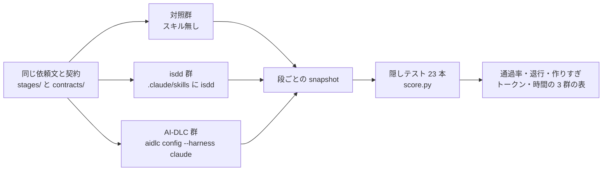

# セッションログ 657a16f3

- セッション: `657a16f3-6da0-4b59-95f4-34346ec5e99b`
- cwd: `/Users/notfolder/Documents/isdd`（branch: main）
- 期間: 2026-11-18 13:13 〜 2026-11-21 02:52
- Claude Code: 2.1.325
- 発言: ユーザー 108 / Claude 103 / ツール呼び出し 347
- 書き出し: 2026-11-21 02:52 JST

> ユーザー発言と Claude の本文は逐語。ツール呼び出しは `🔧` の 1 行に要約し、ツール結果・思考ブロックは含まない。

---
## 1. ユーザー（2026-11-18 13:13）

https://github.com/awslabs/aidlc-workflows
上記との比較をしてください。isddと同じevalをできますか？比較評価のやり方を報告して

## 2. Claude

> 🔧 `Bash` Clone the AI-DLC workflows repository into the scratchpad and list its files

> 🔧 `Bash` List the isdd repository layout, eval and measurement folders, and read the two memory notes

> 🔧 `Bash` Read the AI-DLC README and list its main folders

> 🔧 `Bash` Read the isdd measurement README, the eval runner script, and list eval scenario folders

> 🔧 `Bash` List AI-DLC documentation, Claude harness, and core folders

> 🔧 `Bash` List isdd eval scenarios and read one scenario definition, the eval config, and the grader header

> 🔧 `Bash` Read AI-DLC interaction modes and workflow profiles guides

> 🔧 `Bash` Search AI-DLC docs for headless or non-interactive execution and read the tests README

> 🔧 `Bash` Read how AI-DLC tests drive Claude non-interactively and how unattended or autonomous runs are handled

> 🔧 `Bash` Read the AI-DLC artifacts reference, model guidance, and list end-to-end tests and test harness helpers

> 🔧 `Bash` Read AI-DLC notes on unattended runs, the human presence guard, automated install, model choice, and the copy install channel

> 🔧 `Bash` Read the isdd unattended measurement runner and the headings and tables of the measurement report

> 🔧 `Bash` Check local tools, AI-DLC branches and tags, the human presence bypass flag, how its tests answer gates, and its traceability sensor

> 🔧 `ToolSearch` select:WebSearch

> 🔧 `Bash` Read how the AI-DLC golden journey test handles presence flags and answers, and look for evaluator or v1 branches

> 🔧 `WebSearch` awslabs aidlc-workflows evaluation benchmark comparison spec-driven development spec-kit Kiro results

> 🔧 `WebSearch` aidlc-workflows "aidlc-evaluator" golden test case evaluation framework

> 🔧 `Bash` Inspect the v1 and evaluator branches of the AI-DLC repository and list the latest stable releases

> 🔧 `Bash` Read the estimation rules log and the rerun section of the isdd measurement report

# AI-DLC（awslabs/aidlc-workflows）と isdd の比較、同じ eval ができるかの調査報告

調査だけを行い、isdd リポジトリは変更していません。AI-DLC は一時フォルダに複製して読みました（2026-11-18 時点の main、安定版 v2.11.4）。

## 結論

- **スキルの eval（`evals/`、28 場面）は AI-DLC にそのまま使えません。** 採点が isdd の文書形式とチェッカーの合否を見ているためです。
- **効果の計測（`measure/`）は AI-DLC を 3 つ目の群として足せます。** 採点は隠しテストの通過率・退行・作りすぎ・トークン・時間で、手法に依存しません。
- **AI-DLC v2 を無人で回せるかは未検証です。** 承認ゲートが「人の返信」を仕組みで要求するため、試運転 1 本での確認が要ります。
- 公開された AI-DLC と他手法の実測比較は見つかりませんでした。

## 2 つの違い

| 観点 | isdd（v2.3.0） | AI-DLC（v2.11.4） |
|---|---|---|
| 形 | スキル 4 本と Python のチェッカー（標準ライブラリのみ） | 専用エンジン（`aidlc` コマンド、TypeScript）、フック、14 エージェント、33 段階 |
| 流れ | 業務課題 → 要件 → 設計 → 実装 → 実装後レビューの 1 本 | 11 種類の進め方から選ぶ（Express 7 段階、Classic 15 段階、Feature 30 段階など） |
| 承認 | スキルの文章で止まる | エンジンが止める。人の発言の記録が無いと承認を拒否する |
| 追跡 | 設計 ID とコードの対応表、依存の規則、E2E の受け入れ | 段階ごとの `traceability.json` を検査（既定は助言扱い）と監査記録 |
| 成果物の場所 | `docs/`、変更は `.history/` | `aidlc/spaces/<space>/intents/<日付>-<名前>/` |
| 推奨モデル | Haiku で eval を通す方針 | Claude Opus 4.8 を推奨、中位モデルは effort を下げる案内 |
| 導入 | `install.sh` か `gh skill` | インストーラでネイティブの実行ファイル、または Bun 1.4.4 以上で手動コピー |
| 自前の検証 | Haiku の場面 eval と効果の計測 | エンジンの決定的テストと実機の通し。旧 v1 系に評価器（正解の文書との意味的類似度、題材は `sci-calc`・`todo-app` など） |

## 同じ eval ができるか

| 方式 | できるか | 得られるもの | 安全性・手間 |
|---|---|---|---|
| A. `evals/` の場面を AI-DLC に当てる | できない | ― | 採点器を AI-DLC 用に書き直すと別の eval になり、比較にならない |
| B. `measure/` に AI-DLC 群を足す | できる見込み（試運転が要る） | 同じ題材・同じ隠しテストでの通過率、退行、作りすぎ、コスト | 作業フォルダはリポジトリ外。この Mac に `aidlc` か Bun の導入が要る（現在どちらも無い） |
| C. AI-DLC v1 の評価器の題材で isdd を回す | 未調査（題材と採点の中身は読んでいない） | 相手の土俵での結果 | 評価器は Bedrock 前提の可能性があり、AWS の認証が要るかもしれない |

おすすめは B です。お題 1（備品管理、3 段、隠しテスト 23 本）は対照群と isdd 群の各 5 回が済んでいるので、AI-DLC 群だけ回せば 3 群の表になります。

## 比較評価のやり方（B の案）

1. `run.py` に `--arm aidlc` を足し、作業フォルダで `aidlc config --harness claude` を実行して `.claude/` を作ります。
2. 最初の依頼を `/aidlc <進め方> <依頼>` の形にし、質問には `ANSWERS.md` の固定回答で答えさせます。
3. 段ごとに新しい `claude -p` を起こし、`--resume` の往復で承認を送ります。
4. 各群に他方の手法が見えないことを毎回記録します（isdd 群に `aidlc/` が無い、AI-DLC 群に isdd のスキルが無い）。
5. 採点と集計は既存の `score.py` と `report.py` をそのまま使います。

### 先に潰す必要がある点

- **承認ゲート:** AI-DLC は承認ごとに、ゲート表示後の人の発言を要求します。isdd 群の「承認はすべて与えられたものとして進めて」は 1 回の発言では通りません。
  - 対処は 2 つあります。往復を段階数ぶん回す方法（Classic なら 15 回以上、今の上限は 12 回）と、公式の `AIDLC_SKIP_HUMAN_PRESENCE_GUARD=1` で外す方法です。
  - `AIDLC_UNATTENDED=1` は逆に承認を待ち続けるので使えません。
- **質問の出し方:** Claude Code では選択肢の画面を使いますが、`claude -p` では出せません。質問ファイルへの記入で進むかを試運転で確かめます。
- **モデル:** Haiku では AI-DLC の手順を最後まで通せない可能性があります。通せないこと自体も結果ですが、推奨と違う条件だと明記が要ります。
- **題材の天井:** お題 1 は対照群も 22/23 前後で、isdd との差が出ていません。AI-DLC を足しても見えるのはコストの差だけになる可能性が高いです。

### 見積もり（AI の作業速度、三点見積もり）

| 単位 | 楽観 / 最頻 / 悲観 | 期待値 | 不確かさの原因 |
|---|---|---|---|
| 実装（群の追加、導入手順、依頼文） | 0.5 / 1 / 3 時間 | 1.3 時間 | ― |
| 試運転 1 本（3 段）と手戻り | 0.5 / 1.5 / 4 時間 | 1.8 時間 | 無人での承認と質問が未知 |
| 本計測 5 回 × 3 段（4〜5 本並列） | 1 / 2 / 6 時間 | 2.5 時間 | 1 本の所要が不明（isdd は約 60 分）、定額契約の 5 時間上限 |

合計の期待値は約 5.5 時間です。

## 確認事項

依頼: 作業はまだ始めません。下の答えをもらってから試運転に進みます。

**1. どの方式で比べるか**

| 案 | 内容 | 影響 |
|---|---|---|
| A | `measure/` に AI-DLC 群を足す（お題 1、既存の 2 群の結果を再利用） | 約 5.5 時間。差が出にくい題材のまま |
| B | A に加え、差が出やすい題材を先に作る（バックログの「評価の題材の見直し」） | 題材の設計が先に要り、3 群とも回し直し |
| C | AI-DLC v1 の評価器の題材で isdd を回す | 追加の調査が要る |

おすすめ: A。仕組みが動くかを安い題材で先に確かめられ、B に進むときも群の追加はそのまま使えます。

**2. AI-DLC のどの版と進め方を使うか**

| 案 | 内容 | 影響 |
|---|---|---|
| A | v2.11.4 の Classic（15 段階、要件 → 設計 → 実装 → テスト） | isdd の流れに最も近い。往復とトークンが多い |
| B | v2.11.4 の Express（7 段階、設計を省く） | 軽いが、設計を持つ isdd と条件がずれる |
| C | v1 系（規則の Markdown だけ、エンジン無し） | 導入が要らず無人で回しやすいが、旧系統（保守は継続中） |

おすすめ: A。現行版で、比べる工程がそろいます。

**3. この Mac への導入方法（2 で v2 を選んだ場合）**

| 案 | 内容 | 影響 |
|---|---|---|
| A | 公式インストーラで `aidlc` を入れる | ホーム配下に実行ファイルと PATH の設定が入る。作業フォルダの準備が 1 コマンド |
| B | Bun を入れて配布物を手動コピー | `aidlc` は入らないが、Bun が入る |

おすすめ: A。公式の標準手順で、計測後に `aidlc` のアンインストールで戻せます。

**4. 承認ゲートの通し方**

| 案 | 内容 | 影響 |
|---|---|---|
| A | `AIDLC_SKIP_HUMAN_PRESENCE_GUARD=1` で人の発言の要求を外す | isdd 群の「承認は与えられたものとする」と同じ条件。AI-DLC の本来の動きからは外れる |
| B | 承認のたびに `--resume` で発言を送る | 本来の動きに近い。往復の上限を 30 回前後に上げる必要があり、時間が延びる |

おすすめ: A。両群の条件がそろい、試運転で詰まる箇所が減ります。

**5. モデル**

| 案 | 内容 | 影響 |
|---|---|---|
| A | 3 群とも Haiku | 既存の結果を再利用できる。AI-DLC は推奨外の条件 |
| B | Haiku に加え、AI-DLC 群と isdd 群を Sonnet でも 1〜2 回 | AI-DLC に不利という指摘を避けられる。定額契約の上限に達しやすい |

おすすめ: A で始め、AI-DLC が Haiku で完走しなかったら B を足します。

Sources:
- [awslabs/aidlc-workflows](https://github.com/awslabs/aidlc-workflows)
- [aidlc-workflows のリリース](https://github.com/awslabs/aidlc-workflows/releases)
- [Evaluation Framework（DeepWiki）](https://deepwiki.com/awslabs/aidlc-workflows/9-evaluation-framework)
- [aidlc-evaluator の ARCHITECTURE.md（ミラー）](https://github-users.yhajoa.workers.dev/awslabs/aidlc-workflows/blob/631ebf3bbb74f9cd8bf4babcd34398318959f683/scripts/aidlc-evaluator/ARCHITECTURE.md)
- [Spec-driven development benchmark（Uvik、AI-DLC は対象外）](https://uvik.net/spec-driven-development-benchmark/)
- [AI-DLC Workflows v2.5.5 を Kiro CLI で動かしてみた（クラスメソッド）](https://dev.classmethod.jp/articles/aidlc-workflows-v2-ga-kiro-cli/)

## 3. ユーザー（2026-11-18 13:24）

1 B+Cをしたい
2 A
3 A
4 B
5 AとALDCの推奨モデルde

## 4. ユーザー（2026-11-18 13:24）

評価

## 5. Claude

> 🔧 `Bash` Download the AI-DLC installer script to the scratchpad and scan what it changes on the machine

> 🔧 `Bash` Clone the AI-DLC v1 branch to the scratchpad and read its evaluator README and test case list

> 🔧 `Bash` Read the rest of the measurement runner and its shared helper for launching Claude

> 🔧 `Bash` Run the reviewed AI-DLC installer and confirm the installed command and its size

> 🔧 `Bash` Read the AI-DLC v1 evaluator's sample test case, its published baseline report, and the contract test package

> 🔧 `Bash` Configure AI-DLC for Claude Code in a scratch project and inspect the files and hook settings it creates

> 🔧 `Bash` Read the fixed answers, the first stage request, and how earlier measurement runs were launched

Now add the AI-DLC arm to the runner.

> 🔧 `Bash` Add an AI-DLC arm to the measurement runner and check that the script still compiles

> 🔧 `Bash` Remove a leftover line, confirm AI-DLC audit event names, and check the existing measurement work area and free disk space

> 🔧 `Bash` Start the AI-DLC trial run for the first stage on Haiku in the background

> 🔧 `Bash` Wait about 100 seconds, then check the trial log and work folder

AI-DLC 群を `measure/run.py` に足し、試運転（お題 1 の段 1、Haiku、Classic、承認は発言で 1 回ずつ送る方式）を背景で起動しました。100 秒後に最初の確認をします。所要は実測が無いため、最初の数往復を見てから終了見込み時刻を出します。

## 6. ユーザー（2026-11-18 13:28）

<task-notification>
<task-id>bbgivuu0v</task-id>
<tool-use-id>toolu_01XFxRqCKjMgyUip3ZBFeh21</tool-use-id>
<output-file>/private/tmp/claude-501/-Users-notfolder-Documents-isdd/657a16f3-6da0-4b59-95f4-34346ec5e99b/tasks/bbgivuu0v.output</output-file>
<status>completed</status>

Background command "Wait about 100 seconds, then check the trial log and work folder" completed (exit code 0)

</task-notification>

## 7. Claude

> 🔧 `Read` /private/tmp/claude-501/-Users-notfolder-Documents-isdd/657a16f3-6da0-4b59-95f4-34346ec5e99b/tasks/bbgivuu0v.output

> 🔧 `Bash` Wait about five minutes, then check rounds completed, the first response, and AI-DLC's audit record of gates and human turns

試運転は起動直後の確認を通りました。13:26 に開始し、1 往復目は 82 秒で終わり、AI-DLC が作業の記録（`261118-equipment-ledger`）を作っています。次は 13:34 ごろに、承認が発言ごとに通っているかを監査記録で確かめます。

## 8. ユーザー（2026-11-18 13:33）

<task-notification>
<task-id>bvvfhn705</task-id>
<tool-use-id>toolu_017USV3pmPcw7NgTGPGD1pmH</tool-use-id>
<output-file>/private/tmp/claude-501/-Users-notfolder-Documents-isdd/657a16f3-6da0-4b59-95f4-34346ec5e99b/tasks/bvvfhn705.output</output-file>
<status>completed</status>

Background command "Wait about five minutes, then check rounds completed, the first response, and AI-DLC's audit record of gates and human turns" completed (exit code 0)

</task-notification>

## 9. Claude

> 🔧 `Read` /private/tmp/claude-501/-Users-notfolder-Documents-isdd/657a16f3-6da0-4b59-95f4-34346ec5e99b/tasks/bvvfhn705.output

> 🔧 `Bash` Read how the AI-DLC evaluator's contract tests start the generated app and define test cases

> 🔧 `Bash` Check whether the evaluator shows the API spec to the agent, read the calculator task description and licence, and read the existing scorer header

> 🔧 `Bash` Wait ten minutes, then check trial progress, approved gates, and the current stage

試運転は進んでいます（13:33 時点）。

- 承認は発言 1 回につき 1 件ずつ通っています。4 往復で承認 3 件、14 段階中 5 段階目まで進みました。
- 1 往復は約 70〜110 秒です。残り約 10 段階と実装を見込むと、**段 1 の終了見込みは 14:00〜14:15 ごろ**です（実装の段階の所要は未実測）。
- 1 点、条件のずれが見つかりました。`ANSWERS.md` は isdd 群用の文面で「承認はすべて与えられたものとして進める」と書いてあり、AI-DLC は「承認で止まる」指示との矛盾として報告してきました。本計測の前に AI-DLC 群用の文面へ直します。

C（相手の評価器の題材 `sci-calc`）は、Bedrock 無しで使える部分（API の契約テスト 88 件）を採点に使えることを確かめました。次の確認は 13:44 ごろです。

## 10. ユーザー（2026-11-18 13:44）

<task-notification>
<task-id>bk3ytt78e</task-id>
<tool-use-id>toolu_01A7QVKVd5intqYoyccs8uM3</tool-use-id>
<output-file>/private/tmp/claude-501/-Users-notfolder-Documents-isdd/657a16f3-6da0-4b59-95f4-34346ec5e99b/tasks/bk3ytt78e.output</output-file>
<status>completed</status>

Background command "Wait ten minutes, then check trial progress, approved gates, and the current stage" completed (exit code 0)

</task-notification>

## 11. Claude

> 🔧 `Read` /private/tmp/claude-501/-Users-notfolder-Documents-isdd/657a16f3-6da0-4b59-95f4-34346ec5e99b/tasks/bk3ytt78e.output

> 🔧 `Bash` Read the contract test entry point, how it prepares the app's environment, and the rest of the calculator's technical requirements

> 🔧 `Bash` Create the calculator task folder in the measurement area with the request text, hidden API spec, and the contract test code

> 🔧 `Bash` Generalise the runner to other task folders, write the calculator task files and scorer, and smoke-test the scorer on an empty folder

> 🔧 `Bash` Inspect the shared module that the contract test code imports

> 🔧 `Bash` Add the shared module to the calculator task folder, rerun the scorer smoke test, and check trial progress

> 🔧 `Bash` Make the calculator scorer count all cases as failed when the app cannot be installed or started, and retest

> 🔧 `Bash` Wait nine minutes, then check trial progress and remaining stages

13:45 時点の状況です。

- **試運転（AI-DLC、お題 1 の段 1、Haiku）:** 12 往復で承認 8 件を通過し、設計の段階に入っています。終了見込みは引き続き 14:00〜14:15 ごろです。次の確認は 13:55 ごろです。
- **C の題材:** `measure/scicalc/` を作り、相手の契約テスト 88 件で採点できるところまで組みました。空のフォルダで 0/88 と正しく出ることを確かめています。3 群の実行は、試運転の結果を見てから始めます。
- **実行器:** `measure/run.py` に `--arm aidlc`（AI-DLC 群）と `--task`（題材の切り替え）を足しました。

## 12. ユーザー（2026-11-18 13:50）

未コミットの内容を整理して。不要なものは削除したい

## 13. Claude

> 🔧 `Bash` Summarise uncommitted and untracked files in the isdd repository

## 14. ユーザー（2026-11-18 13:50）

[Request interrupted by user]

## 15. ユーザー（2026-11-18 13:50）

今回の作業前の未コミットの内容はありますか？

## 16. Claude

> 🔧 `Bash` Measure the size, dates, and tracked state of the eval result folders that were uncommitted before this session

あります。今回の作業を始める前から、次のものが未コミットでした。すべて 2026-11-05 の v2.3.0 公開前の eval（Claude Code 経路）の結果です。

| 対象 | 状態 | 中身 | 大きさ |
|---|---|---|---|
| `evals/artifacts-claude-code/` の `result.json` 3 件 | 追跡済みの変更 | 11-04 にコミットした 3 場面の結果が、11-05 の全場面 eval で上書きされたもの（作業場所、時刻、判定の文面の差） | 小 |
| `evals/artifacts-claude-code/` の残り 25 場面（`isdd-build` 9、`isdd-spec` 14、`isdd-setup`、`isdd-reverse-engineering`） | 未追跡 | 11-05 の全場面 eval の `result.json` | 約 380 KB |
| `evals/artifacts-claude-code-v2.3.0-rerun`〜`rerun5` | 未追跡 | 落ちた場面の回し直し 5 回分の結果 | 計 300 KB |

今回の作業で増えた未コミットは次の 2 つです。

- `measure/run.py`（AI-DLC 群と題材の切り替えの追加）
- `measure/scicalc/`（相手の評価器の題材と採点器）

試運転の出力（`measure/results/aidlc-trial/`）は、今のところログと snapshot だけで、どちらも `.gitignore` の対象です。

削除の候補は作業前からの 3 種類ですが、消してよいかの判定（ほかから参照されていないか、記録として残す価値があるか）はまだ調べていません。まだ何も消していません。

## 確認事項

**1. 作業前からの未コミット（eval の結果）をどう整理するか**

11-04 の時点では「公開前の 3 場面の結果」としてコミットした経緯があり、同じ扱いにするなら 11-05 の全場面の結果もコミットする側になります。回し直し 5 回分は、規則を直すたびの途中経過です。

| 案 | 内容 | 影響 |
|---|---|---|
| A | 全場面の結果（変更 3 件と未追跡 25 場面）はコミットし、回し直し 5 回分だけ削除 | v2.3.0 公開時の合否が履歴に残る。途中経過は消える（引き継ぎ記録に経緯はある） |
| B | 全部削除（変更 3 件は 11-04 の内容に戻す） | 作業ツリーがきれいになる。v2.3.0 の全場面の結果は残らない |
| C | 全部コミット | 何も失わない。途中経過のフォルダが 5 つリポジトリに残る |

おすすめ: A。公開時の結果は後で見返す根拠になり、回し直しは最終結果に含まれているためです。選んだ案で進める前に、参照されていないかを確かめてから実行します。

## 17. ユーザー（2026-11-18 13:54）

1 A

## 18. Claude

> 🔧 `Bash` Check whether anything refers to the rerun folders and compare pass or fail results between the main results and each rerun

> 🔧 `Bash` Compare pass or fail between the main eval results and each rerun, and look for references in the handover notes

> 🔧 `Bash` Check the current state of the AI-DLC trial run

案 A の前提が成り立たなかったので、削除もコミットもせずに止めています。

## 調べて分かったこと

「回し直しの結果は最終結果に含まれている」と説明しましたが、誤りでした。回し直しは別フォルダに出していて、`evals/artifacts-claude-code/` には 1 回目の結果がそのまま残っています。

| 場所 | 中身 |
|---|---|
| `evals/artifacts-claude-code/`（28 場面） | 1 回目の結果。うち 4 場面が不合格のまま（変更フローの実装、設計の不足で止まる、除外要件の変更設計、変更設計の最小） |
| `rerun`（9 場面） | 規則を直した後の結果。上の 4 場面はここで合格。「依頼に無い決め事の見える化」は不合格 |
| `rerun2`・`rerun3` | 「決め事の見える化」が不合格のまま、ほかは合格 |
| `rerun4` | 「決め事の見える化」が合格 |
| `rerun5` | 最終の規則で関連 3 場面が合格 |

回し直しを消すと、4 場面が v2.3.0 で合格した記録が無くなり、履歴には不合格だけが残ります。なお、回し直しフォルダを参照している文書やスクリプトはありませんでした。会話記録（`transcript.json`）は回し直しフォルダでは `.gitignore` の対象外で、18 件が未追跡で見えています。

## 試運転の状況（13:54）

AI-DLC の試運転は 14 往復、承認 9 件まで進み、設計の段階が続いています。1 往復に 6 分かかる回が出てきたので、終了見込みを 14:15〜14:30 ごろに改めます。

## 確認事項

**1. 回し直し 5 回分の扱い**

| 案 | 内容 | 影響 |
|---|---|---|
| A | 各場面の最終の回し直し結果で `evals/artifacts-claude-code/` を上書きしてからコミットし、回し直しフォルダを削除 | 履歴には「v2.3.0 の最終の規則で全 28 場面が合格」が 1 か所に残る。1 回目の不合格と途中の不合格の記録は消える |
| B | 1 回目の結果をそのままコミットし、回し直しは `rerun`（4 場面の合格）と `rerun5`（最終）だけ `result.json` をコミット、残りを削除 | 1 回目に落ちた事実と直した後の合格の両方が残る。フォルダが 2 つ残る |
| C | 当初の案のまま（1 回目をコミット、回し直しは全部削除） | 4 場面は不合格の記録だけが残る |

おすすめ: A。「1 回目で落ちたら SKILL.md を直す」運用の経緯はコミット `6184082` と引き継ぎ記録にあり、結果フォルダは公開時点の合否を示せば足ります。どの案でも、会話記録（`transcript.json`）はコミットせず削除します。

## 19. ユーザー（2026-11-18 13:55）

<task-notification>
<task-id>bj00qa4lo</task-id>
<tool-use-id>toolu_0165DFCAAjYsKFab5RECicVx</tool-use-id>
<output-file>/private/tmp/claude-501/-Users-notfolder-Documents-isdd/657a16f3-6da0-4b59-95f4-34346ec5e99b/tasks/bj00qa4lo.output</output-file>
<status>completed</status>

Background command "Wait nine minutes, then check trial progress and remaining stages" completed (exit code 0)

</task-notification>

## 20. Claude

> 🔧 `Bash` Check trial progress, stage checklist, and the latest response

> 🔧 `Bash` Wait twelve minutes, then check trial progress and the latest response

> 🔧 `Bash` Overwrite the main eval results with each scenario's latest rerun result, confirm all pass, and stage them

> 🔧 `Bash` Inspect the second attempt left over for one scenario

> 🔧 `Bash` Commit the final eval results and delete the first rerun folder, then show remaining status

> 🔧 `Bash` Delete the remaining four rerun folders and show status

案 A を実行しました。

## やったこと

- 回し直した 9 場面を、各場面で最後に回した結果で `evals/artifacts-claude-code/` に上書きしました。上書き後は全 28 場面が合格です。
- その 28 場面の `result.json` をコミットしました（`d073756`、main、push はしていません）。
- 回し直しフォルダ 5 つ（`rerun`〜`rerun5`、会話記録を含む）を削除しました。

## 想定と違って残したもの

`evals/artifacts-claude-code/isdd-spec/isdd-requirements-decided-items-001/attempt-2/` が 1 つ残っています。2026-11-05 00:55 の、公開前 eval より古い実行の結果（合格）と会話記録です。回し直しフォルダではなく案 A の範囲外なので、コミットにも入れず、消してもいません。

## 現在の未コミット

| 対象 | 中身 |
|---|---|
| `measure/run.py` | 今回の作業（AI-DLC 群と題材の切り替え） |
| `measure/scicalc/` | 今回の作業（相手の評価器の題材と採点器） |
| 上記の `attempt-2/` | 古い実行の残り |

今回の作業の 2 つは、試運転の結果を見て直す可能性があるので、まだコミットしていません。

## 試運転の状況

AI-DLC の試運転は実装の段階に入り、4 つの単位のうち 1 つ目の承認待ちまで進みました（13:55）。終了見込みは 14:25〜14:35 ごろで、次の確認は 14:08 ごろです。

## 確認事項

**1. 残っている `attempt-2/`（古い実行の結果）を削除するか**

「依頼に無い決め事の見える化」の場面の、公開前 eval より前の実行結果です。同じ場面の最終結果（`attempt-1/`）はコミット済みで、この `attempt-2/` を参照するものはありません。

| 案 | 内容 | 影響 |
|---|---|---|
| A | 削除する | 未コミットが今回の作業分だけになる |
| B | 残す | 未追跡のフォルダが 1 つ残り続ける |

おすすめ: A。最終結果より古く、残す理由が見当たりません。

## 21. ユーザー（2026-11-18 14:07）

<task-notification>
<task-id>bpe156jle</task-id>
<tool-use-id>toolu_01RSTNEMS7vpQaGBqcXmyEV3</tool-use-id>
<output-file>/private/tmp/claude-501/-Users-notfolder-Documents-isdd/657a16f3-6da0-4b59-95f4-34346ec5e99b/tasks/bpe156jle.output</output-file>
<status>completed</status>

Background command "Wait twelve minutes, then check trial progress and the latest response" completed (exit code 0)

</task-notification>

## 22. Claude

> 🔧 `Read` /private/tmp/claude-501/-Users-notfolder-Documents-isdd/657a16f3-6da0-4b59-95f4-34346ec5e99b/tasks/bpe156jle.output

> 🔧 `Bash` Wait thirteen minutes, then check trial progress and the latest response

試運転の進捗です（14:07）。

- 17 往復まで進み、4 つの単位のうち 3 つ目の実装計画の承認待ちです。止まっているプロセスはありません。
- 1 単位あたり「計画の承認 → 実装 → 完了の承認」で 2〜3 往復、実装の往復は約 4 分かかっています。
- 残りは 3 つ目の実装、4 つ目の単位、ビルドとテストで約 6 往復です。**終了見込みは 14:30 ごろ**に改めます。次の確認は 14:20 ごろです。

`attempt-2/` の削除の確認（前の報告の確認事項 1）は、お返事を待っています。

## 23. ユーザー（2026-11-18 14:16）

1 A

## 24. Claude

> 🔧 `Bash` Delete the leftover older attempt folder and show the remaining uncommitted items

`attempt-2/`（古い実行の結果と会話記録の 2 ファイル）を削除しました。

未コミットは今回の作業分の `measure/run.py` と `measure/scicalc/` だけになりました。この 2 つは試運転の結果を見て直す可能性があるので、まだコミットしていません。

試運転は継続中で、終了見込みは 14:30 ごろ、次の確認は 14:20 ごろです。

## 25. ユーザー（2026-11-18 14:18）

<task-notification>
<task-id>btrxlo17a</task-id>
<tool-use-id>toolu_01BZ96Y8Km4m3QAKPTBw8oTD</tool-use-id>
<output-file>/private/tmp/claude-501/-Users-notfolder-Documents-isdd/657a16f3-6da0-4b59-95f4-34346ec5e99b/tasks/btrxlo17a.output</output-file>
<status>completed</status>

Background command "Start the AI-DLC trial run for the first stage on Haiku in the background" completed (exit code 0)

</task-notification>

## 26. Claude

> 🔧 `Bash` Read the finished trial's log, summary, failed tests, and final response

> 🔧 `Bash` Check which models AI-DLC's agents use, read the scoring output, and rerun the scorer on the trial snapshot

> 🔧 `Bash` Inspect the scoring environment for the hidden tests

> 🔧 `Bash` Install the hidden-test requirements into the measurement environment and rescore the trial snapshot

> 🔧 `Bash` Inspect why the measurement environment refuses package installs

> 🔧 `Bash` Recreate the measurement scoring environment in the repository's ignored folder and rescore the trial

試運転が終わり、採点まで通りました。結果をバックログに書いてから報告します。

> 🔧 `Bash` Find the measurement section of the backlog

> 🔧 `Bash` Add the AI-DLC comparison work and its remaining steps to the backlog

# AI-DLC の試運転の結果と、本計測の前に決めたいこと

試運転（お題 1 の段 1、Haiku、Classic、承認は発言で 1 件ずつ）は最後まで通り、採点もできました。ただし消費が想定よりはるかに大きく、本計測の回数とモデルは決め直しが要ります。

## 試運転の結果

| 項目 | AI-DLC 群（試運転 1 回） | 参考: 対照群（やり直しの段 1〜3 合計、1 回あたり） |
|---|---|---|
| 隠しテスト（段 1） | 7/8 | 最終段で 22/23 前後 |
| 所要 | 52 分（22 往復） | 7〜10 分 |
| 新規トークン（入力・出力・キャッシュ作成） | 約 22 万（段 1 だけ） | 約 25 万（3 段の合計） |
| キャッシュ読み取りを含む合計 | 約 4,800 万 | ― |
| ツール呼び出し | 727 回 | ― |
| 承認 | 18 件（人の発言 21 回）、ワークフロー完了 | ― |

- 落ちた 1 本は備品の修正と削除で、契約どおりの「修正」ボタンが見つかりませんでした。
- isdd のスキルは見えていませんでした（記録済み）。
- AI-DLC のレビュー担当 2 エージェントは Sonnet 固定です。「全部 Haiku」にはなっていません。
- `claude -p` が報告した換算額は約 115 ドルでした。定額契約なので請求ではありませんが、利用上限の消費の目安になります。

## 無人実行で分かったこと

- 承認ゲートは `--resume` の発言 1 回につき 1 件ずつ通ります（ご指定の方式で動きました）。
- 質問は選択画面なしで進みました。固定回答のファイルを依頼者の答えとして使わせています。
- 固定回答の前書きが isdd 群向け（「承認はすべて与えられたものとする」）で、AI-DLC が指示の矛盾として報告しました。AI-DLC 群には前書きを差し替えるよう直しました（試運転には未反映）。

## 今回の変更

- `measure/run.py`: `--arm aidlc`、`--scope`、`--task`（題材の切り替え）を追加。
- `measure/scicalc/`: 相手の評価器（v1 系）の題材 `sci-calc`。依頼文、隠しの API 仕様、契約テスト 88 件の採点器。Bedrock は使いません。正解文書との類似度の採点は AI-DLC の文書形式が前提なので使いません。
- `measure/.venv`: 採点環境を作り直しました。前のものは消えた一時フォルダへのリンクで、採点が 0/0 になっていました。
- `.history/BACKLOG.md`: この比較計測の項目を追加。
- どれも未コミットです。

## 本計測の見積もり（試運転の実測から）

| 単位 | 量 | 所要の見込み |
|---|---|---|
| お題 1 の AI-DLC 群、Haiku、1 回（3 段） | 約 2.5 時間、キャッシュ読み取り込みで約 1.5 億トークン | 5 回なら直列で約 13 時間 |
| sci-calc、Haiku、3 群 × 1 回 | AI-DLC 約 1 時間、isdd 約 30 分、対照 約 5 分 | 約 1.5 時間 |
| 推奨モデルでの実行 | 未実測。Haiku より単価が高く、利用上限に早く達する | 1 本ずつ様子を見る必要あり |

定額契約の 5 時間上限は、前回 Haiku 10 本の同時実行で 1 時間強で達しました。AI-DLC は 1 本で isdd の数倍を消費するので、同時実行は 1〜2 本が限度と見ています。

差が出やすい題材の設計（ご指定の 1B）は、下の回答を待つ間に案を作り、別の報告で出します。

## 確認事項

**1. お題 1 の AI-DLC 群（Haiku）を何回回すか**

対照群と isdd 群は各 5 回が済んでいます。そろえると 5 回ですが、時間と上限の消費が大きくなります。

| 案 | 内容 | 影響 |
|---|---|---|
| A | 2 回 | 約 5 時間。ばらつきは粗くしか見えない |
| B | 5 回 | 約 13 時間（上限での待機を除く）。既存の 2 群と回数がそろう |
| C | 1 回 | 約 2.5 時間。完走と点数の目安だけ |

おすすめ: A。この題材は 2 群で差が出ておらず、ここに 13 時間かけるより、差が出やすい題材に回数を使うほうが得るものが多いためです。

**2. 「AI-DLC の推奨モデル」での評価の範囲**

AI-DLC の文書は Claude Opus 4.8 を推奨しています。この環境で選べる Opus は Opus 5.5 です。

| 案 | 内容 | 影響 |
|---|---|---|
| A | sci-calc で 3 群を Opus 5.5 で各 1 回 | 相手の題材と相手の推奨条件で 3 群がそろう。1 段だけなので消費が読める |
| B | A に加え、お題 1（3 段）も 3 群を Opus 5.5 で各 1 回 | 変更を重ねる題材でも比べられる。AI-DLC 群だけで数時間、上限に達する可能性が高い |
| C | AI-DLC 群だけ Opus 5.5 で回す | 消費は最小。ほかの群と条件がそろわず、モデルの差と手法の差が分けられない |

おすすめ: A。条件をそろえた比較になり、消費の実測を取ってから B に広げられます。

**3. sci-calc（相手の題材）の Haiku での回数**

| 案 | 内容 | 影響 |
|---|---|---|
| A | 3 群 × 1 回 | 約 1.5 時間 |
| B | 3 群 × 3 回 | 約 4.5 時間。ばらつきが見える |

おすすめ: A。計算 API の新規作成は 3 群とも満点に近くなる見込みで、まず天井かどうかを 1 回で確かめます。

**4. 今回の変更のコミット**

| 案 | 内容 | 影響 |
|---|---|---|
| A | 今コミットする（`measure/run.py`、`measure/scicalc/`、`.history/BACKLOG.md`、試運転の結果の JSON） | 本計測の前の状態が履歴に残る。push はしない |
| B | 本計測が終わってからまとめてコミット | 未コミットが残る |

おすすめ: A。本計測中に実行器を直したとき、差分が追いやすくなります。

## 27. ユーザー（2026-11-18 14:23）

1 A
2 A
3 A
4 A

## 28. Claude

> 🔧 `Bash` Commit the runner changes, the calculator task, the trial results, and the backlog update

> 🔧 `Bash` Fix the trial summary scores, then start the comparison runs in two parallel lanes in the background

> 🔧 `Bash` Wait about two minutes, then check that both lanes started cleanly

4 件ともご指定どおり進めました。

- **コミット:** 実行器の変更、`sci-calc` の題材、試運転の結果、バックログを `cba56d0` でコミットしました（push はしていません）。
- **本計測:** 2 列の同時実行で起動しました。

| 列 | 順に回すもの | 見込み |
|---|---|---|
| 1 | sci-calc の AI-DLC 群（Haiku）→ お題 1 の AI-DLC 群 1 回目 → 2 回目（各 3 段） | 約 6 時間 |
| 2 | sci-calc の対照群・isdd 群（Haiku）→ sci-calc の対照群・isdd 群・AI-DLC 群（Opus 5.5） | 約 3 時間 |

**終了見込みは 20:30 ごろ**です（列 1 の約 6 時間が律速。根拠は試運転の 1 段 52 分 × 7 段）。Opus の AI-DLC 群と利用上限での待機は未実測なので、延びる可能性があります。起動直後の確認を約 2 分後に行い、以後は 30 分以内の間隔で進捗を見て報告します。

待つ間に、差が出やすい題材の設計案を作ります。

## 29. ユーザー（2026-11-18 14:26）

<task-notification>
<task-id>b0s40my53</task-id>
<tool-use-id>toolu_012jA5edFeWJG6K7ZGrGcy3k</tool-use-id>
<output-file>/private/tmp/claude-501/-Users-notfolder-Documents-isdd/657a16f3-6da0-4b59-95f4-34346ec5e99b/tasks/b0s40my53.output</output-file>
<status>completed</status>

Background command "Wait about two minutes, then check that both lanes started cleanly" completed (exit code 0)

</task-notification>

## 30. Claude

> 🔧 `Read` /private/tmp/claude-501/-Users-notfolder-Documents-isdd/657a16f3-6da0-4b59-95f4-34346ec5e99b/tasks/b0s40my53.output

> 🔧 `Bash` Wait 25 minutes, then check both lanes for finished stages, errors, and usage-limit waits

> 🔧 `Bash` Read the backlog note on rethinking the task, the existing change-request stages, and the rerun findings

本計測は 14:24 に 2 列とも正常に起動しました（終了見込みは 20:30 ごろのまま、次の確認は 14:52 ごろ）。待つ間に、差が出やすい題材（ご指定の 1B）の案をまとめました。作成はまだしていません。

## 差が出やすい題材の案

### 今の題材で差が出ない理由

お題 1 の変更依頼は「社員番号を 6 桁から 7 桁に。登録の検査、ログイン、一覧のすべてを合わせる」のように、直す場所を依頼文が列挙しています。対応表や設計書が無くても、依頼文をなぞれば取りこぼしません。コードも 600〜1,000 行で、全部読んでから直せる大きさです。

### 案の骨子

| 観点 | 今のお題 1 | 新しい題材の案 |
|---|---|---|
| 依頼の書き方 | 直す場所を列挙 | 業務の言葉だけで書く（「退職した人が借りたままの備品が分からなくなる」など）。画面名や項目名は書かない |
| 1 つの依頼の波及 | 1〜2 か所 | 3 か所以上（画面、検査、知らせの文、別機能の前提） |
| 段の数 | 3 段 | 6 段（新規 1 ＋ 変更 5）。毎段、新しいセッション |
| 過去の決め事との衝突 | 無し | 段 4 か 5 に、段 2 で決めた規則と矛盾する依頼を 1 つ入れる。気づいて確認するか、黙って壊すかを見る |
| 隠しテスト | 段ごとの機能 | 波及先ごとに 1 本ずつ。加えて「段 2 の規則が段 6 でも守られているか」を見る本 |
| 見るもの | 通過率、退行 | 波及の取りこぼし率、退行、矛盾の検出、作りすぎ、コスト |

- 土台はお題 1 の備品管理を使い、契約と隠しテストの基盤（Playwright）を再利用します。
- 段 1 は各群が自分で作ります。isdd 群と AI-DLC 群の文書が、後の段で効くかを見るためです。
- 群は対照・isdd・AI-DLC の 3 つ、Haiku で各 3 回を想定します。

### 見積もり

| 単位 | 楽観 / 最頻 / 悲観 | 期待値 |
|---|---|---|
| 実装（依頼文 5 本、契約、隠しテスト約 20 本、固定回答） | 1 / 2 / 5 時間 | 2.3 時間 |
| 実行（3 群 × 3 回 × 6 段。AI-DLC は 1 段約 50 分） | 20 / 30 / 50 時間 | 31.7 時間 |

実行の大半は AI-DLC 群です（9 回 × 6 段 × 50 分で約 45 時間分を 2 列で回す計算）。回数を各 1 回にすれば約 10 時間になります。

## 気づいたこと

`measure/stages/stage3.md` の見出しが「『管理者』から『管理者』への改称」になっています（本文は「担当者」を「管理者」に、で正しい）。実行中の計測が読むファイルなので、今は直していません。

## 確認事項

**1. 新しい題材をこの案で作り始めてよいか**

今回っている計測とは別のフォルダに作るので、実行中の計測には影響しません。実行は今の計測が終わってからになります。

| 案 | 内容 | 影響 |
|---|---|---|
| A | この骨子で作り、実行前に依頼文と隠しテストの一覧を見せる | 約 2.3 時間で題材ができる。回数は見せるときに決める |
| B | 今の計測の結果を見てから決める | 20:30 ごろまで着手しない |
| C | 骨子を直す（直す点を教えてください） | ― |

おすすめ: A。計測の待ち時間に作れ、実行前にもう一度確認の機会があります。

## 31. ユーザー（2026-11-18 14:28）

1 A

## 32. Claude

> 🔧 `Bash` Read the hidden-test scorer, the test fixtures, and the sizes of existing task files

> 🔧 `Bash` Check which earlier run snapshots still exist, read the cumulative contract, and list test support code

> 🔧 `Bash` Read the test support code, sample hidden tests, and the layout of a full-score reference app

> 🔧 `Bash` Copy the full-score reference app to a temporary folder and read the first half of its code

Reading the reference app (a full-score run from the earlier measurement) so I can extend it and use it to validate the new hidden tests.

> 🔧 `Bash` Read the second half of the reference app and its two main templates

> 🔧 `Bash` Read the existing fixed answers for a change stage and check what an isdd-arm snapshot contains

> 🔧 `Bash` Write the new task's requests, contracts, fixed answers, hidden tests, and scorer into a separate folder

> 🔧 `Bash` Check progress of both measurement lanes

> 🔧 `Bash` Read the scoring error for the calculator control run

> 🔧 `Bash` Fix the calculator scorer so dependencies install into the app's own environment, then rescore the control run

> 🔧 `Bash` Implement the three new stages in the reference app and run the new hidden tests against it

参照実装で新しい隠しテスト 15 本が全部通りました。次は逆方向の確認（決まりを守らない実装でちゃんと落ちるか）をします。

> 🔧 `Bash` Remove each business rule from the reference app in turn and confirm a hidden test fails for each

> 🔧 `Bash` Strengthen the repair test, confirm it now catches the missing rule, and run the full scorer on the reference app and on an unchanged stage-three app

> 🔧 `Bash` Write the preparation script and README for the new task, then check measurement progress and repository status

> 🔧 `Bash` Check which isdd version the earlier isdd-arm snapshots carry compared with the current skills

新しい題材ができました。実行はまだしていません。お約束どおり、実行前に中身をお見せします。回っている計測の途中結果も先に報告します。

## 回っている計測の途中結果（14:46）

相手の題材 `sci-calc`（契約テスト 88 件）は、終わった 3 本がすべて満点でした。

| 群・モデル | 通過 | 所要 | 総トークン（キャッシュ読み取り込み） |
|---|---|---|---|
| 対照群・Haiku | 88/88 | 3.7 分 | 約 104 万 |
| isdd 群・Haiku | 88/88 | 12.7 分 | 約 1,253 万 |
| 対照群・Opus 5.5 | 88/88 | 4.5 分 | 約 63 万 |

- 予想どおり天井で、この題材では点数の差は出ません。残りは AI-DLC 群（Haiku、実行中）と、isdd 群・AI-DLC 群の Opus です。
- 採点器に不具合が 1 つあり、対照群・Haiku が最初 0/88 と出ました（依存がアプリの環境に入っていなかった）。直して採点し直した結果が上の 88/88 です。
- お題 1 の AI-DLC 群（2 回）はこのあと始まります。全体の終了見込みは 20:30 ごろのままです。

## 新しい題材（`measure/ripple/`）

### 承認いただいた骨子から変えた点

| 骨子 | 作ったもの | 理由 |
|---|---|---|
| 新規 1 段 ＋ 変更 5 段を作り直す | お題 1 の段 1〜3 はそのまま使い、段 4〜6 を足す | 段 3 まで終わった成果物が対照群・isdd 群の各 5 回分残っていて、続きから始められる。3 群とも段 1〜3 を回し直さずに済む |
| 過去の決め事と矛盾する依頼を入れ、気づいて確認するかを見る | 入れていない | 固定回答の無人実行では「確認したか」を測れない。代わりに「依頼に書いていない前の決まりを、新しい操作でも守るか」を全段で見る |

### 依頼文と、隠しテストが見るもの

| 段 | 依頼（全文の要旨） | 依頼にも契約にも書いていないが、守るべきこと |
|---|---|---|
| 4 | 年度末の片付けが手間なので、一覧で複数を選んで一度に削除したい | 借りている社員は削除できない／管理者を 0 人にしない／貸出中の備品は削除できない／管理者以外に操作を出さない |
| 5 | 修理中の備品は修理中と分かるようにして貸し出せないようにする。貸出中は返却してから修理に出す | 貸出の登録画面を開いたあとに修理に出された備品を貸し出さない／開いたあとに貸し出された備品を修理中にしない／管理者以外に操作を出さない |
| 6 | 退職した人は削除せず「退職」にして残す。ほかは削除した人と同じ扱い | ログインできない／借りる社員の候補に出ない／借りている社員と最後の管理者は退職にできない／退職した管理者を人数に数えない／社員番号は使われたまま |

- 隠しテストは新規 15 本（段 4: 6、段 5: 4、段 6: 5）。段 1〜3 の 23 本も毎回回して退行を見ます。
- 契約には新しいボタンの文言と表示だけを足し、決まりは書いていません。固定回答も同じです。

### テストの確かめ

- 参照実装（満点の回に段 4〜6を足したもの）で 38/38。
- 参照実装から決まりを 1 つずつ外した 9 通りで、対応するテストがそれぞれ落ちることを確認。
- 段 3 のままのアプリに段 4 を当てると 24/29。「管理者以外に操作を出さない」の 1 本は、操作自体が無いので通ります（段ごとに 1 本、何もしなくても通る本がある）。

### 実行の見積もり（段 4〜6 の 3 段）

| 群 | 1 回の見込み | 根拠 |
|---|---|---|
| 対照群 | 約 10 分 | お題 1 の 3 段で 7〜10 分 |
| isdd 群 | 約 60 分 | お題 1 の 3 段で約 60 分 |
| AI-DLC 群 | 約 2.5 時間 | 試運転の 1 段 52 分 |

## 確認事項

**1. この題材で実行してよいか**

| 案 | 内容 | 影響 |
|---|---|---|
| A | このまま実行する | 今の計測が終わりしだい始める |
| B | 依頼文か、見る決まりを直す（直す点を教えてください） | 直してから再確認 |

おすすめ: A。

**2. 回数**

対照群と isdd 群は続きにできる回が 5 つずつあります。AI-DLC 群は今回っている 2 回が終われば 2 つです。

| 案 | 内容 | 影響 |
|---|---|---|
| A | 対照群 5、isdd 群 5、AI-DLC 群 2（Haiku） | 約 11 時間（2 列で約 6 時間）。AI-DLC だけ回数が少ない |
| B | 3 群とも 2 回 | 約 7 時間（2 列で約 5 時間）。回数がそろうが、ばらつきは粗い |
| C | まず 3 群 1 回ずつ | 約 3.7 時間。差が出るかの当たりを付けてから増やす |

おすすめ: C。新しい題材で差が出るかがまだ分からず、出なければ題材を直すほうが先になるためです。

**3. isdd 群に使う isdd の版**

続きにする isdd 群の成果物は v2.2.0 で作られています。今の版は v2.3.0（「依頼に無い決め事の見える化」を足した版）です。

| 案 | 内容 | 影響 |
|---|---|---|
| A | v2.2.0 のまま続ける | 段 1〜3 と条件が同じ。v2.3.0 の改善は測れない |
| B | スキルを v2.3.0 に入れ替えて続ける | 今の isdd を測れる。版が違うので最初に `isdd-setup` の再実行が入り、時間とトークンが増える |

おすすめ: B。比べたいのは今公開している isdd で、今回の題材は v2.3.0 の「決め事の見える化」が効くかを見るのに向いています。

**4. 今の変更をコミットするか**

新しい題材（`measure/ripple/`）、`sci-calc` の採点器の修正、途中までの結果です。

| 案 | 内容 | 影響 |
|---|---|---|
| A | 今コミットする（push はしない） | 実行前の題材が履歴に残る |
| B | 実行が終わってからまとめる | 未コミットが残る |

おすすめ: A。

## 33. ユーザー（2026-11-18 14:51）

<task-notification>
<task-id>bb1mtzl01</task-id>
<tool-use-id>toolu_018ysV1YMga1JsCxprkZehy2</tool-use-id>
<output-file>/private/tmp/claude-501/-Users-notfolder-Documents-isdd/657a16f3-6da0-4b59-95f4-34346ec5e99b/tasks/bb1mtzl01.output</output-file>
<status>completed</status>

Background command "Wait 25 minutes, then check both lanes for finished stages, errors, and usage-limit waits" completed (exit code 0)

</task-notification>

## 34. Claude

> 🔧 `Bash` Check measurement progress on both lanes

> 🔧 `Bash` Wait 27 minutes, then check measurement progress again

進捗の定時確認です（14:51）。

- 2 列とも止まらずに進んでいます。利用上限での待機はまだ起きていません。
- 列 1: `sci-calc` の AI-DLC 群（Haiku）が 12 往復目。列 2: `sci-calc` の isdd 群（Opus 5.5）を実行中。
- 終了見込みは 20:30 ごろのままです。次の確認は 15:18 ごろです。

新しい題材についての確認事項 4 点（前の報告）は、お返事を待っています。

## 35. ユーザー（2026-11-18 15:12）

1 A
2 C
3 B
4 A

## 36. Claude

> 🔧 `Bash` Add an option to swap in the current isdd skills when continuing a run, then commit the new task, the scorer fix, and finished results

> 🔧 `Bash` Queue the new task's three runs to start after the current second lane finishes

> 🔧 `Bash` Record today's decisions and remaining steps in the backlog and commit

4 点ともご指定どおり進めました。

- **コミット:** 新しい題材、`sci-calc` の採点器の修正、途中結果を `8d05122` に、バックログの更新を `846acc8` にコミットしました（push はしていません）。
- **新しい題材の実行を予約:** 今の計測の列 2 が終わりしだい、自動で次の順に始まります。

| 順 | 群 | 続きにする回 | 備考 |
|---|---|---|---|
| 1 | 対照群 | `control-r5`（段 3 で 23/23） | 約 10 分 |
| 2 | isdd 群 | `isdd-r2`（段 3 で 23/23） | スキルを v2.3.0 に入れ替えて続ける。約 60 分 |
| 3 | AI-DLC 群 | `aidlc-r1`（今日回している 1 回目） | お題 1 の 1 回目が終わってから始める。約 2.5 時間 |

対照群と isdd 群は、段 3 が満点の回を選んで出発点をそろえました。

## 終了見込み

| 作業 | 見込み |
|---|---|
| `sci-calc` の残り（AI-DLC 群の Haiku、isdd 群と AI-DLC 群の Opus） | 16:30 ごろ |
| お題 1 の AI-DLC 群 2 回 | 20:30 ごろ |
| 新しい題材の対照群・isdd 群 | 18:00 ごろ |
| 新しい題材の AI-DLC 群（お題 1 の 1 回目の終了が 17:30 ごろ、そこから 2.5 時間） | **20:30〜21:00 ごろ** |

Opus の AI-DLC 群と利用上限での待機は未実測なので、延びる可能性があります。次の確認は 15:18 ごろで、以後 30 分以内の間隔で見て、節目ごとに報告します。

## 37. ユーザー（2026-11-18 15:18）

<task-notification>
<task-id>bhwnemvpn</task-id>
<tool-use-id>toolu_014hvK8mUz9qfwfm6DMNgaP7</tool-use-id>
<output-file>/private/tmp/claude-501/-Users-notfolder-Documents-isdd/657a16f3-6da0-4b59-95f4-34346ec5e99b/tasks/bhwnemvpn.output</output-file>
<status>completed</status>

Background command "Wait 27 minutes, then check measurement progress again" completed (exit code 0)

</task-notification>

## 38. Claude

> 🔧 `Read` /private/tmp/claude-501/-Users-notfolder-Documents-isdd/657a16f3-6da0-4b59-95f4-34346ec5e99b/tasks/bhwnemvpn.output

> 🔧 `Bash` Wait 28 minutes, then check all measurement logs

進捗です（15:18）。止まっているものはありません。

## `sci-calc`（相手の題材、契約テスト 88 件）の途中結果

| 群・モデル | 通過 | 所要 | 総トークン（キャッシュ読み取り込み） |
|---|---|---|---|
| 対照群・Haiku | 88/88 | 3.7 分 | 約 104 万 |
| isdd 群・Haiku | 88/88 | 12.7 分 | 約 1,253 万 |
| AI-DLC 群・Haiku | 88/88 | 53.0 分 | 約 7,704 万 |
| 対照群・Opus 5.5 | 88/88 | 4.5 分 | 約 63 万 |
| isdd 群・Opus 5.5 | 88/88 | 19.3 分 | 約 969 万 |
| AI-DLC 群・Opus 5.5 | 実行中（3 往復目） | ― | ― |

ここまで全部満点で、この題材で分かるのはコストの差だけです。Haiku では、所要が対照群の約 3 倍（isdd）と約 14 倍（AI-DLC）、総トークンが約 12 倍と約 74 倍でした。

## いま動いているもの

- 列 1: お題 1 の AI-DLC 群 1 回目（15:17 開始、段 1）。
- 列 2: `sci-calc` の AI-DLC 群・Opus 5.5。終わると新しい題材の対照群と isdd 群が自動で始まります。

終了見込みは変わらず、全体で 20:30〜21:00 ごろです。次の確認は 15:46 ごろです。

## 39. ユーザー（2026-11-18 15:46）

<task-notification>
<task-id>brd9nq01f</task-id>
<tool-use-id>toolu_01D69G7yVmzUmWbvQ3faqKjw</tool-use-id>
<output-file>/private/tmp/claude-501/-Users-notfolder-Documents-isdd/657a16f3-6da0-4b59-95f4-34346ec5e99b/tasks/brd9nq01f.output</output-file>
<status>completed</status>

Background command "Wait 28 minutes, then check all measurement logs" completed (exit code 0)

</task-notification>

## 40. Claude

> 🔧 `Read` /private/tmp/claude-501/-Users-notfolder-Documents-isdd/657a16f3-6da0-4b59-95f4-34346ec5e99b/tasks/brd9nq01f.output

利用上限に達したため、ここで止めます。

## 済んだこと

- AI-DLC（v2.11.4）を導入し、`measure/run.py` に AI-DLC 群を追加。試運転（お題 1 の段 1、Haiku）は 52 分で完走し 7/8。
- `sci-calc`（相手の題材）は、対照群・isdd 群・AI-DLC 群の Haiku と、対照群・isdd 群の Opus 5.5 が終了。5 本すべて 88/88。
- 新しい題材 `measure/ripple/`（段 4〜6、隠しテスト 15 本）を作成して検証済み。
- 未コミットの整理（eval の結果のコミットと回し直しフォルダの削除）。
- ここまでの変更は `846acc8` までコミット済み（push はしていません）。

## 残っていること

背景で動いている計測は、私が止まっても続きます。ただし同じ定額契約を使うので、上限に当たって待機に入っている可能性が高いです（15:46 時点で列 2 の最後の記録が 15:31）。実行器は上限の回復を待って自動で再開します。

| 作業 | 状態（15:46） |
|---|---|
| `sci-calc` の AI-DLC 群・Opus 5.5 | 11 往復目まで |
| お題 1 の AI-DLC 群 1 回目 | 段 1 の 12 往復目まで。2 回目は未着手 |
| 新しい題材の 3 群 1 回ずつ | 未着手（列 2 の終了後に自動で開始） |
| 結果の集計、`measure/results/REPORT.md` への追記、結果のコミット、見積もり記録への追記 | 未着手 |

終了見込みの 20:30〜21:00 は、上限での待機の分だけ後ろにずれます。新しい見込み時刻は、待機の長さが分からないため出せていません。

進捗は `/tmp/isdd-measure/` の `lane1.log`・`lane2.log`・`ripple.log` で見られます。定時確認の待機コマンドは今は置けていないので、上限が回復したら「続きを」と声をかけてください。そこから進捗の確認と集計に入ります。

> 🔧 `Bash` Check the current state of all measurement runs after the pause

> 🔧 `Bash` Check whether the launched Claude processes are still running or waiting

> 🔧 `Bash` Wait 25 minutes, then check whether the paused runs have resumed

計測の状態を確認しました（15:51）。

- 2 列とも、実行器は生きていますが `claude -p` の子プロセスがありません。利用上限に当たって、回復待ちに入っています（列 2 は 15:31、列 1 は 15:37 の往復が最後）。
- 実行器は回復時刻を読んで自動で再開する作りです。待機の開始はログに出ていません（出力がバッファにたまるため）。再開は次の往復の記録で分かります。
- 途中までの成果物は失われていません。再開すると同じセッションの続きから進みます。

AI-DLC 群の Opus 5.5 と Haiku を同時に回したことで、約 1 時間半で上限に達しました。この先も同じ間隔で上限に当たる見込みで、そのたびに計測が止まり、この会話も同じ上限の影響を受けます。終了見込みは 20:30〜21:00 から後ろにずれます。ずれ幅は、待機の長さが分かってから出します。

次の確認は 16:16 ごろで、再開しているかを見て新しい終了見込みを報告します。

## 41. ユーザー（2026-11-18 16:16）

<task-notification>
<task-id>b50c2v4nk</task-id>
<tool-use-id>toolu_018ARNjeWh19Fy5frCyRknjr</tool-use-id>
<output-file>/private/tmp/claude-501/-Users-notfolder-Documents-isdd/657a16f3-6da0-4b59-95f4-34346ec5e99b/tasks/b50c2v4nk.output</output-file>
<status>completed</status>

Background command "Wait 25 minutes, then check whether the paused runs have resumed" completed (exit code 0)

</task-notification>

## 42. Claude

> 🔧 `Read` /private/tmp/claude-501/-Users-notfolder-Documents-isdd/657a16f3-6da0-4b59-95f4-34346ec5e99b/tasks/b50c2v4nk.output

> 🔧 `Bash` Read the new task's run log so far

> 🔧 `Bash` Wait 29 minutes, then check the remaining runs

計測は再開しています（16:16）。待機は 15:37 ごろから 15:50 までの 13 分でした。

## `sci-calc`（相手の題材）は 6 本すべて終了

| 群 | モデル | 通過 | 所要 | 総トークン（キャッシュ読み取り込み） |
|---|---|---|---|---|
| 対照群 | Haiku | 88/88 | 3.7 分 | 約 104 万 |
| isdd 群 | Haiku | 88/88 | 12.7 分 | 約 1,253 万 |
| AI-DLC 群 | Haiku | 88/88 | 53.0 分 | 約 7,704 万 |
| 対照群 | Opus 5.5 | 88/88 | 4.5 分 | 約 63 万 |
| isdd 群 | Opus 5.5 | 88/88 | 19.3 分 | 約 969 万 |
| AI-DLC 群 | Opus 5.5 | 88/88 | 69.5 分（上限での待機 13 分を含む） | 約 9,153 万 |

3 群とも両モデルで満点です。相手の題材と推奨モデルの条件では、点数の差は無く、差は所要とトークンだけでした。

## いま動いているもの

- お題 1 の AI-DLC 群 1 回目: 段 1 の 21 往復目。
- 新しい題材（段 4〜6）: 対照群が 16:14 に始まり、段 4 を 71 秒で終えて段 5 に入りました。続いて isdd 群（v2.3.0 に入れ替え）が始まります。

## 終了見込みの見直し

| 作業 | 見込み |
|---|---|
| 新しい題材の対照群・isdd 群 | 17:30 ごろ |
| お題 1 の AI-DLC 群 1 回目 | 18:05 ごろ |
| お題 1 の AI-DLC 群 2 回目、新しい題材の AI-DLC 群 | **20:45 ごろ**（上限での待機が無い場合） |

利用上限の次の回復は 20:50 です。それまでに AI-DLC 群 2 本の同時実行でもう一度上限に当たると、20:50 まで止まり、全体の終了は 22:00〜23:00 ごろにずれます。次の確認は 16:45 ごろです。

## 43. ユーザー（2026-11-18 16:45）

<task-notification>
<task-id>bf7o42iwq</task-id>
<tool-use-id>toolu_018wZaTyANBqVFdur8fNbDL9</tool-use-id>
<output-file>/private/tmp/claude-501/-Users-notfolder-Documents-isdd/657a16f3-6da0-4b59-95f4-34346ec5e99b/tasks/bf7o42iwq.output</output-file>
<status>completed</status>

Background command "Wait 29 minutes, then check the remaining runs" completed (exit code 0)

</task-notification>

## 44. Claude

> 🔧 `Read` /private/tmp/claude-501/-Users-notfolder-Documents-isdd/657a16f3-6da0-4b59-95f4-34346ec5e99b/tasks/bf7o42iwq.output

> 🔧 `Bash` Show which hidden tests the control arm failed on the new task

> 🔧 `Bash` Wait 29 minutes, then check the remaining runs

進捗です（16:45）。新しい題材の対照群が終わり、最初の結果が出ました。

## 新しい題材（段 4〜6）: 対照群の結果

| 段 | 通過 | 退行 | 所要 | 落ちたテスト |
|---|---|---|---|---|
| 4（まとめて削除） | 29/29 | 0 | 71 秒 | 無し |
| 5（修理中） | 32/33 | 0 | 84 秒 | 開いたあとに貸し出された備品を修理中にしない |
| 6（退職） | 37/38 | 0 | 148 秒 | 同上（段 5 から残ったまま） |

対照群（スキル無しの Haiku）は、依頼に書いていない決まりを 15 本中 14 本守りました。借りている社員や最後の管理者の扱い、退職した管理者を人数に数えないことまで、既存のコードから読み取っています。落としたのは、画面を開いたままの間に状態が変わる場面の 1 本だけです。

**この題材でも、対照群がほぼ満点です。** isdd 群と AI-DLC 群が差を付けられる余地は 1 本分しか残っていません。コードが 1,000 行ほどで、Haiku が全部読んでから直せる大きさであることが理由と見ています。差が出る題材にするには、コードの規模を大きくするほうが先になりそうです。この判断は 3 群の結果がそろってから改めて出します。

## いま動いているもの

- 新しい題材の isdd 群（v2.3.0）: 段 4 を終えて段 5。
- お題 1 の AI-DLC 群 1 回目: 段 2 の 4 往復目。

終了見込みは変わらず、上限での待機が無ければ 20:45 ごろ、当たれば 22:00〜23:00 ごろです。次の確認は 17:14 ごろです。

## 45. ユーザー（2026-11-18 17:15）

<task-notification>
<task-id>b28v8ts74</task-id>
<tool-use-id>toolu_01HSrhk3MFmDUg5KfZ4Yk5r4</tool-use-id>
<output-file>/private/tmp/claude-501/-Users-notfolder-Documents-isdd/657a16f3-6da0-4b59-95f4-34346ec5e99b/tasks/b28v8ts74.output</output-file>
<status>completed</status>

Background command "Wait 29 minutes, then check the remaining runs" completed (exit code 0)

</task-notification>

## 46. Claude

> 🔧 `Read` /private/tmp/claude-501/-Users-notfolder-Documents-isdd/657a16f3-6da0-4b59-95f4-34346ec5e99b/tasks/b28v8ts74.output

> 🔧 `Bash` Show which tests the isdd arm failed on the new task and whether it used the current skills

> 🔧 `Bash` Wait 29 minutes, then check the remaining runs

> 🔧 `Bash` Read the failure details of the one failing hidden test in both arms

> 🔧 `Bash` Remove the unfair assumption from one hidden test, re-verify it on the reference and rule-less apps, and rescore both finished arms

隠しテスト 1 本に私の思い込み（貸出中の行に「修理に出す」ボタンを出さない）が入っていて、対照群と isdd 群が同じ箇所で落ちていました。依頼にも契約にも無い前提なので外し、両群を採点し直しています。対照群は 38/38 になり、isdd 群の最後の採点が残り数分で終わります。終わりしだい結果をまとめて報告します。

## 47. ユーザー（2026-11-18 17:28）

<task-notification>
<task-id>bkrmtix81</task-id>
<tool-use-id>toolu_01Xz4729k1MvhEB9C56PQ2bL</tool-use-id>
<output-file>/private/tmp/claude-501/-Users-notfolder-Documents-isdd/657a16f3-6da0-4b59-95f4-34346ec5e99b/tasks/bkrmtix81.output</output-file>
<status>completed</status>

Background command "Remove the unfair assumption from one hidden test, re-verify it on the reference and rule-less apps, and rescore both finished arms" completed (exit code 0)

</task-notification>

## 48. Claude

> 🔧 `Bash` Read the rescoring result, check running jobs, and commit the finished results and the test fix

進捗と、新しい題材の結果です（17:28）。

## 隠しテストの誤りを 1 件直しました

対照群と isdd 群が同じ 1 本で落ちていたので中身を見たところ、テスト側の誤りでした。「貸出中の備品の行には『修理に出す』ボタンを出さない」という前提を私が入れていましたが、依頼にも契約にも無い決まりです。両群とも、ボタンは出したうえで押しても修理中にしない実装で、依頼どおりです。前提を外して両群を採点し直しました。直したテストが、決まりを守らない実装では今も落ちることは確かめています。

## 新しい題材（段 4〜6）の結果: 対照群と isdd 群

| 群 | 段 4 | 段 5 | 段 6 | 退行 | 所要（3 段） | 総トークン（キャッシュ読み取り込み） |
|---|---|---|---|---|---|---|
| 対照群（Haiku） | 29/29 | 33/33 | 38/38 | 0 | 約 5 分 | 約 292 万 |
| isdd 群（Haiku、v2.3.0） | 29/29 | 33/33 | 38/38 | 0 | 約 43 分 | 約 4,937 万 |

**両群とも満点で、この題材でも差は出ませんでした。** 対照群は、依頼に書いていない決まり（借りている社員、最後の管理者、退職した管理者の数え方、開いたままの画面からの操作）を 15 本すべて守りました。コードが 1,000 行前後で、Haiku が既存のコードを読めば決まりが分かる大きさだからだと見ています。isdd 群は v2.3.0 のスキルで進み、変更の記録（`.history/` に 3 件）と「依頼に無く自分で決めた項目」の節を作っていました。

## いま動いているもの

- お題 1 の AI-DLC 群 1 回目: 段 2 の 21 往復目。終わると新しい題材の AI-DLC 群が始まります。
- お題 1 の AI-DLC 群 2 回目: 1 回目のあと。

ここまでの結果は `602701f` にコミットしました（push はしていません）。終了見込みは変わらず、上限での待機が無ければ 20:45 ごろ、当たれば 22:00〜23:00 ごろです。次の確認は 17:44 ごろです。

## 49. ユーザー（2026-11-18 17:44）

<task-notification>
<task-id>br77an5es</task-id>
<tool-use-id>toolu_014CJcyQmvG19TP5GqiV4GuC</tool-use-id>
<output-file>/private/tmp/claude-501/-Users-notfolder-Documents-isdd/657a16f3-6da0-4b59-95f4-34346ec5e99b/tasks/br77an5es.output</output-file>
<status>completed</status>

Background command "Wait 29 minutes, then check the remaining runs" completed (exit code 0)

</task-notification>

## 50. Claude

> 🔧 `Bash` Read the latest scheduled progress check

> 🔧 `Bash` Wait 29 minutes, then check the remaining runs

定時確認です（17:44）。新しい動きは無く、お題 1 の AI-DLC 群 1 回目が段 2 を進めています。止まっているものはありません。

終了見込みは変わらず、上限での待機が無ければ 20:45 ごろ、当たれば 22:00〜23:00 ごろです。次の確認は 18:13 ごろです。

## 51. ユーザー（2026-11-18 18:13）

<task-notification>
<task-id>byeu40lfo</task-id>
<tool-use-id>toolu_01SWEMMBeaWbnRHsbmod2tq4</tool-use-id>
<output-file>/private/tmp/claude-501/-Users-notfolder-Documents-isdd/657a16f3-6da0-4b59-95f4-34346ec5e99b/tasks/byeu40lfo.output</output-file>
<status>completed</status>

Background command "Wait 29 minutes, then check the remaining runs" completed (exit code 0)

</task-notification>

## 52. Claude

> 🔧 `Bash` Read the latest progress check and count running Claude processes

> 🔧 `Bash` Wait 29 minutes, then check the remaining runs

定時確認です（18:13）。止まっているものはありません。

- お題 1 の AI-DLC 群 1 回目は段 3 の 5 往復目です。段 1・2 に約 85 分ずつかかっていて、試運転（52 分）より長くなっています。
- 1 回目は 18:45 ごろに終わる見込みで、そこから 2 回目と、新しい題材の AI-DLC 群が並んで始まります。

終了見込みを **21:30 ごろ**に改めます（上限での待機が無い場合。根拠は 1 段約 55 分 × 3 段）。20:50 の回復前に上限へ当たれば 22:00〜23:00 ごろです。次の確認は 18:42 ごろです。

## 53. ユーザー（2026-11-18 18:43）

<task-notification>
<task-id>b0393ixce</task-id>
<tool-use-id>toolu_01F1tiwVSaq4uaiVUeD9pdro</tool-use-id>
<output-file>/private/tmp/claude-501/-Users-notfolder-Documents-isdd/657a16f3-6da0-4b59-95f4-34346ec5e99b/tasks/b0393ixce.output</output-file>
<status>completed</status>

Background command "Wait 29 minutes, then check the remaining runs" completed (exit code 0)

</task-notification>

## 54. Claude

> 🔧 `Bash` Read the latest progress check

> 🔧 `Bash` Wait 29 minutes, then check the remaining runs

定時確認です（18:43）。止まっているものはありません。

お題 1 の AI-DLC 群 1 回目は段 3 の 12 往復目で、見込みより少し遅れています。段 3 の終了は 19:00〜19:15 ごろになりそうです。

終了見込みを **22:00 ごろ**に改めます（1 回目の遅れの分。上限での待機が無い場合）。次の確認は 19:12 ごろです。

## 55. ユーザー（2026-11-18 19:12）

<task-notification>
<task-id>bt5bowdo0</task-id>
<tool-use-id>toolu_01M3DLSZ5MK6JmEVivYtDbdt</tool-use-id>
<output-file>/private/tmp/claude-501/-Users-notfolder-Documents-isdd/657a16f3-6da0-4b59-95f4-34346ec5e99b/tasks/bt5bowdo0.output</output-file>
<status>completed</status>

Background command "Wait 29 minutes, then check the remaining runs" completed (exit code 0)

</task-notification>

## 56. Claude

> 🔧 `Bash` Read the latest progress check

> 🔧 `Bash` Find out why the AI-DLC run's third stage ended unfinished and what the follow-on run is doing

> 🔧 `Bash` Find when the third stage started looping and list the processes of the follow-on run

> 🔧 `Bash` Stop only the follow-on AI-DLC run that started from the unfinished state, leaving the other run untouched

> 🔧 `Bash` Stop the leftover Claude process of the cancelled run and confirm only the remaining run is active

> 🔧 `Bash` Make sure the cancelled run's process has exited and show repository status

止まった回の後始末をして、続きの段取りを組み直しています。

> 🔧 `Bash` Remove the cancelled run's partial output, commit the first AI-DLC run's results, and queue the follow-on run to start only if the second run completes its thir…

> 🔧 `Bash` Read the commit id and the first AI-DLC run's per-stage summary

> 🔧 `Bash` Wait 29 minutes, then check the remaining runs

お題 1 の AI-DLC 群 1 回目が終わりました（19:12 確認）。段 3 で想定外のことが起きたので、対処と合わせて報告します。

## お題 1 の AI-DLC 群 1 回目（Haiku、Classic）

| 段 | 通過 | 所要 | 往復 | 状態 |
|---|---|---|---|---|
| 1（新規） | 7/8 | 80 分 | 28 | 完了 |
| 2（貸出・返却、7 桁化） | 13/15 | 77 分 | 27 | 完了 |
| 3（アカウント管理、改称） | 13/23 | 57 分 | 60（上限） | **未完了** |

- 段 3 は 13 往復目あたりから、最初の単位の実装の段階で進まなくなりました。AI-DLC のエンジンが同じ段階を返し続け、エージェントは「`aidlc engine orchestrate next` の出力を送ってほしい」と繰り返して、往復の上限 60 回で打ち切りです。実装が途中のままなので、段 3 の機能がほぼ落ちています。
- 段 1・2 で落ちたのは備品の修正・削除のテストで、試運転と同じ箇所です。
- 参考: 同じ題材の最終段は、対照群が平均 21.8/23、isdd 群が 22.2/23 でした。

## 想定外への対処

新しい題材の AI-DLC 群は、この 1 回目の続きから始める予約でした。予約どおり 18:58 に始まりましたが、出発点が未完了（13/23、作業の記録が途中）で、ほかの 2 群（23/23 から開始）と比べられません。**私の判断で止めました**（止めたのはこの 1 本だけで、2 回目には触っていません）。途中の出力は消しています。

代わりに、いま回っているお題 1 の 2 回目が段 3 まで完了したときに限り、その続きから新しい題材を回すよう予約し直しました。2 回目も未完了なら回しません。

## 終了見込みの見直し

| 作業 | 見込み |
|---|---|
| お題 1 の AI-DLC 群 2 回目（18:58 開始、1 段 約 80 分） | 23:00 ごろ |
| 新しい題材の AI-DLC 群（2 回目の完了後、3 段） | **翌 1:30〜3:00 ごろ** |

20:50 に利用上限の回復があり、その前後で待機が入る可能性があります。次の確認は 19:42 ごろです。

## 確認事項

**1. 新しい題材の AI-DLC 群を回すか**

対照群と isdd 群がどちらも 38/38 の満点だったので、AI-DLC 群を回しても分かるのは「満点か、それ未満か」と所要だけです。3〜4 時間ぶんの利用上限を使います。開始は早くても 23:00 ごろなので、それまでにお返事があれば反映できます。

| 案 | 内容 | 影響 |
|---|---|---|
| A | 予約のまま回す | 3 群がそろう。終了は翌 1:30〜3:00 ごろ |
| B | 取りやめる | 23:00 ごろに計測が全部終わる。新しい題材は 2 群の結果だけになる |

おすすめ: B。この題材は対照群で天井に達していて、3 群目から得られる情報が少ないためです。お返事が無ければ予約のまま（A）進みます。

## 57. ユーザー（2026-11-18 19:42）

<task-notification>
<task-id>b9pcs1hnx</task-id>
<tool-use-id>toolu_015nmLM85xdrZ9D3naotvUM8</tool-use-id>
<output-file>/private/tmp/claude-501/-Users-notfolder-Documents-isdd/657a16f3-6da0-4b59-95f4-34346ec5e99b/tasks/b9pcs1hnx.output</output-file>
<status>completed</status>

Background command "Wait 29 minutes, then check the remaining runs" completed (exit code 0)

</task-notification>

## 58. Claude

> 🔧 `Bash` Read the latest progress check

> 🔧 `Bash` Wait 29 minutes, then check the remaining run

定時確認です（19:42）。止まっているものはありません。

お題 1 の AI-DLC 群 2 回目は、段 1 の 26 往復目です（18:58 開始）。終了見込みは変わらず 23:00 ごろです。新しい題材の AI-DLC 群を回すかどうか（前の報告の確認事項 1）は、お返事を待っています。お返事が無ければ予約のまま進みます。

次の確認は 20:11 ごろです。

## 59. ユーザー（2026-11-18 20:11）

<task-notification>
<task-id>bazi1msru</task-id>
<tool-use-id>toolu_012Ys4zQ2rQsDTXU3S1yZEj2</tool-use-id>
<output-file>/private/tmp/claude-501/-Users-notfolder-Documents-isdd/657a16f3-6da0-4b59-95f4-34346ec5e99b/tasks/bazi1msru.output</output-file>
<status>completed</status>

Background command "Wait 29 minutes, then check the remaining run" completed (exit code 0)

</task-notification>

## 60. Claude

> 🔧 `Bash` Read the latest progress check

> 🔧 `Bash` Wait 29 minutes, then check the remaining run

> 🔧 `Bash` Read the recent rounds of the second AI-DLC run to see whether it is progressing

> 🔧 `Bash` Start a watcher that stops the second AI-DLC run if a stage ends unfinished, so later stages are not stacked on a broken state

定時確認です（20:11）。止まってはいませんが、2 回目の進みが遅くなっています。

## お題 1 の AI-DLC 群 2 回目の状況

- 段 1 が 71 分・41 往復に達し、4 つの単位のうち 4 つ目の設計に入ったところです（試運転は 22 往復、1 回目は 28 往復で段 1 を終えています）。
- 遅い理由は 2 つ見えています。レビュー結果の記録が AI-DLC の書式検査で繰り返し拒否されていることと、受け入れ条件と設計の食い違いで「人の判断が要る」と止まることです。
- 往復の上限は 60 回です。残りの作業量から見て、段 1 が上限で打ち切られる可能性があります。

## 入れた安全策

1 回目と同じく、未完了の段の上に次の段を重ねても比べられる結果になりません。そこで、**2 回目のどれかの段が未完了で終わったら、その時点で 2 回目を止める見張り**を置きました。完了すれば何もしません。止まった場合は、新しい題材の AI-DLC 群も回りません（完了が条件のため）。

## 終了見込み

| 場合 | 見込み |
|---|---|
| 段 1 が上限で打ち切り → 見張りが止める | 20:40 ごろに計測が全部終わる |
| 段 1 が完了して段 2・3 へ進む | 23:30 ごろ（新しい題材の AI-DLC 群を回すなら、さらに 3 時間前後） |

次の確認は 20:40 ごろです。

## 61. ユーザー（2026-11-18 20:41）

<task-notification>
<task-id>blcjuw3gu</task-id>
<tool-use-id>toolu_01Ruex3x9tDGKU15ZeVGe6ua</tool-use-id>
<output-file>/private/tmp/claude-501/-Users-notfolder-Documents-isdd/657a16f3-6da0-4b59-95f4-34346ec5e99b/tasks/blcjuw3gu.output</output-file>
<status>completed</status>

Background command "Wait 29 minutes, then check the remaining run" completed (exit code 0)

</task-notification>

## 62. Claude

> 🔧 `Bash` Read the latest progress check and the watcher log

> 🔧 `Bash` Wait 25 minutes, then check the remaining run and the watcher

> 🔧 `Bash` Check whether the run is in a long round or waiting on the usage limit

利用上限に達したため、ここで止めます。

## いまの状態（20:41）

お題 1 の AI-DLC 群 2 回目は、20:09 の 41 往復目を最後に、利用上限の回復待ちに入っています（子プロセスが無く、実行器だけが待機中）。回復は 20:50 で、実行器が自動で再開します。

## 済んだこと

- `sci-calc`（相手の題材）: 3 群 × Haiku・Opus 5.5 の 6 本すべて 88/88。差は所要とトークンだけ。
- 新しい題材（段 4〜6）: 対照群・isdd 群（v2.3.0）ともに 38/38。隠しテスト 1 本の誤りを直して採点し直し済み。
- お題 1 の AI-DLC 群 1 回目: 段 1 が 7/8、段 2 が 13/15、段 3 は実装の段階で進まなくなり未完了（13/23）。
- ここまでの結果は `6c5be6a` までコミット済み（push はしていません）。

## 残っていること

| 作業 | 状態 |
|---|---|
| お題 1 の AI-DLC 群 2 回目 | 段 1 の 41 往復目で待機中。20:50 に自動再開。段が未完了で終わると見張りが止める |
| 新しい題材の AI-DLC 群 | 2 回目が段 3 まで完了したときだけ自動で始まる予約。回すかどうかの確認（おすすめは取りやめ）にお返事をもらえていません |
| 結果の集計と `measure/results/REPORT.md` への追記 | 未着手 |
| 2 回目の結果のコミット、バックログの更新、見積もり記録への追記 | 未着手 |

背景の計測は私が止まっても続きます。定時確認の待機コマンドが 1 本（21:06 ごろ）残っていますが、上限の間は私が応答できません。進捗は `/tmp/isdd-measure/lane1.log` と `guard-r2.log` で見られます。上限が回復したら声をかけてください。進捗の確認と集計から再開します。

> 🔧 `Bash` Check the state of the remaining run, the watcher, and the queued follow-on run

> 🔧 `Bash` Collect per-run numbers for the report, read the end of the existing report, and confirm the paused run resumed

計測は 20:52 に再開しました。待っている間に、ここまでの結果を報告書（`measure/results/REPORT.md`）へ追記します。

> 🔧 `Bash` Append the comparison results so far to the measurement report and commit

> 🔧 `Bash` Wait 25 minutes, then check the remaining run, the watcher, and the queued run

状況です（20:53）。

- **計測:** お題 1 の AI-DLC 群 2 回目は、利用上限の回復（20:50）のあと 20:52 に自動で再開しました。段 1 の 42 往復目です。待機は 20:09 ごろから約 40 分でした。
- **報告書:** ここまでの結果を `measure/results/REPORT.md` の末尾に「AI-DLC との比較」として追記し、コミットしました（`8fb6586`、push はしていません）。2 回目の結果は終わってから足します。

## 終了見込み

| 場合 | 見込み |
|---|---|
| 段 1 が往復の上限（60 回）で打ち切り → 見張りが止める | 21:30 ごろ |
| 段 1 が完了して段 2・3 へ | 翌 0:30 ごろ（新しい題材の AI-DLC 群を回すなら、さらに 3 時間前後） |

新しい題材の AI-DLC 群を回すかどうかの確認（おすすめは取りやめ）は、引き続きお返事を待っています。次の確認は 21:18 ごろです。

## 63. ユーザー（2026-11-18 21:06）

<task-notification>
<task-id>bl2kky5wp</task-id>
<tool-use-id>toolu_011KkAq9QEcAo7R3L4T1pKd6</tool-use-id>
<output-file>/private/tmp/claude-501/-Users-notfolder-Documents-isdd/657a16f3-6da0-4b59-95f4-34346ec5e99b/tasks/bl2kky5wp.output</output-file>
<status>completed</status>

Background command "Wait 25 minutes, then check the remaining run and the watcher" completed (exit code 0)

</task-notification>

## 64. Claude

> 🔧 `Bash` Read the earlier scheduled progress check

定時確認です（21:06）。お題 1 の AI-DLC 群 2 回目は再開後も進んでいて、段 1 の 43 往復目を終えたところです（20:53 の記録が最後で、長い往復の途中と見ています）。見張りはまだ動いていません。

終了見込みは変わりません（段 1 が上限で打ち切りなら 21:30 ごろ、完了して先へ進むなら翌 0:30 ごろ）。次の確認は 21:18 ごろです。

## 65. ユーザー（2026-11-18 21:18）

<task-notification>
<task-id>b4q3s30ii</task-id>
<tool-use-id>toolu_01RfGFKBiLGomj36pzyUBFFE</tool-use-id>
<output-file>/private/tmp/claude-501/-Users-notfolder-Documents-isdd/657a16f3-6da0-4b59-95f4-34346ec5e99b/tasks/b4q3s30ii.output</output-file>
<status>completed</status>

Background command "Wait 25 minutes, then check the remaining run, the watcher, and the queued run" completed (exit code 0)

</task-notification>

## 66. Claude

> 🔧 `Bash` Read the latest progress check

> 🔧 `Bash` Wait 25 minutes, then check the remaining run, the watcher, and the queued run

> 🔧 `Bash` Read how the second AI-DLC run's first stage ended and its score

定時確認です（21:18）。お題 1 の AI-DLC 群 2 回目の段 1 が完了しました。

| 段 | 通過 | 完了 | 所要 | 往復 |
|---|---|---|---|---|
| 1（新規） | 7/8 | ○ | 138 分（利用上限での待機 約 40 分を含む） | 46 |

- 往復の上限（60 回）の手前で完了したので、見張りは動いていません。段 2 が 21:16 に始まりました。
- 落ちた 1 本は備品の修正・削除で、試運転・1 回目と同じ箇所です（3 回とも 7/8）。

## 終了見込み

| 作業 | 見込み |
|---|---|
| 2 回目の段 2・3（1 段 約 80 分） | **翌 0:00 ごろ** |
| 新しい題材の AI-DLC 群（2 回目が段 3 まで完了した場合のみ） | 翌 3:00 ごろ |

次の利用上限の回復は翌 1:50 です。それまでに上限へ当たると、そこまで止まります。新しい題材の AI-DLC 群を回すかどうかの確認（おすすめは取りやめ）は、引き続きお返事を待っています。次の確認は 21:43 ごろです。

## 67. ユーザー（2026-11-18 21:43）

<task-notification>
<task-id>bun2l26rk</task-id>
<tool-use-id>toolu_01QK5MxfhhzM3FDrTRRX1LTH</tool-use-id>
<output-file>/private/tmp/claude-501/-Users-notfolder-Documents-isdd/657a16f3-6da0-4b59-95f4-34346ec5e99b/tasks/bun2l26rk.output</output-file>
<status>completed</status>

Background command "Wait 25 minutes, then check the remaining run, the watcher, and the queued run" completed (exit code 0)

</task-notification>

## 68. Claude

> 🔧 `Bash` Read the latest progress check

> 🔧 `Bash` Wait 29 minutes, then check the remaining run, the watcher, and the queued run

定時確認です（21:43）。お題 1 の AI-DLC 群 2 回目は段 2 の 8 往復目で、止まらずに進んでいます。終了見込みは変わらず、段 3 の終了が翌 0:00 ごろです。次の確認は 22:12 ごろです。

## 69. ユーザー（2026-11-18 22:12）

<task-notification>
<task-id>b5soiebau</task-id>
<tool-use-id>toolu_019qyRtL6CEPGxDJL1ZhT5Kq</tool-use-id>
<output-file>/private/tmp/claude-501/-Users-notfolder-Documents-isdd/657a16f3-6da0-4b59-95f4-34346ec5e99b/tasks/b5soiebau.output</output-file>
<status>completed</status>

Background command "Wait 29 minutes, then check the remaining run, the watcher, and the queued run" completed (exit code 0)

</task-notification>

## 70. Claude

> 🔧 `Bash` Read the latest progress check

> 🔧 `Bash` Wait 29 minutes, then check the remaining run, the watcher, and the queued run

定時確認です（22:12）。お題 1 の AI-DLC 群 2 回目は段 2 の 15 往復目です。最後の記録は 22:05 で、長い往復（実装）の途中と見ています。終了見込みは変わらず、段 3 の終了が翌 0:00 ごろです。次の確認は 22:41 ごろです。

## 71. ユーザー（2026-11-18 22:42）

<task-notification>
<task-id>b79yokobc</task-id>
<tool-use-id>toolu_017VYrKUwhD4bnWcC1DbAdf2</tool-use-id>
<output-file>/private/tmp/claude-501/-Users-notfolder-Documents-isdd/657a16f3-6da0-4b59-95f4-34346ec5e99b/tasks/b79yokobc.output</output-file>
<status>completed</status>

Background command "Wait 29 minutes, then check the remaining run, the watcher, and the queued run" completed (exit code 0)

</task-notification>

## 72. Claude

> 🔧 `Bash` Read the latest progress check and whether a Claude process is active

> 🔧 `Bash` Wait 29 minutes, then check the remaining run, the watcher, and the queued run

定時確認です（22:42）。お題 1 の AI-DLC 群 2 回目は段 2 の 20 往復目を終え、次の往復が動いています（直前の往復は実装で約 14 分かかりました）。

段 2 は 86 分経過していて、1 回目（77 分）より遅めです。終了見込みを、段 2 が 23:00 ごろ、段 3 が **翌 0:30 ごろ**に改めます。次の確認は 23:11 ごろです。

## 73. ユーザー（2026-11-18 23:11）

<task-notification>
<task-id>bz2pddh2w</task-id>
<tool-use-id>toolu_01NeQ76Ytu28dkB3BnZu5xbx</tool-use-id>
<output-file>/private/tmp/claude-501/-Users-notfolder-Documents-isdd/657a16f3-6da0-4b59-95f4-34346ec5e99b/tasks/bz2pddh2w.output</output-file>
<status>completed</status>

Background command "Wait 29 minutes, then check the remaining run, the watcher, and the queued run" completed (exit code 0)

</task-notification>

## 74. Claude

> 🔧 `Bash` Read the latest progress check and whether a Claude process is active

> 🔧 `Bash` Wait 29 minutes, then check the remaining run, the watcher, and the queued run

定時確認です（23:11）。お題 1 の AI-DLC 群 2 回目は段 2 の 22 往復目を終えました。止まってはいませんが、実装の往復が 1 回 14〜22 分と長く、段 2 だけで約 115 分かかっています。

終了見込みをもう一度改めます。段 2 が 23:40 ごろ、段 3 が **翌 1:30 ごろ**です（段 2 と同じ速さの場合）。翌 1:50 の利用上限の回復より前に上限へ当たると、そこまで止まります。次の確認は 23:40 ごろです。

## 75. ユーザー（2026-11-18 23:40）

<task-notification>
<task-id>bvg9ykqp5</task-id>
<tool-use-id>toolu_01B1d2tK85hz5viK6bgMJvYu</tool-use-id>
<output-file>/private/tmp/claude-501/-Users-notfolder-Documents-isdd/657a16f3-6da0-4b59-95f4-34346ec5e99b/tasks/bvg9ykqp5.output</output-file>
<status>completed</status>

Background command "Wait 29 minutes, then check the remaining run, the watcher, and the queued run" completed (exit code 0)

</task-notification>

## 76. Claude

> 🔧 `Bash` Read the latest progress check and whether a Claude process is active

> 🔧 `Bash` Wait 29 minutes, then check the remaining run, the watcher, and the queued run

定時確認です（23:40）。お題 1 の AI-DLC 群 2 回目は段 2 の 23 往復目を実行中で、この往復が 29 分続いています。プロセスは生きているので、実装の長い往復と見ています。1 往復の制限は 45 分で、超えると実行器がその段を打ち切ります。

終了見込みは、段 2 が翌 0:00 ごろ、段 3 が **翌 1:30〜2:00 ごろ**です。次の確認は翌 0:09 ごろです。

## 77. ユーザー（2026-11-19 00:09）

<task-notification>
<task-id>bv1ks022v</task-id>
<tool-use-id>toolu_01DYDreepZGUAZeo3qS13ugk</tool-use-id>
<output-file>/private/tmp/claude-501/-Users-notfolder-Documents-isdd/657a16f3-6da0-4b59-95f4-34346ec5e99b/tasks/bv1ks022v.output</output-file>
<status>completed</status>

Background command "Wait 29 minutes, then check the remaining run, the watcher, and the queued run" completed (exit code 0)

</task-notification>

## 78. Claude

> 🔧 `Bash` Read the latest progress check

> 🔧 `Bash` Wait 29 minutes, then check the remaining run, the watcher, and the queued run

定時確認です（0:09）。お題 1 の AI-DLC 群 2 回目は段 2 の 24 往復目を終え、次の往復が動いています。段 2 は約 170 分経過で、まだ完了していません。

1 回目の段 2（77 分・27 往復）の 2 倍以上かかっています。往復の数は同程度ですが、実装の往復が 1 回 10〜30 分と長くなっています。終了見込みを、段 2 が 0:30 ごろ、段 3 が **2:30〜3:00 ごろ**に改めます。次の確認は 0:38 ごろです。

## 79. ユーザー（2026-11-19 00:38）

<task-notification>
<task-id>b67vsqh22</task-id>
<tool-use-id>toolu_01GE6j4AGkaUTTrmnQMhsey6</tool-use-id>
<output-file>/private/tmp/claude-501/-Users-notfolder-Documents-isdd/657a16f3-6da0-4b59-95f4-34346ec5e99b/tasks/b67vsqh22.output</output-file>
<status>completed</status>

Background command "Wait 29 minutes, then check the remaining run, the watcher, and the queued run" completed (exit code 0)

</task-notification>

## 80. Claude

> 🔧 `Bash` Read the latest progress check

> 🔧 `Bash` Read how the second stage ended and its score

> 🔧 `Bash` Wait 29 minutes, then check the remaining run, the watcher, and the queued run

定時確認です（0:38）。お題 1 の AI-DLC 群 2 回目の段 2 が完了し、段 3 に入りました。

| 段 | 通過 | 完了 | 所要 | 往復 |
|---|---|---|---|---|
| 1（新規） | 7/8 | ○ | 138 分（上限での待機 約 40 分を含む） | 46 |
| 2（貸出・返却、7 桁化） | 12/15 | ○ | 178 分 | 26 |
| 3（アカウント管理、改称） | 実行中（9 往復目） | ― | ― | ― |

- 段 2 で落ちたのは、備品の修正・削除の 2 本（1 回目と同じ）と、応答時間の 1 本です。
- 見張りは動いていません（どの段も完了しているため）。

終了見込みは、段 3 が **2:30〜3:00 ごろ**です。1:50 の利用上限の回復より前に上限へ当たると、そこまで止まります。段 3 が完了した場合は、予約どおり新しい題材の AI-DLC 群が続けて始まります（取りやめのお返事があれば止めます）。次の確認は 1:07 ごろです。

## 81. ユーザー（2026-11-19 00:51）

<task-notification>
<task-id>bykq28fng</task-id>
<tool-use-id>toolu_012XQ2Z1uyvafMtHwJzLReGL</tool-use-id>
<output-file>/private/tmp/claude-501/-Users-notfolder-Documents-isdd/657a16f3-6da0-4b59-95f4-34346ec5e99b/tasks/bykq28fng.output</output-file>
<status>failed</status>

Background command "Remove the cancelled run's partial output, commit the first AI-DLC run's results, and queue the follow-on run to start only if the second run completes its third stage" failed with exit code 144

</task-notification>

## 82. Claude

> 🔧 `Bash` Check which measurement processes are still alive after a background task ended unexpectedly

> 🔧 `Bash` Check the run's final state and read how its third stage ended

> 🔧 `Bash` Confirm the run has exited and find the round where the third stage first stopped to ask for a choice

> 🔧 `Bash` Confirm the run has exited and find the round where the third stage first stopped to ask for a choice

> 🔧 `Bash` Check whether the scoring of the last stage is still in progress

> 🔧 `Bash` Wait until the last stage's scoring finishes, then show the second run's results

お題 1 の AI-DLC 群 2 回目は、段 3 がまた未完了のまま往復の上限（60 回）に達して終わりました。いまは最後の採点（約 4 分）を待っています。終わりしだい、結果を報告書に足して最終報告を出します。

## 83. ユーザー（2026-11-19 00:58）

<task-notification>
<task-id>bmew8uj61</task-id>
<tool-use-id>toolu_01J5LAMJ4SymntUVD3GSY6fJ</tool-use-id>
<output-file>/private/tmp/claude-501/-Users-notfolder-Documents-isdd/657a16f3-6da0-4b59-95f4-34346ec5e99b/tasks/bmew8uj61.output</output-file>
<status>completed</status>

Background command "Fix the trial summary scores, then start the comparison runs in two parallel lanes in the background" completed (exit code 0)

</task-notification>

## 84. Claude

> 🔧 `Bash` Read the second AI-DLC run's final per-stage results and confirm no measurement processes remain

> 🔧 `Bash` Read the backlog archive format and the last entries of the estimation log

> 🔧 `Bash` Add the second run's results to the report, move the finished comparison work to the backlog archive with follow-ups, and commit

> 🔧 `Bash` Append the estimate-versus-actual record to the shared estimation log and check for leftover wait commands

計測は 0:58 にすべて終わりました。AI-DLC との比較の最終報告です。

# 結論

- **点数では 3 群の差が出ませんでした。** 相手の題材（`sci-calc`）は 3 群とも満点、新しい題材（依頼に書いていない決まりを見る段 4〜6）も対照群と isdd 群がどちらも満点です。
- **AI-DLC は、変更を重ねる 3 段目で 2 回とも完了できませんでした。** 同じ所でエンジンが先へ進まなくなり、最終段は 13/23 と 10/23 です（対照群の平均 21.8/23、isdd 群 22.2/23）。
- **コストは対照群 < isdd 群 < AI-DLC 群の順**で、Haiku の所要はおよそ 1 : 3 : 14 でした。

# 結果

## 相手の題材 `sci-calc`（新規 1 段、契約テスト 88 件）

| 群 | モデル | 通過 | 所要 | 総トークン（キャッシュ読み取り込み） |
|---|---|---|---|---|
| 対照群 | Haiku | 88/88 | 3.7 分 | 約 104 万 |
| isdd 群 | Haiku | 88/88 | 12.7 分 | 約 1,253 万 |
| AI-DLC 群 | Haiku | 88/88 | 53.0 分 | 約 7,704 万 |
| 対照群 | Opus 5.5 | 88/88 | 4.5 分 | 約 63 万 |
| isdd 群 | Opus 5.5 | 88/88 | 19.3 分 | 約 969 万 |
| AI-DLC 群 | Opus 5.5 | 88/88 | 69.5 分（待機 13 分を含む） | 約 9,153 万 |

## お題 1（備品管理、3 段）の AI-DLC 群（Haiku）

| 回 | 段 1 | 段 2 | 段 3 | 所要（3 段） |
|---|---|---|---|---|
| 1 回目 | 7/8 | 13/15 | 13/23（未完了） | 213 分 |
| 2 回目 | 7/8 | 12/15 | 10/23（未完了、退行 2） | 353 分（待機 約 40 分を含む） |

- 段 3 は 2 回とも、最初の単位の設計を承認したあと実装へ進めず、往復の上限（60 回）で打ち切りです。
- 段 1・2 で毎回落ちたのは、備品の修正・削除（契約の「修正」ボタンが無い）です。

## 新しい題材（お題 1 の続きの段 4〜6、隠しテスト 15 本を追加）

| 群 | 段 4 | 段 5 | 段 6 | 退行 | 所要（3 段） |
|---|---|---|---|---|---|
| 対照群 | 29/29 | 33/33 | 38/38 | 0 | 5.1 分 |
| isdd 群（v2.3.0） | 29/29 | 33/33 | 38/38 | 0 | 43.0 分 |

AI-DLC 群は回していません。出発点にする段 3 が 2 回とも未完了で、ほかの 2 群（23/23 から開始）と条件がそろわないためです。

# 読み方の注意

- AI-DLC の推奨モデルは Opus で、Haiku は推奨外の条件です。Opus で回したのは `sci-calc` の 1 本だけで、変更を重ねる題材では試していません。
- AI-DLC の承認は発言 1 回につき 1 件ずつ送りました。段 3 で止まったあと、エージェントが求めた選択（報告を送る・止める・別の方法）に実行器の定型の返事が答えていないので、人が付いていれば先へ進めた可能性があります。
- 回数は少ないです（`sci-calc` と新しい題材は各 1 回、AI-DLC のお題 1 は 2 回）。
- 新しい題材の隠しテスト 1 本に私の思い込みの前提が入っていたので、途中で外して採点し直しました。

# 次に試す価値があること

差が出なかった理由は、コードが 1,000〜2,600 行で、Haiku が全部読んでから直せる大きさだからだと見ています。依頼の書き方を変えても対照群は決まりをコードから読み取りました。次はコードの規模を上げる題材です（バックログの「評価の題材の見直し」に追記済み）。

# 残したもの

- 報告書: `measure/results/REPORT.md` の末尾「AI-DLC（awslabs/aidlc-workflows）との比較」。
- コミットは `49c9a67` まで、すべて main です。**push はしていません。**
- 見積もりと実績の差を `~/.claude/estimate-log.md` に 1 行足しました（計測は見込み約 6 時間に対して約 10.5 時間）。`~/.claude` 側のコミットはしていません。
- バックログに 2 件足しました: `measure/stages/stage3.md` の見出しの誤記、この Mac に入れた AI-DLC（`aidlc` 2.11.4、約 193 MB）を外すかどうか。

# 気づいたこと（触っていません）

以前の計測の作業フォルダ（`/tmp/isdd-measure/work/isdd-r4`）から起動されたサーバーが、13 日前から動いたままです（プロセス 61005、ポート 8123）。今回の作業のものではないので止めていません。

# 確認事項

**1. AI-DLC をこの Mac から外すか**

比較は終わりました。追加の計測（Opus でのお題 1 など）をしないなら不要です。

| 案 | 内容 | 影響 |
|---|---|---|
| A | 残す | 追試がすぐできる。約 193 MB を使い続ける |
| B | 外す（`aidlc` のアンインストール） | 追試のときに入れ直しが要る（数分） |

おすすめ: A。規模を上げた題材で AI-DLC も比べるなら、そのまま使えます。

**2. 残っている古いサーバー（プロセス 61005）を止めるか**

| 案 | 内容 | 影響 |
|---|---|---|
| A | 止める | ポート 8123 が空く。以前の計測は完了済みで、使っているものはない見込み |
| B | そのまま | 何も変わらない |

おすすめ: A。13 日前の計測の残りで、役目は終わっています。

## 85. ユーザー（2026-11-19 01:08）

<task-notification>
<task-id>b8oi7l93w</task-id>
<tool-use-id>toolu_016fChTC3weWWk1zrbjHrGc3</tool-use-id>
<output-file>/private/tmp/claude-501/-Users-notfolder-Documents-isdd/657a16f3-6da0-4b59-95f4-34346ec5e99b/tasks/b8oi7l93w.output</output-file>
<status>completed</status>

Background command "Wait 29 minutes, then check the remaining run, the watcher, and the queued run" completed (exit code 1: No matches found)

</task-notification>

## 86. Claude

最後に残っていた定時確認の待機コマンドが終わりました。計測のプロセスはもう動いておらず、背景で待っているものもありません。

状況は前の最終報告から変わっていません。確認事項の 2 点（AI-DLC を外すか、13 日前から残っているサーバーを止めるか）は、お返事を待っています。

## 87. ユーザー（2026-11-19 02:03）

This session is being continued from a previous conversation that ran out of context. The summary below covers the earlier portion of the conversation.

Summary:
1. Primary Request and Intent:
   - Original request: 「https://github.com/awslabs/aidlc-workflows 上記との比較をしてください。isddと同じevalをできますか？比較評価のやり方を報告して」— compare isdd (the user's spec-driven-development skill set in /Users/notfolder/Documents/isdd) with AWS AI-DLC workflows, determine whether isdd's eval can be applied, and report how to do a comparative evaluation.
   - After the report, the user chose: (1) B+C — build a more discriminating task AND run on AI-DLC's own evaluator task; (2) A — AI-DLC v2.11.4 Classic scope; (3) A — install via official installer; (4) B — pass approval gates by sending one `--resume` message per approval (not the bypass flag); (5) Haiku for all arms plus evaluation with AI-DLC's recommended model.
   - Side request mid-task: 「未コミットの内容を整理して。不要なものは削除したい」/「今回の作業前の未コミットの内容はありますか？」— tidy pre-existing uncommitted eval result files.
   - Later decisions: お題1 AI-DLC arm Haiku × 2 runs; sci-calc 3 arms × Haiku ×1 and × Opus 5.5 ×1; commit as we go (no push); new task "ripple" approved as designed, 3 arms × 1 run, isdd arm refreshed to v2.3.0 skills.
   - Standing rules from CLAUDE.md (must keep following): respond in Japanese; diagrams in Mermaid; don't mix investigation and work; execute only approved items; before deleting inspect contents and report if premise differs; reports use tables; questions go at the end under 「確認事項」, numbered, each with options table / おすすめ / reason, independent questions asked together; long tasks need clock-time end estimates and background `sleep` wake-ups at ≤30 min intervals; estimates follow `~/.claude/estimate-log.md` (append a row after work; no project/tech names there); 「`~/.claude` で同期するファイルはすべて公開される。CLAUDE.md・スキル・フック・`estimate-log.md` に、トークン・パスワード・自宅のホスト名や IP・開発中の作業の中身を書かない」; commit `~/.claude` only from home-directory sessions; eval rules (Haiku only for evals, don't edit skills/ evals/ during eval runs); BACKLOG at `.history/BACKLOG.md` updated as state changes; commit messages end with `Co-Authored-By: Claude Fable 5.2 <noreply@anthropic.com>`; never push unless asked.

2. Key Technical Concepts:
   - isdd: 4 skills (isdd-spec, isdd-build, isdd-reverse-engineering, isdd-setup), Python checkers; `evals/` (28 Haiku scenes via waza / `evals/run-claude-code.py`, isdd-format-specific graders) vs `measure/` (effect measurement: control vs isdd arms, hidden Playwright tests, `claude -p` unattended runs outside repo).
   - AI-DLC v2.11.4: native `aidlc` engine binary, hooks, 14 agents, 33 stages, scopes (classic = 15 stages), approval gates require a recorded HUMAN_TURN (`AIDLC_UNATTENDED=1` withholds it; `AIDLC_SKIP_HUMAN_PRESENCE_GUARD=1` bypass — not used), artifacts under `aidlc/spaces/<space>/intents/<YYMMDD>-<label>/` with `audit/*.md` (events GATE_APPROVED, HUMAN_TURN, WORKFLOW_COMPLETED), `aidlc config --harness claude --yes`, start with `/aidlc classic <request>`; reviewer agents fixed to Sonnet; recommended model Opus.
   - AI-DLC v1 branch evaluator (`scripts/aidlc-evaluator`): test case sci-calc (vision.md, tech-env.md, openapi.yaml with `x-test-cases`, 88 contract tests), Bedrock-based semantic comparison (not used).
   - measure/run.py mechanics: per stage a fresh `claude -p` session, `--resume` rounds until `STAGE_DONE` exists, snapshots to `measure/results/<label>/snapshot-stageN` (gitignored), scoring serialized via `.score.lock`, rate-limit wait/retry in `agentrun.run_claude_retry`.
   - Subscription 5-hour usage limit shared between the measurement runs and this session (hit ~15:37 and ~20:09 on 2026-11-18; resets 15:50, 20:50, next 01:50).

3. Files and Code Sections:
   - `/Users/notfolder/Documents/isdd/measure/run.py` (modified, committed): added `--arm aidlc` (choices isdd/control/aidlc), `--scope` (default classic), `--task <folder>` (global `TASK` dir for stages/contracts/answers/score.py; default label `<task>-<arm>-r<run>`), `FIRST_PROMPT_AIDLC` (starts with `/aidlc {scope} REQUEST.md の依頼を…`, tells agent to use ANSWERS.md as requester's answers, choose "Chat" answer mode, stop at approvals, create STAGE_DONE when last stage approved), `FOLLOW_UP_AIDLC = "承認します。続けてください。質問への私の答えは ANSWERS.md のとおりです…"`, `AIDLC_ANSWERS_HEAD` (replaces isdd-oriented preamble of answers files, keeping only `- ` bullet lines), setup runs `aidlc config --harness claude --yes` in workdir, summary records `aidlc` version/scope and per-stage `aidlc_records`, `aidlc_gates_approved`, `aidlc_human_turns`, `aidlc_workflow_completed`, validity = records exist and no isdd skills visible.
   - `measure/scicalc/` (new, committed): `stages/stage1.md` (vision.md + tech-env.md), `contracts/stage1.md`, `answers/stage1.md`, `hidden/openapi.yaml`, `vendor/contracttest/` and `vendor/shared/` (copies from v1 commit 188482a173a1a40c21cbd0837fe60326440d79eb, MIT-0), `score.py` (runs contract tests via `uv run --no-project --python 3.13 --with pyyaml --with httpx python -c INNER`; INNER pops `VIRTUAL_ENV`; counts all 88 as failed if server can't start), `README.md`.
   - `measure/ripple/` (new, committed): `stages/stage4.md` (bulk delete), `stage5.md` (repair state), `stage6.md` (retired accounts) written in business language without restating earlier rules; `contracts/stage4-6.md` (stage-3 contract + new element text only); `answers/stage4-6.md` (no rules); `hidden/conftest.py` (loads `measure/hidden/conftest.py` via importlib), `hidden/helpers.py`, `hidden/test_stage4.py` (6 tests), `test_stage5.py` (4), `test_stage6.py` (5), `hidden/pytest.ini`; `score.py` (runs measure/hidden stage1–3 marks plus ripple/hidden stage4+ marks); `prepare.py` (`--from <run> --work <dir> [--refresh-isdd-skills]`, restores `snapshot-stage3` to `<work>/ripple-<run>`, writes `results/ripple-<run>/summary.json` with stage 3 copied); `README.md`.
   - `measure/results/REPORT.md`: appended section 「AI-DLC（awslabs/aidlc-workflows）との比較 — 2026-11-18」 with conditions, sci-calc table, お題1 AI-DLC table (trial, r1, r2), ripple table, findings.
   - `measure/results/`: committed `aidlc-trial`, `scicalc-{control,isdd,aidlc}-r1`, `scicalc-{control,isdd,aidlc}-opus-r1`, `aidlc-r1`, `aidlc-r2`, `ripple-control-r5`, `ripple-isdd-r2` (summary.json / stageN.json).
   - `measure/.venv`: recreated with `uv venv --python 3.12` + hidden/requirements.txt + playwright chromium (was a dangling symlink into an old session scratchpad; gitignored).
   - `.history/BACKLOG.md`: comparison item moved to `.history/BACKLOG-archive.md` (new section); 「評価の題材の見直し」 item annotated with ripple result ("次に試すのはコードの規模"); added two priority-4 items (fix heading typo in `measure/stages/stage3.md`「『管理者』から『管理者』への改称」; decide whether to uninstall AI-DLC).
   - `evals/artifacts-claude-code/`: 28 scenes' `result.json` overwritten with each scene's final rerun result and committed (d073756); `evals/artifacts-claude-code-v2.3.0-rerun`…`rerun5` and a stale `attempt-2/` deleted.
   - `~/.claude/estimate-log.md`: one row appended (2026-11-18; measurement estimated ~6 h, actual ~10.5 h, ratio 1.7, cause 実行時間の見誤り). Not committed.
   - Outside repo: `/tmp/isdd-measure/` (work dirs, `bin/python3` → uv 3.12, `aidlc-batch.sh`, `ripple-batch.sh`, `ripple-aidlc.sh`, `guard-r2.sh`, logs `lane1.log`, `lane2.log`, `ripple.log`, `ref/app` reference implementation of stages 4–6 on control-r5's Flask app, 38/38); AI-DLC installed at `~/.local/bin/aidlc`, `~/.local/share/aidlc` (~193 MB); scratchpad clones of aidlc-workflows main and v1.
   - Commits on main (none pushed): d073756, cba56d0, 8d05122, 846acc8, 602701f, 6c5be6a, 8fb6586, 49c9a67.

4. Errors and fixes:
   - Wrong premise in my option A for cleanup ("reruns are included in final results"): discovered reruns were separate folders holding the only passing results for 4 scenes; stopped without deleting, reported, re-asked; user chose to overwrite main with final rerun results then delete.
   - Trial scoring 0/0: `measure/.venv` was a dangling symlink; recreated the venv and rescored (7/8); patched `aidlc-trial/summary.json`.
   - sci-calc control scored 0/88: `uv run` set `VIRTUAL_ENV`, so app deps installed into the wrong env; fixed by popping `VIRTUAL_ENV` in INNER; rescored 88/88.
   - Vendored contracttest needed `shared.sandbox`: vendored `shared/` files too.
   - ANSWERS.md preamble (isdd wording "承認はすべて与えられたものとする") conflicted with AI-DLC prompt in the trial: added `AIDLC_ANSWERS_HEAD` substitution for aidlc arm.
   - Ripple hidden test `test_lent_equipment_cannot_be_sent_to_repair`: first undetected mutation (added return-then-check「空き」), later found an unfair assumption (no「修理に出す」button on lent rows) that made both arms fail; removed the assumption, re-verified against reference and mutant, rescored both arms to 38/38.
   - `ripple-aidlc-r1` auto-started from aidlc-r1's unfinished stage 3 (13/23): killed that run only (script, run.py, claude child; first `kill` failed due to a trailing-space pid argument, then killed by pid), deleted its partial results/workdir, requeued conditionally on aidlc-r2 finishing stage 3.
   - `guard-r2.sh` was intended for intermediate stages but fired on the final stage during scoring; its kill happened not to stop scoring, results were recorded normally.
   - Usage limit reached twice in this session; measurement runs auto-waited and resumed.
   - A `sleep 45` chained command was blocked by the harness; used background until-loop instead.

5. Problem Solving:
   - Established that isdd's `evals/` can't be reused for AI-DLC, while `measure/` can host a third arm; verified AI-DLC runs unattended via `claude -p` with one approval per `--resume` round.
   - Final results: sci-calc — all 6 runs 88/88 (Haiku: control 3.7 min/1.04M total tokens, isdd 12.7 min/12.5M, AI-DLC 53.0 min/77.0M; Opus 5.5: control 4.5 min/0.63M, isdd 19.3 min/9.7M, AI-DLC 69.5 min incl. 13 min wait/91.5M). お題1 AI-DLC Haiku — trial 7/8; r1 7/8, 13/15, 13/23 (stage 3 unfinished, 60 rounds); r2 7/8, 12/15, 10/23 (unfinished, 2 regressions); both stage-3 failures at the same point (after U1 design approval the engine keeps returning Code Generation rules). Ripple — control 29/29, 33/33, 38/38 (5.1 min); isdd v2.3.0 29/29, 33/33, 38/38 (43.0 min); AI-DLC arm not run (no completed stage-3 baseline).
   - Conclusion reported: no score difference between arms on these tasks; cost order control < isdd < AI-DLC (~1 : 3 : 14 wall time on Haiku); AI-DLC on Haiku failed to complete the third change stage twice; next thing to try is larger codebases.
   - Noticed but not touched: stale waitress server pid 61005 (port 8123) from `/tmp/isdd-measure/work/isdd-r4`, running ~13 days.

6. All user messages:
   - 「https://github.com/awslabs/aidlc-workflows 上記との比較をしてください。isddと同じevalをできますか？比較評価のやり方を報告して」
   - 「1 B+Cをしたい / 2 A / 3 A / 4 B / 5 AとALDCの推奨モデルde 評価」
   - 「未コミットの内容を整理して。不要なものは削除したい」
   - 「[Request interrupted by user] 今回の作業前の未コミットの内容はありますか？」
   - 「1 A」 (first cleanup question)
   - 「1 A」 (sent mid-turn; rerun handling: overwrite with final rerun results, commit, delete rerun folders)
   - 「1 A」 (delete leftover `attempt-2/`)
   - 「1 A / 2 A / 3 A / 4 A」 (AI-DLC お題1 Haiku 2 runs; recommended-model evaluation on sci-calc with 3 arms on Opus 5.5; sci-calc Haiku 3 arms × 1; commit now)
   - 「1 A」 (build the new task per the outline and show before running)
   - 「1 A / 2 C / 3 B / 4 A」 (run ripple as is; 3 arms 1 run each; isdd arm with v2.3.0 skills; commit now)
   - Two system-originated continuation notices after usage-limit resets ("Your claude.ai usage limit has reset. Continue the task…").

7. Pending Tasks:
   - No approved work remains. Two open questions await the user's answer (from the final report):
     1. Whether to keep AI-DLC installed on this Mac (recommended: A, keep) or uninstall.
     2. Whether to stop the stale server process 61005 on port 8123 (recommended: A, stop).
   - An earlier question (whether to run ripple's AI-DLC arm) became moot: it did not run because aidlc-r2's stage 3 was unfinished.
   - Nothing has been pushed; `~/.claude/estimate-log.md` edit is uncommitted (by rule, only home-directory sessions commit it).

8. Current Work:
   All measurements finished at 0:58 on 2026-11-19. I updated `measure/results/REPORT.md` with aidlc-r2 results, moved the comparison item to `.history/BACKLOG-archive.md`, added follow-up backlog items, committed `49c9a67`, appended the estimate-log row, and delivered the final report (conclusion, result tables, caveats, next idea, what was left, the stale server observation, and two 確認事項). The last message noted that the final background wait command had ended, no measurement processes or background waits remain, and that the two confirmation items are awaiting the user's reply.

9. Optional Next Step:
   None until the user replies. The last assistant message stated: 「状況は前の最終報告から変わっていません。確認事項の 2 点（AI-DLC を外すか、13 日前から残っているサーバーを止めるか）は、お返事を待っています。」 If the user answers, act only on the chosen options (e.g., stop pid 61005 after re-checking it is still the same process, or run the AI-DLC uninstall); do not start new measurements (such as a larger-codebase task) without explicit approval.

If you need specific details from before compaction (like exact code snippets, error messages, or content you generated), read the full transcript at: /Users/notfolder/.claude/projects/-Users-notfolder-Documents-isdd/657a16f3-6da0-4b59-95f4-34346ec5e99b.jsonl
Continue the conversation from where it left off without asking the user any further questions. Resume directly — do not acknowledge the summary, do not recap what was happening, do not preface with "I'll continue" or similar. Pick up the last task as if the break never happened.

The messages after this summary are the most recent messages from before compaction, kept verbatim. The summary was written without seeing them, so something it says has not happened yet may already have happened in them.

## 88. ユーザー（2026-11-19 09:48）

1 A
2 A
AI-DLCのお題3が止まった理由の調査と、新しい題材をhaikuとopusで回したい。

## 89. Claude

> 🔧 `Bash` Re-check the stale server process before stopping it

> 🔧 `Bash` List AI-DLC run work folders and their records

> 🔧 `Bash` Stop the stale server and list AI-DLC intent records for run 1

> 🔧 `Bash` Summarize audit events per intent in run 1

> 🔧 `Bash` Print the event timeline of the unfinished third-stage intent

> 🔧 `Bash` Show per-round records of the third stage in run 1

> 🔧 `Read` /Users/notfolder/Documents/isdd/measure/results/aidlc-r1/stage3.log

> 🔧 `Bash` Compare the completed second stage with the stuck third stage around code generation

> 🔧 `Bash` Locate session transcripts and show the engine state file for the stuck intent

> 🔧 `Bash` Show stage progress and the engine commands and replies around the point where run 1 got stuck

> 🔧 `Bash` List the engine commands issued while stuck

> 🔧 `Bash` Read the engine replies at the key moments

> 🔧 `Bash` Find the fullest code-generation directive the engine returned in each stage of run 1

> 🔧 `Bash` Show how the second stage got through the same checkpoint

> 🔧 `Bash` Count checkpoint commands and truncated engine reads per stage in both runs

> 🔧 `Bash` Ask the engine for its next step on a copy of the stuck run

> 🔧 `Bash` Read the full step the engine returns at the stuck point, on the copy

原因は特定できました。残作業一覧を更新してから報告します。

> 🔧 `Bash` Find the AI-DLC items in the backlog

> 🔧 `Edit` /Users/notfolder/Documents/isdd/.history/BACKLOG.md

## 実施したこと

| 項目 | 結果 |
|---|---|
| AI-DLC を残すか（1 A） | 残しました。残作業一覧に「当面は残す」と記録しました |
| 13 日前から残っていたサーバー（2 A） | プロセス 61005 を止めました。止める前に、起動日時とフォルダが前回見たものと同じであることを確かめています |
| AI-DLC の 3 段目が止まった理由の調査 | 原因を特定しました（下記）。変更は加えていません |
| 新しい題材を Haiku と Opus で回す | 未着手です。題材の指す範囲を確認させてください（確認事項 1） |

ポート 8123 では別の node のプロセス（60237）も待ち受けています。計測とは関係がないので触っていません。

## 3 段目が止まった理由

**AI-DLC のエンジンは「ユニットの検証コマンドを依頼者に承認してもらう」手順を待っていましたが、Haiku がその指示を読んでいませんでした。** 2 回とも同じ原因です。

- **エンジンの状態**: 1 つ目のユニット（「担当者」→「管理者」の改称）は実装もレビューも終わり、「ユニットの確認待ち」で止まっていました。検証コマンドは未登録でした。
- **エンジンが返していた指示**: 止まった状態を複製してエンジンに次の手順を聞くと、返答の末尾に「検証コマンドを提案し、依頼者に承認を求め、記録せよ」と書かれていました。
- **Haiku の読み方**: 3 段目では、エンジンへのコマンド 324 回のうち 276 回で返答を先頭 300〜600 文字に切って読んでいました。指示は長い前置きの後ろにあるので、一度も目に入っていません。
- **その後**: Haiku は「エンジンが同じ手順を返し続ける」と報告して依頼者に助けを求めました。計測の仕組みは「承認します。続けてください」としか返さないので、60 往復の上限まで同じやり取りが続きました。

2 段目でも同じ場所で一度詰まっていましたが、そのときは Haiku が手順書を自分で開いて検証・承認の手順を見つけ、通過しています。2 段目は検証コマンドの承認が設計の最後で済んでいました。3 段目ではそれが行われないまま実装に入っています。

| 段 | 検証コマンドの承認の記録 | ユニット確認のコマンド | 結果 |
|---|---|---|---|
| 1 回目の 2 段目 | あり | 24 回 | 完了 |
| 1 回目の 3 段目 | なし | 0 回 | 未完了 |
| 2 回目の 3 段目 | なし | 0 回 | 未完了 |

つまり AI-DLC のエンジンの不具合ではなく、Haiku がエンジンの長い返答を読み切れないことが原因です。Opus なら通る可能性は高いと見ていますが、お題 1 を Opus で回したことはないので未確認です。

## 確認事項

**1. 「新しい題材」はどれを指しますか**

前回作った題材（ripple。お題 1 の 3 段目の続きに、一括削除・修理中・退職者の 3 つの変更を足すもの）は、Haiku で対照群と isdd 群を回して両方満点でした。前回の報告では「次に試すのはコードの規模」と書きましたが、その大きな題材はまだ作っていません。

| 案 | 内容 | 影響 |
|---|---|---|
| A | ripple を Opus 5.5 でも回す。Haiku は AI-DLC 群だけ追加する | 題材を作る手間はありません。Haiku で差が出なかった題材なので、Opus でも差が出ない見込みが高いです |
| B | コードの規模が大きい題材を新しく作り、Haiku と Opus で回す | 差が出る可能性は A より高いです。題材の設計と隠しテストの作成に半日ほどかかります。設計は実行前にお見せします |
| C | A を先に回し、その間に B を設計する | 両方の結果が得られます。利用上限を最も多く使います |

おすすめ: B。ripple と sci-calc では 3 群とも満点で、同じ題材をモデルを変えて回しても、分かるのは費用の差だけになりそうだからです。

**2. AI-DLC 群をどう回しますか**

AI-DLC 群は、お題 1 の 3 段目を Haiku で完了できていません。ripple も大きな題材も 3 段目の続きから始めるなら、完了した土台が要ります。

| 案 | 内容 | 影響 |
|---|---|---|
| A | AI-DLC 群は Opus だけで回す。Haiku は「3 段目を完了できず」を結果とする | 公式の推奨モデルでの比較になります。お題 1 の 1〜3 段目を Opus で回す時間（3〜4 時間の見込み）が先に要ります |
| B | 最初の指示に「エンジンの返答は切らずに全部読む」と 1 行足して、Haiku でも回し直す | Haiku でも完了する可能性が出ます。AI-DLC 群だけ計測側が手助けすることになり、他の群と条件が揃いません |
| C | AI-DLC 群は回さず、対照群と isdd 群だけにする | 最も速く終わります。AI-DLC との比較は sci-calc とお題 1 の結果までになります |

おすすめ: A。手助けなしの条件を保てて、Haiku の結果は「完了できない」という形ですでに 2 回得られているからです。

**3. 回数は各群 1 回でよいですか**

| 案 | 内容 | 影響 |
|---|---|---|
| A | 各群・各モデル 1 回 | 対照群と isdd 群は合わせて 2〜3 時間、AI-DLC 群（Opus）は土台込みで 6〜8 時間の見込みです。前回は見積もりの 1.7 倍かかり、5 時間の利用上限での待ちも入るので、1 日がかりになります |
| B | 各群・各モデル 2 回 | ばらつきが分かります。時間と利用量はおよそ 2 倍です |

おすすめ: A。まず差が出る題材かどうかを 1 回で確かめ、差が出たら回数を増やすほうが無駄が少ないからです。

## 90. ユーザー（2026-11-19 13:42）

1 

<pasted_content id="bfa2">
新しい題材（お題 1 の続きの段 4〜6、隠しテスト 15 本を追加）

┌───────────────────┬───────┬───────┬───────┬──────┬──────────────┐
│        群         │ 段 4  │ 段 5  │ 段 6  │ 退行 │ 所要（3 段） │
├───────────────────┼───────┼───────┼───────┼──────┼──────────────┤
│ 対照群            │ 29/29 │ 33/33 │ 38/38 │ 0    │ 5.1 分       │
├───────────────────┼───────┼───────┼───────┼──────┼──────────────┤
│ isdd 群（v2.3.0） │ 29/29 │ 33/33 │ 38/38 │ 0    │ 43.0 分      │
└───────────────────┴───────┴───────┴───────┴──────┴──────────────┘
</pasted_content id="bfa2">

これを回していない理由はなんですか？
2 A
3 A

## 91. Claude

> 🔧 `Bash` Review the runner options, earlier batch scripts, and the estimate log

> 🔧 `Bash` Read the ripple preparation script and how run labels are used

> 🔧 `Bash` Write the batch script for the Opus runs and check for name clashes

> 🔧 `Bash` Run the Opus measurement batch (three arms, two lanes)

> 🔧 `Bash` Wait briefly, then check both lanes' logs for early failures

## ご質問への答え

貼っていただいた表に AI-DLC 群の行が無いのは、**続きを始める土台が AI-DLC 群に無かったから**です。この題材は、お題 1 の 3 段目まで完了した回の成果物から 4〜6 段目を続ける作りです。AI-DLC 群は Haiku で 2 回とも 3 段目を完了できませんでした（原因は前の報告のとおり）。未完了の成果物から続けると、4 段目以降の点が 3 段目の失敗を引きずるので、回さずに止めました。

対照群と isdd 群を Opus で回していないのは、前回のご指示が「3 群を Haiku で 1 回ずつ」だったためです。

## 始めたこと

ご回答（1 はこの題材、2 A、3 A）に沿って、13:45 に Opus 5.5 での計測を始めました。

| 列 | 群 | 内容 |
|---|---|---|
| 1 | AI-DLC | お題 1 の 1〜3 段目を Opus で作り、3 段目が完了したら 4〜6 段目を続ける |
| 2 | 対照群 → isdd 群（v2.3.0） | 同上。順に回す |

- **土台も Opus で作り直します。** AI-DLC 群の土台は Opus で作るしかないので、3 群の条件を揃えるために、対照群と isdd 群も 1 段目から Opus で回します。Haiku の土台に Opus を継ぎ足すより、1 時間ほど余分にかかります。
- **Haiku は追加しません。** 対照群と isdd 群は表のとおり済んでいて、AI-DLC 群は「3 段目を完了できず」が結果です（2 A）。
- **3 段目が未完了の群は、4〜6 段目を回しません。** 前回と同じ扱いです。

## 終了の見込み

**翌 2:00 ごろ**（早ければ 23:00、遅ければ 4:00）です。

- **列 2**: 16:30 ごろ終わる見込みです。対照群は 6 段で約 30 分、isdd 群は約 2〜2.5 時間と置きました（Haiku での 3 段 43 分を、Opus で 1.5 倍として）。
- **列 1**: 全体の終わりを決めます。AI-DLC の 1 段は、Opus の実測が 70 分（別の題材で 1 本）、Haiku では 37〜178 分でした。6 段で 8〜12 時間に、5 時間ごとの利用上限での待ちが 1〜2 時間加わると見ています。
- 前回は見積もりの 1.7 倍かかったので、幅を広く取っています。

起動直後の確認を 100 秒後に、その後は 30 分以内の間隔で進捗を確かめ、見込みを更新します。

## 92. ユーザー（2026-11-19 13:44）

<task-notification>
<task-id>b0dujrl8z</task-id>
<tool-use-id>toolu_0179oCKk6nE7SXr1voZKdLpS</tool-use-id>
<output-file>/private/tmp/claude-501/-Users-notfolder-Documents-isdd/657a16f3-6da0-4b59-95f4-34346ec5e99b/tasks/b0dujrl8z.output</output-file>
<status>completed</status>

Background command "Wait briefly, then check both lanes' logs for early failures" completed (exit code 1: No matches found)

</task-notification>

## 93. Claude

> 🔧 `Bash` Read the early check output

> 🔧 `Bash` Wait 25 minutes, then report progress of both lanes

起動直後の確認では、2 列とも 13:43 に 1 段目を始めていて、エラーは出ていません。次は 14:10 ごろに進捗を確かめます。終了見込みは翌 2:00 ごろのままです。

## 94. ユーザー（2026-11-19 14:09）

<task-notification>
<task-id>b8nftx9dw</task-id>
<tool-use-id>toolu_01QRiCVzbu4QSpfapcHDq44T</tool-use-id>
<output-file>/private/tmp/claude-501/-Users-notfolder-Documents-isdd/657a16f3-6da0-4b59-95f4-34346ec5e99b/tasks/b8nftx9dw.output</output-file>
<status>completed</status>

Background command "Wait 25 minutes, then report progress of both lanes" completed (exit code 0)

</task-notification>

## 95. Claude

> 🔧 `Bash` Read the progress check output

> 🔧 `Bash` Wait 29 minutes, then report progress of both lanes

14:09 時点の進捗です。

| 群（Opus 5.5） | 状況 |
|---|---|
| 対照群 | 6 段すべて完了。8/8、15/15、23/23、29/29、33/33、38/38 で満点、退行なし。所要は 6 段で約 12 分 |
| isdd 群 | 14:03 に 1 段目を開始 |
| AI-DLC 群 | 1 段目の 10 往復目。止まらずに進んでいます |

対照群は見込み（30 分）より早く終わりました。終了見込みは翌 2:00 ごろのままです。次は 14:40 ごろに確かめます。

## 96. ユーザー（2026-11-19 14:39）

<task-notification>
<task-id>brnxzm6om</task-id>
<tool-use-id>toolu_01YcGwsmNeifn9Y83HfS4ftF</tool-use-id>
<output-file>/private/tmp/claude-501/-Users-notfolder-Documents-isdd/657a16f3-6da0-4b59-95f4-34346ec5e99b/tasks/brnxzm6om.output</output-file>
<status>completed</status>

Background command "Wait 29 minutes, then report progress of both lanes" completed (exit code 0)

</task-notification>

## 97. Claude

> 🔧 `Bash` Read the progress check output

> 🔧 `Bash` Wait 29 minutes, then report progress of both lanes

14:39 時点の進捗です。

| 群（Opus 5.5） | 状況 |
|---|---|
| 対照群 | 完了（6 段とも満点） |
| isdd 群 | 3 段目を実行中。1〜2 段目は合わせて約 30 分で終わりました |
| AI-DLC 群 | 1 段目が約 55 分で終わり、採点も済みました。2 段目に入るところです |

どちらも見込みより速く進んでいます。このペースなら isdd 群は 16:00 ごろ、AI-DLC 群は 20:00〜22:00 ごろに終わりそうですが、後ろの段ほど長くなる傾向があるので、終了見込みは**翌 0:00 ごろ**に早めるに留めます。次は 15:10 ごろに確かめます。

## 98. ユーザー（2026-11-19 15:08）

<task-notification>
<task-id>bhtcm7i08</task-id>
<tool-use-id>toolu_01SDZG9JFdNxZ6toLDhMymZR</tool-use-id>
<output-file>/private/tmp/claude-501/-Users-notfolder-Documents-isdd/657a16f3-6da0-4b59-95f4-34346ec5e99b/tasks/bhtcm7i08.output</output-file>
<status>completed</status>

Background command "Wait 29 minutes, then report progress of both lanes" completed (exit code 0)

</task-notification>

## 99. Claude

> 🔧 `Bash` Read the progress check output

> 🔧 `Bash` Wait 29 minutes, then report progress of both lanes

15:08 時点の進捗です。

| 群（Opus 5.5） | 状況 |
|---|---|
| 対照群 | 完了（6 段とも満点） |
| isdd 群 | 1〜3 段目は 8/8、15/15、23/23 で満点（合わせて約 47 分）。4 段目が終わって採点中、5 段目を実行中 |
| AI-DLC 群 | 2 段目の 9 往復目。止まらずに進んでいます |

isdd 群は 15:40 ごろ終わる見込みです。全体の終了見込みは翌 0:00 ごろのままです。次は 15:40 ごろに確かめます。

## 100. ユーザー（2026-11-19 15:37）

<task-notification>
<task-id>benvdoal4</task-id>
<tool-use-id>toolu_01LA9iDCW9VJBJS5zD3FiNfo</tool-use-id>
<output-file>/private/tmp/claude-501/-Users-notfolder-Documents-isdd/657a16f3-6da0-4b59-95f4-34346ec5e99b/tasks/benvdoal4.output</output-file>
<status>completed</status>

Background command "Wait 29 minutes, then report progress of both lanes" completed (exit code 0)

</task-notification>

## 101. Claude

> 🔧 `Bash` Read the progress check output

> 🔧 `Bash` Wait 29 minutes, then report progress of the remaining lane

15:37 時点の進捗です。

| 群（Opus 5.5） | 状況 |
|---|---|
| 対照群 | 完了（6 段とも満点） |
| isdd 群 | 4〜5 段目の採点が済み、最後の 6 段目を実行中 |
| AI-DLC 群 | 2 段目の 13 往復目まで終了。直前の往復で実装（約 11 分）を行っていて、止まらずに進んでいます |

isdd 群は 15:50 ごろ終わる見込みで、前回の見込み（15:40）から 10 分ほど後ろにずれました。全体の終了見込みは翌 0:00 ごろのままです。次は 16:07 ごろに確かめます。

## 102. ユーザー（2026-11-19 16:06）

<task-notification>
<task-id>bt4c8e6kv</task-id>
<tool-use-id>toolu_01DPg3kecYJmftAr4KLbKf4o</tool-use-id>
<output-file>/private/tmp/claude-501/-Users-notfolder-Documents-isdd/657a16f3-6da0-4b59-95f4-34346ec5e99b/tasks/bt4c8e6kv.output</output-file>
<status>completed</status>

Background command "Wait 29 minutes, then report progress of the remaining lane" completed (exit code 0)

</task-notification>

## 103. Claude

> 🔧 `Bash` Read the progress check output and the finished lane's results

> 🔧 `Bash` Wait 29 minutes, then report progress of the remaining lane

16:06 時点の進捗です。

| 群（Opus 5.5） | 状況 |
|---|---|
| 対照群 | 完了。6 段とも満点、6 段で約 12 分 |
| isdd 群 | 15:41 に完了。6 段とも満点（8/8、15/15、23/23、29/29、33/33、38/38）、退行なし。6 段で約 92 分 |
| AI-DLC 群 | 2 段目を終えて、3 段目の 5 往復目。Haiku が 2 回止まった段に入っています |

AI-DLC 群の 2 段目の点数は、この確認の出力に出ていないので、次の確認で合わせて報告します。1 段あたり 55〜70 分で進んでいるので、このまま 3 段目を通れば 20:00〜21:00 ごろに終わります。終了見込みは余裕を見て **22:00 ごろ**に早めます。次は 16:36 ごろに確かめます。

## 104. ユーザー（2026-11-19 16:35）

<task-notification>
<task-id>b6i0tnkhg</task-id>
<tool-use-id>toolu_01EfcuFALrMz8NhhvWh3Z3sB</tool-use-id>
<output-file>/private/tmp/claude-501/-Users-notfolder-Documents-isdd/657a16f3-6da0-4b59-95f4-34346ec5e99b/tasks/b6i0tnkhg.output</output-file>
<status>completed</status>

Background command "Wait 29 minutes, then report progress of the remaining lane" completed (exit code 0)

</task-notification>

## 105. Claude

> 🔧 `Bash` Read the progress check and the recorded stage scores

> 🔧 `Bash` Wait 29 minutes, then report progress of the remaining lane

利用上限に達したので、ここで止めます。

## 16:35 時点の状況

| 群（Opus 5.5） | 状況 |
|---|---|
| 対照群 | 完了。6 段とも満点（8/8、15/15、23/23、29/29、33/33、38/38）、約 12 分 |
| isdd 群（v2.3.0） | 完了。6 段とも満点、退行なし、約 92 分 |
| AI-DLC 群 | 1 段目（約 54 分）と 2 段目（約 65 分）は完了。3 段目の 12 往復目まで進んだところです |

- **AI-DLC 群の点数は未確認です。** 1〜2 段目は完了の記録がありますが、点数がまとめのファイルにまだ入っておらず、採点結果を見に行く前に上限に達しました。
- **AI-DLC 群の 3 段目は、16:17 を最後にログが進んでいません。** 長い実装の往復の途中か、利用上限で待っているかのどちらかで、見分けは付いていません。計測の仕組みは上限が解けると自動で再開します。

## 残っていること

1. AI-DLC 群の 3 段目と、完了した場合の 4〜6 段目（自動で続きます）
2. AI-DLC 群の 1〜2 段目の点数の確認
3. 結果を報告書に追記してコミット（残作業一覧の更新は未コミットのままです）
4. 見積もりの記録に 1 行足す

終了見込みは、上限での待ちが入るので 22:00 ごろより後ろにずれます。新しい見込みは、上限が解けて進捗を確かめてから出します。17:05 ごろに進捗確認の待機が 1 本だけ残っていますが、上限が解けていなければそこでは動けません。

## 106. ユーザー（2026-11-19 17:04）

<task-notification>
<task-id>bevkw7ew6</task-id>
<tool-use-id>toolu_014sdy2wP3LefKVmD79NoPyj</tool-use-id>
<output-file>/private/tmp/claude-501/-Users-notfolder-Documents-isdd/657a16f3-6da0-4b59-95f4-34346ec5e99b/tasks/bevkw7ew6.output</output-file>
<status>completed</status>

Background command "Wait 29 minutes, then report progress of the remaining lane" completed (exit code 0)

</task-notification>

## 107. Claude

> 🔧 `Bash` Read the progress check, confirm the run is alive, and read recorded scores

> 🔧 `Bash` Check whether the current round is still working

> 🔧 `Bash` Wait 25 minutes, then report progress of the remaining lane

17:05 時点の進捗です。

| 群（Opus 5.5） | 状況 |
|---|---|
| 対照群 | 完了（6 段とも満点） |
| isdd 群 | 完了（6 段とも満点） |
| AI-DLC 群 | 1 段目 8/8、2 段目 15/15（前回未確認だった点数です）。3 段目は 12 往復目のあと、16:25 から動いていません |

- **3 段目は利用上限での待ちと見ています。** 計測のプロセスは生きていて、会話の記録が 16:25 で止まっています。上限に達した時刻と合うので、固まったのではなく、上限が解けるのを待っている状態と判断しました。ただし、ログに「上限で待つ」の行はまだ出ておらず、確定ではありません。
- **3 段目は設計の承認までは通過しています。** 最後の応答は、実装に入る前の「残りを自動で進めるか、確認ポイントごとに止まるか」の質問でした。Haiku が止まった場所（1 つ目のユニットの実装後）はこの先です。

次は 17:30 ごろに確かめます。そこでログが進んでいなければ、プロセスの状態を調べて、待つか止めるかを報告します。終了見込みは、再開の時刻が分かってから出し直します。

## 108. ユーザー（2026-11-19 17:30）

<task-notification>
<task-id>b10ksxyvu</task-id>
<tool-use-id>toolu_018dVtVwRPhFYsUXY8en37fr</tool-use-id>
<output-file>/private/tmp/claude-501/-Users-notfolder-Documents-isdd/657a16f3-6da0-4b59-95f4-34346ec5e99b/tasks/b10ksxyvu.output</output-file>
<status>completed</status>

Background command "Wait 25 minutes, then report progress of the remaining lane" completed (exit code 0)

</task-notification>

## 109. Claude

> 🔧 `Bash` Read the check output and inspect the waiting processes and retry logic

> 🔧 `Bash` Look for the usage-limit wait message and confirm the runner is sleeping

> 🔧 `Bash` Wait 29 minutes, then report progress of the remaining lane

17:30 時点で、AI-DLC 群の 3 段目はまだ再開していません。

- **状態**: 計測のプロセスは生きていて、モデルを呼ぶ子プロセスが無く、待機（スリープ）中です。固まっているのではなく、利用上限が解ける時刻まで待っていると判断しました。
- **対処**: 止めずに待ちます。上限が解ければ自動で 13 往復目から再開します。
- **分かっていないこと**: 再開の時刻です。上限の解ける時刻を書いた行がログにまだ出ていません（出力がファイルに書き出される前に待機に入ったためと見ています）。

再開後は、3 段目の残りに約 40 分、4〜6 段目に各 55〜65 分かかる見込みです。再開から約 4 時間で終わるので、たとえば 18:00 に再開すれば 22:00 ごろ、20:00 に再開すれば翌 0:00 ごろです。途中でもう一度上限に当たれば、さらに後ろにずれます。

次は 18:00 ごろに確かめます。

## 110. ユーザー（2026-11-19 17:59）

<task-notification>
<task-id>bnm2y97pu</task-id>
<tool-use-id>toolu_01URP7hd7bddpvsL7YvarfNF</tool-use-id>
<output-file>/private/tmp/claude-501/-Users-notfolder-Documents-isdd/657a16f3-6da0-4b59-95f4-34346ec5e99b/tasks/bnm2y97pu.output</output-file>
<status>completed</status>

Background command "Wait 29 minutes, then report progress of the remaining lane" completed (exit code 0)

</task-notification>

## 111. Claude

> 🔧 `Bash` Read the progress check output

> 🔧 `Bash` Wait 29 minutes, then report progress of the remaining lane

17:59 時点でも、AI-DLC 群の 3 段目は再開していません。状態は 17:30 と同じで、利用上限が解けるのを待っています。止めずに待ちます。

次は 18:30 ごろに確かめます。終了見込みは「再開から約 4 時間」のままです。

## 112. ユーザー（2026-11-19 18:28）

<task-notification>
<task-id>bqmat5cyb</task-id>
<tool-use-id>toolu_016XnNNWwgsJX5xJivzK6WX2</tool-use-id>
<output-file>/private/tmp/claude-501/-Users-notfolder-Documents-isdd/657a16f3-6da0-4b59-95f4-34346ec5e99b/tasks/bqmat5cyb.output</output-file>
<status>completed</status>

Background command "Wait 29 minutes, then report progress of the remaining lane" completed (exit code 0)

</task-notification>

## 113. Claude

> 🔧 `Bash` Read the progress check output

> 🔧 `Bash` Wait 29 minutes, then report progress of the remaining lane

18:28 時点でも変化はありません。AI-DLC 群の 3 段目は、利用上限が解けるのを待ったままです。計測のプロセスは生きています。

次は 19:00 ごろに確かめます。終了見込みは「再開から約 4 時間」のままです。

## 114. ユーザー（2026-11-19 18:57）

<task-notification>
<task-id>b7clnmpxa</task-id>
<tool-use-id>toolu_01UwJs3DUohpMcRidWvQ2ug9</tool-use-id>
<output-file>/private/tmp/claude-501/-Users-notfolder-Documents-isdd/657a16f3-6da0-4b59-95f4-34346ec5e99b/tasks/b7clnmpxa.output</output-file>
<status>completed</status>

Background command "Wait 29 minutes, then report progress of the remaining lane" completed (exit code 0)

</task-notification>

## 115. Claude

> 🔧 `Bash` Read the progress check output

> 🔧 `Bash` Wait 29 minutes, then report progress of the remaining lane

18:57 時点でも変化はありません。AI-DLC 群の 3 段目は、利用上限が解けるのを待ったままです。計測のプロセスは生きています。

次は 19:27 ごろに確かめます。終了見込みは「再開から約 4 時間」のままです。

## 116. ユーザー（2026-11-19 19:26）

<task-notification>
<task-id>b1monp08f</task-id>
<tool-use-id>toolu_01YGX8gAfx8vWAfJbkR6PPsX</tool-use-id>
<output-file>/private/tmp/claude-501/-Users-notfolder-Documents-isdd/657a16f3-6da0-4b59-95f4-34346ec5e99b/tasks/b1monp08f.output</output-file>
<status>completed</status>

Background command "Wait 29 minutes, then report progress of the remaining lane" completed (exit code 0)

</task-notification>

## 117. Claude

> 🔧 `Bash` Inspect the waiting runner's process group and how the limit wait is logged

> 🔧 `Bash` Probe whether Opus is currently available under the usage limit

> 🔧 `Bash` Read the limit message from the Opus probe

> 🔧 `Bash` Wait 29 minutes, then report progress of the remaining lane

19:28 時点の状況です。再開の時刻が分かりました。

- **利用上限は 19:40 に解けます。** Opus を 1 回だけ呼んで確かめたところ、「5 時間の上限、19:40 に解除」と返りました。計測の仕組みは解除の 2 分後まで待つ作りなので、**19:42 ごろに 3 段目の 13 往復目から自動で再開**します。
- **待機中にログが出なかった理由**: 上限で待つときのメッセージだけ、ファイルへの書き出しが遅れる書き方になっていました。プロセスは正常です。

**終了見込みは 23:45 ごろ**です（19:42 に再開、3 段目の残り約 40 分、4〜6 段目が各 55〜65 分）。4 時間のあいだにもう一度上限に当たる可能性が高く、その場合は解除まで待つので、翌 2:00〜5:00 ごろまでずれます。

次は 19:57 ごろに、再開したことを確かめます。

> 🔧 `Bash` Check whether the measurement has resumed

19:41 時点では、計測はまだ再開していません。解除の 2 分後まで待つ作りなので、19:42 ごろに自動で再開する見込みのままです。

背景の待機が 1 本動いていて、19:57 ごろに再開を確かめて報告します。終了見込みは 23:45 ごろ（途中で再び上限に当たれば翌 2:00〜5:00 ごろ）のままです。

## 118. ユーザー（2026-11-19 19:56）

<task-notification>
<task-id>btu3hurjs</task-id>
<tool-use-id>toolu_01TT3yEXhw6umDSUNYL7kYMA</tool-use-id>
<output-file>/private/tmp/claude-501/-Users-notfolder-Documents-isdd/657a16f3-6da0-4b59-95f4-34346ec5e99b/tasks/btu3hurjs.output</output-file>
<status>completed</status>

Background command "Wait 29 minutes, then report progress of the remaining lane" completed (exit code 0)

</task-notification>

## 119. Claude

> 🔧 `Bash` Read the progress check output

> 🔧 `Bash` Wait 29 minutes, then report progress of the remaining lane

19:56 時点の進捗です。計測は見込みどおり 19:42 に再開しました。

- **AI-DLC 群（Opus 5.5）**: 3 段目の 13 往復目が 19:46 に終わり、続きを実行中です。
- **待ちの長さ**: 利用上限での待機は 196 分（16:25〜19:42）でした。

終了見込みは 23:45 ごろのままです。途中で再び上限に当たれば、翌 2:00〜5:00 ごろまでずれます。次は 20:26 ごろに確かめます。

## 120. ユーザー（2026-11-19 20:25）

<task-notification>
<task-id>b5qk9h1h6</task-id>
<tool-use-id>toolu_01TCh4tLYJW8p7WYfyWn2nuY</tool-use-id>
<output-file>/private/tmp/claude-501/-Users-notfolder-Documents-isdd/657a16f3-6da0-4b59-95f4-34346ec5e99b/tasks/b5qk9h1h6.output</output-file>
<status>completed</status>

Background command "Wait 29 minutes, then report progress of the remaining lane" completed (exit code 0)

</task-notification>

## 121. Claude

> 🔧 `Bash` Read the progress check output

> 🔧 `Bash` Wait 29 minutes, then report progress of the remaining lane

20:25 時点の進捗です。**AI-DLC 群は Opus 5.5 で 3 段目を完了しました。** Haiku が 2 回止まった段です。

| 段 | 点数 | 退行 | 所要 |
|---|---|---|---|
| 1 | 8/8 | — | 約 54 分 |
| 2 | 15/15 | 0 | 約 65 分 |
| 3 | 23/23 | 0 | 約 79 分（別に上限での待ち 196 分） |

3 段目まで満点です。3 段目の所要は、記録上の 275 分から待ちの 196 分を引いた値です。

20:19 に、この成果物の続きとして 4 段目（題材 ripple）が始まりました。残りは 4〜6 段目で、各 55〜80 分と見ています。**終了見込みは 0:00 ごろ**に直します（前回は 23:45 ごろ）。上限の枠は 19:40 に始まったばかりですが、1 段で 1 億トークン前後を使うので、途中で再び上限に当たれば翌 2:00〜5:00 ごろまでずれます。

次は 20:55 ごろに確かめます。

## 122. ユーザー（2026-11-19 20:54）

<task-notification>
<task-id>bz9y5i43i</task-id>
<tool-use-id>toolu_012jHH9LQkg6n5wJSgs7gjrz</tool-use-id>
<output-file>/private/tmp/claude-501/-Users-notfolder-Documents-isdd/657a16f3-6da0-4b59-95f4-34346ec5e99b/tasks/bz9y5i43i.output</output-file>
<status>completed</status>

Background command "Wait 29 minutes, then report progress of the remaining lane" completed (exit code 0)

</task-notification>

## 123. Claude

> 🔧 `Bash` Read the progress check output

> 🔧 `Bash` Wait 29 minutes, then report progress of the remaining lane

20:54 時点の進捗です。AI-DLC 群（Opus 5.5）は 4 段目の 8 往復目まで終わり、止まらずに進んでいます。再開後に上限には当たっていません。

終了見込みは 0:00 ごろのままです。次は 21:24 ごろに確かめます。

## 124. ユーザー（2026-11-19 21:23）

<task-notification>
<task-id>bgfuxgenw</task-id>
<tool-use-id>toolu_015NoZ8wsqshZ3euMNo9R6fx</tool-use-id>
<output-file>/private/tmp/claude-501/-Users-notfolder-Documents-isdd/657a16f3-6da0-4b59-95f4-34346ec5e99b/tasks/bgfuxgenw.output</output-file>
<status>completed</status>

Background command "Wait 29 minutes, then report progress of the remaining lane" completed (exit code 0)

</task-notification>

## 125. Claude

> 🔧 `Bash` Read the progress check output

> 🔧 `Bash` Wait 29 minutes, then report progress of the remaining lane

21:23 時点の進捗です。AI-DLC 群（Opus 5.5）は 4 段目の 13 往復目（実装、約 12 分）まで終わり、14 往復目を実行中です。開始から 64 分たっていて、見込み（55〜80 分）の範囲です。再開後に上限には当たっていません。

終了見込みは **0:30 ごろ**に直します（前回は 0:00 ごろ）。4 段目が 21:40 ごろまでかかりそうなためです。次は 21:53 ごろに確かめます。

## 126. ユーザー（2026-11-19 21:52）

<task-notification>
<task-id>b23yz3mtv</task-id>
<tool-use-id>toolu_019EQEd36tv7bqk1Vjnv4fJ1</tool-use-id>
<output-file>/private/tmp/claude-501/-Users-notfolder-Documents-isdd/657a16f3-6da0-4b59-95f4-34346ec5e99b/tasks/b23yz3mtv.output</output-file>
<status>completed</status>

Background command "Wait 29 minutes, then report progress of the remaining lane" completed (exit code 0)

</task-notification>

## 127. Claude

> 🔧 `Bash` Read the progress check output and confirm the round is active

> 🔧 `Bash` Wait 29 minutes, then report progress and recorded scores

21:52 時点の進捗です。AI-DLC 群（Opus 5.5）は 4 段目を終え、5 段目の 4 往復目まで進んでいます。4 段目の所要は約 75 分でした。点数は次の確認で合わせて報告します。再開後に上限には当たっていません。

終了見込みは 0:30 ごろのままです。次は 22:22 ごろに確かめます。

## 128. ユーザー（2026-11-19 22:21）

<task-notification>
<task-id>b3hwkgn5h</task-id>
<tool-use-id>toolu_01Aj9PqGah8PVyAUd6MRA17H</tool-use-id>
<output-file>/private/tmp/claude-501/-Users-notfolder-Documents-isdd/657a16f3-6da0-4b59-95f4-34346ec5e99b/tasks/b3hwkgn5h.output</output-file>
<status>completed</status>

Background command "Wait 29 minutes, then report progress and recorded scores" completed (exit code 0)

</task-notification>

## 129. Claude

> 🔧 `Bash` Read the progress check output

> 🔧 `Bash` Wait 29 minutes, then report progress and recorded scores

利用上限に達したので、ここで止めます。

## 22:21 時点の状況

| 群（Opus 5.5） | 状況 |
|---|---|
| 対照群 | 完了。6 段とも満点、約 12 分 |
| isdd 群（v2.3.0） | 完了。6 段とも満点、約 92 分 |
| AI-DLC 群 | 1〜4 段目は満点（8/8、15/15、23/23、29/29）。5 段目は 8 往復目のあと、22:01 からログが進んでいません |

5 段目が止まっているのは、計測側も同じ利用上限に当たって待機に入ったためと見ています（前回と同じ形です）。未確認ですが、その場合は上限が解けると自動で再開します。

## 残っていること

1. AI-DLC 群の 5 段目の残りと 6 段目（自動で続きます）
2. 結果を報告書に追記してコミット（残作業一覧の更新も未コミットです）
3. 見積もりの記録に 1 行足す

終了見込みは 0:30 ごろから後ろにずれます。前回の待ちは約 3 時間だったので、同じなら再開が翌 1:00 ごろ、終了が翌 3:00 ごろです。上限の解ける時刻はまだ確かめられていません。22:50 ごろに進捗確認の待機が 1 本残っていますが、上限が解けていなければそこでは動けません。

## 130. ユーザー（2026-11-19 22:50）

<task-notification>
<task-id>b2tqohdge</task-id>
<tool-use-id>toolu_012SsBDcJxaAmKqqD53JLp99</tool-use-id>
<output-file>/private/tmp/claude-501/-Users-notfolder-Documents-isdd/657a16f3-6da0-4b59-95f4-34346ec5e99b/tasks/b2tqohdge.output</output-file>
<status>completed</status>

Background command "Wait 29 minutes, then report progress and recorded scores" completed (exit code 0)

</task-notification>

## 131. Claude

> 🔧 `Bash` Read the progress check output

> 🔧 `Bash` Wait 29 minutes, then report progress of the remaining lane

22:50 時点では変化がありません。AI-DLC 群の 5 段目は 22:01 の 8 往復目を最後にログが進んでおらず、計測のプロセスは生きています。利用上限で待機中と見ていますが、解ける時刻はまだ確かめられていません。止めずに待ちます。

次は 23:20 ごろに確かめます。終了見込みは、前回と同じ長さの待ちなら翌 3:00 ごろです。

## 132. ユーザー（2026-11-20 06:43）

<task-notification>
<task-id>b8645nfaq</task-id>
<task-id>bni54x4la</task-id>
<task-id>__orphan_summary__:shell</task-id>
<status>stopped</status>

2 background shell command tasks didn't finish before the previous session ended. Task ids: b8645nfaq, bni54x4la.

<note>No completion record was found for them in the previous session. They may have been stopped (via the UI, Monitor timeout, or agent teardown — these leave no transcript marker), or they may have been running when the previous Claude Code process exited. They have been marked stopped. Task ids in this notification beginning with "__orphan_summary" are internal scan markers, not tasks.</note>
</task-notification>

## 133. ユーザー（2026-11-20 06:43）

続けて

## 134. Claude

> 🔧 `Bash` Check whether the measurement finished and read all recorded results

> 🔧 `Bash` Check what survived the restart and how the runner restores work folders

> 🔧 `Read` /Users/notfolder/Documents/isdd/measure/run.py

> 🔧 `Bash` Read the saved stage-4 record and snapshot contents

> 🔧 `Bash` See how scores are merged into the summary and locate Python 3.12

> 🔧 `Bash` Recreate the work area after the restart, restore the stage-4 state, and record the stage-4 score

Restored state is clean (4 intents complete). Start stages 5–6.

> 🔧 `Bash` Run stages 5 and 6 of the AI-DLC arm on Opus from the restored stage-4 state

> 🔧 `Bash` Wait briefly, then check the restarted run for early failures

No response requested.

## 135. ユーザー（2026-11-20 06:44）

<task-notification>
<task-id>bmlc5mxcc</task-id>
<task-id>beuznqexo</task-id>
<task-id>__orphan_summary__:shell</task-id>
<status>stopped</status>

2 background shell command tasks didn't finish before the previous session ended. Task ids: bmlc5mxcc, beuznqexo.

<note>No completion record was found for them in the previous session. They may have been stopped (via the UI, Monitor timeout, or agent teardown — these leave no transcript marker), or they may have been running when the previous Claude Code process exited. They have been marked stopped. Task ids in this notification beginning with "__orphan_summary" are internal scan markers, not tasks.</note>
</task-notification>

## 136. Claude

計測は昨夜 23:08 ごろの Mac の再起動で止まっていました。5 段目からやり直しを始めています。

## 起きていたこと

- **Mac が 23:08 ごろに再起動し、計測のプロセスと `/tmp/isdd-measure`（作業フォルダ、ログ）が消えました。** 再起動の原因は調べていません。
- **結果は残っています。** 採点結果と各段の成果物の控えはリポジトリの `measure/results/` にあるので、4 段目までは無事です。
- **失われたのは、AI-DLC 群の 5 段目の途中（8 往復、約 40 分ぶん）だけです。** 途中の成果物は控えを取っていないので、5 段目は最初からやり直します。

## 現在の結果（Opus 5.5）

| 群 | 段 1 | 段 2 | 段 3 | 段 4 | 段 5 | 段 6 | 所要 |
|---|---|---|---|---|---|---|---|
| 対照群 | 8/8 | 15/15 | 23/23 | 29/29 | 33/33 | 38/38 | 約 12 分 |
| isdd 群（v2.3.0） | 8/8 | 15/15 | 23/23 | 29/29 | 33/33 | 38/38 | 約 92 分 |
| AI-DLC 群 | 8/8 | 15/15 | 23/23 | 29/29 | やり直し中 | 未実行 | 段 4 までで約 4.5 時間（上限での待ちを除く） |

ここまで 3 群とも満点で、退行はありません。

## やり直しの内容

- 4 段目完了時の控えを作業フォルダに戻し、6:50 ごろに 5 段目を始めました。戻した状態で、AI-DLC の記録が「4 件とも完了」になっていることを確かめています。
- 中断した 5 段目のログは `stage5-interrupted.log` として残しました。
- 4 段目の点数（29/29）は、まとめのファイルに入る前に止まっていたので、採点結果から書き足しました。

## 終了見込み

**9:15 ごろ**です。5 段目と 6 段目を各 65〜75 分と置いています（4 段目の実測が約 70 分）。途中で利用上限に当たれば、解除まで最大 3 時間ほど後ろにずれます。

起動直後の確認を 2 分後に、その後は 30 分以内の間隔で進捗を確かめます。終わったら、報告書への追記、コミット、見積もりの記録までを続けて行います。

## 137. ユーザー（2026-11-20 06:45）

<task-notification>
<task-id>beuznqexo</task-id>
<tool-use-id>toolu_011DJfX9J31x6cWXwwiq9K5W</tool-use-id>
<output-file>/private/tmp/claude-501/-Users-notfolder-Documents-isdd/657a16f3-6da0-4b59-95f4-34346ec5e99b/tasks/beuznqexo.output</output-file>
<status>completed</status>

Background command "Wait briefly, then check the restarted run for early failures" completed (exit code 0)

</task-notification>

## 138. Claude

> 🔧 `Bash` Read the early check output

> 🔧 `Bash` Wait 27 minutes, then report progress

起動直後の確認では、5 段目は 6:43 に始まり、プロセスは動いていてエラーは出ていません（先の報告で開始を「6:50 ごろ」と書いたのは誤りで、正しくは 6:43 です）。

終了見込みは 9:10 ごろです。次は 7:13 ごろに確かめます。

## 139. ユーザー（2026-11-20 07:12）

<task-notification>
<task-id>bgbx5thfq</task-id>
<tool-use-id>toolu_01WCzyyA7UJbi8fkK7rxJmeW</tool-use-id>
<output-file>/private/tmp/claude-501/-Users-notfolder-Documents-isdd/657a16f3-6da0-4b59-95f4-34346ec5e99b/tasks/bgbx5thfq.output</output-file>
<status>completed</status>

Background command "Wait 27 minutes, then report progress" completed (exit code 0)

</task-notification>

## 140. Claude

> 🔧 `Bash` Read the progress check output

> 🔧 `Bash` Wait 29 minutes, then report progress

7:12 時点の進捗です。AI-DLC 群（Opus 5.5）の 5 段目は 5 往復目まで終わり、止まらずに進んでいます。上限には当たっていません。

終了見込みは 9:10 ごろのままです。次は 7:42 ごろに確かめます。

## 141. ユーザー（2026-11-20 07:41）

<task-notification>
<task-id>bgut58dai</task-id>
<tool-use-id>toolu_01WE3aqyGvnQqAQ43uu1ZvwP</tool-use-id>
<output-file>/private/tmp/claude-501/-Users-notfolder-Documents-isdd/657a16f3-6da0-4b59-95f4-34346ec5e99b/tasks/bgut58dai.output</output-file>
<status>completed</status>

Background command "Wait 29 minutes, then report progress" completed (exit code 0)

</task-notification>

## 142. Claude

> 🔧 `Bash` Read the progress check output

> 🔧 `Bash` Wait 29 minutes, then report progress

7:41 時点の進捗です。AI-DLC 群（Opus 5.5）の 5 段目は 13 往復目（実装、約 12 分）まで終わりました。4 段目と同じ運びなら、あと 2〜3 往復で完了します。上限には当たっていません。

終了見込みは 9:10 ごろのままです。次は 8:10 ごろに確かめます。

## 143. ユーザー（2026-11-20 07:54）

ai-dlcはモードがいくつかある様ですが、モードは？

## 144. Claude

> 🔧 `Bash` List the scopes AI-DLC offers and the autonomy modes used in this run

> 🔧 `Bash` Find the scope names in the installed AI-DLC files

> 🔧 `Bash` Read the scope skill descriptions

> 🔧 `Bash` Read the definition of each AI-DLC scope

今回の計測は、すべて **classic** で回しています。AI-DLC ではこの「モード」を scope（進め方の型）と呼び、v2.11.4 には 11 種類あります。

## 今回の設定

| 項目 | 値 | 補足 |
|---|---|---|
| scope | classic | 最初の確認でお選びいただいたものです。AI-DLC 自身の説明では「v1 相当の手順で、指定しないときの既定」です |
| 通る段階 | 要件〜設計（9 段階）と実装（6 段階） | 企画と運用の段階は飛ばします |
| 設計の深さ | Standard | |
| コード計画の承認 | あり | |
| 実装中の確認 | ユニットごとに止まる（gated） | 途中で聞かれる「自動で進めるか」には、毎回こちらを選んでいます |
| 質問への答え方 | Chat | 計測の指示で固定しています |

## scope の一覧（v2.11.4）

インストールされた定義ファイルから読み取りました。

| scope | AI-DLC の説明 | 深さ | コード計画の承認 |
|---|---|---|---|
| express | 最も軽い。要件から配備まで、設計なし、レビューなし | Minimal | なし |
| bugfix | 特定の不具合を直す | Minimal | あり |
| refactor | 既存コードの整理 | Minimal | あり |
| security-patch | 脆弱性への対応 | Minimal | あり |
| poc | 実現できるかを速く確かめる | Minimal | なし |
| **classic** | **v1 相当の手順（既定）** | **Standard** | **あり** |
| mvp | 運用を飛ばして中核を出す | Standard | あり |
| feature | 新機能の全工程 | Standard | あり |
| infra | 基盤の変更 | Standard | あり |
| workshop | 複数人での進行、承認が必須 | Standard | あり |
| enterprise | 規制のある企業向け、監査の記録を全部残す | Comprehensive | あり |

## 結果の読み方への影響

今回の AI-DLC 群の所要（1 段 55〜80 分、約 1 億トークン）は、classic の重さを反映した数字です。お題の変更は 1 段あたり小さいので、express や bugfix で回せば時間はかなり短くなるはずですが、測っていないので程度は分かりません。計測の仕組みは `--scope` で切り替えられます。

## 進捗

AI-DLC 群（Opus 5.5）の 5 段目は実行中で、終了見込みは 9:10 ごろのままです。次は 8:10 ごろに確かめます。

## 145. ユーザー（2026-11-20 07:56）

classicで良いです

## 146. Claude

承知しました。classic のまま続けます。

AI-DLC 群（Opus 5.5）の 5 段目は実行中で、終了見込みは 9:10 ごろのままです。8:10 ごろに進捗を確かめて報告します。

## 147. ユーザー（2026-11-20 08:10）

<task-notification>
<task-id>bs3l29qwi</task-id>
<tool-use-id>toolu_014KSg4azH8WgMPpNmvd9tUF</tool-use-id>
<output-file>/private/tmp/claude-501/-Users-notfolder-Documents-isdd/657a16f3-6da0-4b59-95f4-34346ec5e99b/tasks/bs3l29qwi.output</output-file>
<status>completed</status>

Background command "Wait 29 minutes, then report progress" completed (exit code 0)

</task-notification>

## 148. Claude

> 🔧 `Bash` Read the progress check output and the stage-5 score if present

> 🔧 `Bash` Wait 29 minutes, then report progress

8:10 時点の進捗です。AI-DLC 群（Opus 5.5）の 5 段目が完了し、**33/33 で満点**でした。所要は約 73 分です。7:56 ごろに最後の 6 段目が始まり、1 往復目が終わっています。上限には当たっていません。

終了見込みは 9:10 ごろのままです。次は 8:40 ごろに確かめます。

## 149. ユーザー（2026-11-20 08:40）

<task-notification>
<task-id>b51rq3f8s</task-id>
<tool-use-id>toolu_015ySDSU1U6eCoDfaDHg3VzJ</tool-use-id>
<output-file>/private/tmp/claude-501/-Users-notfolder-Documents-isdd/657a16f3-6da0-4b59-95f4-34346ec5e99b/tasks/b51rq3f8s.output</output-file>
<status>completed</status>

Background command "Wait 29 minutes, then report progress" completed (exit code 0)

</task-notification>

## 150. Claude

> 🔧 `Bash` Read the progress check output

> 🔧 `Bash` Wait until the run finishes or 29 minutes pass, then report

8:40 時点の進捗です。AI-DLC 群（Opus 5.5）の 6 段目は 11 往復目まで終わり、実装の往復を実行中です。上限には当たっていません。

終了見込みは 9:10 ごろのままです。計測が終わったらすぐ、遅くとも 9:10 ごろに確かめます。

## 151. ユーザー（2026-11-20 09:09）

<task-notification>
<task-id>bsoji7ufd</task-id>
<tool-use-id>toolu_01R7H1dZhGzSjm12Ynxzj6NN</tool-use-id>
<output-file>/private/tmp/claude-501/-Users-notfolder-Documents-isdd/657a16f3-6da0-4b59-95f4-34346ec5e99b/tasks/bsoji7ufd.output</output-file>
<status>completed</status>

Background command "Wait until the run finishes or 29 minutes pass, then report" completed (exit code 0)

</task-notification>

## 152. Claude

> 🔧 `Bash` Read the progress check output

> 🔧 `Bash` Wait for scoring to finish, then collect all Opus results and locate the report section

計測は 9:10 に全部終わりました。3 群とも 6 段すべて満点です。これから報告書に追記してコミットします。

> 🔧 `Read` /Users/notfolder/Documents/isdd/measure/results/REPORT.md

> 🔧 `Bash` Check which result files are tracked or ignored

> 🔧 `Bash` Sum time and tokens per arm for the report

> 🔧 `Bash` Append the Opus results and the stall investigation to the report and move the backlog item to the archive

> 🔧 `Bash` Update the backlog note and commit the results

> 🔧 `Bash` Append the estimate record and confirm no measurement processes remain

Opus 5.5 での計測は 9:10 に全部終わりました。**3 群とも 6 段すべて満点で、点数の差は出ませんでした。差が出たのは所要とトークンだけです。**

## 結果（Opus 5.5、各群 1 回）

| 群 | 段 1 | 段 2 | 段 3 | 段 4 | 段 5 | 段 6 | 退行 | 所要（6 段） | 総トークン（6 段） |
|---|---|---|---|---|---|---|---|---|---|
| 対照群 | 8/8 | 15/15 | 23/23 | 29/29 | 33/33 | 38/38 | 0 | 12 分 | 約 254 万 |
| isdd 群（v2.3.0） | 8/8 | 15/15 | 23/23 | 29/29 | 33/33 | 38/38 | 0 | 92 分 | 約 6,535 万 |
| AI-DLC 群（classic） | 8/8 | 15/15 | 23/23 | 29/29 | 33/33 | 38/38 | 0 | 411 分 | 約 6 億 5,027 万 |

- **所要の比は 1 : 8 : 34、総トークンの比は 1 : 26 : 256 です。**
- **AI-DLC 群は Opus なら最後まで通りました。** Haiku が 2 回止まった 3 段目も完了しています。Haiku で止まった原因は、エンジンの返答を途中で切って読んでいたことでした（前の報告のとおり）。
- **AI-DLC 群の 1 段は 54〜73 分、14〜16 往復、約 1 億トークンです。** 6 段で承認は 92 件でした。所要の 411 分は、利用上限での待ち 196 分を除いた値です。
- **AI-DLC 群の 5 段目はやり直した回の値です。** 昨夜 23:08 ごろに Mac が再起動し、実行中だった 5 段目の途中（約 40 分ぶん）が消えたため、4 段目完了時の控えから最初にやり直しました。再起動の原因は調べていません。

Haiku の結果は前回のままです。対照群と isdd 群は 4〜6 段目が満点、AI-DLC 群は 3 段目を完了できないので 4〜6 段目は回していません。

## 読み取れること

- **この題材と規模では、手順を足しても点数は上がりません。** モデルを Opus に上げても同じでした。対照群は、依頼にも契約にも書いていない決まりを 15 本すべて守っています。
- **差を見るには、題材のほうを変える必要があります。** コードが約 1,000 行で、全部読んでから直せる大きさだからと見ています。次に試すなら、読み切れない規模のコードへの変更です。これは未着手で、残作業一覧の「評価の題材の見直し」に今回の結果を書き足しました。

## 行ったこと

| 項目 | 内容 |
|---|---|
| 報告書 | `measure/results/REPORT.md` に、止まった原因の調査と Opus の結果の表を追記 |
| コミット | `b796f4c`（結果 6 フォルダ、報告書、残作業一覧）。push はしていません |
| 残作業一覧 | 調査と計測の項目を完了側へ移動 |
| 見積もりの記録 | 1 行追加（未コミット。ホームのセッションでコミットが要ります） |

見積もりは「翌 2:00 ごろ」でしたが、実際は翌 9:10 でした。遅れの大半は再起動による約 7.6 時間の停止で、実行そのものは見込みどおりの速さでした。

## 残っているもの

- **作業フォルダ `/tmp/isdd-measure`**: 再起動で一度消え、いまあるのは AI-DLC 群の 5〜6 段目のぶんだけです。次の再起動でまた消えます。結果と各段の控えはリポジトリ側にあるので、消えても困りません。
- **AI-DLC 本体**: ご指示どおり残してあります。

計測のプロセスや背景の待機は、もう動いていません。

## 153. ユーザー（2026-11-20 12:37）

要するにisddとai-dlcの差がない？ai-dlcよりisddの方が少し軽い？トークン的にも、ユーザーへの問い合わせ回数的にも？
また、前回の評価では対照群との違いが出ていたと思いますが、今回対照群との違いが出なかったのはモデルの違い？haikuとopusでコンテキストウィンドウ変わるんだっけ？

## 154. Claude

> 🔧 `Bash` Read the earlier measurement summaries in the report

> 🔧 `Bash` Check the context window each model reports in this setup

はい、点数では isdd と AI-DLC に差がなく、コストは isdd のほうが軽いです。ただし「問い合わせ回数が少ない」は、今回の計測では言えません。

## isdd と AI-DLC の違い

**点数**は、Opus 5.5 では両方とも 6 段満点です。ただし対照群も満点なので、「品質が同じ」と分かったわけではありません。この題材では差を測れなかった、というのが正確です。各群 1 回という点も割り引いてください。

**コスト**は isdd が軽いです。

| 指標（Opus 5.5、6 段の合計） | isdd | AI-DLC（classic） | 比 |
|---|---|---|---|
| 所要 | 92 分 | 411 分 | 約 4.5 倍 |
| 総トークン（キャッシュ読み込み込み） | 約 6,535 万 | 約 6 億 5,027 万 | 約 10 倍 |
| 新規トークン | 約 231 万 | 約 714 万 | 約 3 倍 |

Haiku でも向きは同じです。sci-calc では isdd が 12.7 分・1,250 万トークン、AI-DLC が 53.0 分・7,700 万トークンでした。

**問い合わせ回数**は、条件が揃っていないので比べられません。

- **AI-DLC**: 承認を 1 件ずつ実際に送りました。1 段あたり 13〜16 件、6 段で 92 件です。質問への答えは固定回答から取らせたので、質問の往復は数に入っていません。
- **isdd**: 今回は「承認はすべて与えられたもの」として固定回答で進めたので、往復は 1 回です。実際に人に聞く回数は測っていません。
- **参考**: 依頼者役が答える別の計測（計測 5、Haiku、新規 1 段）では、isdd は 12〜17 往復でした。こちらは質問と承認の合計で、依頼があいまいな題材なので、AI-DLC の 13〜16 件と直接は比べられません。

同じ条件で比べるなら、isdd も承認を 1 件ずつ送る方式で回す必要があります。

## 対照群との違いが今回出なかった理由

モデルの違いではなく、**測り方の違い**です。

| 計測 | 測り方 | 対照群と isdd の差 |
|---|---|---|
| お題 1（Haiku、各 5 回） | 依頼と契約が明文、隠しテストで採点 | なし（21.8/23 と 22.2/23） |
| Web サイト（Haiku、各 3 回） | 同上 | 対照群がやや上（79/81 と 76.5/81） |
| 計測 5（Haiku） | あいまいな依頼。依頼者役に聞いて要件を決める | **isdd が大きく上**（台帳 20 項目との一致が 2.7 と 14.7） |
| ripple（Haiku） | 依頼と契約で採点。決まりは依頼に書かない | なし（両方 38/38） |
| 今回（Opus 5.5） | ripple と同じ | なし（両方 38/38） |

差が出たのは計測 5 だけで、これは「聞いて決める力」を見る別の測り方でした。隠しテストで採点する題材では、Haiku のときから差が出ていません。今回もその型なので、結果は前回までと同じ向きです。

モデルを上げた影響は別のところに出ています。Haiku の対照群は 5 回の平均が 21.8/23 でしたが、Opus は満点でした。上がったのは全群の天井で、群の間の差ではありません。

## コンテキストウィンドウ

この環境では **Haiku 5.5 も Opus 5.5 も同じ 100 万トークン**です。いま両方を 1 回ずつ呼んで、返ってきた値で確かめました（出力の上限も同じ 128,000）。

なので、差が出なかった理由はコンテキストの広さではありません。お題 1 のコードは 1,000〜2,600 行で、どちらのモデルでも全部読んでから直せる大きさです。

## 155. ユーザー（2026-11-20 12:42）

前回差が出たのに今回出なかった理由が理解できない

## 156. Claude

前回と今回では、**正解に必要な情報がどこにあるか**が違いました。前回は依頼者に聞かないと分からない情報が正解で、今回は聞かなくても手元にある情報だけで正解できました。

## 前回、差が出た計測（計測 5）

- **正解の置き場所**: 依頼者役だけが持つ「隠し台帳」20 項目です。たとえば画面の文言や細かい決まりで、依頼文にも契約にも書いていません。
- **正解にたどり着く方法**: 依頼者役に質問するしかありません。
- **起きたこと**: isdd は手順どおり 1 問ずつ聞いたので、平均 14.7 項目が合いました。対照群はほとんど聞かずに自分で決めたので、平均 2.7 項目でした。

つまり前回の差は「聞いたか、聞かなかったか」の差です。

## 今回、差が出なかった計測（お題 1 と ripple）

- **正解の置き場所**: 依頼文、契約、既存のコードの中に全部あります。
- **正解にたどり着く方法**: 読めば分かります。聞く相手は用意しておらず、isdd にも固定の回答を渡しただけです。
- **起きたこと**: 対照群も読んで正しく作ったので、両方満点でした。

ripple は「決まりを依頼に書かない」題材ですが、その決まりは既存のコードに実装されています。たとえば「借りている社員は削除できない」は、削除の処理を読めば分かります。隠し台帳のように「誰かに聞かないと分からない」情報ではありませんでした。

## まとめると

| | 前回（計測 5） | 今回 |
|---|---|---|
| 正解に必要な情報 | 依頼者の頭の中だけ | 依頼・契約・コードに全部ある |
| 聞く相手 | いる（依頼者役が答える） | いない（固定の回答） |
| isdd の強み（聞いて決める）が効く余地 | ある | ない |
| 結果 | isdd が大きく上 | 差なし |

isdd が対照群より優れているのは「聞いて決める」部分で、今回の題材はそこを使わない作りでした。モデルやコンテキストの違いではなく、題材が isdd の強みを測っていなかった、ということです。

なお前回も、差が出たのは要件定義書の中身までです。動くアプリを採点する隠しテストは両群とも低く（8 本中、対照群 0.3、isdd 2.0）、正しく聞き取った要件が実装まで届いていませんでした。

## 157. ユーザー（2026-11-20 12:44）

なぜ評価方法が違うのですか？
前回の評価をaidlcでやって欲しかったのですが。出来なかった理由は？

## 158. Claude

> 🔧 `Bash` Check how the ambiguous-request measurement is wired and whether it can take a third arm

できなかったのではなく、私がその計測方法を選択肢に入れていませんでした。技術的な障害はなく、小さな追加で回せます。

## 評価方法が違った理由

最初のご依頼「isdd と同じ eval を」に対して、私は隠しテストで採点する計測（お題 1）を比較の土台に選びました。理由は、採点がモデルの判定に頼らず、3 群を同じ条件で並べやすかったからです。

ただ、その時点で報告書には「隠しテストの計測では差が出ない。差が出たのは、あいまいな依頼から聞いて決める計測（計測 5）だけ」と書いてありました。isdd の強みが出る唯一の計測を比較から外したのは、私の選び方の誤りです。その後に作った題材 ripple も同じ型で、同じ結果になりました。

## 計測 5 を AI-DLC で回すのに要るもの

計測の仕組みを読んで確かめました。追加は 2 か所です。

| 追加するもの | 内容 | 今の状態 |
|---|---|---|
| AI-DLC 群の最初の指示（依頼者役が答える版） | `/aidlc classic` で始め、質問と承認は依頼者役に聞く | isdd 群用と対照群用しかなく、AI-DLC 群を指定すると対照群用の指示になる |
| 判定が読む要件定義書の場所 | AI-DLC は `aidlc/spaces/…/inception/requirements-analysis/` に書く | 判定は `docs/requirements.md` だけを読む |

依頼者役（隠し台帳を持って質問に答えるモデル）、台帳 20 項目、最小版の契約、判定（Opus 5.5 の 3 人の多数決）は、すでにあるものをそのまま使えます。往復の上限は 60 回にします（AI-DLC は承認だけで 1 段 14〜28 往復かかるため）。

1 つ注意があります。お題 1 の計測 5 は、この Mac では台帳のパスの不具合で失敗したままで、成功した 6 本は別の環境（社内 API 基盤）の結果です。この Mac で通るかは、最初の 1 本で確かめます。

## 確認事項

**1. どのモデルで回しますか**

前回の計測 5 は Haiku でした。AI-DLC は Haiku でも新規の 1 段は 3 回とも完了していますが、依頼者役との往復が増える条件では未確認です。

| 案 | 内容 | 影響 |
|---|---|---|
| A | AI-DLC 群を Haiku で 3 回 | 前回の対照群・isdd 群（各 3 回）とそのまま並べられます。約 4〜7 時間（1 回 80〜140 分） |
| B | 3 群とも Opus 5.5 で回す（各 3 回） | 推奨モデルでの比較になります。対照群と isdd 群も回し直すので、約 6〜9 時間 |
| C | A のあとに B | 両方そろいます。約 10〜16 時間で、利用上限での待ちが数回入ります |

おすすめ: A。前回と同じ条件で AI-DLC 群だけを足すのが、「前回の評価を AI-DLC で」に最も近く、時間も短いからです。

**2. 対照群と isdd 群を、この Mac で回し直しますか**

前回の 6 本は別の環境で、isdd は v2.2.0 でした。今は v2.3.0 です。

| 案 | 内容 | 影響 |
|---|---|---|
| A | 回し直さず、前回の結果と並べる | 追加の時間なし。環境と isdd の版が違う点は注記します |
| B | isdd 群だけ v2.3.0 で 3 回回し直す | 約 2 時間追加。isdd の版の違いが消えます |
| C | 対照群と isdd 群を両方 3 回回し直す | 約 2.5 時間追加。3 群とも同じ環境・同じ日の結果になります |

おすすめ: C。計測 5 は回によるばらつきが大きく（isdd の一致数は 10〜18）、環境も版も違う結果と並べると、差が出ても原因を切り分けられないからです。

## 159. ユーザー（2026-11-20 12:48）

1 Bですが、対象とisddで差が出たのはopusなはずですが、測り直すのは環境の違いだから？
2 A
無駄な評価をしたのでトークンが少ないため、より確実にisddとAI DLCの違いが見れる最小の評価が必要です

## 160. Claude

> 🔧 `Bash` Find which model the earlier ambiguous-request measurement used

> 🔧 `Bash` Confirm the generation model used in the earlier measurement

> 🔧 `Bash` Read the prompts, the requester-role wiring, the judge's inputs, and where AI-DLC writes requirements

> 🔧 `Bash` Add the requester-role prompt and requirements-only stop for the AI-DLC arm, and let the judge read AI-DLC's requirements

測り直しを勧めた理由は、モデルではなく環境と isdd の版の違いでした。そして「前回は Haiku」と書いたのは、記録で確かめていない断定でした。訂正します。

## 前回のモデルについて

- **記録には、前回の計測 5 の生成モデルが残っていません。** 成功した 6 本は社内 API 基盤で回していただいた結果で、リポジトリには点数の表だけがあります。
- **私が Haiku と書いた根拠は、「生成は Haiku」というリポジトリの決まりだけでした。** Opus で回されたのであれば、そちらが正しいです。
- **その場合、ご回答の 1 B と 2 A はそのまま両立します。** 前回の対照群と isdd 群が Opus なら、AI-DLC 群を Opus で足すだけで 3 群が並びます。回し直しは不要です。

## 最小の評価の案

**AI-DLC 群だけを、要件定義の承認まで回して止めます。**

前回 isdd と対照群の差が出たのは「隠し台帳 20 項目のうち、要件定義書に正しく入った数」でした。この判定は要件定義書と依頼者役とのやり取りしか読みません。設計と実装まで進めても、この数字は変わりません。

| | 最後まで回す | 要件定義で止める |
|---|---|---|
| 1 回の所要（Opus） | 約 55 分 | 約 10〜15 分 |
| 1 回の総トークン | 約 1 億 | 約 1,500 万〜2,500 万 |
| 台帳との一致数 | 測れる | 測れる |
| 隠しテスト 8 本 | 測れる | 測れない |

所要とトークンは、Opus の 1 段目の記録（14 往復、54 分）から、要件定義の承認が出る 3〜4 往復目までを見積もった値です。依頼者役との質問の往復が増えるので、実測は上にずれる可能性があります。

隠しテストは、前回 isdd 群でも 8 本中 0〜3 本と低く、群の差を見る指標になっていませんでした。外しても比較の結論は変わらないと見ています。

**比べる相手**は前回の結果です。

| 群 | 台帳 20 項目との一致（3 回） | 依頼者に聞いた項目（3 回） |
|---|---|---|
| 対照群 | 1・3・4 | 2・3・1 |
| isdd 群（v2.2.0） | 16・18・10 | 14・17・6 |
| AI-DLC 群 | これから測る | これから測る |

isdd 群は回によって 10〜18 と幅があります。AI-DLC 群が 1 回だけだと、たとえば 13 が出たときに「isdd と同じ」とも「下」とも言えません。

## 準備したこと

計測の仕組みに、次の 2 点を足しました（未コミット、計測はまだ始めていません）。

- AI-DLC 群が依頼者役に質問と承認を聞く指示と、要件定義の承認で止める指定（`--until-requirements`）
- 判定が AI-DLC の要件定義書（`aidlc/spaces/…/requirements-analysis/`）を読めるようにする変更

## 確認事項

**1. 回数と範囲はどれにしますか**

| 案 | 内容 | 見込み |
|---|---|---|
| A | 要件定義で止める × 3 回 | 約 45 分、総トークン 約 4,500 万〜7,500 万（最後まで 1 回ぶんより少ない） |
| B | 要件定義で止める × 1 回 | 約 15 分、約 1,500 万〜2,500 万。ばらつきは分からない |
| C | 最後まで × 1 回 | 約 55〜90 分、約 1 億以上。隠しテストも測れるが、1 回だけ |

おすすめ: A。isdd 群のばらつき（10〜18）と比べるには 3 回が要り、それでも最後まで 1 回回すより少ないトークンで済むからです。

## 161. ユーザー（2026-11-20 12:52）

1 A

## 162. Claude

> 🔧 `Bash` Run the first AI-DLC requirements-only measurement with the requester role

> 🔧 `Bash` Wait four minutes, then check the first run's opening exchange

1 回目を始めました。まず 1 回目の最初のやり取り（AI-DLC が依頼者役に質問し、答えが届くこと）を 4 分後に確かめ、問題がなければ 2 回目と 3 回目を並べて始めます。

**終了見込みは、3 回の判定まで含めて 45〜60 分後**です。1 回 10〜15 分の見積もりに、依頼者役との往復で延びるぶんを足しています。

## 163. ユーザー（2026-11-20 12:56）

<task-notification>
<task-id>bpdn740fp</task-id>
<tool-use-id>toolu_01RWyoxSHN7Ry9NC6BkKEt9b</tool-use-id>
<output-file>/private/tmp/claude-501/-Users-notfolder-Documents-isdd/657a16f3-6da0-4b59-95f4-34346ec5e99b/tasks/bpdn740fp.output</output-file>
<status>completed</status>

Background command "Wait four minutes, then check the first run's opening exchange" completed (exit code 0)

</task-notification>

## 164. Claude

> 🔧 `Bash` Read the first run's opening exchange

> 🔧 `Read` /Users/notfolder/Documents/isdd/measure/results/m5-aidlc-opus-r1/stage1.log

Working as intended (AI-DLC asks the requester role in chat). Launch runs 2 and 3 in parallel.

> 🔧 `Bash` Run the second and third AI-DLC requirements-only measurements in parallel

> 🔧 `Bash` Wait 15 minutes, then report progress of the three runs

1 回目の最初のやり取りを確かめました。AI-DLC は依頼者役に質問を出していて、意図どおりに動いています。2 回目と 3 回目を 12:58 に並べて始めました。

- **1 回目の最初の質問は、開発の進め方についての 6 問でした**（ブランチ、配備の承認、テストの順番など）。業務の中身の質問はこの次の段階で出ます。台帳に無い項目なので、依頼者役は「任せる」と答えるはずです。

終了見込みは 13:35〜13:50 ごろです。次は 13:13 ごろに確かめます。

## 165. ユーザー（2026-11-20 13:05）

<task-notification>
<task-id>bcz7kmjgy</task-id>
<tool-use-id>toolu_01Ro7B3T4j3FQKqe7GmWjTog</tool-use-id>
<output-file>/private/tmp/claude-501/-Users-notfolder-Documents-isdd/657a16f3-6da0-4b59-95f4-34346ec5e99b/tasks/bcz7kmjgy.output</output-file>
<status>completed</status>

Background command "Run the first AI-DLC requirements-only measurement with the requester role" completed (exit code 0)

</task-notification>

## 166. Claude

> 🔧 `Bash` Read the first run's judged result

> 🔧 `Bash` See why the judge wrote no result

> 🔧 `Bash` Fix the judge's token-count bug and judge the first run

1 回目が終わりました。判定の道具に不具合（トークン数の合計で落ちる）があったので直して、判定し直しています。

| AI-DLC 群（Opus 5.5、要件定義まで） | 聞いた項目 | 台帳と一致 | 食い違い | 書かれていない | 往復 | 所要 | 総トークン |
|---|---|---|---|---|---|---|---|
| 1 回目 | 17 | 18 | 2 | 0 | 5 | 11.9 分 | 約 979 万 |

1 回目は isdd 群の上位の回（16・18）と同じ水準です。AI-DLC も業務の質問を依頼者にまとめて聞いていて、台帳の文言をそのまま要件に入れました。食い違いの 2 件は、聞かずに自分で決めた項目です（入力エラー時にパスワードを残すか、登録ボタンの文言）。

2 回目と 3 回目は実行中で、13:15〜13:20 ごろに終わる見込みです。そろったら 3 群の表で報告します。

## 167. ユーザー（2026-11-20 13:10）

<task-notification>
<task-id>b08w6pas0</task-id>
<tool-use-id>toolu_01AissW9tYrbzhpjiBgUqp9e</tool-use-id>
<output-file>/private/tmp/claude-501/-Users-notfolder-Documents-isdd/657a16f3-6da0-4b59-95f4-34346ec5e99b/tasks/b08w6pas0.output</output-file>
<status>completed</status>

Background command "Run the second and third AI-DLC requirements-only measurements in parallel" completed (exit code 0)

</task-notification>

## 168. Claude

> 🔧 `Bash` Collect the three judged results

> 🔧 `Bash` Add the results to the report, commit, and record the estimate

3 回とも終わりました。**前回 isdd と対照群の差が出た計測で、AI-DLC は isdd と同じかそれ以上でした。** 「依頼者に聞いて決める」力は、isdd だけの強みではありませんでした。

## 結果（隠し台帳 20 項目との一致）

| 群 | 聞いた項目 | 台帳と一致 | 食い違い | 書かれていない | 往復 |
|---|---|---|---|---|---|
| 対照群（前回、3 回） | 2・3・1 | 1・3・4 | 3・3・1 | 16・14・15 | 1 |
| isdd 群（前回、3 回） | 14・17・6 | 16・18・10 | 0・0・3 | 4・2・7 | 12〜17（実装まで） |
| **AI-DLC 群（今回、3 回）** | **17・16・17** | **18・19・20** | **2・0・0** | **0・1・0** | **5（要件定義まで）** |

平均の一致数は、対照群 2.7、isdd 群 14.7、AI-DLC 群 19.0 です。

## 読み取れること

- **AI-DLC 群は 3 回とも安定していました。** 一致数は 18〜20 で、isdd 群の 10〜18 より幅が狭いです。
- **聞き方が違います。** AI-DLC は質問を 2 回にまとめて出しました。業務の質問は 7 問前後で、画面の文言は案を一覧にして直してもらう形です。要件定義の承認まで 5 往復でした。isdd は 1 問ずつ聞くので往復が多くなります。
- **AI-DLC が聞かなかった項目は 3 回とも同じ 3 つです。** 入力エラーのときに入力を残すか、登録ボタンの文言、一覧のボタンの出し分けです。
- **コストは小さく済みました。** 1 回 約 12 分、総トークン 約 1,000 万〜1,200 万で、見積もり（10〜15 分、1,500 万〜2,500 万）の下側でした。3 回の合計は約 3,300 万で、最後まで 1 回回す場合の 3 分の 1 です。

## 割り引いて読む点

- **isdd 群と対照群は前回の値です。** 別の環境、isdd は v2.2.0、生成のモデルは記録に残っていません。今回の AI-DLC 群と同じ日・同じ条件ではありません。
- **往復の数は範囲が違います。** isdd 群の 12〜17 は実装までで、AI-DLC 群の 5 は要件定義までです。「AI-DLC のほうが問い合わせが少ない」とまでは言えません。
- **判定は Opus の 1 回の判定です。** 3 回目は、聞いていない 2 項目も「一致」になっています。判定の揺れは確かめていません。
- **隠しテスト（動くアプリの採点）は測っていません。** 要件定義で止めたためです。

## ここまでの全体像

| 見たもの | 対照群 | isdd | AI-DLC |
|---|---|---|---|
| 明文の依頼を正しく作る（隠しテスト、Opus） | 満点 | 満点 | 満点 |
| あいまいな依頼から聞いて決める（台帳の一致） | 2.7 | 14.7 | 19.0 |
| 6 段の所要（Opus） | 12 分 | 92 分 | 411 分 |

isdd が AI-DLC に対してはっきり勝っているのは、今のところ所要とトークンだけです。品質の面で isdd が上と言える結果は、今回の計測の中にはありません。

## 行ったこと

- 報告書に結果の表と注記を追記し、計測の仕組みの変更と合わせてコミットしました（`20bf503`、push はしていません）。
- 判定の道具に、トークン数の合計で落ちる不具合があったので直しました。
- 見積もりの記録に 1 行足しました（見積もり 45〜60 分、実際は約 20 分。2・3 回目を並べて回したためです）。

isdd 群を今の版（v2.3.0）と Opus で同じように要件定義まで 3 回回せば、上の「割り引いて読む点」の 1 つ目と 2 つ目は解消できます。必要であればお知らせください。

## 169. ユーザー（2026-11-20 13:11）

<task-notification>
<task-id>b9bq9095w</task-id>
<tool-use-id>toolu_01N25rVS1ryAc76atzNDBRev</tool-use-id>
<output-file>/private/tmp/claude-501/-Users-notfolder-Documents-isdd/657a16f3-6da0-4b59-95f4-34346ec5e99b/tasks/b9bq9095w.output</output-file>
<status>completed</status>

Background command "Wait 15 minutes, then report progress of the three runs" completed (exit code 0)

</task-notification>

## 170. Claude

最後に残っていた進捗確認の待機が終わりました。3 回とも先の報告のとおり完了済みで、新しい情報はありません。計測のプロセスも背景の待機も、もう動いていません。

## 171. ユーザー（2026-11-20 13:19）

isddの2.3.0で評価して下さい

## 172. Claude

> 🔧 `Bash` Add the requirements-only stop for the isdd arm and write its run script

> 🔧 `Bash` Run the first isdd requirements-only measurement with the requester role

> 🔧 `Bash` Wait about three minutes, then check the first run's opening exchange

isdd v2.3.0 での計測を 13:20 に始めました。AI-DLC 群と同じ条件です。

| 項目 | 内容 |
|---|---|
| 群 | isdd（v2.3.0） |
| モデル | Opus 5.5 |
| 題材 | お題 1 の段 1、契約は最小版、依頼者役が隠し台帳 20 項目で答える |
| 止める所 | 要件定義書を依頼者が承認した時点（設計と実装は回さない） |
| 回数 | 3 回 |

計測の仕組みに、isdd 群を要件定義の承認で止める指定を足しました。

1 回目の最初のやり取りを 3 分後に確かめ、問題がなければ 2 回目と 3 回目を並べて始めます。**終了見込みは 14:05 ごろ**です。isdd は 1 問ずつ聞くので往復が多く、1 回 15〜20 分と置いています（AI-DLC 群は 1 回 12 分でした）。

## 173. ユーザー（2026-11-20 13:23）

<task-notification>
<task-id>bh2p90zu7</task-id>
<tool-use-id>toolu_01BFVpmy3bfu3ZBNa6SoBLY4</tool-use-id>
<output-file>/private/tmp/claude-501/-Users-notfolder-Documents-isdd/657a16f3-6da0-4b59-95f4-34346ec5e99b/tasks/bh2p90zu7.output</output-file>
<status>completed</status>

Background command "Wait about three minutes, then check the first run's opening exchange" completed (exit code 0)

</task-notification>

## 174. Claude

> 🔧 `Read` /private/tmp/claude-501/-Users-notfolder-Documents-isdd/657a16f3-6da0-4b59-95f4-34346ec5e99b/tasks/bh2p90zu7.output

Working as intended. Launching runs 2 and 3.

> 🔧 `Bash` Run the second and third isdd requirements-only measurements in parallel

> 🔧 `Bash` Wait 20 minutes, then report progress of the three runs

1 回目の最初のやり取りを確かめました。isdd-spec が新規フローで始まり、依頼者役に質問して答えを受け取っています。意図どおりです。2 回目と 3 回目を 13:24 に並べて始めました。

1 回目は 3 分で 5 往復進んでいて、1 往復が短いです。終了見込みは 14:05 ごろのままです。次は 13:44 ごろに確かめます。

## 175. ユーザー（2026-11-20 13:30）

<task-notification>
<task-id>boid4yi9m</task-id>
<tool-use-id>toolu_01SwKDvmjdosJH3mGCgmLNph</tool-use-id>
<output-file>/private/tmp/claude-501/-Users-notfolder-Documents-isdd/657a16f3-6da0-4b59-95f4-34346ec5e99b/tasks/boid4yi9m.output</output-file>
<status>completed</status>

Background command "Run the first isdd requirements-only measurement with the requester role" completed (exit code 0)

</task-notification>

## 176. Claude

> 🔧 `Bash` Read the first isdd run's judged result

isdd v2.3.0 の 1 回目が終わりました。

| isdd 群（v2.3.0、Opus 5.5、要件定義まで） | 聞いた項目 | 台帳と一致 | 食い違い | 書かれていない | 往復 | 所要 | 総トークン |
|---|---|---|---|---|---|---|---|
| 1 回目 | 19 | 20 | 0 | 0 | 9 | 9.8 分 | 約 157 万 |

20 項目すべてが一致で、AI-DLC 群の最良の回（20）と同じです。総トークンは AI-DLC 群の 1 回（約 1,000 万〜1,200 万）の 7 分の 1 ほどでした。

2 回目と 3 回目は実行中で、13:35〜13:40 ごろに終わる見込みです。そろったら 3 群の表で報告します。

## 177. ユーザー（2026-11-20 13:33）

<task-notification>
<task-id>blsh8fob3</task-id>
<tool-use-id>toolu_01H8gbF5KhDp6j3R1qvnyjhr</tool-use-id>
<output-file>/private/tmp/claude-501/-Users-notfolder-Documents-isdd/657a16f3-6da0-4b59-95f4-34346ec5e99b/tasks/blsh8fob3.output</output-file>
<status>completed</status>

Background command "Run the second and third isdd requirements-only measurements in parallel" completed (exit code 0)

</task-notification>

## 178. Claude

> 🔧 `Bash` Collect all six judged results

> 🔧 `Bash` Add the isdd results to the report, commit, and record the estimate

isdd v2.3.0 の 3 回が終わりました。**同じ条件でそろえると、聞いて決める力は isdd と AI-DLC で差がなく、コストは isdd が約 6 分の 1 でした。**

## 結果（Opus 5.5、要件定義の承認まで、各 3 回）

| 群 | 台帳 20 項目と一致 | 聞いた項目 | 食い違い | 往復 | 所要（1 回） | 総トークン（1 回） |
|---|---|---|---|---|---|---|
| isdd v2.3.0 | 20・18・20（平均 19.3） | 19・19・20 | 0・2・0 | 9〜10 | 約 9.4 分 | 約 169 万 |
| AI-DLC classic | 18・19・20（平均 19.0） | 17・16・17 | 2・0・0 | 5 | 約 12.2 分 | 約 1,100 万 |
| （参考）対照群、前回 | 1・3・4（平均 2.7） | 2・3・1 | 3・3・1 | 1 | 2〜5 分 | — |

## 読み取れること

- **品質は同じです。** 一致数はどちらも 3 回とも 18〜20 で、平均の差は 0.3 です。3 回ずつでは差と言えません。
- **コストは isdd が軽いです。** 総トークンは約 6 分の 1、所要は約 8 割です。
- **問い合わせの往復は isdd のほうが多いです。** isdd は 9〜10 回、AI-DLC は 5 回でした。isdd は進め方、業務課題、要件の順に小分けに聞き、AI-DLC は 2 回にまとめて聞きます。以前のご質問「問い合わせ回数も isdd が少ないか」への答えは、「いいえ、往復は isdd のほうが多い」です。
- **isdd のほうが漏れなく聞きます。** AI-DLC が 3 回とも聞かなかった 3 項目のうち 2 つ（登録ボタンの文言、一覧のボタンの出し分け）を、isdd は 3 回とも聞きました。ただし AI-DLC は聞かずに決めても多くが台帳と合っていたので、一致数の差にはなっていません。
- **isdd は前回より良くなっています。** 前回（v2.2.0）は 16・18・10 でしたが、今回は 20・18・20 です。版、モデル、環境が全部違うので、どれが効いたかは切り分けていません。

## 割り引いて読む点

- **対照群は今回測っていません。** 上の値は前回のもので、モデルの記録がありません。Opus の対照群がどこまで聞くかは未確認です。
- **判定は Opus の 1 回の判定です。** 揺れは確かめていません。
- **測ったのは要件定義書までです。** 聞き取った要件が実装まで届くかは、どちらの群も測っていません。

## ここまでの全体像（Opus 5.5）

| 見たもの | 対照群 | isdd v2.3.0 | AI-DLC classic |
|---|---|---|---|
| 明文の依頼を正しく作る（隠しテスト、6 段） | 満点 | 満点 | 満点 |
| あいまいな依頼から聞いて決める（台帳の一致） | 未計測（前回 2.7） | 19.3 | 19.0 |
| 6 段を最後まで回す所要 | 12 分 | 92 分 | 411 分 |
| 要件定義までの総トークン | — | 約 169 万 | 約 1,100 万 |

isdd と AI-DLC の違いは、今のところ品質ではなくコストです。isdd は AI-DLC と同じ結果を、所要で 4 分の 1 前後、トークンで 6〜10 分の 1 で出しています。

## 行ったこと

- 報告書に isdd 群の表と比較を追記し、コミットしました（`acb5a87`、push はしていません）。
- 計測の仕組みに、isdd 群を要件定義の承認で止める指定を足しました。
- 見積もりの記録に 1 行足しました（見積もり 45 分、実際は約 13 分）。

20 分後の進捗確認の待機が 1 本残っていますが、計測はすべて終わっているので、起きても新しい報告はありません。

## 179. ユーザー（2026-11-20 13:43）

<task-notification>
<task-id>b4r6bz2b9</task-id>
<tool-use-id>toolu_01QLHGY2tMkjVNwUvoAqeMKm</tool-use-id>
<output-file>/private/tmp/claude-501/-Users-notfolder-Documents-isdd/657a16f3-6da0-4b59-95f4-34346ec5e99b/tasks/b4r6bz2b9.output</output-file>
<status>completed</status>

Background command "Wait 20 minutes, then report progress of the three runs" completed (exit code 0)

</task-notification>

## 180. Claude

最後の進捗確認の待機が終わりました。3 回とも先の報告のとおり完了済みで、新しい情報はありません。計測のプロセスも背景の待機も、もう動いていません。

## 181. ユーザー（2026-11-20 13:43）

対照群とisdd,aidlcのきちんとした比較がしたい。評価方法を検討して

## 182. Claude

> 🔧 `Bash` Read the hidden ledger, the minimal contract, and what the hidden tests check

作成はせず、検討した評価方法の案を説明します。

## 今の比較に欠けているもの

| 欠けている点 | 現状 |
|---|---|
| 対照群の Opus での値 | 「聞いて決める」計測の対照群は前回の値だけで、モデルの記録が無い |
| 最終成果物の比較 | 差が出る計測（あいまいな依頼）は要件定義書で止めていて、動くアプリを採点していない |
| 依頼者の負担 | 往復の数しか見ていない。質問の数や読む量は数えていない |
| 判定の確かさ | 台帳との一致は Opus の 1 回の判定で、揺れを確かめていない |
| 採点器の確かさ | あいまいな依頼用の隠しテスト 8 本は、正しい実装で満点になるか未確認 |

最後の点は重要です。前回この 8 本は対照群 0〜1、isdd 群 0〜3 と全群が低く、「要件が実装に届いていない」と読みました。しかし 8 本は元の（文言まで書いた）契約向けに作ったもので、1 本の中でボタンの文言が 1 つ違えば落ちます。群の差ではなく採点器が粗いだけの可能性があります。

## 提案する評価方法

**あいまいな依頼を、依頼者役とのやり取りを経て、動くアプリまで作らせ、3 つの軸で採点します。** 3 群とも同じモデル（Opus 5.5）、同じ日、同じ環境で回します。

明文の依頼の計測は 3 群とも満点で差が出ないと分かったので、これ以上は回しません。

| 軸 | 何を見るか | 測り方 | モデルの消費 |
|---|---|---|---|
| 1. 聞いて決める | 依頼者だけが知っている 18 項目が要件に入ったか | 今の判定を 3 回行い多数決 | 小（判定 1 回 30 秒） |
| 2. 作ったものが合っている | 動くアプリが 18 項目を満たすか | 項目ごとの自動テスト（18 本に作り直す） | なし（Playwright） |
| 3. コスト | 所要、トークン、依頼者の負担 | 記録から集計。負担は往復の数、質問の数、依頼者が読む文字数 | なし |

- **軸 2 が今回の中心です。** 「聞いて要件に書いた」ことが「そのとおり動く」ことに結びつくかを、3 群で初めて比べます。isdd の追跡の仕組み（対応表、E2E）が効くとすればここです。
- **項目は 18 にします。** 台帳 20 項目のうち 2 つ（備品名が空のときの文言、管理番号の大文字と小文字）は「任せる」が答えなので、正解がありません。
- **採点器は先に確かめます。** 台帳どおりの参照実装で 18/18、項目を 1 つずつ外した実装で対応する 1 本だけが落ちることを確かめてから回します。ripple のときと同じやり方です。

## 進め方と費用

段階を分けて、安いものから回す案です。

| 段階 | 内容 | 所要 | 総トークン |
|---|---|---|---|
| 0 | 採点器を 18 本に作り直し、参照実装で確かめる | 約 1.5 時間（私の作業） | モデルの実行なし |
| 1 | 対照群を 3 回、最後まで | 約 15 分 | 約 200 万 |
| 2 | isdd 群の 3 回を、承認済みの要件定義から実装まで続ける | 約 40 分 | 約 2,000 万〜3,000 万 |
| 3 | AI-DLC 群の 3 回を、同じく実装まで続ける | 約 2.5〜3 時間 | 約 2.5 億〜3 億 |

- **段階 2 と 3 は、今日の 6 回の続きから始められます。** 作業フォルダと会話が残っているので、要件定義をやり直す必要がありません。ただし置き場所が再起動で消える `/tmp` なので、採用する場合は先に消えない場所へ控えを取ります。
- **費用の大半は段階 3 です。** AI-DLC は設計と実装に 1 回 約 1 億トークンかかります。

## この方法でも分からないこと

- **変更を重ねたときの差**: 新規の 1 段だけです。あいまいな変更依頼を重ねる計測には、段 2・3 用の台帳を新しく作る必要があります。
- **大きなコードでの差**: お題 1 は 1,000〜2,600 行です。
- **各 3 回のばらつき**: 今日の結果は 18〜20 と狭いので 3 回で足りると見ていますが、軸 2 のばらつきは回してみないと分かりません。

## 確認事項

**1. AI-DLC 群を実装まで何回回しますか**

AI-DLC の実装までの実行が費用の 9 割を占めます。対照群と isdd 群は 3 回ずつ回す前提です。

| 案 | 内容 | 総トークン（全体） | 影響 |
|---|---|---|---|
| A | 3 回 | 約 2.7 億〜3.3 億 | 3 群とも 3 回でそろう。利用上限に 1〜2 回当たる見込み |
| B | 1 回 | 約 1.1 億〜1.3 億 | AI-DLC だけ 1 回。ばらつきが分からず、差が小さいと結論できない |
| C | 0 回（段階 0〜2 だけ） | 約 2,500 万〜3,500 万 | 対照群と isdd 群の比較は完成する。AI-DLC は要件定義までの比較に留まる |

おすすめ: C を先に回し、結果を見て A か B を決める。段階 0〜2 は安く、対照群と isdd の間で軸 2 に差が出るかどうかが先に分かります。差が出なければ、AI-DLC に 3 億トークンを使う意味が薄いからです。

**2. 隠しテストを 18 本に作り直してよいですか**

| 案 | 内容 | 影響 |
|---|---|---|
| A | 台帳の項目ごとに 18 本を新しく作る | 項目単位で群の差が見える。作成と確かめに約 1.5 時間。前回の 8 本の点とは比べられなくなる |
| B | 今の 8 本をそのまま使う | すぐ回せる。全群が低い点になり、差が見えない可能性が高い |

おすすめ: A。前回の全群の低い点が採点器の粗さによるものかを切り分けられず、同じことを繰り返す恐れがあるからです。

## 183. ユーザー（2026-11-20 13:57）

差が出る理由が弱くないですか？
また、isddとai-dlcのユーザーへの質問回数を比較したい。できますか？

## 184. Claude

> 🔧 `Bash` List the questions each workflow put to the requester in the first runs

> 🔧 `Bash` Read how isdd phrases its questions in the first run

> 🔧 `Bash` Count questions, approvals, and reading volume per run from the existing logs

> 🔧 `Bash` See the question heading formats in the other runs

> 🔧 `Bash` Count the questions in the third AI-DLC run and check two isdd rounds by eye

ご指摘のとおりです。前の案は、差が出る根拠が弱いです。質問回数の比較は、今日の記録から数えられたので、結果を下に載せます。

## 差が出る理由が弱い点

前の案は「聞き取った要件が、動くアプリまで届くか」で isdd と AI-DLC に差が出ることを期待していました。しかし、これまでの結果はその逆を示しています。

- **要件定義書の中身は同じです。** 台帳との一致は isdd 19.3、AI-DLC 19.0 でした。
- **書かれた仕様を実装する力も同じです。** 明文の依頼では、Opus は 3 群とも 6 段満点でした。

入力（要件）が同じで、実装の力も同じなら、出来上がるアプリも同じになる見込みが高いです。AI-DLC に約 3 億トークンを使って「やはり同じ」を確かめる案になっていました。取り下げます。

差が出ると言える根拠があるのは、いま分かっている範囲ではコストと依頼者の負担だけです。

## 質問回数の比較（今日の 6 回、要件定義の承認まで）

新しい実行はせず、記録を読んで数えました。質問の見出しの書き方が回ごとに違うので、機械的に数えたあと、見出しを目で確かめています。

| 群 | 回 | 質問の数 | 承認の依頼 | 答えた往復 | 依頼者が読む文字数 | 依頼者が書いた文字数 |
|---|---|---|---|---|---|---|
| isdd v2.3.0 | 1 | 31 | 1 | 8 | 約 20,800 | 約 1,400 |
| isdd v2.3.0 | 2 | 23 | 1 | 9 | 約 17,600 | 約 800 |
| isdd v2.3.0 | 3 | 29 | 1 | 8 | 約 19,600 | 約 1,300 |
| AI-DLC classic | 1 | 14 | 2 | 4 | 約 9,600 | 約 800 |
| AI-DLC classic | 2 | 14 | 2 | 4 | 約 8,600 | 約 900 |
| AI-DLC classic | 3 | 15 | 2 | 4 | 約 8,100 | 約 1,200 |

平均すると、次のとおりです。

| 指標 | isdd | AI-DLC | 比 |
|---|---|---|---|
| 質問の数 | 27.7 | 14.3 | isdd が約 1.9 倍 |
| 答えた往復 | 8.3 | 4.0 | isdd が約 2.1 倍 |
| 読む文字数 | 約 19,300 | 約 8,800 | isdd が約 2.2 倍 |

**要件定義までは、依頼者の負担は isdd のほうが約 2 倍重いです。** それで得られた一致数は同じ（19.3 と 19.0）でした。

質問の中身は次のように違います。

- **isdd だけが聞くこと**: 業務のあるべき姿と現状、取り組む業務課題、見込む経営効果（3〜4 問）。選んだ案の理由（1〜2 問）。非機能と運用（6〜9 問。応答時間、バックアップ、データの移行など）。
- **AI-DLC だけが聞くこと**: 開発の進め方（5〜6 問。ブランチ、テストを書く順番、整形の道具など）。依頼者役は全部「任せる」と答えました。
- **両方が聞くこと**: 画面の文言と振る舞い。isdd は 9〜15 問、AI-DLC は 8〜10 問です。
- **読む量の差の主因**: isdd は 1 問ごとに「案 / メリット / デメリット / 複雑さ / 根拠」の表を付けます。AI-DLC は選択肢を 1 行ずつ並べます。

## この数字の限界

- **要件定義までの数です。** その先は逆転する可能性があります。AI-DLC は設計と実装でも段階ごとに承認で止まり、Opus の 1 段目では承認が 13 件ありました。isdd の残りは設計とタスクの承認などで、数件のはずですが、v2.3.0 では数えていません。
- **質問の粒度がそろっていません。** isdd の「画面に出す文言」は 1 問で文言を 7 つ決める回があります。数より「読む文字数」のほうが負担に近いと見ています。
- **依頼者役はモデルです。** 表を読む手間や「任せる」と答える気軽さは、人とは違います。
- **AI-DLC の読む量は会話のぶんだけです。** 承認の前に確認を勧められる文書（要件定義書、レビュー結果）は数えていません。isdd も同じ扱いです。

## 確認事項

**1. 質問回数の比較を、実装の完了まで延ばしますか**

要件定義より先の負担は、isdd v2.3.0 ではまだ数えていません。AI-DLC は承認が多いので、最後まで数えると結論が変わる可能性があります。

| 案 | 内容 | 費用 |
|---|---|---|
| A | isdd の 3 回を、今日の続きから実装の完了まで依頼者役つきで回し、質問と承認を数える。AI-DLC は 1 回だけ同じように最後まで回す | isdd は約 30〜40 分、約 2,000 万〜3,000 万トークン。AI-DLC は約 50〜70 分、約 1 億トークン |
| B | isdd の 3 回だけ最後まで回す。AI-DLC は、固定の回答で回した Opus の記録（承認 13 件、質問は固定回答で済ませた）で代用する | 約 30〜40 分、約 2,000 万〜3,000 万トークン。AI-DLC の設計以降の質問の数は分からない |
| C | 延ばさない。要件定義までの比較で止める | なし |

おすすめ: B。isdd 側の数が安く手に入り、AI-DLC の承認の数は既存の記録で分かるからです。AI-DLC が設計以降に出す質問の数だけは分からないので、そこが必要になったら 1 回だけ足す、という順で足ります。

## 185. ユーザー（2026-11-20 14:53）

This session is being continued from a previous conversation that ran out of context. The summary below covers the earlier portion of the conversation.

Summary:
1. Primary Request and Intent:
   - Overall: compare isdd (user's spec-driven-development skills in `/Users/notfolder/Documents/isdd`) with AWS AI-DLC workflows (v2.11.4, classic scope) and a no-skill control arm, using `measure/` unattended runs.
   - This segment's requests, in order:
     1. 「1 A / 2 A / AI-DLCのお題3が止まった理由の調査と、新しい題材をhaikuとopusで回したい」 (keep AI-DLC installed; stop stale server pid 61005; investigate the stage-3 stall; run the new task on Haiku and Opus).
     2. Clarified "new task" = ripple (stages 4–6), asked why AI-DLC wasn't run on it; chose 2 A (AI-DLC arm Opus only) and 3 A (1 run each).
     3. Asked what AI-DLC modes exist → confirmed 「classicで良いです」.
     4. Asked whether isdd and AI-DLC differ, whether isdd is lighter (tokens, user questions), and why no difference vs control this time (model? context window?).
     5. Said they wanted the previous evaluation (計測 5, ambiguous request with requester role) run for AI-DLC; then: 「無駄な評価をしたのでトークンが少ないため、より確実にisddとAI DLCの違いが見れる最小の評価が必要です」; chose 1 A (requirements-only × 3).
     6. 「isddの2.3.0で評価して下さい」.
     7. 「対照群とisdd,aidlcのきちんとした比較がしたい。評価方法を検討して」 (検討 = explain only, do not create).
     8. Most recent: 「差が出る理由が弱くないですか？ また、isddとai-dlcのユーザーへの質問回数を比較したい。できますか？」
   - Standing rules (CLAUDE.md, must keep following): respond in Japanese; diagrams in Mermaid; don't mix investigation and work; execute only approved items; 「検討して」→ explain only; before deleting inspect and report if premise differs; reports use tables; questions go at the end under 「確認事項」, numbered, each with options table / おすすめ / reason; long tasks need clock-time end estimates and background `sleep` wake-ups at ≤30 min intervals; estimates follow `~/.claude/estimate-log.md` (append a row after work; no project/tech names there); 「`~/.claude` で同期するファイルはすべて公開される。CLAUDE.md・スキル・フック・`estimate-log.md` に、トークン・パスワード・自宅のホスト名や IP・開発中の作業の中身を書かない」; commit `~/.claude` only from home-directory sessions; eval rules (don't edit skills/ evals/ during eval runs); BACKLOG at `.history/BACKLOG.md` updated as state changes; commit messages end with `Co-Authored-By: Claude Fable 5.2 <noreply@anthropic.com>`; never push unless asked; use they/them when pronouns unknown; treat user/project info as private in external requests. User is token-constrained and wants minimal, decisive evaluations.

2. Key Technical Concepts:
   - `measure/run.py`: unattended `claude -p` runs per stage with `--resume` rounds until `STAGE_DONE`; arms `control` / `isdd` / `aidlc`; `--task`, `--label`, `--model`, `--max-rounds`, `--responder <ledger>` (requester-role model, default Sonnet 5.5, answers from hidden ledger), `--contract stage1-min.md`, new `--until-requirements`; snapshots at `measure/results/<label>/snapshot-stageN` (gitignored); rate-limit wait/retry in `agentrun.run_claude_retry` (its wait message uses unflushed `print`, so it appears late in logs).
   - AI-DLC v2.11.4: `aidlc` engine; scopes (11: express, bugfix, refactor, security-patch, poc, classic, mvp, feature, infra, workshop, enterprise); classic = Standard depth, plan approval on, 9 inception + 6 construction stages; unit checkpoints require an approved Construction Verification Command (`aidlc engine bolt checkpoint --action verify|ask|approve`); engine directives are long JSON with instructions (`gate_note`, `construction_checkpoint`) at the end.
   - 計測 5: ambiguous request (お題 1 stage 1, minimal contract), hidden ledger `measure/ledger/stage1.md` (20 items L1–L20; L19/L20 are "任せる"), judged by `measure/ledger_judge.py` (Opus 5.5) for asked/一致/食い違い/無し.
   - ripple task (`measure/ripple/`, stages 4–6 continuing from a completed stage-3 snapshot via `prepare.py`).
   - Subscription 5-hour usage limit shared by measurement runs and this session; Haiku 5.5 and Opus 5.5 both report contextWindow 1,000,000 / maxOutputTokens 128,000 in this setup.

3. Files and Code Sections:
   - `/Users/notfolder/Documents/isdd/measure/run.py` (modified, committed in 20bf503 and acb5a87):
     - Added `FIRST_PROMPT_AIDLC_Q` (starts `/aidlc {scope} REQUEST.md の依頼を、AI-DLC のワークフローで進めてください。`; requester answers questions/approvals in chat; "Chat" answer mode; ends with `{until}`), `AIDLC_UNTIL_END`, `AIDLC_UNTIL_REQ` (stop when Requirements Analysis is approved, then create STAGE_DONE), `ISDD_UNTIL_END`, `ISDD_UNTIL_REQ` (stop when requester approves `docs/requirements.md`).
     - Responder branch: aidlc → `FIRST_PROMPT_AIDLC_Q.format(scope=..., until=...)`; isdd with `--until-requirements` → replaces "要件定義 → 設計 → 実装 → 実装後レビューまで最後まで進めてください" with "進めてください" and `ISDD_UNTIL_END` with `ISDD_UNTIL_REQ`.
     - `--until-requirements` flag; when set, hidden-test scoring thread is not started.
   - `/Users/notfolder/Documents/isdd/measure/ledger_judge.py` (modified, committed): falls back to `aidlc/spaces/*/intents/*/inception/requirements-analysis/requirements*.md` when `docs/requirements.md` is absent; fixed `judge_tokens` sum to `sum(v for v in usage.values() if isinstance(v, int))`.
   - `/Users/notfolder/Documents/isdd/measure/results/REPORT.md`: added sections 「AI-DLC 群がお題 1 の段 3 で止まった理由（2026-11-19 に調査）」, 「Opus 5.5 でお題 1（段 1〜3）と ripple（段 4〜6）を通す — 2026-11-19〜20」, 「計測 5（あいまいな依頼から聞いて決める）の AI-DLC 群 — 2026-11-20」, 「同じ条件の isdd 群（v2.3.0、Opus 5.5、要件定義の承認で止める）」, plus two bullets in 「分かったこと」.
   - New committed result folders: `control-opus-r1`, `isdd-opus-r1`, `aidlc-opus-r1`, `ripple-{control,isdd,aidlc}-opus-r1`, `m5-aidlc-opus-r{1,2,3}`, `m5-isdd-opus-r{1,2,3}` (summary.json, stageN.json, ledger.json; `stage1.log` files are gitignored but exist locally and hold the requester dialogues).
   - `.history/BACKLOG.md` / `BACKLOG-archive.md`: AI-DLC kept ("当面は残す"); stall investigation + Opus measurement moved to archive; 「評価の題材の見直し」 annotated with "2026-11-20: Opus 5.5 でも 3 群とも 6 段満点で差が出なかった".
   - `~/.claude/estimate-log.md`: three rows appended (2026-11-19 long run ratio 1.6/1.0; two 2026-11-20 rows ratio 0.4 and 0.3). Uncommitted (home-session rule).
   - Outside repo (volatile): `/tmp/isdd-measure/` recreated after reboot (`bin/python3` → uv cpython 3.12, `work/ripple-aidlc-opus-r1`, `work/m5-aidlc-opus-r{1,2,3}`, `work/m5-isdd-opus-r{1,2,3}`, scripts `m5.sh`, `m5i.sh`). Scratchpad has `r1copy` (copy of stuck aidlc-r1) and `probe/`.
   - Commits on main (none pushed): b796f4c, 20bf503, acb5a87 (after earlier 49c9a67 etc.).

4. Errors and fixes:
   - Mac rebooted ~23:08 on 2026-11-19, wiping `/tmp/isdd-measure` mid AI-DLC stage 5: restored `snapshot-stage4` to the same workdir path, merged stage-4 score (29/29) into summary.json manually, renamed partial log to `stage5-interrupted.log`, reran stages 5–6.
   - Usage limit hit by this session and the runs (16:25–19:42 wait; again ~22:01); runs auto-resumed; the wait message was invisible due to unflushed print, so I probed Opus with a one-line `claude -p` call to read the reset time.
   - `ledger_judge.py` crashed (`TypeError: unsupported operand type(s) for +: 'int' and 'dict'`) on first m5 run: fixed the usage sum and re-judged.
   - I wrongly told the user the earlier 計測 5 used Haiku (based only on the repo rule; the model is not recorded; user says Opus) — corrected and apologized.
   - User feedback: I had chosen a measurement type (hidden tests with explicit specs) that could not show isdd's strength and omitted 計測 5 from options — acknowledged as my design error; user called the resulting runs 「無駄な評価」 and demanded minimal evaluations.
   - Reported start time 6:50 instead of actual 6:43 — corrected in next message.
   - Regex-based question counting on m5 logs gave wrong numbers (formats vary per run); switched to reading headings manually.

5. Problem Solving:
   - Stage-3 stall root cause (both Haiku runs): no Construction Verification Command approval recorded; engine stayed "at the Unit checkpoint"; Haiku truncated 276/324 (r1) and 150/205 (r2) engine replies so never read `gate_note`. Not an engine bug; Opus passed.
   - Opus 5.5 results (1 run each): all three arms 8/8, 15/15, 23/23, 29/29, 33/33, 38/38, no regressions. Time for 6 stages: control 12 min, isdd 92 min, AI-DLC 411 min (excluding 196 min limit wait); total tokens ≈ 2.54M / 65.3M / 650M; AI-DLC 92 approvals, 14–16 rounds per stage.
   - 計測 5, Opus 5.5, stop at requirements approval, 3 runs each: AI-DLC matched 18/19/20 (asked 17/16/17; 5 rounds; ~12.2 min; ~11M total tokens/run); isdd v2.3.0 matched 20/18/20 (asked 19/19/20; 9–10 rounds; ~9.4 min; ~1.69M total tokens/run). Previous reference (other environment, v2.2.0, model unrecorded): control 1/3/4, isdd 16/18/10.
   - Conclusion so far: no quality difference between isdd and AI-DLC in anything measured; isdd is cheaper (time ~1/4, tokens 1/6–1/10) but uses more requester round-trips.
   - Question-count analysis in progress (from existing `m5-*/stage1.log`, no new runs). Manual counts so far: isdd r1 31 questions + 1 approval over 8 answered rounds; isdd r2 23 + 1 over 9; isdd r3 29 + 1 over 8; AI-DLC r1 14 + 2 approvals over 4; r2 14 + 2 over 4; r3 15 + 2 over 4. Characters the requester must read: isdd ≈ 20.8k / 17.6k / 19.6k; AI-DLC ≈ 9.6k / 8.6k / 8.1k. Characters answered: isdd 1,365 / 817 / 1,269; AI-DLC 791 / 864 / 1,240. Caveats: granularity differs (one isdd/AI-DLC "question" may bundle many wordings; AI-DLC's first 5–6 questions are about development practices, isdd's first ~6 are about external integration, business problem, business issue, expected effect); isdd also asks "reason" follow-ups; only requirements phase counted (AI-DLC classic has ~13–16 approvals per full stage; isdd's later approvals not measured).

6. All user messages:
   - 「1 A / 2 A / AI-DLCのお題3が止まった理由の調査と、新しい題材をhaikuとopusで回したい。」
   - 「1 [pasted table of ripple results for 対照群 and isdd 群] これを回していない理由はなんですか？ / 2 A / 3 A」
   - (system-originated) "Your claude.ai usage limit has reset. Continue the task you were working on when the limit was reached; do not repeat work that is already complete."
   - 「続けて」
   - 「ai-dlcはモードがいくつかある様ですが、モードは？」
   - 「classicで良いです」
   - 「要するにisddとai-dlcの差がない？ai-dlcよりisddの方が少し軽い？トークン的にも、ユーザーへの問い合わせ回数的にも？ また、前回の評価では対照群との違いが出ていたと思いますが、今回対照群との違いが出なかったのはモデルの違い？haikuとopusでコンテキストウィンドウ変わるんだっけ？」
   - 「前回差が出たのに今回出なかった理由が理解できない」
   - 「なぜ評価方法が違うのですか？ 前回の評価をaidlcでやって欲しかったのですが。出来なかった理由は？」
   - 「1 Bですが、対象とisddで差が出たのはopusなはずですが、測り直すのは環境の違いだから？ / 2 A / 無駄な評価をしたのでトークンが少ないため、より確実にisddとAI DLCの違いが見れる最小の評価が必要です」
   - 「1 A」
   - 「isddの2.3.0で評価して下さい」
   - 「対照群とisdd,aidlcのきちんとした比較がしたい。評価方法を検討して」
   - 「差が出る理由が弱くないですか？ また、isddとai-dlcのユーザーへの質問回数を比較したい。できますか？」

7. Pending Tasks:
   - Reply to the latest message: (a) respond to 「差が出る理由が弱くないですか？」 about the proposed evaluation; (b) answer whether the question-count comparison is possible and give the numbers (analysis from existing logs is nearly done).
   - The two 確認事項 from the evaluation proposal (how many AI-DLC runs to implementation: A 3 / B 1 / C 0-first; rebuild hidden tests as 18 per-ledger-item tests: A / B) are unanswered and effectively superseded by the user's challenge; no new measurement is approved.
   - Nothing pushed; `~/.claude/estimate-log.md` edits uncommitted (by rule).

8. Current Work:
   Answering the user's last message. I had been reading the six requirements-only logs (`measure/results/m5-{isdd,aidlc}-opus-r{1,2,3}/stage1.log`) to count questions put to the requester, approvals requested, answered round-trips, and reading volume. A regex counter proved unreliable, so I listed question headings per round and counted by hand (numbers in section 5). I had not yet written the reply. My intended answer on the first point: agree the rationale is weak — with Opus, both isdd and AI-DLC wrote 18–20 of 20 ledger items into requirements and all arms scored full marks on explicit specs, so an end-to-end rerun would most likely show isdd ≈ AI-DLC again and mainly re-confirm control ≠ others; real differences more plausibly lie in cost, requester burden (questions/round-trips/reading volume), overbuild (code size), and document fidelity after changes, several of which can be measured from existing artifacts without new model runs.

9. Optional Next Step:
   Write the reply (no new runs, since the user asked 「できますか？」 and the data comes from existing logs): state that the comparison is possible and present the table — isdd v2.3.0: 31 / 23 / 29 questions + 1 approval each, 8–9 answered round-trips, ~17.6k–20.8k characters to read; AI-DLC classic: 14 / 14 / 15 questions + 2 approvals each, 4 answered round-trips, ~8.1k–9.6k characters to read — with the caveats on granularity and that only the requirements phase is covered; and concede on 「差が出る理由が弱くないですか？」 as described above, placing any further decision under 「確認事項」. Before sending, optionally double-check the AI-DLC r2 count (currently taken from the regex result 6 + 8, same shape as r1) by listing its Q headings.

If you need specific details from before compaction (like exact code snippets, error messages, or content you generated), read the full transcript at: /Users/notfolder/.claude/projects/-Users-notfolder-Documents-isdd/657a16f3-6da0-4b59-95f4-34346ec5e99b.jsonl
Continue the conversation from where it left off without asking the user any further questions. Resume directly — do not acknowledge the summary, do not recap what was happening, do not preface with "I'll continue" or similar. Pick up the last task as if the break never happened.

The messages after this summary are the most recent messages from before compaction, kept verbatim. The summary was written without seeing them, so something it says has not happened yet may already have happened in them.

## 186. ユーザー（2026-11-20 21:08）

1 Aかつ、AIdlcも3回実装しないと成果物が出来るまでのユーザーの負荷が比較出来ないのでは？

## 187. Claude

> 🔧 `Bash` Inspect the runner's options and check that work folders still exist

> 🔧 `Read` /Users/notfolder/Documents/isdd/measure/run.py

> 🔧 `Bash` Show the earlier launch scripts, work folder contents and recorded session ids

> 🔧 `Bash` Read the session runner, requester-role helper, prompts and stored session folders

> 🔧 `Bash` Check earlier batch setup, the estimate log, session files and stage-1 timings

> 🔧 `Bash` Add a continue-from-requirements mode to the runner and write the launch script

> 🔧 `Bash` Start the three isdd continuation runs and check their first output

> 🔧 `Bash` Wait ten minutes, then show progress of the isdd runs

> 🔧 `Bash` Start the three AI-DLC continuation runs and check first output of all six

ご指摘のとおりなので、AI-DLC も 3 回、実装の完了まで回します。6 回とも起動済みで、動き始めています。

## いま動かしているもの

要件定義で止めた 6 回（isdd 3 回、AI-DLC 3 回）を、同じセッションの続きとして実装の完了まで回しています。依頼者役が質問と承認に答える形は、要件定義までと同じです。

| 群 | 回数 | 終了見込み | 根拠 |
|---|---|---|---|
| isdd v2.3.0 | 3 回（並行） | 21:40 ごろ | 固定回答で回したときの 1 段目が 14 分。往復が増えるぶんを足した |
| AI-DLC classic | 3 回（並行） | 22:30 ごろ | 固定回答で回したときの 1 段目が 54 分。同じく往復の増加を足した |

- **費用の見込み**: isdd は 3 回で約 2,000 万トークン、AI-DLC は 3 回で約 3 億トークンです。
- **利用上限**: AI-DLC の途中で上限に当たる可能性があります。当たった場合は回復まで自動で待って再開するので、終了はそのぶん遅れます。
- **進捗の確認**: 10 分後に 1 回見て、以後は 30 分以内の間隔で確認します。

## 終わったら出すもの

- 成果物ができるまでの、質問の数・承認の依頼の数・答えた往復の数・読む文字数（群ごとに 3 回ぶん）
- 所要時間とトークン数
- 隠しテストの結果（採点は自動で走ります）

## 先にお伝えしておく限界

- **途中で 1 回止めた続きです。** 最初の指示は「要件定義で止める」だったので、「予定を変えて最後まで進める」という指示を 1 回はさんでいます。通しで回した場合と、質問の数が少し違う可能性があります。両群とも同じ条件です。
- **6 回を同時に動かしています。** 同じ機械でアプリを起動して確かめるので、ポートの取り合いで手間が増える回が出るかもしれません。記録に出ていたら報告します。

実行器（`measure/run.py`）への追加はまだコミットしていません。結果と合わせてコミットします。

## 188. ユーザー（2026-11-20 21:21）

<task-notification>
<task-id>b7el2q6l5</task-id>
<tool-use-id>toolu_01Eb2Y8JQrG3XU9i5JrhbzHk</tool-use-id>
<output-file>/private/tmp/claude-501/-Users-notfolder-Documents-isdd/657a16f3-6da0-4b59-95f4-34346ec5e99b/tasks/b7el2q6l5.output</output-file>
<status>completed</status>

Background command "Wait ten minutes, then show progress of the isdd runs" completed (exit code 0)

</task-notification>

## 189. Claude

> 🔧 `Bash` Show the latest progress lines of all six runs

> 🔧 `Bash` Wait twenty minutes, then show progress of all runs

21:21 時点で 6 回とも進んでいます。止まっている回はありません。

| 群 | 進み具合 | 終了見込み |
|---|---|---|
| isdd（3 回） | 往復 2〜3 回を終え、長い作業（設計か実装）に入っている | 21:40〜21:50 ごろ |
| AI-DLC（3 回） | 往復 4〜5 回を終えた。承認ごとに 1〜4 分で進んでいる | 22:30 ごろ（変更なし） |

次は 21:41 ごろに確認します。

## 190. ユーザー（2026-11-20 21:41）

<task-notification>
<task-id>bx4b2cc6f</task-id>
<tool-use-id>toolu_01LVJBc1M8FpjHgRdhE1vhuB</tool-use-id>
<output-file>/private/tmp/claude-501/-Users-notfolder-Documents-isdd/657a16f3-6da0-4b59-95f4-34346ec5e99b/tasks/bx4b2cc6f.output</output-file>
<status>completed</status>

Background command "Wait twenty minutes, then show progress of all runs" completed (exit code 0)

</task-notification>

## 191. Claude

> 🔧 `Bash` Show the latest progress lines of all six runs

> 🔧 `Bash` Wait twenty-five minutes, then show progress of all runs

> 🔧 `Bash` Show which hidden tests failed in the three isdd runs and why

> 🔧 `Bash` Compare the ledger, requirements and implemented wording for the failing tests

21:41 時点の途中経過です。isdd の 3 回は終わり、AI-DLC の 3 回は実装の段階に入っています。

| 群 | 状態 | 所要（続きのぶん） | トークン（続きのぶん） | 隠しテスト |
|---|---|---|---|---|
| isdd 1 回目 | 完了 | 12.8 分 | 約 735 万 | 3/8 |
| isdd 2 回目 | 完了 | 15.9 分 | 約 1,050 万 | 2/8 |
| isdd 3 回目 | 完了 | 15.1 分 | 約 910 万 | 6/8 |
| AI-DLC 1〜3 回目 | 実行中（往復 13〜14 回を終えた） | — | — | — |

**isdd の隠しテストが低いです（2〜6/8）。** 要件定義書は台帳と 18〜20 項目一致していたのに、動くアプリでは落ちています。前回の計測 5 と同じ傾向です。

原因はまだ調べ切っていません。いま見えているのは次の 2 つです。

- 2 回目は「この操作は担当者だけが行えます」を、テストが見る知らせの欄ではなくエラーの欄に出している。どちらに出すかは台帳にも契約にも明記がなく、エージェントが自分で決めた項目です。
- 1・2 回目は「保存」という名前のボタンが見つからずに落ちているテストがあります。

AI-DLC の結果が出たら、両群の落ちた理由を「要件には書いたが実装で外した」と「台帳にも契約にも無い所でテストと食い違った」に分けて並べます。前者なら群の差として意味があり、後者ならテスト側の問題です。

AI-DLC の終了見込みは 22:30 ごろのままです。次は 22:06 ごろに確認します。

## 192. ユーザー（2026-11-20 21:45）

対照群と比較してもisddが隠しテストに弱い？

## 193. Claude

> 🔧 `Bash` Read the earlier results table for the ambiguous-request measurement

いいえ、対照群より弱いという結果は出ていません。同じ条件で測った範囲では、対照群のほうが低いです。

## これまでの数字

| 条件 | 対照群 | isdd 群 | 備考 |
|---|---|---|---|
| あいまいな依頼（前回の計測 5、別の環境、isdd v2.2.0） | 1・0・0（8 本中） | 3・0・3 | isdd の 0 は実装まで届かなかった回 |
| あいまいな依頼（今回、Opus 5.5、isdd v2.3.0） | **測っていない** | 3・2・6 | |
| 仕様を書き切った依頼（Opus 5.5、1 回ずつ） | 8/8 | 8/8 | 6 段とも両群満点 |

- **あいまいな依頼では、対照群はほとんど通りません。** 対照群は依頼者に聞かずに決めるので、文言や振る舞いが台帳から外れ、0〜1 本でした。
- **仕様を書き切った依頼では、両群とも満点です。** isdd を使うと実装が弱くなる、という結果もありません。

## 分かっていないこと

**今回の条件（Opus 5.5）での対照群の点は、まだありません。** 前回の 0〜1 本は別の環境の数字で、モデルも記録に残っていません。Opus の対照群は前回より多く質問する可能性があるので、「今回も isdd が上」とは言い切れません。

**isdd が 8 本中 2〜6 本しか通らない理由も、まだ切り分けていません。** 要件定義書は台帳と 18〜20 項目一致しているので、落ち方は次のどちらかです。

- 要件には正しく書いたのに、実装で外した。これは isdd の弱点です。
- 台帳にも契約にも無い所で、テストの期待と食い違った。これはテストの作りの問題で、どの群でも同じように落ちます。

AI-DLC の 3 回が終わったら（22:30 ごろの見込み）、両群の落ちたテストをこの 2 つに分けて報告します。

## 確認事項

**1. 今回の条件で対照群も回しますか**

対照群を同じ条件（Opus 5.5、最小版の契約、依頼者役つき）で回すと、3 群を同じ表に並べられます。

| 案 | 内容 | 費用 |
|---|---|---|
| A | 対照群を 3 回回す | 1 回 2〜5 分、3 回で約 100 万〜200 万トークン。AI-DLC の 1 回の 50 分の 1 以下 |
| B | 回さない。対照群は前回の数字（0〜1 本）を参考として扱う | なし |

おすすめ: A。安く済み、「対照群より弱いか」という問いに今回の条件で直接答えられるからです。回す場合は、AI-DLC の 3 回が終わってから始めます（同時に動かす本数を増やさないため）。

## 194. ユーザー（2026-11-20 21:47）

1 Aですが、その前になんでisddが落としたか確認したい。どの様に確認する？

## 195. Claude

You've hit your 5-hour limit · resets 2am (Asia/Tokyo) · out of usage credits

## 196. ユーザー（2026-11-20 22:06）

<task-notification>
<task-id>bfgumv02b</task-id>
<tool-use-id>toolu_01ESfscr8x3usiV47HkFwTwS</tool-use-id>
<output-file>/private/tmp/claude-501/-Users-notfolder-Documents-isdd/657a16f3-6da0-4b59-95f4-34346ec5e99b/tasks/bfgumv02b.output</output-file>
<status>completed</status>

Background command "Wait twenty-five minutes, then show progress of all runs" completed (exit code 0)

</task-notification>

## 197. Claude

> 🔧 `Bash` Check AI-DLC progress and how the scorer stores test output

利用上限に達したので、ここで止めます。確認の方法だけ先にお答えします。

## isdd が落とした理由の確認方法

モデルは動かさず、残っている成果物だけで調べます。トークンは、この会話のぶんしか使いません。

1. **落ちたテストを 1 本ずつ再実行して、失敗した行を全部取る。** いまの記録は出力の末尾 4,000 文字だけで、落ちた 13 本のうち数本しか理由が読めません。隠しテストは保存済みのアプリに対して回すだけなので、1 回 1〜3 分です。
2. **失敗した行ごとに、4 つを横に並べる。** テストが期待したもの、台帳の該当項目、要件定義書の記述、実装が実際に出したもの、の 4 つです。
3. **落ちた原因を 3 つに分ける。**

| 分類 | 意味 | 誰の問題か |
|---|---|---|
| 要件に正しく書いたが、実装が違う | 要件から実装への受け渡しで落ちた | isdd の弱点 |
| 要件の段階で台帳と違う | 聞き取りで外した | isdd の弱点（聞き方） |
| 台帳にも契約にも無い所でテストと食い違った | テストが、依頼者に聞いても分からないことを期待している | テストの作りの問題。どの群でも落ちる |

4. **3 回ぶんを表にして報告する。** 1 つの原因で複数のテストが落ちている場合（例: 最初の画面で止まると後ろが全部落ちる）は、原因の数で数えます。

## いまの状態

| 項目 | 状態 |
|---|---|
| isdd の 3 回（実装の完了まで） | 完了。隠しテストは 3・2・6（8 本中） |
| AI-DLC の 3 回 | 3 回とも実装の段階（往復 14 回を終えた所）で利用上限に当たり、待機中。**2:00 に上限が戻ると自動で再開します** |
| isdd が落とした理由の確認 | 未着手。上の手順 1 から |
| 対照群の 3 回（承認済み） | 未着手。上の確認のあとに回す |
| 実行器（`measure/run.py`）への追加 | 未コミット |

- AI-DLC の 3 回は、再開から 20〜40 分で終わる見込みです（2:20〜2:40 ごろ）。
- 作業フォルダは再起動で消える場所（`/tmp/isdd-measure`）にあります。2:00 までに Mac を再起動すると、AI-DLC の 3 回は続きから回せなくなります。
- 上限が戻るまで、私からは進捗を確認できません。戻ったあとに「続けて」と送っていただければ、手順 1 から始めます。

## 198. ユーザー（2026-11-20 23:30）

続けて

## 199. Claude

You've hit your 5-hour limit · resets 2am (Asia/Tokyo) · out of usage credits

> 🔧 `Bash` Check the AI-DLC runs after the limit reset and read the scorer's main routine

> 🔧 `Bash` Re-run the hidden tests on the three saved isdd apps and list every failing assertion

落ちた 13 本の失敗行は取れました。原因は 3 種類に絞れそうなので、実装と台帳・要件定義書を突き合わせています。

> 🔧 `Bash` Line up ledger, requirements, design and implementation for each failing cause

> 🔧 `Bash` Trace the save-button label and the 30-character wording through the dialogue, requirements and code

> 🔧 `Bash` Read how the button labels and the wording were asked and answered in the dialogue

> 🔧 `Bash` Show the wording proposal and the requester's reply in run 2, and wording questions in run 1

> 🔧 `Bash` Check how the judge scored the button-label item, and AI-DLC progress

> 🔧 `Bash` Check that the AI-DLC runner processes are alive

> 🔧 `Bash` Wait fifteen minutes, then show AI-DLC progress

isdd が落とした理由を確認しました。**「要件に書いたのに実装が違う」は 1 件もありませんでした。** 実装は 3 回とも要件定義書のとおりで、落ちた原因は要件より前の段階にあります。

## 確認の方法

保存済みの 3 つのアプリに隠しテストを回し直し、落ちた 13 本の失敗行を全部取りました。そのうえで、テストの期待・台帳・依頼者役との会話・要件定義書・実装を突き合わせました。モデルは動かしていません。

## 落ちた原因（3 種類）

| 原因 | 落ちた本数 | 該当の回 | 分類 |
|---|---|---|---|
| A. 「この操作は担当者だけが行えます」を出す場所 | 4 本 | 1・2・3 回目 | テストと契約の食い違い |
| B. 備品の登録画面のボタンが「登録」（テストは「保存」を押す） | 8 本 | 1・2 回目 | 聞き取りの漏れ |
| C. 「名前は30文字以内…」に空白が無い（テストは「30 文字」） | 1 本 | 2 回目 | 依頼者役の見落とし |

### A. 出す場所（4 本）

- **テストの期待**: 知らせの欄（`.message`）に出る。
- **契約の記述**: 「画面全体のエラーは `.error`、操作の結果の知らせは `.message`」。
- **台帳の記述**: 「貸出状況の画面に戻して…と出す」。どの欄かは書いていない。
- **isdd の判断**: 3 回とも、権限のエラーなので `.error` に出すと要件定義書に書き、そのとおり実装した。

契約を素直に読めば `.error` になります。依頼者に聞いても台帳に答えが無いので、どの群でも落ちる見込みが高い項目です。**テスト側の問題です。**

### B. ボタンの文言（8 本）

- **台帳の記述**: 保存のボタンは「保存」。
- **1・2 回目**: ボタンの文言を依頼者に聞かなかった。自分で、登録画面は「登録」、修正画面は「保存」と決めて要件定義書に書いた。
- **3 回目**: 「ボタンとリンクの文言」を問いにして聞き、台帳どおり「保存」になった。この回は該当のテストを全部通っている。

**これは isdd の聞き取りの漏れです。** エラーの文言は 3 回とも聞いているのに、ボタンの文言は聞く回と聞かない回があります。

1 か所の違いで 8 本も落ちているのは、テストの準備（備品の登録）が同じ「保存」ボタンを押すためです。原因としては 2 件（1 回目と 2 回目）です。

### C. 空白の有無（1 本）

2 回目は、isdd が文言の案を表で示し、依頼者役が 4 行を直しました。「30文字」の行は台帳と空白の有無だけが違い、依頼者役（Sonnet 5.5）が見落として直しませんでした。**計測の仕組み側の問題です。**

## 分かったこと

- **要件から実装への受け渡しは正しく動いています。** 前回の報告書に書いた「正しい要件が実装で守られていない」は、今回の 3 回には当てはまりません。
- **隠しテストの点（3・2・6）は、isdd の出来を正しく表していません。** 13 本のうち 5 本はテストと計測の仕組みが原因で、残り 8 本は 1 か所の漏れが 4 倍に数えられています。原因 A を除くと、3 回目は満点です。
- **台帳との一致の判定が甘い所があります。** 1・2 回目は、登録画面のボタンが「登録」なのに「ボタンの文言はすべて一致」と判定されていました。前に報告した一致数（20・18・20）は、1・2 回目で 1 項目ずつ多い可能性があります。
- **isdd の本当の弱点は B です。** 文言を「聞く項目」として漏らさず挙げる手順になっていません。

## 進行中のもの

AI-DLC の 3 回は 2:00 過ぎに再開する待機に入ったままです（プロセスは生きています）。2:20 ごろに確認し、再開していれば 2:40 ごろに終わる見込みです。対照群の 3 回は、そのあとに回します。

## 確認事項

**1. 原因 A（出す場所）のテストをどう扱いますか**

このままだと、AI-DLC と対照群も同じ所で落ちる見込みが高く、3 群の比較に関係のない失点が混ざります。

| 案 | 内容 | 影響 |
|---|---|---|
| A | テストを直し、`.message` と `.error` のどちらに出ていても通す。isdd の 3 回は採点し直す（モデルは動かさない、1 回 1〜3 分） | 3 群とも、聞き取りと実装の出来だけで点が決まる。過去の計測 5 の点とは比べられなくなる |
| B | テストは変えず、報告書に「この 2 本は契約の読み方で落ちる」と書いて、原因ごとの表で比べる | 過去の点と比べられる。点そのものは出来を表さないまま |

おすすめ: A。契約から答えが決まらない項目で点が動くのは、テストの不備だからです。過去の計測 5 は別の環境の参考値なので、比べられなくなる損は小さいです。

**2. isdd の聞き取りの漏れ（原因 B）を、スキルの改善として残作業に足しますか**

| 案 | 内容 | 影響 |
|---|---|---|
| A | 残作業の一覧に「画面のボタンとリンクの文言を、聞く項目として漏らさない手順にする」を足す。着手は別途 | 今回は記録だけ |
| B | 足さない | なし |

おすすめ: A。3 回中 2 回で起きていて、利用者から見て直しの手間が出る種類の漏れだからです。

## 200. ユーザー（2026-11-21 02:14）

進捗は？

## 201. Claude

> 🔧 `Bash` Show current time and the latest AI-DLC progress lines

> 🔧 `Bash` List the runner and model processes with elapsed time, and recent sleep/wake events

2:14 時点で、AI-DLC の 3 回は 2:01 に自動で再開し、実装の段階を動かしています。止まってはいません。

| 項目 | 状態 |
|---|---|
| isdd の 3 回（実装の完了まで） | 完了。隠しテストは 3・2・6（8 本中） |
| isdd が落とした理由の確認 | 完了（前の報告のとおり） |
| AI-DLC の 3 回 | 実行中。往復 15 回目を 13 分動かしている |
| 対照群の 3 回 | 未着手。AI-DLC のあとに回す |

- **AI-DLC の終了見込みは 2:45〜3:00 ごろです。** 上限に当たる前は実装の往復 1 回に 10〜13 分かかっていました。残りは、いまの実装の往復と、そのあとの確認と承認の往復が数回です。前の見込み（2:40 ごろ）より少し後ろにずらします。
- **進捗の行が増えていないのは、往復が終わるまで記録を書かない作りのためです。** モデルを動かすプロセスが 3 本とも生きていることを確かめました。

次は 2:20 ごろに確認し、以後 30 分以内の間隔で見ます。確認事項の 2 問（出す場所のテストの扱い、聞き取りの漏れを残作業に足すか）は、前の報告のままお答えを待っています。

## 202. ユーザー（2026-11-21 02:16）

isddがテストで落ちた理由がわかりません。結局テストが悪いのか、isddの欠陥を見つけたのか

## 203. Claude

両方です。落ちた原因は 3 つあり、1 つが isdd の欠陥、2 つがテストと計測の仕組みの不備でした。

## 結論

| 原因 | どちらの問題か | 起きた回 | 落ちたテスト |
|---|---|---|---|
| ボタンの文言を依頼者に聞かなかった | **isdd の欠陥** | 3 回中 2 回 | 8 本 |
| テストが、契約から読み取れない場所を期待している | **テストの不備** | 3 回中 3 回 | 4 本 |
| 依頼者役が、空白 1 つの違いを直さなかった | **計測の仕組みの不備** | 3 回中 1 回 | 1 本 |

## isdd の欠陥（1 つ）

**isdd は、画面のボタンに書く言葉を依頼者に聞かないことがあります。**

- 依頼者は「保存のボタンは『保存』」という答えを持っていました。
- 1・2 回目の isdd は、エラーの文言は聞いたのに、ボタンの文言は聞きませんでした。自分で「登録」と決めて、そのとおり作りました。
- 3 回目の isdd は聞いたので、「保存」になりました。

聞けば答えが返ってくる項目を、聞く回と聞かない回がある。これが欠陥です。

落ちたテストは 8 本ですが、間違いは 1 回につき 1 か所です。テストが事前の準備で同じボタンを押すので、1 か所の違いで 4 本ずつ落ちています。

## テストの不備（1 つ）

**テストの期待が、依頼者に聞いても分からない内容でした。**

- 権限が無いときの「この操作は担当者だけが行えます」を、テストは「知らせの欄」に出ると期待しています。
- 契約には「エラーはエラーの欄、操作の結果の知らせは知らせの欄」と書いてあります。権限が無いのはエラーなので、isdd は 3 回ともエラーの欄に出しました。
- 依頼者の答えには、どの欄に出すかが入っていません。

isdd の読み方のほうが契約に沿っています。正解を知る手段が無いので、これは isdd の欠陥ではありません。

## 計測の仕組みの不備（1 つ）

isdd が「名前は30文字以内…」という案を出し、依頼者役は「30 文字」（空白あり）に直すべきところを見落としました。依頼者役はモデルなので、こうした見落としが起きます。人が依頼者なら気にしない違いです。

## 点数の読み方

| 回 | 実際の点 | テストと仕組みの不備を除いた場合 |
|---|---|---|
| 1 回目 | 3/8 | 4/8（ボタンの欠陥で 4 本落ちる） |
| 2 回目 | 2/8 | 4/8（同上） |
| 3 回目 | 6/8 | 8/8 |

- **「要件に書いたのに実装が違う」は 0 件です。** 作る段階は正しく動いています。
- **欠陥があるのは聞き取りの段階です。** 3 回中 2 回で、聞くべき項目を 1 つ漏らしました。

## 確認事項

前の報告の 2 問を、この整理に合わせて出し直します。

**1. テストの不備（出す場所）を直しますか**

| 案 | 内容 | 影響 |
|---|---|---|
| A | エラーの欄と知らせの欄のどちらに出ていても通すようにテストを直し、isdd の 3 回を採点し直す（モデルは動かさない） | AI-DLC と対照群も、同じ不備で点を落とさずに比べられる |
| B | 直さない。原因ごとの表で比べる | 点数に、出来と関係のない失点が残る |

おすすめ: A。これから出る AI-DLC と対照群の点にも同じ失点が混ざるので、比べる前に直すほうが結果を読みやすいからです。

**2. isdd の欠陥（ボタンの文言を聞かない）を残作業に足しますか**

| 案 | 内容 | 影響 |
|---|---|---|
| A | 残作業の一覧に「ボタンとリンクの文言を、聞く項目として漏らさない手順にする」を足す。直す作業は別に決める | 記録だけ |
| B | 足さない | なし |

おすすめ: A。3 回中 2 回で起きていて、今回の計測で見つかった唯一の isdd の欠陥だからです。

## 204. ユーザー（2026-11-21 02:19）

テストと計測の不備はそもそもテストの母数に入れないとして、isddの欠陥は対象群ではどうだったのか？意味のあるテストなのか

## 205. Claude

> 🔧 `Bash` Check AI-DLC progress, look for earlier control-arm results, and see where tests rely on the save button

> 🔧 `Bash` Show the first AI-DLC result and start the three control-arm runs

> 🔧 `Bash` Wait seven minutes, then show control and AI-DLC progress

> 🔧 `Bash` Re-run the hidden tests on the first finished AI-DLC app and list failing assertions

> 🔧 `Bash` Check the AI-DLC app's buttons, whether it asked about labels, and progress of the other runs

> 🔧 `Bash` Read the requester's reply to the AI-DLC question about button labels

> 🔧 `Bash` Wait until the control runs and the second AI-DLC run are scored, then show their result lines

> 🔧 `Bash` Search the current spec skill and its references for how screen elements and wording are handled

> 🔧 `Bash` Re-run the hidden tests on the control and remaining AI-DLC apps and list failing assertions

> 🔧 `Bash` Check how the current design stage handles mockups and when screen-element hearing rules were introduced

9 回ぶんがすべて終わり、対照群と AI-DLC の落ち方も確認できました。先に訂正があります。**「ボタンの文言は isdd の欠陥」という前の判定は誤りでした。** 3 群とも同じ所で落ちていて、原因は台帳とテストの側にあります。

## 訂正: ボタンの文言は isdd の欠陥ではない

| 群 | ボタン「保存」で落ちた回 | 「出す場所」で落ちた回 |
|---|---|---|
| 対照群 | 3 回中 2 回 | 3 回中 2 回（残り 1 回は別の理由で同じテストが落ちた） |
| isdd | 3 回中 2 回 | 3 回中 3 回 |
| AI-DLC | 3 回中 2 回 | 3 回中 3 回 |

決め手は AI-DLC の 1 回目です。AI-DLC は「備品の登録画面のボタンは『登録』、修正画面は『保存』でよいか」と依頼者役に聞き、依頼者役は「よい」と答えました。聞いても落ちています。

台帳には「保存『保存』」としか書いていません。登録画面のボタンも「保存」だ、とは読めない書き方です。テストだけがそう決めていました。

## ご質問: 意味のあるテストなのか

**いまの 8 本は、3 群の差を見るテストとして意味がありません。**

| 群 | 隠しテスト（8 本中） |
|---|---|
| 対照群 | 1・2・5 |
| isdd | 3・2・6 |
| AI-DLC | 3・3・6 |

- **点を決めているのは、ほぼ上の 2 つの不備です。** isdd と AI-DLC の失点は、依頼者役の見落としの 1 本を除いて、すべてこの 2 つでした。
- **ボタンの不備が、ほかの確認を隠しています。** 備品を登録できないと、その先の確認まで進まずに落ちます。

不備を除いた範囲で見ると、差は対照群にだけ出ています。

| 群 | 不備以外で台帳と違った所 |
|---|---|
| 対照群 | 3 回とも、備品が 0 件のときの表示が違う。1 回目はエラーの文言 2 つと権限が無いときの戻し先も違う。2 回目は名前の長さのエラーが出ない |
| isdd | 2 回目の空白 1 つ（依頼者役の見落とし） |
| AI-DLC | なし |

ただし、これはテストが途中で止まった残りから拾った数です。きちんと比べるには、テストを直して採点し直す必要があります。

## ご質問: 最新の isdd は画面要素をどう扱うか

**最新版（v2.3.0）は、画面要素を要件定義の段階で聞く設計になっています。** おっしゃる v1 の考え方とは違います。

| 段階 | いまの規則 | 書いてある場所 |
|---|---|---|
| 要件定義 | 画面ごとに 5 項目を確かめる。目的、主要要素（ボタン、一覧、入力欄など）、入力項目、表示項目、エラー時の見え方。未確定があるうちは要件定義を完了にしない | `shared/references/hearing-rules.md` |
| 要件定義 | 文言や振る舞いをエージェントが黙って決めない。決めたら「依頼に無く自分で決めた項目」の表に書く | 同上。2026-11-05 に追加（v2.3.0） |
| 設計 | 設計書に、画面一覧・画面遷移図・文字で描いた画面イメージを書く | `shared/references/design-chapters.md` |

- **画面イメージを設計書に描く規則は残っています。**
- **変わったのは要件定義の側です。** 画面ごとの 5 項目は 2026-10-18 の見直しの時点で入っていて、v2.3.0 で「文言を黙って決めない」が足されました。
- **今回の計測の isdd は、この規則どおりに動いています。** 文言を 9〜15 問聞いたのはこのためで、質問の数が AI-DLC の約 2 倍になった主な理由でもあります。

v1 の本文とは突き合わせていません。上は最新版の規則と、変更の履歴から分かる範囲です。

## 実行の状態

9 回とも完了しました。動いているものはありません。質問の数と承認の数の集計（成果物ができるまでの依頼者の負担）は、まだ出していません。次に出します。

## 確認事項

**1. 隠しテストを直して、9 回を採点し直しますか**

| 案 | 内容 | 費用 |
|---|---|---|
| A | 不備の 2 つを直す。出す場所は 2 つの欄のどちらでも通す。備品の登録画面のボタンは「登録」と「保存」のどちらでも通す。9 回を採点し直す | モデルは動かさない。約 15 分 |
| B | 直さない。隠しテストの点は今回の比較に使わず、上の「不備以外で台帳と違った所」の表だけを残す | なし |

おすすめ: A。直せば、3 群の出来を同じ 8 本で比べられるからです。

**2. 画面要素の扱いを、v1 の考え方（要件では聞かず、設計の画面イメージで確認する）に戻すかを検討しますか**

今回の結果では、文言を細かく聞いた isdd も、聞く数が半分の AI-DLC も、台帳との一致は同じでした。

| 案 | 内容 | 影響 |
|---|---|---|
| A | 残作業の一覧に「画面要素と文言を聞く段階の見直し」を足し、v1 の本文と突き合わせてから案を出す | 今回は記録だけ。スキルは変えない |
| B | 足さない。いまの規則のままにする | なし |

おすすめ: A。依頼者の負担が約 2 倍になっている原因がこの規則で、それに見合う差が今回は出なかったからです。ただし v2.3.0 でこの規則を足したのは「黙って決めた文言が依頼者に見えない」という計測結果を受けてのことなので、戻す前に両方の経緯を並べる必要があります。

## 206. ユーザー（2026-11-21 02:37）

テストの直しの前に、今のテストで意味があるのか、対象群とisddの違いは検出できたのから質問回数は？何のためにテスト、評価しているのか理解を説明して、その理解から、現状どうなっているか報告して

## 207. Claude

> 🔧 `Bash` Tally round-trips, reading volume, approvals, time and tokens for the nine full runs

## 何のために評価しているか（私の理解）

知りたいことは 2 つだと理解しています。

1. **isdd を使う価値があるか。** 何も使わない場合（対照群）より、依頼者が欲しかったものに近いアプリができるか。
2. **AI-DLC と比べて isdd はどこが違うか。** 同じ出来なら、依頼者の手間と費用はどちらが軽いか。

そのために測るものは 2 種類です。

| 測るもの | 何が分かるか | 測り方 |
|---|---|---|
| 出来 | できたアプリが、依頼者の頭の中の答え（台帳 20 項目）にどれだけ合っているか | 隠しテスト 8 本、要件定義書と台帳の突き合わせ |
| 負担 | 依頼者が成果物を手にするまでに、何回答え、どれだけ読むか。時間とトークン | 会話の記録 |

あいまいな依頼を使うのは、仕様を書き切った依頼では 3 群とも満点で差が出なかったからです。

## 現状 1: 出来の差は、いまのテストでは検出できていない

| 群 | 隠しテスト（8 本中） |
|---|---|
| 対照群 | 1・2・5 |
| isdd | 3・2・6 |
| AI-DLC | 3・3・6 |

**この点数からは、対照群と isdd の違いも、isdd と AI-DLC の違いも言えません。** 理由は 2 つです。

- **3 群とも同じ 2 か所で落ちています。** 台帳に答えが無い項目をテストが決め打ちしていて、聞いても聞かなくても落ちます。
- **その 2 か所が、ほかの確認を隠しています。** 備品を登録する準備の段階で止まるので、8 本のうち 4 本は中身を見る前に落ちます。

**いまのテストに意味があるか、という問いへの答えは「無い」です。** 群の差ではなく、テストの不備を測っています。

テストが途中まで進んだ範囲で拾うと、差の兆しは対照群にだけあります。

| 群 | 不備以外で台帳と違った所 |
|---|---|
| 対照群 | 3 回とも 0 件のときの表示が違う。1 回目は文言 2 つと戻し先も違う。2 回目は名前の長さのエラーが出ない |
| isdd | 2 回目の空白 1 つ（依頼者役の見落とし） |
| AI-DLC | なし |

これは兆しで、結論ではありません。隠れている 4 本の中身は 3 群とも見えていません。

## 現状 2: 負担の差は、はっきり出ている

成果物ができるまでの合計です（3 回の平均。要件定義までと、その続きを足した数）。

| 指標 | 対照群 | isdd | AI-DLC |
|---|---|---|---|
| 依頼者が答えた往復 | 0.7 回 | 11.0 回 | 18.3 回 |
| うち要件定義まで | — | 8.3 回 | 4.0 回 |
| うち設計から完了まで | — | 2.7 回 | 14.3 回 |
| 依頼者が読む文字数 | 約 2,500 | 約 34,500 | 約 29,500 |
| 所要時間 | 約 4 分 | 約 24 分 | 約 62 分 |
| トークン | 約 70 万 | 約 1,070 万 | 約 1 億 1,600 万 |

- **isdd は前半に聞き、後半は任せます。** 設計以降は、技術の選定と設計の承認など 2〜3 回だけです。
- **AI-DLC は後半が重いです。** 設計以降に 14 回答えます。承認の記録は 1 回あたり 13〜14 件でした。
- **合計の往復は isdd が AI-DLC の約 6 割、トークンは約 11 分の 1 です。** 読む量はほぼ同じです。
- **対照群はほとんど聞きません。** 1 回目は何も聞かずに完了し、2・3 回目は文言をまとめて 1 回だけ聞きました。

数字の注意点です。

- AI-DLC の読む量は会話のぶんだけです。承認の前に読むよう勧められる文書は入っていません。isdd も同じ扱いです。
- AI-DLC の所要時間は、利用上限で待った約 4 時間 18 分を引いた数です。
- 設計以降の「質問の数」は、AI-DLC ではまだ数えていません。上の表は往復の数です。

## まとめ

| 知りたいこと | 現状 |
|---|---|
| isdd は対照群より良いものを作るか | **まだ言えない。** テストの不備で点が比べられない。兆しは対照群の側にだけ食い違いがある |
| isdd と AI-DLC で出来は違うか | **違いは見つかっていない。** 要件定義書の一致数も、落ち方も同じ |
| isdd と AI-DLC で負担は違うか | **違う。** isdd のほうが往復は約 6 割、時間は約 4 割、トークンは約 11 分の 1 |

出来の比較が宙に浮いたままなので、1 つ目の問いに答えるにはテストを直す必要があります。

## 確認事項

**1. 出来の比較をどう決着させますか**

| 案 | 内容 | 費用 |
|---|---|---|
| A | 隠しテストの不備 2 つを直し、9 回を採点し直す。隠れていた 4 本の中身が見えるようになる | モデルは動かさない。約 15 分 |
| B | 隠しテストは使わず、できたアプリを台帳 20 項目と 1 項目ずつ突き合わせる（要件定義書の判定と同じ道具を、アプリのコードに当てる） | 判定のモデルを 9 回動かす。約 10 分、約 100 万トークン |
| C | ここで止める。出来の差は「未確定」として報告書に書く | なし |

おすすめ: A。モデルを動かさずに済み、いま見えていない 4 本の結果が出るからです。A で差がはっきりしなければ、そのとき B を足すかを決められます。

## 208. ユーザー（2026-11-21 02:41）

1 A

## 209. Claude

> 🔧 `Bash` Find the test lines that depend on the save button and the staff-only message location

> 🔧 `Bash` Relax the two flawed expectations in the hidden tests and show the import lines to update

> 🔧 `Bash` Update imports, re-score all nine saved apps with the fixed tests, and compare before and after

テストの不備 2 つを直して 9 回を採点し直しました。まだ落ちている 15 本について、台帳と突き合わせて理由を分けています。

> 🔧 `Bash` List every remaining failing assertion after the test fix, alongside the ledger items

> 🔧 `Bash` Check whether the row edit control is a link or a button, and the control arm's submit labels

> 🔧 `Bash` Append the estimate-versus-actual record and show uncommitted changes in the repository

テストの不備 2 つを直し、9 回を採点し直しました。**対照群と、isdd・AI-DLC の差が見えるようになりました。isdd と AI-DLC の差はありません。**

## 採点し直した結果（隠しテスト 8 本）

| 群 | 直す前 | 直した後 | 平均 |
|---|---|---|---|
| 対照群 | 1・2・5 | 1・3・7 | 3.7 |
| isdd | 3・2・6 | 7・5・8 | 6.7 |
| AI-DLC | 3・3・6 | 7・7・8 | 7.3 |

直したのは次の 2 つだけです。

- 権限が無いときの知らせは、エラーの欄と知らせの欄のどちらに出ていても通す。
- 備品の登録画面の送信ボタンは、「保存」と「登録」のどちらでも通す。

## まだ落ちている 15 本の理由

| 群・回 | 落ちた数 | 理由 | 分類 |
|---|---|---|---|
| 対照群 1 回目 | 7 | 何も聞かずに作った。エラーの文言 2 つ、ボタンの文言（「登録する」）、0 件のときの表示、権限が無いときの戻し先が台帳と違う | 聞かなかった |
| 対照群 2 回目 | 5 | 1 回だけ聞いた。ボタンの文言（「登録する」）、名前の長さのエラーが出ない、0 件のときの表示が違う | 聞き足りなかった |
| 対照群 3 回目 | 1 | 1 回だけ聞いた。0 件のときの表示が違う | 聞き足りなかった |
| isdd 1 回目 | 1 | 行の「修正」がボタンではなくリンク | 契約と違う実装 |
| isdd 2 回目 | 3 | 同上が 1 本。残り 2 本は文言 2 つ（空白の有無、「登録されています」と「使われています」） | 契約と違う実装 1、依頼者役の見落とし 2 |
| AI-DLC 1・2 回目 | 各 1 | 行の「修正」がボタンではなくリンク | 契約と違う実装 |
| isdd 3 回目、AI-DLC 3 回目 | 0 | — | — |

- **「修正」がリンクになっている件は、実装の落ち度です。** 契約に「一覧の行のボタンから行う」と書いてあります。isdd も AI-DLC も 3 回中 2 回で同じように外しました。
- **isdd 2 回目の文言 2 つは、依頼者役の見落としです。** isdd が文言の案を表で 15 行ほど示し、依頼者役は 4 行を直しましたが、2 行を直し漏らしました。

## 何が言えるようになったか

| 知りたいこと | 結果 | 確かさ |
|---|---|---|
| isdd は対照群より良いものを作るか | 作る。平均 6.7 本と 3.7 本。対照群の失点はすべて「聞かなかった・聞き足りなかった」が原因 | 3 回ずつなので弱い。対照群は 1 本から 7 本まで揺れ、3 回目は isdd と並ぶ |
| isdd と AI-DLC で出来は違うか | 違わない。依頼者役の見落としを除くと、落ち方まで同じ（3 回中 2 回で「修正」がリンク） | 同上 |
| isdd と AI-DLC で負担は違うか | 違う。isdd は往復が約 6 割、時間が約 4 割、トークンが約 11 分の 1 | 3 回とも同じ傾向で、揺れが小さい |

**対照群の揺れが大きい点が、今回いちばん大事な発見だと見ています。** Opus の対照群は、聞かない回（1 本）と、文言をまとめて 1 回聞く回（7 本）に分かれました。1 回聞くだけで isdd に近い点が出ています。isdd の価値は「毎回必ず聞く」ことにあり、聞く量を 10 往復かける必要があるかは別の問いです。

## いまの状態

- 実行中のものはありません。
- 未コミットの変更があります。実行器への追加（`measure/run.py`）、隠しテストの直し（`measure/hidden/` の 6 ファイル）、結果フォルダ 9 つです。
- 直す前の採点結果は、各結果フォルダの `stage1-before-testfix.json` に残してあります。
- 報告書（`measure/results/REPORT.md`）には、まだ書いていません。
- 隠しテストの直しは、後ろの段（権限の変更など）のテスト 2 本にも同じ緩和が入っています。過去の結果より甘くなる方向だけの変更です。

## 確認事項

**1. 報告書への追記とコミットをしますか**

| 案 | 内容 | 影響 |
|---|---|---|
| A | 今回の結果（負担の比較、テストの不備と直し、採点し直しの表、落ちた理由）を報告書に追記し、変更と結果をコミットする。push はしない | 記録が残る。約 10 分 |
| B | まだしない | 変更は作業フォルダに残るだけ |

おすすめ: A。結果フォルダと直す前の採点が、コミットしないと次のセッションに引き継げないからです。

**2. 残作業の一覧に次の 2 件を足しますか**

| 案 | 内容 |
|---|---|
| A | 両方足す。「画面要素と文言を聞く段階の見直し（v1 の考え方との突き合わせ）」と「行の操作をボタンで作るという契約を外す件の原因調べ」 |
| B | 1 件目だけ足す |
| C | 足さない |

おすすめ: A。1 件目は isdd の負担が AI-DLC の要件定義の約 2 倍になっている原因で、2 件目は今回見つかった唯一の「契約に書いてあるのに実装が違う」例だからです。

## 210. ユーザー（2026-11-21 02:51）

1A
2A
セッション引き継ぎの準備をしてpushして

## 211. Claude

> 🔧 `Skill`

> 🔧 `Bash` Read the end of the report, its headings, the history folder and the push target

> 🔧 `Bash` Append results to the report and backlog, export the session log, and scan it for sensitive strings
