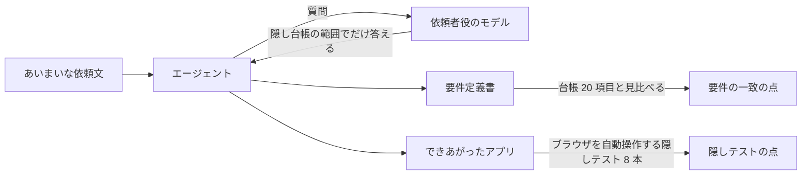

# セッションログ ee46a52c

- セッション: `ee46a52c-5a82-4b55-bb01-0bc92fe66f5c`
- cwd: `/Users/notfolder/orca/workspaces/isdd/qiita_2.3.0`（branch: notfolder/qiita_2.3.0）
- 期間: 2026-11-18 13:16 〜 2026-11-21 21:05
- Claude Code: 2.1.327
- 発言: ユーザー 21 / Claude 20 / ツール呼び出し 78
- 書き出し: 2026-11-21 21:05 JST

> ユーザー発言と Claude の本文は逐語。ツール呼び出しは `🔧` の 1 行に要約し、ツール結果・思考ブロックは含まない。

---
## 1. ユーザー（2026-11-18 13:16）

現在のバージョンは2.3.0で良い？

## 2. Claude

> 🔧 `Bash` Check version files, tags and releases

はい、現在のバージョンは v2.3.0 です。次の 4 か所で一致しています。

| 確認した場所 | 値 |
|---|---|
| 4 スキルの `SKILL.md` の `version` | `v2.3.0` |
| ローカルとリモートの最新タグ | `v2.3.0`（コミット `6184082`） |
| GitHub のリリース | `v2.3.0` が Latest（2026-11-05 公開） |
| README の導入・公開コマンド | `--pin v2.3.0` / `--tag v2.3.0` |

このブランチ（`notfolder/qiita_2.3.0`）にはタグより後のコミットが 2 件ありますが、どちらも BACKLOG の更新です。

## 3. ユーザー（2026-11-18 13:17）

v2.3.0 の Qiita 記事を書いて。v1系からの差分と、2.3.0での評価、強みを書いて。 qiita_writerは使える？

## 4. Claude

`qiita-writer` スキルは使えます。読み込んでから、記事の材料を集めます。

> 🔧 `Skill`

> 🔧 `Bash` Survey article source material and skill references

> 🔧 `Bash` List version tags, release commits and releases

> 🔧 `Read` /Users/notfolder/orca/workspaces/isdd/qiita_2.3.0/README.md

> 🔧 `Read` /Users/notfolder/orca/workspaces/isdd/qiita_2.3.0/measure/results/REPORT.md

> 🔧 `Read` /Users/notfolder/orca/workspaces/isdd/qiita_2.3.0/docs/qiita/2026-10-19-isdd-v2-0-0-trace-map/article.md

> 🔧 `Read` /Users/notfolder/.claude/skills/yomiyasu/references/gemini-syntax.md

> 🔧 `Read` /Users/notfolder/.claude/skills/yomiyasu/references/domains/tech.md

> 🔧 `Read` /Users/notfolder/.claude/skills/yomiyasu/references/slop-catalog.md

> 🔧 `Read` /Users/notfolder/orca/workspaces/isdd/qiita_2.3.0/README.md

> 🔧 `Bash` Show v2.3.0 commit details and v1.0.14 skill list

> 🔧 `Read` /Users/notfolder/orca/workspaces/isdd/qiita_2.3.0/.history/2026-11-05-1101-計測のやり直しと決め事の見える化/summary.md

> 🔧 `Bash` Check eval scene counts, unit tests, and skill version used in measurement

> 🔧 `Bash` Show v2.2.0 and v2.3.0 feature commits and the decided-items rules

> 🔧 `Bash` Check repo URL, redo snapshot contents, v1 article head; create article directory

材料はそろったので、記事本文を書き出します。計測は v2.2.0 時点のスキルで回したものなので、その点は記事内に明記します。

> 🔧 `Write` /Users/notfolder/orca/workspaces/isdd/qiita_2.3.0/docs/qiita/2026-11-18-isdd-v2-3-0-changes-and-measurement/article.md

> 🔧 `Bash` Run the yomiyasu linter on the article

> 🔧 `Bash` Fix repeated sentence endings and re-run the linter

> 🔧 `Edit` /Users/notfolder/orca/workspaces/isdd/qiita_2.3.0/docs/qiita/2026-11-18-isdd-v2-3-0-changes-and-measurement/article.md

> 🔧 `Bash` Re-run the linter and show git status

`qiita-writer` は使えました。記事を書き出してあります(コミットはしていません)。

`docs/qiita/2026-11-18-isdd-v2-3-0-changes-and-measurement/article.md`

## 記事の中身

| 章 | 内容 |
|---|---|
| はじめに | 結論を先に置き、全体の流れを図で示す |
| v1.0.14 と v2.3.0 の違い | 12 観点の比較表(スキル数、ID の持ち方、チェックの時点、正本の扱いなど) |
| 版ごとの変更 | v2.0.0 から v2.3.0 までの 5 版を順に説明 |
| isdd あり・なしの比較計測 | 条件、結果の表、差が出なかった題材、差が出た題材、見つかった弱み |
| v2.3.0 の公開前 eval | Haiku で 28 場面を回し、5 場面が落ちて直した内容 |
| isdd の強み | 5 点と、向く案件・向かない案件 |
| 導入と更新、制約、おわりに | コマンド、計測の限界、次に確かめること |

## 書くときに決めたこと

- **評価は良い結果だけにしていません。** 依頼と受け入れ基準が文章で決まっている題材では点数に差が無く、トークンは 4〜5 倍かかったと冒頭に書きました。強みは、差が出た「あいまいな依頼から要件を決める」計測(台帳 20 項目との一致が平均 2.7 対 14.7)を中心にしています。
- **計測は v2.3.0 そのものの評価ではありません。** 計測の成果物に残っている版の表示は v2.2.0 で、v2.3.0 として公開した状態では回し直していません。記事の「計測の条件」と「制約・注意点」に明記しました。v2.3.0 そのものの評価は公開前 eval の章だけです。
- **1 回目の計測(11 月 4 日)は参考値として載せました。** 対照群が isdd の設計規則を読めていたためです。

## リンターの結果

yomiyasu のリンターは 2 回直して、残りは「正本」への指摘 6 件だけです。「正本」は isdd の用語で、記事の冒頭で定義しているので残しました。

## 確認事項

**1. 計測の章の見せ方**

「2.3.0 での評価」というご依頼に対し、計測は版の表示が v2.2.0 の時点のものです。記事では「v2.3.0 の変更のもとになった計測」として載せ、版のずれを明記しています。

| 案 | 内容 | 影響 |
|---|---|---|
| A | 今のまま(版のずれを明記して載せる) | 記事は今の形で出せる。読者には v2.3.0 の直接の評価ではないと伝わる |
| B | 計測の章の見出しを「v2.2.0 時点の計測」に変える | 版のずれがより目立つ。本文はほぼそのまま |
| C | v2.3.0 で計測を回し直してから載せる | 数字が v2.3.0 のものになるが、計測のやり直しが要る |

おすすめ: A。計測で見つかった問題が v2.3.0 の 2 つの変更の理由なので、記事の流れとして自然で、ずれも本文に書いてあるためです。

**2. 過去の記事へのリンク**

v1.0.14 と v2.0.0 の記事に本文で触れていますが、公開済みの URL を確認できていないのでリンクは入れていません。

| 案 | 内容 | 影響 |
|---|---|---|
| A | URL を教えてもらい、リンクを入れる | 読者が前の記事へ飛べる |
| B | リンク無しのまま出す | 今のまま。「補足・未確認事項」の該当行だけ消す |

おすすめ: A。v2.0.0 の対応表方式は「詳しくは v2.0.0 の記事に書きました」と短く済ませているので、リンクがあるほうが親切です。

**3. 2 回目の計測で使ったスキルの中身**

2 回目の計測(11 月 5 日)に、v2.3.0 の変更(決め事の見える化、チェッカーの範囲指定)が入っていたかを、リポジトリからは確かめられませんでした。変更のコミットは計測より前ですが、計測の成果物に要件定義書が残っていないためです。記事では「確かめられていません」と補足に書いています。ご記憶があれば教えてください。入っていたなら、計測の条件の書き方を「v2.3.0 に入る変更を含むスキルで回した」に直せます。

## 5. ユーザー（2026-11-18 14:16）

1 A
2 v2.0.0の記事はないです。https://qiita.com/notfolderを調べて過去の読者への配慮と同時に、新規読者への配慮ができるように記事にして
3 追加でコミットしました。参照してもう一度記事を書き直して

## 6. Claude

> 🔧 `Bash` Fetch new commits and list the user's published Qiita articles

> 🔧 `Bash` Show the new commits on main and their changed files

> 🔧 `Bash` Download the four past isdd-related Qiita articles to the scratchpad

> 🔧 `Bash` Summarize the v2.3.0 eval results committed on main

> 🔧 `Read` /private/tmp/claude-501/-Users-notfolder-orca-workspaces-isdd-qiita-2-3-0/ee46a52c-5a82-4b55-bb01-0bc92fe66f5c/scratchpad/qiita/fe964d0f4f1236660707.md

> 🔧 `Bash` List headings of the other past articles and their isdd references

> 🔧 `Bash` Tabulate eval results per scene, check how the measurement loaded skills, check old repo redirect

> 🔧 `Bash` Show a fixture trace map and run the checker on a renamed copy in the scratchpad

> 🔧 `Bash` Find a fixture trace map that uses the short design ID form

> 🔧 `Write` /Users/notfolder/orca/workspaces/isdd/qiita_2.3.0/docs/qiita/2026-11-18-isdd-v2-3-0-changes-and-measurement/article.md

> 🔧 `Bash` Run the linter on the rewritten article

リンターの指摘が 3 か所残っているので、文末の続きを直して仕上げます。

> 🔧 `Bash` Fix the three repeated endings and re-run the linter

> 🔧 `Edit` /Users/notfolder/orca/workspaces/isdd/qiita_2.3.0/docs/qiita/2026-11-18-isdd-v2-3-0-changes-and-measurement/article.md

> 🔧 `Bash` Final linter run and git status

記事を書き直しました(コミットはしていません)。

`docs/qiita/2026-11-18-isdd-v2-3-0-changes-and-measurement/article.md`

## 調べて分かったこと

| 調べたこと | 結果 | 記事への反映 |
|---|---|---|
| Qiita の過去記事 | isdd 関連は 3 月・4 月・5 月・6 月の 4 本。v2 系の記事は無い | 冒頭に 4 本の一覧とリンクを置き、「v2.0.0 の記事に書いた」という記述を消した |
| 5 月の記事の内容 | 導入コマンドが `notfolder/req-spec-driven`、開始が `/isdd-requirements`、コードに ID コメントを埋め込む説明 | 「以前の記事から変わったこと」の章に 10 項目の対比表を作った |
| 旧リポジトリ名 | `github.com/notfolder/req-spec-driven` は `notfolder/isdd` へ転送される | 対比表に書いた |
| 追加のコミット | `main` の `d073756`。v2.3.0 公開前の全 28 場面の eval 結果で、全場面合格、採点項目は 165 個 | 「v2.3.0 の eval」を独立した章にし、スキルごとの場面数と確かめている内容を表にした |
| 2 回目の計測で使ったスキル | 計測の実行器はリポジトリの `skills/` を複製して使い、v2.3.0 の 2 つの変更は計測より前にコミットされていた | 「v2.3.0 の 2 つの変更を入れたあとのスキル。公開前 eval で直した 5 件は入っていない」と書いた |

追加のコミットは `main` にあり、このブランチには入っていません。マージはせず、内容だけ読みました。

## 書き直しで変えた点

- **新規読者向け**: 「isdd とは」の章を足しました。解決したいこと、流れの図、4 スキルの表、用語の表(正本、要件 ID、設計 ID、対応表など)、向く案件を先に読めます。冒頭に読む人ごとの案内表も置いています。
- **過去の読者向け**: 対比表に加えて、過去記事の主張と今回の結果をつなげました。5 月の「自己採点に寄る」は isdd でも残ったこと、3 月の「コードレビューが不要になる」は言える範囲が狭くなったことを書いています。
- **v2.0.0 の説明**: 記事が無いので、対応表の実例とチェッカーの出力を載せました。出力は、eval の題材でメソッド名を変えて v2.3.0 のチェッカーを実際に動かしたものです。
- **評価を 2 章に分けた**: 「v2.3.0 の eval」(手順が通るか)と「isdd あり・なしの比較計測」(結果が良くなるか)です。
- **v1 系からの更新手順**: 廃止した 9 本を消すコマンドと、対応表方式への移り方を 1 か所にまとめました。

## リンターで残したもの

| 残した指摘 | 理由 |
|---|---|
| 「正本」が 6 件 | isdd の用語で、用語の表で定義している |
| 文末「ます」の 3 連続が 1 か所(「isdd とは」の「1 回のセッションで…任せています」付近) | 修正は 2 回までの決まりで、2 回使い切った |
| 箇条書き比率 25% | 変更点や条件の並びで、並列のデータに当たる |

図は 6 枚で、スキルの目安(2〜5 枚)を 1 枚超えています。記事が長いのでそのままにしました。

## 確認事項

**1. 3 月の記事の主張への言及**

「おわりに」に、3 月の記事の「コードレビューが不要になる」について「今回の計測を経て、言えることは狭くなっています」と書きました。要件を決める力は数字で確かめられた一方、実装が要件どおりかをコードを読まずに確かめる手段はまだ足りない、という内容です。計測の結果からは言えることですが、ご自身の過去の主張を弱める書き方なので、載せるかどうかの判断をお願いします。

| 案 | 内容 | 影響 |
|---|---|---|
| A | 今のまま載せる | 過去の読者に、何が確かめられて何がまだなのかが正直に伝わる |
| B | 3 月の記事への言及を消し、「次に確かめたいこと」だけ残す | 過去の主張には触れない。計測の弱みは別の章に残る |

おすすめ: A。計測の章で同じ弱みを数字で示しているので、過去の記事とのつながりを書かないほうが不自然なためです。

**2. 残った文末の指摘**

上の表の「ます」の 3 連続 1 か所は、決まりの回数を超えるので直していません。直してよければ 1 文だけ言い換えます。

| 案 | 内容 | 影響 |
|---|---|---|
| A | 1 文だけ直す | リンターの指摘が「正本」だけになる |
| B | そのままにする | 読みやすさへの影響は小さい |

おすすめ: A。1 文の言い換えで済み、意味は変わらないためです。

## 7. ユーザー（2026-11-18 14:25）

正しく書いた要件が、そのまま正しい実装になるとは限らなかった
これはなんですか？

## 8. Claude

あいまいな依頼から要件を決める計測(報告書の「計測 5」)の結果を、私が 1 行にまとめた文です。

## もとになった数字

| | 対照群の平均 | isdd 群の平均 |
|---|---|---|
| 依頼者だけが知る 20 項目のうち、要件定義書に正しく入った数 | 2.7 | 14.7 |
| できあがったアプリが通した隠しテスト(8 本) | 0.3 | 2.0 |

isdd 群は 20 項目のうち 14.7 項目を要件定義書に正しく書きましたが、できあがったアプリは隠しテストを 8 本中 2.0 本しか通しませんでした。報告書(`measure/results/REPORT.md` の末尾)はこれを「正しい要件が実装の正しさに結びついていない」と書いています。

## この文の弱いところ

記事の冒頭に結論として置くには、根拠が足りていません。

| 弱い点 | 中身 |
|---|---|
| 平均 2.0 に、実装が無かった回が入っている | isdd 群 3 回の内訳は 3 本・0 本・3 本。0 本の回は、基盤が空の応答を返し続けて止めた回で、実装まで届いていない。実装できた 2 回だけなら 8 本中 3 本 |
| 原因を確かめていない | 落ちたテストが、要件に正しく書けていた項目のものかを、1 本ずつ見比べていない。報告書の記述をそのまま使った |
| 回数が少ない | 各群 3 回 |
| 隠しテストの性質 | 契約に文言を書かない題材で、隠しテストは画面の文言や振る舞いを細かく見る。要件に書いてあっても、表記が少し違うだけで落ちる可能性がある |

「限らなかった」と言い切れる材料は「要件は 14.7 項目合っていたのに、テストは 3 本しか通らなかった」までです。なぜそうなったかは分かっていません。

## 確認事項

**1. この文の扱い**

| 案 | 内容 | 影響 |
|---|---|---|
| A | 冒頭の結論から外し、「計測で見つかった弱み」の章だけに残す。そこに「3 回のうち 1 回は実装まで届かなかった」「原因は確かめていない」を足す | 冒頭の結論は、根拠のはっきりした 2 点だけになる |
| B | 冒頭に残し、「要件は平均 14.7 項目合っていたが、隠しテストは実装できた 2 回とも 8 本中 3 本だった。原因は確かめていない」と数字で書く | 弱みを冒頭から隠さない。文は長くなる |
| C | 今のまま | 根拠より強い言い方が冒頭に残る |

おすすめ: B。isdd の弱みとして大事な結果なので冒頭に残したいのですが、今の書き方は原因が分かっているように読めるためです。どの案でも、弱みの章の「8 本中平均 2.0 本」には、実装が無かった回を含むことを書き足します。

## 9. ユーザー（2026-11-18 14:27）

1 A 途中でトークン不足で計測をやめていたと思います。だからではないでしょうか？

## 10. Claude

> 🔧 `Bash` Look for records on why the ambiguous-request measurement runs stopped

半分は当たっていますが、リポジトリの記録だけでは裏づけきれませんでした。この計測(あいまいな依頼から要件を決める、備品管理アプリ)は社内 API 基盤で回したもので、リポジトリにあるのは報告書の文章だけです。回ごとの記録や成果物は残っていません。

## 報告書に書いてあること

| isdd 群の回 | 隠しテスト(8 本) | 経過 |
|---|---|---|
| 1 回目 | 3 | 往復の上限 12 回で実装まで届かず、会話を引き継いで再開。17 回で完了。打ち切り時点でも 3 本 |
| 2 回目 | 0 | 再開後に空の応答を返し続けたため止めた。要件と設計まででき、実装は無い |
| 3 回目 | 3 | 12 回目で完了 |

- **2 回目の 0 本**は、ご指摘のとおり途中でやめた結果です。ただし報告書の理由は「空の応答が続いた」で、トークン不足とは書いてありません。「会話が長すぎて応答を作れない可能性が高いが、原因は確かめていない」とあります。
- **1 回目と 3 回目の 3 本**は、報告書では「完了」した回の点です。途中でやめた、とは読めません。
- 1 回目の「完了」が、実装後レビューや E2E まで通した完了なのか、エージェントが完了を宣言しただけなのかは、報告書からは分かりません。

つまり「途中でやめたから低い」と言えるのは 2 回目だけで、残り 2 回が 8 本中 3 本だった理由は記録からは説明できません。ご記憶のトークン不足が 1 回目や 3 回目にも関わっていたなら、報告書の「完了」という書き方のほうが不正確です。

どちらにしても、「正しく書いた要件が、そのまま正しい実装になるとは限らなかった」と結論に書ける材料ではありません。確かなのは次の 2 つだけです。

- 要件の一致は対照群 2.7、isdd 群 14.7
- 隠しテストの点は、実装まで届かなかった回を含んでいて、評価に使えない

## 記事をこう直します

ご回答の A に、今回の話を加えた形です。

| 場所 | 直し方 |
|---|---|
| 冒頭の結論 | 3 点目を消す |
| 2 回目の結果の表 | 「隠しテスト 8 本の平均 0.3 / 2.0」の行を消す |
| 計測で見つかった弱み | 「正しく書いた要件が実装で守られていない」を消し、「あいまいな依頼の計測は、isdd 群 3 回のうち 1 回が実装まで届かずに止まった。実装の正しさは評価できていない」に変える |
| 強みと弱み、おわりに、5 月の記事への言及 | 「要件が実装に引き継がれていない」を前提にした文を、「引き継がれているかは未確認」に直す |
| 制約・注意点 | 「あいまいな依頼の計測は要件の一致までを評価した。実装の評価は途中で止まった回があり、やり直しが要る」を足す |

## 確認事項

**1. 止めた理由の書き方**

| 案 | 内容 | 影響 |
|---|---|---|
| A | 報告書どおり「往復の上限に達した」「空の応答が続いて止めた」と書く | 記録にあることだけを書く。トークン不足には触れない |
| B | 「トークンの上限で計測を途中で止めた」と書く | ご記憶に合う。ただしリポジトリの記録には無いので、社内側の記録で確かめてから書きたい |
| C | 理由は書かず「途中で止まった回がある」とだけ書く | 理由の食い違いを避けられる。読者には事情が伝わりにくい |

おすすめ: A。記録で確かめられるのがこの 2 つだけのためです。社内側の記録でトークン不足が確かめられたら、B に差し替えます。

**2. 1 回目と 3 回目の「8 本中 3 本」の扱い**

| 案 | 内容 | 影響 |
|---|---|---|
| A | 記事に載せない | 実装の評価は「未評価」とだけ書く。弱みを 1 つ書かないことになるが、裏づけの無い数字を出さずに済む |
| B | 「完了した 2 回は 8 本中 3 本だった。原因は確かめていない」と弱みの章に 1 行残す | 分かっている数字は隠さない。完了の中身が不確かなまま載る |

おすすめ: B。isdd に不利な数字を理由が不確かなまま落とすと、記事全体の信用を下げるためです。ただし、1 回目と 3 回目も実際には途中で止めていたというご記憶なら A にします。

## 11. ユーザー（2026-11-18 14:31）

1 止めた評価は無効として母数からも消すことはできませんか？そうしたら止めた理由は不要なはず
2 Bだが、内容だけでは判断できない。説明して

## 12. Claude

> 🔧 `Bash` Read the hidden ledger and the hidden tests used in the ambiguous-request measurement

> 🔧 `Bash` Read the minimal contract and a sample hidden test

## 1. 止めた回を母数から消せるか

消せます。ただし消すのは「実装の点」の母数だけにして、「1 回除いた」ことは 1 行書かせてください。理由の説明は要らなくなります。

| 指標 | 止めた回(isdd 群の 2 回目)の扱い | 理由 |
|---|---|---|
| 要件の一致(台帳 20 項目) | 残す | この回も要件定義書は完成していて、台帳と 18 項目一致している。無効にする理由が無い |
| 隠しテストの点 | 除く | 実装が無いので、0 点は「実装が悪い」という意味ではない |

除いたあとの数字はこうなります。

| | 対照群 | isdd 群 |
|---|---|---|
| 要件の一致の平均 | 2.7(3 回) | 14.7(3 回) |
| 隠しテストの平均(8 本) | 0.3(3 回) | 3.0(2 回。3 回のうち 1 回は実装まで届かず除外) |

「除外した」と書かずに 2 回の平均だけを出すことは勧めません。isdd 群だけ都合の悪い回を黙って消した形になり、読者が報告書と照らすと数が合わなくなるためです。「実装まで届かなかった 1 回を除く」の一言なら、止めた理由には触れずに済みます。

## 2. 「8 本中 3 本」とは何か

### 計測のしくみ

- **隠し台帳**は、依頼文に書いていない 20 項目の答えです。「社員番号の形式が違うときの文言は『社員番号は 6 桁の数字で入力してください』」「一覧の並び順は管理番号の昇順」などが入っています。
- エージェントに渡す契約は最小版で、起動方法、URL、入力欄の id だけが書いてあります。文言や振る舞いは「依頼者に確認して決めること」としています。
- **隠しテスト 8 本**は、できあがったアプリをブラウザで操作して確かめます。内訳はアカウントまわり 5 本、備品まわり 2 本、貸出まわり 1 本です。

### 隠しテストは 1 か所違うと 1 本落ちる

1 本のテストが、たくさんの項目をまとめて確かめます。「アカウント登録」のテスト 1 本の中身は次のとおりです。

| 確かめること | 台帳の項目 |
|---|---|
| 社員番号の形式が違うときの文言が一字一句同じ | L1 |
| 社員番号が重複したときの文言が一字一句同じ | L2 |
| 名前が長いとき、空のとき、パスワードが短いときの文言が一字一句同じ | L3〜L5 |
| エラーのとき、入力した値が消えずに残っている | L8 |
| 登録に成功したらログイン画面へ移り、「登録しました。ログインしてください」と出る | L6 |

この 7 項目のうち 1 つでも違えば、このテストは不合格です。句点の有無や全角・半角の違いでも落ちます。

### 「3 本」をどう読めるか

要件を 16 項目正しく書いた回でも 3 本だった理由として、考えられるのは次の 3 つです。どれが当たっているかは確かめていません。回ごとの成果物がリポジトリに無いためです。

| 考えられる理由 | 中身 | isdd の弱みと言えるか |
|---|---|---|
| ア. 要件に書いたことが実装に引き継がれなかった | 要件定義書の文言と、画面に出る文言が違っている | 言える。報告書はこの読み方をしている |
| イ. 要件に書けなかった数項目で落ちた | 20 項目中 4 項目(1 回目)や 10 項目(3 回目)は要件に入っていない。その 1 項目が 1 本のテストを落とす | 半分言える。聞き漏らしの問題で、実装の問題ではない |
| ウ. テストが細かすぎる | 文言は合っているが、表示する場所や要素の付け方が契約と少し違う | 言いにくい。計測の作りの問題 |

確かなのは、**対照群の 0〜1 本よりは多い**ことと、**満点にはほど遠い**ことの 2 つです。「なぜ 3 本か」は分かっていません。

## 記事をこう直します

| 場所 | 直し方 |
|---|---|
| 冒頭の結論 | 3 点目を消す |
| 2 回目の結果の表 | 隠しテストの行を「0.3 / 3.0」にし、「isdd 群は 3 回のうち、実装まで届かなかった 1 回を除く」と注を付ける |
| 計測で見つかった弱み | 「正しく書いた要件が実装で守られていない」を消し、「あいまいな依頼の計測で、実装できた 2 回の隠しテストは 8 本中 3 本だった。対照群より多いが満点には遠く、原因は確かめていない」に変える |
| 強みと弱み、おわりに、5 月の記事への言及 | 「要件が実装に引き継がれていない」を前提にした文を、「引き継がれているかは確かめられていない」に直す |
| 往復が多いという弱み | そのまま残す(止めた理由には触れない) |

## 確認事項

**1. この内容で記事を直してよいか**

| 案 | 内容 | 影響 |
|---|---|---|
| A | 上の表のとおり直す | 止めた回は実装の点の母数から消え、「1 回除く」の注だけが残る。止めた理由は書かない |
| B | 注も付けず、isdd 群は 2 回の平均だけを書く | 記事は短くなるが、報告書と回数が合わなくなる |
| C | 隠しテストの点は記事に一切載せない | 原因の分からない数字を出さずに済む。ご回答の「2 は B」とは変わる |

おすすめ: A。除外したことを一言書けば、ご希望どおり止めた理由は要らなくなり、読者にも隠しごとの無い数字になるためです。

## 13. ユーザー（2026-11-18 14:38）

1 A

## 14. Claude

> 🔧 `Bash` Locate the lines to revise in the article

> 🔧 `Bash` Apply the agreed revisions and re-run the linter

記事を直しました(コミットはしていません)。

`docs/qiita/2026-11-18-isdd-v2-3-0-changes-and-measurement/article.md`

| 場所 | 直した内容 |
|---|---|
| 冒頭の結論 | 「正しく書いた要件が、そのまま正しい実装になるとは限らなかった」を消し、2 点にした |
| 2 回目の結果の表 | 隠しテストの行を「0.3 / 3.0」にし、「isdd 群は 3 回のうち、実装まで届かなかった 1 回を除く」と行の見出しに書いた |
| 計測で見つかった弱み | 「実装できた 2 回の隠しテストは 8 本中 3 本だった。対照群より多いが満点には遠く、原因は確かめていない」に変えた |
| おわりに | 「正しく実装されたかを確かめる手段は、まだ足りていません」を「今回の計測では確かめられていません」に変えた |

止めた理由はどこにも書いていません。要件の一致(2.7 対 14.7)は 3 回のままです。

弱みの章の「依頼者との往復が多い。12〜17 回の往復で、18〜47 分かかった」には、止めた回の数字(12 回、18 分)が入っています。要件と設計までは進んだ回なのでそのままにしました。

## 確認事項

前々回にお聞きして、まだ答えをいただいていない 2 点です。

**1. 3 月の記事の主張への言及**

「おわりに」に、3 月の記事の「コードレビューが不要になる」について「今回の計測を経て、言えることは狭くなっています」と書いています。ご自身の過去の主張を弱める書き方です。

| 案 | 内容 | 影響 |
|---|---|---|
| A | 今のまま載せる | 過去の読者に、確かめられたこと(要件を決める力)と、まだのこと(実装が要件どおりか)が伝わる |
| B | 3 月の記事への言及を消し、「次に確かめたいこと」だけ残す | 過去の主張には触れない |

おすすめ: A。ただし今回、実装の評価は「弱い」ではなく「確かめられていない」に直したので、「狭くなっています」は少し強い言い方です。A の場合は「今回の計測で確かめられたのは、そのうち要件を決める部分までです」に言い換えます。

**2. 残った文末の指摘**

リンターの指摘が 1 か所残っています(「isdd とは」の章で文末「ます」が 3 回続く)。修正は 2 回までの決まりで止めていました。

| 案 | 内容 | 影響 |
|---|---|---|
| A | 1 文だけ言い換える | リンターの指摘が、用語の「正本」だけになる |
| B | そのままにする | 読みやすさへの影響は小さい |

おすすめ: A。1 文の言い換えで済み、意味は変わらないためです。

## 15. ユーザー（2026-11-18 14:40）

1 A

## 16. Claude

> 🔧 `Edit` /Users/notfolder/orca/workspaces/isdd/qiita_2.3.0/docs/qiita/2026-11-18-isdd-v2-3-0-changes-and-measurement/article.md

> 🔧 `Bash` Show the revised paragraph and re-run the linter

「おわりに」の 3 月の記事への言及を言い換えました(コミットはしていません)。

> 3月の記事では「コードレビューが不要になる」と書きました。今回の計測で確かめられたのは、そのうち要件を決める部分までです。あいまいな依頼から正しい要件を決める力は、数字に表れました。その要件が正しく実装されたかは、今回の計測では確かめられていません。

`docs/qiita/2026-11-18-isdd-v2-3-0-changes-and-measurement/article.md`

リンターの指摘は、用語の「正本」6 件と、文末「ます」の 3 連続 1 か所が残っています。後者は前回の確認事項 2 のお答えをいただいていないので、手を付けていません。

## 確認事項

**1. 残った文末の指摘を直すか**

「isdd とは」の章の「1 回のセッションで仕様どおりに作ることは、モデルに任せています。」の前後で、文末「ます」が 3 回続いています。

| 案 | 内容 | 影響 |
|---|---|---|
| A | この 1 文を「…は、モデルに任せる範囲です。」に言い換える | リンターの指摘が「正本」だけになる。意味は変わらない |
| B | そのままにする | 読みやすさへの影響は小さい |

おすすめ: A。1 文の言い換えで済むためです。

**2. このあとの扱い**

記事はまだコミットしておらず、Qiita にも投稿していません。

| 案 | 内容 | 影響 |
|---|---|---|
| A | このブランチ(`notfolder/qiita_2.3.0`)に記事をコミットする | 記事がリポジトリに残る。投稿はしない |
| B | コミットして、`qiita-post` スキルで Qiita に投稿する | 記事が公開される。公開後は取り消しにくい |
| C | 何もしない | ファイルは作業ツリーに残るだけ |

おすすめ: A。公開の前に、ご自身で全文を一度読んでいただくのがよいと考えるためです。特に計測の数字と、過去記事との対比表を見てください。

## 17. ユーザー（2026-11-18 15:35）

This session is being continued from a previous conversation that ran out of context. The summary below covers the earlier portion of the conversation.

Summary:
1. Primary Request and Intent:
   - 最初の質問: 現在のバージョンが 2.3.0 でよいかの確認 → 確認済み(SKILL.md の version、タグ、GitHub リリース、README すべて v2.3.0)。
   - 本題: 「v2.3.0 の Qiita 記事を書いて。v1系からの差分と、2.3.0での評価、強みを書いて。qiita_writerは使える？」→ `qiita-writer` スキルで記事を作成。
   - 追加指示: (a) 計測の章は版のずれを明記して載せる案 A。(b) v2.0.0 の記事は公開されていないので、https://qiita.com/notfolder を調べ、過去の読者と新規読者の両方に配慮した記事にする。(c) 追加コミットを参照して書き直す。
   - その後、冒頭の結論「正しく書いた要件が、そのまま正しい実装になるとは限らなかった」への疑問 → 止めた計測回を実装の点の母数から除き、止めた理由は書かない形に修正(案 A)。3 月の記事への言及は残す(案 A、言い換え付き)。
   - 守るべき共通ルール(CLAUDE.md): 日本語で応答。図は Mermaid。承認された項目だけ実行。ユーザーへの問いは応答末尾の「確認事項」に番号付きでまとめ、各問に「案 / 内容 / 影響」の表と「おすすめ」と根拠を付ける。調べれば分かることは問いにしない。コミットは依頼されたときだけ(記事は未コミットのまま)。`~/.claude` に同期するファイルに秘密や作業の中身を書かない。ユーザーのメールなど個人情報を外部サービスへ送らない。代名詞は they/them 相当。

2. Key Technical Concepts:
   - isdd(Interview-driven Spec-driven Development): 4 スキル(`isdd-spec`・`isdd-build`・`isdd-reverse-engineering`・`isdd-setup`)、正本(`docs/requirements.md`・`docs/detail_design.md`)、対応表 `docs/trace_map.md`、要件 ID `RQ-*`、設計 ID `DS-[種類]-[要素名]`、`docs/active_change`、チェッカー(`trace_map_checker.py`、`dependency_checker.py`、`acceptance_checker.py`、`rq_integrity_checker.py`、`rq_ds_link_checker.py`)。
   - 版の履歴: v1.0.14(9 スキル＋`isdd-common`、コードに ID コメント)→ v2.0.0(対応表方式、`isdd-setup`、10 本)→ v2.0.1(正本は実装済みの仕様だけ)→ v2.1.0(4 本に統合、短い設計 ID、追跡を 3 つに)→ v2.2.0(受け入れ判定)→ v2.3.0(依頼に無い決め事の見える化「1-2 節」、チェッカーの `--src` ファイル指定と `--exclude`、DS-MD の対象限定、公開前 eval の 5 件修正)。
   - 評価の材料: (1) v2.3.0 公開前 eval — Haiku、Claude Code 経路(`evals/run-claude-code.py`)、全 28 場面(spec 16・build 10・reverse 1・setup 1)、1 回目 5 場面不合格 → 直して全合格、採点項目 165/165、合計約 53 分(3188 秒)、1 場面 25〜220 秒。結果は `main` のコミット `d073756`(このブランチ `notfolder/qiita_2.3.0` には未マージ、読むだけにした)。単体テスト 95 本。(2) isdd あり・なし比較計測(`measure/results/REPORT.md`)— 1 回目(11/4、Agent ツール方式、対照群に CLAUDE.md 混入、v2.2.0、参考値): 38/42 対 39/42、90/90 対 90/90、81/84 対 83/84、43.5/50 対 48/50。2 回目(11/5、`claude -p` 無人実行、Opus 3 人採点): 備品管理 21.8/23 対 22.2/23、Web 79/81 対 76.5/81、変更の取りこぼし 1 対 9(57 件中)、台帳 20 項目の一致 2.7 対 14.7、所要中央値 94 秒対 694 秒、ツール 12 対 59 回、新規トークン 265,319 対 1,179,767(約 4.4 倍)。
   - あいまいな依頼の計測(計測 5)の isdd 群内訳: 隠しテスト 3・0(実装なし、空の応答が続いて停止)・3。合意済みの扱い: 要件の一致は 3 回のまま、隠しテストは実装まで届かなかった 1 回を除き 0.3 対 3.0、止めた理由は書かない。
   - 2 回目の計測で使ったスキル: `measure/run.py` がリポジトリの `skills/` を複製、v2.3.0 の 2 つの変更は計測前にコミット済み(版表示は v2.2.0、公開前 eval の 5 件修正は未反映)。一部は社内 API 基盤で実行され中身は未確認。
   - Qiita 過去記事(API で確認): 3 月 `34cc12003dc7e63c45e5`、4 月 `3daa610f6e3d9392c344`、5 月 `fe964d0f4f1236660707`(isdd 紹介、導入コマンドが旧 `notfolder/req-spec-driven`、`/isdd-requirements`)、6 月 `5c6590b30628bb6b7cb2`(v1.0.14)。旧リポジトリ URL は `notfolder/isdd` へ 301 転送。
   - qiita-writer / yomiyasu の規則: 和欧文間に空白を入れない、文末コロン・ダッシュ・絵文字なし、同一文末 3 連続を避ける、リンター修正は最大 2 回、「正本」は用語なので残す。リンター: `python3 ~/.claude/skills/yomiyasu/scripts/yomiyasu_lint.py <article.md>`。

3. Files and Code Sections:
   - `/Users/notfolder/orca/workspaces/isdd/qiita_2.3.0/docs/qiita/2026-11-18-isdd-v2-3-0-changes-and-measurement/article.md`(新規作成、未コミット、唯一の成果物)
     - front matter: `title: 対話駆動仕様開発 isdd v2.3.0 ― v1系から変わったことと、isddあり・なしで測って分かった強みと弱み` / `tags: 要件定義 生成AI AIコーディング 仕様駆動開発 ClaudeCode` / `slide: false`
     - 章構成: はじめに(過去記事 4 本の表、結論 2 点、読み方の表)／isddとは(解決したいこと、流れの図、スキル表、用語表、向く案件)／以前の記事から変わったこと(10 項目の対比表)／版ごとの変更(v2.0.0〜v2.3.0、対応表の実例、チェッカーの実出力、強制 3 か所の図)／v2.3.0のeval／isddあり・なしの比較計測(条件、1 回目・2 回目の対比表、結果、差が出なかった題材、差が出た題材、計測で見つかった弱み)／強みと弱み(強み 5 つ)／導入と更新(新規、v1 系から、v2 系から)／制約・注意点／おわりに／補足・未確認事項。Mermaid 図 6 枚。
     - 直近の修正: 冒頭結論の 3 点目を削除。表の行を `| 上の題材の隠しテスト8本の平均。isdd群は3回のうち、実装まで届かなかった1回を除く | 0.3 | 3.0 |` に変更。弱みの項目を「あいまいな依頼の計測で、実装できた2回の隠しテストは8本中3本だった。対照群より多いが満点には遠く、原因は確かめていない」に変更。おわりにの段落(485 行目)を「3月の記事では「コードレビューが不要になる」と書きました。今回の計測で確かめられたのは、そのうち要件を決める部分までです。あいまいな依頼から正しい要件を決める力は、数字に表れました。その要件が正しく実装されたかは、今回の計測では確かめられていません。」に変更。
   - 読んだだけのファイル: `README.md`、`measure/results/REPORT.md`、`.history/2026-11-05-1101-…/summary.md`、`.history/BACKLOG-archive.md`、`shared/references/requirements-chapters.md`(1-2 節)、`shared/references/hearing-rules.md`、`measure/run.py`、`measure/ledger/stage1.md`、`measure/contracts/stage1-min.md`、`measure/hidden/test_accounts.py`、`docs/qiita/2026-10-19-isdd-v2-0-0-trace-map/article.md`(未公開の下書き)、`evals/isdd-build/fixtures/case1-minimum/`(対応表の実例とチェッカー出力の元)。
   - スクラッチパッド(`/private/tmp/claude-501/-Users-notfolder-orca-workspaces-isdd-qiita-2-3-0/ee46a52c-5a82-4b55-bb01-0bc92fe66f5c/scratchpad/`)に過去記事の本文、eval 集計、チェッカー実行用の複製あり(一時物)。

4. Errors and fixes:
   - 初版で「v2.0.0 の記事に書きました」と書いた → ユーザーから「v2.0.0の記事はないです」。Qiita を調べ、過去 4 本の一覧とリンク、v2.0.0 の中身の説明を記事内に入れて修正。
   - 初版は新規読者への説明が不足 → 「isddとは」章、用語表、読み方の案内を追加。
   - 冒頭結論「正しく書いた要件が…限らなかった」は根拠不足(実装なしの回を平均に含む、原因未確認)→ ユーザーの指摘で削除し、止めた回を実装の点の母数から除外。止めた理由(ユーザーはトークン不足と記憶、報告書は「往復上限」「空の応答」)は記事に書かないことで決着。
   - リンターの同一文末 3 連続を複数回修正。2 回の上限で止め、「isddとは」章 49 行目付近(「1回のセッションで仕様どおりに作ることは、モデルに任せています。」)の「ます」3 連続が 1 か所残っている。
   - zsh のグロブ不一致(`no matches found`)は調査上の軽微なもので影響なし。

5. Problem Solving:
   - 計測が v2.3.0 そのものの評価ではない点は、条件表と制約に明記する形で解決(ユーザー承認: 案 A)。
   - 2 回目の計測のスキル内容は `run.py` とコミット順から判断し、補足に限界を記載。
   - 計測 5 の回ごとの成果物はリポジトリに無く、「8 本中 3 本」の原因は未確認のまま記事に明記。

6. All user messages:
   - 「現在のバージョンは2.3.0で良い？」
   - 「v2.3.0 の Qiita 記事を書いて。v1系からの差分と、2.3.0での評価、強みを書いて。 qiita_writerは使える？」
   - 「1 A / 2 v2.0.0の記事はないです。https://qiita.com/notfolderを調べて過去の読者への配慮と同時に、新規読者への配慮ができるように記事にして / 3 追加でコミットしました。参照してもう一度記事を書き直して」
   - 「正しく書いた要件が、そのまま正しい実装になるとは限らなかった これはなんですか？」
   - 「1 A 途中でトークン不足で計測をやめていたと思います。だからではないでしょうか？」
   - 「1 止めた評価は無効として母数からも消すことはできませんか？そうしたら止めた理由は不要なはず / 2 Bだが、内容だけでは判断できない。説明して」
   - 「1 A」(止めた回を実装の点の母数から除き注を付ける修正の承認)
   - 「1 A」(3 月の記事への言及を残す。言い換え付き)

7. Pending Tasks:
   - 未回答の確認事項: リンターに残る文末「ます」3 連続 1 か所(49 行目付近)を 1 文だけ言い換えてよいか(おすすめ: 直す)。承認が無いので未実施。
   - 記事はコミットしていない(依頼なし)。Qiita への投稿も依頼されていない。

8. Current Work:
   直前のユーザーの「1 A」を受け、`article.md` の「おわりに」の 3 月記事への言及を言い換えた(「今回の計測を経て、言えることは狭くなっています。…数字で確かめられました。」→「今回の計測で確かめられたのは、そのうち要件を決める部分までです。…数字に表れました。」)。リンターを再実行し、スコア 70/100、残りは「正本」6 件と 49 行目の「ます」3 連続 1 件。この結果をユーザーへまだ報告していない。

9. Optional Next Step:
   ユーザーへ日本語で報告する: 「おわりに」の言い換えを反映したこと(485 行目の新しい文面)、記事は未コミットであること、リンターの残りは「正本」と文末 1 か所だけであること。末尾の「確認事項」で、未回答の「残った文末の指摘(「isdd とは」の章で文末「ます」が 3 回続く)を 1 文だけ言い換えるか」を案 A/B の表とおすすめ(A)付きで再度聞く。承認が出るまでその文は編集しない。

If you need specific details from before compaction (like exact code snippets, error messages, or content you generated), read the full transcript at: /Users/notfolder/.claude/projects/-Users-notfolder-orca-workspaces-isdd-qiita-2-3-0/ee46a52c-5a82-4b55-bb01-0bc92fe66f5c.jsonl
Continue the conversation from where it left off without asking the user any further questions. Resume directly — do not acknowledge the summary, do not recap what was happening, do not preface with "I'll continue" or similar. Pick up the last task as if the break never happened.

The messages after this summary are the most recent messages from before compaction, kept verbatim. The summary was written without seeing them, so something it says has not happened yet may already have happened in them.

## 18. ユーザー（2026-11-21 07:25）

計測の条件の1回目は不要です。2回目のみの結果で記事を書いて

## 19. Claude

> 🔧 `Bash` 記事の見出しと1回目の計測に触れた行を探す

> 🔧 `Read` /Users/notfolder/orca/workspaces/isdd/qiita_2.3.0/docs/qiita/2026-11-18-isdd-v2-3-0-changes-and-measurement/article.md

> 🔧 `Read` /Users/notfolder/orca/workspaces/isdd/qiita_2.3.0/docs/qiita/2026-11-18-isdd-v2-3-0-changes-and-measurement/article.md

> 🔧 `Bash` 1回目由来の記述と報告書の該当箇所を探す

> 🔧 `Read` /Users/notfolder/orca/workspaces/isdd/qiita_2.3.0/measure/results/REPORT.md

> 🔧 `Read` /Users/notfolder/orca/workspaces/isdd/qiita_2.3.0/measure/results/REPORT.md

> 🔧 `Bash` 1回目の計測の記述を除いて記事を書き換え、リンターを実行する

> 🔧 `Bash` 書き換えの影響を受ける段落を表示する

> 🔧 `Bash` 関連する3か所を直してリンターを再実行する

1回目の計測の記述を外し終え、残った数字の出どころを最後に確かめています。

> 🔧 `Bash` 3,291件の出どころと、書き換えた計測の章を確認する

計測の章を、1回目を除いた結果だけで書き直しました(コミットはしていません)。

`docs/qiita/2026-11-18-isdd-v2-3-0-changes-and-measurement/article.md`

## 計測の章で変えたこと

- **条件**: 1回目と2回目を比べる表をやめ、1回分の条件の箇条書きにしました。時期は11月5日だけにしています。
- **結果**: 1回目の結果表を消しました。残した表には、備品管理アプリのトークンの行(265,319 対 1,179,767)を足しています。
- **本文**: SWE-Dev、FeatureBench、WebGen-Benchの記述と「参考値」の注記を消しました。「1回目」「2回目」という呼び方の補足も消しています。

## 1回目だけが根拠だったので、合わせて変えた箇所

| 箇所 | 変更前 | 変更後 |
|---|---|---|
| 冒頭の結論と弱み | トークンは3〜5倍 | 備品管理アプリで約4.4倍、1段の所要時間は約7倍 |
| 弱みの項目 | 自分で書いたE2Eは自分の解釈を確かめるだけになる(E2E 29〜35本が合格したのに隠しテストを3本落とした) | 削除。代わりに、Webサイトで変更の取りこぼしが対照群より多かったことを書いた |
| 「おわりに」 | 計測では、受け入れテストも自分の解釈を確かめるだけになる場合があった | 削除 |
| 5月の記事の「自己採点に寄る」への言及 | isddを使っても残ることが数字で出た | この問題が解けたかどうかは、今回の計測では確かめられていない |
| v2.3.0の変更の説明 | 後の章の比較計測で見つかった問題への対応 | 公開前にisddを試しに動かして見つかった問題への対応 |

最後の行は、v2.3.0の2つの変更のきっかけが1回目の計測だったためです。計測と書くと記事の中に対応する結果が無くなるので、言い方を変えました。

リンターの残りは、用語の「正本」、並列データの箇条書きの比率、前回からの文末「ます」の3連続1か所です。条件の箇条書きの「機能の追加ではなく既存機能の変更」は、意味を担う否定なので残しました。

## 確認事項

**1. v2.3.0の章に残る「3,291件」をどうするか**

チェッカーの走査範囲を変えた理由として、「範囲の外のコードが未登録として3,291件報告された」と書いています。この数字は1回目の計測(FeatureBenchのmlflow)で出たものです。記事では計測の結果としてではなく、変更の理由として書いています。

| 案 | 内容 | 影響 |
|---|---|---|
| A | そのまま残す | 変更の理由が具体的な数字で伝わる。1回目の計測の数字が1つだけ記事に残る |
| B | 数字を消し、「範囲の外のコードが大量に未登録として報告された」にする | 1回目に由来する数字が記事から無くなる。理由の具体性は下がる |

おすすめ: A。比較の結果ではなく、チェッカーが実際に出した件数だからです。

**2. 文末「ます」の3連続を直すか**(前回から未回答)

「isddとは」の章の「1回のセッションで仕様どおりに作ることは、モデルに任せています。」の前後で、文末「ます」が3回続いています。

| 案 | 内容 | 影響 |
|---|---|---|
| A | この1文を「…は、モデルに任せる範囲です。」に言い換える | リンターの文末の指摘が無くなる。意味は変わらない |
| B | そのままにする | 読みやすさへの影響は小さい |

おすすめ: A。1文の言い換えで済むためです。

**3. このあとの扱い**

| 案 | 内容 | 影響 |
|---|---|---|
| A | このブランチ(`notfolder/qiita_2.3.0`)に記事をコミットする | 記事がリポジトリに残る。投稿はしない |
| B | コミットして、`qiita-post`スキルでQiitaに投稿する | 記事が公開される。公開後は取り消しにくい |
| C | 何もしない | ファイルは作業ツリーに残るだけ |

おすすめ: A。公開の前に、書き直した計測の章と冒頭の結論を一度読んでいただくのがよいと考えるためです。

## 20. ユーザー（2026-11-21 07:33）

その要件が正しく実装されたかは、今回の計測では確かめられていません。

次に確かめたいことが2つあります。1つは、要件定義書に正しく書いた文言や振る舞いが、実装とE2Eに引き継がれているかです。もう1つは、変更する箇所が示されない依頼や大きなコードベースで、対応表による追跡が差を生むかです。どちらも、計測の題材を作り直して確かめます。
これはなぜ確かめられていないという結論になっていますか？evalで確かめられていない？

## 21. Claude

> 🔧 `Bash` isdd-build の eval が何を採点しているかを調べる

評価で確かめているのは別のことなので、この結論は変わりません。ただ、記事の文は理由が伝わりにくいので直す余地があります。

## evalが確かめていること

evalの採点項目は、スキルの手順が通ったかを見ています。たとえば次のような項目です。

- 対応表に決まった設計IDが書かれているか
- チェッカーが通るか
- 設計に無い要素が要るときに実装を止めたか

題材はHello Worldと小さなCRMで、`isdd-build`の場面には「単体テスト・E2Eは作らなくて構いません」と指示しているものもあります。できたソフトを外から別のテストで採点する項目はありません。記事の「v2.3.0のeval」の章にも「確かめているのは手順が通ることで、作ったソフトの品質ではありません」と書いています。

## 計測のほうで確かめられたことと、確かめられていないこと

実装の正しさを外から測ったのは、比較計測の隠しテストです。

| 題材 | 要件の与え方 | 実装の結果 | 言えること |
|---|---|---|---|
| 備品管理アプリ | 文言や振る舞いを契約の文書で渡した | isdd群は平均22.2/23 | 要件が文書で決まっていれば、ほぼ正しく実装された |
| Webサイト | 依頼の文章で渡した | isdd群は76.5/81 | 同上 |
| あいまいな依頼 | isddがヒアリングで決めた | 実装できた2回とも8本中3本 | 要件は台帳と平均14.7項目一致したが、実装の点は低い。原因は調べていない |

「確かめられていない」のは3行目だけです。isddが自分で聞き取って決めた要件について、実装まで正しく届いたとは言えない結果でした。8本中3本の原因が実装の誤りなのか、隠しテストの期待と要件の書き方のずれなのかは、回ごとの成果物がリポジトリに無く、調べられていません。

## 記事の文の問題

いまの「その要件が正しく実装されたかは、今回の計測では確かめられていません」は、計測全体で実装を何も確かめていないように読めます。実際は上の表の1行目と2行目で確かめています。

## 確認事項

**1. 「おわりに」のこの段落を直すか**

| 案 | 内容 | 影響 |
|---|---|---|
| A | 範囲を限って書き直す。「要件が文書で決まっている題材では、isddありでもほぼ正しく実装されました。ヒアリングで決めた要件については、実装できた2回の隠しテストが8本中3本で、正しく実装されたとは言えていません。原因は調べられていません」 | 何が確かめられ、何が残っているかが分かる。段落が2文ほど長くなる |
| B | Aに加えて、evalは手順を見るもので実装の正しさは見ていないことを1文足す | 同じ疑問を持つ読者に先に答えられる。evalの章と内容が重なる |
| C | そのままにする | 計測全体で実装を確かめていないように読める |

おすすめ: A。evalの位置づけはevalの章に書いてあるので、ここで繰り返さなくても足ります。

前回の確認事項(「3,291件」の扱い、文末「ます」の言い換え、コミットするか)もまだお答えをいただいていません。あわせてお願いします。

## 22. ユーザー（2026-11-21 07:39）

隠しテストの期待と要件の書き方のずれというか、テスト側の問題でした。評価から外すと記事を直さないといけないところはありますか？

## 23. Claude

> 🔧 `Bash` あいまいな依頼の計測の隠しテストに関わる記述を探す

あります。直す箇所は4つで、うち2つは行を消すだけ、残り2つは結論の書き方が変わります。記事にはまだ手を付けていません。

なお、テスト側の問題だったことは報告書(`measure/results/REPORT.md`)には書かれておらず、報告書は「要件から実装への受け渡しで落ちている」としています。記事はご説明に沿って直せますが、報告書と記事の説明が食い違う状態になります。

## 直す箇所

| 行 | いまの記述 | 外したあと |
|---|---|---|
| 345(結果の表) | 「上の題材の隠しテスト8本の平均…0.3 対 3.0」の行 | 行を消す。「実装まで届かなかった1回を除く」の注も一緒に無くなる |
| 376(計測で見つかった弱み) | 「実装できた2回の隠しテストは8本中3本だった。対照群より多いが満点には遠く、原因は確かめていない」 | 項目を消す |
| 466(おわりに) | 「その要件が正しく実装されたかは、今回の計測では確かめられていません」 | 理由が変わる。ヒアリングで決めた要件の実装は、今回は測っていないことになる。要件が文書で決まっている題材では、ほぼ正しく実装された(備品管理 22.2/23、Web 76.5/81)と書ける |
| 468(おわりに) | 次に確かめたいことの1つ目「要件定義書に正しく書いた文言や振る舞いが、実装とE2Eに引き継がれているか」 | 課題として残せるが、「低い点が出たから」という動機は消える。「隠しテストを作り直して測る」という書き方になる |

## 直さなくてよい箇所

- 冒頭の結論の2点は、隠しテストの点を使っていないのでそのままです。
- あいまいな依頼の計測の主な結果(台帳20項目の一致 2.7 対 14.7、内訳の表)は、要件定義書を台帳と突き合わせたものなので影響を受けません。
- 136行目(5月の記事の「自己採点に寄る」への言及)は、「今回の計測では確かめられていません」のままで正しいです。

## 確認事項

**1. あいまいな依頼の計測の隠しテストを記事から外すか**

| 案 | 内容 | 影響 |
|---|---|---|
| A | 外す。上の4か所を直し、理由は書かない | 記事がすっきりする。隠しテストを測ったこと自体が記事から消える |
| B | 外したうえで、制約・注意点に1行足す。「あいまいな依頼の計測では隠しテストも回したが、テスト側に問題があったので結果から除いた」 | 報告書を読んだ人にも食い違いの理由が分かる。1行増える |
| C | 外さない | テスト側の問題による低い点が、isddの弱みとして記事に残る |

おすすめ: B。リポジトリの報告書には 0.3 対 2.0 の数字と「実装で守られていない」という説明が残っていて、記事から黙って消すと、両方を読んだ人に不都合な数字を隠したように見えるためです。

**2. 「おわりに」の実装についての書き方**

| 案 | 内容 | 影響 |
|---|---|---|
| A | 「要件が文書で決まっている題材では、isddありでもほぼ正しく実装されました。ヒアリングで決めた要件が正しく実装されたかは、今回は測れていません」と書く | 確かめたことと残っていることが分かれる |
| B | 実装についての文を消し、要件を決める力が数字に表れたことだけを書く | 短くなる。3月の記事の「コードレビューが不要になる」に対して、どこまで言えたかが曖昧になる |

おすすめ: A。次に確かめたいことの1つ目と話がつながるためです。

前回までの3問(「3,291件」の扱い、文末「ます」の言い換え、コミットするか)も未回答のままです。おすすめはそれぞれ「残す」「言い換える」「コミットだけする」です。

## 24. ユーザー（2026-11-21 07:42）

1 A リポジトリの報告書を書いた時点では判明していない事実なだけですし、.historyの内容なので、誤っていても問題ありません
2 A

## 25. Claude

> 🔧 `Bash` 隠しテストの記述を外して「おわりに」を直し、リンターを実行する

あいまいな依頼の計測の隠しテストを記事から外し、「おわりに」を直しました(コミットはしていません)。

`docs/qiita/2026-11-18-isdd-v2-3-0-changes-and-measurement/article.md`

## 直した箇所

| 箇所 | 変更 |
|---|---|
| 結果の表 | 隠しテスト8本の平均(0.3 対 3.0)の行を消した |
| 計測で見つかった弱み | 「実装できた2回の隠しテストは8本中3本だった…」の項目を消した |
| おわりに(実装についての文) | 「要件が文書で決まっている題材では、isddありでもほぼ正しく実装されています。ヒアリングで決めた要件が正しく実装されたかは、今回は測れていません。」に変えた |
| おわりに(次に確かめたいことの1つ目) | 「ヒアリングで決めて要件定義書に書いた文言や振る舞いが、実装とE2Eに引き継がれているか」に変えた |

隠しテストを外した理由は、ご指示どおり記事には書いていません。

リンターの残りは前回と同じで、用語の「正本」、並列データの箇条書きの比率、文末「ます」の3連続1か所です。

## 確認事項

次の3問は互いに独立で、まだお答えをいただいていません。

**1. v2.3.0の章に残る「3,291件」をどうするか**

チェッカーの走査範囲を変えた理由として「範囲の外のコードが未登録として3,291件報告された」と書いています。この数字は、記事から外した1回目の計測で出たものです。記事では計測の結果としてではなく、変更の理由として書いています。

| 案 | 内容 | 影響 |
|---|---|---|
| A | そのまま残す | 変更の理由が具体的な数字で伝わる。1回目の計測の数字が1つだけ残る |
| B | 「範囲の外のコードが大量に未登録として報告された」にする | 1回目に由来する数字が無くなる。具体性は下がる |

おすすめ: A。比較の結果ではなく、チェッカーが実際に出した件数だからです。

**2. 文末「ます」の3連続を直すか**

「isddとは」の章の「1回のセッションで仕様どおりに作ることは、モデルに任せています。」の前後で、文末「ます」が3回続いています。

| 案 | 内容 | 影響 |
|---|---|---|
| A | この1文を「…は、モデルに任せる範囲です。」に言い換える | 文末の指摘が無くなる。意味は変わらない |
| B | そのままにする | 読みやすさへの影響は小さい |

おすすめ: A。1文の言い換えで済むためです。

**3. このあとの扱い**

| 案 | 内容 | 影響 |
|---|---|---|
| A | このブランチ(`notfolder/qiita_2.3.0`)に記事をコミットする | 記事がリポジトリに残る。投稿はしない |
| B | コミットして、`qiita-post`スキルでQiitaに投稿する | 記事が公開される。公開後は取り消しにくい |
| C | 何もしない | ファイルは作業ツリーに残るだけ |

おすすめ: A。計測の章と「おわりに」を大きく書き換えたので、公開の前に一度読んでいただくのがよいと考えるためです。

## 26. ユーザー（2026-11-21 07:44）

1 B
2 A
3 修正した記事の内容を確認してから

## 27. Claude

> 🔧 `Bash` 2か所を言い換えてリンターを実行する

> 🔧 `Bash` 新しく出た文末の指摘を直してリンターを再実行する

2か所を直しました。コミットも投稿もしていないので、このまま内容をご確認ください。

`docs/qiita/2026-11-18-isdd-v2-3-0-changes-and-measurement/article.md`

## 直した箇所

| 箇所 | 変更後 |
|---|---|
| v2.3.0の章(チェッカーの走査範囲を変えた理由) | 「範囲の外のコードが大量に未登録として報告されたためです。」 |
| 「isddとは」の章 | 「1回のセッションで仕様どおりに作ることは、モデルに任せる範囲です。isddは次の4つを受け持ちます。」 |

2つ目は、承認いただいた言い換えだけだと、今度は文末「です」が3回続く指摘が出ました。そのため、続く1文「isddが受け持つのは次の4つです。」も「isddは次の4つを受け持ちます。」に変えています。意味は同じです。

## リンターの残り

文末の指摘は無くなりました。残りは次の3種類で、どれも残す判断です。

- 「正本」はisddの用語です。
- 箇条書きの比率は、条件・変更点・制約といった並列データによるものです。
- 「機能の追加ではなく既存機能の変更」は、意味を担う否定です。

## 確認するときに見てほしいところ

今回のやり取りで大きく書き換えたのは次の4か所です。

- 「はじめに」の結論2点
- 「isddあり・なしの比較計測」の章全体
- 「以前の記事から変わったこと」の末尾にある、5月の記事の「自己採点に寄る」への言及
- 「おわりに」

確認が済んだら、コミットするか、投稿まで進めるかをお知らせください。

## 28. ユーザー（2026-11-21 07:51）

要するに、isddは自分で要件を決め切れる人には不要だが、要件を完璧に決められない人におすすめ、という内容を、全体を見直して単なる追記ではなく、記事として自然な内容になるように追記して

## 29. Claude

> 🔧 `Read` /Users/notfolder/orca/workspaces/isdd/qiita_2.3.0/docs/qiita/2026-11-18-isdd-v2-3-0-changes-and-measurement/article.md

> 🔧 `Read` /Users/notfolder/orca/workspaces/isdd/qiita_2.3.0/docs/qiita/2026-11-18-isdd-v2-3-0-changes-and-measurement/article.md

> 🔧 `Read` /Users/notfolder/orca/workspaces/isdd/qiita_2.3.0/docs/qiita/2026-11-18-isdd-v2-3-0-changes-and-measurement/article.md

> 🔧 `Bash` 「誰に向くか」を記事の各章に織り込み、リンターを実行する

> 🔧 `Bash` 文末の連続を直してリンターを再実行する

> 🔧 `Bash` 残った文末の連続を直してリンターを再実行する

「要件を自分で決め切れる人には要らず、決め切れていない人に向く」という主張を、冒頭から「おわりに」まで7か所に織り込みました(コミットはしていません)。

`docs/qiita/2026-11-18-isdd-v2-3-0-changes-and-measurement/article.md`

## 入れた箇所

| 章 | 変更 |
|---|---|
| はじめに(結論) | 結論の最初にこの主張を置き、既存の2点を「根拠」として続けた |
| この記事の読み方 | 「自分に要るかを知りたい方」の行を足した |
| isddとは | 「向く案件と向かない案件」を「どんな人と案件に向くか」に改題し、人の基準を2段落で先に書いた。案件の表はそのまま残した |
| 差が出なかった題材 | 「要件を決め切って渡せる人にとって、isddの手順は余分な手間になります」を足した |
| 差が出た題材 | 決め切れていない依頼者から見ると、聞かれたことに答えるだけで決め事の大半が要件定義書に入った、と足した |
| 強みと弱み | 末尾の段落を書き直し、強みの1つ目と弱みからこの主張を導く形にした |
| おわりに | 5月の記事の題「非エンジニアが要件を握って…」につなげ、読者への勧めで締める段落を足した |

## ご判断いただきたい書き方が1つあります

「強みと弱み」に、次の留保を入れています。

> 2つ目から4つ目の強みは、変更を重ねる案件や複数の人が触る案件のためのものです。こうした案件で差が出るかは、今回の計測では確かめられていません。要件を決め切れる人にも役に立つ場面が残るとすれば、この部分です。

「不要」と言い切れるのは計測した条件の範囲までで、変更の追跡や引き継ぎの効果は測っていないためです。案件の表にも「寿命が長く、変更を重ねる」が向く側に残っています。

リンターの残りは、用語の「正本」、並列データの箇条書きの比率、意味を担う否定の1件だけです。

## 確認事項

**1. 「強みと弱み」の留保を残すか**

| 案 | 内容 | 影響 |
|---|---|---|
| A | 留保を残す | 主張がやや弱まる。測っていない効果まで否定せずに済み、案件の表とも合う |
| B | 留保を消し、「要件を決め切れる人には不要」と言い切る | 主張がはっきりする。案件の表の「寿命が長く、変更を重ねる」「複数の人やエージェントが触る」と食い違うので、表の行も直す必要がある |

おすすめ: A。変更を重ねる案件での効果は、測って否定されたのではなく、まだ測っていないだけだからです。

**2. このあとの扱い**

| 案 | 内容 | 影響 |
|---|---|---|
| A | このブランチ(`notfolder/qiita_2.3.0`)に記事をコミットする | 記事がリポジトリに残る。投稿はしない |
| B | コミットして、`qiita-post`スキルでQiitaに投稿する | 記事が公開される。公開後は取り消しにくい |
| C | 内容の確認が済むまで何もしない | ファイルは作業ツリーに残るだけ |

おすすめ: C。前回「修正した記事の内容を確認してから」とのことでしたので、確認が済んでからお知らせください。

## 30. ユーザー（2026-11-21 07:53）

1 B
2 C

## 31. Claude

> 🔧 `Bash` 留保を消して言い切り、向く・向かないの表を直してリンターを実行する

留保を消して言い切る形にし、向く・向かないの表も直しました。コミットはしていないので、このまま内容をご確認ください。

`docs/qiita/2026-11-18-isdd-v2-3-0-changes-and-measurement/article.md`

## 直した箇所

**強みと弱み**: 「2つ目から4つ目の強みは…この部分です。」の段落を消しました。代わりに、前の段落の末尾を「要件を決め切れる人にisddは要りません。」で締めています。

**どんな人と案件に向くか**: 表を次のとおりに変えました。

| 向く | 向かない |
|---|---|
| 作りたいものはあるが、要件を細部まで決め切れていない | 要件を細部まで自分で文章にできる |
| 要件を業務の言葉で絞りたい | 要件が既に完全な形で与えられている |
| 何を作ることになったかを文書で確かめたい | 使い捨て、1セッションで終わる小物や、1〜2ファイルの修正だけ |

- 消した行は、食い違いの元だった「寿命が長く、変更を重ねる」「複数の人やエージェントが触る」「変更のたびに何が実装済みかを機械で確かめたい」の3つです。
- 足した行は1行目と、3行目の左側です。どちらも本文に書いた内容から取りました。
- この表はREADMEの同じ表と中身が違うものになりました。

## そのまま残した箇所

変更の追跡に触れた記述が3か所残っています。どれも「向く」とは書いていないので、言い切りとは食い違わないと判断しました。

- 「何を解決したいか」で、isddが受け持つ4つのうちの「変更を重ねても、文書と実装がずれないようにする」(仕組みの説明)
- 「制約・注意点」の「変更する箇所が文章で示されない依頼や、より大きなコードベースで対応表が役に立つかは、まだ測れていません」
- 「おわりに」の、次に確かめたいことの2つ目(対応表による追跡が差を生むか)

リンターの残りは前回と同じです。確認が済んだら、コミットするか、投稿まで進めるかをお知らせください。

## 32. ユーザー（2026-11-21 07:58）

コミットしてmainにマージ、pushして、qiitaに下書き投稿して

## 33. Claude

> 🔧 `Bash` 作業ツリーとmainの状態を確認する

> 🔧 `Bash` mainに増えたコミットと計測の報告書の追記を確認する

> 🔧 `Bash` mainの報告書のうち、計測5のやり直しの節を読む

> 🔧 `Bash` mainの最新を取り込んで記事をコミットし、mainとブランチをpushする

Push まで済んだので、次は Qiita への下書き投稿に進みます。

> 🔧 `Skill`

> 🔧 `Bash` 投稿内容を送信せずに確認する

> 🔧 `Bash` 記事を限定共有でQiitaに投稿する

コミット、`main`へのマージとpush、Qiitaへの投稿まで終わりました。

- **コミット**: `08567bc`
- **main**: `origin/main`が12コミット進んでいたので先に取り込み、その上に記事を1コミット載せてpushしました(早送りで、マージコミットは作っていません)。
- **ブランチ**: `notfolder/qiita_2.3.0`もpushしました。
- **Qiita**: https://qiita.com/notfolder/private/[伏せ字]

Qiita APIには下書きが無いので、限定共有記事として投稿しています。URLを知る人だけが読め、一覧や検索には出ません。Qiitaの編集画面から公開に切り替えられます。表とMermaidの図6枚の表示崩れは、Qiita上で一度見てください。

## 気づいたこと

**1. 記事の内容が、`main`の最新の計測結果と食い違っています。**

取り込んだ12コミットに、11月18日〜21日の計測が入っていました。記事が「測れていません」「次に確かめたい」と書いている2点は、どちらも報告書に結果があります。

| 記事の記述 | `main`の報告書(`measure/results/REPORT.md`) |
|---|---|
| 「ヒアリングで決めた要件が正しく実装されたかは、今回は測れていません」 | あいまいな依頼の計測を実装の完了まで通した。隠しテスト8本の平均は、テストの不備を直した後で対照群3.7、isdd群6.7。「要件定義書に正しく書いたのに実装が違う」はisdd群に1件も無かった(Opus 5.5、3回ずつ) |
| 「変更する箇所が示されない依頼で、対応表による追跡が差を生むかは、まだ測れていません」 | 依頼に書いていない決まりを変更のあとも守れるかを測った。対照群もisdd群も満点で、差は出なかった(コードは1,000行前後) |

ほかに、AI-DLCとの比較と、Opus 5.5でのisdd群の結果も入っています。

**2. ほかの作業ツリーの`main`は古いままです。**

`/Users/notfolder/Documents/isdd`で`main`をチェックアウト中なので、そちらは`git pull`が要ります。こちらからは触っていません。

**3. 投稿の記録ファイルが未コミットです。**

投稿すると、記事と同じフォルダに`.qiita-post.json`(記事のIDとURL)ができます。次回の投稿を新規ではなく更新にするためのファイルです。

## 確認事項

**1. 記事に最新の計測結果を反映するか**

| 案 | 内容 | 影響 |
|---|---|---|
| A | 上の2点を反映して記事を直し、限定共有記事を更新する | 「測れていません」が結果に置き換わる。ヒアリングで決めた要件が実装まで届いたことを強みとして書ける。計測の条件にOpus 5.5の回が加わる |
| B | Aに加えて、AI-DLCとの比較も記事に入れる | 記事の範囲が広がり、長くなる。別の記事に分ける手もある |
| C | このまま公開する | 記事の「測れていません」が、リポジトリの報告書と食い違ったまま出る |

おすすめ: A。記事の結論(要件を決め切れていない人に向く)を、実装の点でも裏付けられるためです。AI-DLCとの比較は話題が別なので、分けたほうが読みやすいと考えます。

**2. `.qiita-post.json`をコミットするか**

| 案 | 内容 | 影響 |
|---|---|---|
| A | コミットして`main`にpushする | ほかのマシンや作業ツリーからも、同じ記事を更新できる。限定共有のURLがリポジトリに残り、リポジトリが公開ならURLも読める |
| B | コミットしない | URLはこの作業ツリーにだけ残る。作業ツリーを消すと、次の投稿が新規になるおそれがある |

おすすめ: 記事を公開に切り替えた後でA。限定共有のあいだはURLを公開リポジトリに置かないほうがよいためです。

## 34. ユーザー（2026-11-21 08:01）

1 A
2 まだ公開しません下書きして

## 35. Claude

> 🔧 `Read` /Users/notfolder/orca/workspaces/isdd/qiita_2.3.0/measure/results/REPORT.md

> 🔧 `Read` /Users/notfolder/orca/workspaces/isdd/qiita_2.3.0/measure/results/REPORT.md

> 🔧 `Bash` 最新の計測結果を記事に反映し、リンターを実行する

> 🔧 `Bash` 文末の連続などを直してリンターを再実行する

最新の計測結果を記事に反映し終えたので、限定共有の記事を更新します。

> 🔧 `Bash` 限定共有の記事を最新の内容で更新する

最新の計測結果を記事に反映し、Qiitaの限定共有記事を同じURLのまま更新しました。公開はしていません。

https://qiita.com/notfolder/private/[伏せ字]

## 反映した内容

| 章 | 変更 |
|---|---|
| はじめに | 根拠を3点にした。3点目は、あいまいな依頼を実装の完了まで通した隠しテスト8本の平均(isddなし3.7、isddあり6.7) |
| 計測の条件 | v2.3.0の公開後(11月19日〜21日)に計測を2つ足したことと、そのモデルを書いた |
| 結果の表 | 2行足した(依頼に書いていない決まりを含む変更 38/38 対 38/38、あいまいな依頼の実装 3.7 対 6.7) |
| 差が出なかった題材 | 変更する箇所を示さない依頼でも、1,000行前後のコードでは両群とも満点だった段落を足した |
| 差が出た題材 | 実装の完了まで通した結果の表と、落ちた理由の内訳を足した。隠しテストの2か所を直して両群を採点し直したことも書いた |
| 計測で見つかった弱み | 往復の多さにOpus 5.5の回の数字を足した。1,000行前後では対応表による追跡が差を生まなかったことを足した |
| 制約・注意点 | モデルを「HaikuとOpus 5.5」に直した。版と回数の注記を足した |
| おわりに | 「測れていません」を消し、決めた要件が実装まで届いたと書いた。次に確かめたいことは、大きなコードベースで対応表が差を生むかの1つにした |

AI-DLCとの比較は入れていません。補足に「この記事では扱っていません」とだけ書いています。

## 報告書を読んで分かり、記事に足した注記

- 11月5日のあいまいな依頼の計測(2.7 対 14.7)は、生成に使ったモデルが記録に残っていないと、新しい報告書に書かれていました。制約・注意点に1行足し、「同じモデルどうしで比べた」という文は「スキルの有無だけを変えて比べた」に直しています。
- Opus 5.5の対照群は、1回だけ質問した回が8本中7本を通していました。報告書の「isddの価値は毎回必ず聞くことにある」に沿って、「isddで変わるのは、毎回必ず聞くようになる点です」と書いています。

## いまの状態

- 今回の記事の修正は未コミットです。`main`にあるのは反映前の版(`08567bc`)で、Qiitaの限定共有記事のほうが新しい状態です。
- `.qiita-post.json`は未コミットのままにしています。
- 新しく足した数字は報告書から取ったもので、回ごとの成果物までは確かめていません。補足にもそう書いています。

## 確認事項

**1. 今回の修正をコミットして`main`にpushするか**

| 案 | 内容 | 影響 |
|---|---|---|
| A | コミットして`main`とブランチにpushする | リポジトリの記事がQiitaの限定共有記事と同じ内容になる |
| B | 内容を確認してからにする | それまでリポジトリには反映前の版が残る |

おすすめ: B。計測の章と「おわりに」をまた大きく書き換えたので、Qiita上で一度読んでいただいてからがよいと考えるためです。

## 36. ユーザー（2026-11-21 08:05）

qiitaの下書きに見つからないのですが、投稿していますか？
また、AI- DLCへの言及は不要です

## 37. Claude

> 🔧 `Bash` AI-DLCへの言及を消して記事を更新し、Qiita上に記事があることを確かめる

投稿はしています。ただし「下書き」ではなく「限定共有記事」として入っているので、Qiitaの下書き一覧には出ません。

## 記事のある場所

- 直接開くURL: https://qiita.com/notfolder/private/[伏せ字]
- Qiita上では、マイページの記事一覧に「限定共有」の印付きで出ているはずです(こちらでは画面までは確かめていません)。

いまAPIで記事を取得して確かめました。記事は存在し、限定共有(`private: true`)で、本文は18,477文字、最終更新は今日の8時6分です。

## 下書きに入らない理由

Qiita APIには下書きを作る機能がありません。APIで公開せずに置けるのは限定共有記事だけです。限定共有記事はURLを知る人だけが読め、一覧・検索・タグページには出ません。編集画面から公開に切り替えられます。

前回「下書きとして投稿しました」と受け取れる書き方をしてしまいました。正しくは限定共有記事です。

## AI-DLCへの言及

補足の1行を消し、限定共有記事も更新しました。記事の中に「AI-DLC」は残っていません。

## いまの状態

記事の修正(最新の計測結果の反映と、今回の1行の削除)は未コミットです。`main`にあるのは反映前の版です。

## 確認事項

**1. Qiitaの「下書き」に置きたいか**

| 案 | 内容 | 影響 |
|---|---|---|
| A | 限定共有記事のままにする | 今のURLで確認でき、編集画面から公開に切り替えられる。URLを知る人には読める |
| B | Qiitaの下書きにも置く。こちらで本文をクリップボードに入れるので、Qiitaの新規投稿画面に貼って「下書き保存」していただく | 下書き一覧に出る。貼り付けは手作業になる。限定共有記事を消すかどうかは別に決める |

おすすめ: A。限定共有記事でも外には出ず、公開への切り替えもできるためです。

**2. 今回の修正をコミットして`main`にpushするか**

| 案 | 内容 | 影響 |
|---|---|---|
| A | コミットして`main`とブランチにpushする | リポジトリの記事がQiitaの限定共有記事と同じ内容になる |
| B | 内容を確認してからにする | それまでリポジトリには反映前の版が残る |

おすすめ: B。計測の章と「おわりに」を大きく書き換えたので、Qiita上で一度読んでいただいてからがよいと考えるためです。

## 38. ユーザー（2026-11-21 08:06）

下書きのリンクを出して

## 39. Claude

https://qiita.com/notfolder/private/[伏せ字]

限定共有記事のリンクです。Qiitaの下書き一覧には出ないので、このURLから開いてください。編集画面はこちらです。

https://qiita.com/drafts/[伏せ字]/edit

編集画面のURLはQiitaの通常の形式から組み立てたもので、開けるかどうかは確かめていません。開けない場合は、上の記事ページの編集ボタンから入ってください。

## 40. ユーザー（2026-11-21 21:05）

セッション引き継ぎの準備をしてpushして

## 41. Claude

> 🔧 `Skill`
