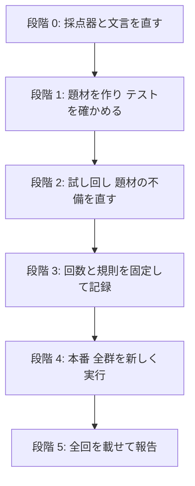
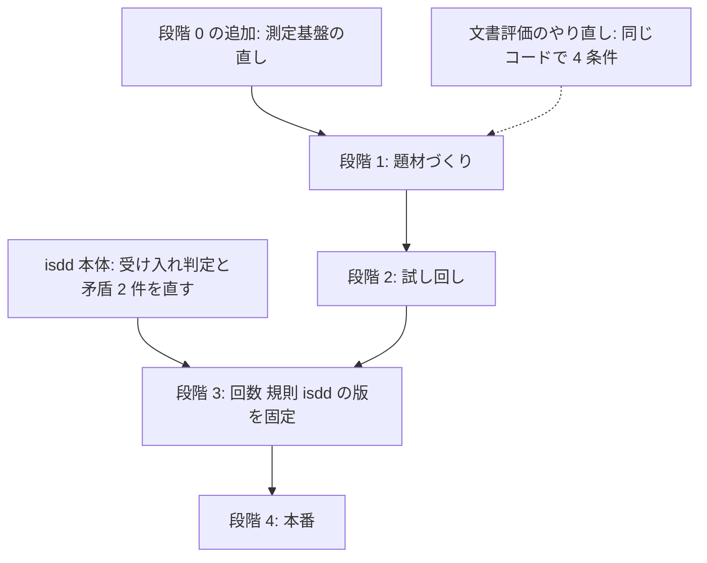
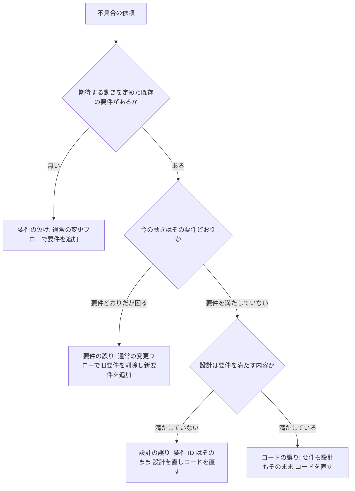

# セッションログ 05cae6e5

- セッション: `05cae6e5-ad53-4aaa-9ab9-7bc46c4021f7`
- cwd: `/Users/notfolder/Documents/isdd`（branch: main）
- 期間: 2026-11-23 07:46 〜 2026-11-28 11:39
- Claude Code: 2.1.329
- 発言: ユーザー 64 / Claude 56 / ツール呼び出し 349
- 書き出し: 2026-11-28 11:40 JST

> ユーザー発言と Claude の本文は逐語。ツール呼び出しは `🔧` の 1 行に要約し、ツール結果・思考ブロックは含まない。

---
## 1. ユーザー（2026-11-23 07:46）

（コマンド: /clear ）

## 2. ユーザー（2026-11-23 07:54）

現在の評価が妥当かもう一度整理したい。isddでやっている事の評価で外部連携など評価していないところがある。要件定義の重要性も整理できていない評価になっている。質問数が少なくて、とりあえず動くのでisddを縮小して良い様な結果だが、何で作ったのか、解決すべき業務課題は何かなど、isddが要件定義で決めている項目の価値を測れていない。設計で決めさせている事の評価も測れていない。
評価方法を見直して、どの様な評価が必要かちゃんと整理して報告して

## 3. Claude

> 🔧 `Bash` 計測のまとめとスキルの構成を一覧する

> 🔧 `Read` /Users/notfolder/Documents/isdd/measure/results/SUMMARY.md

> 🔧 `Bash` 要件定義書と設計書の章立ての規則を読む

> 🔧 `Read` /Users/notfolder/Documents/isdd/.history/BACKLOG.md

> 🔧 `Read` /Users/notfolder/.claude/projects/-Users-notfolder-Documents-isdd/05cae6e5-ad53-4aaa-9ab9-7bc46c4021f7/tool-results/b8jt9w0r1.txt

> 🔧 `Bash` 外部連携・設計の完全性・要件の除外の規則と、計測の題材の中身を読む

> 🔧 `Bash` 題材の依頼文と依頼者役の答え、外部連携を含む題材の有無を確かめる

> 🔧 `Bash` 外部連携を含む題材の有無、契約、読み手評価の質問の種類、変更を重ねる題材の台帳を確かめる

> 🔧 `ToolSearch` select:WebSearch

> 🔧 `WebSearch` benchmark evaluating coding agents on underspecified requirements clarifying questions requirements elicitation LLM

> 🔧 `WebSearch` spec-driven development evaluation AI coding agents empirical study requirements documents value maintainability

> 🔧 `WebSearch` LLM agent architecture design decision evaluation benchmark non-functional requirements software architecture erosion generated code

調査だけ行い、ファイルは何も変更していません。

## 結論

今の評価から「isdd は縮小してよい」とは言えません。題材と採点の作りが、isdd が要件定義と設計で決める項目の大半を、差が出ない形に固定していました。差が測れたのは「依頼に無い文言と業務のきまりを聞く」「決めたことを残す」の 2 点だけで、「一文で足りる」が言えるのもその 2 点に限られます。

## 1. 今の評価で差が出ない理由

| 原因 | 確かめた事実 | 測れなくなったもの |
|---|---|---|
| 依頼文に答えが書いてある | `bizrules` の依頼文に、業務の問題（Excel 台帳、問い合わせ 1 回 15 分）、利用人数 50 人、社内サーバー、無償、GUI のみが最初から書いてある | 業務の問題・課題、技術制約、非機能を聞き出す価値 |
| 契約が設計を決めている | `contract.md` が起動方法、URL、要素の id、Python 3.12 と SQLite、「外部のサービスを使わない」まで指定している | 技術選定、構成、インターフェース設計、運用設計 |
| 依頼者役が解決策を間違えない | 台帳は「聞かれたことに答える、案に従う、技術は任せる」。頼まれた機能は常に正しい | 課題と機能を結びつけ、要らない機能を削り、ずれた依頼を直す価値 |
| 採点が画面の機能テストだけ | 隠しテストはブラウザ操作で文言と動きを見る | 非機能、運用、障害時の動き、作りすぎ |
| 外部連携の題材が無い | `measure/` の題材を検索して 0 件 | 接続テスト、仕様との突き合わせ、連携ライブラリ、モックと実物の切り替え |
| 聞くことが同じ種類で独立している | 文言 20 項目、きまり 8 つは、1 回にまとめて聞けば済む | 問題 → 課題 → 機能のように、前の答えで次の問いが変わる聞き取り |

計測 5 の「依頼文 114 行を残すだけで 64.0 点」も、依頼文に理由が書いてあったからです。理由が聞き取りでしか出てこない題材なら、依頼文を残す方式は「なぜ」に答えられません。

## 2. isdd が決める項目ごとの、今の評価の届き方

| isdd が決める項目 | 今の評価 | 状態 |
|---|---|---|
| 業務の問題、業務課題、見込み効果（要件 2 章） | 計測 5 の「なぜ」の質問だけ。作るときの価値は見ていない | ほぼ未測定 |
| 機能を課題に結びつけ、結びつかない機能を削る（要件 3 章） | なし | 未測定 |
| 技術制約（要件 1-1） | 依頼文に記載済み | 未測定 |
| 依頼に無く自分で決めた項目（要件 1-2） | 計測 2・3 で「聞けたか」だけ。未確認の決め事を示す価値は見ていない | 一部 |
| 業務ルール（要件 3-2） | 計測 3 | 測定済み |
| 外部連携（要件 3-3、設計 4-1、8 章） | なし | 未測定 |
| データの保持、同時更新、状態遷移（要件 4 章、設計 3 章） | なし | 未測定 |
| 非機能、運用（要件 5・6 章、設計 9・10 章） | なし | 未測定 |
| 技術選定（設計 1 章） | 契約で固定 | 未測定 |
| クラスの責務、依存の規則（設計 5・7 章） | 計測 8・9 で 60 機能の変更漏れだけ。構造の崩れは見ていない | 一部 |
| 対応表と追跡（未実装と作りすぎの検出） | スキルの eval だけ。バイブコーディングとの比較は無い | 未測定 |
| 決め事を残して読む | 計測 4・5・6・10 | 測定済み |

## 3. 必要な評価

**要件定義の価値**

| 番号 | 評価 | 題材の作り | 採点 |
|---|---|---|---|
| A1 | 課題とずれた依頼を直せるか | 依頼は「〜の機能を作って」だけ。依頼者役は本当の問題を持ち、聞かれれば話す。依頼どおりに作っても問題は解決しない | 業務の問題が解決したかを確かめるシナリオのテスト |
| A2 | 作りすぎを防げるか | 依頼に、課題に結びつかない機能を混ぜる。「無いと何が困るか」と聞かれた依頼者役は「困らない」と答える | 作った機能の数、コードの行数、費用 |
| A3 | 非機能・運用・データを聞けるか | 台帳に同時利用、保持期間、監査の記録、既存 Excel からの移行を持たせ、依頼文には手がかりだけ置く | 同時更新のテスト、件数を入れた応答時間、移行の成否、記録の有無 |
| A4 | 技術制約を聞けるか | 依頼者役が配備先と禁止技術を持つ | 採点環境で起動するか、禁止技術を使っていないか |
| A5 | あとの依頼が業務課題と矛盾したら指摘できるか | 変更を重ねる題材に、最初の課題と矛盾する依頼を入れる | 指摘したか、黙って作ったか |

**設計の価値**

| 番号 | 評価 | 題材の作り | 採点 |
|---|---|---|---|
| B1 | 外部連携 | 手元で立てる模擬の外部システム。ページ分割、回数制限、認証の失効、説明書と実物の食い違いを仕込む | 実物相当での隠しテスト、障害を起こしたときの動き、連携先の仕様を変えたあとの直しの費用 |
| B2 | 技術選定 | 保守切れやライセンス違反の候補が選ばれやすい条件にする | 選んだ依存の保守状況、ライセンス、配備先で動くか |
| B3 | データの整合 | 同時更新と、途中で失敗する複数操作を含む業務 | 並行リクエストと障害注入のテスト |
| B4 | 構造の持ち | 変更を 10〜30 回重ねる | 重複実装の数、依存の向きの違反数、1 回の変更の行数と費用の推移 |
| B5 | 未実装と作りすぎの検出 | 要件の多い題材で「完了」と報告させる | 完了と言ったのに未実装の要件数、要件に無いコードの量 |

A1・A2 と B1 は、isdd だけが手順を持つ部分です。A3 は一文つきでも聞ける可能性があり、isdd の上乗せが出るかどうか自体が知りたい点です。

## 4. 測り方の直し

| 直すこと | 理由 |
|---|---|
| 依頼文から業務の問題と制約を外し、依頼者役の台帳に移す | 聞き出す価値を測るため |
| 契約を起動方法とポートまで減らし、採点を業務シナリオ・非機能・障害時の結果に寄せる | 契約が設計を決めると、設計の差が出ないため |
| 依頼者役に、解決策を間違える、理由を聞かれて初めて本当の問題を話す、という性格を持たせる | 今の依頼者役は頼む機能が常に正しい |
| 質問は回数ではなく、その質問で防げた手戻りで数える | 今は質問が費用としてしか現れない |
| 各評価はまずバイブコーディングと一文つきだけで回す | 両方とも落ちる題材だけ isdd を回せば、重い実行を絞れる |
| 結論に「測っていない範囲」を並べて書く | 測った 2 点の結果が、全体の結論として読まれたため |

## 5. 外部の研究との照合

検索結果の要約で確かめた範囲で、論文の本文は読んでいません。

- 曖昧な依頼への質問を測る評価（Ambig-SWE、ClarEval、ICAE-Bench）はありますが、どれも「足りない前提を聞けたか」と機能の出来を見るもので、今の計測 2・3 と同じ範囲です。業務課題との整合、非機能、外部連携を測る既存の評価は見つかりませんでした。題材は自作になります。
- ICAE-Bench の著者は、難所は質問することより、聞いた要件を保って実装に反映することだと述べています。計測 4 の結果と合います。
- 仕様駆動開発の調査では、実装の細部まで書いた仕様は古くなりやすい（Agarwal ら）、仕様の成果物があっても不具合は減らなかった（Hill、ESEM 2026）という報告があります。

Sources:
- [Ambig-SWE: Interactive Agents to Overcome Underspecificity in Software Engineering](https://arxiv.org/abs/2502.13069v3)
- [ClarEval](https://arxiv.org/html/2603.00187)
- [ICAE-Bench: Evaluating Coding Agents as Interactive Project Builders](https://huggingface.co/papers/2607.21217.md)
- [Spec-Driven Development as Prescribed and as Practiced](https://arxiv.org/pdf/2608.25202)
- [Hill, ESEM 2026](https://drops.dagstuhl.de/storage/00lipics/lipics-vol394-esem2026/LIPIcs.ESEM.2026.84/LIPIcs.ESEM.2026.84.pdf)

## 確認事項

3 問は互いに独立です。作業量の見積もりは、どれを作るか決まってから出します。

**1. どの評価から題材を作るか**

3 章の評価は題材を新しく作る必要があり、一度に全部は作れません。

| 案 | 内容 | 影響 |
|---|---|---|
| A | 課題とずれた依頼と作りすぎ（A1・A2）を 1 つの題材で先に作り、次に外部連携（B1） | 「業務課題を決める価値」が最初に分かる。模擬の外部システムが要らず、題材が軽い |
| B | 外部連携（B1）を先に作る | isdd の中で最も手順が重い部分の価値が分かる。模擬の外部システムを作る分、題材が重い |
| C | 非機能とデータの整合（A3・B3）を先に作る | 採点を機械で作りやすい。ただし一文つきで足りる結果になる可能性がある |

おすすめ: A。指摘の中心が「何のために作るのか、解決すべき業務課題は何か」の価値で、今の題材に最も欠けている部分だからです。

**2. 外部連携の題材の連携先**

| 案 | 内容 | 影響 |
|---|---|---|
| A | 手元で立てる模擬の外部システム（HTTP の API）に癖を仕込む | 無人で何度でも回せる。説明書と実物の食い違いも作れる |
| B | 実在の無償サービスにつなぐ | 現実に近い。接続情報の管理が要り、相手の変更で結果が揺れる |
| C | 既存の DB に直結する形にする | スキーマの取得と突き合わせを測れる。API 特有の制限は測れない |

おすすめ: A。同じ条件で繰り返せることと、対照群に条件をそろえられることが比較に必要だからです。

**3. 今の「軽くできる」という結論の扱い**

`measure/results/SUMMARY.md` の 2 章と 6 章は、isdd の手順に省ける所が多いと書いています。`.history/BACKLOG.md` にも「isdd を軽くする検討」が重要度 高で残っています。

| 案 | 内容 | 影響 |
|---|---|---|
| A | `SUMMARY.md` に「測っていない範囲」の節を足し、軽くする検討は新しい評価が出るまで保留と書く | 誤った縮小を防げる。今回の整理も残る |
| B | 文書はそのままにし、軽くする検討だけ保留にする | 変更が小さい。`SUMMARY.md` を読んだ人は縮小してよいと受け取る |
| C | 何も変えず、新しい評価の結果が出てから直す | 手間は無い。次の Qiita 記事の材料が今の結論のままになる |

おすすめ: A。次の記事が `SUMMARY.md` を材料にするので、今の結論のまま外に出るのを先に止めたいからです。

## 4. ユーザー（2026-11-23 08:02）

<pasted_content id="dddd">
今のまとめをファイルにしてpushしておいて
1 A
2 A
3 Aだが、今回のまとめはかなり良いので、SUMMARYとは別に出して
今すぐは評価しなおさず、11時すぎににやります。
</pasted_content id="dddd">

## 5. Claude

> 🔧 `Write` /Users/notfolder/Documents/isdd/measure/results/EVALUATION-REVIEW.md

> 🔧 `Edit` /Users/notfolder/Documents/isdd/measure/results/SUMMARY.md

> 🔧 `Edit` /Users/notfolder/Documents/isdd/measure/results/SUMMARY.md

> 🔧 `Edit` /Users/notfolder/Documents/isdd/.history/BACKLOG.md

> 🔧 `Bash` 見直しの文書と追記をコミットして push する

まとめをファイルにして、`main` へ push しました（コミット `cad60c4`）。これまでのコミットと同じく、ブランチは切らず `main` に直接入れています。

| ファイル | 変更 |
|---|---|
| `measure/results/EVALUATION-REVIEW.md` | 新規。今回のまとめの全文と、決めたこと（1A・2A・3A）を末尾に記載 |
| `measure/results/SUMMARY.md` | 2 章に「この結論が届く範囲」の追記、7 章の限界の表に 1 行。どちらも新しい文書への案内 |
| `.history/BACKLOG.md` | 題材づくり 3 件を追加（課題とずれた依頼と作りすぎ、外部連携、残りの評価）。「isdd を軽くする検討」は保留と明記 |

`.qiita-post.json` の 2 件は、限定共有中の決まりどおりコミットしていません。

評価のやり直しには着手していません。11 時すぎに再開するときは、BACKLOG の最初の題材（課題とずれた依頼と作りすぎ）から始めます。

## 6. ユーザー（2026-11-23 08:14）

/Users/notfolder/Documents/isdd/measure/results/CODEX-EVALUATION-REVIEW.md
これを読んで、妥当なところだけ取り込んで方針を検討し直して整理して報告して

## 7. Claude

> 🔧 `Read` /Users/notfolder/Documents/isdd/measure/results/CODEX-EVALUATION-REVIEW.md

> 🔧 `Bash` 採点器と実行器の採点・有効判定の部分を読む

> 🔧 `Bash` 文書の質疑応答の採点と、0.7% の算出の記録を読む

> 🔧 `Bash` 既存の採点結果に、テスト名の重複・未採点・採点者の応答欠けが無いかを読み取りだけで確かめる

> 🔧 `Bash` 採点者の応答欠けが、仕様の質問の点に影響したかを確かめる

> 🔧 `Bash` 記事の中の区切りと確率の書き方を確かめる

Codex のレビューを読み、指摘の根拠をコードと既存の結果で確かめました。今回は読み取りだけで、ファイルは変更していません。

## 結論

7 件とも方向は妥当で、取り込みます。ただし 3 件は、確かめた事実に合わせて範囲を狭めます。最初の題材（課題とずれた依頼と作りすぎ）と次の外部連携という順番は変えません。変えるのは、題材を作る前に採点器と文言を直すことと、本番の比較を全群の新しい実行でやり直すことの 2 点です。

## 1. 指摘ごとの判定

| 番号 | Codex の指摘 | 確かめた事実 | 判定 |
|---|---|---|---|
| 1 | 採点できなかった結果が点や退行に混ざりうる | コードは指摘どおり（終了コードを記録しない、テスト名だけがキー、XML が無いと 0 件、消えたテストは退行に数えない、採点者の応答が壊れると 0 点）。既存の結果では起きていない | 取り込む。対象は今後の採点器の直しで、既存の数字の訂正は不要 |
| 2 | 結論が注記より強い | `SUMMARY.md` の 2 章「省ける所が多くあります」、6 章「出来は同じ」「効き目の芯」が残る。計測 3 の isdd は 2 回、計測 4 の isdd と数文つきは 1 回ずつ。私の見直し文書の「採点が画面の機能テストだけ」も、計算の API と文書を読む評価を無視した言い過ぎ | 取り込む |
| 3 | 対照群の結果だけで題材を選ぶと偏る | 私が出した「まず対照群だけで回し、両方落ちる題材だけ isdd を回す」は、対照群がたまたま低かった題材を選ぶことになる | 取り込む。先に安く回すことは残し、位置づけを変える（2 章） |
| 4 | 試行数と統計の解釈 | 0.7% は、アプリ 1 本を単位にした平均の差の並べ替え検定（12 回対 3 回、p=0.0066）で、単位と区切りの懸念は当たらない。ただし「偶然で出る確率」は不正確。対照群の 9 回追加は、3 回の結果（p=0.30）を見たあとに決めている | 一部取り込む。言い回しの直しと、回数と止める条件の事前の固定 |
| 5 | 作りすぎを行数と機能数で測ると価値とずれる | `score.py` の作りすぎは行数と公開関数の数だけ。必要な機能を省いても減る | 取り込む |
| 6 | 割り当て・手順の実施・完了を分ける | `run.py` の `valid` は「スキルを呼んだ、または文書がある」。変更の段では、前の段の文書があるだけで真になる | 取り込む |
| 7 | AI の採点の一致は正しさを保証しない | 同じモデルの 3 回の中央値。指摘は正しい | 一部取り込む。新しい題材は固定テストで採点する。人による抜き取りは確認事項 3 |

指摘 1 と 4 で確かめた既存の結果の中身です。

| 確かめたこと | 結果 |
|---|---|
| 隠しテストの名前の重複（4 題材） | 0 件 |
| 段ごとの採点結果 223 件のうち、テスト 0 件や採点エラーのもの | 0 件 |
| 仕様の質問の採点者の応答 144 件のうち、32 問がそろっていないもの | 0 件 |
| 記事の「4 件以下・5 件以上」 | 比較記事の 149 行目にある。0.7% は平均の差の検定の値で、この区切りから出した値ではない。記事では区切りの文の直後に置かれ、区切りから計算したように読める |

確かめていないのは、文書を読むほかの評価（不具合の判定など）の採点者の応答と、期待件数との厳密な照合です。

## 2. 見直した方針



| 段階 | やること | 前の方針との違い |
|---|---|---|
| 0 | 採点器の直し。テストをファイル名込みで記録し、期待件数との差、終了状態、XML の欠落を「未採点」として分ける。採点者の応答は全項目を検査する。実行器は、割り当て・スキルが見えたか・呼んだか・文書を更新したか・完了・採点できたかを別々に記録する。単体テストで確かめる | 新規 |
| 0 | `SUMMARY.md` と `EVALUATION-REVIEW.md` の断定を「この題材・指標・回数では差が見つからなかった」にそろえ、数字に回数を添える。0.7% の言い回しを直す | 新規 |
| 1 | 題材の台帳に、本当の業務の問題、必要な成果、課題に不要な機能の一覧を先に書く。テストは、正しい実装・依頼どおりの実装・作りすぎた実装の 3 つで確かめる | 作りすぎの測り方を変更 |
| 2 | バイブコーディングと一文つきで試す。目的は題材とテストの不備の直しで、結果は本番に数えない | 「isdd を回すかを決める選別」から「探索」に変更 |
| 3 | 主な指標、各群の回数、足すときの条件、除外の規則を、本番の前に題材のフォルダに書いてコミットする | 新規 |
| 4 | 全群を新しく実行する。試し回しで一文つきが満点でも isdd を回す | 「両方落ちた題材だけ isdd」をやめる |
| 5 | 割り当てた回をすべて載せる。未完了と環境の障害は理由別に出す。作らなかった題材と理由も書く | 新規 |

作りすぎの題材の採点は、次の 4 つを別々に報告します。

| 指標 | 中身 |
|---|---|
| 業務シナリオの達成 | 必須。落ちた回は、ほかの指標が良くても合格にしない |
| 不要な機能の実装 | 台帳で不要と決めた機能が、あるかないかをテストで見る |
| 必要な機能の欠落 | 削りすぎを別に数える |
| 費用と行数 | 行数は参考値 |

## 3. 取り込まないところ

| Codex の提案 | 扱い | 理由 |
|---|---|---|
| 既存の結果への採点検査の適用 | 今回の確認で足りるとする | 重複・0 件・応答欠けはどれも 0 件だった |
| 比較の単位をアプリ 1 本にする | 対応済み | 0.7% の検定はすでにその単位 |
| 条件を伏せた答えを人が採点する | 新しい題材では不要にする | 固定テストで採点できる題材にするため |

## 確認事項

3 問は互いに独立です。

**1. 本番の比較の回数**

指摘 4 のとおり、回数は結果を見る前に決めます。1 回の費用の実測は、バイブコーディングと一文つきが約 1 ドル、isdd が約 18〜29 ドルです。

| 案 | 内容 | 影響 |
|---|---|---|
| A | バイブコーディング 6 回、一文つき 6 回、isdd 3 回 | 約 70〜100 ドル相当。安い群の揺れは見える。isdd は 3 回なので「同等」とは書けず、「差は見つからなかった」までしか言えない |
| B | 3 群とも 3 回 | 約 60〜90 ドル相当。計測 2 で、対照群 3 回では揺れて差が言えなかった |
| C | 3 群とも 6 回 | 約 120〜190 ドル相当。isdd と一文つきの差まで言える見込みが上がる。定額契約の 5 時間上限に何度か当たる |

おすすめ: A。安い群だけ多く回す今の決まりに沿い、回数を先に固定すれば、あとから足した問題も避けられます。isdd と一文つきの差が主題になる題材だけ、C を事前に選びます。

**2. 段階 0 をいつやるか**

採点器と文言の直しは、モデルを動かさずに済みます。

| 案 | 内容 | 影響 |
|---|---|---|
| A | 題材づくりの前に、採点器の直しと文言の直しを両方やる | 新しい題材が最初から直した採点器に乗る。題材づくりが少し後ろにずれる |
| B | 文言の直しだけ先にやり、採点器は題材づくりと並行で直す | 外に出る表現は先に直る。新しい題材の採点スクリプトを 2 度書くおそれがある |
| C | 題材づくりを先にやり、直しは本番の前にまとめる | 早く題材に入れる。試し回しの結果に未採点が混ざっても気づけない |

おすすめ: A。題材ごとの採点スクリプトは `score.py` を写して作ってきたので、先に直さないと同じ穴が新しい題材に入ります。

**3. AI の採点を人が抜き取りで確かめるか**

対象は、既存の「仕様の質問」の評価（32 問、AI が 3 回採点）です。

| 案 | 内容 | 影響 |
|---|---|---|
| A | やらない。限界として「採点は AI で、人の確認はしていない」と書く | 手間は無い。その評価の点は AI の採点の偏りを含んだままになる |
| B | 条件を伏せた答え 20〜30 件をあなたが採点し、AI の採点との一致を記録する | あなたの作業が要る。「なぜ」の質問の 1.7 点対 15 点の差の信頼が上がる |

おすすめ: A。この評価の差は大きく、採点基準の小さな偏りでは逆転しません。記事でこの数字を主な根拠に使うと決めたときに B をやれば足ります。

**依頼（問いとは別）**

- `measure/results/CODEX-EVALUATION-REVIEW.md` は未コミットです。コミットするかどうかを指示してください。
- 比較記事 149 行目の言い回しは、限定共有中の記事の本文なので触っていません。直すかどうかも指示してください。

## 8. ユーザー（2026-11-23 08:20）

<pasted_content id="dddd">
1 A
2 A
3 A
現状をまとめてcodexのファイルも含めてpushまでして
</pasted_content id="dddd">

## 9. Claude

> 🔧 `Bash` 見直し文書に Codex の取り込みと進め方を書き足し、BACKLOG を更新して、Codex のファイルと一緒にコミットして push する

現状をまとめ、Codex のファイルと一緒に `main` へ push しました（コミット `d59ff1b`）。

| ファイル | 変更 |
|---|---|
| `measure/results/CODEX-EVALUATION-REVIEW.md` | そのまま追加 |
| `measure/results/EVALUATION-REVIEW.md` | 8 章に Codex の 7 件の判定と確かめた事実、9 章に進め方（段階 0〜5）を追加。7 章に今回の決定（1A・2A・3A）を追記。4 章と 5 章の表は、取り込んだあとの内容に直した |
| `.history/BACKLOG.md` | 段階 0（採点器と文言の直し）を追加。最初の題材の項目を、試し回しは探索、本番は 6 回・6 回・3 回という内容に更新 |

まだやっていないことは次のとおりです。

- **段階 0**: 採点器の直しと `SUMMARY.md` の文言の直しは未着手です。決定どおり、題材づくりの前にここから始めます。
- **比較記事 149 行目**: 0.7% の言い回しは触っていません。直すかどうかの判断待ちとして BACKLOG に入れました。

## 10. ユーザー（2026-11-23 11:31）

<task-notification>
<task-id>bmh5k5sum</task-id>
<tool-use-id>toolu_01FVALFhRpum4UZb1UABwPb4</tool-use-id>
<output-file>/private/tmp/claude-501/-Users-notfolder-Documents-isdd/657a16f3-6da0-4b59-95f4-34346ec5e99b/tasks/bmh5k5sum.output</output-file>
<status>completed</status>
<summary>Background command "計測のあいだ機械がスリープしないようにする（10 時間）" completed (exit code 0)</summary>
</task-notification>

## 11. Claude

スリープ防止のコマンド（10 時間）が終了したという通知が届きました。このセッションで起動したものではなく、以前の計測のときのものです。

いま計測は動かしていないので、影響はありません。段階 0 以降で長い実行を始めるときは、スリープ防止を改めてかけ直します。

## 12. ユーザー（2026-11-23 12:07）

段階0を実施して

## 13. Claude

> 🔧 `Bash` 採点器の写しどうしの違いと、既存のテストの置き場所を確かめる

> 🔧 `Bash` 実行器の採点まわりと、採点結果を読む側のコードを読む

> 🔧 `Bash` 写しの採点器の本体、不具合判定の採点、集計の表示、再採点の部分を読む

採点器の共通部品 `measure/scoring.py` を作り、各題材の採点スクリプトと実行器をそれに載せ替えます。続けて単体テストと文言の直しをやります。

> 🔧 `Write` /Users/notfolder/Documents/isdd/measure/scoring.py

> 🔧 `Bash` 各題材の採点スクリプトを共通部品に載せ替え、構文を確かめる

> 🔧 `Bash` 載せ替えが止まった題材のフォルダの作りを確かめる

> 🔧 `Bash` 残りの題材の採点スクリプトを載せ替える

> 🔧 `Bash` 実行器に、未採点の区別・未実行の区別・手順の実施状況の記録を入れる

> 🔧 `Bash` 手作業の採点・再採点・集計表も共通部品に載せ替える

実行器と集計表の載せ替えが済みました。次は AI の採点（`docval/`）の応答検査と単体テストです。

> 🔧 `Bash` AI の採点に、形の壊れた応答を捨てて聞き直す検査を入れる

> 🔧 `Bash` 共通部品の単体テストを書いて、手元の 2 つの Python で通す

> 🔧 `Bash` 直した採点器を既存の成果物の写しに対して実際に回し、記録済みの点と一致するか確かめる

> 🔧 `Bash` 未採点になる経路を実物で確かめ、計測ごとの回数を結果のファイルから数える

> 🔧 `Bash` 変更を重ねる計測の回数の記録と、直す対象の文を特定する

> 🔧 `Bash` まとめの断定を回数つきの表現に直し、見直し文書に段階 0 の実施内容を書く

> 🔧 `Write` /private/tmp/claude-501/-Users-notfolder-Documents-isdd/05cae6e5-ad53-4aaa-9ab9-7bc46c4021f7/scratchpad/wording.py

> 🔧 `Bash` 文言の直しを当て、実行器に足した関数をモデルなしで確かめる

文言の直しも当て終わりました。最後に BACKLOG の整理と README への追記をします。

> 🔧 `Bash` BACKLOG の段階 0 を完了へ移し、README に採点の扱いを追記して、全体の構文とテストを確かめる

段階 0 を実施しました。モデルは動かしていません。コミットと push はまだしていません。

## やったこと

| 項目 | 中身 |
|---|---|
| 採点の共通部品 `measure/scoring.py`（新規） | 回すはずのテストを先に数え、結果との差、pytest の終了コード、XML の欠落、テスト名の重なりを「未採点」として不合格と分ける。アプリが起動せずテストが落ちるのは不合格のまま |
| 題材ごとの採点スクリプト | `score.py`、`bizrules`、`longrun`、`bigapp`、`ripple` を共通部品に載せ替えた |
| 実行器と集計 | `run.py`・`stage.py`・`rescore.py`・`report.py` が未採点を「未採点」と出す。前の段で合格したテストが結果から消えたものは、退行と分けて「未実行」に出す |
| 手順の実施状況 | `run.py` が段ごとに、割り当て、スキルが見えたか、呼んだか、その段で文書を更新したか、完了、採点できたかを別々に残す。モデル、依頼者役、上限、isdd の版も残す |
| AI の採点 | `docval/qa.py` と `docval/t23.py` が、形の壊れた応答を 0 点として数えずに捨てて聞き直す。3 件そろわなければ点を確定しない |
| 文言 | `SUMMARY.md` の 2 章・4 章・6 章の断定を「この題材と回数では差が見つからなかった」にそろえ、回数を添えた。0.7% の説明も直した |
| 記録 | `EVALUATION-REVIEW.md` の 9 章に実施内容、`measure/README.md` に採点の扱い、BACKLOG の段階 0 を完了へ移動 |

## 確かめたこと

- **単体テスト**: `measure/tests/test_scoring.py` の 28 件が、Python 3.9 と 3.12 の両方で通りました。
- **実物の採点**: 既存の成果物 1 本を写して採点し直し、記録済みの点（11 件中 4 件）と一致しました。回すはずの 11 件と結果の 11 件もそろいました。
- **未採点の経路**: pytest の無い Python を渡すと、0 点ではなく「未採点」になりました。

## 確かめていないこと

- `run.py` の実施状況の記録と、AI の採点の聞き直しは、通しでは動かしていません。モデルを動かさないと通らない経路なので、次の実行の最初の 1 回で中身を確かめます。文書の更新の検出と isdd の版の読み取りだけは、単独で動かして確かめました。
- `scicalc`・`swedev`・`featurebench`・`webgen` の採点器は、今後の評価で使わないので載せ替えていません。

## 文言で変えた点のうち、判断が入ったもの

- 6 章の「効き目の芯は 3 つ」を 2 つに減らしました。「テストを残して毎回通す」は、どのやり方でも前の機能を壊さなかったので、効き目を確かめられていないためです。
- 0.7% の説明に、バイブコーディングの 12 回のうち 9 回は最初の結果を見たあとに足した、という事実を書き足しました。

## 確認事項

**1. コミットと push**

変更は 16 ファイルと新規 2 つ（`measure/scoring.py`、`measure/tests/`）で、作業フォルダに置いたままです。

| 案 | 内容 | 影響 |
|---|---|---|
| A | 今コミットして `main` に push する | 段階 1 の題材づくりを、直した採点器が入った状態から始められる |
| B | 差分を見てから決める | `SUMMARY.md` の文言を先に読める。題材づくりの開始はそのあとになる |

おすすめ: A。文言の直しは Codex の指摘 2 と決定済みの方針どおりで、気になる所はあとから個別に直せます。

## 14. ユーザー（2026-11-23 13:09）

This session is being continued from a previous conversation that ran out of context. The summary below covers the earlier portion of the conversation.


Summary:
1. Primary Request and Intent:
   - 最初の依頼: isdd の現在の評価（`measure/results/SUMMARY.md` の計測 1〜12）が妥当かを整理し直す。外部連携、要件定義の重要性（何で作ったのか、解決すべき業務課題は何か）、設計で決めさせている事の価値を測れていないので、評価方法を見直し、どの様な評価が必要かを整理して報告する。
   - 2 回目: そのまとめをファイルにして push。回答は「1 A / 2 A / 3 Aだが、今回のまとめはかなり良いので、SUMMARYとは別に出して」「今すぐは評価しなおさず、11時すぎににやります」。
   - 3 回目: `measure/results/CODEX-EVALUATION-REVIEW.md` を読み、妥当なところだけ取り込んで方針を検討し直して整理して報告。
   - 4 回目: 「1 A / 2 A / 3 A」「現状をまとめてcodexのファイルも含めてpushまでして」。
   - 5 回目（最新）: 「段階0を実施して」（採点器の直しと文言の直し。題材づくりの前にやる作業）。
   - 守るべき指示（CLAUDE.md より）: 日本語で応答。図は Mermaid。調査依頼と作業依頼を混同しない。承認された範囲だけ実行。報告は表で。確認事項は応答末尾に番号付き・選択肢・おすすめ・根拠つき。10 分以上の作業は終了時刻を時計で報告し、背景の sleep で自分を起こす。`~/.claude` で同期するファイルにトークン・パスワード・自宅のホスト名や IP・開発中の作業の中身を書かない。**限定共有のあいだは `.qiita-post.json` をコミットしない。** eval 実行中は `skills/`・`evals/` を編集しない。コミット・push はユーザーが頼んだときだけ（コミット末尾に `Co-Authored-By: Claude Fable 5.2 <＜メールアドレス＞>`）。ユーザーの名前・メール等を外部サービスに送らない。BACKLOG は状態が変わった時点で随時更新。作業量の見積もりは `~/.claude/estimate-log.md` のルールに従う。

2. Key Technical Concepts:
   - isdd（isdd-spec / isdd-build / isdd-reverse-engineering / isdd-setup）とバイブコーディング・一文つき・数文つき・AI-DLC の比較計測（`measure/run.py`、`claude -p` の無人実行、依頼者役の隠し台帳、隠しテスト＝pytest＋Playwright、JUnit XML）
   - 今の評価で差が出ない構造的理由: 依頼文に業務の問題・制約が書いてある、契約（contract.md）が設計を固定、依頼者役が解決策を間違えない、採点が機能テスト中心、外部連携の題材が無い、質問が独立した同種のものだけ
   - 必要な評価 A1〜A5（要件定義）、B1〜B5（設計）。決定: 最初は A1・A2（課題とずれた依頼＋作りすぎ）を 1 題材、次に B1（外部連携、手元の模擬 HTTP API に癖）。「isdd を軽くする」判断は保留。
   - Codex 指摘の取り込み: 未採点と不合格の区別、未実行と退行の区別、試し回しは探索で本番に数えない、本番は回数と規則を先にコミットして全群を新しく実行（バイブ 6・一文つき 6・isdd 3）、作りすぎは業務シナリオ達成を必須にして不要機能の実装／必要機能の欠落／費用を別々に報告、割り当て・実施・完了の区別、AI 採点の人による抜き取りはやらない（限界として書く）
   - 進め方: 段階 0（採点器と文言の直し）→ 1（題材づくり、正しい実装・依頼どおりの実装・作りすぎ実装でテスト確認）→ 2（試し回し）→ 3（回数と規則の固定）→ 4（本番）→ 5（全回を報告）

3. Files and Code Sections:
   - `measure/results/EVALUATION-REVIEW.md`（新規、コミット済み＋段階 0 で追記・未コミット）: 1 結論、2 差が出ない理由、3 項目ごとの届き方、4 必要な評価、5 測り方の直し、6 外部研究、7 決めたこと、8 Codex の取り込み、9 進め方（末尾に「段階 0 の実施（2026-11-23）」の表、載せ替えていない採点器、実物で確かめていないもの）。
   - `measure/results/CODEX-EVALUATION-REVIEW.md`: Codex のレビュー 7 件。d59ff1b でコミット済み。
   - `measure/results/SUMMARY.md`: cad60c4 で「この結論が届く範囲」追記と 7 章に 1 行。段階 0 で断定を回数つき表現に変更（未コミット）: 2 章の表に回数、「差が出なかった場面」に「同等だと確かめたものではない／計測 9 は isdd を回していない」、「省ける所が多くあります」→ 測った 2 題材に限る表現、0.7% の説明（並べ替え検定 p=0.0066、9 回は結果を見たあとに追加）、計測 2・3・4 の文、6 章の前置き・「出来は同じ」・「効き目の芯」・AI-DLC の行。
   - `measure/scoring.py`（新規・未コミット）: 採点の共通部品。主な関数: `parse_collect(stdout)`, `short_name`, `parse_junit(xml)` → (識別子 classname::name, 名前, 結果), `judge_run(expected_ids, cases, returncode, timed_out, where)` → tests/test_ids/expected/not_run/reasons, `new_result(stage, app)`, `run_hidden(python, hidden, marks, env, timeout_min, result)`（`--collect-only` で期待件数、pytest 実行、merge）, `merge_run`, `finalize`, `load_score(out_json)`（無い・壊れ・旧形式を扱う）, `stage_fields(score)`, `compare_stages(prev, now)` → `regressions` と `not_run_after_pass`, `score_label(info)`（未採点は「未採点」）, `valid_point_vote`, `valid_found_vote`, `parse_json_object`, `collect_votes(ask, is_valid, need=3, max_tries=6)`, `median_points`。`scoring_status` は "scored"/"unscored"、PYTEST_OK=(0,1)。
   - `measure/score.py`, `measure/bizrules/score.py`, `measure/longrun/score.py`, `measure/bigapp/score.py`, `measure/ripple/score.py`（未コミット）: `run_pytest` を削除し `from scoring import finalize, new_result, run_hidden` に載せ替え。`bizrules-nohint/score.py`、`bigapp-doc-isdd/score.py`、`bigapp-doc-notes/score.py` はシンボリックリンク。`count_overbuild` は `score.py` に残る。
   - `measure/run.py`（未コミット）: `import hashlib, re`、scoring の import、`ISDD_DOCS` と `doc_digests(workdir)`（docs の正本と `.history/*/*.md` の sha256）、段の前後で比較して `conduct = {"assigned", "isdd_skills_visible", "isdd_skill_invoked", "isdd_docs_updated", "procedure_evidence", "done", "scored"}`、`summary["conditions"]`（model, responder_model, task, max_rounds, timeout_min, contract, seed, repo_commit, isdd_version=SKILL.md の version）、`score_snapshot` で古い out_json を消し採点器の終了コードを確認、最後の集計は `load_score`→`stage_fields`→`compare_stages`、ログに `score_label`。`valid` は互換のため残した。
   - `measure/stage.py`, `measure/rescore.py`, `measure/report.py`（未コミット）: 同じく `load_score`/`stage_fields`/`compare_stages`/`score_label` を使用、report は未採点と未実行を表示。
   - `measure/docval/qa.py`（未コミット）: 答えが 1 件も無い回は採点せず `judge_error`、`answers_missing` を記録、`collect_votes` で壊れた応答を捨てて聞き直し、3 件そろわなければ点を確定しない（return 1）。
   - `measure/docval/t23.py`（未コミット）: review の採点を `collect_votes`＋`valid_found_vote` に、`issues_unreadable`・`result_unreadable`・`judge_rejected` を記録。
   - `measure/tests/test_scoring.py`（新規・未コミット）: unittest 28 件。Python 3.9.6 と `.venv` の 3.12.13 で OK。
   - `measure/README.md`（未コミット）: 末尾に「採点できなかった結果の扱い（2026-11-23）」節。
   - `.history/BACKLOG.md`: d59ff1b までに題材づくり 3 件・「軽くする検討」保留・記事 149 行目の判断待ちを追加。段階 0 の項目は削除（未コミット）。`.history/BACKLOG-archive.md` に段階 0 の完了行を追加（未コミット）。
   - 参照のみ: `shared/references/requirements-chapters.md`, `design-chapters.md`, `spec-external.md`, `design-completeness.md`, `requirement-exclusion.md`, `measure/bizrules/stages`, `ledger.md`, `contracts`, `measure/longrun/ledger.md`, `measure/docval/questions.json`, `results/REPORT.md`（606〜632 行: 並べ替え検定の記録）。

4. Errors and fixes:
   - zsh の glob エラー（`--include=*.md`、`skills/*/VERSION`）: 引用符で囲む／別の方法で確認。
   - 採点スクリプトの一括書き換えが `bizrules-nohint` で `ValueError: substring not found`: シンボリックリンクで既に書き換え済みだったため。実体の `longrun`・`bigapp`・`ripple` だけを処理し直した。
   - 長い日本語を含む heredoc を `python3 -`（3.9）に渡すと `SyntaxError: Non-UTF-8 code`: スクリプトをスクラッチパッドのファイル（`# -*- coding: utf-8 -*-`）に書いて実行して解決。
   - `isdd_version` を `REPO/VERSION` から読もうとしたがファイルが無い: `skills/isdd-spec/SKILL.md` の `version:` を正規表現で読む形に変更（v2.3.1 を確認）。
   - 採点者の応答欠け 54 件に見えたのは `review` 種別（キー 2 個の形式）で、`qa` の 144 件は全部 32 問そろっていた。
   - ユーザーからのやり方の修正: まとめは SUMMARY と別ファイルにする（3A への修正）。評価のやり直しは 11 時すぎで、今すぐやらない。

5. Problem Solving:
   - Codex 指摘の事実確認: 隠しテスト名の重複 0 件、採点結果 223 件に 0 件・エラーなし、qa の採点応答 144 件に欠けなし → 既存数値の訂正は不要。0.7% は平均差の並べ替え検定（12 対 3、p=0.0066）で区切りからの値ではない。比較記事 149 行目は区切りから計算したように読める（未修正、判断待ち）。
   - 段階 0 の実物確認: `bizrules-nohint-control-opus-r1/snapshot-stage1` をスクラッチパッドに写して採点し、記録（11 件中 4 件）と一致・`scored`。pytest の無い `/usr/bin/python3` を渡すと `unscored`。`doc_digests` もモデルなしで確認。
   - 実物で未確認: `run.py` の `conduct`/`conditions` の記録、`docval` の聞き直し（モデルを動かす経路）。載せ替えていない採点器: `scicalc`、`swedev`、`featurebench`、`webgen`。

6. All user messages:
   - 「現在の評価が妥当かもう一度整理したい。isddでやっている事の評価で外部連携など評価していないところがある。要件定義の重要性も整理できていない評価になっている。質問数が少なくて、とりあえず動くのでisddを縮小して良い様な結果だが、何で作ったのか、解決すべき業務課題は何かなど、isddが要件定義で決めている項目の価値を測れていない。設計で決めさせている事の評価も測れていない。評価方法を見直して、どの様な評価が必要かちゃんと整理して報告して」
   - 「今のまとめをファイルにしてpushしておいて／1 A／2 A／3 Aだが、今回のまとめはかなり良いので、SUMMARYとは別に出して／今すぐは評価しなおさず、11時すぎににやります。」
   - 「/Users/notfolder/Documents/isdd/measure/results/CODEX-EVALUATION-REVIEW.md これを読んで、妥当なところだけ取り込んで方針を検討し直して整理して報告して」
   - 「1 A／2 A／3 A／現状をまとめてcodexのファイルも含めてpushまでして」
   - （システム通知: スリープ防止の背景コマンドが終了。ユーザー入力ではない）
   - 「段階0を実施して」

7. Pending Tasks:
   - 段階 0 の完了報告をユーザーに出す（変更は未コミット。コミット・push は頼まれていない）。
   - 以降（ユーザーの指示待ち）: 段階 1 の題材づくり（A1・A2）、次に外部連携（B1）。比較記事 149 行目の言い回しを直すかはユーザーの判断待ち。

8. Current Work:
   「段階0を実施して」の作業を一通り終えた直後。最後のコマンドで BACKLOG の段階 0 を archive へ移し、`measure/README.md` に追記し、単体テスト OK・全ファイルの構文 OK・`git diff --stat` は 16 ファイル（176 追加・198 削除、ほかに未追跡の `measure/scoring.py` と `measure/tests/`）。コミットと push はしていない。`.qiita-post.json` 2 件は未追跡のまま触らない。ユーザーへの最終報告（やったこと、確かめたこと、確かめていないこと、未コミットであること）がまだ。

9. Optional Next Step:
   ユーザーの「段階0を実施して」に対する完了報告を出す: 変更したファイルの表、単体テスト 28 件と実物の採点（11 件中 4 件で一致、未採点の経路も確認）、実物で未確認の部分（`conduct`/`conditions`、`docval` の聞き直し）、載せ替えていない採点器、変更は未コミットである旨。確認事項として、コミットして push するかを尋ねる（これまでは毎回ユーザーが push を明示して依頼）。段階 1 には指示があるまで進まない。

If you need specific details from before compaction (like exact code snippets, error messages, or content you generated), read the full transcript at: /Users/notfolder/.claude/projects/-Users-notfolder-Documents-isdd/05cae6e5-ad53-4aaa-9ab9-7bc46c4021f7.jsonl
Continue the conversation from where it left off without asking the user any further questions. Resume directly — do not acknowledge the summary, do not recap what was happening, do not preface with "I'll continue" or similar. Pick up the last task as if the break never happened.

The messages after this summary are the most recent messages from before compaction, kept verbatim. The summary was written without seeing them, so something it says has not happened yet may already have happened in them.

## 15. ユーザー（2026-11-23 14:38）

/Users/notfolder/Documents/isdd/measure/results/CODEX-ISDD-VALUE-AND-EVALUATION-REVIEW-2026-11-23.md
これを見て再度方針を検討し直して

## 16. Claude

> 🔧 `Read` /Users/notfolder/Documents/isdd/measure/results/CODEX-ISDD-VALUE-AND-EVALUATION-REVIEW-2026-11-23.md

> 🔧 `Read` /Users/notfolder/Documents/isdd/measure/results/EVALUATION-REVIEW.md

> 🔧 `Bash` Codex の指摘箇所（受け入れ判定、依頼者役、除外規則、費用の記述）を読む

> 🔧 `Bash` 文書評価の材料のファイル数と、保存済みの集計と採点結果の食い違いを照合する

> 🔧 `Bash` 評価定義の矛盾、対応表の記述、費用集計、実行器の隔離の記述を確認する

> 🔧 `Bash` 計測 2 の 15 回について、集計ファイルと採点結果の点を並べて照合する

> 🔧 `Bash` 性能・アクセス制御の隠しテストがあるかを確認する

2 回目の Codex レビューを読み、主な指摘をコードと保存済みの結果で確かめました。ファイルは何も変更していません。

## 結論

題材の順番（課題とずれた依頼と作りすぎ → 外部連携）と、本番の回数は変えません。変えるのは次の 3 点です。

1. **isdd 本体の直しを、評価とは別の作業として立てる。** 受け入れ判定が誤って合格を出す穴は、題材を増やしても直りません。
2. **題材づくりの前に、測定基盤の直しをもう 1 回やる。** 段階 0 で私が作った採点部品にも穴が残っていました。
3. **文書を読む評価（計測 5〜8、10）の読み方を弱める。** 「文書の効果」ではなく「成果物一式の比較」でした。

## 指摘ごとの確認と判定

| Codex の指摘 | 確かめた事実 | 判定 |
|---|---|---|
| 受け入れ判定の誤合格（6.1） | `acceptance_checker.py` は、1 つの設計上のテストに結んだ行をまとめ、「合格が 1 件以上、失敗なし」で合格にする。未実行やスキップが混ざっても合格。鮮度は全結果ファイルの最新の日時 1 つで判定。再現は実行せず、コードを読んで確認 | 取り込む。isdd 本体の不具合 |
| データ・運用の要件が受け入れ判定の対象外（6.2） | 判定の対象は機能・画面・外部連携の要件だけ（`TESTED_CATEGORIES`） | 妥当。規則の変更になるので別に判断 |
| 「他の設計で実現済み」の除外で検証も外れる（6.3） | `requirement-exclusion.md` の 5 番が、その要件だけを確かめるシナリオも除外すると定めている | 妥当。同上 |
| 規則と評価定義の矛盾 2 件（6.9） | `evals.json` の 4 番は「正本は変更なし」と「正本に反映」が並ぶ。`build-implement.md` は 24 行目と 35 行目が食い違う | 取り込む。小さな直し |
| 採点部品が短いテスト名で照合する（5.9） | 私の実装がそのとおり。別ファイルの同名テストを取り違える | 取り込む。段階 0 の作り残し |
| 集計ファイルの更新漏れ（5.7） | 計測 2 の `summary.json` が、テストを直す前の点のまま。Codex の 5 件に加え AI-DLC の 3 件も同じで、計 8 件。`SUMMARY.md` の数字は直した後の点で、訂正は不要 | 取り込む。`report.py` はこの古い点を読む |
| 文書評価の条件差（5.2） | 材料のファイル数は 14・91・33・31 で一致。条件ごとに実装もテストも規則ファイルも違う | 取り込む。文言を直す |
| 依頼者役が失敗すると「任せます」と返す（5.5） | `agentrun.py` 135 行目で確認。過去の結果で何回起きたかは未確認 | 取り込む |
| 費用と時間が 20〜30 倍（5.8） | `SUMMARY.md` 48 行目。時間は 24 分対 3 分、3.4 時間対 15 分で 8〜14 倍。依頼者役の費用は集計に入っていない | 取り込む |
| 性能・権限を「未測定」と書きすぎ（5.4） | `test_performance.py`（50 画面、3 秒）と `test_access.py` がある | 取り込む。`EVALUATION-REVIEW.md` 3 章を直す |
| 隠しテストを読める状態（5.9） | 実行器は Bash と Read を許し、隔離の設定は無い。読んだ形跡があるかは未確認 | 一部取り込む（下の 2） |
| 0.7% の疑いの訂正（5.7） | 前回の私の確認と同じ結論 | 対応不要 |
| 評価 T03〜T10、働き V01〜V25 の表 | 既存の「評価の残り」と重なる | 参照として残す。順番は最初の 2 題材の結果で決める |
| 根拠の管理、状態管理、逆解析、保証範囲の表示（6.4〜6.8） | 未確認。一部は BACKLOG の「手順の直し」と重なる | BACKLOG に置き、今は着手しない |

## 見直した進め方



| 作業 | 中身 | モデルの実行 |
|---|---|---|
| 段階 0 の追加 | 照合をファイル名込みにする。集計 8 件を作り直す。依頼者役の失敗を未完了として記録する。依頼者役の費用を別に残す。題材ファイルのハッシュを残す。文言 3 か所を直す | なし |
| 段階 1 に足す条件 | 依頼者役が承認時に誤りを指摘する条件を台帳に書く。正解は業務の成果で決め、isdd の章名や質問順を条件にしない。台帳の事実が質問・要件・実装・テストのどこで落ちたかを追う。実行順を無作為にする | なし |
| isdd 本体の直し | 受け入れ判定を行ごとに確かめ、スキップを合格に入れず、鮮度を結果ごとに見る。単体テストを足す | なし |
| 文書評価のやり直し | isdd が作った 1 つの実装から文書を抜き差しし、要件定義書あり・なし × 設計書あり・なしで読ませる。古い文書は「欠けている」と「逆のことが書いてある」に分ける | 読み手だけ |

## 確認事項

**1. 受け入れ判定の誤合格を、本番の比較の前に直すか**

isdd は実装の最後にこの判定を通します。本番のあとに直すと、直した版での結果がありません。

| 案 | 内容 | 影響 |
|---|---|---|
| A | 本番の前に直し、版を上げて固定する。矛盾 2 件も一緒に直す | 本番は直した版の結果になる。公開前の eval が要る |
| B | 今の v2.3.1 のまま本番を回し、直しはあと | すぐ題材づくりに入れる。穴のある版の結果になる |

おすすめ: A。本番までに題材づくりと試し回しがあり、並行して直せます。

**2. 隠しテストと台帳を読まれない対策**

| 案 | 内容 | 影響 |
|---|---|---|
| A | 実行後に、ログから隠しテスト・台帳・他の回の成果物へのアクセスを検索し、あればその回を無効にする | 実装は小さい。読まれた回を捨てる形になる |
| B | 実行を別ユーザーかコンテナに隔離する | 読めなくなる。実行器の作り直しが要る |

おすすめ: A。流出の形跡は今のところ無く、検出できれば比較は守れます。

**3. 文書評価のやり直し（4 条件）をいつやるか**

| 案 | 内容 | 影響 |
|---|---|---|
| A | 最初の題材の本番のあと | 順番は今のまま。それまで `SUMMARY.md` は「成果物一式の比較」と書く |
| B | 題材づくりと並行 | 要件定義書と設計書それぞれの効果が早く分かる。作業が 2 本になる |

おすすめ: A。最初の依頼の中心は、作るときの要件定義と設計の価値でした。

**4. データ・運用の要件の検証と、除外で検証が外れる規則（6.2、6.3）**

| 案 | 内容 | 影響 |
|---|---|---|
| A | BACKLOG に置き、最初の 2 題材の結果を見てから決める | 規則を今は変えない |
| B | 1 の直しと一緒に規則も変える | 版の変更が大きくなり、eval の場面が増える |

おすすめ: A。規則の変更は効き目を評価で確かめてからにできます。

**5. この見直しの記録と、段階 0 の未コミット分**

| 案 | 内容 | 影響 |
|---|---|---|
| A | `EVALUATION-REVIEW.md` に 10 章として追記し、Codex の 2 本目と段階 0 の変更をまとめてコミットして push | 記録がそろう |
| B | 追記だけして、コミットはしない | 段階 0 の追加の直しと混ざる |

おすすめ: A。段階 0 の変更は単体テストが通っていて、追加の直しは別のコミットに分けられます。

## 17. ユーザー（2026-11-23 14:48）

<pasted_content id="dddd">
1 A
2 A
3 B
4 B
5 A
夜まで忙しいです。評価のし直しをして完全に評価を終えて、報告書をpushまでして下さい。やり残しのない様に
</pasted_content id="dddd">

## 18. Claude

> 🔧 `Bash` 現在時刻、作業ツリー、計測の運用メモ、見積もり記録、計測の README を読む

> 🔧 `Bash` 計測の実行器と題材の構成を一覧する

> 🔧 `Bash` 運用メモと見積もり記録、README の続きを読む

> 🔧 `Read` /Users/notfolder/Documents/isdd/measure/run.py

> 🔧 `Read` /Users/notfolder/Documents/isdd/measure/agentrun.py

> 🔧 `Bash` 業務のきまりの題材（依頼、台帳、契約、採点器）と見積もりの規則を読む

> 🔧 `Read` /Users/notfolder/.claude/projects/-Users-notfolder-Documents-isdd/05cae6e5-ad53-4aaa-9ab9-7bc46c4021f7/tool-results/bxopys5lm.txt

> 🔧 `Bash` 過去の実行のモデル・所要時間・起動コマンドと、公開タグを確認する

回答を受け取りました。まず今の状態を記録してコミットし、そのあと本体の直し・題材づくり・文書評価を並行で進めます。

> 🔧 `Bash` 見直しの記録を追記し、段階 0 の変更と Codex の 2 本目をコミットして push する

> 🔧 `Agent` isdd 本体の直し

> 🔧 `Agent` 文書評価の 4 条件やり直し

> 🔧 `Agent` 外部連携の題材づくり

本体の直し・文書評価・外部連携の題材を 3 つの並行作業に出しました。私は実行器の追加の直しと、1 つめの題材づくりを進めます。

> 🔧 `Bash` 12 時間、Mac のスリープを止める

> 🔧 `Bash` 採点の照合、依頼者役の失敗と費用の記録、題材の資料の配置、隠しテストに触れた回の検出を実行器に入れる

> 🔧 `Bash` 照合の単体テストを足して回す

> 🔧 `Bash` 落ちた単体テストの場所を出す

> 🔧 `Bash` 単体テストを直して回し、実物で採点を確かめ、集計の食い違いを全件探す

採点器の追加の直しは通りました。集計の食い違い 9 件を直してから、1 つめの題材づくりに入ります。

> 🔧 `Bash` 集計ファイルを採点結果から作り直し、直す文言の場所を探す

> 🔧 `Bash` 文書評価の節と費用の表を読む

> 🔧 `Bash` 費用と時間の記述、文書評価の読み方、未測定の表を直す

> 🔧 `Bash` 既存の隠しテストの起動の仕組みと、採点環境のライブラリを確認する

1 つめの題材（課題とずれた依頼と作りすぎ）の依頼・台帳・契約・隠しテストを書いています。

> 🔧 `Bash` アプリを起動する共通の準備処理を読む

> 🔧 `Bash` 1 つめの題材の依頼文、契約、依頼者の台帳を書く

> 🔧 `Bash` 1 つめの題材の隠しテストと採点器を書く

隠しテストを確かめるための見本の実装（正しい・依頼どおり・作りすぎ・削りすぎ）を書いて、テストが狙いどおりに分かれるかを確かめます。

> 🔧 `Bash` 見本の実装 4 種を書き、隠しテストがそれぞれを狙いどおりに分けるかを確かめる

> 🔧 `Bash` 契約の説明の差し替えを実行器に入れ、試し回しのコマンドを用意する

> 🔧 `Bash` 1 つめの題材の試し回し（バイブコーディング 1 回、一文つき 1 回）を回す

> 🔧 `Bash` 起動直後の試し回しのログを確かめる

> 🔧 `Bash` 題材の説明書を書き、試し回しの進み具合を見る

試し回しを起動して結果を待っています。ログの場所を確かめます。

> 🔧 `Bash` 試し回しのログと作業フォルダを探す

> 🔧 `Bash` 試し回しのログの末尾を見る

> 🔧 `Bash` 4 分後に試し回しの進み具合を見る

> 🔧 `Bash` 1 つめの題材の本番の規則の下書きを書く

> 🔧 `Bash` 試し回しの終了を待って確かめる

> 🔧 `Bash` 全回の表を出す集計スクリプトを書き、試し回しの進み具合を見る

> 🔧 `Bash` 一文つきの試し回しが最初に何を聞いたかを読む

> 🔧 `Bash` 無人実行で利用者の共通ルールが読み込まれているかを確かめる

> 🔧 `Bash` 共通ルールを外す起動オプションと、過去の回で同じことが起きていたかを調べる

> 🔧 `Bash` 最小モードの説明と、共通ルールの変更日を確認する

> 🔧 `Bash` 共通ルールを除外する設定が効くかを 2 通りで試す

> 🔧 `Bash` 過去の回のログに共通ルールの言い回しが出ているかを数える

> 🔧 `Bash` 変更を重ねる計測の回が、共通ルールの影響を受けていたかを確かめる

> 🔧 `Bash` 作業フォルダの場所で共通ルールの読み込みが変わるかを確かめる

> 🔧 `ToolSearch` select:SendMessage

> 🔧 `SendMessage`

> 🔧 `SendMessage`

> 🔧 `Bash` 共通ルールの除外と、親フォルダの検査を実行器に入れ、試し回しの結果を表にする

> 🔧 `Bash` 一文つきの試し回しで、依頼者役の答えと落ちたテストを確かめる

> 🔧 `Bash` 依頼者が答えた回数の数え方を直す

試し回しで見つかった数え方の不備を直しています（位置は既に正しかったので、条件だけ替えます）。

> 🔧 `Bash` 依頼者が答えた回数の数え方を直し、構文と単体テストを確かめる

> 🔧 `Bash` 本番の実行コマンドを乱数で並べて出すスクリプトを書く

> 🔧 `Bash` 過去の回の作業フォルダがホームの下だったかを、計測ごとに分類する

> 🔧 `Bash` 共通ルールの混入を、まとめの「信用してよい範囲」に書く

> 🔧 `Bash` 混入していない計測の一覧を直す

> 🔧 `Bash` 並行作業の完了を待つあいだの、9 分後の目覚まし

いまの状況です（15:05）。

| 作業 | 状態 | 見込み |
|---|---|---|
| 段階 0 の追加の直し（照合、依頼者役の失敗と費用、集計 9 件の作り直し、文言） | 完了 | — |
| 1 つめの題材（課題とずれた依頼と作りすぎ） | 題材・隠しテスト・見本 4 種での確かめ・試し回しまで完了 | 本体の直しが終わりしだい、規則をコミットして本番 18 本を起動 |
| isdd 本体の直し（受け入れ判定など） | 単体テストと build の eval 3 場面は合格。spec の eval が実行中 | 15:30 ごろ |
| 文書評価のやり直し（同じコードで 4 条件） | 60 本を実行中 | 15:50 ごろ |
| 外部連携の題材 | 題材はでき、試し回し中 | 15:25 ごろ |

途中で見つけたこと: 作業フォルダをホームの下に置くと、ホームの `CLAUDE.md` と `~/.claude/CLAUDE.md` が計測中の AI に読み込まれます。11/22 午後以降の計測 4〜10 が該当し、バイブコーディングの群も素の状態ではありませんでした（群の間の条件は同じ）。実行器に検査を入れ、今回の本番は混入しない場所で回します。`SUMMARY.md` の「信用してよい範囲」に書きました。

9 分後に自分を起こして、並行作業の進み具合を確かめます。

## 19. ユーザー（2026-11-23 15:07）

<task-notification>
<task-id>ad22cf994918e4ed8</task-id>
<output-file>/private/tmp/claude-501/-Users-notfolder-Documents-isdd/657a16f3-6da0-4b59-95f4-34346ec5e99b/tasks/ad22cf994918e4ed8.output</output-file>
<status>completed</status>
<summary>Agent "文書評価の 4 条件やり直し" is waiting on its own background work</summary>
<note>This agent stopped with background work of its own still running. It may resume on its own when that work completes or reports, and the same task-id notifies again if it does; the result below may be interim.</note>
<result>やり直しは正常に進んでいます（最初の 3 本: 文書なし 48 点、要件定義書だけ 62 点、設計書だけ 50 点。64 点満点、1 回分）。15:32 ごろに次の確認をします。終了見込みは 15:50 ごろのままです。</result>
<usage><subagent_tokens>253877</subagent_tokens><tool_uses>24</tool_uses><duration_ms>968955</duration_ms></usage>
</task-notification>

## 20. Claude

文書評価のやり直しは正常に進んでいます（途中経過の通知を受け取りました。まだ 1 回分なので、結果としては扱いません）。本体の直しの完了を待っています。

## 21. ユーザー（2026-11-23 15:09）

<task-notification>
<task-id>a807bfe5f1c814dde</task-id>
<output-file>/private/tmp/claude-501/-Users-notfolder-Documents-isdd/657a16f3-6da0-4b59-95f4-34346ec5e99b/tasks/a807bfe5f1c814dde.output</output-file>
<status>completed</status>
<summary>Agent "isdd 本体の直し" is waiting on its own background work</summary>
<note>This agent stopped with background work of its own still running. It may resume on its own when that work completes or reports, and the same task-id notifies again if it does; the result below may be interim.</note>
<result>担当: isdd 本体の直し（決定 1A・4B）。skills/ は確定しました。版は **v2.4.0**。コミット・push・タグ付け・公開はしていません。measure/ は編集していません。

## 変えたファイル

| 種類 | ファイル |
|---|---|
| チェッカー（正本） | `shared/scripts/acceptance_checker.py` |
| 規則（正本） | `shared/references/` の `trace-map-rules.md`、`design-chapters.md`、`requirement-exclusion.md`、`requirements-chapters.md`、`spec-requirements.md`、`spec-design.md`、`design-completeness.md`、`id-definitions.md`、`build-implement.md`、`build-review.md` |
| 複製 | `skills/*/references/`、`skills/isdd-setup/scripts/acceptance_checker.py`（`build_skills.py` が作成。`--check` で一致） |
| 版 | `skills/*/SKILL.md` の 4 本（v2.3.1 → v2.4.0） |
| 評価定義 | `skills/isdd-spec/evals/evals.json` の 4 番 |
| テスト | `tests/test_acceptance_checker.py`、`tests/README.md` |
| README | 公開・導入コマンドの版、「v2.3 系から更新する」の節、変更履歴の v2.4.0 |
| eval の記録 | `evals/artifacts-claude-code/` の 7 場面の `result.json`（実行で上書き） |

## 規則の変更点

| 項目 | 変更 |
|---|---|
| 誤合格（6.1） | `DS-TS` を対応表の行ごとに判定してからまとめる。結果の無い行が 1 行でもあれば未実行。skipped が 1 件でも混ざる行は未実行で、警告も出す。鮮度は testcase を出した XML ごとに見る。同じ testcase が複数の XML にあれば新しいほうを使う |
| データ・運用（6.2） | `RQ-NF`・`RQ-DT`・`RQ-OP` を全部、要件ごとの表に出す。確かめ方は 3 通り: 第 7 章の「検証する要件ID」、第 11 章で `DS-TS` に直接、設計書の新しい節「8-5. テスト以外で確かめる要件」（確認方法・確認結果・確認日）。表には「確認済み（手動）」「未確認（手動）」「検証方法なし」と出る |
| 厳しさ | 「未確認（手動）」と「検証方法なし」は `--strict` でも失敗にしない。既存の文書を止めず、人しかできない確認を「確認済み」と書かせないため。実装後レビューが件数と ID をユーザーに示す |
| 除外（6.3） | 11-1 の除外要件も受け入れ判定の対象に残す。除外した要件を確かめるシナリオは除外せず、吸収先を確かめる `DS-TS` に対応させる。11-1 に `RQ-TS` があれば警告 |
| 矛盾 2 件（6.9） | `build-implement.md` は「モックの実装は載せない、E2E のテスト関数は `DS-TS` の行で結ぶ」に書き分けた。`evals.json` の 4 番は「変更設計では正本を変えない」に統一した |

既存プロジェクトへの影響: これまで合格していたものが、行の結果欠け・skip・11-1 に書いたシナリオで `--strict` 失敗になりえます。README の更新手順に書きました。

## 確かめたこと

- **単体テスト**: 新しい 7 件（Codex の再現 3 条件を含む）は、直す前のチェッカーで 7 件とも落ち、直した後は 16 件すべて通りました。`bash tools/test_pythons.sh` は Python 3.9・3.10・3.12・3.13・3.14・3.15 で合格。
- **eval**（Haiku、Claude Code 経路、どれも 1 回目で合格）:

| スキル | 場面 | 結果 |
|---|---|---|
| isdd-spec | 除外要件を変更設計書に記録する | PASS |
| isdd-spec | 除外要件の記録 | PASS |
| isdd-spec | Hello World 詳細設計 | PASS |
| isdd-spec | Hello World 要件定義 | PASS |
| isdd-build | Hello World 対応表作成 | PASS |
| isdd-build | Hello World 実装後整合確認（最小） | PASS |
| isdd-build | Hello World 未マッピング要件検出・ヒアリング確認 | PASS |

- 成果物の目視: 詳細設計の場面で 8-5 の表が書かれ（`RQ-DT-DB-NOT-REQUIRED`、未確認）、除外の場面で 11-1 に `RQ-TS` は書かれていませんでした。

## やり残しと、確かめていないこと

- 新しい規則そのものを採点する eval の採点項目（8-5 の有無、11-1 に `RQ-TS` が無いこと、手動確認の報告）は足していません。既存の採点項目が通ることと、目視 2 件だけです。
- 実装後レビューが「未確認（手動）」「検証方法なし」をユーザーに示すかは、確かめていません（fixture に該当の要件があるか未確認）。
- 全場面の eval（公開の直前に 1 回）は回していません。タグ付けと `gh skill publish` も未実施です。README の公開・導入コマンドは v2.4.0 に書き換え済みなので、タグを打つまで `--pin v2.4.0` は使えません。
- waza 経路（`run-all.sh`）では回していません。
- eval の実行に PyYAML が要り、手元のどの Python にも無かったので、スクラッチパッドに仮想環境を作りました: `/private/tmp/claude-501/-Users-notfolder-Documents-isdd/05cae6e5-ad53-4aaa-9ab9-7bc46c4021f7/scratchpad/evalvenv/bin/python`。
- 範囲外で気づいた点: README の変更履歴に v2.2.0 と v2.3.0 の節がありません（v2.3.1 の次が v2.1.0）。触っていません。</result>
<usage><subagent_tokens>279254</subagent_tokens><tool_uses>34</tool_uses><duration_ms>1093178</duration_ms></usage>
</task-notification>

## 22. Claude

> 🔧 `Bash` 本番の規則を仕上げ、本体の直しと題材と実行器をコミットして push する

> 🔧 `Bash` 1 つめの題材の本番 18 本（3 群 × 6 回）を 4 本並列で回す

> 🔧 `Bash` 起動から約 2 分後に本番のログとエラーを確かめる

1 つめの題材の本番 18 本を起動しました（15:24 ごろ）。isdd の 6 回が 1 回 20〜25 分かかる見込みで、4 本並列なので終了は 16:30 ごろの見込みです（利用上限に当たれば延びます）。2 分後に起動直後のログを確かめます。

本体の直しは v2.4.0 としてコミットし、push しました。

## 23. ユーザー（2026-11-23 15:12）

<task-notification>
<task-id>bpaea03lp</task-id>
<tool-use-id>toolu_016A2M6YjyeLR3soK5u6ybQN</tool-use-id>
<output-file>/private/tmp/claude-501/-Users-notfolder-Documents-isdd/657a16f3-6da0-4b59-95f4-34346ec5e99b/tasks/bpaea03lp.output</output-file>
<status>completed</status>
<summary>Background command "起動から約 2 分後に本番のログとエラーを確かめる" completed (exit code 1: No matches found)</summary>
</task-notification>

## 24. Claude

> 🔧 `Bash` 起動直後の本番のログを読む

> 🔧 `Bash` isdd の最初の回でスキルが見えているか、何を聞いているかを確かめる

> 🔧 `Bash` 25 分後に本番の進み具合を表で確かめる

本番は正常に動いています（15:12 時点）。isdd の回はスキルが見えていて、開始の確認から業務の問題の聞き取りに進んでいます。

次の確認は 15:37 ごろです。外部連携の題材と文書評価の完了通知が先に来たら、そちらを先に処理します。

> 🔧 `SendMessage`

外部連携の題材の作業者から、隠しテストに触れた回の検出に誤検出があるとの報告を受けました。本番の実行中は実行器を変えず、完了後に直して、それまでの回は記録を判定し直します。次の確認は 15:37 ごろです。

## 25. ユーザー（2026-11-23 15:14）

<task-notification>
<task-id>af9136baebb91ae77</task-id>
<output-file>/private/tmp/claude-501/-Users-notfolder-Documents-isdd/657a16f3-6da0-4b59-95f4-34346ec5e99b/tasks/af9136baebb91ae77.output</output-file>
<status>completed</status>
<summary>Agent "外部連携の題材づくり" is waiting on its own background work</summary>
<note>This agent stopped with background work of its own still running. It may resume on its own when that work completes or reports, and the same task-id notifies again if it does; the result below may be interim.</note>
<result>本流の指示を了解しました。誤検出は無視し、2 回目の試し回しのあとは題材を調整せず、README に経緯を書いて PROTOCOL.md を仕上げます。採点の確かめ直しの完了を待ちます。</result>
<usage><subagent_tokens>247059</subagent_tokens><tool_uses>30</tool_uses><duration_ms>1389917</duration_ms></usage>
</task-notification>

## 26. Claude

外部連携の題材の作業者は方針を了解し、確かめ直しを進めています。引き続き、本番の進み具合の確認（15:37 ごろ）と、並行作業の完了通知を待ちます。

## 27. ユーザー（2026-11-23 15:20）

<task-notification>
<task-id>af9136baebb91ae77</task-id>
<output-file>/private/tmp/claude-501/-Users-notfolder-Documents-isdd/657a16f3-6da0-4b59-95f4-34346ec5e99b/tasks/af9136baebb91ae77.output</output-file>
<status>failed</status>
<summary>Agent "外部連携の題材づくり" failed: Agent terminated early due to an API error: You've hit your 5-hour limit · resets 4:30pm (Asia/Tokyo) · out of usage credits (error type rate_limit, HTTP 429, request id req_011ChKNmMT7NC1EYBungFRSH, model sent to the API: claude-fable-5-2)</summary>
<note>A task-notification fires each time this agent stops with no live background children of its own. The user can send it another message and resume it, so the same task-id may notify more than once. This agent's work so far is saved. The limit resets at 4:30pm (Asia/Tokyo). Once its requests are accepted again, send the agent a message (SendMessage) to let it continue from where it stopped instead of starting a new agent.</note>
</task-notification>

## 28. Claude

You've hit your 5-hour limit · resets 4:30pm (Asia/Tokyo) · out of usage credits

## 29. ユーザー（2026-11-23 15:20）

<task-notification>
<task-id>ad22cf994918e4ed8</task-id>
<output-file>/private/tmp/claude-501/-Users-notfolder-Documents-isdd/657a16f3-6da0-4b59-95f4-34346ec5e99b/tasks/ad22cf994918e4ed8.output</output-file>
<status>failed</status>
<summary>Agent "文書評価の 4 条件やり直し" failed: Agent terminated early due to an API error: You've hit your 5-hour limit · resets 4:30pm (Asia/Tokyo) · out of usage credits (error type rate_limit, HTTP 429, request id req_011ChKNoU5YNqA1bD4Audqru, model sent to the API: claude-fable-5-2)</summary>
<note>A task-notification fires each time this agent stops with no live background children of its own. The user can send it another message and resume it, so the same task-id may notify more than once. This agent's work so far is saved. The limit resets at 4:30pm (Asia/Tokyo). Once its requests are accepted again, send the agent a message (SendMessage) to let it continue from where it stopped instead of starting a new agent.</note>
</task-notification>

## 30. ユーザー（2026-11-23 15:37）

<task-notification>
<task-id>b7w1deft5</task-id>
<tool-use-id>toolu_01KLUFsp6vdBM3WVuNGUHd9e</tool-use-id>
<output-file>/private/tmp/claude-501/-Users-notfolder-Documents-isdd/657a16f3-6da0-4b59-95f4-34346ec5e99b/tasks/b7w1deft5.output</output-file>
<status>completed</status>
<summary>Background command "25 分後に本番の進み具合を表で確かめる" completed (exit code 0)</summary>
</task-notification>

## 31. Claude

You've hit your 5-hour limit · resets 4:30pm (Asia/Tokyo) · out of usage credits

> 🔧 `Bash` 利用上限の回復後に、本番の進み具合と動いている実行を確かめる

> 🔧 `SendMessage`

> 🔧 `SendMessage`

> 🔧 `Bash` 7 分後に、上限回復後の本番が再開したかを確かめる

15:18 ごろに定額契約の 5 時間上限に達し、16:30 の回復まで全部が止まっていました。回復したので再開しています。

| 作業 | 状態（16:31） |
|---|---|
| 1 つめの題材の本番 | 18 本中 7 本が完了。動いていた 4 本は実行器が回復を待っていて、自動で再開します。残りは isdd の 6 回が中心 |
| 文書評価のやり直し | 作業者を再開。欠けた分だけやり直す |
| 外部連携の題材 | 作業者を再開。試し回しのあと、規則を仕上げて報告を返す |

上限をまた使い切らないよう、並行作業の同時実行を 2 本に絞り、確認の回数も減らしました。それでも 1 回の枠（21:30 まで）で全部は終わらない見込みがあり、その場合は実行器が次の回復を待って続けます。終了見込みは、本番 2 題材と文書評価を合わせて 22〜23 時ごろです。

7 分後に、本番が再開したかを確かめます。

## 32. ユーザー（2026-11-23 16:32）

<task-notification>
<task-id>ad22cf994918e4ed8</task-id>
<tool-use-id>toolu_01TAwjyehVwDu5G5DkG1LDDJ</tool-use-id>
<output-file>/private/tmp/claude-501/-Users-notfolder-Documents-isdd/657a16f3-6da0-4b59-95f4-34346ec5e99b/tasks/ad22cf994918e4ed8.output</output-file>
<status>completed</status>
<summary>Agent "文書評価の 4 条件やり直し" is waiting on its own background work</summary>
<note>This agent stopped with background work of its own still running. It may resume on its own when that work completes or reports, and the same task-id notifies again if it does; the result below may be interim.</note>
<result>上限で止まるまでに仕様の質問 16 本が採点まで終わっていて、壊れた結果はありませんでした（1 本は答えだけ済みで採点待ち）。済んだ分を飛ばして、16:32 に 2 本並列で続きを始めました。残り 43 本で、終了見込みは 17:30 ごろです。30 分後か完了時に確認します。</result>
<usage><subagent_tokens>257559</subagent_tokens><tool_uses>3</tool_uses><duration_ms>43031</duration_ms></usage>
</task-notification>

## 33. Claude

文書評価のやり直しは、済んだ 16 本を飛ばして残り 43 本を再開しました（終了見込み 17:30 ごろ）。本番の再開の確認を待ちます。

## 34. ユーザー（2026-11-23 16:32）

<task-notification>
<task-id>af9136baebb91ae77</task-id>
<tool-use-id>toolu_016fvnW3jnPJ6DB8umSMXJ8L</tool-use-id>
<output-file>/private/tmp/claude-501/-Users-notfolder-Documents-isdd/657a16f3-6da0-4b59-95f4-34346ec5e99b/tasks/af9136baebb91ae77.output</output-file>
<status>completed</status>
<summary>Agent "外部連携の題材づくり" is waiting on its own background work</summary>
<note>This agent stopped with background work of its own still running. It may resume on its own when that work completes or reports, and the same task-id notifies again if it does; the result below may be interim.</note>
<result>README と PROTOCOL.md を直しました。2 回目の試し回しの完了通知を待ちます。</result>
<usage><subagent_tokens>254211</subagent_tokens><tool_uses>4</tool_uses><duration_ms>51495</duration_ms></usage>
</task-notification>

## 35. Claude

外部連携の題材は、説明書と規則の直しが済み、2 回目の試し回しの完了待ちです。本番の再開の確認（16:38 ごろ）を待ちます。

## 36. ユーザー（2026-11-23 16:33）

<task-notification>
<task-id>af9136baebb91ae77</task-id>
<output-file>/private/tmp/claude-501/-Users-notfolder-Documents-isdd/657a16f3-6da0-4b59-95f4-34346ec5e99b/tasks/af9136baebb91ae77.output</output-file>
<status>completed</status>
<summary>Agent "外部連携の題材づくり" is waiting on its own background work</summary>
<note>This agent stopped with background work of its own still running. It may resume on its own when that work completes or reports, and the same task-id notifies again if it does; the result below may be interim.</note>
<result>待機中です。</result>
<usage><subagent_tokens>255296</subagent_tokens><tool_uses>6</tool_uses><duration_ms>135860</duration_ms></usage>
</task-notification>

## 37. Claude

外部連携の題材の作業者は試し回しの完了待ちです。こちらも本番の再開の確認を待っています。

## 38. ユーザー（2026-11-23 16:38）

<task-notification>
<task-id>b9w912u34</task-id>
<tool-use-id>toolu_01Uz1Fb2jFgfWDLGms98RCUh</tool-use-id>
<output-file>/private/tmp/claude-501/-Users-notfolder-Documents-isdd/657a16f3-6da0-4b59-95f4-34346ec5e99b/tasks/b9w912u34.output</output-file>
<status>completed</status>
<summary>Background command "7 分後に、上限回復後の本番が再開したかを確かめる" completed (exit code 0)</summary>
</task-notification>

## 39. Claude

> 🔧 `Bash` 本番の再開の状況を読む

> 🔧 `Bash` 28 分後に本番の進み具合を確かめる

本番は再開しています（16:38）。バイブコーディングと一文つきは 9 本が完了し、isdd の回は聞き取りの 7〜9 往復目です。次の確認は 17:07 ごろです。

## 40. ユーザー（2026-11-23 16:44）

<task-notification>
<task-id>af9136baebb91ae77</task-id>
<output-file>/private/tmp/claude-501/-Users-notfolder-Documents-isdd/657a16f3-6da0-4b59-95f4-34346ec5e99b/tasks/af9136baebb91ae77.output</output-file>
<status>completed</status>
<summary>Agent "外部連携の題材づくり" is waiting on its own background work</summary>
<note>This agent stopped with background work of its own still running. It may resume on its own when that work completes or reports, and the same task-id notifies again if it does; the result below may be interim.</note>
<result>一文つきの回の完了を待ちます。</result>
<usage><subagent_tokens>255700</subagent_tokens><tool_uses>6</tool_uses><duration_ms>813853</duration_ms></usage>
</task-notification>

## 41. Claude

外部連携の題材は試し回しの残り 1 本の完了待ちです。本番の次の確認は 17:07 ごろです。

## 42. ユーザー（2026-11-23 16:46）

<task-notification>
<task-id>af9136baebb91ae77</task-id>
<output-file>/private/tmp/claude-501/-Users-notfolder-Documents-isdd/657a16f3-6da0-4b59-95f4-34346ec5e99b/tasks/af9136baebb91ae77.output</output-file>
<status>completed</status>
<summary>Agent "外部連携の題材づくり" is waiting on its own background work</summary>
<note>This agent stopped with background work of its own still running. It may resume on its own when that work completes or reports, and the same task-id notifies again if it does; the result below may be interim.</note>
<result>担当: 外部連携の題材（B1）`measure/extapi/` づくり。完了しました。コミットはしていません。編集したのは `measure/extapi/` の中だけです（試し回しの結果は `measure/results/extapi-trial-*` に出ています）。

## 作ったファイル（`measure/extapi/`）

| ファイル | 中身 |
|---|---|
| `stages/stage1.md`・`stage2.md` | 依頼文。段 2 は連携先からの v2 移行の通知つき |
| `contracts/stage1.md`・`stage2.md`、`contract-note.txt` | 契約（起動、環境変数 3 つ、採点用の接点 4 つ）。技術と構成は決めない |
| `workdir-files/supplier-api/` | 連携先の説明書と検証環境の接続情報（作業フォルダに写る） |
| `ledger.md` | 依頼者役の台帳（E1〜E13、この題材だけの答え方の規則つき） |
| `mock/supplier_server.py` | 模擬の連携先（標準ライブラリだけ。共用と採点用の両方に使う） |
| `hidden/` | 隠しテスト。段 1 が 21 本、段 2 で 3 本足して 24 本。名前はすべて `test_ext_` で始まり重複なし |
| `score.py` | 採点器（`scoring.py` を使用。段 2 は連携先を v2 だけにする） |
| `reference/` | 確かめ用の実装（`correct_a`、`correct_b`、`naive` と、それぞれの v2） |
| `README.md`、`PROTOCOL.md` | 題材の説明・事実とテストの対応表・試し回しの経緯、本番の規則 |

## 題材

- **依頼**: 卸の会社が、仕入先「まるいち物産」の在庫照会 API から商品と在庫数を取り込んで一覧し、商品ごとに売価を入れる。依頼文に業務の問題と決まりは書いていない。
- **台帳の事実**: 取り込みは操作したときだけ（E1）、連携先が止まっているときは前回の内容を見せる（E2）、途中の失敗は混ぜない（E3）、在庫が残る廃番は出し在庫 0 の廃番は出さない（E4）、無くなった商品は消す（E5）、売価は自社が正で取り込みで消えない（E6）、回数の制限を守る（E7）、在庫 5 個以下は 0 と出す（E13）、段 2 は `available` だけ（E8）、v1 との両対応は不要（E9）、業務の事情（E10〜E12）。
- **仕込んだ癖**: `per_page` の上限が説明書は 100 で実物は 50、廃番を返さないと書いてあるのに印つきで返す、1 秒 3 回の制限と 429、照会 6 回か 30 秒でのトークン失効、503。v2 は最後のページに `next_cursor` のキーが無い（通知は `null`）。回数制限と失効はトークンごと。
- **段 2**: API が v2 に変わる（カーソル方式、在庫の内訳、`status`、制限 1 秒 2 回）。段 1 のテストも v2 に対して全部回す。

## 確かめ用の実装での結果

| 実装 | 段 1（21 本） | 段 2（24 本） |
|---|---|---|
| `correct_a`（SQLite、まとめて入れ替え） | 21 | 24 |
| `correct_b`（JSON ファイル、間隔を自分で空ける） | 21 | 24 |
| `naive`（説明書どおりに素直に作る） | 7 | 6 |

## 試し回し

| 回 | 群 | 段 1 | 段 2 | 備考 |
|---|---|---|---|---|
| 1 回目（ホームの下、共通ルールが見えていた） | バイブコーディング / 一文つき | 19/19、19/19 | 21/21、21/21 | 天井 |
| 2 回目（`/Users/Shared`、決まりを足したあと） | バイブコーディング | 18/21 | 20/24 | 聞かずに作った |
| 2 回目 | 一文つき | 18/21 | 22/24 | 段 2 で廃番の案を依頼者役が直した |

- **直したこと**: 1 回目は台帳の事実がすべて「普通の既定」と同じで、聞かなくても当たりました。依頼者だけが知る決まりを 2 つ入れました（E4 を「在庫が残る廃番は出す」に変更、E13 を追加）。天井の結果を見てから足したことを README にそのまま書いています。
- **2 回目で落ちたテスト**: どれも E4 と E13 のテストで、会話と突き合わせると群の出来でした。依頼者役は台帳どおりに答えています。テストの不備は見つからず、2 回目のあとは題材を変えていません。
- **退行**: 2 回とも 0 件でした。

## 本番の起動

共用の連携先は 18080 でいま動いています（PID 35786）。止まっていたら次で起こします。

```bash
nohup python3 measure/extapi/mock/supplier_server.py --port 18080 --versions 1,2 --items 180 &gt; /tmp/extapi-supplier.log 2&gt;&amp;1 &amp;
```

実行は次の形です。`--contract` は付けません（段ごとの契約を既定で使うため）。

```bash
python3 measure/run.py --arm control --run N --model claude-opus-5-5 --work /Users/Shared/isdd-measure-work --task extapi --stages 1,2 --max-rounds 20 --responder measure/extapi/ledger.md --path-prefix /tmp/isdd-measure/bin
# 一文つきは --ask-first と --label extapi-ask-opus-rN を足す。isdd は --arm isdd
```

## やり残しと注意

- **`leak_hits` の誤検出**: `run.py` が、自分の作業フォルダの直後に `;` が続く入力を数えます。2 回目の試し回しの 2〜7 件は全部これで、本物は 0 件でした。本流が直す予定の件です。
- **isdd 群は試していません**: isdd が検証環境に接続して調べる流れと、段 2 の変更の流れは、この題材では未確認です。
- **回数制限の抜け道**: 照会のたびにトークンを取り直す実装は、制限にかからずにテストを通ります（トークンごとに数える作りのため）。README に書いてあります。
- **採点の時間**: 連携先が止まっているときに長くやり直す実装は、採点に 1 段 5 分ほどかかります。
- **採点の排他**: 私が直接回した採点は `results/.score.lock` を取っていません。本流の needfit の採点と同時に動いた時間がある可能性があります。
- **PROTOCOL.md**: 回数（6・6・3）、足さない、除外の規則、実行順の無作為（種 20261123）、試し回しは数えない、を書いてあります。本番の前のコミットは本流に任せます。</result>
<usage><subagent_tokens>264193</subagent_tokens><tool_uses>9</tool_uses><duration_ms>889589</duration_ms></usage>
</task-notification>

## 43. Claude

> 🔧 `Bash` 本番の残りの状況と、外部連携の題材の規則を確かめる

> 🔧 `Bash` 外部連携の題材と本番の規則をコミットして push し、実行の順を作る

> 🔧 `Bash` 外部連携の題材の本番 15 本（6・6・3 回、2 段）を 3 本並列で回す

> 🔧 `Bash` 起動から 2 分半後に外部連携の本番のログを確かめる

外部連携の題材ができあがり、規則をコミットして、本番 15 本を起動しました（16:47）。

| 作業 | 状態 |
|---|---|
| 1 つめの題材の本番（18 本） | バイブコーディングと一文つきはほぼ完了、isdd の 6 回が実行中 |
| 外部連携の題材の本番（15 本、2 段） | 起動したところ |
| 文書評価のやり直し | 実行中（17:30 ごろ） |

外部連携の題材は、試し回しの 1 回目でどの群も満点だったため、依頼者だけが知る決まりを 2 つ足しています。この経緯は題材の説明書にそのまま書いてあり、2 回目の試し回しのあとは題材を変えていません。

全体の終了見込みは変わらず 22〜23 時ごろです。2 分半後に、外部連携の本番の起動直後のログを確かめます。

## 44. ユーザー（2026-11-23 16:48）

<task-notification>
<task-id>af9136baebb91ae77</task-id>
<output-file>/private/tmp/claude-501/-Users-notfolder-Documents-isdd/657a16f3-6da0-4b59-95f4-34346ec5e99b/tasks/af9136baebb91ae77.output</output-file>
<status>completed</status>
<summary>Agent "外部連携の題材づくり" finished</summary>
<note>A task-notification fires each time this agent stops with no live background children of its own. The user can send it another message and resume it, so the same task-id may notify more than once.</note>
<result>この通知は、固まりを見張るために置いた 15 分後の確認が終わったという知らせです。試し回しは 2 本ともその前に完了していて、先の最終報告に変更はありません。</result>
<usage><subagent_tokens>264687</subagent_tokens><tool_uses>9</tool_uses><duration_ms>1037843</duration_ms></usage>
</task-notification>

## 45. Claude

外部連携の題材の作業者は終了しました（先の報告から変更なし）。起動直後のログの確認を待ちます。

## 46. ユーザー（2026-11-23 16:49）

<task-notification>
<task-id>blfymvfr8</task-id>
<tool-use-id>toolu_01LkbBBycv73ehPmSP4avFNY</tool-use-id>
<output-file>/private/tmp/claude-501/-Users-notfolder-Documents-isdd/657a16f3-6da0-4b59-95f4-34346ec5e99b/tasks/blfymvfr8.output</output-file>
<status>completed</status>
<summary>Background command "起動から 2 分半後に外部連携の本番のログを確かめる" completed (exit code 1: No matches found)</summary>
</task-notification>

## 47. Claude

> 🔧 `Bash` 外部連携の本番の起動直後のログを読む

外部連携の本番は 3 本とも正常に動き始めました（エラーなし）。次の確認は 17:07 ごろの、1 つめの題材の進み具合です。

## 48. ユーザー（2026-11-23 18:31）

<task-notification>
<task-id>ad22cf994918e4ed8</task-id>
<output-file>/private/tmp/claude-501/-Users-notfolder-Documents-isdd/657a16f3-6da0-4b59-95f4-34346ec5e99b/tasks/ad22cf994918e4ed8.output</output-file>
<status>failed</status>
<summary>Agent "文書評価の 4 条件やり直し" failed: Agent terminated early due to an API error: You've hit your 5-hour limit · resets 9:30pm (Asia/Tokyo) · out of usage credits (error type rate_limit, HTTP 429, request id req_011ChKWXH21BGD6ekvPGih9T, model sent to the API: claude-fable-5-2)</summary>
<note>A task-notification fires each time this agent stops with no live background children of its own. The user can send it another message and resume it, so the same task-id may notify more than once. This agent's work so far is saved. The limit resets at 9:30pm (Asia/Tokyo). Once its requests are accepted again, send the agent a message (SendMessage) to let it continue from where it stopped instead of starting a new agent.</note>
</task-notification>

## 49. ユーザー（2026-11-23 18:31）

<task-notification>
<task-id>bw90eyh5c</task-id>
<tool-use-id>toolu_01LJtjniqCjAq39knHo3pccG</tool-use-id>
<output-file>/private/tmp/claude-501/-Users-notfolder-Documents-isdd/657a16f3-6da0-4b59-95f4-34346ec5e99b/tasks/bw90eyh5c.output</output-file>
<status>completed</status>
<summary>Background command "28 分後に本番の進み具合を確かめる" completed (exit code 0)</summary>
</task-notification>

## 50. Claude

You've hit your 5-hour limit · resets 9:30pm (Asia/Tokyo) · out of usage credits

> 🔧 `Bash` 上限の回復後に、2 題材の本番と文書評価の進み具合を確かめる

> 🔧 `Bash` 触れた回の記録を直した規則で判定し直し、落ちたテストを群ごとに数える

> 🔧 `Bash` 途中結果をコミットして push し、文書評価の実行が生きているかを確かめる

> 🔧 `Bash` 25 分後に全部の実行の進み具合を確かめる

16:55 ごろに再び 5 時間上限に達し、21:30 の回復まで止まっていました。回復後の状況です（21:33）。

| 作業 | 状態 |
|---|---|
| 1 つめの題材の本番（18 本） | 15 本完了。残りは isdd の 3 回で、実行中 |
| 外部連携の題材の本番（15 本） | 2 本完了。残り 13 本は実行中と順番待ち |
| 文書評価のやり直し | 60 本中およそ 36 本が完了、続きを実行中 |

途中結果はコミットして push しました。

1 つめの題材の途中の数字（15 本、業務のテスト 8 件中）:

| 群 | 業務のシナリオの達成 | 業務のテスト | 不要な機能を作った数 | 費用 |
|---|---|---|---|---|
| バイブコーディング（6 回） | 1 回 | 0 件が 5 回、7 件が 1 回 | 3 つが 5 回、0 が 1 回 | 約 0.7 ドル |
| 一文つき（6 回） | 6 回 | 7 件が 5 回、8 件が 1 回 | 6 回とも 0 | 約 0.8 ドル |
| isdd（3 回まで完了） | 3 回 | 7 件が 1 回、8 件が 2 回 | 3 回とも 0 | 約 17〜23 ドル |

隠しテストや台帳に触れた回は、判定し直した結果 0 件でした。

**見通し**: 上限は 1 回の枠を 25 分ほどで使い切っています。isdd の回が重いためです。今の枠でも残りを終えきれない可能性が高く、その場合は実行器が次の回復（2:30）を待って続けます。報告書の仕上げと push は、実行が終わりしだい行います。今の枠で終わらなければ、朝までかかります。

25 分後（21:58 ごろ）に進み具合を確かめます。

## 51. ユーザー（2026-11-23 21:56）

<task-notification>
<task-id>bjz1u18wv</task-id>
<tool-use-id>toolu_01PsheNeUdLQ58mQSB9YAc52</tool-use-id>
<output-file>/private/tmp/claude-501/-Users-notfolder-Documents-isdd/657a16f3-6da0-4b59-95f4-34346ec5e99b/tasks/bjz1u18wv.output</output-file>
<status>completed</status>
<summary>Background command "25 分後に全部の実行の進み具合を確かめる" completed (exit code 0)</summary>
</task-notification>

## 52. Claude

> 🔧 `Bash` 進み具合の確認結果を読む

> 🔧 `Bash` 採点できなかった 3 本の理由を読む

> 🔧 `SendMessage`

> 🔧 `Bash` 1 つめの題材の全 18 回を群ごとに集計し、検定の値と、isdd の要件定義書に業務課題が入ったかを確かめる

> 🔧 `Bash` 1 つめの題材の結果をまとめに書き、コミットして push する

> 🔧 `Bash` 25 分後に外部連携の本番の進み具合を確かめる

1 つめの題材の結果（21:58 時点で確定）:

| | バイブコーディング | 一文つき | isdd |
|---|---|---|---|
| 業務のシナリオを達成した回数（各 6 回） | 1 回 | 6 回 | 6 回 |
| 業務の問題のテスト（8 件中） | 0 件が 5 回、7 件が 1 回 | 7 件が 5 回、8 件が 1 回 | 7 件が 2 回、8 件が 4 回 |
| 要らない機能を作った数（3 つ中） | 3 つが 5 回 | 6 回とも 0 | 6 回とも 0 |
| 無いと困る機能を削った回数 | 0 | 0 | 0 |
| 開発の費用（平均） | 約 0.8 ドル | 約 0.8 ドル | 約 20 ドル |

- バイブコーディングと isdd の差は出ました（1 回対 6 回）。
- 一文つきと isdd の差は、この題材では見つかりませんでした。一文つきは、依頼文にある台帳の列から「10 以下では足りない」ことに自分で気づき、1 回の質問で直しています。
- 正しい判定に要る列が依頼文に見えていたことが、この題材の限界です。まとめに書きました。

次の確認は 22:23 ごろです。外部連携の本番（isdd は 2 段で 1 回 30 ドル以上）が残っていて、今の枠で終わらなければ 2:30 の回復後に続きます。

## 53. ユーザー（2026-11-23 21:59）

<task-notification>
<task-id>ad22cf994918e4ed8</task-id>
<tool-use-id>toolu_01HyjF9Fo9XCb6cLzUitBdWu</tool-use-id>
<output-file>/private/tmp/claude-501/-Users-notfolder-Documents-isdd/657a16f3-6da0-4b59-95f4-34346ec5e99b/tasks/ad22cf994918e4ed8.output</output-file>
<status>completed</status>
<summary>Agent "文書評価の 4 条件やり直し" finished</summary>
<note>A task-notification fires each time this agent stops with no live background children of its own. The user can send it another message and resume it, so the same task-id may notify more than once.</note>
<result>担当: 文書評価のやり直し（同じコードで、要件定義書あり・なし × 設計書あり・なし）。全 60 本が採点まで終わり、欠けと未採点は 0 件でした。コミットはしていません。

## 作ったファイルと変更

| ファイル | 中身 |
|---|---|
| `measure/docval/build4.py` | 材料を作るスクリプト（`--check` で manifest と照合） |
| `measure/docval/manifest4.json` | 20 条件のファイル一覧と sha256、書き換えの件数 |
| `measure/docval/bug4.patch` | 不具合 6 件の差分 |
| `measure/docval/questions4.json` | 前からの 32 問 ＋ 設計の質問 8 問 ＋ 答えが無い質問 6 問（正解と根拠つき） |
| `measure/docval/claude4.py` | ホームの外で読み手を起こす部品（`claudeMdExcludes` つき） |
| `measure/docval/qa.py`、`t23.py` | `--questions`、`--outdir`、`--outside-home` を追加。足した質問は別の基準文で採点。引数なしの動きは変えていない |
| `measure/results/docval4-qa/`（36 件）、`docval4-triage/`（24 件） | 結果 |
| `measure/results/drafts/docval4.md` | 報告の下書き |
| `~/isdd-measure-work/docval/material/d4*`（20 フォルダ） | 材料 |

`agentrun.py`・`run.py`・`scoring.py`・`skills/`・`shared/`・`evals/`・`SUMMARY.md` には触れていません。

## 結果

読み手は Opus 5.5 で、同じ材料を 3 回読んだ平均です。

| 条件 | 前からの 32 問（64 点） | うち理由（16 点） | 設計の質問（16 点） | 答えが無い質問（12 点） |
|---|---|---|---|---|
| 元の README・文書なし | 47.0 | 3.7 | 11.0 | 12.0 |
| 元の README・要件定義書だけ | 62.0 | 15.0 | 11.0 | 12.0 |
| 元の README・設計書だけ | 51.0 | 3.7 | 15.7 | 12.0 |
| 元の README・両方 | 62.0 | 15.0 | 15.7 | 12.0 |
| 減らした README・文書なし | 43.0 | 0.0 | 11.0 | 12.0 |
| 減らした README・要件定義書だけ | 62.0 | 15.0 | 11.0 | 12.0 |
| 減らした README・設計書だけ | 47.7 | 0.0 | 15.7 | 12.0 |
| 減らした README・両方 | 61.7 | 15.0 | 15.7 | 12.0 |
| 元の README・文書が欠けている | 63.0 | — | 16.0 | 12.0 |
| 元の README・文書に逆の記述 | 61.0 | — | 15.3 | 12.0 |
| 減らした README・文書が欠けている | 59.0 | — | 14.3 | 12.0 |
| 減らした README・文書に逆の記述 | 57.7 | — | 16.0 | 12.0 |

不具合の判定（不具合 6 件、仕様どおり 6 件）:

| 条件 | 結果 |
|---|---|
| 文書が 1 つでもある（18 回） | すべて 12 件正解 |
| 元の README・文書なし（3 回） | 不具合 6 件は毎回当てた。仕様どおりは 4 件で、2 件は「判断できない」 |
| 減らした README・文書なし（3 回） | 2 回は 12 件正解。1 回は不具合 3 件を「仕様どおり」と誤った |

## 分かったこと

- **要件定義書の上乗せは +15〜19 点**で、大半は「なぜそうしたか」の質問です。文書だけを変えた今回も、文書なし 43〜47 点、要件定義書つき 62 点で、前の「42 点と 62 点」と同じ向きでした。
- **設計書の上乗せは、設計の質問で +4.7 点だけ**でした。増えたのは決まりと理由を問う 4 問で、排他の仕組みや直す場所はコードから満点でした。理由の質問は設計書では 1 点も増えていません。
- **README に理由が 2 つ写っていて**（監査法人に渡すため、組織変更のため）、その分だけ文書なしの点が上がっていました。コードとテストには写っていません。
- **逆の記述がある文書でも、誤った値を事実として答えた例は 24 件中 0 件**でした。21 件はコードの値を答えて食い違いを書き添え、3 件はどちらとも決めませんでした。
- **答えが無い質問は全 36 回で満点**で、条件を見分けられませんでした。
- **不具合の判定**は、要件定義書・設計書・テストのどれか 1 つが正しければ足り、要件定義書と設計書の差は見つかりませんでした。

## 途中で対応したこと

- 本流の指示で、ホームの下で回していた 10 本を止めて捨て、ホームの外（`/Users/Shared/isdd-measure-work/docval4/`）で最初からやり直しました。Haiku に聞いて、読み込まれている CLAUDE.md が「無し」になることを 1 回確かめてあります。
- 過去の文書評価の読み手は `~/isdd-measure-work/docval/work/`（最初の版の `qa.py` 20 行目）で起こしていて、ホームの下でした。下書きの限界に書いてあります。
- 利用上限に 2 回当たりましたが、どちらも待ってやり直す経路で、壊れた結果はありませんでした。

## やり残しと理由

| やっていないこと | 理由 |
|---|---|
| Haiku の読み手 | 利用上限を分け合っていたため、Opus だけに絞った |
| 古い文書 2 条件での不具合の判定 | 既存の報告 12 件はコードに不具合がある前提で、正しいコードと誤った文書の組には使えない。新しい報告の一覧が要る |
| 依頼者のレビュー（計測 7）、60 機能の影響範囲（計測 8）のやり直し | 指示の範囲外 |
| 足した 14 問の正解の人による確認 | 材料を読んで自分で決め、根拠を `questions4.json` に残した |
| 減らした README で、文書が欠けている条件の設計の質問 D2 が 2 回 0 点だった理由 | 答えの中身を読んでいない |
| 別のマシンでの材料の再作成 | 出発点の控え（`snapshot-stage10`、`snapshot-stage5`）が git の管理外。sha256 での照合はできる |

範囲外で気づいたこと: 元の README に「期限の延長は今は受け付けない」という古い行が残り、同じ README の後ろの節と食い違っています（isdd の実装後レビューが README の古い行を消していない例）。</result>
<usage><subagent_tokens>278699</subagent_tokens><tool_uses>2</tool_uses><duration_ms>100122</duration_ms></usage>
</task-notification>

## 54. Claude

> 🔧 `Bash` 文書評価の下書きの見出しと長さを確かめる

> 🔧 `Bash` 文書評価の下書きを、まとめの計測 13 として入れる

> 🔧 `Bash` 計測 13 の体裁を整え、文書評価の材料と結果をコミットして push する

文書評価のやり直し（同じコードで 4 条件）が終わり、まとめに計測 13 として入れて push しました。

| 条件（読み手 3 回の平均） | 前からの 32 問（64 点） | うち「なぜ」（16 点） | 設計の質問（16 点） |
|---|---|---|---|
| 文書なし | 43〜47 | 0〜3.7 | 11.0 |
| 要件定義書だけ | 62.0 | 15.0 | 11.0 |
| 設計書だけ | 48〜51 | 0〜3.7 | 15.7 |
| 両方 | 62 前後 | 15.0 | 15.7 |

- **要件定義書**の上乗せは 15〜19 点で、大半は「なぜそうしたか」の質問でした。実装もテストも同じにした今回も、前の「42 点と 62 点」と同じ向きです。
- **設計書**の上乗せは、設計の質問で 4.7 点だけでした。直す場所や排他の仕組みは、コードだけで満点でした。
- 文書に今の仕様と逆の記述があっても、誤った値を事実として答えた例は 24 件中 0 件でした。
- 材料は 1 本、読み手は AI で、同じ成果物を 3 回読んだ値です。

残りは外部連携の本番だけです。次の確認は 22:23 ごろです。

## 55. ユーザー（2026-11-23 22:22）

<task-notification>
<task-id>bq74xobpo</task-id>
<tool-use-id>toolu_01YWPfhjcRNvRnRAg4xBb56m</tool-use-id>
<output-file>/private/tmp/claude-501/-Users-notfolder-Documents-isdd/657a16f3-6da0-4b59-95f4-34346ec5e99b/tasks/bq74xobpo.output</output-file>
<status>completed</status>
<summary>Background command "25 分後に外部連携の本番の進み具合を確かめる" completed (exit code 0)</summary>
</task-notification>

## 56. Claude

> 🔧 `Bash` 外部連携の本番の進み具合を読む

> 🔧 `Bash` 25 分後に外部連携の本番の残りを確かめる

外部連携の本番は 15 本中 9 本が完了しました（22:23）。今の枠ではまだ上限に当たっていません。

途中の数字（段 1 は 21 件、段 2 は 24 件）:

| 群 | 段 1 | 段 2 |
|---|---|---|
| バイブコーディング（5 回まで） | 5 回とも 18 件 | 5 回とも 20 件 |
| 一文つき（3 回まで） | 3 回とも 20 件 | 3 回とも 22 件 |
| isdd（1 回まで） | 21 件 | 24 件 |

残りは一文つき 3 回、バイブコーディング 1 回、isdd 2 回です。次の確認は 22:48 ごろです。

## 57. ユーザー（2026-11-23 22:48）

<task-notification>
<task-id>b7gw0ehkc</task-id>
<tool-use-id>toolu_01TPpuGiuhekqBDjrBebZap9</tool-use-id>
<output-file>/private/tmp/claude-501/-Users-notfolder-Documents-isdd/657a16f3-6da0-4b59-95f4-34346ec5e99b/tasks/b7gw0ehkc.output</output-file>
<status>completed</status>
<summary>Background command "25 分後に外部連携の本番の残りを確かめる" completed (exit code 0)</summary>
</task-notification>

## 58. Claude

> 🔧 `Bash` 外部連携の本番の残りの状況を読む

> 🔧 `Bash` 計測の運用の決まりをリポジトリの CLAUDE.md と運用メモに足す

> 🔧 `Bash` 25 分後に外部連携の本番の残りを確かめる

外部連携の本番は 15 本中 11 本が完了し、3 本が実行中、isdd の 1 回が順番待ちです（22:48）。上限には当たっていません。

待ち時間に、今回分かった運用の決まり（作業フォルダはホームの外、回数と規則を先にコミット、上限の尽き方）をリポジトリの `CLAUDE.md` と運用メモに足しました。

次の確認は 23:14 ごろです。isdd の最後の 1 回が 2 段で 40〜50 分かかるので、全部の完了は 23:40 ごろ、報告の仕上げと push は 0 時前後の見込みです。

## 59. ユーザー（2026-11-23 23:13）

<task-notification>
<task-id>b4h1i4yo9</task-id>
<tool-use-id>toolu_01MA9ahQWC4Q1okMGsMv9wWk</tool-use-id>
<output-file>/private/tmp/claude-501/-Users-notfolder-Documents-isdd/657a16f3-6da0-4b59-95f4-34346ec5e99b/tasks/b4h1i4yo9.output</output-file>
<status>completed</status>
<summary>Background command "25 分後に外部連携の本番の残りを確かめる" completed (exit code 0)</summary>
</task-notification>

## 60. Claude

> 🔧 `Bash` 外部連携の本番の残りの状況を読む

> 🔧 `Bash` 隠しテストに触れた回の検出の誤検出を直して確かめる

> 🔧 `Bash` 23 分後に最後の 1 本の完了を確かめる

外部連携の本番は 15 本中 14 本が完了しました（23:14）。残りは isdd の最後の 1 回で、聞き取りの 8 往復目です。

待っているあいだに、隠しテストに触れた回の検出の誤検出を直しました（残りの 1 本はすでに起動済みなので、実行中の回には影響しません）。

次の確認は 23:37 ごろです。完了したら、外部連携の結果をまとめに書き、評価の見直しの文書と BACKLOG を更新して push します。

## 61. ユーザー（2026-11-23 23:37）

<task-notification>
<task-id>bysrcsmb3</task-id>
<tool-use-id>toolu_01WPkKeJwk7iyEUfQ9hhFguQ</tool-use-id>
<output-file>/private/tmp/claude-501/-Users-notfolder-Documents-isdd/657a16f3-6da0-4b59-95f4-34346ec5e99b/tasks/bysrcsmb3.output</output-file>
<status>completed</status>
<summary>Background command "23 分後に最後の 1 本の完了を確かめる" completed (exit code 0)</summary>
</task-notification>

## 62. Claude

> 🔧 `Bash` 最後の 1 本の状況を読む

> 🔧 `Bash` ここまでの結果と直しをコミットして push する

定額契約の利用上限にまた達したので、ここで止まります。評価はまだ完了しておらず、外部連携の最後の 1 本と報告の仕上げが残っています。ここまでの結果はすべて push 済みです（最新は `e51f4b8`）。

## 終わったこと

| 作業 | 結果 |
|---|---|
| 段階 0 と追加の直し | 完了。集計ファイル 9 件を採点結果から作り直した |
| isdd 本体の直し | v2.4.0 としてコミット済み。受け入れ判定の誤合格、データ・運用の要件の検証、除外で検証が外れる規則、矛盾 2 件。単体テストと eval 7 場面は合格 |
| 1 つめの題材（課題とずれた依頼と作りすぎ） | 本番 18 回が完了。`SUMMARY.md` の計測 14 |
| 文書評価のやり直し（同じコードで 4 条件） | 60 本が完了。`SUMMARY.md` の計測 13 |
| 外部連携の題材 | 題材と規則はコミット済み。本番は 15 本中 14 本が完了 |

## 主な結果

- **課題とずれた依頼**: 業務のシナリオの達成は、各 6 回のうちバイブコーディング 1 回、一文つき 6 回、isdd 6 回でした。要らない機能は、バイブコーディングが 5 回で 3 つとも作り、ほかの 2 群は 0 でした。一文つきと isdd の差は見つかりませんでした。費用は isdd が約 25 倍です。
- **この題材の限界**: 正しい判定に要る列が依頼文に見えていて、一文つきが自分で気づけました。
- **文書の有無**: 要件定義書の上乗せは 64 点中 15〜19 点で、大半は「なぜ」の質問でした。設計書の上乗せは、設計の質問 16 点中 4.7 点でした。
- **外部連携（途中、段 1 は 21 件・段 2 は 24 件）**:

| 群 | 段 1 | 段 2 |
|---|---|---|
| バイブコーディング（6 回） | 6 回とも 18 件 | 6 回とも 20 件 |
| 一文つき（6 回） | 6 回とも 20 件 | 6 回とも 22 件 |
| isdd（2 回まで） | 21 件、20 件 | 24 件、22 件 |

外部連携は、落ちたテストを台帳や会話と突き合わせる作業がまだです。この表の数字は確定ではありません。

## 途中で見つけたこと

作業フォルダをホームの下に置くと、ホームの `CLAUDE.md` と `~/.claude/CLAUDE.md` が計測中の AI に読み込まれます。11/22 午後以降の計測 4〜10 が該当し、バイブコーディングの群も素の状態ではありませんでした（群の間の条件は同じ）。今回の本番は混入しない場所で回し、`SUMMARY.md` の「信用してよい範囲」に書きました。

## 残っていること

| 残り | 中身 |
|---|---|
| 外部連携の isdd の最後の 1 回 | 段 2 の途中。実行器が上限の回復（2:30 ごろ）を待って自動で続ける |
| 外部連携の結果の報告 | 落ちた理由の突き合わせ、`SUMMARY.md` の計測 15 |
| まとめの更新 | `SUMMARY.md` の結論（2 章）と費用、`EVALUATION-REVIEW.md` に実施結果、BACKLOG、見積もりの記録 |
| v2.4.0 の公開 | タグ付けと公開はしていない。README は `--pin v2.4.0` と書いてあるので、タグを打つまでこの導入コマンドは使えない。公開前の全場面の eval も未実施 |
| 未コミットの小さな変更 | `measure/docval/` の実行用の引数の追加はコミット済み。ほかに未コミットは無い（`.qiita-post.json` 2 件は決まりどおり触っていない） |

上限が回復したら「続けて」と送ってください。残りの報告を仕上げて push します。

> 🔧 `Bash` 外部連携の本番 15 回を群ごとに集計し、退行と触れた回を確かめる

> 🔧 `Bash` 差が出た 2 つの決まりが、会話のどこで出たか（出なかったか）を突き合わせる

> 🔧 `Bash` 最後の 1 本の状況を確かめる

> 🔧 `Bash` 15 分後に最後の 1 本の完了を確かめる

上限が回復しました（2:31）。外部連携の isdd の最後の 1 回は、段 2 の途中で回復待ちから再開するところです。15 分後（2:46 ごろ）に完了を確かめ、そのあと報告を仕上げます。

外部連携の途中の数字で、落ちたテストを会話と突き合わせた結果です。

| 群 | 段 1（21 件） | 落ちたテスト |
|---|---|---|
| バイブコーディング（6 回） | 6 回とも 18 | 廃番の扱い 2 件、在庫が少ない商品の見せ方 1 件 |
| 一文つき（6 回） | 6 回とも 20 | 在庫が少ない商品の見せ方 1 件 |
| isdd（3 回） | 21・21・20 | 1 回だけ、在庫が少ない商品の見せ方 1 件 |

- ページ分割、回数制限、認証の失効、説明書と実物の食い違いのテストは、どの群も全部通りました。外部連携の癖そのものでは差が出ていません。
- 差が出たのは、依頼者だけが知る決まり 2 つです。「在庫 5 個以下は 0 と出す」は、今の仕事のやり方を聞いたときだけ出る事実で、一文つきは 6 回とも聞かず、isdd は 3 回中 2 回、業務の問題の聞き取りで引き出しました。
- この 2 つは、試し回しでどの群も満点だったあとに足した決まりです。報告にそのまま書きます。

## 63. ユーザー（2026-11-24 02:46）

<task-notification>
<task-id>b0r0d8k1a</task-id>
<tool-use-id>toolu_01RCCLzbY5d9zaj3yicNxWqQ</tool-use-id>
<output-file>/private/tmp/claude-501/-Users-notfolder-Documents-isdd/657a16f3-6da0-4b59-95f4-34346ec5e99b/tasks/b0r0d8k1a.output</output-file>
<status>completed</status>
<summary>Background command "15 分後に最後の 1 本の完了を確かめる" completed (exit code 0)</summary>
</task-notification>

## 64. Claude

> 🔧 `Bash` 最後の 1 本の結果を読む

> 🔧 `Bash` 最後の 1 本が終わるまで待つ

> 🔧 `Bash` 固まっていないかを確かめる 25 分後の目覚まし

最後の 1 本（外部連携の isdd、段 2）は再開して実行中です（2:46）。これまでの isdd の段 2 は 16〜17 分だったので、3:00 ごろ終了の見込みです。終わった時点で通知が来るようにし、固まった場合に備えて 3:12 ごろの確認も置きました。

終わりしだい、外部連携の結果（計測 15）、まとめの結論、評価の見直しの文書、BACKLOG を書いて push します。

## 65. ユーザー（2026-11-24 02:53）

<task-notification>
<task-id>benxnwgd1</task-id>
<tool-use-id>toolu_01WWwMguzK8CN8fGBV9bEaXE</tool-use-id>
<output-file>/private/tmp/claude-501/-Users-notfolder-Documents-isdd/657a16f3-6da0-4b59-95f4-34346ec5e99b/tasks/benxnwgd1.output</output-file>
<status>completed</status>
<summary>Background command "12 時間、Mac のスリープを止める" completed (exit code 0)</summary>
</task-notification>

## 66. Claude

> 🔧 `Bash` あと 3 時間、Mac のスリープを止める

スリープ防止の 12 時間が切れたので、3 時間ぶん掛け直しました。最後の 1 本の完了通知を待っています。

## 67. ユーザー（2026-11-24 03:11）

<task-notification>
<task-id>bj0tpbemk</task-id>
<tool-use-id>toolu_01Q7yU5CkG9G6KCCJsPBVxE6</tool-use-id>
<output-file>/private/tmp/claude-501/-Users-notfolder-Documents-isdd/657a16f3-6da0-4b59-95f4-34346ec5e99b/tasks/bj0tpbemk.output</output-file>
<status>completed</status>
<summary>Background command "固まっていないかを確かめる 25 分後の目覚まし" completed (exit code 0)</summary>
</task-notification>

## 68. Claude

> 🔧 `Bash` 最後の 1 本が固まっていないかを確かめる

> 🔧 `Bash` 実行中の子プロセスが生きているかを確かめる

> 🔧 `Bash` 実行器が何を待っているかを調べる

> 🔧 `Bash` 24 時間待ちに入った実行を止め、待ち時間の計算の不具合を直し、作業フォルダの状態を確かめる

> 🔧 `Bash` 止めた回の作業フォルダを退避し、段 1 の完了時点から作り直す

> 🔧 `Bash` 外部連携の isdd の 1 回目の段 2 を、段 1 の完了時点からやり直す

> 🔧 `Bash` やり直しの起動直後のログを確かめる

> 🔧 `Bash` まとめの結論の章を読む

外部連携の isdd の最後の 1 回が、上限の回復の知らせを誤って「翌日の 2:30 まで待つ」と解釈して止まっていました（実行器の待ち時間の計算の不具合。直しました）。この回の段 2 を、段 1 の完了時点の成果物からやり直しています（3:16 開始、3:35 ごろ終了見込み）。規則どおり、基盤の障害として報告に載せます。

完了通知が来たら、残りの報告を書いて push します。

## 69. ユーザー（2026-11-24 03:14）

<task-notification>
<task-id>b3o05grnp</task-id>
<tool-use-id>toolu_016wfwT8W47mfLGBk69n11b2</tool-use-id>
<output-file>/private/tmp/claude-501/-Users-notfolder-Documents-isdd/657a16f3-6da0-4b59-95f4-34346ec5e99b/tasks/b3o05grnp.output</output-file>
<status>completed</status>
<summary>Background command "やり直しの起動直後のログを確かめる" completed (exit code 0)</summary>
</task-notification>

## 70. Claude

> 🔧 `Bash` やり直しの起動直後のログを読む

やり直しは正常に起動しました（エラーなし）。完了通知を待ちます。

## 71. ユーザー（2026-11-24 04:09）

This session is being continued from a previous conversation that ran out of context. The summary below covers the earlier portion of the conversation.


Summary:
1. Primary Request and Intent:
   - 最初からの流れ: isdd の評価（`measure/results/SUMMARY.md`）が妥当かを見直し、要件定義・設計・外部連携の価値を測る評価を整理 → 段階 0（採点器と文言の直し）を実施 → 2 回目の Codex レビュー（`measure/results/CODEX-ISDD-VALUE-AND-EVALUATION-REVIEW-2026-11-23.md`）を読んで方針を再検討して報告。
   - 最新の指示（確認事項への回答）: 「1 A / 2 A / 3 B / 4 B / 5 A　夜まで忙しいです。評価のし直しをして完全に評価を終えて、報告書をpushまでして下さい。やり残しのない様に」
     - 1A: 受け入れ判定の誤合格を本番の前に直し、版を上げて固定（矛盾 2 件も）
     - 2A: 隠しテスト・台帳を読まれない対策は、実行後のログ検索で触れた回を無効にする
     - 3B: 文書評価のやり直し（同じコードで要件定義書あり・なし × 設計書あり・なし）を題材づくりと並行で
     - 4B: データ・運用の要件の検証と、除外で検証が外れる規則も 1 と一緒に直す
     - 5A: 見直しを `EVALUATION-REVIEW.md` に追記し、Codex の 2 本目と段階 0 をコミットして push
   - 守るべき指示（CLAUDE.md）: 日本語で応答。図は Mermaid。報告は表で。確認事項は応答末尾に番号・選択肢・おすすめ・根拠つき。10 分以上の作業は終了時刻を時計で報告し、背景の sleep で自分を起こす（確認間隔 30 分以内）。`~/.claude` で同期するファイル（`estimate-log.md` など）にトークン・パスワード・自宅のホスト名や IP・開発中の作業の中身を書かない。**限定共有のあいだは `.qiita-post.json` をコミットしない。** eval 実行中は `skills/`・`evals/` を編集しない。コミット末尾に `Co-Authored-By: Claude Fable 5.2 <＜メールアドレス＞>`。ユーザーの名前・メール等を外部サービスに送らない。BACKLOG は状態が変わった時点で更新。作業量の見積もりは `~/.claude/estimate-log.md` のルール（終わったら 1 行足す。公開前提でプロジェクト名や中身を書かない）。計測の決まり: 少ない回数では「同等」と書かず「差は見つからなかった」と書く、隠しテストの落ちた理由を台帳・契約・会話と突き合わせる、人に読ませる報告は `SUMMARY.md` に計測ごとに「やったこと・結果・分かったこと」。

2. Key Technical Concepts:
   - `measure/run.py`（`claude -p` の無人実行、依頼者役の隠し台帳、段ごとの採点、`--task`、`--ask-first`、`--responder`、`--max-rounds 20`、`--path-prefix /tmp/isdd-measure/bin`、`--work /Users/Shared/isdd-measure-work`）
   - 群: バイブコーディング（`--arm control`）、一文つき（`--arm control --ask-first`）、isdd（`--arm isdd`、v2.4.0）。開発は `claude-opus-5-5`、依頼者役は `claude-sonnet-5-5`
   - 本番は回数と規則（題材の `PROTOCOL.md`）を先にコミット、実行順は乱数（種 20261123、`measure/make_runs.py`）、試し回しは本番に数えない
   - 採点の共通部品 `measure/scoring.py`（未採点と不合格の区別、`collect_key` でファイル・クラス込みの照合、`legacy` 印）
   - 利用者の共通ルールの混入: 作業フォルダがホームの下だと `~/CLAUDE.md` と `~/.claude/CLAUDE.md` が読み込まれる（11/22 午後以降の計測 4〜10 が該当）。対策: `/Users/Shared` で回す、`--settings '{"claudeMdExcludes":[…]}'`、`ancestor_rules` の検査
   - 定額契約の 5 時間上限: Opus の isdd の回と Fable の fork を並行すると約 25 分で尽きる。上限は 15:18→16:30、16:55→21:30、23:37→2:30 と 3 回当たった
   - isdd v2.4.0 の変更: 受け入れ判定を対応表の行ごとに判定（結果の欠け・skip を合格にしない、鮮度を XML ごと）、RQ-NF/DT/OP を要件ごとの表に出す（設計書 8-5「テスト以外で確かめる要件」）、除外した要件の検証を残す、矛盾 2 件

3. Files and Code Sections:
   - `measure/results/EVALUATION-REVIEW.md`: 10 章「Codex の 2 回目のレビューの取り込み」を追記（コミット済み）。3 章の「非機能、運用」を「一部」に修正。**11 章（実施結果）はまだ書いていない。**
   - `measure/results/SUMMARY.md`: 48 行目の費用と時間を「約 30〜45 倍の費用と約 8〜14 倍の時間」に修正、計測 5 に「成果物一式の比較」の注記、7 章に「利用者の共通ルールの混入」の行（計測 4〜10 が該当、1〜3・11・12 は混入なし）、**計測 13（文書評価 4 条件）と計測 14（needfit）を「## 5. 費用」の前に追加済み**。計測 15（extapi）、2 章の結論への追記、5 章の費用の追記はまだ。
   - `measure/scoring.py`: `collect_key(test_id)` を追加し `judge_run` の照合を識別子に変更、`load_score` の旧形式に `legacy: True`。
   - `measure/agentrun.py`: `NO_USER_RULES`（claudeMdExcludes）、`ancestor_rules(workdir)`、`run_claude(..., extra_env=None)` と `tool_inputs` の記録、`ask_responder_ex`（返事・費用・失敗回数を返す。失敗時に「任せます」に置き換えない）、RESPONDER_PROMPT に「隠し台帳に『この題材だけの答え方の規則』があれば優先」。**未コミットの直し**: `seconds_until_reset` で回復時刻を 1 時間以内に過ぎている場合は 120 秒を返す、上限の知らせの print に `flush=True`。
   - `measure/run.py`: `task_digest`、`leak_hits`（正規表現を `[A-Za-z0-9_.-]+` に直し済み・コミット済み）、`workdir-files/` の配置、`contract-note.txt` による括弧書きの差し替え、依頼者役の費用（`responder_cost_usd`）と失敗（`infra_incomplete`）、`conduct.leak_hits`・`parent_dir_refs`、`conditions`（task_digest、work、ancestor_claude_md、claude_cli）、親フォルダに CLAUDE.md があれば exit 2、質問の数え方を「依頼者が『続けてください』以外を返した回」に変更。
   - `measure/taskreport.py`（新規）: `python3 measure/taskreport.py <頭> [--stage N] [--json]` で全回の表。`measure/make_runs.py`（新規）: 乱数で並べた実行コマンド。
   - `measure/needfit/`（新規・コミット済み）: `stages/stage1.md`（在庫台帳、「在庫数が 10 以下で要発注の印」、ついで 4 つ）、`contracts/stage1.md`（JSON API、`reorder`、ついでの URL は 404 可）、`ledger.md`（F1〜F10）、`hidden/`（base 10・need 8・keep 1・probe 1）、`score.py`（categories・scenario・unneeded）、`reference/app.py`（MODE=correct/literal/overbuilt/cutall）、`README.md`、`PROTOCOL.md`（6・6・6 回）、`runs.txt`、`contract-note.txt`。
   - `measure/extapi/`（fork が作成・コミット済み 76aa87a）: 仕入先の在庫照会 API の取り込み、台帳 E1〜E13、`mock/supplier_server.py`（共用は 18080 番で稼働中、起動は `nohup python3 measure/extapi/mock/supplier_server.py --port 18080 --versions 1,2 --items 180 > /tmp/extapi-supplier.log 2>&1 &`）、隠しテスト 段 1 が 21 本・段 2 が 24 本、`reference/`（correct_a・correct_b・naive）、`PROTOCOL.md`（6・6・3 回、2 段）、`runs.txt`。1 回目の試し回しが天井（19/19）だったため、依頼者だけが知る決まり 2 つ（E4 在庫が残る廃番は出す、E13 在庫 5 個以下は 0 と出す）を足した経緯を README に記載。
   - `measure/docval/`（fork が作成・コミット済み 3f76e9a）: `build4.py`、`manifest4.json`、`bug4.patch`、`questions4.json`、`claude4.py`、`qa.py`・`t23.py` に `--questions`・`--outdir`・`--outside-home`。結果は `measure/results/docval4-qa/`・`docval4-triage/`、下書き `measure/results/drafts/docval4.md`。
   - isdd 本体（fork、v2.4.0、コミット済み 169a927）: `shared/scripts/acceptance_checker.py`、`shared/references/` の 10 本、`skills/*/SKILL.md` の版、`skills/isdd-spec/evals/evals.json` の 4 番、`tests/test_acceptance_checker.py`（16 件）、`tests/README.md`、README。単体テストは Python 3.9〜3.15 で合格、eval 7 場面（spec 4・build 3）は Haiku で 1 回目合格。タグ付け・`gh skill publish`・全場面の eval は未実施。
   - `CLAUDE.md`（リポジトリ）: 計測の運用に 3 行追加（作業フォルダはホームの外、本番は規則を先にコミット、5 時間上限の尽き方）。コミット済み e51f4b8。
   - メモリ `isdd-measure-ops.md`: 2026-11-23 追記（/Users/Shared、上限、fork は落ちる）。
   - 集計ファイル 9 件（m5full の 8 件と bigapp-notes-opus-r1）を `stageN.json` から作り直し（`resynced` を記録）。

4. Errors and fixes:
   - 単体テスト 4 件が `not_run` の形の変更で落ちた → 期待値を識別子（`a::test_1`）に直した。31 件が通る。
   - 試し回しのログに `batch.sh` と `batch2.sh` の違い（ログ名）→ 本番は `batch2.sh` を使用。
   - **共通ルールの混入**: 一文つきの試し回しの出力が利用者の `~/.claude/CLAUDE.md` の形式だった → Haiku で確認し、`/Users/Shared` と `/private/tmp` では読み込まれないことを確かめ、`claudeMdExcludes` と `ancestor_rules` を入れ、fork 2 つに連絡してやり直させた。私が fork に指定した `--work ~/isdd-measure-work` が誤りだった。
   - 質問の数え方が表で聞いた質問を数え落とした → 直した。
   - `leak_hits` の誤検出（自分のフォルダ名の直後に `;`）: extapi の fork が報告。本番の実行中は run.py を触らず、全回が起動してから直した。記録は直した規則で判定し直し、本物は 0 件（needfit の isdd r1・r6 に、存在しないフォルダ `next`・`necessary` へ cd しようとした記録が 1 件ずつ）。
   - 利用上限に 3 回到達。fork は落ちたので回復後に SendMessage で続行を伝えた。run.py は回復を待って続行。
   - **`seconds_until_reset` の不具合**: 2:30 回復の知らせを 2:34 ごろ受けて翌日の 2:30 まで待つ状態になり、`extapi-isdd-opus-r1` の段 2 が止まった → プロセス 40562 を kill、`agentrun.py` を直し、途中の作業フォルダを `/Users/Shared/isdd-measure-aborted/extapi-isdd-opus-r1-stage2-aborted` に退避、`snapshot-stage1` から作業フォルダを作り直して `git init`、`stage2.log` を `stage2-aborted.log` に、`summary.json` を `summary-before-stage2-redo.json` に控え、`--stages 2` でやり直しを起動。
   - isdd fork が eval 用に PyYAML の仮想環境をスクラッチパッドに作った（`…/scratchpad/evalvenv/bin/python`）。

5. Problem Solving:
   - needfit の結果（確定、各 6 回）: 業務のシナリオの達成はバイブコーディング 1・一文つき 6・isdd 6。need（8 件中）はバイブ 0・0・0・0・0・7、一文つき 8・7・7・7・7・7、isdd 7・7・8・8・8・8。base は全回 10/10、keep の欠落 0。要らない機能はバイブ 3・3・3・3・3・0、ほか全部 0。費用は約 0.8／0.8／20 ドル、依頼者役 0.01／0.05／0.44 ドル。フィッシャー: バイブ対 isdd p=0.015、一文つき対 isdd p=1.0。一文つきが落としたのは `test_need_unused_item_is_not_flagged`（5/6 回）、isdd は 2/6 回。限界: 正しい判定に要る列が依頼文に見えている。
   - 文書評価 4 条件（確定）: 前からの 32 問は文書なし 43〜47、要件定義書だけ 62、設計書だけ 48〜51、両方 62。「なぜ」は 0〜3.7 → 15。設計の質問は 11.0 → 15.7（設計書あり）。答えが無い質問は全条件 12/12。逆の記述で誤った値を答えた例は 24 件中 0。不具合の判定は文書が 1 つでもあれば全問正解。
   - extapi の結果（段 1 は 15 回確定、段 2 は isdd r1 だけ未完）: 段 1 はバイブ 6 回とも 18/21（落ち: 廃番 2 件と `test_ext_low_stock_shown_as_zero`）、一文つき 6 回とも 20/21（落ち: low_stock）、isdd 21・21・20（r3 が low_stock を落とす）。段 2 はバイブ 6 回とも 20/24、一文つき 6 回とも 22/24、isdd r2 が 24/24・r3 が 22/24。退行 0、触れた回 0。費用は段 1 でバイブ約 0.6、一文つき約 0.9、isdd 33.4・30.5・26.6 ドル、段 2 でバイブ約 0.4、一文つき約 0.7、isdd 11.7・10.9 ドル。ページ分割・回数制限・失効・説明書との食い違いのテストは全群が通過し、差は依頼者だけが知る決まり 2 つ（試し回しのあとに足したもの）だけ。E13 は「今の仕事のやり方」を聞いたときだけ出る事実で、一文つきは 6 回とも聞かず、isdd は r1・r2 が業務の問題の聞き取りで引き出した（r3 は出ていない）。
   - コミット履歴: 9c37c57（段階 0 と Codex 2 本目）、169a927（isdd v2.4.0 と needfit と実行器）、76aa87a（extapi）、d2598dc（途中結果）、27eaa25（計測 14）、3f76e9a（計測 13）、e51f4b8（extapi 14/15 と leak 修正と CLAUDE.md）。すべて push 済み。

6. All user messages:
   - `/Users/notfolder/Documents/isdd/measure/results/CODEX-ISDD-VALUE-AND-EVALUATION-REVIEW-2026-11-23.md` 「これを見て再度方針を検討し直して」
   - 「1 A / 2 A / 3 B / 4 B / 5 A　夜まで忙しいです。評価のし直しをして完全に評価を終えて、報告書をpushまでして下さい。やり残しのない様に」
   - （以降はシステム通知・fork からの連絡・利用上限の回復の知らせで、ユーザーの入力ではない。）

7. Pending Tasks:
   - `extapi-isdd-opus-r1` の段 2 のやり直しの完了を待ち、結果を確かめる（背景タスク b6no6q29o、ログは `measure/results/batch-extapi-r1-stage2-redo.log`、3:12 開始、3:35 ごろ終了見込み）。
   - `SUMMARY.md` に計測 15（extapi）を書く: 全 15 回、落ちたテストの突き合わせ、癖では差が出なかったこと、差は試し回しのあとに足した決まり 2 つだけであること、isdd r1 の段 2 は基盤の障害でやり直したこと（run.py の中身の要約がこの回だけ違う）、回数制限の抜け道などの限界。
   - `SUMMARY.md` の 2 章に「評価の見直しのあとに測ったこと（計測 13〜15）」の表、5 章の費用に新しい題材の費用、「isdd を軽くできる見込み」の扱い（保留していた判断への示唆）を追記。
   - `EVALUATION-REVIEW.md` に 11 章（実施結果: 段階 0 の追加、isdd v2.4.0、3 つの評価の結果、共通ルールの混入、上限、やっていない評価 A3〜A5・B2〜B5）。
   - `.history/BACKLOG.md` と `BACKLOG-archive.md` の更新（題材 2 つと文書評価の完了、Codex 6.4〜6.8 の残り、v2.4.0 のタグ付けと全場面 eval、新しい規則の eval の採点項目、README の変更履歴に v2.2.0・v2.3.0 の節が無い件、README の古い行の件、比較記事 149 行目の判断待ちは継続）。
   - `~/.claude/estimate-log.md` に見積もりと実績の 1 行（公開前提の書き方で）。
   - 未コミットの変更（`measure/agentrun.py` の直し、段 2 のやり直しの結果、`stage2-aborted.log`、`summary-before-stage2-redo.json`、上の文書）をコミットして push。
   - 最終報告と確認事項: v2.4.0 のタグ付け・公開（README は `--pin v2.4.0` と書いてあるがタグ未作成、公開前の全場面 eval 未実施）をどうするか、など。

8. Current Work:
   外部連携の題材（extapi）の本番 15 本のうち最後の 1 本、`extapi-isdd-opus-r1` の段 2 をやり直している最中。実行器が上限の回復の知らせを「翌日の 2:30 まで待つ」と解釈して止まっていたため、kill して `agentrun.py` の `seconds_until_reset` を直し、`snapshot-stage1` から作業フォルダ（`/Users/Shared/isdd-measure-work/extapi-isdd-opus-r1`）を作り直して、次のコマンドを背景で起動した:
   `python3 measure/run.py --arm isdd --run 1 --model claude-opus-5-5 --work /Users/Shared/isdd-measure-work --task extapi --stages 2 --responder measure/extapi/ledger.md --max-rounds 20 --path-prefix /tmp/isdd-measure/bin --label extapi-isdd-opus-r1 > measure/results/batch-extapi-r1-stage2-redo.log 2>&1`
   起動直後のログは「[03:12:32] [extapi-isdd-opus-r1] stage 2: 開始」。スリープ防止は 3 時間ぶん掛け直してある。ユーザーには「完了通知が来たら、残りの報告を書いて push します」と伝えてある。

9. Optional Next Step:
   やり直しの完了通知を受けたら、`python3 measure/taskreport.py extapi- --stage 2` と `summary.json` で段 2 の結果（合格数、落ちたテスト、退行、費用、`conduct`）を確かめ、「外部連携の結果（計測 15）、まとめの結論、評価の見直しの文書、BACKLOG を書いて push します」（直前の私の発言）のとおり、計測 15 の節、2 章と 5 章の追記、`EVALUATION-REVIEW.md` の 11 章、BACKLOG、見積もりの記録を書き、未コミットの変更と合わせてコミットして push し、最終報告（やったこと・結果・確かめていないこと・確認事項）を出す。ユーザーの指示は「評価のし直しをして完全に評価を終えて、報告書をpushまでして下さい。やり残しのない様に」。

If you need specific details from before compaction (like exact code snippets, error messages, or content you generated), read the full transcript at: /Users/notfolder/.claude/projects/-Users-notfolder-Documents-isdd/05cae6e5-ad53-4aaa-9ab9-7bc46c4021f7.jsonl
Continue the conversation from where it left off without asking the user any further questions. Resume directly — do not acknowledge the summary, do not recap what was happening, do not preface with "I'll continue" or similar. Pick up the last task as if the break never happened.

The messages after this summary are the most recent messages from before compaction, kept verbatim. The summary was written without seeing them, so something it says has not happened yet may already have happened in them.

## 72. ユーザー（2026-11-24 04:10）

<task-notification>
<task-id>b6no6q29o</task-id>
<tool-use-id>toolu_01LJ8jstNP6qm4MG2dPotBZN</tool-use-id>
<output-file>/private/tmp/claude-501/-Users-notfolder-Documents-isdd/657a16f3-6da0-4b59-95f4-34346ec5e99b/tasks/b6no6q29o.output</output-file>
<status>completed</status>
<summary>Background command "外部連携の isdd の 1 回目の段 2 を、段 1 の完了時点からやり直す" completed (exit code 0)</summary>
</task-notification>

## 73. Claude

> 🔧 `Bash` やり直しの結果と外部連携の全回の表を確認

> 🔧 `Bash` 触れた回の判定の実装と表の列の出どころを確認

> 🔧 `Bash` 記録された「触れた」件数を直した規則で判定し直す

> 🔧 `Bash` 集計ファイルの構造を見る

> 🔧 `Bash` 触れたと記録された入力の中身を見る

> 🔧 `Bash` ツール入力の全文が残っているか確認

> 🔧 `Bash` 実行ログの全文から、採点器のフォルダやほかの回のフォルダへの言及を数える

> 🔧 `Bash` 落ちたテストの一覧と文書の見出しを確認

> 🔧 `Read` /Users/notfolder/Documents/isdd/measure/results/SUMMARY.md

> 🔧 `Read` /Users/notfolder/Documents/isdd/measure/results/SUMMARY.md

> 🔧 `Read` /Users/notfolder/Documents/isdd/measure/results/EVALUATION-REVIEW.md

> 🔧 `Bash` 題材の説明・規則と、やり直し前の記録を読む

> 🔧 `Bash` 題材の要約値が回ごとに同じかを確認

> 🔧 `Bash` 一覧表の「触れた」列を今の規則で数え直すようにして確認

外部連携のやり直しは 24/24 で完了しました。いま全回の記録を確かめ直していて、このあと報告書を書いて push します。

> 🔧 `Bash` 在庫台帳の題材で「触れた」と数えられた入力の中身を確認

> 🔧 `Bash` 在庫台帳の題材の除外の規則と isdd の回の点を確認

> 🔧 `Bash` まとめに計測 15・結論・費用・判断材料・限界を追記

まとめ（SUMMARY.md）への追記が済みました。数字を見直してから、評価の見直しの文書と残作業の一覧を更新して push します。

> 🔧 `Bash` やり直しの回に待ち時間が入ったかを確認し、倍率を直す

> 🔧 `Bash` 評価の見直しの文書に実施結果の章を足し、残作業の一覧を更新

> 🔧 `Bash` 完了一覧の節の位置を確認

> 🔧 `Bash` 完了一覧と見積もりの記録を足し、単体テストと変更の一覧を確認

文書の更新が終わりました。単体テストを通してからコミットして push します。

> 🔧 `Bash` 単体テストを実行し、控えのログが git の管理対象かを確認

> 🔧 `Bash` ログの記述を直し、結果と文書をコミットして push

> 🔧 `Bash` 計測用の模擬サーバーとスリープ防止を止める

評価のやり直しは全部終わり、報告書まで push しました（最後のコミットは `9f4cb42`、4:20 ごろ完了）。測った 3 つの評価のどれでも、「作る前に質問する」の一文を足したやり方（一文つき）と isdd の差は見つかりませんでした。

## 結果

| 評価 | バイブコーディング | 一文つき | isdd（v2.4.0） |
|---|---|---|---|
| 業務の問題とずれた依頼で、業務の問題を解決できた回数（計測 14、各 6 回） | 1 回 | 6 回 | 6 回 |
| 同じ依頼で、要らない機能を作った数（3 つ中） | 5 回が 3 つ、1 回が 0 | 6 回とも 0 | 6 回とも 0 |
| 外部連携で、連携先の癖と仕様変更のテスト（計測 15、6・6・3 回） | 全部通過 | 全部通過 | 全部通過 |
| 外部連携で、依頼者だけが知る決まり 2 つを作れたか | 6 回とも 0 | 6 回とも 1 つ | 2 回が 2 つ、1 回が 1 つ |
| 同じコードに文書を足して仕様の質問に答える（計測 13、64 点満点） | 文書なし 43〜47 点 | — | 要件定義書あり 62 点、設計書だけ 48〜51 点 |
| 新しく作る 1 回の費用 | 約 0.6〜0.8 ドル | 約 0.8〜0.9 ドル | 約 20〜30 ドル |

- **バイブコーディングとの差**: 業務の問題を解決できたか（1 回対 6 回）と、要らない機能を作らないことで出ました。
- **外部連携**: ページ分割・回数制限・認証の失効・説明書との食い違いは、何も指示しないバイブコーディングも全部通しました。差が出たのは依頼者だけが知る決まり 2 つだけです。この 2 つは、試し回しで全群が満点になったのを見てから足したものです。
- **一文つきと isdd の違い**: 今の仕事のやり方を聞かないと出てこない決まりを、isdd は 9 回中 6 回、一文つきは 12 回中 1 回拾いました。2 つの題材をあとから足した数で、先に決めた指標ではありません。
- **文書の価値**: 要件定義書があると「なぜそうしたか」の質問が 0〜4 点から 15 点になりました。設計書だけでは設計の質問しか上がりません。

## やったこと

| 項目 | 状態 |
|---|---|
| 受け入れ判定の誤合格、データ・運用の要件の検証、除外で検証が外れる規則、矛盾 2 件の直し（isdd v2.4.0） | 実装済み。単体テストと、変えた規則に関わる 7 場面は合格 |
| 隠しテスト・台帳に触れた回を実行後に検出する仕組み | 済み。外部連携の 15 回は検出 0 件 |
| 文書評価のやり直し、題材 2 つの本番（18 回と 15 回） | 全回が完了し、採点できた |
| `SUMMARY.md`（計測 13〜15、結論、費用、判断材料、限界）と `EVALUATION-REVIEW.md`（10・11 章） | 済み |
| 残作業の一覧（BACKLOG）、見積もりの記録 | 済み |

## 知っておいてほしいこと

- **規則からの外れが 1 つあります。** 計測 14 は「検出が 1 件でもあれば無効にしてやり直す」と先に決めていました。isdd の 3 回に検出が残りましたが、やり直していません。中身は、存在しないフォルダへ移ろうとした入力と、作業フォルダの並びに空のファイルを作って消した入力で、隠しテストや台帳は読んでいません。この 3 回を外しても isdd は 3 回中 3 回の達成で、結論は変わりません。
- **計測 4〜10 には、あなたの共通ルール（`~/.claude/CLAUDE.md`）が全群に読み込まれていました。** 作業フォルダがホームの下にあったためです。群の間の条件は同じですが、バイブコーディングも素の状態ではありませんでした。計測 13 以降はホームの外で回しています。
- **外部連携の isdd の 1 回目は、段 2 を 1 回やり直しました。** 実行器が利用上限の回復時刻を翌日と読み違えて止まったためで、実行器は直しました。
- **v2.4.0 は未公開です。** タグ付けと、公開前の全場面の eval をしていません。README はすでに `--pin v2.4.0` と書いてあるので、今はその手順で入れられません。
- **まだ測っていない評価**: 非機能・運用・データの聞き取り、技術の制約、業務課題と矛盾する変更依頼、技術選定、データの整合、設計の構造、未実装と作りすぎの検出。

## 確認事項

**1. isdd v2.4.0 を公開しますか。**

| 案 | 内容 | 影響 |
|---|---|---|
| A | 全場面の eval を Haiku で 1 回回し、通ったらタグを付けて公開する | 数時間かかる。README と実物がそろう |
| B | 公開せず、README の `--pin` を v2.3.0 に戻す | 今すぐそろう。直した受け入れ判定は利用者に届かない |

おすすめ: A。受け入れ判定が未実行やスキップを合格にする誤りは、利用者に実害が出るためです。

**2. 計測 14 の isdd の 3 回を、先に決めた規則どおりやり直しますか。**

| 案 | 内容 | 影響 |
|---|---|---|
| A | やり直さず、外れを明記したままにする（今の状態） | 追加の費用なし |
| B | 3 回をやり直す | 約 60 ドル相当と約 1 時間。利用上限に当たれば数時間 |

おすすめ: A。外しても結論が変わらないためです。記事などで「規則どおり」と言い切りたい場合は B です。

**3. 次に何を測りますか。**

| 案 | 内容 | 影響 |
|---|---|---|
| A | 「今の仕事のやり方を聞く」の差を確かめる題材を 1 つ作る。聞かないと出てこない決まりを 4〜5 個入れ、拾った数を主な指標に先に決める | isdd を軽くするときに残す手順が決まる |
| B | 残りの評価（非機能・運用・データ、技術選定など）を順にやる | 測っていない範囲が埋まる。題材づくりが多い |
| C | 測るのをここで止め、isdd を軽くする検討に入る | 測っていない手順を畳む判断に根拠が無い |

おすすめ: A。2 つの題材で同じ向きに出た唯一の違いで、これが本物かどうかで軽くする案の中身が変わるためです。

## 74. ユーザー（2026-11-24 20:08）

1 A
2 A
報告書のパスは?

## 75. Claude

Login reached its time limit · Please run /login

報告書はこの 2 つです。

- `/Users/notfolder/Documents/isdd/measure/results/SUMMARY.md`（結果のまとめ。今回の分は 2 章の末尾、計測 13〜15、6 章）
- `/Users/notfolder/Documents/isdd/measure/results/EVALUATION-REVIEW.md`（評価の見直し。今回の分は 10・11 章）

2 は今のまま（やり直さない）にします。1 の公開に向けて、全場面の eval の準備を確かめます。

> 🔧 `Bash` eval の実行方法、場面の数、必要な環境を確認

> 🔧 `Bash` 場面の数を数え、eval 用の Python 環境を用意

> 🔧 `Bash` 4 スキルの全場面の eval を Haiku で並行起動し、起動直後のログを確認

> 🔧 `Bash` 25 分待って eval の進捗を確認

待機を背景で置きました。20:40 ごろに進捗を確かめて報告します。3 番（次に何を測るか）の回答は、いつでも構いません。

## 76. ユーザー（2026-11-24 20:18）

isddとai-dlcの違いについて、awsに質問する項目と、awsに説明する資料のパスは？

## 77. Claude

> 🔧 `Bash` AI-DLC に関する質問一覧と説明資料を探す

パスは次のとおりです。

| 用途 | パス | 中身 |
|---|---|---|
| AWS に質問する項目 | `/Users/notfolder/Documents/isdd/.history/aidlc-handson-questions.md` | ハンズオンで聞くことの一覧。冒頭に「優先して聞く 5 つ」、その下に章ごとの表（答えを書く列つき）。作成は 11-22 で、今回の計測 13〜15 の結果はまだ反映していません |
| AWS に説明する資料（比較の記事） | `/Users/notfolder/Documents/isdd/docs/qiita/2026-11-21-isdd-aidlc-control-comparison/article.md` | isdd・AI-DLC・バイブコーディングの比較。Qiita に限定共有で投稿済み |
| 同（数字のまとめ） | `/Users/notfolder/Documents/isdd/measure/results/SUMMARY.md` の「計測 12: AI-DLC との比較」 | やったこと・結果・分かったこと |

AWS に説明するためだけに作った専用の資料はありません。上の 2 つが、いま渡せる材料です。

比較記事の 149 行目「この差が偶然で出る確率を計算すると 0.7%」は、言い回しが不正確なまま残っています（BACKLOG の判断待ち）。AWS に見せる前に直すかどうかを決めたほうが安全です。

eval は実行中で、20:40 ごろに進捗を報告します。

## 確認事項

**1. AWS 向けの説明資料を新しく作りますか。**

| 案 | 内容 | 影響 |
|---|---|---|
| A | 専用の資料を 1 本作る（isdd と AI-DLC の違い、手元の計測の結果、聞きたいこと） | 相手が 1 本で読める。質問一覧にも計測 13〜15 を反映する |
| B | 今の比較記事と質問一覧をそのまま使う | 作業なし。記事は Qiita の読者向けで、AWS に聞きたいことと結びついていない |

おすすめ: A。記事は一般の読者向けで、質問一覧は自分用のメモなので、相手に渡す形になっていないためです。作る場合は、ハンズオンの日付と、資料の形（Markdown、スライド、共有ページ）を教えてください。

## 78. ユーザー（2026-11-24 20:20）

1 A 不自然な表現や説明の無い用語を使うなどはしないように、yomiyasuもかけて説明資料を作って。

## 79. Claude

> 🔧 `Read` /Users/notfolder/Documents/isdd/.history/aidlc-handson-questions.md

> 🔧 `Read` /Users/notfolder/Documents/isdd/measure/results/SUMMARY.md

> 🔧 `Read` /Users/notfolder/Documents/isdd/measure/results/SUMMARY.md

> 🔧 `Skill`

> 🔧 `Bash` リポジトリの URL と資料の置き場所、検査の道具を確認

> 🔧 `Write` /Users/notfolder/Documents/isdd/docs/aidlc/2026-11-24-isddとAI-DLCの違い-説明資料.md

> 🔧 `Bash` 資料を読みやすさの検査にかけ、引用した数字を元のまとめと照合

資料の下書きを検査にかけたところです。指摘（英字前後の空白、箇条書きの多さ）を直しています。

> 🔧 `Bash` 箇条書きを地の文に直し、英数字前後の空白を取って再検査

> 🔧 `Bash` 見出しと文末を直し、資料の表示と eval の進捗を確認

説明資料を作りました。yomiyasu の検査は 95 点で、残る指摘は箇条書きの比率（21.6%、警告の手前）だけです。

**パス**: `/Users/notfolder/Documents/isdd/docs/aidlc/2026-11-24-isddとAI-DLCの違い-説明資料.md`（未コミット）

## 中身

| 章 | 内容 |
|---|---|
| 1. お伝えしたいこと | 違いの要点と、結果を読む範囲 |
| 2. isdd とは | 進む順番、人が関わる場面、特徴 3 つ |
| 3. 作りの違い | 文書の持ち方、設計とコードの対応、質問と承認の出し方など 7 項目の表 |
| 4. 同じ条件で動かした結果 | 測り方と結果 4 つ（細かく書いた依頼、書いていない依頼、性能の低いモデル、isdd だけで測ったこと） |
| 5. この結果の限界 | 回数、題材の作者、classic だけ、動かし方、規模 |
| 6. 伺いたいこと | 優先の 5 つと、ほか 15 個（文書の持ち方、手順の価値の確かめ方、使い方） |
| 7. 提供できるもの | 題材、テスト、記録の場所 |

## 書き方で決めたこと

- **呼び名**: 内輪の言い回しは使わず、「手順なし」「一文だけ足す」と書き、表で中身を説明しました。
- **AI-DLC の用語**: classic、sci-calc、Issue の番号は相手の言葉なのでそのまま使っています。
- **空白**: yomiyasu の規則に合わせ、英数字と日本語のあいだの半角空白を取りました。リポジトリのほかの文書とは表記が違います。
- **使った数字**: AI-DLC と直接比べた 11-18〜21 の計測と、その後の isdd だけの結果 3 つです。あなたの共通ルールが混入した計測のうち、「依頼を 10 回重ねる」の 1 行だけ使っています。群の間の条件は同じなので載せましたが、外すこともできます。
- **質問一覧の元ファイル**: `.history/aidlc-handson-questions.md` は変えていません。

## eval の進捗（20:22）

| スキル | 状態 |
|---|---|
| isdd-setup、isdd-reverse-engineering | 1 回目で合格、完了 |
| isdd-build | 10 場面中 5 場面目。1 場面が 1 回目で落ちて再試行に入った |
| isdd-spec | 16 場面中 4 場面目 |

isdd-spec の進みが 1 場面 約 2.5 分なので、終了見込みは 21:45 から **21:10 ごろ**に早めます。build で 1 回目に落ちた場面は、終わってから原因を見ます（運用の決まりでは、再試行で通ってもスキルの直しの対象です）。次の確認は 20:40 ごろです。

## 確認事項

**1. この資料をどの形で渡しますか。**

| 案 | 内容 | 影響 |
|---|---|---|
| A | Markdown のままコミットして push し、GitHub の URL で渡す | 作業は数分。表は GitHub でそのまま読める |
| B | 共有できるページにする（あなただけが見られる状態で作り、共有はあなたが切り替える） | 相手が GitHub を開かずに読める |
| C | 手元のファイルのまま、コミットしない | 何も公開されない |

おすすめ: A。リポジトリは公開済みで、資料の 7 章がリポジトリの中の題材や結果を指しているためです。

**2. 混入のあった計測から引いた 1 行（依頼を 10 回重ねる）を残しますか。**

| 案 | 内容 | 影響 |
|---|---|---|
| A | 残す | 伺いたいことの 9 番（記憶と依頼者のどちらを正しいとするか）の背景になる |
| B | 外す | 資料の数字が、条件のそろった計測だけになる |

おすすめ: A。ただし 5 章の限界に「この 1 行は、利用者の共通の設定が全部のやり方に読み込まれた状態で測った」と 1 文足します。

## 80. ユーザー（2026-11-24 20:24）

1 C ＜メールアドレス＞にメールで送ってください
2 A

## 81. Claude

> 🔧 `Bash` 資料の限界の章に、混入のあった 1 行の注記を足す

> 🔧 `ToolSearch` select:mcp__claude_ai_Gmail__send_message,mcp__claude_ai_Gmail__create_draft

> 🔧 `Bash` 添付するファイルのハッシュを計算

> 🔧 `mcp__claude_ai_Gmail__send_message`

メールを送りました。

| 項目 | 内容 |
|---|---|
| 宛先 | ＜メールアドレス＞ |
| 件名 | isddとAI-DLCの違い（説明資料） |
| 添付 | `2026-11-24-isddとAI-DLCの違い-説明資料.md`（約 16 KB） |
| 本文 | 章立てだけを書いた短い案内。署名は付けていません |
| 送信済みの確認 | [Gmail で開く](https://mail.google.com/mail/?authuser=＜メールアドレス＞＜伏せ字＞) |

送る前に、資料の「5. この結果の限界」へ、依頼を 10 回重ねる計測の注記を 1 文足しました（2 の A）。ファイルはコミットしていません（1 の C）。

添付は Markdown のままなので、表は Markdown を表示できる道具で開かないと罫線の記号のまま見えます。読みにくければ、PDF か Word に直して送り直せます。

eval は実行中で、20:40 ごろに進捗を報告します。

## 82. ユーザー（2026-11-24 20:39）

<task-notification>
<task-id>bb47l81t3</task-id>
<tool-use-id>toolu_01AVKYehuYRAZ2unArV6a4VL</tool-use-id>
<output-file>/private/tmp/claude-501/-Users-notfolder-Documents-isdd/657a16f3-6da0-4b59-95f4-34346ec5e99b/tasks/bb47l81t3.output</output-file>
<status>completed</status>
<summary>Background command "25 分待って eval の進捗を確認" completed (exit code 0)</summary>
</task-notification>

## 83. Claude

> 🔧 `Bash` eval の進捗の出力を読む

> 🔧 `Bash` eval の終了を待ち（最長 25 分）、合否の表と落ちた採点項目を出す

終了を待つ確認を背景に置きました（最長でも 21:05 に起きます）。

## 84. ユーザー（2026-11-24 20:54）

<task-notification>
<task-id>bv886kz96</task-id>
<tool-use-id>toolu_01KRZ5ze4sWHo6HzvEgyrMke</tool-use-id>
<output-file>/private/tmp/claude-501/-Users-notfolder-Documents-isdd/657a16f3-6da0-4b59-95f4-34346ec5e99b/tasks/bv886kz96.output</output-file>
<status>completed</status>
<summary>Background command "eval の終了を待ち（最長 25 分）、合否の表と落ちた採点項目を出す" completed (exit code 0)</summary>
</task-notification>

## 85. Claude

> 🔧 `Bash` eval の最終結果を読む

> 🔧 `Bash` 2 回とも落ちた isdd-build の場面の定義と過去の結果を確認

> 🔧 `Bash` 前回の結果と、今回の応答の末尾を読んで落ちた理由を調べる

> 🔧 `Bash` 前回の合否と、v2.4.0 で isdd-build の指示がどう変わったかを確認

> 🔧 `Bash` v2.4.0 の実装の規則の差分と、実装後レビューへ進む条件の記述を確認

> 🔧 `Bash` 追い指示のあとの応答の冒頭と、場面の材料にあるデータ要件の扱いを確認

> 🔧 `Bash` 場面の材料に、変更フローの整合チェックをかけて不合格が本物かを確認

> 🔧 `Bash` 整合チェッカーの v2.4.0 での変更点と、正本を重ねる処理を確認

> 🔧 `Bash` この不合格が v2.3.1 でも同じかを終了コードで確認

> 🔧 `Bash` isdd-spec で落ちた 2 場面の採点の理由と場面の定義を読む

全場面の eval が終わりました（20:54）。**28 場面中 25 が 1 回目で合格、3 場面が 1 回目で落ちたので、v2.4.0 のタグ付けと公開はまだしていません。**

## 結果

| スキル | 場面 | 1 回目で合格 | 落ちた場面 |
|---|---|---|---|
| isdd-setup | 1 | 1 | — |
| isdd-reverse-engineering | 1 | 1 | — |
| isdd-build | 10 | 9 | 1（再試行も不合格） |
| isdd-spec | 16 | 14 | 2（1 つは再試行で合格、1 つは再試行も不合格） |

この実行は Claude Code のログイン経路なので、参考値です（Anthropic API の上限が 12-01 まで戻らないため）。

## 落ちた 3 場面

| 場面 | 起きたこと | v2.4.0 の変更が原因か |
|---|---|---|
| isdd-build「対応の差し替えとファイルの分割を含む変更を実装する」（2 回とも不合格） | 「実装だけ、実装後レビューはまだ」と頼んだのに、次の「規則どおりに進めてください」を受けて、要件定義書と設計書の最新版への反映まで進めた。SKILL.md には「一般的な返事はレビューの依頼とみなさない」とすでに書いてある | 違う見込み。この規則も整合チェッカーも v2.3.1 から変わっていない。11-05 の公開前の実行では合格していた |
| isdd-spec「依頼に無い決め事の見える化」（2 回とも不合格） | 1 回目は、決める前に選択肢つきで聞かなかった。2 回目は、聞いたあとの表の書き方が足りなかった。落ちる理由が毎回違う | 違う見込み。v2.3.0 の公開前にも規則を 4 回直して 5 回目で通った場面で、BACKLOG に「安定性を確かめる」が残っている |
| isdd-spec「時刻表示追加の変更要件定義」（1 回目だけ不合格） | 削除する要件の行に、対応する業務課題の番号を書かなかった | 未確認 |

1 つめの場面には、材料の側の不備も見つけました。場面に置いてある変更の文書が、変更フローの整合チェックに通りません（v2.3.1 のチェッカーでも同じ）。2 回目の実行では、AI がこの不合格を「最新版に反映すれば解消する」と書いていて、先へ進む理由の 1 つになっていました。

## 確かめていないこと

- 3 場面とも、v2.4.0 を入れる前の版で今回し直したら通るかは確かめていません。「v2.4.0 が原因ではない見込み」は、変えたファイルと落ちた理由を突き合わせた判断です。
- 3 つめの場面の原因は、会話の記録をまだ読んでいません。

## そのほかの状態

- eval の結果ファイル（`evals/artifacts-claude-code/` の下）が書き換わっています。コミットしていません。
- 説明資料（`docs/aidlc/…説明資料.md`）は、指示どおり未コミットです。

## 確認事項

**1. v2.4.0 の公開をどう進めますか。**

| 案 | 内容 | 影響 |
|---|---|---|
| A | 落ちた 3 場面を直してから公開する。1 つめは場面の材料を直し、「実装だけ」の規則を見直す。2・3 つめは会話の記録を読んで規則を直す。直した場面だけ回し直す | 運用の決まりどおり。「決め事の見える化」は前回 5 回かかった場面なので、数時間かかる可能性がある |
| B | 1 つめと 3 つめだけ直し、「決め事の見える化」は既知の不安定な場面として残したまま公開する | 早い。決まり（1 回目で落ちたら直す）からは外れる。受け入れ判定の誤合格の直しが利用者に早く届く |
| C | 公開を保留し、README の `--pin` を v2.3.1 に戻す | README と実物がそろう。直しは届かない |

おすすめ: A で始め、「決め事の見える化」が 2 回直しても通らなければ B に切り替える。落ちた 3 場面は v2.4.0 で変えた所と関係が薄く、受け入れ判定の直しを止める理由としては弱いためです。ただし決まりを外す判断はあなたのものなので、切り替える前に報告します。

**2. 前回の 3 番（次に何を測るか）は未回答のままです。** 「今の仕事のやり方を聞く」の差を確かめる題材を作る案（A）をおすすめしています。公開の作業と並行はせず、公開のあとに始めます。

## 86. ユーザー（2026-11-24 21:50）

This session is being continued from a previous conversation that ran out of context. The summary below covers the earlier portion of the conversation.


Summary:
1. Primary Request and Intent:
   - 前段（完了済み）: 「1 A / 2 A / 3 B / 4 B / 5 A　夜まで忙しいです。評価のし直しをして完全に評価を終えて、報告書をpushまでして下さい。やり残しのない様に」→ 評価のやり直し（計測 13〜15）を終え、報告書を push 済み（コミット `9f4cb42`）。
   - その後の確認事項への回答「1 A / 2 A / 報告書のパスは?」: 1A＝isdd v2.4.0 を、全場面の eval を Haiku で 1 回回し、通ったらタグを付けて公開する。2A＝計測 14 の isdd の 3 回はやり直さず、規則からの外れを明記したままにする。3（次に何を測るか。おすすめは「今の仕事のやり方を聞く」の差を確かめる題材）は**未回答**。
   - 「isddとai-dlcの違いについて、awsに質問する項目と、awsに説明する資料のパスは？」→ パスを回答。
   - 「1 A 不自然な表現や説明の無い用語を使うなどはしないように、yomiyasuもかけて説明資料を作って。」→ AWS 向けの説明資料を作成。
   - 「1 C ＜メールアドレス＞にメールで送ってください / 2 A」→ 1C＝資料は手元のファイルのままコミットしない。メールで送付。2A＝混入のあった計測の 1 行（依頼を 10 回重ねる）は残し、限界の章に注記を 1 文足す。
   - 守る指示（CLAUDE.md）: 日本語で応答。図は Mermaid。報告は表で。確認事項は応答末尾に番号・選択肢・おすすめ・根拠つき。10 分以上の作業は終了時刻を時計で報告し、背景の sleep で自分を起こす（間隔 30 分以内）。`~/.claude` で同期するファイルにトークン・パスワード・自宅のホスト名や IP・開発中の作業の中身を書かない。**限定共有のあいだは `.qiita-post.json` をコミットしない。** eval 実行中は `skills/`・`evals/`・`evals/run-all.sh` を編集しない。eval は Haiku のみ、**1 回目で落ちたら再試行で通ってもスキルの質の問題として SKILL.md を直す（強いモデルで救済しない）**、eval は差分で回す（全場面は公開直前に 1 回）。共通ファイルの正本は `shared/`、`skills/<スキル>/references|scripts` は `python3 tools/build_skills.py` が作る複製で手で編集しない。チェッカーを変えたら `bash tools/test_pythons.sh`、規則を変えたら `tests/README.md` の対応表とテスト。コミット末尾に `Co-Authored-By: Claude Fable 5.2 <＜メールアドレス＞>`。ユーザーの名前・メール等を外部サービスに送らない（メール送信はユーザーの明示の依頼）。BACKLOG は状態が変わった時点で更新。見積もりは `~/.claude/estimate-log.md` に 1 行（公開前提の書き方）。

2. Key Technical Concepts:
   - 計測: `measure/run.py`（無人実行）、`measure/taskreport.py`、題材 `needfit`（計測 14）・`extapi`（計測 15）・`docval4`（計測 13）、群はバイブコーディング／一文つき／isdd v2.4.0。
   - eval: `evals/run-claude-code.py <スキル> [--task グロブ] [--attempts N] [--out フォルダ]`（Claude Code のログイン経路、参考値、PyYAML が要る。Anthropic API の上限は 2026-12-01 まで）。追い指示（follow_up_prompts）は無条件に送られる。結果は `evals/artifacts-claude-code/<スキル>/<場面 ID>/attempt-N/{result.json,transcript.json}`。
   - eval 用の Python: `/private/tmp/claude-501/-Users-notfolder-Documents-isdd/05cae6e5-ad53-4aaa-9ab9-7bc46c4021f7/scratchpad/evalvenv/bin/python`、ログは同じ scratchpad の `evallog/<スキル>.log`。
   - yomiyasu スキル（リンター `/Users/notfolder/.claude/skills/yomiyasu/scripts/yomiyasu_lint.py`）。
   - Gmail 送信（`mcp__claude_ai_Gmail__send_message`、添付は `sha256:<hex>:<絶対パス>` の参照）。

3. Files and Code Sections:
   - `measure/results/SUMMARY.md`（コミット済み）: 2 章に「評価を見直したあとに測ったこと（計測 13〜15）」、計測 14 に規則からの外れ（isdd の 1・5・6 回目に検出が残ったが無効にせず。外しても 3/3 達成）、計測 15（extapi、全 15 回、段 1 はバイブ 18・一文つき 20・isdd 21/21/20、段 2 は 20・22・24/24/22、差は依頼者だけが知る決まり 2 つ、p=0.083）、5 章の費用、6 章「評価を見直したあとの判断材料」、7 章の限界、8 章の場所。
   - `measure/results/EVALUATION-REVIEW.md`（コミット済み）: 11 章「実施した結果」。
   - `measure/taskreport.py`（コミット済み）: `real_leaks(hits, label, work)` を追加し「触れた」列を直した規則で数え直す。`measure/agentrun.py`（回復時刻の読み違いの直し、コミット済み）。
   - `.history/BACKLOG.md`・`BACKLOG-archive.md`（コミット済み）: 題材 2 つを完了へ。追加: v2.4.0 の公開、v2.4.0 の規則の eval 採点項目、README 変更履歴、「今の仕事のやり方を聞く」題材、計測 14 の 3 回のやり直しの判断（→ユーザーが 2A でやり直さないと決定。BACKLOG のこの行は未更新）、Codex 6.4〜6.8、extapi の回数制限の抜け道の調査。
   - `~/.claude/estimate-log.md`: 2026-11-24 の 1 行を追記済み。
   - `docs/aidlc/2026-11-24-isddとAI-DLCの違い-説明資料.md`（新規、**未コミット。ユーザー指示でコミットしない**）: 7 章構成（お伝えしたいこと／isdd とは／作りの違い／同じ条件で動かした結果／限界／伺いたいこと 20 個（優先 5）／提供できるもの）。呼び名は「手順なし」「一文だけ足す」。英数字と日本語の間の半角空白は取った。限界の章に「結果4の『依頼を10回重ねる』は…共通の設定が…読み込まれた状態で測りました」を追加。yomiyasu の検査 95 点。
   - `.history/aidlc-handson-questions.md`: 質問一覧の元（変更なし。計測 13〜15 は未反映）。
   - `evals/artifacts-claude-code/…/result.json` など: 今回の eval で上書きされ未コミット（`git status` で M）。
   - `evals/isdd-build/tasks/code-change-flow-remap.yaml`、`evals/isdd-build/fixtures/change-flow-remap/`、`evals/isdd-spec/tasks/req-decided-items.yaml`: 落ちた場面の定義（読んだだけ）。
   - `skills/isdd-build/SKILL.md` 82〜83 行: 「いったん『実装だけ』と頼まれたら、ユーザーが実装後レビューをはっきり頼むまで段階 2 に入らない。『進めてください』『規則どおりに』のような一般的な返事は、レビューの依頼とみなさない」（すでにある規則。v2.3.1 から版の行以外は変更なし）。

4. Errors and fixes:
   - taskreport の「触れた」列が古い検出（誤検出）をそのまま表示 → `real_leaks` で数え直すようにした。needfit の isdd r5 にも検出 2 件（作業フォルダの並びに空ファイル `npmfit-placeholder` を作って消した）があり、SUMMARY の「2 回」を「3 回（1・5・6 回目）」に訂正し、規則からの外れとして明記。
   - extapi r1 のやり直しの `task_digest` が他と違う → 題材は同じで、実行器（run.py/agentrun.py）を直したぶんの違いと確認。
   - `stage2-aborted.log` は `.gitignore`（`*.log`）で管理外 → SUMMARY の記述を直した。
   - システムの python3 に pytest・yaml が無い → `measure/.venv/bin/python -m pytest measure/tests`（31 件合格）、eval 用に scratchpad へ venv を作成。
   - yomiyasu の空白除去の正規表現が見出しの「## 1. この」の空白も消した → sed で戻した。
   - 整合チェッカーの v2.3.1 と HEAD の比較で `tail -6` が報告を隠して「v2.4.0 の退行」に見えた → 終了コードで確かめ、v2.3.1 でも同じ不合格（終了コード 1）で退行ではないと確認（チェッカーは v2.3.1 から無変更）。

5. Problem Solving:
   - 全場面の eval（28 場面、20:12〜20:54）の結果: 1 回目で合格 25 場面。落ちたのは 3 場面。
     1. isdd-build「対応の差し替えとファイルの分割を含む変更を正本に重ねて実装する」（`isdd-traceability-change-flow-remap-001`）: FAIL / FAIL。採点 `active_change_kept`・`canonical_requirements_unchanged`・`canonical_design_unchanged` が不合格。1 回目の応答では「実装後レビューは行っていません」と止まったが、追い指示「これ以上の情報はありません。isdd の規則どおりに進めてください」のあとに実装後レビュー（正本への反映、`docs/active_change` の削除）を実行した。2 回目の試行では、変更フローの整合チェック（`rq_ds_link_checker.py <変更要件> <変更設計> --base docs/requirements.md`）が `RQ-DT-DB-NOT-REQUIRED` と `RQ-TS-VERIFY-HELLO-WORLD-OUTPUT` を「対応欠落」と出すことを理由に段階 2 へ進んでいる。この不合格は fixture の変更文書に元からある（v2.3.1 のチェッカーでも終了コード 1。姉妹の場面 `change-flow` の fixture は 0）。2026-11-05（v2.3.0）は同じ場面が合格していた。SKILL.md 83 行に禁止の規則はすでにある。
     2. isdd-spec「Hello World 時刻表示追加 変更要件定義」: FAIL → PASS。1 回目は `deleted_requirements_have_bk`（`[削除]` の要件の行に `RQ-BK-` が無い）。
     3. isdd-spec「依頼に無い決め事の見える化」（`req-decided-items.yaml`）: FAIL / FAIL。採点 `undecided_behaviours_asked_before_deciding`。1 回目は条件 1（決める前に選択肢と推奨を付けて聞く）を満たさず、2 回目は条件 2（最小で決めたあと止まらず、1-2 の表に書いて示す）を満たさず。以前から揺れる場面（BACKLOG に安定性の確認の項目あり）。
   - 結論（途中）: 全場面が通っていないので、v2.4.0 のタグ付け・公開はまだしていない。原因の切り分け中。

6. All user messages:
   - 「1 A / 2 A / 報告書のパスは?」（/login のローカルコマンド出力つき）
   - 「isddとai-dlcの違いについて、awsに質問する項目と、awsに説明する資料のパスは？」
   - 「1 A 不自然な表現や説明の無い用語を使うなどはしないように、yomiyasuもかけて説明資料を作って。」
   - 「1 C ＜メールアドレス＞にメールで送ってください / 2 A」
   - （ほかはシステム通知・背景タスクの完了通知で、ユーザーの入力ではない。）

7. Pending Tasks:
   - isdd v2.4.0 の公開（1A）: eval で 1 回目に落ちた 3 場面の原因を確かめ、運用の決まりどおりスキル（または fixture）を直し、関係する場面だけを回し直す（例: `…/evalvenv/bin/python evals/run-claude-code.py isdd-build --task '<場面>' --attempts 1 --out evals/artifacts-claude-code-v2.4.0-rerun1`）。通ったらタグ `v2.4.0` を付けて `gh skill publish`。直しの方針がユーザーの判断を要する場合（揺れる「決め事」の場面をどこまで直すか等）は確認事項で聞く。
   - eval の結果をユーザーに報告する（まだ最終結果を報告していない。20:40 の途中報告まで）。
   - BACKLOG の更新: 計測 14 のやり直しの判断の行（2A で「やり直さない」に決定）を完了へ移す、v2.4.0 公開の行に eval の結果を反映、AWS 向け説明資料の作成・送付を記録。
   - eval の成果物（`evals/artifacts-claude-code/` の変更）をコミットするかは未決。説明資料はコミットしない（1C）。
   - 確認事項 3（次に何を測るか）は未回答のまま。
   - メール送信済み（宛先 ＜メールアドレス＞、件名「isddとAI-DLCの違い（説明資料）」、Markdown 添付、メッセージ ID ＜伏せ字＞）。PDF/Word に直して送り直す提案をしてある。

8. Current Work:
   全場面の eval が 20:54 に終わり、落ちた 3 場面の原因を調べている途中。直前に読んだのは isdd-spec の 2 場面の採点理由（`evallog/isdd-spec.log` の 61・170・184 行）と `evals/isdd-spec/tasks/req-decided-items.yaml` の採点の問い（条件 1・2）。isdd-build の remap 場面については、追い指示を進行の許可と読んだこと、fixture の変更文書が整合チェックに元から落ちること（v2.3.1 でも同じ）まで確かめた。スキルも fixture もまだ何も直していない。背景で動いているものは、スリープ防止（`caffeinate -dimsu -t 14400`、20:12 開始）だけ。

9. Optional Next Step:
   ユーザーに eval の最終結果（28 場面中 25 が 1 回目で合格、3 場面が不合格、タグ付けは未実施）と原因を表で報告し、直しの案を確認事項で出す。候補: (a) remap の fixture の変更設計書に `RQ-DT`・`RQ-TS` の対応を足して整合チェックを通す（fixture の不備の直し）＋必要なら build の規則の補強、(b) 変更要件定義の `[削除]` 行に `RQ-BK` を書く規則の明確化、(c)「依頼に無い決め事」は既知の揺れる場面として扱いを決める。直前の作業の引用: 「終わったら、1 回目で落ちた場面の原因を調べて報告します。再試行で通っていても、運用の決まりではスキルの質の問題として扱うので、タグ付けはその結果を見てからにします。」

If you need specific details from before compaction (like exact code snippets, error messages, or content you generated), read the full transcript at: /Users/notfolder/.claude/projects/-Users-notfolder-Documents-isdd/05cae6e5-ad53-4aaa-9ab9-7bc46c4021f7.jsonl
Continue the conversation from where it left off without asking the user any further questions. Resume directly — do not acknowledge the summary, do not recap what was happening, do not preface with "I'll continue" or similar. Pick up the last task as if the break never happened.

The messages after this summary are the most recent messages from before compaction, kept verbatim. The summary was written without seeing them, so something it says has not happened yet may already have happened in them.

## 87. ユーザー（2026-11-25 09:03）

2.4.0にした理由と差分の詳細を説明して

## 88. Claude

> 🔧 `Bash` v2.3.1 から現在までの、スキルに関わるコミットと変更ファイルを一覧する

> 🔧 `Bash` v2.3.1 からの規則文書・README・受け入れ判定チェッカーの差分を表示する

> 🔧 `Read` /Users/notfolder/.claude/projects/-Users-notfolder-Documents-isdd/05cae6e5-ad53-4aaa-9ab9-7bc46c4021f7/tool-results/b057nb5y1.txt

> 🔧 `Bash` v2.4.0 のコミットの日時と、直しの出どころになったレビュー文書の該当箇所を探す

v2.3.1 との差分（コミット `169a927`、2026-11-23）をもとに説明します。差分は、スキルの中身が 39 ファイル、443 行の追加と 134 行の削除です。

## v2.4.0 にした理由

きっかけは、Codex に頼んだ isdd の見直し（`measure/results/CODEX-ISDD-VALUE-AND-EVALUATION-REVIEW-2026-11-23.md` の 6 章）です。「実装が終わった」と判定する仕組みに穴があるという指摘で、どれも手元で再現できたか、規則を読んで確かめられたので直しました。

| 指摘 | 重さ | 何が問題か |
|---|---|---|
| 受け入れ判定の誤合格（6.1） | 最優先・再現済み | 実行していないテスト、スキップしたテスト、古い結果が混ざっていても「合格」になる |
| データ・運用・非機能の要件が判定の外（6.2） | 高 | `RQ-DT`・`RQ-OP` は「要件ごとの実装済み判定」の表に出ず、確かめたかどうかが分からない |
| 設計をまとめると検証まで外れる（6.3） | 高 | 「他の要件の設計で実現済み」として除外すると、その要件を確かめるシナリオも除外され、判定の対象から消える |
| 規則どうしの食い違い 2 件 | 低 | 外部連携のモックと E2E の扱い、同梱の評価定義の 4 番 |

版を v2.3.2 ではなく v2.4.0 にしたのは、不具合の直しだけではなく、使う側の動きが変わるためです。

- 判定が厳しくなり、これまで合格していたプロジェクトが「未実行」「未検証」になることがあります。
- 設計書に新しい節（8-5）が増え、判定の表に出る要件の種類と結果の種類が増えます。
- 更新には `isdd-setup` の再実行が要ります。README に「v2.3 系から更新する」の手順を足しました。

基本の流れ（業務課題 → 要件 → 設計 → 実装 → 実装後レビュー）と文書の互換は変えていないので、v3 にはしていません。

## 差分の詳細

### 1. 受け入れ判定の誤合格を直した（`shared/scripts/acceptance_checker.py`）

| 場面 | v2.3.1 | v2.4.0 |
|---|---|---|
| 1 つの `DS-TS` に対応表の行が 2 つあり、片方だけ結果がある | 合格 | 未実行 |
| 合格とスキップが混ざっている | 合格 | 未実行（警告にどの行かを出す） |
| 古い合格の結果に、無関係な新しい結果ファイルを足す | 合格 | 要再実行 |
| 同じテストの結果が複数のファイルにある | 全部を数える | 時刻の新しいほうだけを使う |

原因は 2 つでした。

- `DS-TS` に結んだ行を全部まとめてから「合格が 1 件以上、失敗なし」を合格にしていました。これを行ごとに判定し、不合格 → 未実行 → 要再実行 → 合格の順で悪いほうを採るようにしました。
- 結果の新しさを、全ファイルのうち最新の時刻 1 つで見ていました。これを、そのテストの結果を出したファイルの時刻で見るようにしました。

### 2. データ・運用・非機能の要件を判定の表に全部出す

- 判定の表に `RQ-NF`・`RQ-DT`・`RQ-OP` をすべて出します。v2.3.1 は、対応を書いた `RQ-NF` だけでした。
- 設計書に「8-5. テスト以外で確かめる要件」の節を足しました。自動テストで確かめられないもの（バックアップからの復旧、本番の設定など）を、確認方法・確認結果・確認日の表で書きます。
- 表の結果に 3 つ増えました。

| 結果 | 意味 | `--strict` で失敗にするか |
|---|---|---|
| 確認済み（手動） | 8-5 に確認結果と確認日がある | しない |
| 未確認（手動） | 8-5 にあるが、まだ確かめていない | しない |
| 検証方法なし | テストにも 8-5 にも確かめ方が無い | しない |

失敗にしないのは、人にしかできない確認を、チェッカーを通すために「確認済み」と書かせないためです。実装後レビューは、自分で確かめられるものだけ確かめ、残りは件数と要件 ID をユーザーに示します（`build-review.md` の手順 10）。機能・画面・外部連携の要件は 8-5 に書けず、必ず E2E で確かめます。

### 3. 除外した要件の検証を残す（`requirement-exclusion.md` の 5）

| | v2.3.1 | v2.4.0 |
|---|---|---|
| 除外した要件 | 判定の対象外 | 対象に残す |
| その要件だけを確かめるシナリオ | 11-1 に書いて除外する | 除外しない。吸収先の設計を確かめる `DS-TS` に対応させる |
| ほかの要件も確かめるシナリオ | 「検証する要件ID」からその要件を外す | 外さない |
| 11-1 に `RQ-TS` がある | 何も出ない | 警告 |

外せるのは設計要素との対応だけで、要件を確かめる義務は残る、という考え方に変えました。確かめる必要が本当に無いなら、除外ではなく要件そのものを削除します。

### 4. 規則の食い違い 2 件

- `build-implement.md`: 「モックとテストは対応表に載せない」を、「モックの実装は載せない。E2E のテスト関数は `DS-TS` の行で結ぶ」に書き分けました。
- `skills/isdd-spec/evals/evals.json` の 4 番: 「変更設計の段階で正本に反映されていること」を求める期待が残っていたので、「正本は変えない（反映は実装後レビュー）」にそろえました。

### 5. 付随する変更

| ファイル | 内容 |
|---|---|
| `design-chapters.md`・`design-completeness.md`・`requirements-chapters.md`・`spec-design.md`・`spec-requirements.md`・`id-definitions.md`・`trace-map-rules.md` | 上の 1〜3 を、要件と設計を書く側の規則と点検項目に反映 |
| `tests/test_acceptance_checker.py`・`tests/README.md` | テスト 7 件と、規則とテストの対応表 3 行を追加 |
| 4 つの `SKILL.md` | 版の行だけ変更（手順の本文は v2.3.1 と同じ） |
| `README.md` | 更新手順、変更履歴、`--pin v2.4.0` |
| `skills/<スキル>/references`・`scripts` | 上の正本の複製 |

## 確かめたことと、まだのこと

| 項目 | 状態 |
|---|---|
| チェッカーの単体テスト（Python 3.9〜3.15） | 合格（BACKLOG の記録） |
| 変えた規則に関わる 7 場面の eval | 合格（BACKLOG の記録） |
| 公開前の全場面の eval | 28 場面中 25 が 1 回目で合格、3 場面が不合格（11-24） |
| 足した規則（8-5、除外した要件の検証）を採点する eval の項目 | 無い。今の場面は「規則を変えても落ちない」ことしか確かめていない |
| タグ `v2.4.0` と公開 | まだ。README は先に `--pin v2.4.0` と書いてあり、タグが無い状態 |

落ちた 3 場面は、今回変えたファイルと落ちた理由を突き合わせた限り、v2.4.0 の変更とは別の所で起きています。ただし、v2.3.1 で今回し直して同じように落ちるかは確かめていません。

## 確認事項

前回の 2 問がそのまま残っています。

**1. v2.4.0 の公開をどう進めますか。**

| 案 | 内容 | 影響 |
|---|---|---|
| A | 落ちた 3 場面を直してから公開する | 運用の決まりどおり。「依頼に無い決め事の見える化」の場面は前回 5 回かかったので、数時間かかる可能性がある |
| B | 2 場面だけ直し、「依頼に無い決め事の見える化」は不安定な場面として残したまま公開する | 早い。「1 回目で落ちたら直す」の決まりからは外れる |
| C | 公開を保留し、README の `--pin` を v2.3.1 に戻す | README と実物がそろう。受け入れ判定の直しは利用者に届かない |

おすすめ: A で始め、「依頼に無い決め事の見える化」が 2 回直しても通らなければ、報告したうえで B に切り替える。落ちた場面は今回の変更と関係が薄く、誤合格の直しを止める理由としては弱いためです。

**2. 次に何を測りますか（前々回の 3 番）。** 「今の仕事のやり方を聞く」ことで差が出るかを確かめる題材を作る案をおすすめしています。公開のあとに始めます。

## 89. ユーザー（2026-11-25 09:10）

1 A
もう一つ変更を検討したい。isddで運用しているシステムでバグが発見された時、既存の要件にならず、新規要件として変更要件に入る時が多い。依頼がバグ修正であれば既存要件を確認して、既存要件が満たされていなければその要件のまま、設計を直し、コードを直す様にしたい。やり方を検討して、整理して報告して

## 90. Claude

> 🔧 `Bash` スキルと規則の中で、バグや不具合の扱いに触れている箇所を探す

> 🔧 `Read` /Users/notfolder/Documents/isdd/skills/isdd-spec/SKILL.md

> 🔧 `Read` /Users/notfolder/Documents/isdd/shared/references/spec-requirements.md

> 🔧 `Bash` 変更フローの規則（区分の書き方、実装中に設計の不足を見つけたときの扱い、チェッカーの前提）を読む

> 🔧 `Bash` 変更フローの評価用の材料の中身を一覧する

> 🔧 `Bash` 材料の要件 ID と、設計書の対応表の章を読む

> 🔧 `Bash` 要件を足さない不具合修正の変更文書を試しに作り、今のチェッカー 2 つが通すかを確かめる

不具合修正の扱いの検討結果を先に報告します。このあと、落ちた 3 場面の直し（1A）に進みます。検討なので、スキルや規則は何も変えていません。

## 今の規則で何が起きているか

| 見た所 | 今の書き方 | 不具合修正で起きること |
|---|---|---|
| `isdd-spec` の説明文（起動のきっかけ） | 「機能を追加したい」「仕様を変えたい」など。「バグを直して」が無い | 不具合の依頼がどの入口に入るかが決まっていない |
| 変更フローの最初の問い | 「一言で言うと今回どのような変更ですか」→ 業務の問題 → 業務課題 → 要件 | 不具合も「変更」として扱われ、要件を書く流れに乗る |
| 変更要件定義書の書き方 | すべての項目に [追加] か [削除] を書く | 書ける区分がこの 2 つだけなので、直す内容が [追加] の新しい要件になる |
| 既存の要件との照合 | 「既存要件を読んで理解する」「同じ目的の要件は足さない」の 2 文だけ | 「この不具合はどの既存要件に反しているか」を確かめる手順が無い |
| 実装後レビューの案内（`build-review.md` 107 行） | 「バグや仕様誤りが見つかった場合も、`isdd-spec` で要件と設計を直してから」 | 「要件を直す」と書いてあり、要件を足す向きに誘導している |

つまり、既存の要件のまま直す道がそもそも用意されていません。新しい要件になるのは AI の読み違いではなく、規則どおりに動いた結果です。

## 提案するやり方

`isdd-spec` の変更フローの入口で、不具合の依頼を 3 つに切り分けます。スキルは増やしません。人が承認する区切り（仕様の承認 → 実装 → 実装後レビュー）もそのままです。



| 切り分け | 要件 | 設計 | コード | 確かめるテスト |
|---|---|---|---|---|
| 設計の誤り | 変えない（既存の ID のまま） | 変更設計書で旧い設計要素を [削除]、新しい設計要素を [追加]。対応先は既存の要件 ID | 直す | 不具合を再現するテストを足す |
| コードの誤り | 変えない | 変えない | 直す | 同上 |
| 要件の欠け | [追加] | 通常どおり | 通常どおり | 通常どおり |
| 要件の誤り | [削除] と [追加] | 通常どおり | 通常どおり | 通常どおり |

手順として足すものは次のとおりです。

1. **切り分けの手順。** 依頼が不具合なら、業務課題を聞く前に、要件定義書から「期待する動きを定めた要件」を探し、要件 ID と本文を引用してユーザーに示します。「この要件が満たされていない不具合として、要件を変えずに直します。よいですか」と確かめます。見つからなければ、要件の欠けとして通常の変更フローに入ると伝えます。
2. **不具合の記録。** 変更要件定義書の先頭に、現象・再現の手順・満たされていない既存の要件 ID・原因のある場所（設計かコードか）を書く表を足します。業務の問題と業務課題は聞き直さず、既存の要件が結びついている業務課題をそのまま使います。
3. **再現するテストを必ず足す。** 受け入れ判定が合格していたのに不具合があったのなら、テストが見逃しています。直す前に落ちて、直したあとに通るテストを足し、既存の要件を確かめる `DS-TS` に結びます。既存のシナリオで言い表せない手順なら、シナリオ（`RQ-TS`）だけを足します。機能の要件は足しません。
4. **案内の文の直し。** `build-review.md` 107 行と `isdd-build` の SKILL.md 120 行を、「不具合は `isdd-spec` で切り分ける。既存の要件が満たされていなければ要件は変えない」に直します。
5. **起動のきっかけ。** `isdd-spec` の説明文に「バグを直したい」「不具合を直して」を足します。

## 今のチェッカーで通るかを試した結果

評価用の Hello World の材料を写して、要件を足さない不具合修正の変更文書を試しに作り、チェッカーにかけました。

| チェッカー | 結果 | 直しが要るか |
|---|---|---|
| 要件と設計の対応（`rq_ds_link_checker.py`、正本つき） | 合格。既存の要件 ID に新しい設計 ID を対応させる形はそのまま通る | 要らない |
| 要件の整合（`rq_integrity_checker.py`） | 不合格 3 件。変更文書と認識されず業務の ID を求める、引用しただけの既存の要件に受け入れテストを求める、「自分で決めた項目」の節を求める | 要る。不具合修正の変更文書（[追加] も [削除] も無い）の読み方を足し、単体テストを書く |
| 実装後レビューの最新版への反映 | 試していない。設計要素の [削除] と [追加] は今の仕組みで扱えるはずだが、要件が 1 件も変わらない場合の動きは未確認 | 未確認 |
| コードの誤りだけの場合の対応表チェックと受け入れ判定 | 試していない | 未確認 |

## 決まりとの関係

| 決まり（このリポジトリの CLAUDE.md） | この提案 |
|---|---|
| スキルは 4 本。人が承認する区切りで分ける | 守る。`isdd-spec` の中の分岐にする |
| 基本の流れを変えない。小さな変更向けの近道を作らない | 流れは同じ。省くのは「業務課題の聞き直し」と「要件を書くこと」だけで、理由は小ささではなく「要件が変わらないから」。ここは近道に当たるかどうか、あなたの判断が要る |
| 設計 ID の採番は `isdd-spec` だけ | 守る。設計の誤りは `isdd-spec` が変更設計書を書く |
| 最新版の書き換えは実装後レビューだけ | 守る |
| 規則を変えたらテストと対応表、指示を変えたら eval | チェッカーの単体テストと、eval の場面が 3 つほど要る（既存の要件のまま直す／要件の欠けは追加に回す／設計の誤りとコードの誤りの切り分け） |

作業量は、規則と SKILL.md の直しが 4〜5 ファイル、チェッカー 1 本、eval の場面 3 つです。前例（v2.4.0 の規則の直し）から見て、eval の調整を含めて半日から 1 日と見ています。

確認事項は、このあとの作業の報告と合わせて末尾にまとめます。ここから 3 場面の直しに入ります。

> 🔧 `Bash` 見積もりを記録し、落ちた 1 つめの場面の定義と材料を読む

> 🔧 `Bash` 見積もりの記録の書式を確かめ、1 つめの場面の材料が整合チェックに落ちる理由を再現する

> 🔧 `Bash` 書式の合わない見積もりの行を取り消し、実装だけの規則の前後と、落ちた回の会話の記録の形を見る

> 🔧 `Bash` 落ちた 2 回の会話の記録から、各依頼への最後の応答を取り出す

> 🔧 `Bash` 材料の設計書にある ID と、削除する要件の採点の中身を確かめる

> 🔧 `Bash` 変更要件定義の場面で、削除の行のどこが採点に落ちたかを探す

> 🔧 `Bash` 「依頼に無い決め事」の場面の定義と、落ちた 2 回の採点理由・応答を読む

> 🔧 `Bash` 依頼に無い決め事の規則を読み、評価が動いていないことを確かめる

> 🔧 `Bash` スキル・規則・材料・採点の式を直し、複製を作り直して、材料の整合チェックと採点の式の動きを確かめる

> 🔧 `Bash` 評価の実行器の引数と、場面の絞り込みが何に一致するかを確かめる

> 🔧 `Bash` 回し直す isdd-spec の場面の ID を一覧する

> 🔧 `Bash` 直した指示に関わる 12 場面（isdd-build 4、isdd-spec 8）を Haiku で 1 回ずつ回し始める

> 🔧 `Bash` 開始から 100 秒後に、ログの末尾とエラーの行を確かめる

直した指示に関わる 12 場面（`isdd-build` 4、`isdd-spec` 8）を Haiku で回し始めました（9:15 開始）。前回の実測は 1 場面 2〜7 分で、2 つのスキルを並べて回すので、**9:50 ごろ終了の見込み**です。100 秒後に最初の確認をし、そのあとは 15 分おきに見ます。回している間は `skills/` と `evals/` を触りません。

## 91. ユーザー（2026-11-25 09:16）

<task-notification>
<task-id>b7q43rhgl</task-id>
<tool-use-id>toolu_01B4ishk5n3LZY7fUXJePcgp</tool-use-id>
<output-file>/private/tmp/claude-501/-Users-notfolder-Documents-isdd/657a16f3-6da0-4b59-95f4-34346ec5e99b/tasks/b7q43rhgl.output</output-file>
<status>completed</status>
<summary>Background command "開始から 100 秒後に、ログの末尾とエラーの行を確かめる" completed (exit code 0)</summary>
</task-notification>

## 92. Claude

> 🔧 `Read` /private/tmp/claude-501/-Users-notfolder-Documents-isdd/657a16f3-6da0-4b59-95f4-34346ec5e99b/tasks/b7q43rhgl.output

> 🔧 `Bash` 14 分待ってから、回し直しの合否の行と、実行中のプロセスの数を確かめる

最初の確認では、どちらもエラーなく進んでいます。次は 9:31 ごろに見ます。

## 93. ユーザー（2026-11-25 09:30）

<task-notification>
<task-id>bposyvg7v</task-id>
<tool-use-id>toolu_014ZcQLsSnDqWGxp3idqEEZC</tool-use-id>
<output-file>/private/tmp/claude-501/-Users-notfolder-Documents-isdd/657a16f3-6da0-4b59-95f4-34346ec5e99b/tasks/bposyvg7v.output</output-file>
<status>completed</status>
<summary>Background command "14 分待ってから、回し直しの合否の行と、実行中のプロセスの数を確かめる" completed (exit code 0)</summary>
</task-notification>

## 94. Claude

> 🔧 `Bash` 回し直しの場面ごとの結果と不合格の行を見る

> 🔧 `Bash` 回し直しの合否の表と、まだ落ちる場面の採点理由・最後の応答を読む

> 🔧 `Bash` 採点理由の続きと、作られた要件定義書の「自分で決めた項目」の表を読む

> 🔧 `Bash` まだ落ちる場面の採点理由の全文を読む

> 🔧 `Bash` まだ落ちる場面だけを同じ条件であと 2 回回して揺れ方を確かめ、その間に残作業の一覧の該当行を探す

> 🔧 `Bash` 5 分半待って、2 回の追加の実行が終わったかを確かめる

> 🔧 `Bash` 残作業の一覧に公開の進み具合と不具合修正の検討を書き、決着した 2 件を完了の一覧へ移す

残作業の一覧を更新しました。追加の 2 回の結果を待ちます。

## 95. ユーザー（2026-11-25 09:33）

進捗報告を決め事通りにして

## 96. Claude

> 🔧 `Bash` 追加の 2 回の進み具合、採点の行、エラーの有無を確かめる

## 進捗（9:34 時点）

| 作業 | 状態 | 開始 | 終了・終了見込み |
|---|---|---|---|
| 落ちた 3 場面の原因の調査と直し | 完了 | 9:05 | 9:14 |
| 直した指示に関わる 12 場面の回し直し（Haiku） | 完了。11 合格、1 不合格 | 9:14 | 9:26（見込みは 9:50） |
| 残った 1 場面を同じ条件で 2 回追加 | 実行中。2 本とも応答が終わり、最後の採点（AI が会話を読んで判定）の途中 | 9:30 | **9:36 ごろ**（前回この採点は約 1〜2 分） |
| 残作業の一覧の更新 | 完了 | 9:31 | 9:32 |

- 実行中の 2 本は、どちらも止まっていません。機械的な採点 3 項目は合格済みで、エラーの行はありません。
- いま動いている背景の待機は 9:36 に起きます。そこで結果を確かめて報告します。
- 実行中は `skills/` と `evals/` を編集していません。

## 回し直しの結果（12 場面）

| スキル | 場面 | 結果 |
|---|---|---|
| isdd-build | 進行中の変更を重ねて実装する | 合格 |
| isdd-build | 対応の差し替えとファイルの分割を含む変更を実装する（前回 2 回とも不合格） | 合格 |
| isdd-build | 設計に無い要素が要るときは止まる | 合格 |
| isdd-build | 変更要件フロー後の実装後の整合確認 | 合格 |
| isdd-spec | 時刻表示追加の変更要件定義（前回 1 回目不合格） | 合格 |
| isdd-spec | 依頼に無い決め事の見える化（前回 2 回とも不合格） | **不合格** |
| isdd-spec | 開始の判定の 4 場面、ヒアリングの作法、Hello World 要件定義 | 6 場面とも合格 |

残った 1 場面は、場面に書いた 2 つの条件を今回は両方満たしました。採点役が、条件に書いていない規則（本文にだけ書いて表に無い決め事）を理由に不合格にしています。追加の 2 回で、同じ落ち方をするかを見ています。

## 入れた直し（未コミット）

| 直した所 | 内容 |
|---|---|
| `skills/isdd-build/SKILL.md` | 「実装だけ」と頼まれたあとに「進めてください」と言われたら何をするかを書いた（残りを片づけ、1 行で答えて止まる） |
| 評価の材料（変更設計書） | 対応表に欠けていた「変更なし」の 2 行を足した |
| 変更要件定義の採点の式 | 要件の行だけを見るようにした（「自分で決めた項目」の表の行を誤って数えていた見込み。作業フォルダが残っておらず、どの行で落ちたかは確定できていません） |
| `shared/references/spec-requirements.md` | 業務課題の答えがそろっていたら確かめ直しを挟まず、同じ応答で決め事の問いを出す |
| `skills/isdd-spec/SKILL.md` | 承認を求める報告の表の見出し行を固定した |

## 確認事項

追加の 2 回の結果で選択肢の重みが変わるので、確認事項は 9:36 の結果と合わせて出します。不具合修正の扱いの 3 問（置き場所、コードだけの直しの記録、入れる版）もそこにまとめます。

## 97. ユーザー（2026-11-25 09:36）

<task-notification>
<task-id>b0ch58ac2</task-id>
<tool-use-id>toolu_01Rymdt99HR3Y5wcB3oipFKE</tool-use-id>
<output-file>/private/tmp/claude-501/-Users-notfolder-Documents-isdd/657a16f3-6da0-4b59-95f4-34346ec5e99b/tasks/b0ch58ac2.output</output-file>
<status>completed</status>
<summary>Background command "5 分半待って、2 回の追加の実行が終わったかを確かめる" completed (exit code 0)</summary>
</task-notification>

## 98. Claude

> 🔧 `Bash` 追加の 2 回の合否と採点理由を読む

追加の 2 回が 9:34 に終わりました。**残った 1 場面は 3 回とも不合格で、落ち方は 3 回とも同じです。** 背景で動いているものはもうありません。

## 残った場面（依頼に無い決め事の見える化）の状態

| 見る点 | 直す前（11-24 の 2 回） | 直したあと（今日の 3 回） |
|---|---|---|
| 条件 1: 決める前に選択肢と推奨を付けて聞く | 1 回が不合格 | 3 回とも満たす |
| 条件 2: 最小で決め、表に書き、報告で表を示す | 1 回が不合格（表を 2 列に縮めた） | 3 回とも満たす（4 列の表） |
| 採点役が足した理由 | なし | 3 回とも「本文にだけ書いて表に無い決め事がある」で不合格 |

今日入れた 2 つの直しは効いています。残っているのは、場面の採点の問いに書いていない点です。

- 表に無かったのは、「相対パスと絶対パスのどちらも可」「利用者は総務の社員」「エラーの文言の例」のような細かい決め事で、毎回 1〜3 個あります。
- スキルの規則（`hearing-rules.md`）は「本文にだけ書いて表に無い決め事を残さない」と定めているので、規則の違反ではあります。
- 採点の問いは「決めた項目ごとに内容・根拠・承認を書き、報告で表を示した」までしか求めていません。採点役が規則を読んで、問いより厳しく判定しています。
- 表は 14〜20 行あり、主な決め事（ファイルが無い・空・空行）は 3 回とも表に載っています。

「本文の決め事を 1 つも漏らさない」は、どこまでを決め事と数えるかが読む側で変わるので、規則を足しても Haiku で安定して通る見込みは低いと見ています。v2.3.0 の公開前にこの場面で規則を 4 回直したのも、同じ理由でした。

## 全体の状態

| 項目 | 状態 |
|---|---|
| 11-24 に落ちた 3 場面 | 2 場面は直して合格。1 場面は上のとおり |
| 直しのコミット | まだ（スキル 2 本、規則 1 つ、材料 1 つ、採点の式 1 つ） |
| タグ `v2.4.0` と公開 | まだ |
| 見慣れないファイル | `measure/results/CODEX-CURRENT-EVALUATION-REVIEW-2026-11-25.md` が増えています。私は作っていないので触っていません |

## 確認事項

**1. 残った 1 場面をどう扱って公開しますか。**

今は、スキルが場面の 2 つの条件を 3 回とも満たしているのに、採点役が条件の外の理由で落としている状態です。

| 案 | 内容 | 影響 |
|---|---|---|
| A | 採点の問いを 2 つに分ける。今の 2 条件は「この 2 つだけで判定する」と書いて合否に使う。「本文の決め事が全部表にあるか」は別の項目にして、件数を記録するだけにする（合否に使わない）。この場面を 1 回回して通れば公開する | 測っている物と合否がそろう。漏れは数として残り、あとで追える。採点を緩める変更なので、あなたの了承が要る |
| B | スキルの規則をもう 1 回直して、漏れを無くす方向で粘る（最大 2 回） | 決まりどおり。通る見込みは低く、1 回 15 分ほど。規則が長くなり、ほかの場面に響くおそれがある |
| C | この場面を不合格のまま、既知の不安定な場面として記録して公開する | 最も早い。「1 回目で落ちたら直す」の決まりから外れたままになる |

おすすめ: A。直したあとの 3 回は条件を満たしていて、落ちる理由は採点の問いの外にあるためです。漏れの件数を別に記録すれば、問題を隠すことにもなりません。

**2. 不具合修正の扱いを、どこに置きますか。**

依頼が不具合のとき、既存の要件が満たされていなければ要件を変えずに設計とコードを直す、という流れの置き場所です（検討の報告は前の応答にあります）。

| 案 | 内容 | 影響 |
|---|---|---|
| A | `isdd-spec` の変更フローの入口に切り分けを足す。設計の直しは `isdd-spec` が変更設計書に書き、`isdd-build` が実装する | スキルは 4 本のまま。承認の区切りも同じ。不具合 1 件でもスキルを 2 つ通る |
| B | `isdd-build` に不具合修正の入口を足し、切り分けから設計とコードの直しまで 1 本で行う | 往復が少ない。「設計 ID の採番は `isdd-spec` だけ」「`isdd-build` は設計を書かない」の決まりを変えることになる |
| C | 不具合修正用のスキルを 1 本足す | 役割がはっきりする。「スキルは 4 本」の決まりを変える |

おすすめ: A。今の決まりを 1 つも変えずに入れられるためです。

**3. コードだけの誤り（要件も設計も正しい）のとき、記録を残しますか。**

この場合は文書が 1 行も変わりません。何を残すかで、`isdd-spec` が作る物が変わります。

| 案 | 内容 | 影響 |
|---|---|---|
| A | `.history/` に不具合の記録（現象、再現の手順、満たされていなかった要件 ID、原因）と作業の一覧だけを残す。変更要件定義書と変更設計書は作らない | あとから「どの要件の不具合だったか」を追える。チェッカーに、変更文書の無い変更の読み方を足す必要がある |
| B | 変更要件定義書と変更設計書を、全章「変更なし」で作る | 今の仕組みに一番近い。中身の無い文書が 2 つできる |
| C | 何も残さない。`isdd-build` が最新の文書どおりにコードを直し、再現するテストを足すだけ | 最も軽い。不具合の履歴が残らない |

おすすめ: A。不具合が同じ要件に繰り返し出ているかは、あとで見たくなる情報で、空の文書を作るより軽いためです。

**4. 不具合修正の扱いを、どの版に入れますか。**

| 案 | 内容 | 影響 |
|---|---|---|
| A | v2.4.0 を先に公開し、不具合修正は次の版（v2.5.0）にする | 受け入れ判定の誤合格の直しが先に届く。不具合修正は半日〜1 日あと |
| B | v2.4.0 に入れてから公開する | 公開が 1 回で済む。公開前の全場面の eval をもう 1 回回すことになり、誤合格の直しが遅れる |

おすすめ: A。2 つの変更は互いに関係が無く、誤合格の直しを待たせる理由が無いためです。

**5. 次に何を測りますか（前から残っている問い）。** 「今の仕事のやり方を聞く」ことで差が出るかを確かめる題材を作る案をおすすめしています。不具合修正の扱いを先に進めるなら、そのあとに回します。

| 案 | 内容 |
|---|---|
| A | 不具合修正の扱い（v2.5.0）を先に進め、題材づくりはそのあと |
| B | 題材づくりを先に進める |

おすすめ: A。不具合修正は運用で実際に困っている点で、題材づくりは急ぎではないためです。

## 99. ユーザー（2026-11-25 09:46）

<pasted_content id="dddd">
1 Aもしくは、難しい採点のみhaikuでなく、opusにするのはどうか？
2 A
3 A
4 B
5 A
</pasted_content id="dddd">

## 100. Claude

> 🔧 `Bash` 評価の実行器で、AI による採点がどのモデルで動いているかを確かめる

> 🔧 `Bash` 実行器の、AI による採点と引数まわりのコードを読む

> 🔧 `Bash` 実行器に採点だけ別のモデルで行う引数を足し、残った場面の採点の問いを 2 条件に限って漏れの件数を記録させる形に直す

> 🔧 `Bash` 残った場面を、採点が Haiku の場合と Opus の場合で 1 回ずつ回し始め、90 秒後にログを確かめる

> 🔧 `Bash` 200 秒待って、Haiku 採点と Opus 採点の結果を読む

9:52 ごろに背景の待機が起きるので、そこで 2 回の採点結果を確かめて報告します。

## 101. ユーザー（2026-11-25 09:50）

もう一つ、ユーザーへの質問を依存のない質問はまとめて質問する様にしたい。

## 102. Claude

> 🔧 `Bash` 質問のまとめ方の今の規則と、1 問ずつ聞くと定めている箇所を全部拾う

> 🔧 `Bash` Haiku 採点と Opus 採点の結果を読み、1 件ずつ聞くと定めた実装後レビューの手順と、それを確かめている評価の場面を探す

残った場面の結果と、質問のまとめ方の調査結果を報告します。

## 残った場面の結果（9:50 終了）

| 採点のモデル | 合否 | 2 つの条件 | 記録だけの項目（表に無い決め事） |
|---|---|---|---|
| Haiku | 合格 | 両方満たす | 4 件 |
| Opus | 合格 | 両方満たす | 4 件 |

- 採点の問いを 2 条件に限ったところ、どちらのモデルでも合格しました。これで 11-24 に落ちた 3 場面は、すべて 1 回で通る状態です。
- Opus 採点のご提案は、実行器に `--judge-model`（採点だけ別のモデル）と `--judge-task`（その対象の場面）として入れました。生成は Haiku のままです。
- 今回は Haiku でも同じ判定でした。ただ、Opus のほうが理由が具体的で、漏れの指摘も文書の章番号つきでした。公開前の全場面の実行では、AI が会話を読んで判定する採点（25 項目）を Opus にすることをおすすめします。計測（`measure/`）の「採点だけ Opus」の決まりともそろいます。
- 表に無い決め事は毎回 4 件ほど残っています（「データを保存しない」「ネットワークを使わない」など）。合否には使わず、件数として残しました。

## 質問のまとめ方: 今の規則

「依存のない問いは番号を付けてまとめて出す」は、v2.1.0 から `hearing-rules.md` に入っています。それでも 1 問ずつ、または小分けになる箇所が、規則の側に 6 つ残っていました。isdd のスキルの話として調べています（私からあなたへの確認の出し方の話でしたら、教えてください）。

| # | 場所 | 今の規則 | 本当に依存があるか |
|---|---|---|---|
| 1 | `isdd-spec` 開始の判定のあと | 次の応答は「一言で言うとどのようなアプリですか」だけを出す | 弱い。開始の 2 問と一緒に聞ける。ただし「既存コードがあり isdd で運用していない」と答えられたら別のスキルへ案内して止まるので、聞いた分が無駄になる場合がある |
| 2 | `isdd-spec` 段階 1（業務の問題と業務課題） | 「1 問ずつ順に聞く」と明記。対象業務 → あるべき姿と現状 → 取り組む課題 → 見込み経営効果で、最大 4〜5 往復 | 一部だけ。業務ごとのあるべき姿と現状は互いに独立。課題の候補は問題が決まらないと出せない。経営効果は課題が決まらないと聞けない |
| 3 | `isdd-spec` 段階 3（要件） | まとめるのは「同じ章や同じ話題」の問いだけ。機能、画面、業務ルール、データ、非機能、運用、テスト用シナリオで、最大 7 往復 | 多くは無い。非機能、運用、技術制約は機能の答えにほぼ左右されない。画面とテスト用シナリオは機能に左右される |
| 4 | `isdd-spec` 推奨より複雑な案を選んだとき | 「業務上の理由は何か」をほかの問いと混ぜず単独で聞く | 依存ではなく、目立たせるための決まり |
| 5 | `isdd-spec` 段階 4（設計） | 技術選定だけ先に承認、残り 4 つはまとめて承認 | ある。E2E の手段やライブラリは技術選定で変わる |
| 6 | `isdd-build` 実装後レビュー | 未マッピングを 1 件ずつユーザーに聞く | 無いことが多い。別々の関数の扱い（削除・追加など）は互いに独立 |

往復が多くなる主な原因は 2・3・6 です。3 は「話題が離れた問いを混ぜると前提を取り違える」という理由で章ごとに分けていますが、依存の有無とは別の基準になっています。

評価の場面にも影響します。1 を変えると開始の判定の 4 場面、2・3 を変えるとヒアリングの作法と要件定義の場面、6 を変えると未マッピングの場面の採点を直す必要があります。

## 確認事項

**1. どこまでまとめますか。**

| 案 | 内容 | 影響 |
|---|---|---|
| A | 2・3・6 を変える。段階 1 は「業務ごとのあるべき姿と現状」をまとめ、課題と経営効果もユーザーが一度に答えられる形で並べる。段階 3 は章で分けるのをやめ、依存のない問いを章の見出しを付けて 1 回で出す。未マッピングは一覧の表に番号を付けて 1 回で聞く。1・4・5 はそのまま | 往復が大きく減る（要件まで最大 12 回ほど → 3〜4 回）。1 回の応答が長くなる。評価の 3〜4 場面の採点を直す |
| B | A に加えて 1 と 4 も変える（開始の 2 問と「一言で」を一緒に出す。複雑な案の理由の聞き直しも、ほかの問いと一緒に出す） | さらに 1〜2 往復減る。4 は目立たなくなり、理由を聞き流されやすくなる。評価の場面をさらに 4 つ直す |
| C | 6 だけ変える（未マッピングをまとめて聞く） | 変更が小さい。要件のヒアリングの往復は減らない |

おすすめ: A。依存が無いのに分けている所だけを直す案で、あなたの言う基準に一番そのまま合うためです。1 は無駄な問いになる場合があり、4 は別の目的の決まりなので残します。

**2. この変更をどの版に入れますか。**

不具合修正の扱いは v2.4.0 に入れると決まっています（前の回答の 4B）。

| 案 | 内容 | 影響 |
|---|---|---|
| A | これも v2.4.0 に入れる | 公開前の全場面の実行が 1 回で済む。`isdd-spec` の同じ箇所（変更フローの入口と段階 1）を不具合修正の切り分けと一緒に直せる。公開は半日ほど後ろへずれる |
| B | 次の版にする | v2.4.0 が早く出る。同じ箇所を 2 回直し、全場面の実行も 2 回になる |

おすすめ: A。直す場所が不具合修正の切り分けと重なるためです。

**3. 公開前の全場面の実行で、AI が会話を読む採点を Opus にしますか。**

| 案 | 内容 | 影響 |
|---|---|---|
| A | 採点 25 項目を Opus にする（生成は Haiku のまま） | 判定の理由が具体的になる。定額契約の 5 時間の上限を、Haiku だけのときより早く使う |
| B | Haiku のまま。難しい採点（今回の場面）だけ Opus にする | 上限の消費が小さい。どの場面を難しいとするかを個別に決める必要がある |

おすすめ: A。採点の厳しさを場面ごとに変えると、あとで結果を比べにくくなるためです。

この回答を待たずに、不具合修正の扱いのうち質問のまとめ方と重ならない部分（要件の整合チェッカーの直しと単体テスト）から実装を進めます。

> 🔧 `Bash` 要件の整合チェッカーの、変更文書の見分け方と各検査のコードを読む

> 🔧 `Bash` 進行中の変更のフォルダを、チェッカーと実装・レビューの規則がどう読んでいるかを確かめる

> 🔧 `Bash` 進行中の変更の読み込み部分と、既存の単体テストの書き方を読む

> 🔧 `Bash` 2 つのチェッカーの入口と、進行中の変更のテストの書き方を読む

> 🔧 `Bash` 3 つのチェッカーに、不具合の記録だけがある進行中の変更の読み方を足す

> 🔧 `Bash` 2 つのチェッカーの単体テストを足し、受け入れ判定のテストの書き方を読む

> 🔧 `Bash` 受け入れ判定のテストの実行の仕方を読む

> 🔧 `Bash` 受け入れ判定のテストを足し、単体テストを全部実行する

> 🔧 `Bash` 共通ファイルをスキルへ配る対応と、作業一覧・実装・レビューの手順の該当箇所を読む

> 🔧 `Bash` 共通ファイルを各スキルへ配る対応表を読む

> 🔧 `Write` /Users/notfolder/Documents/isdd/shared/references/spec-bugfix.md

> 🔧 `Bash` 不具合修正への入口を 2 つのスキルと作業一覧・実装・レビューの規則に足し、複製を作り直して単体テストを通す

> 🔧 `Bash` 規則とテストの対応表で、行を足す場所を探す

> 🔧 `Bash` 規則とテストの対応表に 2 行足し、手元の複数の Python の版で単体テストを通す

> 🔧 `Bash` 新しい評価の場面の土台にする材料と、採点の道具の使える命令を読む

> 🔧 `Bash` 採点の道具の命令の中身と、変更要件定義の場面の定義の書き方を読む

> 🔧 `Bash` 不具合修正の評価の場面 3 つの材料（空行が余分に出る Hello World と、承認済みの不具合の記録）を作り、記録がチェッカーを通ることを確かめる

> 🔧 `Bash` 不具合修正の評価の場面の定義を 3 つ書き、YAML として読めることと採点の命令の形を確かめる

> 🔧 `Bash` 不具合修正の 3 場面を Haiku で回し始め、100 秒後にログの末尾とエラーの行を確かめる

> 🔧 `Bash` 150 秒待って、不具合修正の 3 場面の採点結果を読む

> 🔧 `Bash` 150 秒待って、不具合修正の 3 場面の採点結果を読む

背景の待機を置きました。10:02 ごろに起きて、3 場面の採点結果を確かめます。その間は `skills/` と `evals/` を触りません。

## 103. ユーザー（2026-11-25 10:01）

<task-notification>
<task-id>bx52svq8c</task-id>
<tool-use-id>toolu_01Y9jZkw5ruHNt67H12cGphN</tool-use-id>
<output-file>/private/tmp/claude-501/-Users-notfolder-Documents-isdd/657a16f3-6da0-4b59-95f4-34346ec5e99b/tasks/bx52svq8c.output</output-file>
<status>completed</status>
<summary>Background command "150 秒待って、不具合修正の 3 場面の採点結果を読む" completed (exit code 0)</summary>
</task-notification>

## 104. Claude

> 🔧 `Read` /private/tmp/claude-501/-Users-notfolder-Documents-isdd/657a16f3-6da0-4b59-95f4-34346ec5e99b/tasks/bx52svq8c.output

> 🔧 `Bash` README の変更履歴に、不具合修正の扱いと今日の指示の直しを書く

> 🔧 `Bash` README の一覧表と残作業の一覧を更新し、複製の一致と単体テストを確かめる

不具合修正の扱いを実装し、評価の 3 場面が Haiku の 1 回目で全部通りました（10:01 終了）。背景で動いているものはありません。

## 進捗

| 作業 | 状態 |
|---|---|
| 11-24 に落ちた 3 場面の直し | 済み。3 場面とも 1 回で合格（採点が Haiku でも Opus でも同じ） |
| 採点だけ別のモデルで行う引数（`--judge-model`） | 済み |
| 不具合修正の扱い（2A・3A・4B） | 実装済み。評価 3 場面が合格 |
| 質問のまとめ方の見直し | 調査まで。範囲の回答待ち |
| コミット、公開前の全場面の実行、タグ `v2.4.0`、公開 | まだ |

## 不具合修正の扱い: 入れたもの

| 種類 | 内容 |
|---|---|
| 手順書（新規） | `shared/references/spec-bugfix.md`。切り分け → 不具合の記録 → チェック → 承認 |
| `isdd-spec` | 起動のきっかけに「バグを直したい」を追加。変更フローの入口で、依頼が不具合なら既存の要件を探し、満たされていなければ要件を足さない |
| `isdd-build` | 不具合の記録があれば、再現するテストを先に書いて落ちることを確かめてから直す。記録が無いのに不具合を直接頼まれたら、直さず `isdd-spec` へ案内する |
| 実装後レビュー | 不具合修正では要件定義書を変えない。再現するテストが受け入れ判定で合格してから、進行中の変更の登録を消す |
| チェッカー 3 本 | 不具合の記録の読み方。引用した要件 ID が最新の要件定義書に無ければエラー |
| 単体テスト | 7 件追加。Python 3.9〜3.15 の 6 つの版で合格（全 111 件） |

作る文書は、ご回答（3A）のとおりです。

| ファイル | 原因が設計 | 原因がコード |
|---|---|---|
| `bug_report.md`（現象、再現の手順、満たされていない要件 ID、原因、再現するテスト） | 作る | 作る |
| 変更設計書 | 作る | 作らない |
| 変更要件定義書 | 作らない | 作らない |
| 作業の一覧 | 作る | 作る |

## 評価の結果（Haiku、1 回目）

材料は「Hello, World! のあとに空行が 1 行余分に出る」不具合です。既存のテストは前後の空白を除いて比べていたので、この不具合を見逃していました。

| 場面 | 確かめたこと | 結果 |
|---|---|---|
| 切り分け: 既存の要件が満たされていない | 既存の要件 ID を引用した記録を作る。変更要件定義書を作らない。新しい要件 ID を作らない。業務課題を聞き直さない。文書とコードを書き換えない | 合格（10 項目） |
| 切り分け: 定めた要件が無い（名前を渡しても挨拶が変わらない） | 不具合の記録を作らず、要件の追加として通常の変更の流れに進む | 合格（5 項目） |
| 実装とレビュー: 原因がコード | 再現するテストを既存のテスト設計に結ぶ。コードが直る。要件定義書・設計書・不具合の記録が変わらない。進行中の変更の登録が消える | 合格（8 項目） |

## 確かめていないこと

- **原因が設計の場合**の評価の場面はありません。チェッカーの組み合わせが通ることを手で試しただけです。
- 不具合修正のために `isdd-spec` と `isdd-build` の入口を書き換えたので、ほかの場面への影響は、公開前の全場面の実行で確かめます。
- 要件の文があいまいで、不具合とも仕様とも読める場合の動きは試していません。

## 確認事項

質問のまとめ方についての 3 問が残っています（1 問目の選択肢の中身は前の応答にあります）。全場面の実行はこの回答を受けて規則を直したあとに 1 回だけ回すので、止めています。

**1. 質問をどこまでまとめますか。**

今の規則には、依存が無いのに分けて聞く箇所が残っています。

| 案 | 内容 | 影響 |
|---|---|---|
| A | 3 か所を変える。業務課題を決める段階は、互いに独立な問いをまとめる。要件の段階は章で分けるのをやめ、依存のない問いを 1 回で出す。実装後レビューの未マッピングは一覧に番号を付けて 1 回で聞く | 要件までの往復が最大 12 回ほどから 3〜4 回に減る。1 回の応答が長くなる。評価の 3〜4 場面の採点を直す |
| B | A に加えて、開始の 2 問と「一言で言うとどのようなアプリですか」を一緒に出し、複雑な案を選んだ理由の聞き直しもほかの問いと一緒に出す | さらに 1〜2 往復減る。理由の聞き直しが目立たなくなる。評価の場面をさらに 4 つ直す |
| C | 実装後レビューの未マッピングだけをまとめる | 変更が小さい。要件のヒアリングの往復は減らない |

おすすめ: A。依存が無いのに分けている所だけを直す案で、ご要望の基準にそのまま合うためです。

**2. この変更をどの版に入れますか。**

| 案 | 内容 | 影響 |
|---|---|---|
| A | v2.4.0 に入れる | 全場面の実行が 1 回で済む。公開は数時間後ろへずれる |
| B | 次の版にする | v2.4.0 を今日の全場面の実行のあとすぐ出せる。`isdd-spec` の同じ箇所をもう一度直し、全場面の実行も 2 回になる |

おすすめ: A。不具合修正を v2.4.0 に入れると決めたので、まとめて 1 回で確かめるほうが手戻りが少ないためです。

**3. 公開前の全場面の実行で、AI が会話を読む採点を Opus にしますか。**

| 案 | 内容 | 影響 |
|---|---|---|
| A | 該当する採点をすべて Opus にする（生成は Haiku のまま） | 判定の理由が具体的になる。定額契約の 5 時間の上限を早く使う |
| B | Haiku のまま | 上限の消費が小さい。今日の比較では、Haiku でも合否は同じだった |

おすすめ: A。採点の基準を場面ごとに変えずにそろえられ、計測の「採点だけ Opus」の決まりとも合うためです。

**4. ここまでの直しをコミットしてよいですか。**

スキル 2 本、規則 5 つ、チェッカー 3 本、単体テスト、評価の材料と場面、実行器、README、残作業の一覧が未コミットです。

| 案 | 内容 | 影響 |
|---|---|---|
| A | いまコミットして push する（タグと公開はまだ） | 作業が途中で失われない。`main` に、全場面の実行を通していない v2.4.0 の中身が載る |
| B | 全場面の実行が通ってから、まとめてコミットする | 履歴が 1 つにまとまる。それまで手元にしか無い |

おすすめ: A。README はすでに v2.4.0 と書いてあり、`main` は公開前の作業場所として使われているためです。評価の成果物（`evals/artifacts-claude-code*`）と AWS 向けの説明資料、`.qiita-post.json`、私が作っていない `measure/results/CODEX-CURRENT-EVALUATION-REVIEW-2026-11-25.md` は含めません。

## 105. ユーザー（2026-11-25 10:56）

This session is being continued from a previous conversation that ran out of context. The summary below covers the earlier portion of the conversation.


Summary:
1. Primary Request and Intent:
   - 「2.4.0にした理由と差分の詳細を説明して」→ 説明済み（コミット `169a927`、Codex の見直し 6.1〜6.3 が出どころ、受け入れ判定の誤合格の直し・8-5 の節・除外要件の検証・食い違い 2 件）。
   - 「1 A / もう一つ変更を検討したい。isddで運用しているシステムでバグが発見された時、既存の要件にならず、新規要件として変更要件に入る時が多い。依頼がバグ修正であれば既存要件を確認して、既存要件が満たされていなければその要件のまま、設計を直し、コードを直す様にしたい。やり方を検討して、整理して報告して」→ 1A＝落ちた 3 場面を直してから v2.4.0 を公開。不具合修正は検討して報告（報告済み）。
   - 「進捗報告を決め事通りにして」→ 進捗は時計の時刻・表・終了見込みで報告する（CLAUDE.md の長時間作業の決まり）。
   - 回答（貼り付け）:「1 Aもしくは、難しい採点のみhaikuでなく、opusにするのはどうか？ / 2 A / 3 A / 4 B / 5 A」→ 1＝残った場面の採点の問いを 2 条件に限り漏れは件数の記録だけ（＋Opus 採点の提案）。2A＝不具合修正は `isdd-spec` の変更フローの入口に切り分けを足す。3A＝コードだけの誤りは `.history/` に不具合の記録と作業一覧だけ残し、変更要件定義書・変更設計書は作らない。4B＝不具合修正を v2.4.0 に入れてから公開。5A＝不具合修正を先に、題材づくり（「今の仕事のやり方を聞く」）はそのあと。
   - 「もう一つ、ユーザーへの質問を依存のない質問はまとめて質問する様にしたい。」→ isdd のスキルの話として調査・報告し、範囲を確認中（未回答）。
   - 守る指示（CLAUDE.md）: 日本語、図は Mermaid、報告は表、確認事項は応答末尾に番号・選択肢の表・おすすめ・根拠つき（依存のない問いはまとめて）、調べれば分かることは問わない、「検討して」は作成せず説明だけ、10 分以上の作業は終了時刻を時計で報告し背景の sleep で自分を起こす（間隔 30 分以内、起動直後に 60〜120 秒の確認）、`~/.claude` で同期するファイルにトークン・パスワード・自宅のホスト名や IP・開発中の作業の中身を書かない（`estimate-log.md` はプロジェクト名や中身を書かない公開前提の表形式）、**限定共有のあいだは `.qiita-post.json` をコミットしない**、eval 実行中は `skills/`・`evals/`・`evals/run-all.sh` を編集しない、eval の生成は Haiku のみで 1 回目に落ちたら SKILL.md を直す、eval は差分で回し全場面は公開直前に 1 回、共通ファイルの正本は `shared/` で `skills/<スキル>/references|scripts` は `python3 tools/build_skills.py` が作る複製（手で編集しない、複製もコミット）、チェッカーを変えたら `bash tools/test_pythons.sh`、規則を変えたら `tests/README.md` の対応表とテスト、スキルは 4 本・基本の流れは変えない・設計 ID の採番は isdd-spec だけ・正本の書き換えは実装後レビューだけ、コミットはユーザーが頼んだときだけで末尾に `Co-Authored-By: Claude Fable 5.2 <＜メールアドレス＞>`、ユーザーの名前・メール等を外部サービスに送らない、BACKLOG は状態が変わった時点で更新。AWS 向け説明資料 `docs/aidlc/` はコミットしない（以前の指示 1C）。

2. Key Technical Concepts:
   - eval 実行器 `evals/run-claude-code.py <スキル> --task '<名前か ID のグロブ>' --attempts N --out <フォルダ>`（Claude Code ログイン経路、参考値）。今回 `--judge-model <モデル>`・`--judge-task <グロブ>` を追加（prompt 採点だけ別モデル、生成は `--model` のまま）。eval 用 Python: `/private/tmp/claude-501/-Users-notfolder-Documents-isdd/05cae6e5-ad53-4aaa-9ab9-7bc46c4021f7/scratchpad/evalvenv/bin/python`、ログは同 scratchpad の `evallog/`。結果は `<out>/<スキル>/<場面 ID>/attempt-1/{result.json,transcript.json}`、result.json の `workspace` に作業場所。
   - 採点の道具 `evals/_graders/isdd_grade.py`（checker / strict-trace / match（--re, --not-re, --min-files）/ unchanged / absent / count）。
   - 不具合修正の設計: 変更のディレクトリ `.history/[YYYYMMDD]-fix-[名前]/` に `bug_report.md`（見出し `# 不具合の記録`、既存の要件 ID と RQ-BK を引用、`## 再現するテスト` の表）＋ `tasks.md` ＋ `docs/active_change`。原因が設計なら `change_detail_design.md` も。`change_requirements.md` は作らない。チェック: `rq_integrity_checker.py bug_report.md --base docs/requirements.md`、設計のときは `rq_ds_link_checker.py bug_report.md change_detail_design.md --base docs/requirements.md`。
   - 背景の待機は `run_in_background: true` で `sleep N; …` を置く（前景の長い sleep は拒否される）。

3. Files and Code Sections（すべて未コミット）:
   - `skills/isdd-build/SKILL.md`: 入口「実装だけ」に「後の応答でも効く（入口を決め直さない）」、段階 2 冒頭に一般的な返事を受けたときにすること（残りを片づけ「実装後レビュー（正本への反映）は頼まれていないので行っていません。『実装後レビューをして』と頼まれたら始めます」と 1 行で答えて止まる、「正本に反映すれば消える」を理由に進まない）、入口に「不具合修正」（`bug_report.md` があれば build-implement.md の「不具合修正のとき」。無いのに不具合を頼まれたら isdd-spec へ案内して止まる）、末尾の案内文を不具合の切り分けに言及する形へ。
   - `skills/isdd-spec/SKILL.md`: description に「バグを直したい」「不具合を直して」と切り分けの説明、ファイル表に `references/spec-bugfix.md`、開始の判定 1 に不具合の報告なら段階 1 に入らず spec-bugfix.md に従う箇条、完了条件に不具合修正の行、報告の表の 1 行目を `| 項目 | 決めた内容 | 根拠（最小案か、依頼のどこから推測したか） | 承認（承認済 / 未確認） |` に固定（「すべて未確認」と外にまとめて列を省くのも不可）。
   - `shared/references/spec-bugfix.md`（新規。manifest で isdd-spec に配布）: 1 切り分け（現象の確認→既存の要件を探す→種類の表（実装の不具合／要件の誤り／要件の欠け）→原因が設計かコードか→1 回の応答で確認）、2 書くもの（ファイルの表、bug_report.md の 2 つの表の雛形、シナリオの無い RQ-NF/DT/OP は変更設計書で DS-TS を [追加]）、3 チェック、4 報告と承認。
   - `shared/references/spec-requirements.md`: 段階 1 の 6 のあとに「まとめて答えられたら確かめ直しの応答を挟まず、同じ応答で次の問い（決め事の洗い出しを表と推奨つきで）を出す」。
   - `shared/references/design-tasks-rules.md`: 不具合修正の 0-2 の読み替えと「0-3 再現するテストのタスク」。
   - `shared/references/build-implement.md`: 「## 不具合修正のとき」（再現テストを先に書いて落ちることを確かめる、既存の DS-TS の行に足す、原因別の進め方、bug_report.md は書き換えない、記録と違えば proposals.md に書いて止まる）。
   - `shared/references/build-review.md`: 手順 5 に不具合修正の場合（requirements.md を変えない、再現テストが対応表にあり合格してから active_change を削除、bug_report.md は残す）、末尾の案内文の直し。
   - `shared/scripts/rq_integrity_checker.py`: `BUG_REPORT_HEADING`、`is_bug_report`、`base_file`、`check_bug_report()`（[追加] の行はエラー、引用 ID なしはエラー、`--base` で正本に無い ID をエラー）、不具合の記録では 1-2 の節・RQ-BZ・網羅を求めない、`main()` で `--base` を読む。
   - `shared/scripts/trace_map_checker.py`: `BUG_REPORT_NAME='bug_report.md'`、変更設計書が無く bug_report.md がある場合は正本だけで判定し「進行中の変更: …/bug_report.md（不具合修正。変更設計書が無いので正本だけで判定）」を出す。
   - `shared/scripts/acceptance_checker.py`: 同じ場合に「進行中の変更: …（不具合修正。変更する文書が無いので正本だけで判定）」。
   - `shared/manifest.json`（isdd-spec の references に spec-bugfix.md）、`skills/*/references|scripts`（build_skills.py で複製済み、`--check` 一致）。
   - `tests/test_rq_integrity_checker.py`（`BugReportTest` 5 件）、`tests/test_trace_map_checker.py`（`test_bug_report_without_change_design_checks_canonical_only`）、`tests/test_acceptance_checker.py`（`test_bug_report_only_change_uses_canonical`）、`tests/README.md`（対応表 2 行）。単体テスト 111 件 OK、`bash tools/test_pythons.sh` は Python 3.9〜3.15 の 6 種で合格（README 追記の前に実行。その後 README と BACKLOG しか変えていない）。
   - `evals/run-claude-code.py`: `--judge-model`・`--judge-task`、result.json に `judge_model`。
   - `evals/isdd-spec/tasks/req-decided-items.yaml`: 採点の問いに「報告の表は 4 列」「合否はこの 2 つだけ」「合否とは別に『表に無い決め事: N 件（例: …）』を理由の末尾に書く」。
   - `evals/isdd-spec/tasks/creq-hello-change-req-minimum.yaml`: `deleted_requirements_have_bk` の式を、先頭セルが要件 ID の行だけを見る `^\|\s*`?RQ-(?:FT|UI|TS|DT|NF|OP|EX)-(?!.*RQ-BK-)(?=.*\[削除\]).*$` に。
   - `evals/isdd-build/fixtures/change-flow-remap/.history/20260509-split-entry-module/change_detail_design.md`: 第 11 章に `DS-SC-NO-PERSISTENCE-DT-DB-NOT-REQUIRED` と `DS-TS-HELLO-OUTPUT-E2E-TS-VERIFY-HELLO-WORLD-OUTPUT` の「変更なし（既存）」2 行を追加（整合チェック exit 0 に）。
   - 新しい場面と材料: `evals/isdd-spec/fixtures/bugfix/`（docs・src・e2e。`src/hello.py` は `print(message + "\n")` で空行が余分に出る。既存の E2E は `.strip()` で見逃す）、`evals/isdd-build/fixtures/bugfix-code/`（同＋scripts・AGENTS.md・CLAUDE.md・`.history/20260601-fix-blank-line/{bug_report.md,tasks.md}`・`docs/active_change`）、`evals/isdd-spec/tasks/bugfix-code-error.yaml`（ID `isdd-bugfix-code-error-001`）、`evals/isdd-spec/tasks/bugfix-missing-requirement.yaml`（`isdd-bugfix-missing-requirement-001`）、`evals/isdd-build/tasks/bugfix-code-implement.yaml`（`isdd-bugfix-code-implement-001`）。
   - `README.md`: v2.4.0 の変更履歴に「不具合修正を、要件を変えずに扱えるようにした」「`isdd-build` と `isdd-spec` の指示の直し」、参照ファイルの表に spec-bugfix.md。
   - `.history/BACKLOG.md`・`BACKLOG-archive.md`: v2.4.0 公開の行に eval の経過、不具合修正の行（実装済み・未コミット、残りは原因が設計の場面と全場面の実行）、質問のまとめ方の行（確認中）、計測 14 のやり直しの判断と AWS 説明資料を完了へ。
   - eval の成果物フォルダ（未コミット、扱い未決）: `evals/artifacts-claude-code/`（11-24 の全場面で上書き）、`evals/artifacts-claude-code-v2.4.0-rerun1`〜`rerun3`、`-rerun4-haikujudge`、`-rerun5-opusjudge`、`-bugfix1`。
   - 触っていないもの: `measure/results/CODEX-CURRENT-EVALUATION-REVIEW-2026-11-25.md`（私が作っていない未追跡ファイル。ユーザーに報告済み）、`docs/aidlc/`（コミットしない）、`.qiita-post.json` 2 つ（コミットしない）。

4. Errors and fixes:
   - `~/.claude/estimate-log.md` に書式の合わない箇条書き（プロジェクト名入り）を足してしまった → `sed -i '' '$ d'` で取り消した。記録は作業が終わったときに表の 1 行で、プロジェクト名や中身を書かずに足す（未実施）。
   - 前景の `sleep 150; …` が拒否された → `run_in_background: true` で置き直した。
   - 変更要件定義の場面は作業場所が残っておらず、どの行で落ちたかは確定できていない（「自分で決めた項目」の表の行の誤検出の見込み）と報告済み。
   - システムの python3 に yaml が無い → YAML の確認は evalvenv の Python で行った。
   - ユーザーの指摘「進捗報告を決め事通りにして」→ 以後、時計の時刻と表で進捗を出している。

5. Problem Solving:
   - 11-24 に落ちた 3 場面: (1) isdd-build の remap 場面＝一般的な返事への代わりの行動が未記載＋材料の対応表の欠け → 直して合格。(2) 変更要件定義＝採点の式の直しで合格。(3) 依頼に無い決め事＝段階 1 の確かめ直しと表の列の直しで 2 条件は 3 回とも満たすが、採点役が条件外（本文にだけある決め事）で 3 回不合格 → 採点の問いを 2 条件に限定（ユーザー 1A）して Haiku 採点・Opus 採点とも合格（表に無い決め事は各 4 件と記録）。
   - 回し直し 12 場面（isdd-build 4、isdd-spec 8）は 9:14〜9:26 で 11 合格。
   - 不具合修正: チェッカー・規則・場面を実装し、3 場面が 9:56〜10:01 に Haiku で 1 回目に全項目合格。
   - 未検証: 原因が設計の場合の eval 場面は無い（link チェックは手で試して通ることを確認しただけ）。SKILL.md の入口の変更がほかの既存場面に与える影響は、公開前の全場面の実行でまだ確かめていない。

6. All user messages:
   - 「2.4.0にした理由と差分の詳細を説明して」
   - 「1 A / もう一つ変更を検討したい。isddで運用しているシステムでバグが発見された時、既存の要件にならず、新規要件として変更要件に入る時が多い。依頼がバグ修正であれば既存要件を確認して、既存要件が満たされていなければその要件のまま、設計を直し、コードを直す様にしたい。やり方を検討して、整理して報告して」
   - 「進捗報告を決め事通りにして」
   - （貼り付け）「1 Aもしくは、難しい採点のみhaikuでなく、opusにするのはどうか？ / 2 A / 3 A / 4 B / 5 A」
   - 「もう一つ、ユーザーへの質問を依存のない質問はまとめて質問する様にしたい。」
   - （ほかはシステム通知・背景タスクの完了通知）

7. Pending Tasks:
   - 不具合修正の実装結果（3 場面合格、入れた変更、未検証の点）をユーザーに報告する（まだ最終報告していない）。
   - 未回答の確認事項（質問のまとめ方）: 1. どこまでまとめるか（A＝段階 1・段階 3 の章分け・未マッピングの 1 件ずつを変える（おすすめ）／B＝加えて開始の判定の次の問いと複雑な案の聞き直しも／C＝未マッピングだけ）。2. どの版に入れるか（A＝v2.4.0 に入れる（おすすめ）／B＝次の版）。3. 公開前の全場面の実行で prompt 採点 25 項目を Opus にするか（A＝全部 Opus（おすすめ）／B＝Haiku のまま、難しい場面だけ Opus）。
   - 回答後: 質問のまとめ方の変更（規則と評価の場面の採点の直し）→ 公開前の全場面の eval を 1 回（Haiku 生成）→ 通ればコミット・タグ `v2.4.0`・`gh skill publish`（公開は 1A・4B で了承済みだが、コミットと push の前に状態を報告する）。
   - 原因が設計の場合の評価の場面を足すか検討（BACKLOG に記載）。v2.4.0 で足した規則（8-5、除外要件）の採点項目（BACKLOG）。
   - `~/.claude/estimate-log.md` に実績の 1 行（表形式、公開前提の書き方）を作業完了時に足す（見積もりは半日〜1 日、実際は約 1 時間で実装と 3 場面まで到達）。
   - eval の成果物フォルダをコミットするかは未決。説明資料と `.qiita-post.json` はコミットしない。
   - そのあと: 「今の仕事のやり方を聞く」題材づくり（5A で不具合修正のあと）。

8. Current Work:
   不具合修正の扱い（2A・3A・4B）の実装を終え、3 つの新しい評価の場面が 10:01 に全部合格。続けて README の変更履歴と参照ファイルの表、BACKLOG を更新し、最後に `python3 tools/build_skills.py --check`（一致）と `python3 -m unittest discover -s tests`（OK）を確かめたところ。背景で動いている eval は無い（caffeinate だけ）。何もコミットしていない。

9. Optional Next Step:
   ユーザーへ、不具合修正の実装結果を表で報告する（3 場面の結果、入れた変更、未検証の点＝原因が設計の場面が無い・既存場面への影響は全場面の実行で確かめる）。あわせて、未回答の確認事項 3 問（質問のまとめ方の範囲・入れる版・全場面の採点を Opus にするか）を末尾に出し直す。直前の自分の発言:「この回答を待たずに、不具合修正の扱いのうち質問のまとめ方と重ならない部分（要件の整合チェッカーの直しと単体テスト）から実装を進めます。」— その実装が終わった段階。回答が来るまでは、公開前の全場面の実行は始めない（質問のまとめ方を v2.4.0 に入れるなら、その変更のあとに 1 回で回すため）。

If you need specific details from before compaction (like exact code snippets, error messages, or content you generated), read the full transcript at: /Users/notfolder/.claude/projects/-Users-notfolder-Documents-isdd/05cae6e5-ad53-4aaa-9ab9-7bc46c4021f7.jsonl
Continue the conversation from where it left off without asking the user any further questions. Resume directly — do not acknowledge the summary, do not recap what was happening, do not preface with "I'll continue" or similar. Pick up the last task as if the break never happened.

The messages after this summary are the most recent messages from before compaction, kept verbatim. The summary was written without seeing them, so something it says has not happened yet may already have happened in them.

## 106. ユーザー（2026-11-25 13:04）

<pasted_content id="dddd">
1 A
3 A
3 B
4A
</pasted_content id="dddd">

## 107. Claude

> 🔧 `Bash` Show uncommitted changes excluding eval artifacts

> 🔧 `Bash` Verify builds and tests, then stage the files

> 🔧 `Bash` Commit staged changes and push to main

> 🔧 `Bash` Find the rules about how questions are asked

> 🔧 `Bash` Read the hearing rules and the relevant sections

> 🔧 `Bash` Find eval scenarios that grade question batching

> 🔧 `Bash` List eval scenarios and those that grade questioning

> 🔧 `Bash` Read the hearing-manner and unmapped scenarios

> 🔧 `Bash` Apply the question-batching rule edits

> 🔧 `Bash` Add changelog entry, rebuild skill copies, run tests

> 🔧 `Bash` Check earlier eval logs and runner usage

> 🔧 `Bash` Start the full eval run for all four skills

> 🔧 `Bash` Check how long the previous full run took

> 🔧 `Bash` Wait briefly, then check eval logs for early failures

ご回答は「1A、2A、3B、4A」と読みました（2 行目の「3 A」は 2 問目への回答と解釈しています。違っていれば教えてください）。

## 進捗（13:08 時点）

| 作業 | 状態 |
|---|---|
| ここまでの直しのコミットと push（4A） | 済み。`f9c5b07` |
| 質問のまとめ方の直し（1A） | 規則は直した。単体テスト 111 件は合格。評価はこれから |
| 公開前の全場面の実行（Haiku 生成、Haiku 採点。3B） | 13:06 に開始。4 スキルを並行で実行中 |
| タグ `v2.4.0` と公開 | 全場面が通ってから |

**終了見込みは 13:55 ごろです。** 11-24 の全場面の実行では `isdd-spec` の 16 場面に 41 分かかりました。今回は 18 場面なので約 46 分と見ています。開始直後の確認を 100 秒後に置いてあり、以後は 30 分以内の間隔で確かめます。

## 質問のまとめ方: 直した所

| 場所 | これまで | 直したあと |
|---|---|---|
| 業務課題を決める段階 | 1 問ずつ順に聞く | 対象業務・あるべき姿・現状を 1 回で聞く。業務課題と見込み経営効果を次の 1 回で聞く |
| 要件のヒアリング | 章の中の独立した問いをまとめる（章ごとに 1 往復） | 章で応答を分けない。依存のない問いを全章ぶん 1 回で出し、章を小見出しにする |
| 実装後レビューの未マッピング | 1 件ずつ聞く | 一覧の下に行ごとの問いを番号付きで並べ、1 回で聞く。設計中の未マッピングの聞き直しも同じ |

評価の場面の採点は直していません。既存の採点の問いは「独立した問いはまとめ、依存のある問いは先回りしない」という基準で、今回の規則とそのまま合うためです。全場面の結果で食い違いが出たら直します。

この変更はまだコミットしていません。全場面の実行中は `skills/` と `evals/` を編集しません。

## 108. ユーザー（2026-11-25 13:08）

<task-notification>
<task-id>btm9r6v1k</task-id>
<tool-use-id>toolu_01K7TKGL9UgT7k3Z6HqpveQM</tool-use-id>
<output-file>/private/tmp/claude-501/-Users-notfolder-Documents-isdd/657a16f3-6da0-4b59-95f4-34346ec5e99b/tasks/btm9r6v1k.output</output-file>
<status>completed</status>
<summary>Background command "Wait briefly, then check eval logs for early failures" completed (exit code 0)</summary>
</task-notification>

## 109. Claude

> 🔧 `Read` /private/tmp/claude-501/-Users-notfolder-Documents-isdd/657a16f3-6da0-4b59-95f4-34346ec5e99b/tasks/btm9r6v1k.output

> 🔧 `Bash` Wait 25 minutes, then report eval progress and failures

> 🔧 `Bash` Inspect the error-matching lines in the spec eval log

開始直後の確認では異常はありません（13:08 時点）。エラーの行は無く、`isdd-setup` の 1 場面と、不具合修正の切り分けの 2 場面がすでに合格しています。

次の確認は 13:35 ごろに置いてあります。終了見込みは 13:55 ごろのままです。

## 110. ユーザー（2026-11-25 13:33）

<task-notification>
<task-id>b2n4f2s2f</task-id>
<tool-use-id>toolu_01XVxkDaoyeuTzEyz82oKiJk</tool-use-id>
<output-file>/private/tmp/claude-501/-Users-notfolder-Documents-isdd/657a16f3-6da0-4b59-95f4-34346ec5e99b/tasks/b2n4f2s2f.output</output-file>
<status>completed</status>
<summary>Background command "Wait 25 minutes, then report eval progress and failures" completed (exit code 0)</summary>
</task-notification>

## 111. Claude

> 🔧 `Read` /private/tmp/claude-501/-Users-notfolder-Documents-isdd/657a16f3-6da0-4b59-95f4-34346ec5e99b/tasks/b2n4f2s2f.output

> 🔧 `Bash` Wait for the eval run to finish and print the results

> 🔧 `Bash` Fallback check after 20 minutes in case the run stalls

## 進捗（13:33 時点）

| スキル | 場面 | 状態 |
|---|---|---|
| `isdd-build` | 11 / 11 | 終了。不合格の項目なし |
| `isdd-reverse-engineering` | 1 / 1 | 合格 |
| `isdd-setup` | 1 / 1 | 合格 |
| `isdd-spec` | 15 / 18 に着手 | 実行中。ここまで不合格の項目なし |

予定より少し早く進んでいて、**終了見込みは 13:45 ごろ**です。終了を検知する待機と、固まった場合に備えた 13:55 の確認を置いてあります。

## 112. ユーザー（2026-11-25 13:53）

<task-notification>
<task-id>bwaoidfsg</task-id>
<tool-use-id>toolu_01RKYz1AnRPGwQGNQ3M3H9Rs</tool-use-id>
<output-file>/private/tmp/claude-501/-Users-notfolder-Documents-isdd/657a16f3-6da0-4b59-95f4-34346ec5e99b/tasks/bwaoidfsg.output</output-file>
<status>completed</status>
<summary>Background command "Fallback check after 20 minutes in case the run stalls" completed (exit code 0)</summary>
</task-notification>

## 113. Claude

> 🔧 `Bash` Check why the spec eval is still running

> 🔧 `Read` /private/tmp/claude-501/-Users-notfolder-Documents-isdd/657a16f3-6da0-4b59-95f4-34346ec5e99b/tasks/b1flhrfdw.output

> 🔧 `Bash` Check tags, skill versions, and the documented publish steps

> 🔧 `Bash` Find how earlier versions were published

Update BACKLOG, commit, push, dry-run, publish.

> 🔧 `Bash` Read the backlog lines to update

> 🔧 `Bash` Commit and push the batching rules, then dry-run the publish

> 🔧 `Bash` Show the isdd-spec description and its earlier length

> 🔧 `Bash` Measure skill description lengths now and at v2.3.1

> 🔧 `Bash` Shorten the isdd-spec description and re-run the dry run

> 🔧 `Bash` Trim the description further and re-check

> 🔧 `Bash` Re-run the two bug-fix triage scenarios after the description change

説明文を上限内に縮め、関係する 2 場面の回し直しも合格しました。これからコミットして、タグ `v2.4.0` を付けて公開します。

> 🔧 `Bash` Commit the description fix, push, and publish v2.4.0

> 🔧 `Bash` Verify the release and read the archive and estimate log formats

> 🔧 `Bash` Append estimate log row, update backlog and archive, commit and push

isdd v2.4.0 を公開しました（14:01、タグ `v2.4.0`、コミット `50b8c5a`）。公開前の全場面の評価は、31 場面とも Haiku の 1 回目で合格しています。

ご回答は「1A、2A、3B、4A」と読んで進めました。2 行目の「3 A」を 2 問目への回答（質問のまとめ方を v2.4.0 に入れる）と解釈しています。違っていた場合は教えてください。

## 行ったこと

| 作業 | 結果 |
|---|---|
| ここまでの直しのコミットと push | `f9c5b07` |
| 質問のまとめ方の直し | `08cd3c5`。単体テスト 111 件は合格 |
| 公開前の全場面の評価（Haiku の生成と採点、13:06〜13:42） | 31 場面すべて合格 |
| `isdd-spec` の説明文の短縮 | `50b8c5a`。不具合修正の切り分けの 2 場面を回し直して合格 |
| 公開 | `gh skill publish ./skills --tag v2.4.0` が成功 |
| 残作業の一覧と見積もりの記録 | 更新済み（`4c01718`） |

説明文の短縮は、公開の予行で出た警告への対応です。不具合修正の説明を足した結果、Agent Skills の推奨上限（1024 バイト）を超えていました。起動のきっかけの言葉は「不具合を直して」を削り、「バグを直したい」だけを残しています。

## 評価の結果

| スキル | 場面 | 合格 |
|---|---|---|
| `isdd-spec` | 18 | 18 |
| `isdd-build` | 11 | 11 |
| `isdd-reverse-engineering` | 1 | 1 |
| `isdd-setup` | 1 | 1 |

## 確かめていないこと

- **質問のまとめ方の新しい規則は、評価で直接は確かめていません。** 今の場面は相手役が最初からまとめて答えるので、「業務課題の段階を 2 回の応答で聞く」「章で分けない」「未マッピングが複数あるときに 1 回で聞く」は採点されていません。規則を変えても既存の場面が落ちないことだけを確かめました。
- **不具合修正で原因が設計の場合**の場面はありません。
- 評価は Claude Code のログイン経路で回したので、参考値です。

この 2 つの場面を足す作業は、残作業の一覧に入れました。

## 手を付けていないもの

- この Mac のユーザーグローバルの isdd は、まだ v2.4.0 に入れ直していません。これまでの版では公開のたびに入れ直していました。
- 評価の成果物のフォルダ（`evals/artifacts-claude-code*`）はコミットしていません。
- AWS 向けの説明資料、`.qiita-post.json`、私が作っていない `measure/results/CODEX-CURRENT-EVALUATION-REVIEW-2026-11-25.md` には触っていません。

## 確認事項

**1. この Mac のユーザーグローバルの isdd を v2.4.0 に入れ直しますか。**

入れ直すと、この Mac のすべてのプロジェクトで不具合修正の切り分けと新しい質問の出し方が効きます。isdd を試用中のプロジェクトでは、あわせて `isdd-setup` の再実行（チェッカーの複製の更新）が要ります。

| 案 | 内容 | 影響 |
|---|---|---|
| A | いま入れ直す | すぐ v2.4.0 を使える。試用中のプロジェクトは、次に使うときに版の食い違いを検出して `isdd-setup` を再実行する |
| B | 入れ直さない | v2.3.1 のまま。新しい規則は効かない |

おすすめ: A。これまでの公開と同じ手順で、実際に使って確かめられるためです。

**2. 評価の成果物のフォルダをどうしますか。**

`evals/artifacts-claude-code/` は 11-24 の全場面の結果で上書きされた状態です（追跡中のファイルに差分がある）。ほかに、今日の回し直しのフォルダが 8 つ、未追跡で残っています。

| 案 | 内容 | 影響 |
|---|---|---|
| A | 今日の全場面の結果（`-v2.4.0-full`）を `evals/artifacts-claude-code/` に写してコミットし、ほかの 8 つは消す | 公開した版の結果だけが残る。途中の回し直しの記録は消える |
| B | 全部そのままコミットする | 経過が全部残る。リポジトリが大きくなる |
| C | コミットせず、そのまま置く | 何も変わらない。作業フォルダに未追跡のものが残り続ける |

おすすめ: A。公開した版に対応する結果が 1 つあれば足り、途中の経過は残作業の一覧と変更履歴に書いてあるためです。

次は、ご回答 5A のとおり「今の仕事のやり方を聞く」の差を確かめる題材づくりに進みます。

## 114. ユーザー（2026-11-26 13:33）

1 A
2 A

## 115. Claude

> 🔧 `Bash` Check the installed isdd skills and the install command options

> 🔧 `Bash` Reinstall the four isdd skills at v2.4.0 for Claude Code user scope

> 🔧 `Bash` Compare the tracked artifacts folder with the full-run results

> 🔧 `Bash` Replace the artifacts folder with the full-run results and remove the rerun folders

> 🔧 `Bash` Update backlog, commit eval results, and push

> 🔧 `Bash` List the measurement folder and the evaluation review headings

> 🔧 `Bash` Read the results chapter and list the two recent subject folders

> 🔧 `Bash` Read the extapi subject as a template

> 🔧 `Bash` Read the needfit subject (smaller template)

> 🔧 `Bash` Find where the summary describes the work-practice finding

> 🔧 `Bash` Read measurement 14/15 details, cost table, and the ask-first wording

> 🔧 `Bash` Read ledger trigger wording, contract, test harness, and task handling in the runner

> 🔧 `Bash` Read the scorer, test head, reference head, runner prompts, and ledger preamble

> 🔧 `Bash` Read estimate rules and check the measurement environment

> 🔧 `Bash` Create the new subject folder with request, contract, and ledger

> 🔧 `Bash` Write the hidden test harness and tests

> 🔧 `Bash` Write the reference app and scorer, then score four reference variants

> 🔧 `Bash` Write the reference app and scorer, then score four reference variants

> 🔧 `Bash` Start two trial runs (vibe coding and ask-first) and check their start

> 🔧 `Bash` Restart the two trial runs and check the first minute

> 🔧 `Bash` Wait for both trial runs to finish and print their final log lines

> 🔧 `Write` /Users/notfolder/Documents/isdd/measure/workways/README.md

題材の説明を書き終え、試し回し 2 本（バイブコーディングと一文つき、13:43 開始）の完了を待っています。終了見込みは 13:50 ごろで、終わりを検知する待機を置いてあります。結果を見て、本番の規則の案と確認事項を出します。

## 116. ユーザー（2026-11-26 13:45）

<task-notification>
<task-id>b06bs1jvj</task-id>
<tool-use-id>toolu_016iJjiCb1Ytc5Xks2RTKL7A</tool-use-id>
<output-file>/private/tmp/claude-501/-Users-notfolder-Documents-isdd/657a16f3-6da0-4b59-95f4-34346ec5e99b/tasks/b06bs1jvj.output</output-file>
<status>completed</status>
<summary>Background command "Wait for both trial runs to finish and print their final log lines" completed (exit code 0)</summary>
</task-notification>

## 117. Claude

> 🔧 `Bash` Read the trial results and locate the output files

> 🔧 `Bash` Inspect the ask-first trial result files

> 🔧 `Bash` Read the question and answer exchange from the ask-first trial

> 🔧 `Bash` Dump the dialogue rounds from the trial summary

> 🔧 `Bash` Find where the dialogue is stored

> 🔧 `Bash` Read the trial conversation log

> 🔧 `Bash` Rework the subject with less predictable rules and re-verify with reference variants

> 🔧 `Bash` Run the two trial runs again and print their scores

> 🔧 `Bash` Update the README, write the draft protocol, and note progress in the backlog

ご回答の 2 件を済ませ、続けて「今の仕事のやり方を聞く」の差を確かめる題材を作りました。試し回しまで終わり、本番の群と回数の決定待ちです。

## 行ったこと

| 作業 | 結果 |
|---|---|
| この Mac のユーザーグローバルの isdd を v2.4.0 に入れ直す（1A） | 済み。入れ直す前は v2.3.0 だった |
| 評価の成果物の整理（2A） | 済み。公開前の全場面の結果（31 場面）だけを残してコミット、push（`0c1af80`）。途中の回し直しのフォルダ 8 つは消した |
| 題材 `measure/workways` の作成 | 依頼文、台帳、契約、隠しテスト 25 件、採点器、確かめ用の実装、説明、本番の規則の案。未コミット |
| 試し回し（バイブコーディングと一文つきを 2 回ずつ、本番に数えない） | 済み |

題材づくりは見積もり約 45 分に対して、約 25 分でした（途中で題材を 1 回作り直しています）。

## 題材の中身

社用車 3 台の予約を、ホワイトボードからアプリにする依頼です。依頼文に書いてある決まりは「同じ車で時間が重なる予約は入れられない」だけで、依頼者役は、聞かれたときだけ次の決まりを話します。

| 区分 | 決まり | 依頼者が話すきっかけ |
|---|---|---|
| 主な指標（5 つ） | 同じ行き先で時間が重なるなら相乗りする（別の車の予約は不可） | 今の仕事のやり方を聞かれた |
| | 1 時間より短い予約は不可（近くは自転車） | 今の仕事のやり方を聞かれた |
| | 4 時間より長い予約は不可（レンタカーを借りる） | 今の決まりを聞かれた |
| | 1 人が同時に持てる予約は 2 件まで | 今の決まりを聞かれた |
| | 同じ人が同じ日に入れられる予約は 1 件だけ | 今の決まりを聞かれた |
| 副の指標（3 つ） | 同じ車は前の予約から 30 分空ける | 今の仕事のやり方を聞かれた |
| | 使えるのは 8:00〜19:00 | 今の仕事のやり方を聞かれた |
| | 予約は 14 日後まで | 今の決まりを聞かれた |

どの決まりも、その話題を具体的に聞かれた場合にも話します（例: 「1 回の予約の最長は」）。案の確認や承認では、書かれていない決まりを自分からは足しません。

## 試し回しの結果

| 回 | バイブコーディング | 一文つき | 分かったこと |
|---|---|---|---|
| 1 回目（最初の 5 つの決まり） | 0 / 5 | 4 / 5 | 一文つきは、作る前の 1 回の質問で「何日先まで」「使える時間帯」「終了と同じ時刻に始まる予約」などを具体的に聞いて拾った。予約アプリなら誰でも聞く種類の決まりで、差を見る余地が無かった |
| 2 回目（決まりを分け直したあと） | 主 0 / 5、副 0 / 3 | 主 1 / 5、副 3 / 3 | 聞かれやすい決まりは一文つきが全部拾い、聞かれにくい決まりは 1 つだけ拾った。isdd が差を出せる余地がある |

1 回目の結果を見て、決まりを「聞かれにくい 5 つ」と「聞かれやすい 3 つ」に分け直しました。分け方は試し回し 1 回の観察によるもので、経緯は規則の案（`measure/workways/PROTOCOL.md`）に書いてあります。依頼文と契約は変えていません。

## 確かめていないこと

- isdd の試し回しはしていません。isdd が今の仕事のやり方を聞いて、決まりがいくつ出るかはまだ分かりません。
- 依頼者役が「現状を教えてください」のような isdd の問いを「今の仕事のやり方」と受け取るかどうかも、まだ見ていません。

## 確認事項

本番は、回数と規則を先にコミットしてから回します。次の 3 つは互いに独立なので、まとめてお答えください。

**1. 本番の群と回数をどうしますか。**

isdd は 1 回が約 20〜30 分で、定額契約の 5 時間の上限を早く使います（計測 14 では 6 回で上限に 3 回当たりました）。バイブコーディングと一文つきは 1 回 2〜3 分です。

| 案 | 内容 | 影響 |
|---|---|---|
| A | 3 群とも 6 回（計測 14 と同じ） | 一文つき対 isdd を 6 回ずつで比べられる。isdd の 6 回で上限に 1〜2 回当たる見込みで、待ちを入れて半日ほどかかる |
| B | バイブコーディング 6、一文つき 6、isdd 3（計測 15 と同じ） | 上限に当たらずに 1.5〜2 時間で終わる見込み。isdd が 3 回なので、差が出ても弱い証拠にとどまる |
| C | バイブコーディング 3、一文つき 6、isdd 6 | 主題の「一文つき対 isdd」に回数を寄せる。バイブコーディングは試し回しで 0 だったので 3 回で足りる見込み。かかる時間は A とほぼ同じ |

おすすめ: C。知りたいのは一文つきと isdd の差で、バイブコーディングは安いものの情報が少ないためです。

**2. 「今の仕事のやり方と決まりを聞く」の一文を足した群を加えますか。**

isdd を軽くする材料として、「作る前に質問する」に「今の仕事のやり方と、今ある決まりも聞く」を足した二文の群を作れます。isdd の差が、手順全体によるのか、この問い 1 つによるのかを分けられます。実行器に引数を 1 つ足す必要があります。

| 案 | 内容 | 影響 |
|---|---|---|
| A | 加える（6 回） | 約 15 分と少しの費用が増える。isdd と同じ数を拾えば、「この一文を足せば足りる」という、isdd を軽くする直接の材料になる |
| B | 加えない | 3 群のまま。isdd が差を出しても、何が効いたかは分からない |

おすすめ: A。1 回が安く、この題材を作った目的（isdd を軽くするときに残す手順を決める）に直接答えるためです。

**3. 本番の前に、isdd の試し回しを 1 回しますか。**

| 案 | 内容 | 影響 |
|---|---|---|
| A | 1 回する | 約 25 分。依頼者役が isdd の問いに決まりを話すか、台帳の不備が無いかを先に確かめられる。不備があれば本番の 6 回を無駄にしない |
| B | しない | すぐ本番に入れる。台帳に不備があると、isdd の回をやり直すことになる |

おすすめ: A。isdd の 1 回は重く、台帳の話すきっかけが isdd の問いと噛み合うかをまだ見ていないためです。

ご回答を受けて、規則を確定してコミットし、本番を回します。それまで題材のファイルと試し回しの結果は未コミットのまま置きます。

## 118. ユーザー（2026-11-26 14:46）

This session is being continued from a previous conversation that ran out of context. The summary below covers the earlier portion of the conversation.


Summary:
1. Primary Request and Intent:
   - 以前からの流れ: isdd v2.4.0 の公開（落ちた 3 場面を直す、不具合修正の扱いを入れる、質問のまとめ方を入れる）→ そのあと「今の仕事のやり方を聞く」の差を確かめる計測の題材づくり（ユーザーの以前の回答 5A）。
   - ユーザーの回答「1 A / 3 A / 3 B / 4A」: 私は「1A（質問のまとめ方は 3 か所を変える）、2A（v2.4.0 に入れる）、3B（全場面の採点は Haiku のまま）、4A（いまコミットして push）」と読んで実施し、その解釈を 2 回報告した（訂正は来ていない）。
   - ユーザーの回答「1 A / 2 A」: 1A＝この Mac のユーザーグローバルの isdd を v2.4.0 に入れ直す、2A＝今日の全場面の結果を `evals/artifacts-claude-code/` に写してコミットし、ほかの回し直しのフォルダは消す。どちらも実施済み。
   - 守る指示（CLAUDE.md）: 日本語、図は Mermaid、報告は表、確認事項は応答末尾に番号・「案/内容/影響」の表・おすすめ・根拠つき（依存のない問いはまとめて）、調べれば分かることは問わない、「検討して」は作成せず説明だけ、10 分以上の作業は終了時刻を時計で報告し背景の sleep で自分を起こす（起動直後 60〜120 秒の確認、間隔 30 分以内）、見積もりは `~/.claude/estimate-log.md` のルール（WBS・三点見積もり・終わったら 1 行追記、プロジェクト名や中身を書かない公開前提）、`~/.claude` で同期するファイルにトークン・パスワード・自宅のホスト名や IP・開発中の作業の中身を書かない、**限定共有のあいだは `.qiita-post.json` をコミットしない**、`docs/aidlc/`（AWS 向け説明資料）はコミットしない、私が作っていない `measure/results/CODEX-CURRENT-EVALUATION-REVIEW-2026-11-25.md` には触らない、eval 実行中は `skills/`・`evals/` を編集しない、eval の生成は Haiku のみ、共通ファイルの正本は `shared/`（`python3 tools/build_skills.py` で複製）、コミットはユーザーが頼んだときだけで末尾に `Co-Authored-By: Claude Fable 5.2 <＜メールアドレス＞>`、ユーザーの名前・メール等を外部サービスに送らない、BACKLOG は状態が変わった時点で更新。
   - 計測の決まり（CLAUDE.md）: 比較計測は `measure/run.py` の無人実行、作業フォルダは `/Users/Shared/isdd-measure-work`（ホームの外）、**本番は回数と規則（題材の `PROTOCOL.md`）を先にコミットしてから全群を新しく回す。試し回しは本番に数えない**、定額契約の 5 時間上限は Opus の isdd 4 本＋並行 3 本で約 25 分で尽きる（長い群と委任を同時に走らせない）、採点だけ Opus・生成は…（計測の開発モデルはこれまで `claude-opus-5-5`、依頼者役 `claude-sonnet-5-5`）、重い実行の前に安い評価で差が出る見込みを確かめる、比べる相手はバイブコーディング（一文つきは対抗馬ではなく isdd を軽くする材料として分けて書く）、少ない回数では「同等」と書かず「差は見つからなかった」、人に読ませる報告は `SUMMARY.md` に計測ごとに書く。

2. Key Technical Concepts:
   - isdd v2.4.0 公開済み: タグ `v2.4.0`＝コミット `50b8c5a`、`gh skill publish ./skills --tag v2.4.0`。`gh skill` は description をバイト数で数え、推奨上限 1024。
   - eval 実行器 `evals/run-claude-code.py <スキル> [--task グロブ] --attempts 1 --out <フォルダ>`（eval 用 Python: `/private/tmp/claude-501/-Users-notfolder-Documents-isdd/05cae6e5-ad53-4aaa-9ab9-7bc46c4021f7/scratchpad/evalvenv/bin/python`）。全場面 31（spec 18、build 11、reverse 1、setup 1）は約 36 分。
   - 計測の実行器: `python3 measure/run.py --arm control|isdd [--ask-first] --run N --model claude-opus-5-5 --work /Users/Shared/isdd-measure-work --task <題材> --stages 1 --responder measure/<題材>/ledger.md --max-rounds 20 --path-prefix /tmp/isdd-measure/bin --label <名前>`。結果は `measure/results/<label>/{stage1.json,stage1.log,summary.json}`、作業フォルダは `/Users/Shared/isdd-measure-work/<label>/`。対照群 1 回は約 2 分。isdd は 1 回 約 20〜30 分・約 20〜30 ドル相当。
   - zsh は変数を語に分けないので、引数を変数にまとめて渡さない。`rm -rf $変数` は安全確認で止められる。背景の待機は `run_in_background: true`。

3. Files and Code Sections:
   - コミット済み（すべて push 済み、`main`）: `f9c5b07`（不具合修正・落ちた 3 場面の直し）、`08cd3c5`（質問のまとめ方: `shared/references/hearing-rules.md`・`spec-requirements.md`（段階 1 の「聞く順」の表: 1 回目=作りたいもの、2 回目=対象業務・あるべき姿・現状、3 回目=業務課題と見込み経営効果。章ごとに応答を分けない）・`build-review.md` 手順 7（未マッピングは行ごとの問いを番号付きで 1 回で聞く）・`requirement-exclusion.md`・`skills/isdd-build/SKILL.md`・README の変更履歴）、`50b8c5a`（`skills/isdd-spec/SKILL.md` の description を 1024 バイト以内に短縮。「不具合を直して」を削り「バグを直したい」だけ残した）、`4c01718`（BACKLOG）、`0c1af80`（`evals/artifacts-claude-code/` を公開前の全場面の結果に差し替え、BACKLOG）。
   - `~/.claude/estimate-log.md`: 2026-11-25 の実績 1 行を追記済み（題材づくりの分は未追記）。
   - `~/.claude/skills/isdd-*`: v2.4.0 に入れ直し済み（`gh skill install notfolder/isdd <skill> --pin v2.4.0 --agent claude-code --scope user --force`）。
   - **未コミット（題材 workways）**: `measure/workways/`
     - `stages/stage1.md`: 依頼「社用車 3 台の予約をホワイトボードからアプリに」。項目は 車・日付・開始/終了時刻・名前・行き先。書いてある決まりは「同じ車で時間が重なる予約は入れられない」だけ。
     - `contracts/stage1.md`: `run.sh`/`setup.sh`/`PORT`/`DATA_DIR`、`POST/GET /api/cars`、`POST /api/reservations`（201、受け付けない予約は 409、項目の誤りは 400）、`GET /api/reservations?date=`、`DELETE /api/reservations/<id>`。「日付と時刻はローカル時刻」。
     - `contract-note.txt`（needfit の複製）。
     - `ledger.md`: 依頼者は総務。決まりは聞かれたときだけ話す。主な指標 W1 share（別の車・重なる時間・同じ行き先は不可＝相乗り）、W2 short（1 時間未満不可）、W3 long（4 時間超不可）、W4 limit（1 人 2 件まで）、W5 once（同じ人は同じ日 1 件）。副の指標 C1 gap（同じ車は 30 分空ける）、C2 hours（8:00〜19:00）、C3 horizon（14 日後まで）。きっかけ: 「今の仕事のやり方」→ W1・W2・C1・C2、「今の決まり」→ W3・W4・W5・C3、または各話題の具体的な質問。広い質問（ほかに要望は）や困りごと（P1〜P3）では話さない。案の確認・承認では書かれていない決まりを足さない。D1〜D11 は既定どおりの事実。
     - `hidden/conftest.py`（needfit から。`Api.car`・`book`（行き先を省くと毎回別の行き先）・`day`・`accepted`（201 かつ一覧にあれば True、4xx かつ一覧に無ければ False））、`hidden/pytest.ini`、`hidden/test_workways.py`（base 10、way 5、common 3、edge 7 の計 25 本。日付は `date.today()` からの相対）。
     - `reference/app.py`（MODE: correct / literal / common / flow / loose。loose は基本テストも 1 本落とすので README の表には載せていない）。
     - `score.py`（`ways`・`ways_count`（主）・`common`・`common_count`（副）・`categories`）。
     - `README.md`（題材の説明、決まりの表、確かめた結果: correct 10/5/3/7、literal 10/0/0/0、common 10/0/3/3、flow 10/2/2/4）。
     - `PROTOCOL.md`（**案**。群と回数は「未定。ユーザーの決定を待つ」。指標、回の扱い、試し回し 2 回の経緯を記載）。`runs.txt` は未作成。
   - 未コミットの試し回しの結果: `measure/results/workways-trial-{ask,control}/`（1 回目、旧い決まり）、`workways-trial2-{ask,control}/`（2 回目）。`.history/BACKLOG.md`（題材づくりの行に進捗を追記、未コミット）。
   - 一時ファイル: scratchpad の `wwref/`（確かめ用の実装の複製と採点結果）、`ww-trial*.log`。

4. Errors and fixes:
   - 公開の予行で「isdd-spec の description が 1241（バイト）で推奨上限 1024 超」の警告 → 説明文を縮め、不具合修正の切り分け 2 場面を回し直して合格を確かめてから公開。教訓を estimate-log に書いた（公開の予行は実装の直後に回す）。
   - `rm -rf $S/$m` が安全確認で拒否 → 削除なしで実行し直した。
   - 試し回しの起動で `$C` に引数をまとめて渡し zsh が分割せず失敗 → 引数を直接書いて起動し直した。
   - 題材の不備（1 回目の試し回し）: 一文つきが具体的な質問で最初の 5 つの決まりのうち 4 つを拾い、差を見る余地が無かった → 決まりを「聞かれにくい 5 つ（主）」と「聞かれやすい 3 つ（副）」に分け直した。2 回目: バイブコーディング W0・C0、一文つき W1（once）・C3。
   - ユーザーから「The user hasn't heard from you…」の通知が何度も来た → 作業の合間に短い状況報告を挟む。

5. Problem Solving:
   - v2.4.0 は公開まで完了。質問のまとめ方の新しい規則と、不具合修正で原因が設計の場合は、評価の場面で直接は確かめていない（BACKLOG に場面追加の行を入れた）。
   - 題材 workways は、確かめ用の実装と安い 2 群の試し回しで「バイブコーディング 0、一文つき 1/5、上に余地あり」を確認。isdd の試し回しはしていない。

6. All user messages:
   - （貼り付け）「1 A / 3 A / 3 B / 4A」
   - 「1 A / 2 A」
   - （ほかはシステム通知・背景タスクの完了通知・「長く報告が無い」の通知）

7. Pending Tasks:
   - 題材 workways の作成結果をユーザーに報告し、確認事項を出す（まだ報告していない）。確認したいこと: (1) 本番の群と回数（案: バイブコーディング 6・一文つき 6・isdd 6＝needfit と同じ／isdd を 3 に減らす案。isdd 6 回は 5 時間の上限に当たる見込み）、(2) 「一文つき＋今の仕事のやり方と決まりも聞く」の群（二文つき。`run.py` に引数の追加が要る。isdd を軽くする材料）を足すか、(3) 本番の前に isdd の試し回しを 1 回するか、(4) 題材と試し回しの結果をコミットしてよいか（PROTOCOL は回数が決まってから固定してコミット）。
   - 回答後: PROTOCOL を確定 → `runs.txt`（乱数の順）→ コミット → 本番（終了時刻を時計で報告、背景の待機）→ 結果を `measure/results/SUMMARY.md` に計測 16 として書く。
   - 題材づくりの実績を `~/.claude/estimate-log.md` に 1 行追記（見積もり 約 45 分、実際は 13:35 ごろ〜13:52 ごろで約 20 分＋題材の直し 1 回。公開前提の書き方で）。
   - BACKLOG に残る項目: 不具合修正（原因が設計）の評価の場面、質問のまとめ方の評価の場面、v2.4.0 で足した規則（8-5、除外要件）の採点項目、README に v2.2.0・v2.3.0 の節が無い件、Codex の 2 回目のレビュー 6.4〜6.8。

8. Current Work:
   題材 `measure/workways`（社用車の予約）を作り、決まりを W1〜W5（主）と C1〜C3（副）に分け直して 2 回目の試し回しを終え、README と PROTOCOL（案）を書き、`.history/BACKLOG.md` に進捗を追記したところ。最後の `git status` では `.history/BACKLOG.md` が変更、`measure/workways/` と `measure/results/workways-trial*` 4 つが未追跡。背景で動いているものは無い。何もコミットしていない（v2.4.0 関連はすべてコミット・push 済み）。

9. Optional Next Step:
   ユーザーへ、題材づくりの結果を表で報告する（題材の中身、決まり 8 つ、確かめ用の実装の採点、試し回し 2 回の結果と題材を直した経緯、未確認の点＝isdd では試していない・依頼者役が台帳のきっかけどおりに答えるかは 2 回しか見ていない）。末尾の確認事項に、上の 4 問（本番の群と回数、二文つきの群を足すか、isdd の試し回しをするか、コミットしてよいか）を「案/内容/影響」の表・おすすめ・根拠つきで出す。直前の自分の発言:「結果を見て、本番の規則の案と確認事項を出します。」— 本番は、ユーザーが回数を決めて PROTOCOL をコミットするまで始めない。

If you need specific details from before compaction (like exact code snippets, error messages, or content you generated), read the full transcript at: /Users/notfolder/.claude/projects/-Users-notfolder-Documents-isdd/05cae6e5-ad53-4aaa-9ab9-7bc46c4021f7.jsonl
Continue the conversation from where it left off without asking the user any further questions. Resume directly — do not acknowledge the summary, do not recap what was happening, do not preface with "I'll continue" or similar. Pick up the last task as if the break never happened.

The messages after this summary are the most recent messages from before compaction, kept verbatim. The summary was written without seeing them, so something it says has not happened yet may already have happened in them.

## 119. ユーザー（2026-11-28 11:39）

セッション引き継ぎの準備をしてpushして

## 120. Claude

> 🔧 `Skill`

> 🔧 `Bash` 現在時刻、変更状況、残作業一覧を確認
