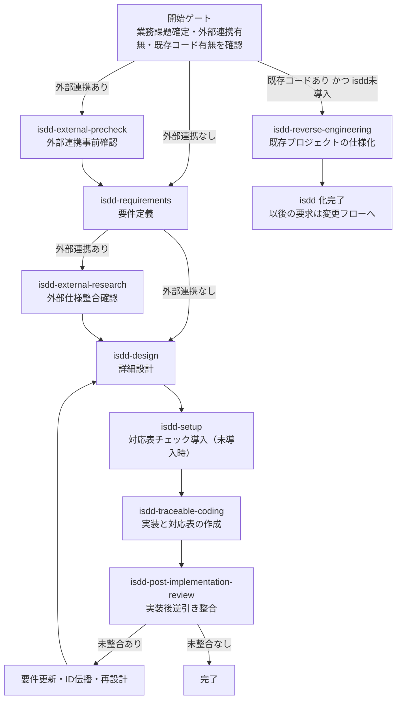
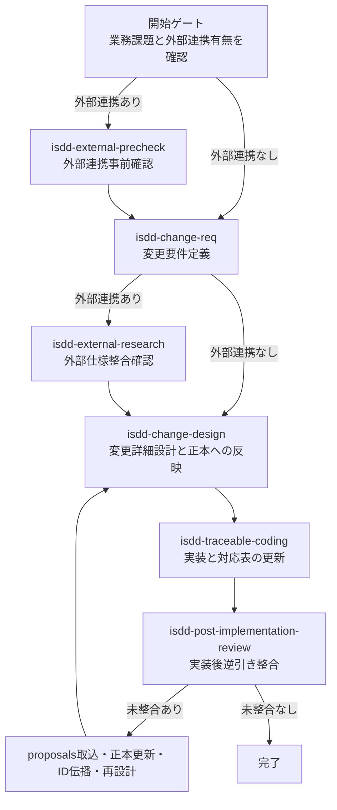
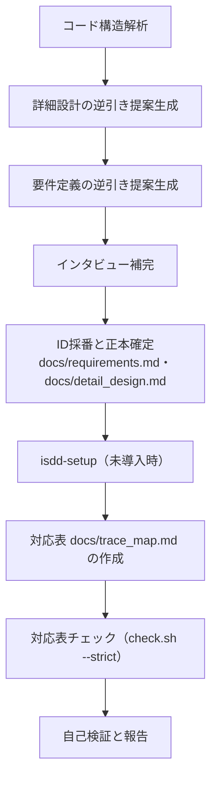
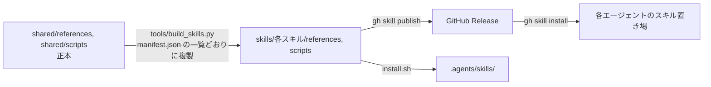
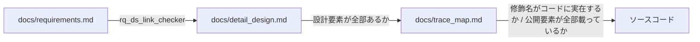

# 対話駆動仕様開発 - 要件・設計・ソースをIDで一貫追跡する

isdd（Interview-driven Spec-driven Development）はインタビュー駆動で仕様を確定して、要件・設計・ソースをIDで一貫追跡しながら、開発を進める手法です。
要件定義書と詳細設計書は ID を持ち、ソースコードには ID を書かず、設計 ID とコードの対応は対応表 `docs/trace_map.md` で管理します。

スキル群は `skills/` に格納し、`gh skill publish` で GitHub に公開・`gh skill install` で導入する形式で管理します。

## 背景と目的

isdd は、AI 実装で起こりやすい次の問題を抑制することを目的とします。

1. 要件の曖昧さによる意図しない実装差分
2. 変更時の影響範囲不明による品質低下
3. 仕様とコードの対応関係が失われることによる保守性低下
4. 実装中に判明した差分が要件・設計へ戻らないことによるドキュメント陳腐化

そのため、isdd では要件と設計を先に確定し、実装では設計 ID とコードの対応表（`docs/trace_map.md`）でトレーサビリティを維持します。
対応表はチェッカースクリプトで機械的に検証し、スキルが起動していない時も git の pre-commit とエージェントのフックで同じチェックが走ります。
さらに実装後は逆引き整合チェックを必須化し、要件・設計・対応表へ差分を還流して整合状態を保ちます。
言語・フレームワーク・DB に既定値は持たず、要件定義で集めた技術制約と要件を根拠に、設計スキルが公式情報を調べたうえで候補を比較してユーザー承認を取ります。

## かんたんな使い方

### 全スキルの最新版を導入する

最初の導入は対話モードで実行し、スキル選択画面で `(all skills)` を選ぶ。

```bash
gh skill install notfolder/req-spec-driven
```

`@vX.Y.Z` を付けずにインストールすると、公開されている最新リリースが導入される。

### 要件定義の起動方法

導入後は、エージェントの入力で次のように開始する。

```text
/isdd-requirements [XXXアプリを作りたい]
```

---

## 開発フロー全体像

### フロー運用原則

- 設計スキル（`isdd-design` / `isdd-change-design`）で見つかった要件・設計差分は、起点要件定義へ直接反映する。
- 変更設計が確定したら、`isdd-change-design` が変更要件定義書と変更設計書の内容を正本（`docs/requirements.md`・`docs/detail_design.md`）へ反映する。対応表チェックは正本の設計書だけを読むため、実装前に正本が最新になっている必要がある。`.history` 配下の変更要件定義書と変更設計書は変更の記録として残す。
- 実装スキルで見つかった要件・設計差分提案は `docs/proposals.md` に一時集約する。
- 実装起因の正本更新は `isdd-post-implementation-review` で実施し、`docs/requirements.md` と `docs/detail_design.md` を最新状態へ更新する。変更設計の反映漏れも同スキルが安全網として拾う。
- `docs/proposals.md` は一時ファイルとして扱い、`isdd-post-implementation-review` 完了時に削除する。
- 変更要件定義、変更設計を使うのは、新たな要求が追加された場合のみとする。
- 既存プロジェクトの初回 isdd 化は `isdd-reverse-engineering` が正本と対応表まで確定する。完了後の新たな要求は変更フローで扱う。

### 新規開発フロー



### 新規要求追加時の変更フロー

このフローは、新たな要求追加が発生した場合にのみ適用する。
設計中に見つかった差分は `change_requirements.md` に直接反映し、変更設計の確定時に正本へ反映する。実装中に見つかった差分提案は `docs/proposals.md` に集約して扱う。



### 既存プロジェクト適用フロー



---

## スキル一覧

| スキル名 | 役割 | 主な成果物 |
|---|---|---|
| isdd-requirements | インタビュー駆動で要件定義書を作成する | docs/requirements.md |
| isdd-design | 要件定義書から詳細設計書と実装タスクを作成する | docs/detail_design.md、.history/[日付]-[タスク名]/tasks.md |
| isdd-change-req | 新たな要求追加時に変更要件定義書を作成する | .history 配下の change_requirements.md |
| isdd-change-design | 変更要件から変更詳細設計書と実装タスクを作成し、確定時に正本へ反映する。必要時は変更要件を直接更新する | .history/[日付]-[タスク名]/change_detail_design.md、.history/[日付]-[タスク名]/tasks.md、docs/requirements.md・docs/detail_design.md（反映後）、.history/[日付]-[タスク名]/change_requirements.md（更新時） |
| isdd-external-precheck | 外部連携の接続可否・認証方式・主要制限を実接続で事前確認する | precheck_report.md |
| isdd-external-research | 外部連携先の詳細仕様を調査し要件との整合を確認する | alignment_report.md、external 配下調査成果物 |
| isdd-reverse-engineering | 既存コードから要件・設計を逆引きし、インタビューで補完して正本と対応表を確定する（初回 isdd 化） | docs/requirements.md、docs/detail_design.md、docs/trace_map.md |
| isdd-setup | 対応表チェック（チェッカー複製・check.sh・pre-commit・AGENTS.md と CLAUDE.md の規則・実装完了チェックのプロファイル・エージェント自身のフック）をプロジェクトに導入する | scripts/isdd/（check.sh、completeness.json を含む）、.git/hooks/pre-commit、AGENTS.md、CLAUDE.md |
| isdd-traceable-coding | 設計書にもとづいて実装し、設計 ID とコードの対応を対応表で管理する | 実装ソース、docs/trace_map.md |
| isdd-post-implementation-review | 実装後に実装起因の要件・設計・対応表・コードの逆引き整合を検証し正本を確定する | docs/requirements.md、docs/detail_design.md、docs/trace_map.md（更新後）、未マッピング一覧、整合レポート |

---

## 委譲する調査（サブエージェントの役割）

次の調査は文脈が大きくなるため、サブエージェント機能のある実行環境では汎用のサブエージェントに委譲し、無い環境では本体がそのまま実施する。isdd はエージェント定義ファイルを同梱しない（環境ごとに書式が違うため）。各スキルの本文に、委譲するときに渡す指示を書いている。

| 役割名 | 主な利用スキル | 役割 |
|---|---|---|
| コード構造解析 | isdd-reverse-engineering | 既存コードの構造（構成、言語、クラス・関数、依存、データモデル、外部連携、バッチ）を読み取ってまとめる |
| 外部ライブラリ調査 | isdd-external-research | 外部連携ライブラリ候補をインターネットで調査し、7 項目で比較評価する |
| 外部 DB スキーマ抽出 | isdd-external-research | `.env` の接続情報で外部 DB に接続し、スキーマ情報を抽出する |

---

## 共通リファレンスとスクリプト

全スキルで使う共通ルールとチェッカーの正本は `shared/` にあり、ビルドスクリプトで各スキルの `references/` と `scripts/` に複製して配る。



- 各スキルは自分のディレクトリの中だけを参照する（Agent Skills の仕様どおり、参照はスキルのルートからの相対パス）。スキルを 1 つだけ入れても動き、`.agents/skills/` 以外の置き場でもパスの読み替えが要らない。
- どのスキルにどのファイルを複製するかは `shared/manifest.json` で決める。`skills/<スキル>/references/` と `scripts/` は手で編集しない。
- 複製はリポジトリに含める。`gh skill publish` はリポジトリの内容をそのまま公開し、`install.sh` も `skills/` をそのまま展開するので、複製をコミットしておけば両者の中身が一致する。
- `python3 tools/build_skills.py --check` が、複製が正本と一致するか、manifest に漏れが無いか、全スキルの `metadata.version` が揃っているかを確かめる。`install.sh`・`evals/run-all.sh`・GitHub Actions（`.github/workflows/skills-sync.yml`）がこれを実行し、不一致なら止まる。

### shared/references/

| ファイル | 内容 | 複製先 |
|---|---|---|
| id-definitions.md | 要件 ID と設計 ID の定義 | 要件・設計・逆引き・外部調査・実装後レビュー |
| document-rules.md | 仕様書・設計書の書き方と、作成後のレビュー | 要件・設計・逆引き・外部調査・実装後レビュー |
| hearing-rules.md | ヒアリングの共通ルール（質問の出し方、複雑さの算定、用語の確定、GUI の 5 項目） | 要件・変更要件・逆引き・外部連携 2 本 |
| requirements-chapters.md | 要件定義書の章構成 | 要件・変更要件・逆引き・外部調査 |
| design-chapters.md | 詳細設計書の章構成と技術選定の手順 | 設計・変更設計・逆引き・外部調査 |
| design-completeness.md | 設計網羅性のチェックリスト | 設計・変更設計・逆引き |
| design-tasks-rules.md | 実装タスク化のルール | 設計・変更設計 |
| requirement-exclusion.md | 最小設計の意味、要件除外ゲート（設計書 11-1 に記録）、設計から要件へのフィードバック | 設計・変更設計 |
| trace-map-rules.md | 設計 ID とコードの対応表（docs/trace_map.md）の書式・粒度・チェック規則 | 設計・変更設計・逆引き・実装・実装後レビュー |
| external-credentials.md | 接続情報（.env）の扱いと接続テスト | 外部連携 2 本 |
| subagent-delegation.md | サブエージェントへの委譲のしかた | 逆引き・外部調査 |

### shared/scripts/

| スクリプト | 用途 | 複製先と実行のしかた |
| --- | --- | --- |
| rq_integrity_checker.py | 要件定義書の RQ-* 内部整合性を検証（BK マッピング・フォーマット） | 要件・変更要件・変更設計・逆引き。各スキルの同梱版を実行する |
| rq_ds_link_checker.py | 要件 ID（RQ-*）と設計 ID（DS-*）の対応欠落・不整合を検証。問題があれば終了コード 1 | 設計・変更設計・逆引き・実装・実装後レビュー。各スキルの同梱版を実行する |
| trace_map_checker.py | 詳細設計書・対応表・コードの 3 者を突合し、壊れた参照（エラー）と未登録（警告）を検出 | isdd-setup がプロジェクトの `scripts/isdd/` に複製し、`check.sh` から実行する |
| implementation_completeness_checker.py | E2E・README・docs/trace_map.md の存在を機械確認。docker compose と「初期ユーザー」は completeness.json に応じて要求 | 同上（`python3 scripts/isdd/implementation_completeness_checker.py .`） |
| isdd_setup.py | コード用チェッカーを scripts/isdd/ に複製して版を VERSION に記録し、check.sh・pre-commit・completeness.json を生成し、AGENTS.md と CLAUDE.md に規則を追記 | isdd-setup に同梱 |

要件・設計のチェッカーは各スキルの同梱版を、コードのチェッカーはプロジェクトの `scripts/isdd/` の複製（pre-commit と同じもの）を使う。`scripts/isdd/VERSION` がスキルの版と違えば、スキルが `isdd-setup` の再実行を案内する。

### 実装後逆引き整合の共通部品

`isdd-post-implementation-review` で使う共通部品は、次の役割を担う。

- 構造抽出: コードからモジュール・クラス・関数・依存関係を抽出する
- 差分要約: 実装差分から仕様影響点を抽出する
- 未マッピング一覧生成: RQ-DS突合結果・対応表チェック結果と差分要約を統合して要件単位の一覧を作る
- ID再伝播: 要件更新後のID差分を設計と対応表へ反映する

### 対応表による追跡（v1.0.15 以降）



- コードには要件 ID も設計 ID も書かない。対応表の 1 行が「設計 ID ↔ ファイル::クラス.関数」を表す。
- `trace_map_checker.py` は、壊れた参照（対応表が指す関数が無い、設計書に無い ID）をエラー、未登録（コードにあって対応表に無い）を警告として報告する。
- 強制は 3 層。`AGENTS.md` と `CLAUDE.md` の規則、エージェント自身が作る応答終了時のフック、git の pre-commit（エラーだけで止める）。
- スキルを持たない人がコードを足しても止めない。そのずれは `isdd-post-implementation-review` が取り込む。

---

## バージョン管理

各スキルは SKILL.md の frontmatter に metadata.version を持ち、同一リリースでは全スキルのバージョンを揃えて管理します。

---

## GitHub Skill 公開手順

SKILL.md の編集は `skills/` 配下で、共通ファイルの編集は `shared/` 配下で行い、`gh skill publish` で GitHub に公開します。

### 事前確認

1. 共通ファイルを変えたら `python3 tools/build_skills.py` で各スキルへ複製し、複製もコミットする。
2. `python3 tools/build_skills.py --check` が「一致」で終わることを確認する（全スキルの `metadata.version` が揃っていることも確かめる）。
3. `skills/` 配下の各 SKILL.md の frontmatter に `license` フィールドが含まれていることを確認する。
4. 公開前に dry-run を実行し、エラーがないことを確認する。

### dry-run（検証のみ）

```bash
gh skill publish ./skills --dry-run
```

### 本番公開

```bash
gh skill publish ./skills --tag v1.0.15
```

---

## スキル導入手順（gh skill install）

公開済みスキルは `gh skill install` で導入する。

### 全スキルを導入

```bash
gh skill install notfolder/req-spec-driven
```

### 1つのスキルを導入

```bash
gh skill install notfolder/req-spec-driven isdd-requirements
```

### バージョンを固定して導入

```bash
gh skill install notfolder/req-spec-driven isdd-requirements@v1.0.15
```

### ユーザースコープへ導入

```bash
gh skill install notfolder/req-spec-driven isdd-requirements --scope user
```

必要に応じて skill 名を isdd-design など他のスキル名に置き換えて導入する。

---

## Waza 評価運用

評価資材は `evals/[skill-name]/` 配下に配置し、評価は `evals/run-all.sh` で実行する。`waza run --discover` は使用しない。

### 特定スキルのみ実行

```bash
bash evals/run-all.sh real isdd-change-design
bash evals/run-all.sh real isdd-requirements isdd-design
```

### 全スキル一括実行

```bash
bash evals/run-all.sh real
```

### Claude のモデルで実行する（Anthropic API）

`run-all.sh claude` は、waza の `copilot-sdk` 実行器の BYOK 機能で Anthropic API を呼ぶ。`.env` に `ANTHROPIC_API_KEY` を置く。

```bash
bash evals/install-copilot-cli.sh      # 初回のみ。新しい Copilot CLI を evals/.copilot-cli/ に入れる
bash evals/run-all.sh claude
bash evals/run-all.sh claude isdd-traceable-coding
```

- waza 0.38.10 が同梱する Copilot ランタイム（1.0.85）は Haiku 5.5 に旧式の思考設定を送り 400 で落ちる。`install-copilot-cli.sh` で入れた新しい CLI（1.0.98 以降）を `run-all.sh claude` が `COPILOT_CLI_PATH` として自動で使う。別の CLI を使うときは `.env` の `COPILOT_CLI_PATH` に実行ファイルを書く。

- `WAZA_CLAUDE_MODEL`（既定 `claude-haiku-5-5`）で実行する。
- 失敗した eval は同じモデルでもう 1 回だけ再試行する。強いモデルへの昇格はしない。**Haiku で 1 回目に落ちたら、再試行で通ってもスキルの質の問題として SKILL.md を直す**（2026-10-17 の運用方針）。
- 最後に「スキル / 1 回目 / 再試行」の表を出す。
- transcript はモデルごとに `evals/<skill>/artifacts/transcripts/<model>/` に残る。
- `.env` の読み込みは設定済みの環境変数を上書きしない。`WAZA_CLAUDE_MODEL=... bash evals/run-all.sh claude` のように一時指定できる。
- 各 `eval.copilot.yaml` の `timeout_seconds` は Claude での実測の約 3 倍（600〜900 秒）。実行基盤が固まったときに 1 時間単位で待たないための値。`local` モードはこの値に `WAZA_LOCAL_TIMEOUT_SCALE`（既定 10）を掛けた一時ファイルで実行するので、ローカルモデルでも従来どおりの長さで動く。

### mock モードについて

`eval.mock.yaml` が存在するスキルのみ mock モードで実行できる。

```bash
bash evals/run-all.sh mock
```

### 単体実行（デバッグ用）

```bash
waza run evals/[skill-name]/eval.copilot.yaml --context-dir evals/[skill-name]/fixtures -v
```

---

## 変更履歴

### v1.0.15

#### 新規追加

- `isdd-setup` スキルを新規追加。チェッカーを `scripts/isdd/` に複製し、`check.sh` と pre-commit を生成し、`AGENTS.md` と `CLAUDE.md` に規則を追記する。応答終了時のフックはエージェント自身に自分の環境向けに作らせ、作れない環境では作らない。
- `trace_map_checker.py` を追加（現在の正本は `shared/scripts/`）。詳細設計書・対応表・コードの 3 者を突合し、壊れた参照をエラー、未登録を警告として報告する。
- `isdd_setup.py` を追加（現在の正本は `shared/scripts/`）。
- `trace-map-rules.md` を追加（現在の正本は `shared/references/`）。対応表の書式・粒度・チェック規則。
- `evals/run-all.sh` に `claude` モードを追加。Anthropic API（BYOK）で Haiku を既定に回し、失敗した eval だけ同じモデルで 1 回再試行する。当初あった Sonnet への昇格は、「Haiku で落ちたらスキルの質が悪いと判断する」方針に合わせて削除（`WAZA_CLAUDE_MODEL_SECONDARY`・`WAZA_CLAUDE_ESCALATE` を廃止、`WAZA_CLAUDE_MODEL_PRIMARY` は `WAZA_CLAUDE_MODEL` に改名。旧名も読む）。
- `evals/install-copilot-cli.sh` を追加。waza 同梱の Copilot ランタイム（1.0.85）は Haiku 5.5 に旧式の思考設定を送って 400 になるため、新しい Copilot CLI を `evals/.copilot-cli/` に入れて `run-all.sh claude` が自動で使う。

#### 構成の変更（スキルの書き方の見直しと共通部分の共有方式）

- **共通スキル `isdd-common` を廃止し、共通ファイルを各スキルに同梱する方式に変更。** 兄弟スキルを `.agents/skills/isdd-common/...` で参照する方式は Agent Skills の仕様の外で、スキルを 1 つだけ入れた場合や置き場が違う場合に壊れた。正本を `shared/` に移し、`tools/build_skills.py` が `shared/manifest.json` の一覧どおりに各スキルの `references/` と `scripts/` へ複製する。複製はコミットし、`gh skill publish` と `install.sh` で中身が一致する（`install.sh` は `--check` で不一致なら止まり、スキル単位で過不足なく展開し、旧版の `isdd-common` を削除する）。
- **チェッカーの実行元を一本化。** 要件・設計のチェッカー（`rq_*.py`）は各スキルの同梱版を実行し、コードのチェッカーはプロジェクトの `scripts/isdd/` の複製を使う。`isdd_setup.py` は `rq_*.py` を複製しなくなり、旧版の複製を削除し、版を `scripts/isdd/VERSION` に記録する。各スキルは VERSION と自分の版を比べ、違えば `isdd-setup` の再実行を案内する。
- **最近のモデル向けに指示の書き方を見直し。** 役割指定（「あなたは〜として振る舞う」）を目的の文に置き換え、「必ず」「絶対」「禁止」などの強調（SKILL.md で計 135 か所）を、本当に変わらない規則だけ平叙文で残して理由を添える形に変更。description を「何をするか＋いつ使うか＋使わない場面」で書き、二重の「必ず使うこと」を削除（isdd-requirements と isdd-change-req の守備範囲を明記）。
- **共通部分を reference に集約。** ヒアリングのルール（2 系統に分かれ三重に書かれていた）を `hearing-rules.md`（旧 `hearing-complexity-rules.md`）に統合。最小設計と要件除外ゲート、設計から要件へのフィードバックを `requirement-exclusion.md` に、`.env` の扱いを `external-credentials.md` に、サブエージェントへの委譲を `subagent-delegation.md` に切り出した。作成後のレビューの共通項目は `document-rules.md` に置いた。reference から別の reference のパスを指す記述を無くし、参照を SKILL.md から 1 段にした。`isdd-reverse-engineering` が別スキルの本文（レビュー手順、完全性制約）に依存していた箇所を reference の参照に置き換えた。
- **要件定義書と詳細設計書の章立ての過不足を見直し。**
  - 問題（業務のあるべき姿と現状のギャップ）と課題（問題を解決するために取り組むアクション・テーマ）を定義し、業務章を「業務の問題」「業務課題一覧（`RQ-BK`）」「見込み経営効果」に組み直した。見込み経営効果に新しいカテゴリ `RQ-EF` を設けた（業務課題に結びつける。設計 ID の対応は求めない）。
  - 要件定義書に、システムの形態（GUI / CUI / Web API / バッチ）、帳票・出力ファイル（3-1）、業務ルール（3-2）、外部連携の表（3-3）、データ要件一覧（4-1）、データ項目（4-2）、検索列を足した CRUD テーブル（4-3）、状態遷移（4-4）、運用要件の章（第 6 章、`RQ-OP`）を追加。画面一覧に対応業務課題 ID 列を追加し、利用者の種別・アクセス経路・SSO を非機能要件（ID 付き）に移した。
  - 設計 ID にテスト（`DS-TS`）と運用（`DS-OP`）を追加し、要件カテゴリごとにどの設計 ID で受けるかの対応表を `id-definitions.md` に置いた。従来はテストシナリオ・非機能・運用の要件を受ける設計 ID が決まっておらず、`rq_ds_link_checker.py` の対応チェックをモデルが場当たり的に合わせていた。
  - 設計書に、トランザクションと排他制御（3-2）、状態遷移（3-3）、インターフェース仕様（入力・バリデーション・出力・エラー）、認証・認可・監査ログ、設定値・環境変数の一覧、バックアップ、障害対応、除外要件（11-1）を追加。E2E の記述を第 8 章に統合し、旧第 11 章を廃止（対応表は第 11 章になった）。ネットワーク構成図はネットワーク越しの通信がある構成だけにし、API の経路の `/api/` の決め打ちをやめた。
  - `rq_ds_link_checker.py` は設計書の「除外要件」節にある要件 ID に対応を求めないようにし、`RQ-EF` を業務コンテキストとして扱う。`rq_integrity_checker.py` は `RQ-EF` を有効なカテゴリにした。
- 実装に無い「ID 重複一覧」の記述（isdd-requirements・isdd-change-req・isdd-traceable-coding）を削除。
- `isdd-change-design` の事前確認から「既存コードがあれば先に isdd-reverse-engineering」を削除（変更フローでは既存コードが常にあり、逆引きの完了後は変更要件定義へ進むため矛盾していた）。
- `isdd-post-implementation-review` は `scripts/isdd/check.sh` が無ければ先に `isdd-setup` を実行する（`trace_map_checker.py` を直接呼ぶ代替経路を削除）。
- `skills/gen_eval_metadata.py` を `tools/` に移動（公開対象の `skills/` にスキル以外のファイルを置かない）。
- `evals/run-all.sh` の事前検査を、eval が SKILL.md を挙げたスキルのファイルをすべて列挙しているかの確認に変更し、開始時に `build_skills.py --check` を実行する。

#### 変更

- **コードに ID を書かない方式に変更。** `isdd-traceable-coding` はトレーサブルコメントの付与をやめ、設計 ID とコードの対応を `docs/trace_map.md` に記録する。`trace_comment_coverage_checker.py` を削除。
- **変更フローの正本反映を `isdd-change-design` の完了時に移動。** 対応表チェック（`check.sh`）は `docs/detail_design.md` だけを読むため、変更設計の設計 ID が正本に無いまま実装すると全行がエラーになり、`--strict` 0 件の完了条件に到達できなかった。変更設計の確定時に変更要件定義書と変更設計書を正本へ反映し、`.history` 配下は変更の記録として残す。`isdd-post-implementation-review` の変更要件反映は反映漏れを拾う安全網に位置づけを変更。`design-tasks-rules.md` の変更設計固有タスクは「正本反映の確認タスク」に変更。
- **`isdd-reverse-engineering` が正本確定まで行う方式に変更。** 従来は `isdd-post-implementation-review` を呼んで正本を確定していたが、同スキルは「実装起因の差分のみ」を対象と宣言しており、対応表が無い段階で `check.sh --strict` を要求するなど初回導入とは噛み合わなかった。逆引きスキル内で `docs/proposals.md` を正本へ書き出し、`rq_integrity_checker` と `rq_ds_link_checker` を通してから `isdd-setup` と対応表作成へ進む。完了後の次のステップは `isdd-requirements` ではなく `isdd-change-req`（`isdd-requirements` の開始ゲートも同じ案内に変更し、循環を解消）。
- **実装完了条件を実行形態に応じて切り替える方式に変更。** docker compose・Playwright `v1.59.0`・README の「初期ユーザー」・E2E の mock モードを無条件に要求していたが、CLI や認証の無いアプリでは成立しない。`isdd-setup` が詳細設計書の実行形態・認証・外部連携を `scripts/isdd/completeness.json` に記録し、`implementation_completeness_checker.py` はそれに従って docker compose と「初期ユーザー」の要否を決める。`design-chapters.md` 第 9 章・第 11 章、`design-tasks-rules.md` の固定タスク、`isdd-traceable-coding` の完了判定を条件付きに変更。E2E のツールは第 1 章と同じ手順で選ぶ。
- **`trace_map_checker.py` の対応言語を拡張。** Python・TypeScript / JavaScript・Java・Go は記号まで確認し、C#・Ruby・PHP・Kotlin・Swift・Rust・C / C++ などはファイルの存在だけ確認する（`::名前` の行は確認対象外として数える）。TypeScript / JavaScript はアロー関数と `export const` の関数も拾う。従来は 5 言語以外のファイルが全行「ファイルが見つかりません」のエラーになっていた。
- `rq_ds_link_checker.py` が問題検出時に終了コード 1 を返すように変更（従来は常に 0 で、フックや CI で機械判定できなかった）。無効化済みだった重複チェックの残骸と、スキル本文・README の「重複一覧」の説明を削除。
- `rq_integrity_checker.py` が [追加] / [削除] を含む文書を変更要件定義書と判定し、RQ-BZ の存在確認を省くように変更。変更のない業務章を「変更なし。参照」と書いた変更要件定義書で「RQ-BZ-* が 1 件も見つかりません」と誤判定していた。
- `trace_map_checker.py` が対応表の表の終わりで読み取りを止めるように変更。同じファイル内の凡例などの表を対応表の行として読み、書式エラーにしていた。
- `evals/run-all.sh` の `.env` 読み込みを、設定済みの環境変数を上書きしない方式に変更。コマンド行で指定した環境変数が `.env` の値に負けていた。
- 各 `eval.copilot.yaml` の `timeout_seconds` を 1800〜6000 秒から実測の約 3 倍（600〜900 秒）に短縮。Claude での eval 実行中に実行基盤が 2 回固まり、放置すると 50〜100 分待つ設定だったため。ローカルモデル向けには `run-all.sh local` が `WAZA_LOCAL_TIMEOUT_SCALE`（既定 10）倍の一時ファイルを作って実行する。
- Haiku の eval で 1 回目に落ちた 2 件を受けて、`design-chapters.md` に「12. 要件と設計の対応表」の章を追加（`rq_ds_link_checker.py` が対応の根拠にする表を設計書の必須章にした）。`isdd-post-implementation-review` の手順 5 に「未マッピング一覧」の表の列と、該当なしでも表を出す規則を追加（一覧を文章で済ませて採点に落ちたため）。
- サブエージェント `code-structure-analyzer`・`external-research-investigator`・`db-schema-extractor` の起動指示を削除。定義ファイルがリポジトリに無く、存在しないエージェント名の起動指示になっていた。「サブエージェント機能があれば汎用のサブエージェントに次の指示で委譲し、無ければ本体で実施する」に書き換え、渡す指示文をスキル本文に置いた。
- `isdd-external-research` に残っていた旧方式（コードへの ID コメント付与、仮 ID コメントの確認）を削除し、`external/[システム名]/src` を対応表の対象に含めることを `trace-map-rules.md` に明記。引き継ぎ先の見出しを `isdd-design` / `isdd-change-design` に修正。
- `hearing-complexity-rules.md` の「MVP 適合性」を「最小案との関係」に改め、同じファイル内の「MVP という語をユーザーに伝えない」との矛盾を解消。
- `isdd-requirements`・`isdd-change-req` の「事前確認」節が開始ゲートと同内容だったため削除し、ペルソナ文を冒頭へ移動。`isdd-change-req` の技術制約の記録先を変更要件定義書に修正。誤字（「片恋」「基本方针」）を修正。`design-chapters.md` の見出しレベルを揃え、`document-rules.md` に起動・テスト実行コマンド 1 行はコード例に当たらないことを明記。
- `isdd-reverse-engineering` は既存コードに一切手を入れず、対応表を作る方式に変更。
- `isdd-post-implementation-review` の入力に対応表を追加。対応表の警告（スキルを使わずに足されたコード）を未マッピング一覧に取り込む。
- `isdd-post-implementation-review` の変更要件反映で、ID 表の差し替えだけでなく両文書を全章通読し、旧仕様を前提にした本文（データ章の説明、旧関数名、用語定義）を書き換えることを必須化。Haiku 5.5 の eval で本文の残置が検出されたため。
- `design-chapters.md` の第 1 章・第 3 章から製品名の既定値（Python、Streamlit、Vue + FastAPI、SQLite、PostgreSQL）を削除し、判断軸と選定手順に置き換え。候補ごとのインターネット調査と出典・確認日の記録、ユーザー承認を必須化。調査できない環境では止まって報告する。
- `requirements-chapters.md` に「1-1. 技術制約」を追加。既存コードベース・配備先・チームの技術・ライセンスとコスト・性能と規模を要件定義で確認する。
- `document-rules.md` に ID の書き方を追加。ID は表の専用列に書き、本文と図には書かない。
- `design-tasks-rules.md` の固定タスクに isdd-setup 導入確認と対応表更新を追加。
- `implementation_completeness_checker.py` に `docs/trace_map.md` の存在確認を追加。
- 全 eval の fixture から ID コメントを除去し、対応表を追加。グレーダーを対応表方式に変更。

### v1.0.14

#### 変更

- 全スキルの SKILL.md に「次のステップ」セクションを追加。完了報告時に次に使うべきスキルを提案するよう統一。外部連携の有無によって分岐する提案（`isdd-external-research` 経由）も明記。
- `isdd-post-implementation-review` の「次のステップ」を拡張。未整合がゼロになった場合に確定成果物（`docs/requirements.md`・`docs/detail_design.md`・実装ソース・`e2e/`）の利用方法と次の開発サイクルの開始方法をユーザーへ案内する。
- `isdd-reverse-engineering` に必須完了条件ブロックを追加。`rq_ds_link_checker.py` の実行と問題0件確認を完了条件として義務化。
- `isdd-common/scripts/rq_ds_link_checker.py` の重複チェック（`check_duplicates`）を無効化。共通化方針テーブルなど1行に複数の RQ-ID が記載される変更設計書形式で発生していた誤検知を解消。
- 全 eval の `timeout_seconds` を10倍に増加。ローカルモデルでの実行時間超過に対応。
- `isdd-change-req`・`isdd-reverse-engineering`・`isdd-post-implementation-review` の eval タスクに `follow_up_prompts` を導入。モデルのヒアリング応答をターン単位で固定入力することで、LLM の応答内容に依存しない再現性の高い評価を実現。**waza v0.28.0 以上が必要。**

### v1.0.13

#### 新規追加

- `isdd-post-implementation-review` スキルを新規追加。実装後に要件・設計・実装コードの逆引き整合を検証し、未マッピング要件のヒアリング更新と正本確定を実施する。
- `isdd-post-implementation-review` の waza 評価を4テストケースで追加（最小・proposals.mdあり・変更要件フロー後・未マッピング検出）。
- `isdd-common/scripts/implementation_completeness_checker.py` を追加。実装コードの完全性を検証するスクリプト。
- `isdd-common/references/design-tasks-rules.md` を追加。実装タスク化のルールを共通リファレンスとして分離。
- `install.sh` を追加。スキル群のインストールを自動化するスクリプト。
- 各スキルに `evals/evals.json` を追加（anthropic skill-creator 対応）。

#### 変更

- 既存スキル（isdd-change-design・isdd-change-req・isdd-design・isdd-requirements・isdd-reverse-engineering・isdd-traceable-coding）に完了判定・終了条件を追加。
- 既存スキルの eval タスクファイルの入力ファイルリストを `.agents/skills` パス形式に統一。
- `isdd-common/references/design-chapters.md`・`requirements-chapters.md`・`hearing-complexity-rules.md` を更新。
- `evals/run-all.sh` を修正。
- 【論点1 ヒアリング平易化】`isdd-requirements`・`isdd-change-req`・`isdd-reverse-engineering` のヒアリング方針を更新。専門用語を避け業務文脈の平易な言葉で質問すること、業務語の意味を推定で確定しないこと、GUI 要件では画面ごとに5項目（目的・主要要素・入力項目・表示項目・エラー時の見え方）を必ず確認することを義務化。`hearing-complexity-rules.md` に同方針と禁止ルールを追加。
- 【論点2 用語確認ゲート】`isdd-requirements`・`isdd-change-req`・`isdd-reverse-engineering` に用語確認ゲートを追加。新出ドメイン用語が出た場合は用語集へ反映して意味確定後でなければ次の要件質問へ進めないルールを追加。`requirements-chapters.md` の用語集フォーマットを業務上の意味・使用範囲・同義語/類義語の3列に固定。
- 【論点3 設計→要件フィードバック方式】`isdd-design`・`isdd-change-design` に変更運用方針を追加。変更要件定義・変更設計は新たな要求追加時のみ使用し、設計・実装中の差分は起点要件定義を直接更新する方式を明記。
- 【論点4 実装後逆引き整合】`isdd-traceable-coding` に `isdd-post-implementation-review` との連携を追記。`isdd-design`・`isdd-change-design` に `isdd-post-implementation-review` との責務分離（設計スキルは正本更新を直接実施し PIR は呼び出さない）を明記。

### v1.0.12

- gh skills での配布方法に変更。
- README.md のインストールコマンドに `--allow-hidden-dirs` オプションを追加。
