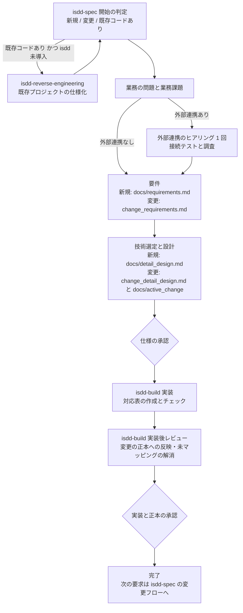
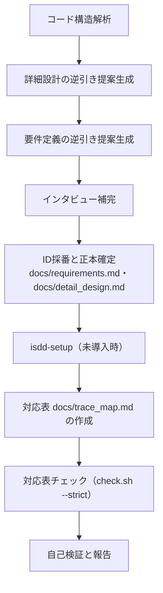
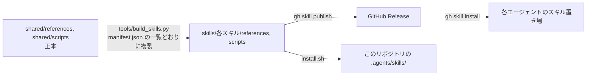
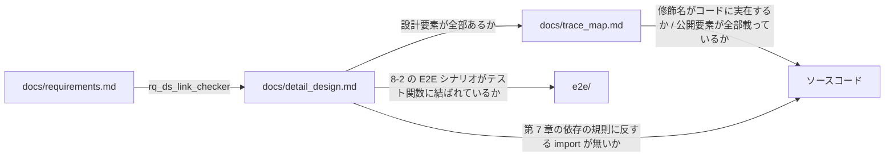

# 対話駆動仕様開発 - 要件・設計・ソースをIDで一貫追跡する

isdd（Interview-driven Spec-driven Development）はインタビュー駆動で仕様を確定して、要件・設計・ソースをIDで一貫追跡しながら、開発を進める手法です。
要件定義書と詳細設計書は ID を持ち、ソースコードには ID を書かず、設計 ID とコードの対応は対応表 `docs/trace_map.md` で管理します。

スキル群は `skills/` に格納し、`gh skill publish` で GitHub に公開・`gh skill install` で導入する形式で管理します。

## 背景と目的

isdd は、AI 実装で起こりやすい次の問題を抑制することを目的とします。

1. 要件の曖昧さによる意図しない実装差分
2. 変更時の影響範囲不明による品質低下
3. 仕様とコードの対応関係が失われることによる保守性低下
4. 実装中に判明した差分が要件・設計へ戻らないことによるドキュメント陳腐化

そのため、isdd では要件と設計を先に確定し、実装では設計 ID とコードの対応表（`docs/trace_map.md`）でトレーサビリティを維持します。
対応表はチェッカースクリプトで機械的に検証し、スキルが起動していない時も git の pre-commit とエージェントのフックで同じチェックが走ります。
さらに実装後は逆引き整合チェックを必須化し、要件・設計・対応表へ差分を還流して整合状態を保ちます。
言語・フレームワーク・DB に既定値は持たず、要件定義で集めた技術制約と要件を根拠に、設計の段階（isdd-spec）が公式情報を調べたうえで候補を比較してユーザー承認を取ります。

## かんたんな使い方

### 全スキルの最新版を導入する

最初の導入は対話モードで実行し、スキル選択画面で `(all skills)` を選ぶ。

```bash
gh skill install notfolder/isdd
```

`@vX.Y.Z` を付けずにインストールすると、公開されている最新リリースが導入される。

### 要件定義の起動方法

導入後は、エージェントの入力で次のように開始する。

```text
/isdd-spec [XXXアプリを作りたい]
```

---

## 開発フロー全体像

### フロー運用原則

- スキルは、人が確認・承認する区切りで分ける。仕様（要件と設計）を作る `isdd-spec`、実装と実装後レビューを行う `isdd-build`、既存コードを isdd 化する `isdd-reverse-engineering` の 3 本と、導入の道具の `isdd-setup` がある。
- `isdd-spec` は、業務課題 → 外部連携（ある場合）→ 要件 → 技術選定と設計 → tasks.md の順に進め、終わりに要件定義書と設計書の承認を得る。設計中に見つかった要件の不足は、要件の文書を直してから設計に伝える。
- 質問は、依存のある問いを 1 問ずつ、独立した問いを番号付きでまとめて出す。外部連携のヒアリングは連携先ごとに 1 回にまとめる。
- 正本（`docs/requirements.md`・`docs/detail_design.md`）は実装済みの仕様だけを持つ。変更フローでは `isdd-spec` が `.history/[日付]-[タスク名]/` に変更要件定義書と変更設計書を作って `docs/active_change` に登録し、正本は書き換えない。実装中は、対応表チェックと `isdd-build` が変更設計書を正本に重ねて読む。
- 正本の更新は、実装の後に `isdd-build` の実装後レビューだけが行う。変更の反映と、実装中に見つかった差分（`docs/proposals.md`）の取り込みをまとめて行い、終わったら `docs/active_change` と `docs/proposals.md` を消す。
- 既存プロジェクトの初回 isdd 化は `isdd-reverse-engineering` が正本と対応表まで確定する。以後の新しい要求は `isdd-spec`（変更フロー）で扱う。

### 開発フロー



### 既存プロジェクト適用フロー



---

## スキル一覧

| スキル名 | 役割 | 主な成果物 |
|---|---|---|
| isdd-spec | インタビューで要件と設計を作る。新規は正本を、変更は変更要件定義書・変更設計書を作り、外部連携は実接続で確かめて要件と突き合わせる | docs/requirements.md・docs/detail_design.md（新規）、.history/[日付]-[タスク名]/change_requirements.md・change_detail_design.md・tasks.md、docs/active_change（変更）、external/[システム名]/docs/research.md・alignment_report.md・.env.example |
| isdd-build | 設計どおりに実装して対応表を作り、実装後レビューで変更を正本へ反映し、要件・設計・対応表・コードの整合を確かめる | 実装ソース（外部連携ライブラリ・モック・E2E を含む）、docs/trace_map.md、正本（更新後）、未マッピング一覧 |
| isdd-reverse-engineering | 既存コードから要件・設計を逆引きし、インタビューで補完して正本と対応表を確定する（初回 isdd 化） | docs/requirements.md、docs/detail_design.md、docs/trace_map.md |
| isdd-setup | 対応表チェックと依存チェック（チェッカー複製・check.sh・pre-commit・AGENTS.md と CLAUDE.md の規則・実装完了チェックのプロファイル・依存の規則の書き写し・エージェント自身のフック）をプロジェクトに導入する | scripts/isdd/（check.sh、completeness.json、dependencies.json を含む）、.git/hooks/pre-commit、AGENTS.md、CLAUDE.md |

---

## 委譲する調査（サブエージェントの役割）

次の調査は文脈が大きくなるため、サブエージェント機能のある実行環境では汎用のサブエージェントに委譲し、無い環境では本体がそのまま実施する。isdd はエージェント定義ファイルを同梱しない（環境ごとに書式が違うため）。各スキルの本文に、委譲するときに渡す指示を書いている。

| 役割名 | 主な利用スキル | 役割 |
|---|---|---|
| コード構造解析 | isdd-reverse-engineering | 既存コードの構造（構成、言語、クラス・関数、依存、データモデル、外部連携、バッチ）を読み取ってまとめる |
| 外部仕様とライブラリの調査 | isdd-spec | 外部システムの公式仕様を読み、連携ライブラリ候補をインターネットで調査して 7 項目で比較評価する |

---

## 共通リファレンスとスクリプト

全スキルで使う共通ルールとチェッカーの正本は `shared/` にあり、ビルドスクリプトで各スキルの `references/` と `scripts/` に複製して配る。



- 各スキルは自分のディレクトリの中だけを参照する（Agent Skills の仕様どおり、参照はスキルのルートからの相対パス）。スキルを 1 つだけ入れても動き、`.agents/skills/` 以外の置き場でもパスの読み替えが要らない。
- どのスキルにどのファイルを複製するかは `shared/manifest.json` で決める。`skills/<スキル>/references/` と `scripts/` は手で編集しない。
- 複製はリポジトリに含める。`gh skill publish` はリポジトリの内容をそのまま公開し、`install.sh` も `skills/` をそのまま展開するので、複製をコミットしておけば両者の中身が一致する。
- `python3 tools/build_skills.py --check` が、複製が正本と一致するか、manifest に漏れが無いか、全スキルの `metadata.version` が揃っているかを確かめる。`install.sh`・`evals/run-all.sh` がこれを実行し、不一致なら止まる。

### shared/references/

| ファイル | 内容 | 複製先 |
|---|---|---|
| spec-requirements.md / spec-external.md / spec-design.md | isdd-spec の段階ごとの手順（要件、外部連携、設計） | spec |
| build-implement.md / build-review.md | isdd-build の段階ごとの手順（実装、実装後レビュー） | build |
| id-definitions.md | 要件 ID と設計 ID の定義（設計 ID は `DS-[種類]-[要素名]`） | spec・build・逆引き |
| document-rules.md | 仕様書・設計書の書き方と、作成後のレビュー | spec・build・逆引き |
| hearing-rules.md | ヒアリングの共通ルール（問いのまとめ方、選択肢の表、複雑さの算定、用語の確定、形態ごとの確認項目） | spec・逆引き |
| requirements-chapters.md | 要件定義書の章構成 | spec・逆引き |
| design-chapters.md | 詳細設計書の章構成と技術選定の手順。要件との対応は第 11 章だけに書く | spec・逆引き |
| design-completeness.md | 設計網羅性のチェックリスト | spec・逆引き |
| design-tasks-rules.md | 実装タスク化のルール | spec |
| requirement-exclusion.md | 最小設計の意味、要件除外ゲート（設計書 11-1 に記録）、設計から要件へのフィードバック | spec |
| trace-map-rules.md | 設計 ID とコードの対応表（docs/trace_map.md）の書式・粒度・チェック規則 | spec・build・逆引き |
| external-credentials.md | 接続情報（.env）の扱いと接続テスト | spec |
| subagent-delegation.md | サブエージェントへの委譲のしかた | spec・逆引き |

### shared/scripts/

| スクリプト | 用途 | 複製先と実行のしかた |
| --- | --- | --- |
| rq_integrity_checker.py | 要件定義書の RQ-* 内部整合性を検証（BK マッピング・フォーマット） | spec・逆引き。各スキルの同梱版を実行する |
| rq_ds_link_checker.py | 要件 ID（RQ-*）と設計 ID（DS-*）の対応を、設計書の「要件と設計の対応表」の章だけから検証。問題があれば終了コード 1 | spec・build・逆引き。各スキルの同梱版を実行する |
| trace_map_checker.py | 詳細設計書・対応表・コードの 3 者を突合し、壊れた参照（エラー）と未登録（警告）を検出。第 7 章の「実現する設計 ID」と 8-2 の E2E シナリオ（`DS-TS` → テスト関数）も確かめる。粒度は `function` / `class` | isdd-setup がプロジェクトの `scripts/isdd/` に複製し、`check.sh` から実行する |
| dependency_checker.py | 設計書第 7 章の依存の規則（`scripts/isdd/dependencies.json`）に反する import を検出（Python・TypeScript / JavaScript・Java・Go） | 同上。`check.sh` が対応表チェックに続けて実行する |
| implementation_completeness_checker.py | E2E・README・docs/trace_map.md の存在を機械確認。docker compose と「初期ユーザー」は completeness.json に応じて要求 | 同上（`python3 scripts/isdd/implementation_completeness_checker.py .`） |
| isdd_setup.py | コード用チェッカーを scripts/isdd/ に複製して版を VERSION に記録し、check.sh・pre-commit・completeness.json・dependencies.json（雛形）を生成し、AGENTS.md と CLAUDE.md に規則を追記 | isdd-setup に同梱 |

要件・設計のチェッカーは各スキルの同梱版を、コードのチェッカーはプロジェクトの `scripts/isdd/` の複製（pre-commit と同じもの）を使う。`scripts/isdd/VERSION` がスキルの版と違えば、スキルが `isdd-setup` の再実行を案内する。

### 実装後逆引き整合の進め方

`isdd-build` の実装後レビューは専用のスクリプトを持たず、上の 2 つのチェッカー（`rq_ds_link_checker.py` と `scripts/isdd/check.sh`）の結果とコードの読み取りを組み合わせて、次の順に進める。

1. 実装差分の影響範囲をまとめる。
2. `rq_ds_link_checker.py` で要件と設計の対応を、`check.sh` で対応表とコードのずれを確かめる。
3. 変更フローでは、変更要件定義書・変更設計書・`docs/proposals.md`・実装差分を突き合わせ、変更設計どおりに実装されていることを確かめてから、変更を正本へ反映して `docs/active_change` を消す。
4. 実装の全関数から逆にたどり、未マッピング一覧（要件未定義・設計未定義・対応表未登録）を表で出す。
5. 未マッピングを 1 件ずつユーザーに確かめて要件定義書へ反映し、更新した要件 ID を設計書と対応表へ伝える。
6. 両チェッカーを再実行し、未整合ゼロ（`check.sh --strict` のエラー・警告とも 0 件）を確かめてから `docs/proposals.md` を削除する。

### 対応表による追跡（v2.0.0 以降）



- コードには要件 ID も設計 ID も書かない。対応表の 1 行が「設計 ID ↔ ファイル::クラス.関数」を表す。
- `trace_map_checker.py` は、壊れた参照（対応表が指す関数が無い、設計書に無い ID）をエラー、未登録（コードにあって対応表に無い）を警告として報告する。前向き（要件が実装されたか）は `RQ-TS` → `DS-TS` → テスト関数の線で、後ろ向き（設計に無いコードが無いか）は対応表で、設計の構造（依存の向き）は `dependency_checker.py` で見る。
- 強制は 3 層。`AGENTS.md` と `CLAUDE.md` の規則、エージェント自身が作る応答終了時のフック、git の pre-commit（エラーだけで止める）。
- スキルを持たない人がコードを足しても止めない。そのずれは `isdd-build` の実装後レビューが取り込む。

---

## バージョン管理

各スキルは SKILL.md の frontmatter に metadata.version を持ち、同一リリースでは全スキルのバージョンを揃えて管理します。

---

## GitHub Skill 公開手順

SKILL.md の編集は `skills/` 配下で、共通ファイルの編集は `shared/` 配下で行い、`gh skill publish` で GitHub に公開します。

### 事前確認

1. 共通ファイルを変えたら `python3 tools/build_skills.py` で各スキルへ複製し、複製もコミットする。
2. `python3 tools/build_skills.py --check` が「一致」で終わることを確認する（全スキルの `metadata.version` が揃っていることも確かめる）。
3. `skills/` 配下の各 SKILL.md の frontmatter に `license` フィールドが含まれていることを確認する。
4. 公開前に dry-run を実行し、エラーがないことを確認する。

### dry-run（検証のみ）

```bash
gh skill publish ./skills --dry-run
```

### 本番公開

```bash
gh skill publish ./skills --tag v2.1.0
```

---

## スキル導入手順（gh skill install）

公開済みスキルは `gh skill install` で導入する。

### 全スキルを導入

```bash
gh skill install notfolder/isdd
```

### 1つのスキルを導入

```bash
gh skill install notfolder/isdd isdd-spec
```

### バージョンを固定して導入

```bash
gh skill install notfolder/isdd isdd-spec@v2.1.0
```

### ユーザースコープへ導入

```bash
gh skill install notfolder/isdd isdd-spec --scope user
```

必要に応じて skill 名を isdd-build など他のスキル名に置き換えて導入する。isdd-spec と isdd-build は組み合わせて使い、対応表チェックのために isdd-setup も要るので、ふつうは全スキルを入れる。

### このリポジトリの中で試す（install.sh）

`install.sh` は、このリポジトリを clone した場所でスキルを試すためのスクリプトで、利用者のプロジェクトには導入しない。利用者のプロジェクトへは `gh skill install` で導入する。

```bash
bash install.sh
```

- `build_skills.py --check` で複製が正本と一致するかを確かめ、不一致なら止まる。
- `skills/` の各スキルを、このリポジトリの `.agents/skills/<スキル>/` に過不足なくコピーする（OpenCode・Codex・Copilot・Gemini CLI 向け）。旧版の `isdd-common` と、v2.0 系のスキル（v2.1 で isdd-spec・isdd-build にまとめた 8 本）があれば消す。
- `.claude/skills` から `../.agents/skills` へのシンボリックリンクを作る（Claude Code 向け）。
- コピーした `.agents/skills/isdd-*/` と `.claude/` は `.gitignore` で追跡しない。`.agents/skills/mermaid-syntax-skill/` は、このリポジトリで文書の mermaid 図を書くときのために外部（re2zero/deepin-skills）から入れたスキルで、isdd としては配布しない。

### v2.0 系から更新する

v2.1.0 で、要件定義・変更要件定義・外部連携の 2 本・設計・変更設計の 6 本を `isdd-spec` に、実装と実装後レビューの 2 本を `isdd-build` にまとめた。`gh skill update` は新しく増えたスキルを入れず、廃止したスキルも消さないので、全スキルを入れ直してから旧スキルを消す。

```bash
# 全スキルを入れ直す（--agent と --scope は最初に導入したときと同じ値にする）
gh skill install notfolder/isdd --all --force --agent claude-code
# v2.0 系のスキルを消す（パスは導入先に合わせる。例は Claude Code のプロジェクトスコープ）
rm -rf .claude/skills/isdd-requirements .claude/skills/isdd-change-req .claude/skills/isdd-design .claude/skills/isdd-change-design \
       .claude/skills/isdd-external-precheck .claude/skills/isdd-external-research .claude/skills/isdd-traceable-coding .claude/skills/isdd-post-implementation-review
```

- 呼び出し方が変わる。`/isdd-requirements`・`/isdd-change-req`・`/isdd-design`・`/isdd-change-design`・外部連携の 2 本は `/isdd-spec`、`/isdd-traceable-coding`・`/isdd-post-implementation-review` は `/isdd-build` で呼ぶ。
- v2.0 系で作った文書はそのまま使える。長い設計 ID（末尾に要件の略称を付けたもの）も有効で、書き換えなくてよい。要件と設計の対応は、設計書の「要件と設計の対応表」の章から読む（v2.0.0 から必須の章）。
- 要件定義書に残っているモック方式の要件 ID（`RQ-EX-USE-*`）も有効なまま扱う。新しく作る設計では、モック方式を設計書の 8-4 に書く。
- `scripts/isdd/VERSION` が古いと、`isdd-build` が `isdd-setup` の再実行を案内する。
- `install.sh` で導入している場合は、リポジトリを最新にして `install.sh` を再実行する。旧スキルも消える。

### v1.0.14 以前から更新する

v2.0.0 で `isdd-setup` を追加し、共通スキル `isdd-common` を廃止した。`gh skill update` は新しく増えたスキルを入れず、廃止したスキルも消さない。そのため v1.0.14 以前から更新するときは、全スキルを入れ直してから `isdd-common` を消す。

```bash
# 全スキルを入れ直す（isdd-setup も入る。--pin で固定していたスキルも最新になる）
gh skill install notfolder/isdd --all --force --agent claude-code
# 廃止した共通スキルを消す（パスは導入先に合わせる。例は Claude Code のプロジェクトスコープ）
rm -rf .claude/skills/isdd-common
```

- `--agent` と `--scope` は、最初に導入したときと同じ値にする。
- 古い `isdd-common` には、旧方式（コードに ID コメントを書く）の規則が入っている。新しいスキルはこれを参照しないが、エージェントが読むと古い規則で動くおそれがあるので消す。
- `install.sh` で導入している場合は、リポジトリを最新にして `install.sh` を再実行する。`isdd-common` も消える。
- スキルの追加や廃止が無い版への更新は、`gh skill update --all` でよい。

### v1.0.14 で作ったプロジェクトを使い続ける

コードに旧方式の ID コメントが残っていても、新しいスキルはそのまま使える。対応表のチェック（`scripts/isdd/check.sh`）はコメントを読まず、pre-commit もエラーだけで止めるため。

1. `isdd-setup` を実行する。`scripts/isdd/` のチェッカー、`check.sh`、pre-commit、`AGENTS.md` と `CLAUDE.md` の規則が入る。
2. 対応表 `docs/trace_map.md` を作る。`isdd-build` の実装後レビューを使うか、次に `isdd-build` で実装するときに作る。どちらも `check.sh --strict` の警告が 0 件になるまで、既存のファイル・クラス・公開関数を登録する。旧コメントに書いてある設計 ID が、登録の手がかりになる。
3. 対応表ができたら、旧コメントの ID を消す。`isdd-build` の実装の完了条件に「コードに要件 ID・設計 ID を含むコメントが無い」があり、残っていると完了条件を満たさない。対応表と二重に管理すると、ずれる原因にもなる。

---

## Waza 評価運用

評価資材は `evals/[skill-name]/` 配下に配置し、評価は `evals/run-all.sh` で実行する。`waza run --discover` は使用しない。

### 準備

- waza を入れる。手順は [microsoft/waza の README](https://github.com/microsoft/waza) の「Installation」にある。動作を確かめた版は 0.38.10。
- `.env.sample` を `.env` にコピーし、使うモードの変数を書く。
- Python 3（チェッカーと採点スクリプト）と bash が要る。`claude` モードは Node.js（npm）も要る。

### モード

`run-all.sh` の第 1 引数でモードを選ぶ。省略すると `mock`。

| モード | 使う eval | モデルの呼び先 | 必要なもの |
|---|---|---|---|
| `mock` | `eval.mock.yaml`（3 スキルだけ） | 呼ばない（YAML が読めるか、`files:` のファイルが揃っているかの確認。採点はすべて不合格になる） | waza |
| `real` | `eval.copilot.yaml` | GitHub Copilot | GitHub Copilot を使えるアカウントでの認証 |
| `local` | `eval.copilot.yaml` | LM Studio（OpenAI 互換の API） | LM Studio でモデルを読み込んでおく。`.env` の `WAZA_LOCAL_LM_STUDIO_URL`（既定 `http://127.0.0.1:1234/v1`）と `WAZA_LOCAL_MODEL`（既定 `gemma-4-e4b-it-mlx`） |
| `claude` | `eval.copilot.yaml` | Anthropic API | `.env` の `ANTHROPIC_API_KEY` と、`evals/install-copilot-cli.sh` で入れた Copilot CLI |

フォークした waza を使うときは、環境変数 `WAZA_BIN` に実行ファイルを指定する。

### 特定スキルのみ実行

```bash
bash evals/run-all.sh real isdd-spec
bash evals/run-all.sh real isdd-spec isdd-build
```

### 全スキル一括実行

```bash
bash evals/run-all.sh real
```

### Claude のモデルで実行する（Anthropic API）

`run-all.sh claude` は、waza の `copilot-sdk` 実行器の BYOK 機能で Anthropic API を呼ぶ。`.env` に `ANTHROPIC_API_KEY` を置く。

```bash
bash evals/install-copilot-cli.sh      # 初回のみ。新しい Copilot CLI を evals/.copilot-cli/ に入れる
bash evals/run-all.sh claude
bash evals/run-all.sh claude isdd-build
```

- waza 0.38.10 が同梱する Copilot ランタイム（1.0.85）は Haiku 5.5 に旧式の思考設定を送り 400 で落ちる。`install-copilot-cli.sh` で入れた新しい CLI（1.0.98 以降）を `run-all.sh claude` が `COPILOT_CLI_PATH` として自動で使う。別の CLI を使うときは `.env` の `COPILOT_CLI_PATH` に実行ファイルを書く。

- `WAZA_CLAUDE_MODEL`（既定 `claude-haiku-5-5`）で実行する。
- 失敗した eval は同じモデルでもう 1 回だけ再試行する。強いモデルへの昇格はしない。**Haiku で 1 回目に落ちたら、再試行で通ってもスキルの質の問題として SKILL.md を直す**（2026-10-17 の運用方針）。
- 最後に「スキル / 1 回目 / 再試行」の表を出す。
- transcript はモデルごとに `evals/<skill>/artifacts/transcripts/<model>/` に残る。
- `.env` の読み込みは設定済みの環境変数を上書きしない。`WAZA_CLAUDE_MODEL=... bash evals/run-all.sh claude` のように一時指定できる。
- 各 `eval.copilot.yaml` の `timeout_seconds` は Claude での実測の約 3 倍（600〜1200 秒）。外部連携の接続テストを含むタスク（isdd-spec の precheck・research）はタスク側で 1200〜1500 秒を指定している。実行基盤が固まったときに 1 時間単位で待たないための値。`local` モードは、eval ファイルとタスク側の値の両方に `WAZA_LOCAL_TIMEOUT_SCALE`（既定 10）を掛けた一時ファイル（eval のディレクトリの `.eval.local.<番号>.yaml` と `.tasks.local.<番号>/`）で実行するので、ローカルモデルでも従来どおりの長さで動く。

### タスクと採点の作り

- 1 つのスキルに複数のケースを置くときは、`evals/<skill>/fixtures/<ケース名>/` に入力をまとめ、タスクの `inputs.context.fixture: fixtures/<ケース名>` で作業場所の直下に展開する。スキルの本文が書くとおりの `docs/...` のパスで試せる。
- 採点は、決められる判定をプログラム型のグレーダー（`type: program`）で行う。共通の補助スクリプト `evals/_graders/isdd_grade.py` が、チェッカーの再実行（`checker`）、対応表の厳格チェック（`strict-trace`）、ファイルの照合（`match`・`unchanged`）、接続情報の値が成果物に無いか（`no-secret`）、`scripts/isdd/VERSION` の照合（`version-current`）などを行う。`run-all.sh` が環境変数 `ISDD_REPO_ROOT` を設定する。
- 会話の流れで決まる判定（開始ゲートでどのスキルへ進んだか、承認の前に止まったか）だけを、プロンプト型のグレーダーで判定する。
- 固定応答（`follow_up_prompts`）はすべて順に送られるので、「止まる」ことを試すタスクには催促の応答を入れない。

### 単体テスト

チェッカーと複製スクリプトの単体テストは `tests/` にある（標準ライブラリの unittest だけを使う）。

```bash
python3 -m unittest discover -s tests -t tests
```

スクリプトは Python 3.9 以上の標準ライブラリだけで動かす（macOS 標準の `python3` が 3.9 のため）。古い版と新しい版の両方で動くことは、このマシンにある版をすべて使って確かめる。非推奨の警告も失敗として扱う。

```bash
bash tools/test_pythons.sh
```

PATH 上の `python3`・`python3.X`、`/usr/bin/python3`、uv が管理する版を探して実行する。古い版と新しい版がそろっていなければ `uv python install 3.9 3.15` などで入れる。

### mock モードとローカルモデルでの実行

`mock` は `eval.mock.yaml` があるスキル（`isdd-setup`・`isdd-build`）だけを実行する。モデルが作業しないので採点は全タスク不合格になり、終了コードも 1 になる。確かめられるのは、eval の YAML が読めることと、タスクの `files:` に挙げたファイルが揃っていることまで。`local` は LM Studio を先に起動してから実行する。

```bash
bash evals/run-all.sh mock
bash evals/run-all.sh local isdd-spec
```

### 1 スキルだけ試す（デバッグ用）

1 スキルだけ試すときも `run-all.sh` にスキル名を渡す。`waza run` を直接呼ぶと、作業場所にスキルのファイルが無いまま実行される。

```bash
bash evals/run-all.sh claude isdd-setup
```

`run-all.sh` は eval ごとに次を行ってから `waza run` を呼ぶ。

1. `evals/<skill>/fixtures/` の中身を一時ディレクトリへコピーする。
2. `skills/` を一時ディレクトリの `.agents/skills/` へコピーする（タスクの `files:` が指す `.agents/skills/...` のパスはここを指す）。
3. タスクの `files:` に挙げたファイルがすべて揃っているかを確かめ、欠けていれば実行せずに止める。
4. `--context-dir` に一時ディレクトリを、`--transcript-dir` に `evals/<skill>/artifacts/transcripts/`（claude モードでは `<モデル>/attempt-<回>/` の下）を渡して実行し、終わったら一時ディレクトリを消す。

---

## 変更履歴

### v2.1.0

#### 更新時の注意

- スキルの構成が変わった。「v2.0 系から更新する」の手順で全スキルを入れ直し、旧スキル 8 本を消す。
- v2.0 系で作った文書（長い設計 ID、`RQ-EX-USE-*`）はそのまま使える。

#### 構成の変更

- **スキルを、人が確認・承認する区切りでまとめた。** 要件定義・変更要件定義・外部連携の事前確認・外部連携の詳細調査・設計・変更設計の 6 本を `isdd-spec` に、実装と実装後レビューの 2 本を `isdd-build` にまとめた（10 本 → 4 本）。小さな変更のつもりでも大きな変更になりうるので、基本の流れ（業務課題 → 要件 → 設計 → 実装 → 実装後レビュー）は変えず、スキルをまたぐ手間だけを減らした。`isdd-spec` は段階の案内役の SKILL.md と、段階ごとの手順（`spec-requirements.md`・`spec-external.md`・`spec-design.md`）からなり、既存の成果物から途中再開できる。`isdd-build` には「実装だけ」「実装後レビューだけ」の入口がある。
- **外部連携を段階の境界で分けた。** 要件の段階では、ヒアリングを連携先ごとに 1 回にまとめ、接続テスト・スキーマ取得・仕様の調査・要件との突き合わせだけを行う（調査レポートと整合確認レポート、`.env.example`）。連携ライブラリの採否とモック方式は設計の段階でユーザーの承認を得て決め、設計 ID を振る。連携ライブラリ・モック・E2E のコードは `isdd-build` が作り、対応表に載せる。v2.0 では設計の前にコードを作り、ライブラリ選定（設計の判断）を要件の段階で決め、モック方式を要件 ID（`RQ-EX-USE-*`）で表していた。
- **独立した質問はまとめて出す。** `hearing-rules.md` を「依存のある問いは 1 問ずつ、独立した問いは番号を付けて 1 回の応答でまとめて出す。どちらも選択肢の表と推奨を付ける」に変えた。開始ゲートの 2 問もまとめて出す。

#### 変更

- **設計 ID を短くした。** 形を `DS-[種類]-[要素名]` にし、要件の略称を末尾に付けない。要件との対応は設計書の第 11 章「要件と設計の対応表」だけに書き、各章の表の「対応要件ID」列をやめた。要件を差し替えても中身の変わらない設計要素の ID は変えず、対応表の行だけを変える。v2.0 の長い ID も有効。
- `rq_ds_link_checker.py` は、対応を「要件と設計の対応表」の章の表だけから読み、設計 ID の名前からの推定をやめた。設計書のほかの章に現れる設計 ID が対応表に無い場合と、対応表の章が無い場合を問題として報告する。
- `install.sh` が v2.0 系のスキル 8 本を `.agents/skills/` から消す。
- eval を `evals/isdd-spec/`（15 場面）と `evals/isdd-build/`（9 場面）に移した。開始ゲートの問いをまとめて出すか、外部連携のヒアリングを業務課題の後に 1 回で行うか、外部連携の段階でコードを作らないか、設計 ID が短いかを採点に足した。
- **追跡の見方を 3 つに分けた。** 前向き（要件が実装されたか）は要件のテスト用利用シナリオ → 設計書 8-2 の `DS-TS` → `e2e/` のテスト関数の線で見る（対応表に `DS-TS` の行を書けるようにし、`e2e` があるのに 8-2 の `DS-TS` が無ければ警告）。後ろ向き（設計に無いコードが無いか）は対応表で見る（粒度を設計書第 7 章で `function` / `class` から選べるようにし、`class` では公開関数の登録を求めない）。設計の構造は新しい `dependency_checker.py` で見る（第 7 章の「依存の規則」を `scripts/isdd/dependencies.json` に書き写し、`check.sh` が import を確かめる。層の越境や、連携ライブラリを通さない外部 API の呼び出しをエラーにする）。
- `trace_map_checker.py` は、設計書第 7 章で `DS-MD` と同じ行に書いた「実現する設計 ID」（`DS-IF`・`DS-BT`・`DS-EV`・`DS-SC`）が対応表に無ければ警告する。外部連携ラッパーの `DS-IF` が未実装でも気づけなかった穴を塞いだ。
- 設計の承認を 2 回にまとめた（技術選定 → E2E の実行手段・連携ライブラリ・モック方式・要件の除外を 1 回で）。第 5 章の SOLID 適合表をやめ、責務を 1 文で書く。逆引きでは KPI と経営効果を「不明（理由）」で閉じてよい。
- 文言の矛盾を直した: 別の変更が `docs/active_change` にあれば isdd-spec の開始時に止まる、外部連携の既存ライブラリ調査は言語が未定なら設計の技術選定後に行う、isdd-reverse-engineering も `scripts/isdd/VERSION` を比べる、「設計スキル」「実装スキル」の総称を段階名に置換、など。

### v2.0.1

#### 更新時の注意

- 変更フローの正本への反映を、変更設計の確定時から実装の後に戻した。v2.0.0 の `isdd-change-design` で正本へ反映済みの変更は、`isdd-post-implementation-review` が二重に反映しない。
- `scripts/isdd/check.sh` の中身が変わるので、`isdd-setup` を再実行する（各スキルが `scripts/isdd/VERSION` の食い違いを見つけて案内する）。

#### 変更

- **正本は実装済みの仕様だけを持つ方式に戻した。** v2.0.0 では変更設計の確定時に正本を書き換えていたため、実装をやめたり途中で止まったりすると、作っていない仕様が正本に残った。`isdd-change-design` は正本を書き換えず、変更のディレクトリを `docs/active_change` に書く。`isdd-post-implementation-review` が実装の後に変更要件定義書と変更設計書を正本へ反映し、`docs/active_change` を消す。
- `trace_map_checker.py` に `--active-change` を追加。ポインタファイルがあれば、そこに書かれた変更の `change_detail_design.md` を正本に重ねて判定する（有効な設計 ID は「正本 ＋ 変更設計書 − [削除]」）。[削除] にした設計 ID が対応表に残っていれば警告にする。`isdd-setup` が生成する `check.sh` はこのオプションを付けて呼び、`AGENTS.md`・`CLAUDE.md` の規則ブロックにも進行中の変更の読み方を足した。
- `rq_ds_link_checker.py` に `--base` を追加。変更要件定義書と変更設計書を検査するとき、変更設計書が参照する既存の要件（変更要件定義書に無い `RQ-*`）を正本で解決し、未定義参照にしない。
- `design-tasks-rules.md` の変更設計固有の固定タスクを「正本反映の確認タスク」から「進行中の変更の登録確認タスク」に変更。
- `isdd-external-research` の要件整合チェックで、変更フローの反映先を変更要件定義書と明記（正本を書き換えると読めたため）。
- 全スキルの SKILL.md に `compatibility`（Python 3.9 以上と bash）を追加。Python 3.9・3.10・3.12・3.14・3.15 で単体テストが通ることを確かめた。複数の版でテストする `tools/test_pythons.sh` を追加。
- GitHub Actions（`.github/workflows/skills-sync.yml`）を削除。複製の一致は `install.sh`・`evals/run-all.sh` が、単体テストは `tools/test_pythons.sh` が確かめる。

### v2.0.0

#### 更新時の注意

- `gh skill update` だけでは `isdd-setup` が入らず、廃止した `isdd-common` が残る。「v1.0.14 以前から更新する」の手順で入れ直す。
- v1.0.14 で作ったプロジェクトは、「v1.0.14 で作ったプロジェクトを使い続ける」の手順で対応表に移る。

#### 新規追加

- `isdd-setup` スキルを新規追加。チェッカーを `scripts/isdd/` に複製し、`check.sh` と pre-commit を生成し、`AGENTS.md` と `CLAUDE.md` に規則を追記する。応答終了時のフックはエージェント自身に自分の環境向けに作らせ、作れない環境では作らない。
- `trace_map_checker.py` を追加（現在の正本は `shared/scripts/`）。詳細設計書・対応表・コードの 3 者を突合し、壊れた参照をエラー、未登録を警告として報告する。
- `isdd_setup.py` を追加（現在の正本は `shared/scripts/`）。
- `trace-map-rules.md` を追加（現在の正本は `shared/references/`）。対応表の書式・粒度・チェック規則。
- `evals/run-all.sh` に `claude` モードを追加。Anthropic API（BYOK）で Haiku を既定に回し、失敗した eval だけ同じモデルで 1 回再試行する。当初あった Sonnet への昇格は、「Haiku で落ちたらスキルの質が悪いと判断する」方針に合わせて削除（`WAZA_CLAUDE_MODEL_SECONDARY`・`WAZA_CLAUDE_ESCALATE` を廃止、`WAZA_CLAUDE_MODEL_PRIMARY` は `WAZA_CLAUDE_MODEL` に改名。旧名も読む）。
- `evals/install-copilot-cli.sh` を追加。waza 同梱の Copilot ランタイム（1.0.85）は Haiku 5.5 に旧式の思考設定を送って 400 になるため、新しい Copilot CLI を `evals/.copilot-cli/` に入れて `run-all.sh claude` が自動で使う。

#### 構成の変更（スキルの書き方の見直しと共通部分の共有方式）

- **共通スキル `isdd-common` を廃止し、共通ファイルを各スキルに同梱する方式に変更。** 兄弟スキルを `.agents/skills/isdd-common/...` で参照する方式は Agent Skills の仕様の外で、スキルを 1 つだけ入れた場合や置き場が違う場合に壊れた。正本を `shared/` に移し、`tools/build_skills.py` が `shared/manifest.json` の一覧どおりに各スキルの `references/` と `scripts/` へ複製する。複製はコミットし、`gh skill publish` と `install.sh` で中身が一致する（`install.sh` は `--check` で不一致なら止まり、スキル単位で過不足なく展開し、旧版の `isdd-common` を削除する）。
- **チェッカーの実行元を一本化。** 要件・設計のチェッカー（`rq_*.py`）は各スキルの同梱版を実行し、コードのチェッカーはプロジェクトの `scripts/isdd/` の複製を使う。`isdd_setup.py` は `rq_*.py` を複製しなくなり、旧版の複製を削除し、版を `scripts/isdd/VERSION` に記録する。各スキルは VERSION と自分の版を比べ、違えば `isdd-setup` の再実行を案内する。
- **最近のモデル向けに指示の書き方を見直し。** 役割指定（「あなたは〜として振る舞う」）を目的の文に置き換え、「必ず」「絶対」「禁止」などの強調（SKILL.md で計 135 か所）を、本当に変わらない規則だけ平叙文で残して理由を添える形に変更。description を「何をするか＋いつ使うか＋使わない場面」で書き、二重の「必ず使うこと」を削除（isdd-requirements と isdd-change-req の守備範囲を明記）。
- **共通部分を reference に集約。** ヒアリングのルール（2 系統に分かれ三重に書かれていた）を `hearing-rules.md`（旧 `hearing-complexity-rules.md`）に統合。最小設計と要件除外ゲート、設計から要件へのフィードバックを `requirement-exclusion.md` に、`.env` の扱いを `external-credentials.md` に、サブエージェントへの委譲を `subagent-delegation.md` に切り出した。作成後のレビューの共通項目は `document-rules.md` に置いた。reference から別の reference のパスを指す記述を無くし、参照を SKILL.md から 1 段にした。`isdd-reverse-engineering` が別スキルの本文（レビュー手順、完全性制約）に依存していた箇所を reference の参照に置き換えた。
- **要件定義書と詳細設計書の章立ての過不足を見直し。**
  - 問題（業務のあるべき姿と現状のギャップ）と課題（問題を解決するために取り組むアクション・テーマ）を定義し、業務章を「業務の問題」「業務課題一覧（`RQ-BK`）」「見込み経営効果」に組み直した。見込み経営効果に新しいカテゴリ `RQ-EF` を設けた（業務課題に結びつける。設計 ID の対応は求めない）。
  - 要件定義書に、システムの形態（GUI / CUI / Web API / バッチ）、帳票・出力ファイル（3-1）、業務ルール（3-2）、外部連携の表（3-3）、データ要件一覧（4-1）、データ項目（4-2）、検索列を足した CRUD テーブル（4-3）、状態遷移（4-4）、運用要件の章（第 6 章、`RQ-OP`）を追加。画面一覧に対応業務課題 ID 列を追加し、利用者の種別・アクセス経路・SSO を非機能要件（ID 付き）に移した。
  - 設計 ID にテスト（`DS-TS`）と運用（`DS-OP`）を追加し、要件カテゴリごとにどの設計 ID で受けるかの対応表を `id-definitions.md` に置いた。従来はテストシナリオ・非機能・運用の要件を受ける設計 ID が決まっておらず、`rq_ds_link_checker.py` の対応チェックをモデルが場当たり的に合わせていた。
  - 設計書に、トランザクションと排他制御（3-2）、状態遷移（3-3）、インターフェース仕様（入力・バリデーション・出力・エラー）、認証・認可・監査ログ、設定値・環境変数の一覧、バックアップ、障害対応、除外要件（11-1）を追加。E2E の記述を第 8 章に統合し、旧第 11 章を廃止（対応表は第 11 章になった）。ネットワーク構成図はネットワーク越しの通信がある構成だけにし、API の経路の `/api/` の決め打ちをやめた。
  - `rq_ds_link_checker.py` は設計書の「除外要件」節にある要件 ID に対応を求めないようにし、`RQ-EF` を業務コンテキストとして扱う。`rq_integrity_checker.py` は `RQ-EF` を有効なカテゴリにした。
- **共通の参照ファイルの食い違いと抜けを見直し。**
  - 除外要件は「他の要件の設計で実現済みの要件」に限り、実装できない・矛盾する要件は要件そのものを直す。変更設計では除外要件（11-1）を正本の設計書にも書き写す（書き写さないと正本どうしのチェックで未マッピングになっていた）。
  - 対応表に載せなくてよい設計 ID（`DS-SC`・`DS-TS`・`DS-OP`・`DS-EV`）を明記。モック方式 ID は要件定義書 3-3 に業務課題つきで書き、`DS-TS` で受ける。要件 ID を差し替えたら、旧略称を持つ設計 ID と対応表の行も差し替える。`RQ-UI` の命名規則を帳票・API にも合わせ、FT・UI・EX・OP の採番手順を追加。
  - 要件定義書の非機能要件に可用性と移行性を追加し、設計書の運用設計にデータ移行と可用性の項目を追加。
  - ヒアリングの確認項目を GUI だけでなく CUI・Web API・バッチにも広げた。推奨より複雑な案が選ばれたときは、最小案との違いをもう一度示したうえでユーザーの選択に従い、理由を要件に記録する（従来はエージェントが最小案で確定していた）。
  - tasks.md の各タスクに実装する設計 ID を書き、単体テスト・結合テストの全件通過を固定タスクに追加（実装スキルの完了条件にも追加）。設計の網羅性チェックにシステム構成・コード設計・外部連携の確認項目を追加。
  - 接続テストは検証用アカウントか読み取り専用の権限で行い、`.gitignore` の確認と使い捨て環境の片付けを追加。文書のレビュー項目に mermaid の構文を追加。サブエージェントの結果は元の資料と突き合わせてから使う。
- **eval とテストの拡充。**
  - eval の fixture を新しい章立てに作り直し、新しい章（業務の問題、見込み経営効果、帳票、業務ルール、運用要件、テストと運用の設計 ID、除外要件、tasks.md の決まりなど）を採点するグレーダーを追加。チェッカーを「実行したか」だけでなく、採点の中で再実行して「合格したか」を見る。
  - 新しいタスク: 開始ゲートの分岐（isdd-requirements 3 本、isdd-change-req 1 本）、技術選定の承認前に止まる、除外要件の記録と正本への書き写し、チェッカーの版の食い違い（isdd-traceable-coding・isdd-post-implementation-review）、設計に無い機能を頼まれたら止まる。isdd-external-precheck と isdd-external-research の eval を新設（検証用の SQLite を連携先にする）。
  - チェッカーと複製スクリプトの単体テスト（`tests/`、45 件）を追加し、CI で実行する。
  - ヒアリングの作法を会話で採点するタスクを追加。Haiku が選択肢の複雑さを示さない、複雑な案が選ばれても確認しない、ユーザーが述べていない理由を作って要件に書く、の 3 点が見つかったため、質問する 5 スキルの本文に選択肢の表の形を直接書き、複雑な案が選ばれたときの手順と理由の書き方（「ユーザーの選択（理由: …）」）、網羅性チェックの確認項目を足した。事前確認の `.gitignore` の規則は、追加を依頼しつつ接続テストを止めない形にした。
  - `rq_ds_link_checker.py` が、要件定義書に無い要件 ID を設計書が参照していても合格していた不具合を修正（未定義参照として報告する）。ファイルが無いときに理由を表示するようにした。
- 実装に無い「ID 重複一覧」の記述（isdd-requirements・isdd-change-req・isdd-traceable-coding）を削除。
- `isdd-change-design` の事前確認から「既存コードがあれば先に isdd-reverse-engineering」を削除（変更フローでは既存コードが常にあり、逆引きの完了後は変更要件定義へ進むため矛盾していた）。
- `isdd-post-implementation-review` は `scripts/isdd/check.sh` が無ければ先に `isdd-setup` を実行する（`trace_map_checker.py` を直接呼ぶ代替経路を削除）。
- `skills/gen_eval_metadata.py` を `tools/` に移動（公開対象の `skills/` にスキル以外のファイルを置かない）。
- `evals/run-all.sh` の事前検査を、eval が SKILL.md を挙げたスキルのファイルをすべて列挙しているかの確認に変更し、開始時に `build_skills.py --check` を実行する。

#### 変更

- **コードに ID を書かない方式に変更。** `isdd-traceable-coding` はトレーサブルコメントの付与をやめ、設計 ID とコードの対応を `docs/trace_map.md` に記録する。`trace_comment_coverage_checker.py` を削除。
- **変更フローの正本反映を `isdd-change-design` の完了時に移動。** 対応表チェック（`check.sh`）は `docs/detail_design.md` だけを読むため、変更設計の設計 ID が正本に無いまま実装すると全行がエラーになり、`--strict` 0 件の完了条件に到達できなかった。変更設計の確定時に変更要件定義書と変更設計書を正本へ反映し、`.history` 配下は変更の記録として残す。`isdd-post-implementation-review` の変更要件反映は反映漏れを拾う安全網に位置づけを変更。`design-tasks-rules.md` の変更設計固有タスクは「正本反映の確認タスク」に変更。
- **`isdd-reverse-engineering` が正本確定まで行う方式に変更。** 従来は `isdd-post-implementation-review` を呼んで正本を確定していたが、同スキルは「実装起因の差分のみ」を対象と宣言しており、対応表が無い段階で `check.sh --strict` を要求するなど初回導入とは噛み合わなかった。逆引きスキル内で `docs/proposals.md` を正本へ書き出し、`rq_integrity_checker` と `rq_ds_link_checker` を通してから `isdd-setup` と対応表作成へ進む。完了後の次のステップは `isdd-requirements` ではなく `isdd-change-req`（`isdd-requirements` の開始ゲートも同じ案内に変更し、循環を解消）。
- **実装完了条件を実行形態に応じて切り替える方式に変更。** docker compose・Playwright `v1.59.0`・README の「初期ユーザー」・E2E の mock モードを無条件に要求していたが、CLI や認証の無いアプリでは成立しない。`isdd-setup` が詳細設計書の実行形態・認証・外部連携を `scripts/isdd/completeness.json` に記録し、`implementation_completeness_checker.py` はそれに従って docker compose と「初期ユーザー」の要否を決める。`design-chapters.md` 第 9 章・第 11 章、`design-tasks-rules.md` の固定タスク、`isdd-traceable-coding` の完了判定を条件付きに変更。E2E のツールは第 1 章と同じ手順で選ぶ。
- **`trace_map_checker.py` の対応言語を拡張。** Python・TypeScript / JavaScript・Java・Go は記号まで確認し、C#・Ruby・PHP・Kotlin・Swift・Rust・C / C++ などはファイルの存在だけ確認する（`::名前` の行は確認対象外として数える）。TypeScript / JavaScript はアロー関数と `export const` の関数も拾う。従来は 5 言語以外のファイルが全行「ファイルが見つかりません」のエラーになっていた。
- `rq_ds_link_checker.py` が問題検出時に終了コード 1 を返すように変更（従来は常に 0 で、フックや CI で機械判定できなかった）。無効化済みだった重複チェックの残骸と、スキル本文・README の「重複一覧」の説明を削除。
- `rq_integrity_checker.py` が [追加] / [削除] を含む文書を変更要件定義書と判定し、RQ-BZ の存在確認を省くように変更。変更のない業務章を「変更なし。参照」と書いた変更要件定義書で「RQ-BZ-* が 1 件も見つかりません」と誤判定していた。
- `trace_map_checker.py` が対応表の表の終わりで読み取りを止めるように変更。同じファイル内の凡例などの表を対応表の行として読み、書式エラーにしていた。
- `evals/run-all.sh` の `.env` 読み込みを、設定済みの環境変数を上書きしない方式に変更。コマンド行で指定した環境変数が `.env` の値に負けていた。
- 各 `eval.copilot.yaml` の `timeout_seconds` を 1800〜6000 秒から実測の約 3 倍（600〜900 秒）に短縮。Claude での eval 実行中に実行基盤が 2 回固まり、放置すると 50〜100 分待つ設定だったため。ローカルモデル向けには `run-all.sh local` が `WAZA_LOCAL_TIMEOUT_SCALE`（既定 10）倍の一時ファイルを作って実行する。
- Haiku の eval で 1 回目に落ちた 2 件を受けて、`design-chapters.md` に「12. 要件と設計の対応表」の章を追加（`rq_ds_link_checker.py` が対応の根拠にする表を設計書の必須章にした）。`isdd-post-implementation-review` の手順 5 に「未マッピング一覧」の表の列と、該当なしでも表を出す規則を追加（一覧を文章で済ませて採点に落ちたため）。
- サブエージェント `code-structure-analyzer`・`external-research-investigator`・`db-schema-extractor` の起動指示を削除。定義ファイルがリポジトリに無く、存在しないエージェント名の起動指示になっていた。「サブエージェント機能があれば汎用のサブエージェントに次の指示で委譲し、無ければ本体で実施する」に書き換え、渡す指示文をスキル本文に置いた。
- `isdd-external-research` に残っていた旧方式（コードへの ID コメント付与、仮 ID コメントの確認）を削除し、`external/[システム名]/src` を対応表の対象に含めることを `trace-map-rules.md` に明記。引き継ぎ先の見出しを `isdd-design` / `isdd-change-design` に修正。
- `hearing-complexity-rules.md` の「MVP 適合性」を「最小案との関係」に改め、同じファイル内の「MVP という語をユーザーに伝えない」との矛盾を解消。
- `isdd-requirements`・`isdd-change-req` の「事前確認」節が開始ゲートと同内容だったため削除し、ペルソナ文を冒頭へ移動。`isdd-change-req` の技術制約の記録先を変更要件定義書に修正。誤字（「片恋」「基本方针」）を修正。`design-chapters.md` の見出しレベルを揃え、`document-rules.md` に起動・テスト実行コマンド 1 行はコード例に当たらないことを明記。
- `isdd-reverse-engineering` は既存コードに一切手を入れず、対応表を作る方式に変更。
- `isdd-post-implementation-review` の入力に対応表を追加。対応表の警告（スキルを使わずに足されたコード）を未マッピング一覧に取り込む。
- `isdd-post-implementation-review` の変更要件反映で、ID 表の差し替えだけでなく両文書を全章通読し、旧仕様を前提にした本文（データ章の説明、旧関数名、用語定義）を書き換えることを必須化。Haiku 5.5 の eval で本文の残置が検出されたため。
- `design-chapters.md` の第 1 章・第 3 章から製品名の既定値（Python、Streamlit、Vue + FastAPI、SQLite、PostgreSQL）を削除し、判断軸と選定手順に置き換え。候補ごとのインターネット調査と出典・確認日の記録、ユーザー承認を必須化。調査できない環境では止まって報告する。
- `requirements-chapters.md` に「1-1. 技術制約」を追加。既存コードベース・配備先・チームの技術・ライセンスとコスト・性能と規模を要件定義で確認する。
- `document-rules.md` に ID の書き方を追加。ID は表の専用列に書き、本文と図には書かない。
- `design-tasks-rules.md` の固定タスクに isdd-setup 導入確認と対応表更新を追加。
- `implementation_completeness_checker.py` に `docs/trace_map.md` の存在確認を追加。
- 全 eval の fixture から ID コメントを除去し、対応表を追加。グレーダーを対応表方式に変更。

### v1.0.14

#### 変更

- 全スキルの SKILL.md に「次のステップ」セクションを追加。完了報告時に次に使うべきスキルを提案するよう統一。外部連携の有無によって分岐する提案（`isdd-external-research` 経由）も明記。
- `isdd-post-implementation-review` の「次のステップ」を拡張。未整合がゼロになった場合に確定成果物（`docs/requirements.md`・`docs/detail_design.md`・実装ソース・`e2e/`）の利用方法と次の開発サイクルの開始方法をユーザーへ案内する。
- `isdd-reverse-engineering` に必須完了条件ブロックを追加。`rq_ds_link_checker.py` の実行と問題0件確認を完了条件として義務化。
- `isdd-common/scripts/rq_ds_link_checker.py` の重複チェック（`check_duplicates`）を無効化。共通化方針テーブルなど1行に複数の RQ-ID が記載される変更設計書形式で発生していた誤検知を解消。
- 全 eval の `timeout_seconds` を10倍に増加。ローカルモデルでの実行時間超過に対応。
- `isdd-change-req`・`isdd-reverse-engineering`・`isdd-post-implementation-review` の eval タスクに `follow_up_prompts` を導入。モデルのヒアリング応答をターン単位で固定入力することで、LLM の応答内容に依存しない再現性の高い評価を実現。**waza v0.28.0 以上が必要。**

### v1.0.13

#### 新規追加

- `isdd-post-implementation-review` スキルを新規追加。実装後に要件・設計・実装コードの逆引き整合を検証し、未マッピング要件のヒアリング更新と正本確定を実施する。
- `isdd-post-implementation-review` の waza 評価を4テストケースで追加（最小・proposals.mdあり・変更要件フロー後・未マッピング検出）。
- `isdd-common/scripts/implementation_completeness_checker.py` を追加。実装コードの完全性を検証するスクリプト。
- `isdd-common/references/design-tasks-rules.md` を追加。実装タスク化のルールを共通リファレンスとして分離。
- `install.sh` を追加。スキル群のインストールを自動化するスクリプト。
- 各スキルに `evals/evals.json` を追加（anthropic skill-creator 対応）。

#### 変更

- 既存スキル（isdd-change-design・isdd-change-req・isdd-design・isdd-requirements・isdd-reverse-engineering・isdd-traceable-coding）に完了判定・終了条件を追加。
- 既存スキルの eval タスクファイルの入力ファイルリストを `.agents/skills` パス形式に統一。
- `isdd-common/references/design-chapters.md`・`requirements-chapters.md`・`hearing-complexity-rules.md` を更新。
- `evals/run-all.sh` を修正。
- 【論点1 ヒアリング平易化】`isdd-requirements`・`isdd-change-req`・`isdd-reverse-engineering` のヒアリング方針を更新。専門用語を避け業務文脈の平易な言葉で質問すること、業務語の意味を推定で確定しないこと、GUI 要件では画面ごとに5項目（目的・主要要素・入力項目・表示項目・エラー時の見え方）を必ず確認することを義務化。`hearing-complexity-rules.md` に同方針と禁止ルールを追加。
- 【論点2 用語確認ゲート】`isdd-requirements`・`isdd-change-req`・`isdd-reverse-engineering` に用語確認ゲートを追加。新出ドメイン用語が出た場合は用語集へ反映して意味確定後でなければ次の要件質問へ進めないルールを追加。`requirements-chapters.md` の用語集フォーマットを業務上の意味・使用範囲・同義語/類義語の3列に固定。
- 【論点3 設計→要件フィードバック方式】`isdd-design`・`isdd-change-design` に変更運用方針を追加。変更要件定義・変更設計は新たな要求追加時のみ使用し、設計・実装中の差分は起点要件定義を直接更新する方式を明記。
- 【論点4 実装後逆引き整合】`isdd-traceable-coding` に `isdd-post-implementation-review` との連携を追記。`isdd-design`・`isdd-change-design` に `isdd-post-implementation-review` との責務分離（設計スキルは正本更新を直接実施し PIR は呼び出さない）を明記。

### v1.0.12

- gh skills での配布方法に変更。
- README.md のインストールコマンドに `--allow-hidden-dirs` オプションを追加。
