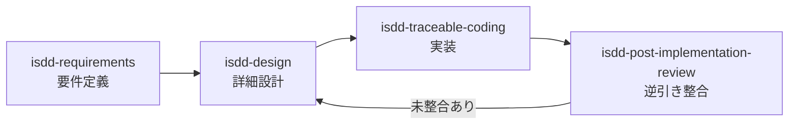
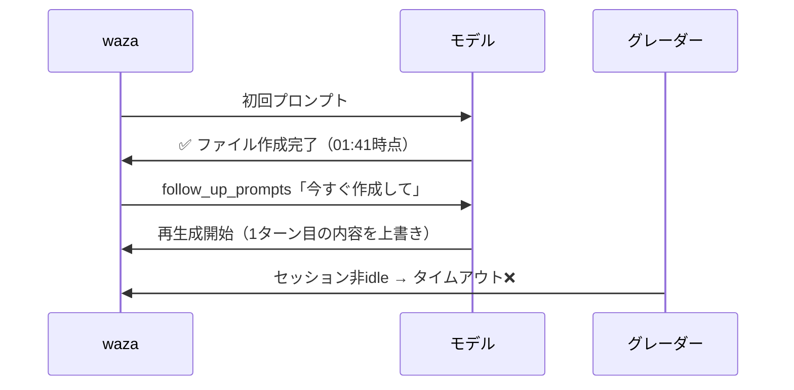
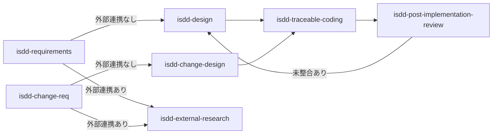

## はじめに

isdd（Interview-driven Spec-driven Development）は、GitHub Copilot のスキル機能を使って要件定義・詳細設計・実装をIDで一貫追跡する仕組みです。この記事では、v1.0.14 リリースに向けて今週行った改修の記録を残します。

メインテーマは **ローカルLLMでのeval対応** と **`follow_up_prompts` の設計判断** の2つです。



## 何を変えたか

v1.0.13 からの主な変更点を一覧にまとめます。

| 変更内容 | 対象 | コミット |
|---|---|---|
| ローカルLLM向けにタイムアウトを10倍に延長 | 全 eval の `timeout_seconds` | `678fc9d` |
| ヒアリング型スキルに `follow_up_prompts` を導入 | isdd-requirements, isdd-reverse-engineering ほか | `8873153` `f5ace73` |
| 自律完了型スキルから `follow_up_prompts` を削除 | isdd-change-design | `f5ace73` |
| `[削除]` 行の RQ-ID を保持・解析除外する処理を追加 | `rq_ds_link_checker.py` | `06bbf93` |
| `check_duplicates` を無効化（誤検知対応） | `rq_ds_link_checker.py` | 同上 |
| 全スキルに「次のステップ」推奨セクションを追加 | 全 SKILL.md | `a88fd1c` |
| `isdd-reverse-engineering` に必須完了条件ブロックを追加 | SKILL.md | `a88fd1c` |
| `run-all.sh` の bash 3.2 空配列バグを修正 | `run-all.sh` | `293acfc` |

## ローカルLLMでの eval 対応

### 問題：10分でタイムアウトしてしまう

waza の eval は `timeout_seconds` で一回の eval のタイムアウトを制御できます。デフォルト値は `600`（10分）で設定していましたが、ローカルで動かしている Gemma 4 26B QAT に投げると、84K トークンの処理に約44分かかりました。

```yaml
# before
timeout_seconds: 600

# after（10倍）
timeout_seconds: 6000
```

全 eval の `timeout_seconds` を一律10倍にしました。実用上は `6000` でも余裕がある場面が多いですが、とりあえず通ることを優先しています。

### macOS の bash 3.2 問題

`run-all.sh` で `set -u`（未定義変数の参照をエラーにするオプション）を有効にしていたところ、空配列の展開でエラーが出ました。

```bash
# zsh や bash 4 以降では問題ないが、macOS の bash 3.2 では unbound variable になる
"${arr[@]}"

# 回避策
${arr[@]+"${arr[@]}"}
```

macOS のデフォルト bash は 3.2 系のため、このパターンで書く必要があります。

## follow_up_prompts ― ヒアリング型 vs 自律型で使い分ける

waza v0.28.0 から `follow_up_prompts` が使えるようになっています。これは eval 中に追加のプロンプトをモデルに送る仕組みで、今回の作業で「使い方を間違えると逆効果になる」ことを学びました。

### 起きたこと

isdd-change-design は自律完了型スキルです。ローカルLLMのテスト中、モデルが1ターン目で計画を説明して止まっているように見えたため、`follow_up_prompts` に「今すぐ作成して」を追加してみました。



モデルはすでに1ターン目で完了していました。完了後に `follow_up_prompts` が届いたため、モデルは再度生成を始め、グレーダーがセッションの終了を待ちきれずタイムアウトしました。

### 解決：スキルの種類で分ける

| スキル種別 | 特徴 | follow_up_prompts |
|---|---|---|
| 自律完了型（isdd-change-design など） | 1ターンでファイル作成まで完了する | 不要・削除する |
| ヒアリング型（isdd-requirements など） | モデルが質問を返してくることがある | 有効活用できる |

ヒアリング型スキルでは、モデルが質問だけして止まるケースがあります。このときに `follow_up_prompts` で「ヒアリングなしで進めてください」のような指示を追加することで、eval が完走できるようになります。

## rq_ds_link_checker.py の改善

### `[削除]` 行の扱い

変更設計書では「削除された要件」を `[削除] RQ-001` のように記述する運用です。変更前は、このような行の RQ-ID もそのまま「未マッピング」として検出していました。

改修後は：
1. `[削除]` 行に含まれる RQ-ID を `deleted_rq_ids` として保持する
2. 詳細設計書の解析時に `deleted_rq_ids` の DS-ID を除外対象として扱う
3. 未マッピング検出では `deleted_rq_ids` をスキップする

### check_duplicates の無効化

isdd の命名規則では DS-ID のサフィックスが対応する RQ-ID を示します（例: `DS-001-01` → `RQ-001`）。共通化方針テーブルなどで1行に複数の RQ-ID が含まれる場合、旧実装では重複と誤判定していました。命名規則で一意性が保証されているため、チェック自体を無効化しています。

```python
def check_duplicates(self):
    """重複チェックは誤検知が多いため無効化。
    
    isdd の命名規則では DS-ID のサフィックスが RQ-ID を一意に示すため、
    共通化方針テーブルなどで DS-ID が複数 RQ-ID と同一行に出現することがある。
    これは設計上の正当な表現であり、真の重複ではない。
    """
    pass
```

## 全スキルへの「次のステップ」推奨

各 SKILL.md の末尾に `## 次のステップ` セクションを追加しました。スキル完了後に何を実行すればよいかをモデルがユーザーに伝えられるようにするためです。



特に `isdd-reverse-engineering` には「必須完了条件」ブロックも追加しました。リバースエンジニアリング後に `rq_ds_link_checker.py` を実行して問題0件を確認するまで「完了」と報告させないための制約です。

```markdown
## 必須完了条件（これを満たすまで完了と報告してはならない）

1. `docs/requirements.md` と `docs/detail_design.md` を作成すること
2. `python3 .agents/skills/isdd-common/scripts/rq_ds_link_checker.py docs/requirements.md docs/detail_design.md` を bash で実行し、問題0件を確認すること
```

## 今週の eval 結果

今週は Gemma 4 26B QAT（ローカル、LM Studio 経由）で動作確認を実施しました。全スキルの eval が `pass` になっています。

| eval | 結果 |
|---|---|
| isdd-requirements | pass |
| isdd-design | pass |
| isdd-change-req | pass |
| isdd-change-design | pass |
| isdd-reverse-engineering | pass |
| isdd-traceable-coding | pass |

## おわりに

ローカルLLMで eval を通すまでの道のりは、タイムアウト・`follow_up_prompts` の誤用・bash の互換性問題など、「やってみないとわからない」問題が続きました。

`follow_up_prompts` はヒアリング型スキルでのみ有効で、自律完了型には不要（むしろ有害）という判断は、実際に eval を失敗させて調べるまで気づけませんでした。waza の eval があったことで、問題を特定できたと感じています。

---

isdd スキルのインストール：

```bash
gh skill install notfolder/req-spec-driven
```
