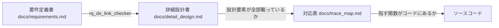
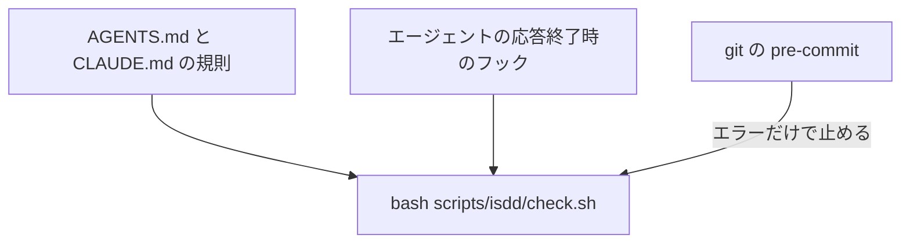
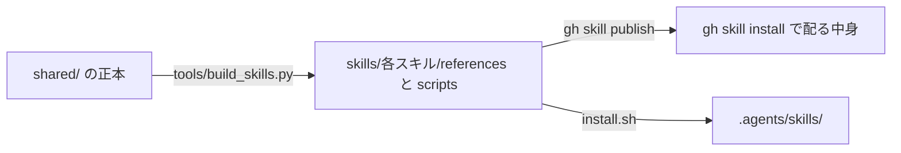
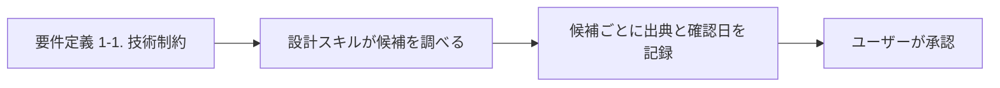
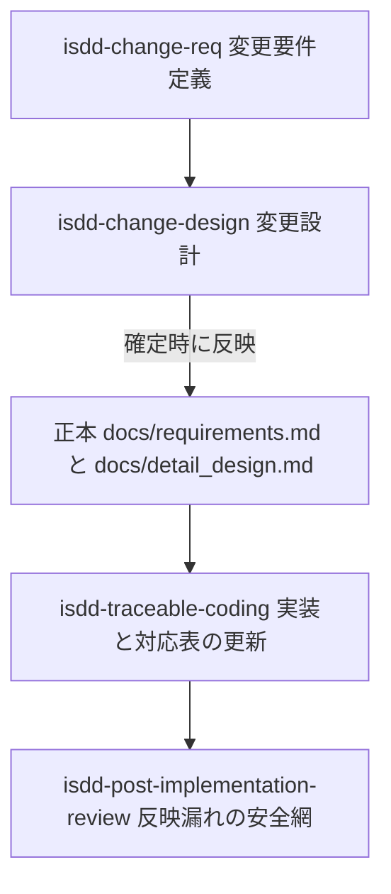
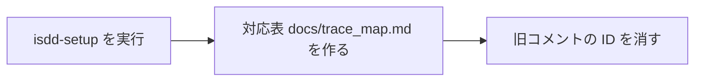

## はじめに

isdd（Interview-driven Spec-driven Development）は、インタビューで仕様を確定し、要件・設計・ソースをIDで追跡しながら開発を進めるためのエージェント向けスキル群です。`gh skill install`で導入して使います。

v1.0.14までは、実装したコードの関数ごとにIDをコメントで書き込んでいました。使っているうちに気になってきたのが、次の3点です。

- 仕様書やコードにIDを付けると読みにくい。既存のコードに入れようとすると、リファクタリングが必要になる
- 設計の章立てで、言語やフレームワーク、DBを具体的な製品名で決め打ちしている
- スキルの書き方が、役割指定や「必ず」「絶対」の強調に頼った古い形のままになっている

v2.0.0では、コードにIDを書くのをやめました。設計IDとコードの対応は、別ファイルの対応表`docs/trace_map.md`で管理します。あわせて、スキルの書き方と共通部分の配り方を今のモデルと仕様に合わせて見直しました（以下、モダナイズと呼びます）。

バージョンを2.0.0に上げたのは、この2つの変更のためです。どちらも、v1.0.14のスキルや、v1.0.14で作ったプロジェクトとの互換を崩します。この記事は、v1.0.14からの変更のまとめです。



仕様書と設計書には今までどおりIDを付けます。コードにはIDを一切書きません。

## v1.0.14からの主な変更点

| 変更内容 | 対象 |
|---|---|
| コードへのIDコメントをやめ、対応表 `docs/trace_map.md` で追跡する | `isdd-traceable-coding` ほか全スキル |
| 対応表を検証する `trace_map_checker.py` を追加し、旧チェッカー `trace_comment_coverage_checker.py` を削除 | `shared/scripts/` |
| チェックの仕組みをプロジェクトに入れる `isdd-setup` スキルを追加 | 新規スキル |
| 共通スキル `isdd-common` を廃止し、共通ファイルを各スキルに同梱する | 全スキル、`shared/`、`tools/build_skills.py` |
| 役割指定と強調をやめ、目的と理由を書く形に直す | 全スキルの SKILL.md |
| 要件定義書と詳細設計書の章立てを組み直す（業務の問題と課題、運用要件、テストと運用の設計 ID など） | `requirements-chapters.md`、`design-chapters.md`、`id-definitions.md` |
| 実装完了の条件（docker compose、初期ユーザー、E2E の mock モード）を実行形態に応じて切り替える | `implementation_completeness_checker.py` ほか |
| 設計の章立てから製品名の既定値を消し、判断軸とインターネット調査で選ぶ方式にする | `design-chapters.md`、`requirements-chapters.md` |
| 変更設計の確定時に正本へ反映する | `isdd-change-design` |
| 既存プロジェクトの逆引きスキルが自分で正本を確定する | `isdd-reverse-engineering` |
| eval を Claude Haiku 5.5 だけで回す `claude` モードを追加し、eval と単体テストを増やす | `evals/`、`tests/` |

## コードにIDを書かない対応表方式

### 対応表の書式

対応表はMarkdownの表で、列は「DS-ID」「修飾名」「備考」の3つに固定しました。修飾名は「ファイルパス::クラス名.関数名」の形で書きます。

| DS-ID | 修飾名 | 備考 |
|---|---|---|
| `DS-MD-HELLO-MODULE-FT-PRINT-HELLO-WORLD` | `src/hello.py` | モジュール |
| `DS-CL-HELLO-WORLD-PRINTER-FT-PRINT-HELLO-WORLD` | `src/hello.py::HelloWorldPrinter` | クラス |
| `DS-FN-GET-HELLO-MESSAGE-FT-GET-HELLO-MESSAGE` | `src/hello.py::HelloWorldPrinter.get_hello_message` | メソッド |
| `DS-FN-PRINT-HELLO-WORLD-FT-PRINT-HELLO-WORLD` | `src/hello.py::HelloWorldPrinter.print_hello_world` | メソッド |

載せるのはファイル、クラス、公開関数とメソッドです。アンダースコアで始まる内部関数、`__init__`などのダンダーメソッド、テストファイルは載せません。要件IDとの対応は設計IDの末尾の略称で表すので、対応表には書きません。

対応表は、要件書や設計書の外に出したほうが両方とも読みやすくなると考えて、独立したファイルにしています。

### チェッカーの動き

`trace_map_checker.py`は、詳細設計書・対応表・コードの3つを突き合わせます。eval用のfixtureでメソッド名を`get_hello_message`から`build_message`に変えて実行すると、出力は次のとおりです。

```text
$ python3 trace_map_checker.py docs/detail_design.md docs/trace_map.md src --strict
...
結果レポート
--------------------------------------------------
✗ エラー 1 件（直してからコミットすること）
  - 対応表 9 行目: コードに存在しない修飾名です（改名・削除の見落とし）: src/hello.py::HelloWorldPrinter.get_hello_message
⚠ 警告 1 件（実装スキルの完了条件では 0 件にすること）
  - 対応表に未登録のメソッド: src/hello.py::HelloWorldPrinter.build_message

検証サマリ
--------------------------------------------------
エラー: 1 件
警告: 1 件
✗ 対応表チェックに失敗しました
```

改名前の名前は「壊れた参照」としてエラーになり、改名後の名前は「未登録」として警告になります。終了コードはエラーがあれば1です。警告は`--strict`を付けたときだけ1になります。

| 区分 | 内容 | 扱い |
|---|---|---|
| エラー | 対応表の DS-ID が設計書に無い。対応表の修飾名がコードに無い | 終了コード 1。pre-commit で止まる |
| 警告 | コードのクラスや公開関数が対応表に無い。設計書の DS-ID が対応表に無い | `--strict` のときだけ終了コード 1 |
| 確認対象外 | 記号を抽出できない言語のファイルを指す `::名前` の行 | 件数を表示するだけ |

### 確認できる言語

言語を固定しない方針に合わせて、チェッカーが扱える言語を広げました。

| 言語 | 確認できること | 方法 |
|---|---|---|
| Python | ファイル、クラス、関数、メソッド | 構文木（ast） |
| TypeScript / JavaScript、Java、Go | ファイル、クラス、関数、メソッド | 正規表現による近似。TypeScript / JavaScript はアロー関数も拾う |
| C#、Ruby、PHP、Kotlin、Swift、Rust、C / C++ など | ファイルの存在だけ | `::名前` の行は確認対象外として数える |

### チェックを3か所で強制する

スキルが起動していないときでも同じチェックが走るように、強制は3層にしました。



pre-commitが止めるのは、エラー（壊れた参照）だけです。未登録の警告では止めません。スキルを持っていない人がプロジェクトのコードを変える場合を考えると、pre-commitで完全に締め出すと困るからです。そのずれは、実装後の逆引き整合スキル`isdd-post-implementation-review`が対応表と設計書に取り込みます。実装スキル`isdd-traceable-coding`の完了条件だけは、エラーも警告も0件です。

チェックはファイル編集のたびには動かさず、応答終了時とpre-commitの2つの時点に絞りました。

## isdd-setupスキル

チェックの仕組みをプロジェクトへ入れるために、`isdd-setup`を追加しました。中で`isdd_setup.py`を実行します。

```bash
python3 isdd_setup.py --src src --runtime cli --no-auth --no-external
```

このスクリプトは次のものを作ります。

- `scripts/isdd/`へのチェッカーの複製（git管理対象。再実行で上書き更新）
- `scripts/isdd/check.sh`と`.git/hooks/pre-commit`
- `AGENTS.md`と`CLAUDE.md`への規則の追記
- `scripts/isdd/completeness.json`（実行形態・認証・外部連携の記録）
- `scripts/isdd/VERSION`（複製したチェッカーの版）

実装スキルと実装後の逆引き整合スキルは、`VERSION`と自分の版を比べ、違えば`isdd-setup`を実行し直してから作業に入ります。古いチェッカーのまま判定すると、規則の変更を見落とすからです。

エージェントの応答終了時のフックは、isdd側では作りません。エージェントごとの処理をisddに持たせたくなかったので、エージェント自身に自分の環境向けのフックを作らせます。応答終了時のイベントやフック機能が無いエージェントでは作らず、そのことを報告させる決まりです。

### 実装完了の条件を実行形態で切り替える

v1.0.14では、docker compose、Playwright、READMEの「初期ユーザー」、E2Eのmockモードを無条件に求めていました。CLIや認証の無いアプリではこの条件を満たせません。

v2.0.0では、`isdd-setup`が詳細設計書から実行形態・認証・外部連携を読み取り、`completeness.json`に記録します。`implementation_completeness_checker.py`はその記録を見て、docker composeと「初期ユーザー」が必要かを決めます。docker composeを求めるのは、`--runtime`が`container`のときだけです。

## スキルのモダナイズ

### 共通スキルをやめて各スキルに同梱する

v1.0.14では、ヒアリングのルールやチェッカーを共通スキル`isdd-common`に置き、各スキルから`.agents/skills/isdd-common/...`のパスで参照していました。兄弟のスキルをパスで参照するのはAgent Skillsの仕様の外です。スキルを1つだけ入れた場合や、置き場所が`.agents/skills/`以外の場合には、参照先が見つかりませんでした。

v2.0.0では`isdd-common`を廃止し、共通ファイルの正本を`shared/`に移しました。`tools/build_skills.py`が`shared/manifest.json`の一覧どおりに、各スキルの`references/`と`scripts/`へ複製します。



複製もコミットしています。`gh skill publish`と`install.sh`が同じ中身を配れるようにするためです。`install.sh`は`build_skills.py --check`で複製が正本と一致するかを確かめ、一致しなければ止まります。

チェッカーの実行元も一本にしました。要件と設計のチェッカー（`rq_*.py`）は、各スキルに同梱した版を実行します。コードを見るチェッカーは、`isdd-setup`がプロジェクトの`scripts/isdd/`に入れた複製を使います。

### 指示の書き方を見直す

SKILL.mdの書き方も、最近のモデル向けに見直しました。

| 見直した点 | v1.0.14 | v2.0.0 |
|---|---|---|
| 冒頭 | 「あなたは〜として振る舞う」という役割指定 | スキルの目的を書く |
| 強調 | 「必ず」「絶対」「禁止」が SKILL.md 全体で 135 か所 | 本当に変わらない規則だけを平叙文で残し、理由を添える |
| description | 「必ず使うこと」を二重に書いていた | 何をするか、いつ使うか、使わない場面を書く |
| 共通の規則 | ヒアリングのルールが 2 系統に分かれ、三重に書かれていた | `hearing-rules.md` などの reference に集め、SKILL.md から 1 段で参照する |

強調を減らしたのは、強い言葉を重ねても、今のモデルでは守られやすさが上がらないと考えたからです。理由を添えておけば、規則の想定から外れた場面でもモデルが判断できます。

### 章立ての過不足を見直す

要件定義書と詳細設計書の章立ても、抜けていた項目を足して組み直しました。

- 業務の章を「業務の問題」「業務課題一覧（`RQ-BK`）」「見込み経営効果（`RQ-EF`）」に分けた
- 要件定義書に、システムの形態（GUI / CUI / Web API / バッチ）、帳票、業務ルール、外部連携の表、データ要件、状態遷移、運用要件（`RQ-OP`）を足した
- 設計IDにテスト（`DS-TS`）と運用（`DS-OP`）を足し、要件のカテゴリごとにどの設計IDで受けるかを`id-definitions.md`に書いた
- 設計書に、トランザクションと排他制御、状態遷移、インターフェース仕様、認証・認可・監査ログ、設定値と環境変数、バックアップ、障害対応、除外要件を足した

テストや運用の要件を受ける設計IDが決まっていなかったので、v1.0.14では`rq_ds_link_checker.py`の対応チェックを、モデルがその場の判断で合わせていました。受け先を決めたことで、この揺れが無くなります。

## 技術選定を固定しない

設計の章立て`design-chapters.md`の第1章と第3章には、Python、Streamlit、Vue + FastAPI、SQLite、PostgreSQLといった既定値が書いてありました。これを消して、判断軸と選定の手順に置き換えています。



要件定義の章立てには「1-1. 技術制約」を追加しました。既存コードベース、配備先、チームの技術、ライセンスとコスト、性能と規模は、要件定義の段階で確認する項目です。設計スキルは候補ごとにインターネットで調べ、出典と確認日を記録してからユーザーの承認を取ります。調査できない環境では、調査できないと報告して止まります。

## フローのつなぎ目の修正

対応表方式に変えたあと、スキル全体を一度レビューしました。過去の経緯を読まずにスキルの中身だけを読むよう指示してClaudeにレビューさせ、19件の指摘が出ました。重大な4件のうち2件は、フロー同士のつなぎ目の問題でした。

isddでは、確定した要件定義書`docs/requirements.md`と詳細設計書`docs/detail_design.md`を正本と呼んでいます。

1つ目は変更フローです。`check.sh`は正本の`docs/detail_design.md`しか読みません。変更設計の設計IDが正本に無いまま実装すると、対応表の全行がエラーになり、完了条件に届きませんでした。そこで、変更設計が確定した時点で`isdd-change-design`が正本へ反映するようにしました。`isdd-post-implementation-review`は反映漏れを拾う安全網の位置づけです。



2つ目は既存プロジェクトの逆引きです。`isdd-reverse-engineering`は正本の確定を`isdd-post-implementation-review`に任せていましたが、そちらは実装起因の差分だけを対象にしています。対応表が無い段階で`check.sh --strict`を要求するので、初めての導入とは噛み合いませんでした。v2.0.0では逆引きスキルが自分で正本を確定し、そのあとに`isdd-setup`と対応表作りへ進みます。完了後の新しい要求は変更フロー`isdd-change-req`で扱います。

ほかにも、問題を検出しても終了コード0を返していた`rq_ds_link_checker.py`を1を返すように直しました。定義ファイルが無いサブエージェント名の起動指示も削除しています。

## evalをHaikuだけで回す

### claudeモード

evalにはwazaを使っています。v2.0.0では、wazaの`copilot-sdk`実行器のBYOK機能でAnthropic APIを呼ぶ`claude`モードを`run-all.sh`に追加しました。

```bash
bash evals/install-copilot-cli.sh   # 初回のみ
bash evals/run-all.sh claude
```

waza 0.38.10に同梱のCopilotランタイム1.0.85は、Haiku 5.5に旧式の思考設定を送ってしまい、400エラーで落ちました。そのため`install-copilot-cli.sh`で新しいCopilot CLIを`evals/.copilot-cli/`に入れ、`run-all.sh claude`が自動でそれを使うようにしています。

### 1回目で落ちたらスキルを直す

当初は「Haikuで落ちたらSonnetで再実行する」昇格の仕組みを入れていました。しかしHaikuで動くならSonnetで検証する意味は薄く、Haikuで動かないならスキルの書き方に問題があると判断して、昇格の仕組みごと削除しました。

いまの運用は次のとおりです。

- モデルは`claude-haiku-5-5`だけを使う
- 失敗したevalは同じモデルで1回だけ再試行する
- 1回目で落ちたら、再試行で通ってもスキルの質の問題としてSKILL.mdを直す

10月17日に全スキルのevalをHaikuだけで1周したときは、約20分かかりました。消費は入力が約990万トークン（うちキャッシュ読込が約860万）、出力が約22万トークンでした。

### evalを増やす

モダナイズに合わせて、evalと単体テストも増やしました。

- fixtureを新しい章立てで作り直し、新しい章を採点するグレーダーを足した
- チェッカーは「実行したか」だけでなく、採点の中で再実行して「合格したか」を見る
- 開始ゲートの分岐、技術選定の承認前に止まる、チェッカーの版の食い違い、設計に無い機能を頼まれたら止まる、といったタスクを足した
- `isdd-external-precheck`と`isdd-external-research`のevalを新しく作った（検証用のSQLiteを連携先にする）
- ヒアリングの作法を会話で採点するタスクを足した
- チェッカーと複製スクリプトの単体テストを`tests/`に45件置き、CIで実行する

ヒアリングの採点では、Haikuが選択肢の複雑さを示さない、複雑な案が選ばれても確認しない、ユーザーが述べていない理由を作って要件に書く、の3点が見つかりました。質問する5つのスキルの本文に選択肢の表の形を直接書き、複雑な案が選ばれたときの手順を足しています。

### 1回目に落ちたevalと直したこと

公開前の最後の確認では、全10スキルのevalを回しました。1回目で落ちたのは次のとおりです。

| スキル | 落ちた理由 | 直したこと |
|---|---|---|
| `isdd-design` | 要件と設計の対応表の章を作らなかった | 設計の章立てに「12. 要件と設計の対応表」を必須の章として足した |
| `isdd-post-implementation-review` | 未マッピング一覧を文章で済ませた。直したあとも、見出しを太字で書き、列名を省略した | 一覧を表で出す規則、Markdown の見出し `### 未マッピング一覧`、列名を省略しないことを手順と完了条件に書いた |
| `isdd-external-research` | mock 方式の ID を要件定義書に書かなかった。`.env.example` をプロジェクト直下に置いた | セルフレビューに ID の記入を足し、`.env.example` の置き場所（`external/[システム名]/`）を本文に書いた |

採点スクリプトの不具合も2件ありました。globの`**`が一致したディレクトリを読もうとして落ちていたことと、同じ行に書く2つのIDの左右の順番まで求めていたことです。この2件では、モデルの出力はスキルの指示どおりでした。採点スクリプトを直したうえで、10スキルとも1回目で合格しています。

### タイムアウトを実測の約3倍に縮めた

v1.0.14ではローカルLLM向けにタイムアウトを10倍に延ばしていました。Claudeでの実行中に実行基盤が2回固まり、22〜40分止まったまま待つことになったので、各`eval.copilot.yaml`の`timeout_seconds`を実測の約3倍（600〜900秒）に縮めました。ローカルモデルで回す`local`モードは、`WAZA_LOCAL_TIMEOUT_SCALE`（既定10）を掛けた一時ファイルで実行します。

## v1.0.14からの更新と移行

### スキルを更新する

v2.0.0では`isdd-setup`が増え、`isdd-common`が無くなりました。`gh skill update`は新しく増えたスキルを入れず、廃止したスキルも消しません。v1.0.14から`gh skill update --all --unpin`で更新すると、9スキルはv2.0.0になりますが、`isdd-setup`は入らず、v1.0.14の`isdd-common`が残りました。

v1.0.14から更新するときは、全スキルを入れ直してから`isdd-common`を消してください。

```bash
# 全スキルを入れ直す（isdd-setup も入る。--pin で固定していたスキルも最新になる）
gh skill install notfolder/isdd --all --force --agent claude-code
# 廃止した共通スキルを消す（パスは導入先に合わせる。例は Claude Code のプロジェクトスコープ）
rm -rf .claude/skills/isdd-common
```

`--agent`と`--scope`は、最初に導入したときと同じ値にします。v1.0.14を入れたディレクトリでこの2つを実行し、10スキルがv2.0.0になって`isdd-common`が無くなることを確かめました。古い`isdd-common`には、コードにIDコメントを書く旧方式の規則が入っています。新しいスキルはこれを参照しませんが、エージェントが読むと古い規則で動くおそれがあるので消しておきます。

`install.sh`で導入している場合は、リポジトリを最新にして`install.sh`を再実行してください。`isdd-common`の削除も`install.sh`の処理に含まれています。

### v1.0.14で作ったプロジェクトを使い続ける

コードに旧方式のIDコメントが残っていても、新しいスキルはそのまま使えます。`check.sh`はコメントを読まず、pre-commitもエラーだけで止めるからです。



最初に`isdd-setup`を実行して、チェッカーと`check.sh`、pre-commitを入れます。次は対応表づくりです。`isdd-post-implementation-review`を使っても、次に`isdd-traceable-coding`で実装するときに作ってもかまいません。どちらのスキルも`check.sh --strict`の警告が0件になるまで、既存のファイル・クラス・公開関数を登録します。旧コメントに書いてある設計IDは、そのまま登録の手がかりになります。

対応表ができたら、旧コメントのIDを消してください。`isdd-traceable-coding`の完了条件に「コードに要件ID・設計IDを含むコメントが無い」があり、残っていると完了条件を満たさないためです。対応表とコメントで二重に管理すると、ずれる原因にもなります。

## 制約・注意点

- コードに書いていたIDコメントは使わなくなりました。旧チェッカー`trace_comment_coverage_checker.py`も削除しています
- 記号まで確認できる言語は、Python、TypeScript / JavaScript、Java、Goです。それ以外の言語はファイルの存在だけを確認します
- TypeScript / JavaScript、Java、Goの抽出は正規表現による近似で、クラス所属の判定も近似です
- 応答終了時のフックはエージェント自身が作ります。フック機能の無いエージェントでは、規則とpre-commitの2層になります
- `gh skill update`だけでは、v2.0.0で増えたスキルが入らず、廃止したスキルも残ります
- Copilot CLIがモデルの応答待ちのまま止まる現象は、原因を特定できていません

## おわりに

v2.0.0は次のコマンドで導入できます。どちらも公開時に`gh`が表示したものです。

```bash
gh skill install notfolder/isdd
gh skill install notfolder/isdd <skill> --pin v2.0.0
```

v1.0.14から更新する場合は、上の「スキルを更新する」の手順を使ってください。

次は、Claude Codeを実行器として呼べるようにwazaをフォークすることを検討しています。実行基盤が固まる現象が再発するようなら、こちらを優先するつもりです。
