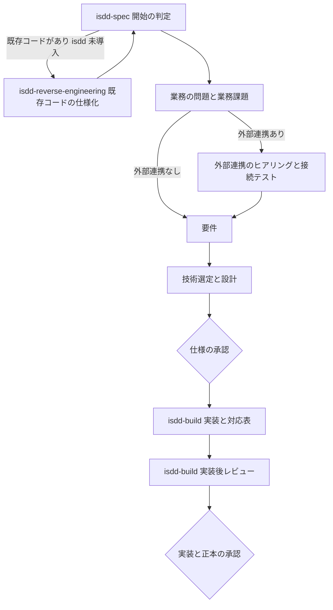
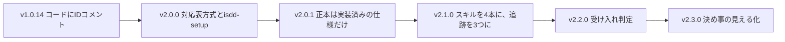
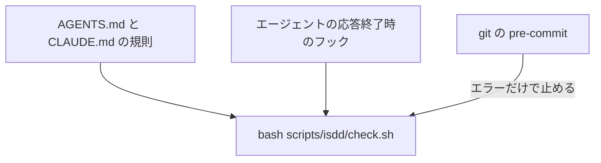
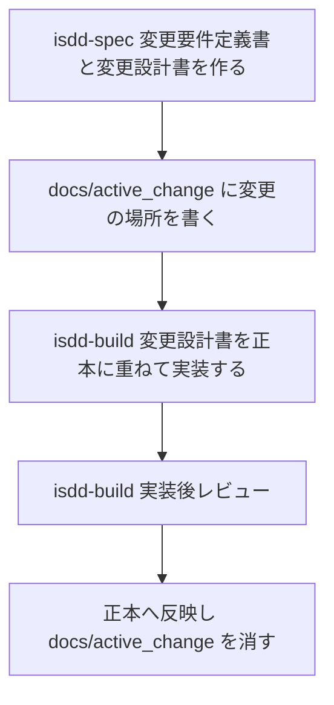
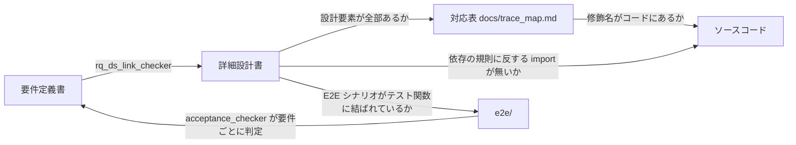
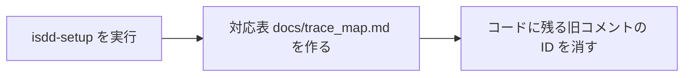

## はじめに

isdd（Interview-driven Spec-driven Development）は、AIのコーディングエージェントに入れて使うスキル群です。エージェントがインタビューで要件を聞き取り、要件定義書と詳細設計書を作ってから実装します。要件・設計・コードの対応はIDで追い、チェッカーで機械的に確かめます。

リポジトリは https://github.com/notfolder/isdd です。

isddについては、これまで次の記事を書いてきました。

| 時期 | 記事 | 書いたこと |
|---|---|---|
| 2026年3月 | [コードが読めなくてもAIで品質の高いソフトウェアが作れる](https://qiita.com/notfolder/items/34cc12003dc7e63c45e5) | 要件定義書と設計書を先に作る進め方と、そのためのプロンプト |
| 2026年4月 | [kiro vs 自作プロンプト](https://qiita.com/notfolder/items/3daa610f6e3d9392c344) | 同じアプリをkiroの標準の進め方と自作プロンプトで作り比べた結果 |
| 2026年5月 | [対話駆動仕様開発 isdd](https://qiita.com/notfolder/items/fe964d0f4f1236660707) | プロンプトをスキルにしたisddの紹介。v1系の内容 |
| 2026年6月 | [isdd v1.0.14 開発ログ](https://qiita.com/notfolder/items/5c6590b30628bb6b7cb2) | ローカルLLMでスキルのevalを回した記録 |

v1.0.14のあと、v2.0.0からv2.3.0まで5回公開しました。その間の記事は書いていません。この記事1本で、v1系からv2.3.0までの変更と、v2.3.0の評価をまとめます。

先に結論です。isddは、要件を自分で決め切って文章にできる人には要りません。作りたいものはあるが、要件を細部まで決め切れていない人に向いています。比較計測の次の3点が根拠です。

- 依頼と受け入れ基準が文章で決まっている題材では、isddを使っても点数は変わらなかった。備品管理アプリの題材では、新しく消費したトークンが約4.4倍だった
- 差が出たのは、あいまいな依頼から要件を決める場面だった。依頼者だけが知っている20項目のうち、要件定義書に正しく入った数は、isddなしが平均2.7、isddありが平均14.7だった
- あいまいな依頼を実装の完了まで通すと、隠しテスト8本の平均は、isddなしが3.7、isddありが6.7だった

### この記事の読み方

| 読む人 | 読む章 |
|---|---|
| isddを初めて知った方 | 「isddとは」「導入と更新」。そのあと「isddあり・なしの比較計測」と「強みと弱み」 |
| 以前の記事を読んだ方、v1系を使っている方 | 「以前の記事から変わったこと」「版ごとの変更」「導入と更新」 |
| 自分に要るかを知りたい方 | 「どんな人と案件に向くか」「強みと弱み」 |
| 効果があるのかを知りたい方 | 「v2.3.0のeval」「isddあり・なしの比較計測」「強みと弱み」 |

## isddとは

### 何を解決したいか

AIに実装を任せると、速く作れます。一方で、次の3つが起きやすくなります。

- 要件があいまいなまま実装が進む
- 変更したときに、どこへ影響するかを追えない
- 作った人やセッションが変わると、何が実装済みかが分からなくなる

isddが文書で残すのは、文脈を持たない次の作業者に守ってほしい内容です。次の作業者とは、別のセッション、別の人、スキルを持たないエージェントのことです。文書は、要件、設計、対応表、依存の規則、受け入れテストの5種類あります。守られているかはチェッカーで確かめます。

1回のセッションで仕様どおりに作ることは、モデルに任せる範囲です。isddは次の4つを受け持ちます。

1. 要件を業務課題から絞る。業務課題に結びつかない要件は残さない
2. 変更を重ねても、文書と実装がずれないようにする
3. 作りすぎを見つける。要件に結びつかない公開関数、画面、設定項目を数える
4. エージェントに機械的な完了条件を渡す

### 流れ



人が確認して承認するのは、仕様ができたときと、実装が終わったときの2回です。スキルもこの区切りで分かれています。

| スキル | 役割 |
|---|---|
| `isdd-spec` | インタビューで要件と設計を作り、承認を取る |
| `isdd-build` | 設計どおりに実装して対応表を作り、実装後レビューで文書とコードの整合を確かめる |
| `isdd-reverse-engineering` | 既存のコードから要件定義書と詳細設計書を書き起こす。既存のコードは変更しない |
| `isdd-setup` | チェッカーとpre-commitをプロジェクトに入れる |

### 用語

この記事で使う用語です。

| 用語 | 意味 |
|---|---|
| 正本 | 確定した要件定義書`docs/requirements.md`と詳細設計書`docs/detail_design.md` |
| 要件ID | `RQ-[カテゴリ]-[内容]`の形のID。例は業務課題の`RQ-BK`、機能の`RQ-FT`、テスト用シナリオの`RQ-TS` |
| 設計ID | `DS-[種類]-[要素名]`の形のID。例はモジュールの`DS-MD`、関数の`DS-FN`、E2Eシナリオの`DS-TS` |
| 対応表 | 設計IDとコードの対応を書く`docs/trace_map.md` |
| 変更フロー | 正本があるプロジェクトに変更を入れるときの流れ |
| 受け入れ判定 | E2Eの結果から、要件ごとに「実装済み / 不合格 / 未検証」を出す判定 |

IDは`RQ-001`のような連番にしていません。意味の分かる名前を付けます。

### どんな人と案件に向くか

いちばん分かりやすい基準は、要件を自分で決め切れるかどうかです。画面の文言、入力の桁数、空欄のときの振る舞いまで自分で文章にできるなら、その文章をそのままエージェントに渡せば足ります。後の章の計測でも、その条件ではisddを使っても点数は変わらず、トークンと時間が余計にかかりました。

isddのインタビューが役に立つのは、決め切れていない人です。エージェントが業務の問題から順に聞き、依頼に書かれていない決め事を質問にして返します。答えた内容は要件定義書に残るので、コードを読まない方でも、何を作ることになったかを文書で確かめられます。

まとめたのが次の表です。

| 向く | 向かない |
|---|---|
| 作りたいものはあるが、要件を細部まで決め切れていない | 要件を細部まで自分で文章にできる |
| 要件を業務の言葉で絞りたい | 要件が既に完全な形で与えられている |
| 何を作ることになったかを文書で確かめたい | 使い捨て、1セッションで終わる小物や、1〜2ファイルの修正だけ |

## 以前の記事から変わったこと

5月の記事とv1.0.14の記事に書いたことのうち、今は違っている点です。

| 以前の記事の内容 | v2.3.0 |
|---|---|
| `gh skill install notfolder/req-spec-driven`で導入する | `gh skill install notfolder/isdd`で導入する。リポジトリ名を変えた。古いURLは新しいURLへ転送される |
| `/isdd-requirements`から始める | `/isdd-spec`から始める |
| スキルは9本と共通スキル`isdd-common` | 4本。共通スキルは廃止した |
| 実装時に、コードへ要件IDと設計IDのコメントを埋め込む | コードにIDを書かない。対応は`docs/trace_map.md`に書く |
| 設計IDは`DS-[種類]-[内容]-[要件のカテゴリ]-[要件の内容]` | `DS-[種類]-[要素名]`。要件との対応は設計書の第11章だけに書く。長いIDも有効なまま |
| 変更のたびに正本を更新する | 正本は実装済みの仕様だけを持つ。変更は実装の後に反映する |
| 設計の章立てにPythonやStreamlitなどの既定値がある | 既定値を持たない。要件の技術制約と調査結果から候補を出し、承認を取る |
| docker composeや初期ユーザーを無条件に求める | 実行形態、認証、外部連携に応じて切り替える |
| 質問は1問ずつ | 依存のある問いは1問ずつ、独立した問いは番号を付けてまとめて出す |
| 評価は、モデルとエージェントツールの組み合わせごとの所感 | 場面ごとのevalをClaude Haiku 5.5だけで回す。別に、isddあり・なしの比較計測をした |

5月の記事では、非エンジニアが要件定義書を確認し、実装はAIに任せると書きました。この考え方は変えていません。今回の計測では、その前提になる「あいまいな依頼から正しい要件を決められるか」も測っています。

5月の記事には「AIは実装とテストを同時に書くと自己採点に寄る」とも書きました。isddは受け入れテストを要件の段階で決めますが、この問題が解けたかどうかは、今回の計測では確かめられていません。

v1系で作ったプロジェクトは、そのまま使い続けられます。手順は「導入と更新」にあります。

## 版ごとの変更



### v2.0.0 コードにIDを書かない

v1系では、実装した関数ごとにIDをコメントで書き込んでいました。コードが読みにくくなり、既存のコードに入れるにはリファクタリングが要ります。

v2.0.0でコードへのIDコメントをやめ、対応を対応表に移しました。対応表はMarkdownの表で、列は「DS-ID」「修飾名」「備考」の3つです。evalで使っているHello Worldの対応表を示します。この題材はv2.0系の長い設計IDのままで、v2.3.0でも有効です。

| DS-ID | 修飾名 | 備考 |
|---|---|---|
| `DS-MD-HELLO-MODULE-FT-PRINT-HELLO-WORLD` | `src/hello.py` | モジュール |
| `DS-CL-HELLO-WORLD-PRINTER-FT-PRINT-HELLO-WORLD` | `src/hello.py::HelloWorldPrinter` | クラス |
| `DS-FN-GET-HELLO-MESSAGE-FT-GET-HELLO-MESSAGE` | `src/hello.py::HelloWorldPrinter.get_hello_message` | メソッド |
| `DS-FN-PRINT-HELLO-WORLD-FT-PRINT-HELLO-WORLD` | `src/hello.py::HelloWorldPrinter.print_hello_world` | メソッド |

`trace_map_checker.py`は、詳細設計書、対応表、コードの3つを照らし合わせます。上の題材でメソッド名を`get_hello_message`から`build_message`に変え、v2.3.0のチェッカーを実行した出力です。

```text
$ python3 trace_map_checker.py docs/detail_design.md docs/trace_map.md src --strict
...
結果レポート
--------------------------------------------------
✗ エラー 1 件（直してからコミットすること）
  - 対応表 9 行目: コードに存在しない修飾名です（改名・削除の見落とし）: src/hello.py::HelloWorldPrinter.get_hello_message
⚠ 警告 1 件（isdd-build の完了条件では 0 件にすること）
  - 対応表に未登録のメソッド: src/hello.py::HelloWorldPrinter.build_message

検証サマリ
--------------------------------------------------
エラー: 1 件
警告: 1 件
✗ 対応表チェックに失敗しました
```

改名前の名前は、対応表が指す先が無いのでエラーになります。改名後の名前は、対応表に載っていないので警告です。

スキルが起動していないときも同じチェックが走るように、チェックを呼ぶ場所を3つにしました。



pre-commitが止めるのはエラーだけで、警告では止めません。スキルを持っていない人がコードを足す場合があるためです。そのずれは、`isdd-build`の実装後レビューが対応表と設計書に取り込みます。`isdd-build`の完了条件は、エラーも警告も0件です。

この仕組みをプロジェクトに入れるスキルが`isdd-setup`です。チェッカーを`scripts/isdd/`に複製し、`check.sh`とpre-commitを作り、`AGENTS.md`と`CLAUDE.md`に規則を追記します。

v2.0.0ではほかに次の変更をしました。

- 共通スキル`isdd-common`を廃止し、共通ファイルを各スキルに同梱した。スキルを1つだけ入れても動く
- スキルの書き方を見直した。「あなたは〜として振る舞う」という役割指定をやめ、目的を書く。「必ず」「絶対」「禁止」の強調は`SKILL.md`全体で135か所あり、変わらない規則だけを理由付きで残した
- 設計の章立てから製品名の既定値を消した
- 記号まで確認できる言語を、Python、TypeScript / JavaScript、Java、Goにした。ほかの言語はファイルの存在だけを確かめる

### v2.0.1 正本は実装済みの仕様だけを持つ

v2.0.0では、変更設計が確定した時点で正本を書き換えていました。この方式だと、実装をやめたり途中で止まったりしたときに、作っていない仕様が正本に残ります。

v2.0.1で元に戻しました。変更フローでは、変更要件定義書と変更設計書を`.history/[日付]-[タスク名]/`に作り、その場所を`docs/active_change`に書きます。正本は書き換えません。実装中は、対応表チェックが変更設計書を正本に重ねて読みます。有効な設計IDは「正本＋変更設計書−削除した設計ID」です。正本への反映は、実装の後に実装後レビューだけが行います。



### v2.1.0 スキルを4本にまとめ、追跡を3つに分ける

v2.0.0の時点でスキルは10本ありました。要件定義、変更要件定義、外部連携の事前確認と詳細調査、設計、変更設計の6本を`isdd-spec`に、実装と実装後レビューの2本を`isdd-build`にまとめています。分ける基準は、人が確認して承認する区切りです。

業務課題から要件、設計、実装、実装後レビューへ進む流れは変えていません。小さな変更のつもりでも大きな変更になりうるので、小さな変更向けの近道も作りませんでした。

設計IDは`DS-[種類]-[要素名]`に短くしました。要件との対応は設計書の第11章「要件と設計の対応表」だけに書きます。要件を差し替えても、中身の変わらない設計要素のIDは変わりません。

追跡は3つに分けています。

| 見るもの | 何で確かめるか |
|---|---|
| 要件が実装されたか | 要件のテスト用シナリオ`RQ-TS`から設計書の`DS-TS`、`e2e/`のテスト関数までのつながり |
| 設計に無いコードが無いか | 対応表。粒度は設計書第7章で`function`か`class`を選ぶ |
| 設計の構造が守られているか | `dependency_checker.py`が、第7章の依存の規則に反するimportを検出する |

外部連携の扱いも段階の境界で分けました。要件の段階では、連携先ごとに1回のヒアリングと接続テスト、仕様の調査、要件との照らし合わせまでを行います。連携ライブラリの採否とモック方式は設計の段階で承認を取り、コードは`isdd-build`が作ります。

### v2.2.0 受け入れテストで中身を確かめる

対応表と依存の規則で確かめられるのは、対応が書かれているかと、設計に無いコードが無いかです。中身が要件どおりかは確かめません。v2.2.0でこの位置づけをREADMEに書き、中身の確認を受け入れテストに任せました。

要件定義書の第7章の表に「検証する要件ID」列を足しています。`acceptance_checker.py`はE2Eの結果（JUnit XML）を対応表の`DS-TS`行と照らし合わせ、この列をたどって要件ごとの判定を出します。`isdd-build`の完了条件は、判定が全部「実装済み」になることです。



実装後レビューの未マッピング一覧には「要件なし（作りすぎ）」の区分と件数を足しました。

### v2.3.0 依頼に無い決め事を見える化する

v2.3.0の変更は2つで、どちらも公開前にisddを試しに動かして見つかった問題への対応です。

1つ目は、依頼に無い決め事の見える化です。試したときには、空欄のときの文言や選択肢の上限などを、エージェントが依頼者に知らせずに決めていました。決めること自体は必要なので、禁止はしていません。要件定義書に「1-2. 依頼に無く自分で決めた項目」の節を必須で置き、次の表に残します。

| 項目 | 決めた内容 | 根拠（最小案か、依頼のどこから推測したか） | 承認（承認済 / 未確認） |
|---|---|---|---|

ヒアリングの規則には、決め事を見落とさないための洗い出しの表を足しました。

| 対象 | 洗い出す場合 |
|---|---|
| 入力ごと | 無い、空、形式が違う、大きすぎる・多すぎる、重複している |
| 出力ごと | 0件のとき、上限を超えたとき、書き込めないとき |
| 操作ごと | 同時に行われたとき、繰り返したとき、途中で失敗したとき |
| 値ごと | 既定値、上限と下限、文字種と長さ |

聞ける状況では要件の段階でまとめて聞きます。聞けない状況では最小案で決め、「承認」列を「未確認」にして進めます。承認を求める報告には、この表をそのまま貼る決まりです。`rq_integrity_checker.py`は節が無い要件定義書を指摘します。

2つ目は、対応表チェッカーの走査範囲です。`--src`にファイルを書けるようにし、`--exclude`で除外できるようにしました。数千ファイルある既存リポジトリの一部だけをisddの対象にしたとき、範囲の外のコードが大量に未登録として報告されたためです。あわせて、設計IDの`DS-MD`を付ける対象を、チェッカーが走査するコードだけに限りました。起動スクリプトは`DS-OP`、テンプレートやCSSは`DS-IF`で受けます。

## v2.3.0のeval

v2.3.0の評価は2種類あります。この章のevalは、スキルが手順どおりに動くかを場面ごとに確かめるものです。次の章の比較計測は、isddを使うと結果が良くなるかを確かめるものです。

### 進め方

- モデルはClaude Haiku 5.5だけを使う
- 1回目で落ちたら、再試行で通ってもスキルの質の問題として`SKILL.md`を直す
- 強いモデルで通して済ませることはしない

5月の記事では、モデルとエージェントツールの組み合わせごとに所感を書きました。v2系では、いちばん小さいモデルで手順が通ることを合格の基準にしています。Haikuで通る手順なら、より強いモデルでも通ると考えているためです。

採点は、決められる判定をプログラムで行います。採点の中でチェッカーを再実行し、ファイルの中身を確かめます。モデルに判定させるのは、会話の流れで決まる判定だけです。承認の前に止まったか、開始時にどの流れへ進んだかなどが当たります。

### 結果

v2.3.0の公開前に、全28場面を回しました。Anthropic APIの月間上限に達していたので、同じ場面定義をClaude Codeのログインで回す`evals/run-claude-code.py`を使っています。wazaで回した結果とは実行基盤が違います。

1回目は5場面が落ちました。スキルとチェッカーを直して回し直し、全28場面が合格しています。採点項目は合計165個です。場面ごとの結果は、リポジトリの`evals/artifacts-claude-code/`にあります。

| スキル | 場面の数 | 確かめていること |
|---|---|---|
| `isdd-spec` | 16 | 開始時の振り分け、要件定義、設計、変更要件定義と変更設計、外部連携の接続テスト、承認の前に止まること、ヒアリングの作法、依頼に無い決め事の見える化 |
| `isdd-build` | 10 | 対応表の作成、進行中の変更を正本に重ねた実装、設計に無い要素で止まること、実装後レビュー、未マッピングの検出、チェッカーの版の食い違い |
| `isdd-reverse-engineering` | 1 | 既存コードからの要件定義書と詳細設計書の書き起こし |
| `isdd-setup` | 1 | チェッカーとpre-commitの導入 |

1場面にかかった時間は25秒から220秒で、28場面の合計は約53分でした。

1回目に落ちた内容と、直したことです。

| 落ちた内容 | 直したこと |
|---|---|
| `isdd-spec`が、「続けて」のような承認の言葉が無い指示で実装へ進んだ | 仕様への明示の同意が無ければ、承認待ちで止まる |
| `isdd-build`が、設計に無い要素で止まったあと、自分で`isdd-spec`を起動して文書を作った | 止まったあとに`isdd-spec`を自分で起動しない |
| 1-2の表に、本文に書いた決め事が載っていなかった | 本文に書く前に表へ足す。レビューでは要件の表を1行ごとに確かめる |
| `acceptance_checker.py`が、進行中の変更で削除する要件も判定の対象にしていた | 削除にした要件、`RQ-TS`、`DS-TS`を判定から外す |

チェッカーの単体テストは95本あります。標準ライブラリだけで書いてあり、動作の対象はPython 3.9以上です。CIは持たず、`bash tools/test_pythons.sh`で手元にある複数の版を使って通しています。

evalの題材はHello Worldと小さなCRMのデータベースです。確かめているのは手順が通ることで、作ったソフトの品質ではありません。品質への効果は次の章で測りました。

## isddあり・なしの比較計測

### 計測の条件

isddのスキルを使う群と、スキルを使わず依頼の文章だけを受け取る対照群を比べました。

- モデルは両群で同じにする。11月5日の計測はClaude Haiku 5.5
- 計測専用のフォルダから`claude -p`で無人実行する。対照群からisddのスキルが見えないことを毎回記録した
- 段ごとに新しいセッションで実行し、前の段の成果物だけを引き継ぐ
- isdd群のヒアリングと承認は、あらかじめ用意した回答で代替する。あいまいな依頼の計測だけは、依頼者役のモデルが質問に答える
- 変更の題材は、機能の追加ではなく既存機能の変更にした
- Webサイトの採点はOpus 5.5の採点者3人の多数決で、基準は文章で固定した
- 時期は2026年11月5日で、v2.3.0の公開の直前
- 使ったスキルは、v2.3.0の2つの変更を入れたあとのもの。公開前evalで直した5件は入っていない
- 公開後の11月19日から21日に、公開したv2.3.0で計測を2つ足した。依頼に書いていない決まりを含む変更と、あいまいな依頼を実装の完了まで通す計測で、後者のモデルはOpus 5.5

変更の題材を既存機能の変更にしたのは、追加だけの依頼では、前の段のテストが落ちる退行が起きにくいためです。

### 結果

| 題材 | 対照群 | isdd群 |
|---|---|---|
| 備品管理アプリ。新規のあと既存機能の変更を2回。各群5回、最終段23本の平均 | 21.8/23 | 22.2/23 |
| 上の備品管理アプリで、新しく消費したトークンの平均 | 265,319 | 1,179,767 |
| Webサイト5課題を3回ずつ。新規のあと既存機能の変更を2回。最終段の合計 | 79/81 | 76.5/81 |
| 上のWebサイトで、変更のケース57件のうち取りこぼした数 | 1 | 9 |
| あいまいな依頼から要件を決める。依頼者だけが知る20項目との一致の平均 | 2.7 | 14.7 |
| 依頼に書いていない決まりを含む変更を3回。備品管理アプリの続き、各群1回、最終段38本 | 38/38 | 38/38 |
| あいまいな依頼を実装の完了まで通す。Opus 5.5、各群3回、隠しテスト8本の平均 | 3.7 | 6.7 |
| 1段の所要時間の中央値 | 94秒 | 694秒 |
| 1段のツール呼び出しの中央値 | 12回 | 59回 |

備品管理アプリでは、isdd群が新しく消費したトークンは対照群の約4.4倍でした。1段の所要時間は約7倍です。所要時間とツール呼び出しの中央値は、11月5日の備品管理アプリとWebサイトの計測から出しました。

### 差が出なかった題材

備品管理アプリは、3月の記事から使っている題材です。画面の文言や振る舞いを契約の文書で渡し、隠しテストで合否を決めました。段2で社員番号を6桁から7桁に、段3で「担当者」を「管理者」に全画面で改称しています。変更の取りこぼしを拾うテストは両群とも全回合格し、退行も全回0でした。

依頼と契約で合否が決まり、変更する箇所が文章で示されている題材では、Haikuはisddなしでも既存の機能を壊しませんでした。要件を決め切って渡せる人にとって、isddの手順は余分な手間になります。

変更する箇所を文章で示さない依頼でも試しました。備品管理アプリの続きとして、変更を3回重ねます。依頼は業務の言葉だけで書き、前の段で決めた決まりには触れません。たとえば「借りている社員は削除できない」「管理者を0人にしない」といった決まりです。結果は両群とも38本すべて合格で、退行もありませんでした。所要時間は対照群が5.1分、isdd群が43.0分です。Opus 5.5で最初から作り直した回も、両群とも全段満点でした。コードは1,000行前後で、既存のコードを読めば決まりが分かる大きさです。この規模では、対応表による追跡は差を生みませんでした。

Webサイトでは、isdd群のほうが低い点になりました。依頼に書かれていない「操作後の確認の知らせ」を、isdd群が作らないことが多かったためです。isdd群は要件に書いたことだけを作ります。3回ずつの結果なので、ばらつきの範囲である可能性も残ります。

### 差が出た題材

差がはっきり出たのは、あいまいな依頼から要件を決める計測です。契約には文言を書かず、依頼者役のモデルが、隠した台帳の範囲でだけ質問に答えます。

| 群 | 依頼者に聞いた項目 | 台帳と一致 | 食い違い | 書かれていない |
|---|---|---|---|---|
| 対照群の平均 | 2.0 | 2.7 | 2.3 | 15.0 |
| isdd群の平均 | 12.3 | 14.7 | 1.0 | 4.3 |

対照群は質問を最終報告にまとめて出し、同時に完了の印を作りました。依頼者役が答える機会が無く、聞かずに決めた分が台帳から外れています。isdd群は手順どおりに要件と設計の承認を取り、台帳の大半を要件定義書に書きました。

4月の記事では、情報が足りないまま仕様書を作ると失敗すると書きました。今回の数字は、聞いてから決める進め方の効果を、スキルの有無だけを変えて比べたものです。要件を決め切れていない依頼者から見ると、聞かれたことに答えるだけで、決め事の大半が要件定義書に入ったことになります。

v2.3.0の公開後に、同じ題材を実装の完了まで通しました。モデルは両群ともOpus 5.5で、3回ずつです。

| 指標 | 対照群 | isdd群 |
|---|---|---|
| 隠しテスト8本の通過。3回の内訳 | 1・3・7 | 7・5・8 |
| 隠しテスト8本の通過。平均 | 3.7 | 6.7 |
| 依頼者が答えた往復の平均 | 0.7 | 11.0 |
| 所要の平均 | 約4分 | 約24分 |
| 総トークンの平均 | 約70万 | 約1,070万 |

対照群が落とした13本は、すべて聞かなかったか、聞き足りなかった項目です。エラーの文言、ボタンの文言、0件のときの表示が台帳と違いました。isdd群の要件定義書と台帳の一致は、3回が20・18・20項目です。要件定義書に正しく書いたのに実装が違う、という失点は1件もありません。isdd群が落とした4本のうち2本は、行の「修正」をボタンにせずリンクにしたものです。残りの2本は、isddが示した文言の案を依頼者役が直し漏らしたものでした。

この隠しテストには、台帳と契約から決まらない期待が2か所ありました。両群が同じ箇所で落ちていたので、その2か所をどちらの書き方でも通すように直し、両群を採点し直しています。上の表は直した後の値です。

対照群も、1回だけ質問した回は7本を通しました。Opus 5.5なら、聞けば正しく作れます。isddで変わるのは、毎回必ず聞くようになる点です。

### 計測で見つかった弱み

- 契約で仕様が決まっている題材では、点数が変わらないまま、トークンが約4.4倍、1段の時間が約7倍かかる
- Webサイトでは、依頼に書かれていない「操作後の確認の知らせ」を作らないことが多く、変更の取りこぼしが対照群より多かった
- 依頼者との往復が多い。あいまいな依頼の計測では12〜17回の往復で、18〜47分かかった。Opus 5.5の回でも、依頼者が答えた往復は平均11回だった
- 変更する箇所を示さない依頼でも、1,000行前後のコードでは対応表による追跡が差を生まなかった
- 無人実行のisdd群は、スキルを呼ぶ機能を使わずに`SKILL.md`を直接読んで進める

## 強みと弱み

evalと計測、設計から、強みを5つ挙げます。

1つ目は、依頼に無い決め事を依頼者に聞いて決め、記録に残せることです。計測でいちばん大きな差が出たのがこの点でした。実装の完了まで通した計測でも、聞いて決めた分が隠しテストの点の差になりました。v2.3.0では、聞けずに決めた項目も1-2の表に残ります。「依頼に書いてあったこと」と「エージェントが決めたこと」を、あとから区別できます。

2つ目は、エージェントに機械的な完了条件を渡せることです。対応表チェック、依存チェック、受け入れ判定が全部通ることが完了の条件です。スキルが起動していないときも、pre-commitと応答終了時のフックで同じチェックが走ります。

3つ目は、正本が実装済みの仕様だけを持つことです。変更を途中でやめても、作っていない仕様が正本に残りません。

4つ目は、会話を引き継がずに再開できることです。再開に要るのは正本、対応表、コード、変更フローなら`docs/active_change`が指すディレクトリの文書だけです。計測でも、段ごとに新しいセッションで実行しました。

5つ目は、Haikuで動くことをevalで確かめていることです。手順の抜けは、いちばん小さいモデルで先に見つかります。

弱みは「計測で見つかった弱み」に書いたとおりです。

強みの1つ目と弱みを合わせると、isddが要るかどうかは、要件を自分で決め切れるかで分かれます。決め切って文章で渡せる人は、isddなしで同じ点数を、少ないトークンと時間で得られました。決め切れていない人がisddなしで頼むと、聞かれないまま、エージェントに決められてしまいます。要件を決め切れる人にisddは要りません。

## 導入と更新

### 新しく導入する

次のコマンドを対話モードで実行し、スキル選択画面で`(all skills)`を選びます。そのあと、使っているコーディングエージェントを選びます。

```bash
gh skill install notfolder/isdd
```

導入後の始め方は次のとおりです。

```text
/isdd-spec [XXXアプリを作りたい]
```

既存のコードがあるプロジェクトでも、同じコマンドで始められます。`isdd-spec`が開始時に状況を判定し、isddの文書が無ければ`isdd-reverse-engineering`へ案内します。

### v1系から更新する

`gh skill update`は、新しく増えたスキルを入れず、廃止したスキルも消しません。全スキルを入れ直してから、古いスキルを消してください。`--agent`と`--scope`は、最初に導入したときと同じ値にします。

```bash
# 全スキルを入れ直す
gh skill install notfolder/isdd --all --force --agent claude-code
# 廃止したスキルを消す（パスは導入先に合わせる。例は Claude Code のプロジェクトスコープ）
rm -rf .claude/skills/isdd-common \
       .claude/skills/isdd-requirements .claude/skills/isdd-change-req .claude/skills/isdd-design .claude/skills/isdd-change-design \
       .claude/skills/isdd-external-precheck .claude/skills/isdd-external-research .claude/skills/isdd-traceable-coding .claude/skills/isdd-post-implementation-review
```

古い`isdd-common`には、コードにIDコメントを書く旧方式の規則が入っています。新しいスキルはこれを参照しませんが、エージェントが読むと古い規則で動くおそれがあるので消してください。

v1系で作ったプロジェクトは、次の順で対応表方式に移せます。



コードに旧方式のIDコメントが残っていても、新しいスキルは動きます。対応表のチェックはコメントを読まないためです。対応表は`isdd-build`の実装後レビューで作れます。旧コメントに書いてある設計IDが、登録の手がかりになります。対応表ができたら、旧コメントのIDを消してください。`isdd-build`の完了条件に「コードに要件ID・設計IDを含むコメントが無い」があるためです。長い設計IDは書き換えなくてかまいません。

### v2系から更新する

v2.1系かv2.2系から更新するときは、全スキルを入れ直します。

```bash
gh skill install notfolder/isdd --all --pin v2.3.0 --force
```

更新後は、各プロジェクトで`isdd-setup`を再実行してください。v2.2系で作った要件定義書には「1-2. 依頼に無く自分で決めた項目」の節が無いので、`rq_integrity_checker.py`が節の欠落を報告します。第1章の末尾に節を足し、決めた項目を表で書きます。決めた項目が無ければ、書く内容は「無し」です。

v2.0系から更新するときは、v1系と同じ手順で入れ直し、`isdd-spec`と`isdd-build`にまとめた8本を消します。版ごとの詳しい手順はREADMEの「スキル導入手順」にあります。

## 制約・注意点

- 11月5日の計測で使ったスキルは、版の表示がv2.2.0のままです。公開したv2.3.0で回したのは、11月19日から21日に足した2つの計測だけです
- 11月5日のあいまいな依頼の計測は別の環境で回していて、生成に使ったモデルが記録に残っていません
- トークンの数字は備品管理アプリの題材だけのものです
- Webサイトの計測は3回ずつ、あいまいな依頼の計測は各群3回、依頼に書いていない決まりの計測は各群1回です。回数が少なく、ばらつきの範囲である可能性があります。実装の完了まで通した計測の対照群は、1本から7本まで揺れました
- 計測のモデルはHaikuとOpus 5.5です。5月の記事で使ったGPT系のモデルでは測っていません
- 全部を読んでからは直せない大きさのコードベースで対応表が役に立つかは、まだ測れていません
- v2.3.0の公開前evalはClaude Code経路で回した結果で、wazaで回した結果とは別のものとして扱っています
- 記号まで確認できる言語は、Python、TypeScript / JavaScript、Java、Goです。それ以外の言語はファイルの存在だけを確認します
- 応答終了時のフックはエージェント自身が作ります。フック機能の無いエージェントでは、規則とpre-commitの2層になります

## おわりに

v1系からv2.3.0までの変更では、チェッカーに期待する範囲を狭めてきました。対応表と依存の規則は、対応が書かれているかと作りすぎを見るものです。中身は受け入れテストで確かめます。

3月の記事では「コードレビューが不要になる」と書きました。今回の計測では、そのうち要件を決める部分の効果が数字に表れました。あいまいな依頼から正しい要件を決められ、決めた要件は実装まで届いています。隠しテストで落ちた分は、文言の直し漏らしと、契約と違う作りの2種類でした。コードを読まずに済むかどうかは、今回の計測では確かめていません。

5月の記事の題には「非エンジニアが要件を握って、堅実に動くソフトを作る」と書きました。今回の計測は、isddが誰のための道具かを数字で示しています。要件を細部まで自分で書ける方は、書いた文章をそのままエージェントに渡してください。書き切れない方には、isddのインタビューに答えるところから始めることをおすすめします。

次に確かめたいのは、対応表による追跡が差を生む条件です。1,000行前後のコードでは、変更する箇所を示さなくても差が出ませんでした。全部を読んでからは直せない大きさのコードベースを題材にして確かめます。

## 補足・未確認事項

- 計測のスキルについての記述は、計測の実行器がリポジトリの`skills/`を複製して使うことと、コミットの順序から判断しました。計測の一部は別の環境で実行しており、その環境のスキルの中身は確かめられていません
- 11月19日から21日に足した計測の数字は、計測の報告書`measure/results/REPORT.md`の該当の節から取りました。回ごとの成果物までは確かめていません
- evalの結果（全28場面、採点項目165個）は`main`ブランチのコミット`d073756`から集計しました
