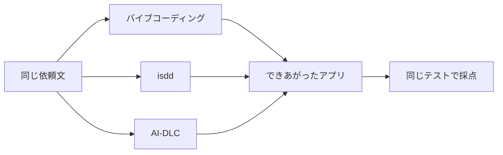
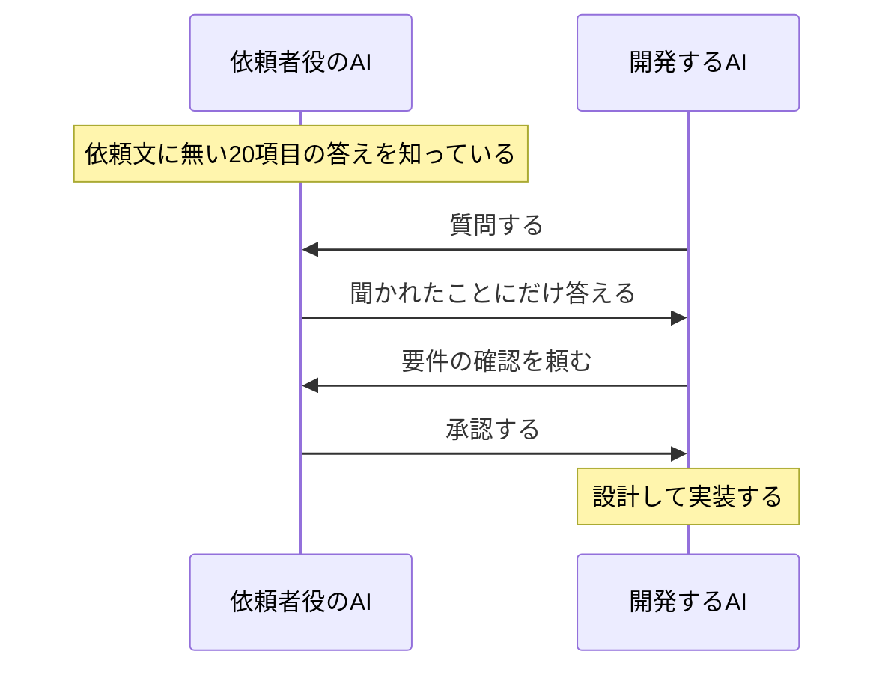

## はじめに

AIにアプリを作ってもらうとき、要件定義や設計の手順を踏ませたほうが、良いものができるのでしょうか。それとも、作りたいものをそのまま伝えるだけで十分なのでしょうか。

私は[isdd](https://github.com/notfolder/isdd)という、AIが質問しながら要件を決め、設計してから実装する手順を作っています。作っている本人として、この手順に意味があるのかを確かめたくなりました。そこで、同じ依頼を次の3つのやり方でClaude Codeに渡し、できあがったアプリを同じテストで採点しました。

| やり方 | 内容 |
|---|---|
| バイブコーディング | 手順を何も入れず、依頼文をそのまま渡して作ってもらう |
| isdd | isdd v2.3.0を入れる。AIが質問して要件を決め、設計、実装の順に進める |
| AI-DLC | AWSが公開している[AI-DLC](https://github.com/awslabs/aidlc-workflows) v2.11.4を入れる。要件、設計、実装、テストの順に進める |

AIのモデルは3つともClaude Opus 5.5です。先に結果を書きます。

| 比べたこと | バイブコーディング | isdd | AI-DLC |
|---|---|---|---|
| 細かいところまで書いた依頼。テスト38件のうち合格した数 | 38 | 38 | 38 |
| そのときにかかった時間 | 12分 | 92分 | 411分 |
| 細かいところを書いていない依頼。テスト8件のうち合格した数の平均 | 2.5 | 6.7 | 7.3 |
| そのときに依頼者が答えた回数 | 0.5回 | 11.0回 | 18.3回 |
| そのときにかかった時間 | 約3分 | 約24分 | 約62分 |

細かいところを書いていない依頼は、バイブコーディングで12回、isddとAI-DLCで3回ずつ試しました。

依頼に細かいところまで書いてあれば、バイブコーディングでも満点でした。手順を入れても点は変わらず、時間だけが増えています。

差が出たのは、依頼に書いていないことをAIが依頼者に聞かないと正しく作れない場合です。このときisddとAI-DLCは、どちらもバイブコーディングより良い結果でした。isddとAI-DLCのできあがりはほぼ同等で、3回ずつでは大きな差を見つけられませんでした。はっきり違ったのは、依頼者の手間とかかった時間です。

isddの作者が自分で用意した比較なので、そのつもりで読んでください。isddとAI-DLCは、試した回数も1〜3回ずつと少なめです。

## 比べ方



作ってもらったのは、会社の備品を管理するWebアプリです。社員がアカウントを登録してログインし、担当者が備品を登録します。どの備品を誰が借りているかは、誰でも一覧で見られます。

採点には、ブラウザでアプリを実際に操作するテストを使いました。テストがアプリを操作できるように、起動の方法、URL、画面の部品に付ける名前だけは、依頼文と一緒にAIへ伝えています。テストの中身はAIに見せていません。

人が付き添わなくても最後まで進むように、Claude Codeは自動で実行しました。isddもAI-DLCも、途中で人に質問や承認を求めます。その答えは、あらかじめ用意した回答か、依頼者の役をする別のAIが返します。バイブコーディングのAIからisddの手順が見えないことは、実行のたびに確かめました。

## 比較1: 細かいところまで書いた依頼

1つ目の比較では、依頼文に細かいところまで書きました。入力のきまりも、画面に出す文言も決めてあります。依頼文の一部です。

```text
社員が自分でアカウントを登録する（社員番号 6 桁の数字、名前 30 文字以内、
パスワード 8 文字以上。社員番号は重複不可）。
```

依頼は6回に分けて、順番に出しました。前の依頼でできたアプリに、次の依頼で機能を足したり、今ある機能を変えたりします。

| 依頼 | 内容 |
|---|---|
| 1回目 | 備品の登録と、貸出の状況の一覧を作る |
| 2回目 | 社員番号を6桁から7桁に変える。貸出と返却を足す |
| 3回目 | 「担当者」という呼び名を「管理者」に変える。アカウントの管理を足す |
| 4〜6回目 | さらに機能を足す。依頼文には、前に決めたきまりをわざと書かない |

4〜6回目で書かなかったきまりは、たとえば「備品を借りている社員は削除できない」です。前に決めたことを守ったまま変更できるかを見ています。

結果です。それぞれ1回ずつ試しました。

| やり方 | 合格したテスト | かかった時間 | 使ったトークン |
|---|---|---|---|
| バイブコーディング | 38件中38件 | 12分 | 約254万 |
| isdd | 38件中38件 | 92分 | 約6,535万 |
| AI-DLC | 38件中38件 | 411分 | 約6億5,027万 |

3つとも満点です。前の依頼で動いていた機能が、あとの依頼で動かなくなることもありませんでした。

かかった時間は、バイブコーディングを1とするとisddが8、AI-DLCが34です。AI-DLCは1回の依頼に54〜73分かかり、6回の依頼で承認を92回求めました。

バイブコーディングは、依頼文に書かなかったきまりもすべて守っています。できあがったコードは1,000行ほどでした。AIがコードを全部読めば、前に決めたきまりが分かる大きさだったのだと思います。

別のアプリでも試しました。AI-DLCが評価用に公開している、計算をするAPIです。こちらも仕様が依頼文に書き切られていて、テストは88件あります。3つとも88件すべて合格でした。かかった時間はバイブコーディングが4.5分、isddが19.3分、AI-DLCが69.5分です。AI-DLCの時間には、利用量の上限にかかって待った13分が入っています。

依頼に細かいところまで書いてあり、コードが小さいうちは、手順を入れても点は上がりませんでした。

## 比較2: 細かいところを書いていない依頼

実際の依頼では、細かいところまで最初から決まっていることは多くありません。そこで2つ目の比較では、画面に出す文言や細かい動きを依頼文から外しました。

かわりに、依頼者の役をするAIを用意しました。モデルはClaude Sonnet 5.5です。この依頼者役にだけ、依頼文に書いていない20項目の答えを持たせました。



依頼者役は、聞かれたことにだけ答えます。自分からは何も言いません。20項目の一部です。

| 依頼文に書いていないこと | 依頼者の答え |
|---|---|
| 社員番号が重複したときに出す文言 | 「この社員番号は既に登録されています」 |
| 入力に誤りがあったとき、入力した値をどうするか | 消さずに残す |
| 担当者ではない人が備品の登録画面を開いたとき | 一覧の画面に戻して「この操作は担当者だけが行えます」と出す |
| 備品が1件も無いときの表示 | 「備品は登録されていません」 |
| 備品を削除するときの確認 | 確認の画面を出し、「はい」のときだけ消す |

テストで見るのは、この答えどおりに動くかです。AIが依頼者に聞かずに作ると、文言や動きが答えと食い違い、テストに落ちます。

### 要件をまとめた文書に、依頼者の答えが入ったか

isddとAI-DLCは、質問が終わると要件を文書にまとめ、依頼者に確認を求めます。まずこの文書を、20項目の答えと見比べました。それぞれ3回ずつ試した結果です。

| 見たこと | isdd | AI-DLC |
|---|---|---|
| 20項目のうち、文書に正しく書かれた数 | 20・18・20 | 18・19・20 |
| 依頼者に聞いた項目の数 | 19・19・20 | 17・16・17 |
| 依頼者が答えた回数 | 9・10・9 | 5・5・5 |
| かかった時間の平均 | 9.4分 | 12.2分 |

文書の正しさに差はありません。比べる前は、質問して要件を決めることがisddの強みだと考えていました。実際には、AI-DLCも同じくらい正しく聞き取っていました。

質問の出し方は違います。isddは進め方、解決したい課題、要件の順に、少しずつ分けて聞きます。AI-DLCは質問を2回にまとめて出しました。文言は、AI-DLCが案の一覧を出し、依頼者が直す形です。

### アプリが完成するまで続けた結果

そのままアプリが完成するまで続けました。バイブコーディングは結果のばらつきが大きかったので、同じ依頼者役を相手に12回試しています。テスト8件のうち合格した数です。

| やり方 | 試した回数 | 各回の合格数 | 平均 |
|---|---|---|---|
| バイブコーディング | 12回 | 1・3・7・3・1・1・3・4・1・4・1・1 | 2.5 |
| isdd | 3回 | 7・5・8 | 6.7 |
| AI-DLC | 3回 | 7・7・8 | 7.3 |

ここでバイブコーディングとの差が出ました。バイブコーディングの12回のうち11回は4件以下で、isddとAI-DLCの6回はすべて5件以上です。この差が偶然で出る確率を計算すると、isddとの比較でもAI-DLCとの比較でも0.7%でした。偶然とは考えにくい差です。

バイブコーディングの結果は、AIが質問したかどうかで分かれました。

| AIの動き | 回数 | 各回の合格数 |
|---|---|---|
| 何も質問せずに作った | 12回のうち6回 | 6回とも1件 |
| 1回だけ質問した | 12回のうち6回 | 3・7・3・3・4・4 |

質問しなかった回は、ボタンの文言、エラーの文言、備品が1件も無いときの表示が、依頼者の答えと違っていました。1回質問した回も、ボタンの文言や備品が1件も無いときの表示までは聞いていないことが多く、そこで落ちています。バイブコーディングが落としたテストは、聞かなかったことか、聞き足りなかったことが原因でした。

1回だけ、8件中7件に合格した回があります。Opus 5.5は、手順が無くても自分から質問することがあり、うまく聞ければisddと変わらない結果になります。ただ、質問するかどうかも、何を聞くかも、そのときしだいです。isddやAI-DLCを使う意味は、毎回かならず質問してくれることにあると考えています。

isddとAI-DLCのできあがりは、3回ずつでは大きな差を見つけられませんでした。間違え方も似ています。備品の「修正」をボタンで作る取り決めなのに、リンクで作ったことが、どちらにも2回ずつありました。

### 依頼者の手間とかかった時間

アプリが完成するまでに依頼者がどれだけ手間をかけたかを、平均で比べます。バイブコーディングは12回、isddとAI-DLCは3回の平均です。

| 比べたこと | バイブコーディング | isdd | AI-DLC |
|---|---|---|---|
| 依頼者が答えた回数 | 0.5回 | 11.0回 | 18.3回 |
| そのうち要件が決まるまで | なし | 8.3回 | 4.0回 |
| そのうち設計から完成まで | なし | 2.7回 | 14.3回 |
| 要件が決まるまでに受けた質問の数 | なし | 27.7問 | 14.3問 |
| 依頼者がやりとりの中で読む文字数 | 約2,500字（はじめの3回の平均） | 約34,500字 | 約29,500字 |
| かかった時間 | 約3分 | 約24分 | 約62分 |
| 使ったトークン | 約55万 | 約1,070万 | 約1億1,600万 |
| 料金に直した額 | 約1ドル | 約29ドル | 約321ドル |

AI-DLCの時間は、利用量の上限にかかって待った約4.3時間を除いた値です。

isddは、はじめにまとめて質問します。設計に入ってからは、使う技術の選択と設計の承認で2〜3回答えるだけです。AI-DLCは、設計に入ってからも14回ほど承認を求めました。

合計すると、isddはAI-DLCに比べて、依頼者が答える回数が約6割、かかる時間が約4割、使うトークンと料金が約11分の1でした。依頼者が読む量はほぼ同じです。

この差は3回とも同じ向きで、値が重なっていません。依頼者が答えた回数は、isddが3回とも11回、AI-DLCが18〜19回です。使ったトークンは、isddが約890万〜1,220万、AI-DLCが約1億1,400万〜1億1,900万でした。

一方で、要件が決まるまではisddのほうが手間がかかります。質問の数はAI-DLCの約2倍でした。isddは1問ごとに案を並べ、良い点、悪い点、作る手間を表にして見せます。画面の文言だけで9〜15問聞いていました。できあがりがほぼ同等なら、この質問は減らせるはずです。

## 自分で依頼者をやってみて

ここまでの数字は、依頼者の役をAIにさせて出したものです。人が答えるとどう感じるのかを知りたくて、私自身が依頼者になり、isddとAI-DLCの両方でアプリを作ってみました。

正直に書くと、どちらも質問に答える負担はかなり大きいです。答え続けるのは苦痛でした。

そのうえで、2つの違いははっきり感じました。isddは、ほぼすべての質問をはじめに出します。要件の質問に答え終えたら、あとは放っておいて他の仕事ができました。AI-DLCは、実装に入ってからも質問と承認が続きます。アプリができあがるまで付きっきりで答え続けなければならず、ここがかなりつらかったです。

上の表の数字とも合っています。設計から完成までに依頼者が答えた回数は、isddが2.7回、AI-DLCが14.3回でした。答える回数の合計よりも、いつまで席を離れられないかの違いのほうが、人には大きく感じられます。

一方で、答えるのが苦痛でも、質問の中身には意味がありました。どちらの手順も、決めなければいけないのに見落としがちな要件を聞いてきます。開発に慣れていない人はもちろん、慣れている私でも見落としそうなものが入っていました。バイブコーディングで質問されなかった回の結果を思い出すと、この質問を省くわけにはいきません。

## 性能の低いモデルで試したとき

Opus 5.5の前に、速くて安いモデルのClaude Haiku 5.5でも試しています。AI-DLCがすすめているモデルはOpusなので、AI-DLCには不利な条件です。

計算をするAPIは、Haikuでも3つとも88件すべて合格しました。

備品を管理するアプリでは、AI-DLCが3回目の依頼の途中で進まなくなりました。2回試して2回ともです。原因を調べると、AI-DLCの手順に誤りがあったわけではありませんでした。

AI-DLCは、次に何をするかをAIに文章で伝えます。進まなくなった場面では、その文章の最後に「テストに使うコマンドを依頼者に承認してもらう」と書いてありました。Haikuはこの文章を先頭の300〜600文字だけ読むことが多く、最後の指示を読んでいませんでした。Opus 5.5では同じ場面を問題なく進んでいます。

AIに渡す手順を作る人は、長い文章の最後に大事な指示を書くと、性能の低いモデルが読み落とすことを知っておくとよさそうです。

## 注意してほしいこと

- isddとAI-DLCは試した回数が少ないです。比較1は1回ずつ、比較2は3回ずつです。isddとAI-DLCのできあがりがまったく同じかどうかは、この回数では判断できません。言えるのは、大きな差は見つからなかったというところまでです
- 比較2のテストは、1つの食い違いで何件も落ちることがあります。備品を保存するボタンの文言が違うと、備品を登録するところで止まり、3件のテストが落ちます。合格した数の差は、食い違いの数の差より大きく出ています
- 依頼文、依頼者の答え、テストは、isddの作者である私が作りました。isddに有利になっている可能性があります
- 試したのは、1,000行ほどのWebアプリと計算のAPIだけです。AIが全部を読み切れない大きさのコードでは、結果が変わるかもしれません
- トークンの数には、キャッシュから読み直した分が入っています。AI-DLCはこの分がほとんどです。料金に直した額は、Claude Codeが実行のたびに記録した値です
- AI-DLCには進め方がいくつかあります。試したのはclassicという進め方だけです
- 比較2のテストには、依頼者の答えからは正解が1つに決まらない項目が2つありました。この2つは、どちらの書き方でも合格にして採点しています

## おわりに

分かったことは3つあります。

1つ目。依頼に細かいところまで書いてあり、コードが小さいなら、バイブコーディングで十分でした。isddやAI-DLCを使うと、時間とトークンが増えるだけです。

2つ目。依頼に書いていないことがあるなら、質問してから作る手順に意味があります。バイブコーディングは12回のうち6回で何も質問せず、その6回はテスト8件のうち1件しか合格しませんでした。isddとAI-DLCのできあがりはほぼ同等で、isddのほうが依頼者の答える回数が少なく、早く終わりました。

3つ目。isddは、要件を決めるときの質問が多すぎます。自分で答えてみても、負担の大きさを感じました。AI-DLCの約2倍聞いて、できあがりに大きな差はありませんでした。

これからやることは2つです。まず、画面の文言を聞く質問を減らします。次は、もっと大きなコードでの比較です。isddは、設計とコードのどこが対応するかを表にして残します。AIが全部を読み切れない大きさになったとき、この表が役に立つのかは、まだ確かめられていません。

比較に使ったスクリプトと結果は、isddのリポジトリの`measure/`フォルダにあります。詳しい結果は`measure/results/REPORT.md`に書いてあります。