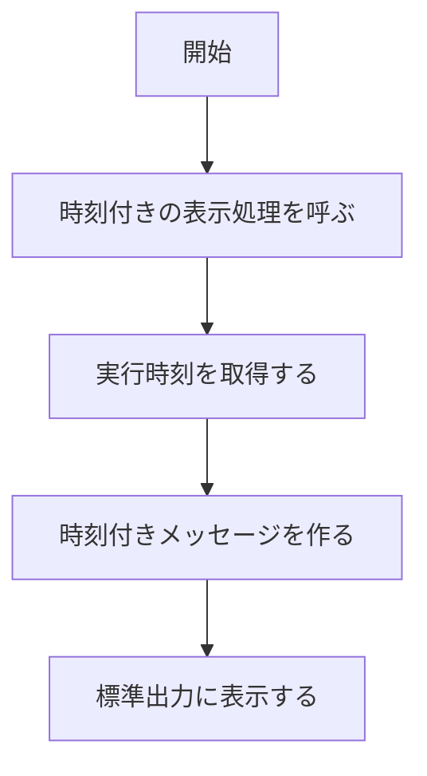

# Hello World 出力システム 変更詳細設計書（出力に実行時刻を付ける）

既存設計書: `docs/detail_design.md`
変更要件定義書: `.history/20260508-add-timestamp-to-hello-world/change_requirements.md`

## 1. 言語・フレームワーク・アーキテクチャの選定

変更なし。既存設計 `docs/detail_design.md` セクション1 を参照（Python 3、標準ライブラリのみ、実行形態は CLI）。

## 2. システム構成

変更なし。既存設計 `docs/detail_design.md` セクション2 を参照。

## 3. データ設計

変更なし。既存設計 `docs/detail_design.md` セクション3 を参照。

## 4. アーキテクチャ設計

### 4-1. 外部設計

| DS-ID | インターフェース | 入力 | バリデーション | 出力 | エラー仕様 | 対応要件ID | 区分 |
|---|---|---|---|---|---|---|---|
| `DS-IF-CLI-ENTRY-UI-HELLO-STDOUT-OUTPUT` | スクリプトの実行（引数なし） | なし | なし | 標準出力に "Hello, World!" を 1 行 | 例外は伝播させる | `RQ-UI-HELLO-STDOUT-OUTPUT` | [削除] 時刻付きの出力に置き換えるため |
| `DS-IF-CLI-ENTRY-UI-TIMESTAMPED-STDOUT-OUTPUT` | スクリプトの実行（引数なし） | なし | なし | 標準出力に "Hello, World! (HH:MM:SS)" を 1 行 | 例外は伝播させ、0 以外の終了コードで終わる | `RQ-UI-TIMESTAMPED-STDOUT-OUTPUT` | [追加] |

### 4-2. 内部設計

## 5. クラス設計

| DS-ID | クラス名 | 責務 | SOLID 原則への適合 | 対応要件ID | 区分 |
|---|---|---|---|---|---|
| `DS-CL-HELLO-WORLD-PRINTER-FT-PRINT-HELLO-WORLD` | HelloWorldPrinter | 表示文字列の取得と表示 | 単一責任 | `RQ-FT-PRINT-HELLO-WORLD` | [削除] 対応要件を削除するため |
| `DS-CL-HELLO-WORLD-PRINTER-FT-PRINT-TIMESTAMPED-OUTPUT` | HelloWorldPrinter | 実行時刻の取得、時刻付きメッセージの生成と表示 | 単一責任: 表示だけを担う | `RQ-FT-PRINT-TIMESTAMPED-OUTPUT` | [追加] |

| DS-ID | メソッド | 責務 | 対応要件ID | 区分 |
|---|---|---|---|---|
| `DS-FN-GET-HELLO-MESSAGE-FT-GET-HELLO-MESSAGE` | HelloWorldPrinter.get_hello_message | 固定文字列を返す | `RQ-FT-GET-HELLO-MESSAGE` | [削除] 時刻付きメッセージの生成に置き換えるため |
| `DS-FN-PRINT-HELLO-WORLD-FT-PRINT-HELLO-WORLD` | HelloWorldPrinter.print_hello_world | 固定文字列を表示する | `RQ-FT-PRINT-HELLO-WORLD` | [削除] 時刻付きの表示に置き換えるため |
| `DS-FN-GET-CURRENT-TIME-FT-GET-CURRENT-TIME` | HelloWorldPrinter.get_current_time | ローカル時刻を HH:MM:SS の文字列で返す | `RQ-FT-GET-CURRENT-TIME`, `RQ-FT-TIME-FORMAT-RULE` | [追加] |
| `DS-FN-BUILD-TIMESTAMPED-MESSAGE-FT-BUILD-TIMESTAMPED-MESSAGE` | HelloWorldPrinter.build_timestamped_message | "Hello, World! (HH:MM:SS)" を返す | `RQ-FT-BUILD-TIMESTAMPED-MESSAGE` | [追加] |
| `DS-FN-PRINT-TIMESTAMPED-OUTPUT-FT-PRINT-TIMESTAMPED-OUTPUT` | HelloWorldPrinter.print_timestamped_output | 時刻付きメッセージを標準出力へ表示する | `RQ-FT-PRINT-TIMESTAMPED-OUTPUT` | [追加] |

## 6. エラーハンドリングとセキュリティ設計

変更なし。既存設計 `docs/detail_design.md` セクション6 を参照。

## 7. コード設計

| DS-ID | ファイル | 役割 | 含まれるクラス | 実現する設計 ID | 区分 |
|---|---|---|---|---|---|
| `DS-MD-HELLO-MODULE-FT-PRINT-HELLO-WORLD` | src/hello.py | 実行の入口と出力処理 | HelloWorldPrinter | `DS-CL-HELLO-WORLD-PRINTER-FT-PRINT-HELLO-WORLD` | [削除] 対応要件を削除するため |
| `DS-MD-HELLO-MODULE-FT-PRINT-TIMESTAMPED-OUTPUT` | src/hello.py | 実行の入口と時刻付きの出力処理 | HelloWorldPrinter | `DS-CL-HELLO-WORLD-PRINTER-FT-PRINT-TIMESTAMPED-OUTPUT` | [追加] |

## 8. テスト設計

| DS-ID | 対応要件ID | 目的 | 前提条件 | 手順 | 期待結果 | 区分 |
|---|---|---|---|---|---|---|
| `DS-TS-HELLO-OUTPUT-E2E-TS-VERIFY-HELLO-WORLD-OUTPUT` | `RQ-TS-VERIFY-HELLO-WORLD-OUTPUT` | 固定文字列の確認 | スクリプトが配置されている | 引数なしで実行する | "Hello, World!" が 1 行 | [削除] 時刻付きの確認に置き換えるため |
| `DS-TS-TIMESTAMPED-OUTPUT-E2E-TS-VERIFY-TIMESTAMPED-OUTPUT` | `RQ-TS-VERIFY-TIMESTAMPED-OUTPUT` | 時刻付きの出力の確認 | スクリプトが配置されている | 引数なしで実行する | "Hello, World! (HH:MM:SS)" が 1 行表示され、終了コード 0 | [追加] |

単体テストと E2E の実行コマンドは変更なし（既存設計 `docs/detail_design.md` セクション8 を参照）。

## 9. 運用設計

| DS-ID | 項目 | 内容 | 対応要件ID | 区分 |
|---|---|---|---|---|
| `DS-OP-CLI-RUN-FT-PRINT-HELLO-WORLD` | 起動 | `python3 src/hello.py` で実行する | `RQ-FT-PRINT-HELLO-WORLD` | [削除] 対応要件を削除するため |
| `DS-OP-CLI-RUN-FT-PRINT-TIMESTAMPED-OUTPUT` | 起動 | `python3 src/hello.py` で実行する | `RQ-FT-PRINT-TIMESTAMPED-OUTPUT` | [追加] |

## 10. ログ・監視・アラート・障害対応設計

変更なし。既存設計 `docs/detail_design.md` セクション10 を参照。

## 11. 要件と設計の対応表

| DS-ID | 対応要件ID | 区分 |
|---|---|---|
| `DS-MD-HELLO-MODULE-FT-PRINT-HELLO-WORLD` | `RQ-FT-PRINT-HELLO-WORLD` | [削除] |
| `DS-CL-HELLO-WORLD-PRINTER-FT-PRINT-HELLO-WORLD` | `RQ-FT-PRINT-HELLO-WORLD` | [削除] |
| `DS-FN-GET-HELLO-MESSAGE-FT-GET-HELLO-MESSAGE` | `RQ-FT-GET-HELLO-MESSAGE` | [削除] |
| `DS-FN-PRINT-HELLO-WORLD-FT-PRINT-HELLO-WORLD` | `RQ-FT-PRINT-HELLO-WORLD` | [削除] |
| `DS-IF-CLI-ENTRY-UI-HELLO-STDOUT-OUTPUT` | `RQ-UI-HELLO-STDOUT-OUTPUT` | [削除] |
| `DS-TS-HELLO-OUTPUT-E2E-TS-VERIFY-HELLO-WORLD-OUTPUT` | `RQ-TS-VERIFY-HELLO-WORLD-OUTPUT` | [削除] |
| `DS-OP-CLI-RUN-FT-PRINT-HELLO-WORLD` | `RQ-FT-PRINT-HELLO-WORLD` | [削除] |
| `DS-MD-HELLO-MODULE-FT-PRINT-TIMESTAMPED-OUTPUT` | `RQ-FT-PRINT-TIMESTAMPED-OUTPUT` | [追加] |
| `DS-CL-HELLO-WORLD-PRINTER-FT-PRINT-TIMESTAMPED-OUTPUT` | `RQ-FT-PRINT-TIMESTAMPED-OUTPUT` | [追加] |
| `DS-FN-GET-CURRENT-TIME-FT-GET-CURRENT-TIME` | `RQ-FT-GET-CURRENT-TIME`, `RQ-FT-TIME-FORMAT-RULE` | [追加] |
| `DS-FN-BUILD-TIMESTAMPED-MESSAGE-FT-BUILD-TIMESTAMPED-MESSAGE` | `RQ-FT-BUILD-TIMESTAMPED-MESSAGE` | [追加] |
| `DS-FN-PRINT-TIMESTAMPED-OUTPUT-FT-PRINT-TIMESTAMPED-OUTPUT` | `RQ-FT-PRINT-TIMESTAMPED-OUTPUT` | [追加] |
| `DS-IF-CLI-ENTRY-UI-TIMESTAMPED-STDOUT-OUTPUT` | `RQ-UI-TIMESTAMPED-STDOUT-OUTPUT` | [追加] |
| `DS-TS-TIMESTAMPED-OUTPUT-E2E-TS-VERIFY-TIMESTAMPED-OUTPUT` | `RQ-TS-VERIFY-TIMESTAMPED-OUTPUT` | [追加] |
| `DS-OP-CLI-RUN-FT-PRINT-TIMESTAMPED-OUTPUT` | `RQ-FT-PRINT-TIMESTAMPED-OUTPUT` | [追加] |
| `DS-SC-NO-PERSISTENCE-DT-DB-NOT-REQUIRED` | `RQ-DT-DB-NOT-REQUIRED` | 変更なし（既存） |

### 11-1. 除外要件

除外要件は無い。
