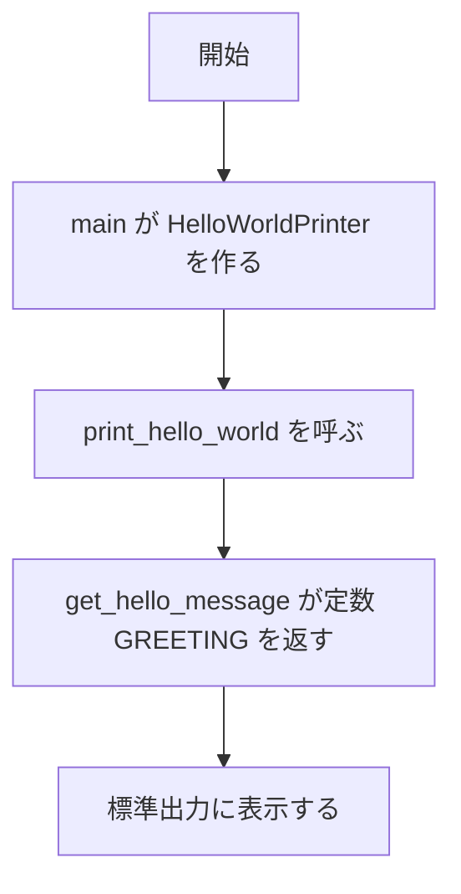

# Hello World 出力システム 変更詳細設計書（実行の入口と出力処理を分ける）

既存設計書: `docs/detail_design.md`
変更要件定義書: `.history/20260509-split-entry-module/change_requirements.md`

## 1. 言語・フレームワーク・アーキテクチャの選定

変更なし。既存設計 `docs/detail_design.md` セクション1 を参照。

## 2. システム構成

変更なし。既存設計 `docs/detail_design.md` セクション2 を参照。

## 3. データ設計

変更なし。既存設計 `docs/detail_design.md` セクション3 を参照。

## 4. アーキテクチャ設計

### 4-1. 外部設計

| DS-ID | インターフェース | 入力 | 出力 | 区分 |
|---|---|---|---|---|
| `DS-IF-CLI-ENTRY-UI-HELLO-STDOUT-OUTPUT` | `python3 src/main.py`（引数なし） | なし | 標準出力に "Hello, World!" を 1 行 | 変更なし（既存。実行するスクリプトが `src/main.py` になるだけで、入出力は変わらない） |

### 4-2. 内部設計



## 5. クラス設計

| DS-ID | クラス名 | 責務 | 区分 |
|---|---|---|---|
| `DS-CL-HELLO-WORLD-PRINTER-FT-PRINT-HELLO-WORLD` | HelloWorldPrinter | 挨拶文の取得と表示 | 変更なし（既存。置き場所が `src/greeting.py` に変わる） |

| DS-ID | 関数・メソッド | 責務 | 区分 |
|---|---|---|---|
| `DS-FN-GET-HELLO-MESSAGE-FT-GET-HELLO-MESSAGE` | HelloWorldPrinter.get_hello_message | モジュール定数 GREETING（"Hello, World!"）を返す | 変更なし（既存。対応する要件だけが `RQ-FT-GET-GREETING-MESSAGE` に変わる） |
| `DS-FN-PRINT-HELLO-WORLD-FT-PRINT-HELLO-WORLD` | HelloWorldPrinter.print_hello_world | 挨拶文を標準出力に表示する | 変更なし（既存） |
| `DS-FN-MAIN-ENTRY` | main | HelloWorldPrinter を作って print_hello_world を呼ぶ。`if __name__ == "__main__":` から呼ばれる | [追加] |

## 6. エラーハンドリングとセキュリティ設計

変更なし。既存設計 `docs/detail_design.md` セクション6 を参照。

## 7. コード設計

```
src/
  greeting.py   # 出力処理（HelloWorldPrinter と定数 GREETING）
  main.py       # 実行の入口
```

| DS-ID | ファイル | 役割 | 含まれるクラス | 実現する設計 ID | 区分 |
|---|---|---|---|---|---|
| `DS-MD-HELLO-MODULE-FT-PRINT-HELLO-WORLD` | src/hello.py | 実行の入口と出力処理 | HelloWorldPrinter | `DS-CL-HELLO-WORLD-PRINTER-FT-PRINT-HELLO-WORLD` | [削除] 入口と出力処理を 2 ファイルに分けるため。ファイルは消す |
| `DS-MD-GREETING-MODULE` | src/greeting.py | 出力処理。定数 GREETING と HelloWorldPrinter | HelloWorldPrinter | `DS-CL-HELLO-WORLD-PRINTER-FT-PRINT-HELLO-WORLD`, `DS-FN-GET-HELLO-MESSAGE-FT-GET-HELLO-MESSAGE`, `DS-FN-PRINT-HELLO-WORLD-FT-PRINT-HELLO-WORLD` | [追加] |
| `DS-MD-MAIN-MODULE` | src/main.py | 実行の入口。greeting から HelloWorldPrinter を import して呼ぶ | なし | `DS-FN-MAIN-ENTRY`, `DS-IF-CLI-ENTRY-UI-HELLO-STDOUT-OUTPUT` | [追加] |

- 対応表の粒度: function（変更なし）
- 依存の規則: 変更なし（`src` は `requests` に依存しない）

## 8. テスト設計

変更なし。既存設計 `docs/detail_design.md` セクション8 を参照（E2E は `python3 src/main.py` を実行して確かめる。既存の `e2e/test_hello_e2e.py` を `src/main.py` の実行に直す）。

## 9. 運用設計

| DS-ID | 項目 | 内容 | 区分 |
|---|---|---|---|
| `DS-OP-CLI-RUN-FT-PRINT-HELLO-WORLD` | 起動 | `python3 src/hello.py` で実行する | [削除] 入口が `src/main.py` に変わるため |
| `DS-OP-CLI-RUN-MAIN` | 起動 | `python3 src/main.py` で実行する | [追加] |

## 10. ログ・監視・アラート・障害対応設計

変更なし。既存設計 `docs/detail_design.md` セクション10 を参照。

## 11. 要件と設計の対応表

| DS-ID | 対応要件ID | 区分 |
|---|---|---|
| `DS-MD-HELLO-MODULE-FT-PRINT-HELLO-WORLD` | `RQ-FT-PRINT-HELLO-WORLD` | [削除] |
| `DS-MD-GREETING-MODULE` | `RQ-FT-PRINT-HELLO-WORLD`, `RQ-FT-GET-GREETING-MESSAGE` | [追加] |
| `DS-MD-MAIN-MODULE` | `RQ-FT-RUN-FROM-ENTRY` | [追加] |
| `DS-FN-MAIN-ENTRY` | `RQ-FT-RUN-FROM-ENTRY` | [追加] |
| `DS-FN-GET-HELLO-MESSAGE-FT-GET-HELLO-MESSAGE` | `RQ-FT-GET-HELLO-MESSAGE` | [削除] 対応だけを差し替える（設計要素は残る） |
| `DS-FN-GET-HELLO-MESSAGE-FT-GET-HELLO-MESSAGE` | `RQ-FT-GET-GREETING-MESSAGE` | [追加] |
| `DS-OP-CLI-RUN-FT-PRINT-HELLO-WORLD` | `RQ-FT-PRINT-HELLO-WORLD` | [削除] |
| `DS-OP-CLI-RUN-MAIN` | `RQ-FT-RUN-FROM-ENTRY` | [追加] |
| `DS-CL-HELLO-WORLD-PRINTER-FT-PRINT-HELLO-WORLD` | `RQ-FT-PRINT-HELLO-WORLD` | 変更なし（既存） |
| `DS-FN-PRINT-HELLO-WORLD-FT-PRINT-HELLO-WORLD` | `RQ-FT-PRINT-HELLO-WORLD` | 変更なし（既存） |
| `DS-IF-CLI-ENTRY-UI-HELLO-STDOUT-OUTPUT` | `RQ-UI-HELLO-STDOUT-OUTPUT` | 変更なし（既存） |

### 11-1. 除外要件

除外要件は無い。
