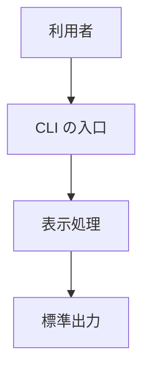
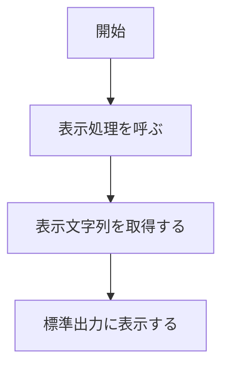
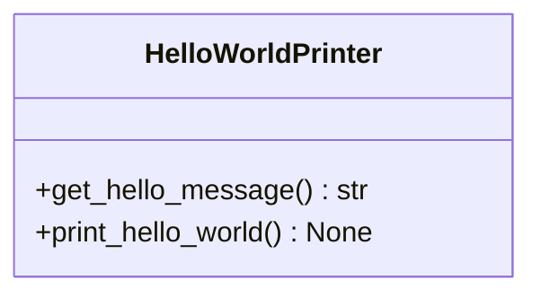

# Hello World 出力システム 詳細設計書

## 1. 言語・フレームワーク・アーキテクチャの選定

- 判定日時: 2026-10-17
- 技術制約の要約: 既存コードなし。配備先は開発者の PC と CI パイプライン。チームの技術は Python。OSS のみ

| 判断軸 | 該当 | 理由 |
|---|---|---|
| 既存資産との整合 | なし | 既存コードが無い |
| チームの技術 | あり | Python を扱える |
| 配備先 | あり | PC と CI の両方で動く必要がある |
| データの規模と構造 | なし | データを保持しない |

| 候補 | 判断軸の評価 | 出典 URL | 確認日 |
|---|---|---|---|
| Python 3（標準ライブラリのみ） | チームが扱え、PC と CI で動く | 未調査（ユーザー承認: 2026-10-17） | 2026-10-17 |

- 最終選定結果: 言語は Python 3、フレームワークなし、DB なし、実行形態は CLI
- 選定理由: 固定文字列の出力だけで、外部ライブラリが要らないため
- ユーザー承認: 2026-10-17

## 2. システム構成

| コンポーネント名 | 役割 |
|---|---|
| hello モジュール | 実行の入口と出力処理を持つ |



ネットワーク越しの通信が無いため、ネットワーク構成図は書かない。

## 3. データ設計

### 3-1. データモデル

DB は必須ではないため、DB 設計は行わない。

| DS-ID | データ | 構造 | 対応要件ID |
|---|---|---|---|
| `DS-SC-NO-PERSISTENCE-DT-DB-NOT-REQUIRED` | 表示文字列 | プログラム内の固定値。永続化しない | `RQ-DT-DB-NOT-REQUIRED` |

### 3-2. トランザクションと排他制御

トランザクション・排他制御が要る操作は無い。

### 3-3. 状態遷移

状態を持つエンティティは無い。

## 4. アーキテクチャ設計

### 4-1. 外部設計

| DS-ID | インターフェース | 入力 | バリデーション | 出力 | エラー仕様 | 対応要件ID |
|---|---|---|---|---|---|---|
| `DS-IF-CLI-ENTRY-UI-HELLO-STDOUT-OUTPUT` | スクリプトの実行（引数なし） | なし | なし | 標準出力に "Hello, World!" を 1 行 | 例外は伝播させ、0 以外の終了コードで終わる | `RQ-UI-HELLO-STDOUT-OUTPUT` |

外部システム連携と外部 DB 連携は無い。

### 4-2. 内部設計



## 5. クラス設計

| DS-ID | クラス名 | 責務 | SOLID 原則への適合 | 対応要件ID |
|---|---|---|---|---|
| `DS-CL-HELLO-WORLD-PRINTER-FT-PRINT-HELLO-WORLD` | HelloWorldPrinter | 表示文字列の取得と表示 | 単一責任: 表示だけを担う | `RQ-FT-PRINT-HELLO-WORLD` |

| DS-ID | メソッド | 責務 | 対応要件ID |
|---|---|---|---|
| `DS-FN-GET-HELLO-MESSAGE-FT-GET-HELLO-MESSAGE` | HelloWorldPrinter.get_hello_message | 固定文字列 "Hello, World!" を返す | `RQ-FT-GET-HELLO-MESSAGE` |
| `DS-FN-PRINT-HELLO-WORLD-FT-PRINT-HELLO-WORLD` | HelloWorldPrinter.print_hello_world | 表示文字列を標準出力へ表示する | `RQ-FT-PRINT-HELLO-WORLD` |



システム内メッセージは無い。

## 6. エラーハンドリングとセキュリティ設計

- エラーハンドリング: 例外は捕捉せず伝播させ、実行失敗として終わる
- 認証は無い
- 認可は無い
- 監査ログは無い

## 7. コード設計

```
src/
```

| DS-ID | ファイル | 役割 | 含まれるクラス | 実現する設計 ID |
|---|---|---|---|---|
| `DS-MD-HELLO-MODULE-FT-PRINT-HELLO-WORLD` | src/hello.py | 実行の入口と出力処理 | HelloWorldPrinter | `DS-CL-HELLO-WORLD-PRINTER-FT-PRINT-HELLO-WORLD` |

コーディング規約: PEP 8。コードには要件 ID・設計 ID を書かず、設計 ID とコードの対応は `docs/trace_map.md` に記録する。

## 8. テスト設計

### 8-1. テストの種類と方針

- 単体テスト: HelloWorldPrinter の 2 つのメソッド
- 単体テストの実行コマンド: `python3 -m unittest discover -s tests`

### 8-2. E2E テストのシナリオ

| DS-ID | 対応要件ID | 目的 | 前提条件 | 手順 | 期待結果 |
|---|---|---|---|---|---|
| `DS-TS-HELLO-OUTPUT-E2E-TS-VERIFY-HELLO-WORLD-OUTPUT` | `RQ-TS-VERIFY-HELLO-WORLD-OUTPUT` | 正常出力の確認 | スクリプトが配置されている | 引数なしで実行する | "Hello, World!" が 1 行表示され、終了コード 0 |

### 8-3. E2E の実行手段

CLI なので、スクリプトを実行して標準出力と終了コードを確かめるテストを Python の unittest で書く。

### 8-4. E2E の実行コマンドと運用

- 実行コマンド: `python3 -m unittest discover -s e2e`
- テスト資産は `e2e/` に置く。全件通過をゴールにする

## 9. 運用設計

| DS-ID | 項目 | 内容 | 対応要件ID |
|---|---|---|---|
| `DS-OP-CLI-RUN-FT-PRINT-HELLO-WORLD` | 起動 | `python3 src/hello.py` で実行する | `RQ-FT-PRINT-HELLO-WORLD` |

- 初期化は不要。認証が無いため、初期ユーザーは無い
- 設定値・環境変数は無い
- 起動方法を README.md に書く

## 10. ログ・監視・アラート・障害対応設計

- ログの設計は必須ではないため、ログの種類と内容の記述は行わない
- 監視・アラートの設計は必須ではないため、監視・アラートの内容と対応方法の記述は行わない
- 障害対応: 実行に失敗したら、利用者が終了コードと例外の表示を確かめて再実行する

## 11. 要件と設計の対応表

| DS-ID | 対応要件ID |
|---|---|
| `DS-MD-HELLO-MODULE-FT-PRINT-HELLO-WORLD` | `RQ-FT-PRINT-HELLO-WORLD` |
| `DS-CL-HELLO-WORLD-PRINTER-FT-PRINT-HELLO-WORLD` | `RQ-FT-PRINT-HELLO-WORLD` |
| `DS-FN-GET-HELLO-MESSAGE-FT-GET-HELLO-MESSAGE` | `RQ-FT-GET-HELLO-MESSAGE` |
| `DS-FN-PRINT-HELLO-WORLD-FT-PRINT-HELLO-WORLD` | `RQ-FT-PRINT-HELLO-WORLD` |
| `DS-IF-CLI-ENTRY-UI-HELLO-STDOUT-OUTPUT` | `RQ-UI-HELLO-STDOUT-OUTPUT` |
| `DS-SC-NO-PERSISTENCE-DT-DB-NOT-REQUIRED` | `RQ-DT-DB-NOT-REQUIRED` |
| `DS-TS-HELLO-OUTPUT-E2E-TS-VERIFY-HELLO-WORLD-OUTPUT` | `RQ-TS-VERIFY-HELLO-WORLD-OUTPUT` |
| `DS-OP-CLI-RUN-FT-PRINT-HELLO-WORLD` | `RQ-FT-PRINT-HELLO-WORLD` |

### 11-1. 除外要件

除外要件は無い。
