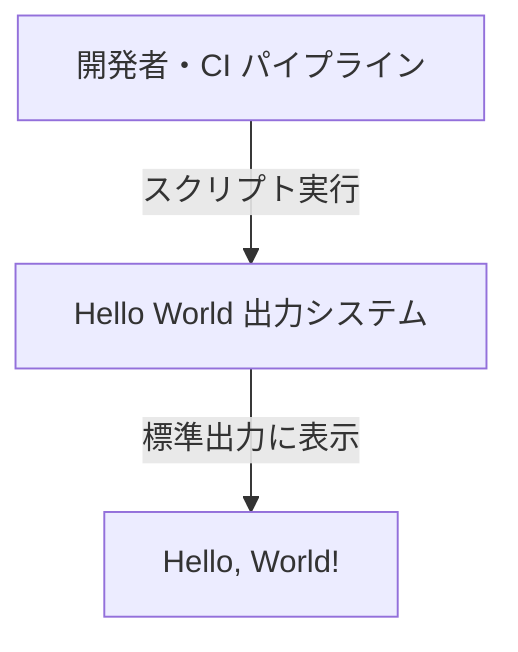
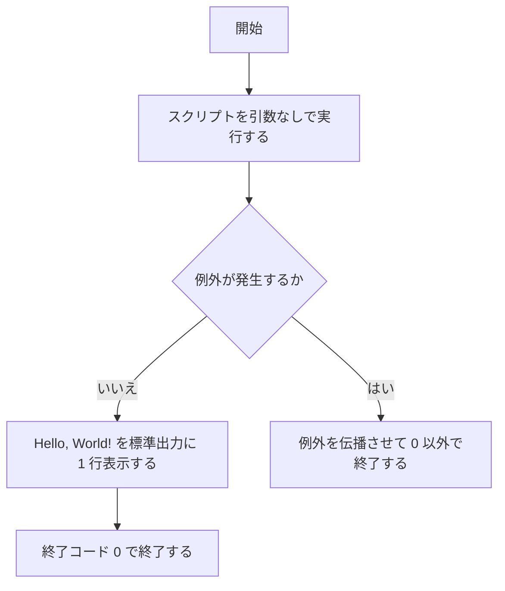

# Hello World 出力システム 要件定義書

## 用語: 問題と課題

問題は業務のあるべき姿と現状のギャップ、課題（業務課題）は問題を解決するために取り組むアクションやテーマを指す。

## 1. 目的・前提

- システムの目的: 固定文字列 "Hello, World!" を標準出力に表示し、実行環境の基本的な動作を検証する
- 用語集

| 用語 | 業務上の意味 | 本案件での使用範囲 | 同義語/類義語 |
|---|---|---|---|
| 標準出力 | プロセスが文字を書き出す出力先（stdout） | 検証結果の表示先 | stdout |
| CI パイプライン | スクリプトを自動で実行する仕組み | 検証スクリプトの実行元 | CI |

- システムの形態: CUI（コマンド）のみ。対話は無い

### 1-1. 技術制約

| 制約項目 | 内容 | 出どころ（誰がいつ答えたか） |
|---|---|---|
| 既存コードベース | なし | ユーザー回答（要件定義時） |
| 配備先 | 開発者の PC と CI パイプライン。コンテナ可 | ユーザー回答（要件定義時） |
| チームの技術 | Python。禁止技術なし | ユーザー回答（要件定義時） |
| ライセンスとコスト | OSS のみ。ランニングコストなし | ユーザー回答（要件定義時） |
| 性能と規模の目安 | 利用者は開発者数名。データ量なし。応答時間の要求なし | ユーザー回答（要件定義時） |

## 2. 業務

| RQ-BZ-ID | 業務名 | 業務の範囲 | 担当者 |
|---|---|---|---|
| `RQ-BZ-OUTPUT-VERIFICATION` | 出力動作検証 | スクリプトの実行から標準出力の確認まで | 開発者、CI パイプライン |

### 2-1. 業務の問題

| 問題 | 対象業務（RQ-BZ） | あるべき姿 | 現状 | ギャップ（KPI） | 業務影響 |
|---|---|---|---|---|---|
| 出力動作の確認方法が人によって違う | `RQ-BZ-OUTPUT-VERIFICATION` | 誰でも同じ手順で 1 分以内に確認できる | 共通の確認手段が無く、担当者ごとに確認方法が違う | 確認手順の数: あるべき姿 1 種類、現状は担当者の人数分 | 環境ごとに独自の確認が要り、結果を比べられない |

### 2-2. 業務課題一覧

| RQ-BK-ID | 業務課題（取り組むこと） | 解決する問題（2-1） | 解決後の状態（KPI の目標値） | 対象業務（RQ-BZ） |
|---|---|---|---|---|
| `RQ-BK-SHARED-VERIFICATION-SCRIPT` | 固定文字列を出力する共通の検証スクリプトを用意する | 出力動作の確認方法が人によって違う | 確認手順が 1 種類になる | `RQ-BZ-OUTPUT-VERIFICATION` |

### 2-3. 見込み経営効果

見込み経営効果は算定しない（検証用の最小構成で、効果を金額や時間で見込む対象ではないため）。

## 3. 機能要件

- 入力データ: なし（引数・設定ファイル・標準入力は受け付けない）
- 出力データ: 標準出力に固定文字列を 1 行
- CUI: スクリプトを引数なしで実行する。正常時の終了コードは 0、例外時は 0 以外

| RQ-ID | カテゴリ | 機能名 | 対応業務課題ID（RQ-BK-*） | この機能が無いと何が困るか |
|---|---|---|---|---|
| `RQ-FT-GET-HELLO-MESSAGE` | 業務機能 | 表示文字列の取得 | `RQ-BK-SHARED-VERIFICATION-SCRIPT` | 出力する文字列を用意できず検証できない |
| `RQ-FT-PRINT-HELLO-WORLD` | 業務機能 | Hello, World! の標準出力 | `RQ-BK-SHARED-VERIFICATION-SCRIPT` | 実行環境の動作を確認する共通手段が無くなる |

### 3-1. 帳票・出力ファイル

| RQ-ID | 帳票・出力名 | 形式（PDF / CSV / 標準出力など） | 出力項目 | 出力のきっかけ | 対応業務課題ID（RQ-BK-*） |
|---|---|---|---|---|---|
| `RQ-UI-HELLO-STDOUT-OUTPUT` | 検証結果の表示 | 標準出力 1 行 | 文字列 "Hello, World!" | スクリプトの実行 | `RQ-BK-SHARED-VERIFICATION-SCRIPT` |

### 3-2. 業務ルール

業務ルールは無い。

### 3-3. 外部連携

外部連携は無い。

## 4. データ

業務エンティティは無い。固定文字列を出力するのみで、データを保持しない。

### 4-1. データ要件一覧

| RQ-ID | 種別 | 内容 | 対応業務課題ID（RQ-BK-*） | この要件が無いと何が困るか |
|---|---|---|---|---|
| `RQ-DT-DB-NOT-REQUIRED` | DB の必要性 | DB は不要。データを永続化しない | `RQ-BK-SHARED-VERIFICATION-SCRIPT` | DB を用意する手間が検証の妨げになる |

### 4-2. 業務エンティティとデータ項目

業務エンティティは無い。

### 4-3. CRUD テーブル

業務エンティティが無いため対象外。

### 4-4. 状態遷移

状態を持つエンティティは無い。

### 4-5. 画面一覧

画面は無い。

## 5. 非機能要件

- 利用者の種別とアクセス経路: 開発者のみ。各自の PC と CI パイプラインで実行する
- 性能: 実行から表示まで 1 秒以内
- 利用人数: 要求は無い
- 可用性の要求は無い
- 移行は無い
- セキュリティ: 認証は無い

| RQ-ID | カテゴリ | 非機能要件名 | 対応業務課題ID（RQ-BK-*） | この非機能要件が無いと何が困るか |
|---|---|---|---|---|
| `RQ-NF-RESPONSE-UNDER-1S` | 性能 | 実行から表示まで 1 秒以内 | `RQ-BK-SHARED-VERIFICATION-SCRIPT` | CI の実行時間が延び、確認を待たされる |

## 6. 運用要件

- ログは必要ないため、ログの内容と保存期間の記述は行わない
- 実行結果の判定: CI パイプラインが終了コードで成否を判定できる（下の表）
- 監査ログは必要ない
- 監視・アラートは必要ないため、監視・アラートの内容と対応方法の記述は行わない
- バックアップは必要ない

| RQ-ID | 種別 | 内容 | 対応業務課題ID（RQ-BK-*） | この要件が無いと何が困るか |
|---|---|---|---|---|
| `RQ-OP-EXIT-CODE-RESULT` | 実行結果の判定 | 成功は終了コード 0、失敗は 0 以外で返し、CI が成否を判定できる | `RQ-BK-SHARED-VERIFICATION-SCRIPT` | CI が成否を判定できず、失敗を見逃す |

## 7. テスト用利用シナリオ

| RQ-ID | テスト目的 | 前提条件 | テスト手順 | 期待される結果 | 対応業務課題ID（RQ-BK-*） |
|---|---|---|---|---|---|
| `RQ-TS-VERIFY-HELLO-WORLD-OUTPUT` | 正常実行で "Hello, World!" が表示されることを確かめる | スクリプトが配置されている | スクリプトを引数なしで実行する | "Hello, World!" が 1 行表示され、終了コード 0 で終わる | `RQ-BK-SHARED-VERIFICATION-SCRIPT` |

## 8. 業務課題と要件の対応表

| RQ-BK-ID | 業務課題 | 対応要件ID |
|---|---|---|
| `RQ-BK-SHARED-VERIFICATION-SCRIPT` | 共通の検証スクリプトを用意する | `RQ-FT-GET-HELLO-MESSAGE`, `RQ-FT-PRINT-HELLO-WORLD`, `RQ-UI-HELLO-STDOUT-OUTPUT`, `RQ-DT-DB-NOT-REQUIRED`, `RQ-NF-RESPONSE-UNDER-1S`, `RQ-OP-EXIT-CODE-RESULT`, `RQ-TS-VERIFY-HELLO-WORLD-OUTPUT` |
