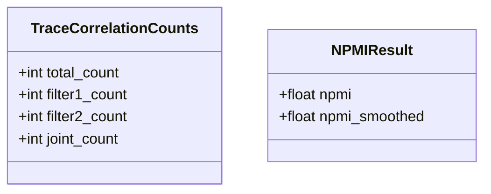

# 変更設計書（NPMI の 2 関数の復元：mlflow/store/analytics/trace_correlation.py）

正本: `docs/detail_design.md`（`mlflow/claude_code/` の逆引き）。本書は正本を書き換えない。区分は [追加] のみ。
変更要件: `change_requirements.md`。本変更は新しい範囲 `mlflow/store/analytics/` を正本に足す（実装後レビューで正本へ反映する）。

## 1. 言語・フレームワーク・アーキテクチャの選定

既存コードベースの選定を使う。Python の標準ライブラリ（math、dataclasses）だけを使い、新しい依存は足さない。DB は使わない（件数を受けて値を返す純粋な関数）。実行形態はライブラリ（利用者の Python から呼ぶ）。

| 項目 | 選定 | 根拠 |
|---|---|---|
| 言語 | Python | 既存コードの言語 |
| ライブラリ | math（対数）、dataclasses（結果の型） | 既存コードの依存。新規の依存は無い |
| DB 製品 | 無し | 要件定義書 4-1 |
| 実行形態 | ライブラリの関数呼び出し | 変更要件定義書 1-2 |
| 承認 | 固定回答（ANSWERS.md）と依頼文により承認済み | ANSWERS.md、REQUEST.md |

## 2. システム構成

### 2-1. コンポーネント一覧

| コンポーネント | 役割 | 配置 |
|---|---|---|
| 相関分析モジュール | 件数の検証、2x2 分割表、NPMI の計算、結果の型 | `mlflow/store/analytics/trace_correlation.py` |
| パッケージの公開一覧 | 相関分析の公開名の再輸出 | `mlflow/store/analytics/__init__.py` |

### 2-2. 各コンポーネントの役割と機能

相関分析モジュールは、件数から素の値（`calculate_npmi_from_counts`）と平滑化の値（`calculate_smoothed_npmi`）を求める。前者は後者を内部で呼んで平滑化の値を作る。

### 2-3. コンポーネント間インターフェースとデータフロー

- 入力: 整数 4 つ（全体件数、フィルタ 1 の件数、フィルタ 2 の件数、同時件数）。平滑化の関数はこれに平滑化の値（既定 0.5）を加える。
- 出力: `NPMIResult`（素の値と平滑化の値）。平滑化の関数は float を返す。
- 外部のデータの入出力は無い。

### 2-4. ネットワーク構成図

無し（ライブラリ）。

## 3. データ設計

### 3-1. データモデル

| DS-ID | 種類 | 項目 | 型 | 意味 |
|---|---|---|---|---|
| `DS-CL-TRACE-CORRELATION-COUNTS` | データクラス | total_count、filter1_count、filter2_count、joint_count | int | 件数の入れ物（既存コードのとおり） |
| `DS-CL-NPMI-RESULT` | データクラス | npmi、npmi_smoothed | float、float または None | 素の値と平滑化の値（既存コードのとおり） |

定数: `JEFFREYS_PRIOR = 0.5`（平滑化の既定値）。

### 3-2. トランザクションと排他制御

無し（純粋な計算。共有の状態は持たない）。

### 3-3. 状態遷移

無し。

## 4. アーキテクチャ設計

### 4-1. 外部設計

利用者の公開インターフェース（mlflow.store.analytics からの import）:

- `calculate_npmi_from_counts(joint_count, filter1_count, filter2_count, total_count) -> NPMIResult`。引数の順序は依頼文の Interface Description どおり（同時件数、フィルタ 1 の件数、フィルタ 2 の件数、全体件数）。
- `calculate_smoothed_npmi(joint_count, filter1_count, filter2_count, total_count, smoothing: float = JEFFREYS_PRIOR) -> float`。

`mlflow/store/analytics/__init__.py` は `calculate_npmi_from_counts` と `calculate_smoothed_npmi` を import して `__all__` で公開する（既存の `__all__` に名前はあるが import が欠けている。その import 行の追加は本変更の範囲）。

### 4-2. 内部設計

- 2x2 分割表は次で作る: n11 = 同時件数、n10 = フィルタ 1 の件数 − 同時件数、n01 = フィルタ 2 の件数 − 同時件数、n00 = 全体件数 − フィルタ 1 の件数 − フィルタ 2 の件数 + 同時件数。4 つのうち 1 つでも負なら不整合。
- PMI = log(n11 × N / (n1 × n2))。N は 4 セルの和、n1 = n11 + n10、n2 = n11 + n01。NPMI = PMI / (−log(n11 / N))。
- 4 セルの 2x2 分割表を作る処理と NPMI の式は、2 つの関数で 1 か所にまとめる（同じ式を 2 回書かない）。まとめる先は内部の補助として書き、対応表には載せない（アンダースコア始まりの内部関数は設計要素にしない）。
- 数値の安定性: 対数は自然対数。値は [−1, 1] に収める。

### 4-3. バッチ設計

無し。

## 5. クラス設計

### 5-1. クラス一覧

| DS-ID | クラス | 責務 |
|---|---|---|
| `DS-CL-TRACE-CORRELATION-COUNTS` [追加] | `TraceCorrelationCounts` | 4 つの件数をまとめる（既存） |
| `DS-CL-NPMI-RESULT` [追加] | `NPMIResult` | 素の値と平滑化の値を返す（既存） |

### 5-2. クラスの責務・属性

上の表と 3-1 のとおり。メソッドは持たない。

### 5-3. クラス図



（`TraceCorrelationCounts` は関数の引数の 4 つの件数と対応する。関数は件数を個別の引数で受けるため、関数はこのクラスを使わない。）

### 5-4. 関数の責務

| 区分 | DS-ID | 関数 | 責務（1 文） |
|---|---|---|---|
| [追加] | `DS-FN-CALCULATE-NPMI-FROM-COUNTS` | `calculate_npmi_from_counts` | 件数から 2x2 分割表を作り、全体件数が 0 以下・件数が不整合・フィルタ件数が 0 の場合は NaN、同時件数 0 の素の値は −1.0、常に同時に起きる場合は 1.0、それ以外は NPMI の式で求め、平滑化の値は `calculate_smoothed_npmi`（既定値）で求めて、NPMIResult にまとめる |
| [追加] | `DS-FN-CALCULATE-SMOOTHED-NPMI` | `calculate_smoothed_npmi` | 件数から 2x2 分割表を作って検証し、不整合・全体件数 0 以下は NaN、常に同時に起きる（平滑化の前に n10・n01・n00 が 0）は 1.0、4 セルに平滑化の値を足し、平滑化の後で n1・n2・n11 が 0 以下なら NaN、それ以外は NPMI の式で求め、[−1, 1] に収めて返す |

詳細規則（両関数の順序）:

1. 全体件数が 0 以下なら、両方の値を NaN（素の関数）。平滑化の関数も NaN。
2. 分割表の 4 セルのいずれかが負なら NaN。
3. 素の関数: フィルタ 1 か 2 の件数が 0 なら素の値は NaN（平滑化の値は平滑化の関数の結果）。
4. 常に同時に起きる（n10 = n01 = n00 = 0）なら 1.0（素の関数と平滑化の関数の両方）。
5. 素の関数: 同時件数が 0 なら −1.0。
6. それ以外は式で求め、[−1, 1] に収める。

### 5-5. クラス図とメッセージ

`calculate_npmi_from_counts` が `calculate_smoothed_npmi` を呼ぶ（平滑化の値の作成）。他の呼び出しは無い。

## 6. エラーハンドリングとセキュリティ設計

### 6-1. エラーハンドリング

例外は投げない。未定義・不整合の件数は NaN で返す（依頼文の仕様）。型の検査はしない（利用者の責任）。

### 6-2. 認証・認可・監査ログ

無し。

### 6-3. その他のセキュリティ対策

無し。

## 7. コード設計

### 7-1. ディレクトリ構成

```
mlflow/store/analytics/
  __init__.py          （公開名の再輸出）
  trace_correlation.py （件数のデータクラス、NPMI の 2 関数、平滑化の既定値）
```

既存のファイルで、依頼文の範囲の中身だけを変える。`scripts/isdd/` の検査の対象（`--src`）に `mlflow/store/analytics` を足す（scripts/isdd/check.sh と acceptance の呼び出し）。

### 7-2. ファイルごとの役割

| 区分 | ファイル | 役割 | 含まれるクラス・公開関数 | 実現する設計 ID |
|---|---|---|---|---|
| [追加] | `mlflow/store/analytics/__init__.py` | 相関分析の公開名を再輸出する | 無し（import のみ） | `DS-MD-ANALYTICS-PACKAGE-INIT` |
| [追加] | `mlflow/store/analytics/trace_correlation.py` | 件数のデータクラス、結果の型、平滑化の既定値、NPMI の 2 関数 | `TraceCorrelationCounts`、`NPMIResult`、`calculate_npmi_from_counts`、`calculate_smoothed_npmi` | `DS-MD-TRACE-CORRELATION-MODULE`、`DS-CL-TRACE-CORRELATION-COUNTS`、`DS-CL-NPMI-RESULT`、`DS-FN-CALCULATE-NPMI-FROM-COUNTS`、`DS-FN-CALCULATE-SMOOTHED-NPMI` |

対応表の粒度: `function`。依存の規則: 無い（変更なし。既存の `mlflow/claude_code/` の規則も無い）。

### 7-3. 対応表の粒度

`function`（公開関数まで対応表に載せる）。依頼文の Interface Description が関数単位のため。

### 7-4. 依存の規則

無い。

### 7-5. コーディング規約

- Python の既存の規約（リポジトリの pyproject と ruff の設定）に従う。
- 関数には、処理の説明、引数、戻り値をドキュメントコメントで書く（依頼文の docstring を使う）。
- コードに要件 ID と設計 ID は書かない。

## 8. テスト設計

### 8-1. テストの種類と方針

- 単体テスト: 既存の mlflow の tests/ は変更しない。依頼の隠しテストが単体テストを担うため、本変更では単体テストを追加しない。
- 結合テスト: 無し。
- 総合テスト・E2E: 本書 8-2 のシナリオを `e2e/test_trace_correlation.py` で実行する（公開インターフェースのみ）。

非機能要件の検証: 無し。

### 8-2. E2E テストのシナリオ

| 区分 | DS-ID | 目的 | 前提条件 | 手順 | 期待結果 |
|---|---|---|---|---|---|
| [追加] | `DS-TS-NPMI-UNSMOOTHED-VALUES` | 素の値と平滑化の値が典型・境界の件数で仕様どおり求まる | 件数 (10,20,15,100)、(0,50,50,100)、(0,0,50,100) | 関数を呼ぶ | 1 件目は有限、2 件目の素の値は −1.0、3 件目の素の値は NaN |
| [追加] | `DS-TS-NPMI-INCONSISTENT-COUNTS` | 不整合・全体件数 0 で両方の値が NaN | 同時件数がフィルタ件数より多い件数、全体件数 0 | 関数を呼ぶ | 両方の値が NaN |
| [追加] | `DS-TS-NPMI-PERFECT-COOCCURRENCE` | 常に同時に起きる件数で 1.0 | 件数 (10,10,10,10) | 関数を呼ぶ | 素の値と平滑化の値が 1.0 |
| [追加] | `DS-TS-SMOOTHED-NPMI-JEFFREYS` | 平滑化の関数が既定値で結果の平滑化の値と一致し、同時件数 0 でも有限 | 件数 (0,50,50,100) | 平滑化の関数を既定値で呼び、結果の平滑化の値と比べる | 一致し、−1.0 ではなく有限 |

### 8-3. E2E の実行手段

pytest（コンテナ内の Python）。公開インターフェース（`mlflow.store.analytics`）を直接呼ぶ。

### 8-4. E2E の実行コマンドと運用

- 実行コマンド: `docker exec fb-isdd bash -lc 'cd /testbed && /opt/miniconda3/envs/testbed/bin/python -m pytest e2e --junitxml=e2e/results/e2e.xml'`
- 結果: `e2e/results/e2e.xml`（既存の claude_code の E2E と同じファイルに出る）。
- 外部連携は無いため、モックのモードは設けない。
- 実装時の必須ゴールは E2E の全件通過。

## 9. 運用設計

### 9-1. 起動・インストール

無し（ライブラリ。mlflow のパッケージの一部として既に入っている）。

### 9-2. バックアップと復旧

無し。

### 9-3. データ移行

無し。

### 9-4. 可用性

無し。

## 10. ログ・監視・アラート・障害対応設計

無し（ライブラリの関数で、ログを出さない）。

## 11. 要件と設計の対応表

| 区分 | DS-ID | 対応要件ID |
|---|---|---|
| [追加] | `DS-MD-TRACE-CORRELATION-MODULE` | `RQ-FT-CALCULATE-NPMI-FROM-COUNTS`, `RQ-FT-CALCULATE-SMOOTHED-NPMI` |
| [追加] | `DS-MD-ANALYTICS-PACKAGE-INIT` | `RQ-FT-CALCULATE-NPMI-FROM-COUNTS`, `RQ-FT-CALCULATE-SMOOTHED-NPMI` |
| [追加] | `DS-CL-TRACE-CORRELATION-COUNTS` | `RQ-FT-CALCULATE-NPMI-FROM-COUNTS` |
| [追加] | `DS-CL-NPMI-RESULT` | `RQ-FT-CALCULATE-NPMI-FROM-COUNTS` |
| [追加] | `DS-FN-CALCULATE-NPMI-FROM-COUNTS` | `RQ-FT-CALCULATE-NPMI-FROM-COUNTS` |
| [追加] | `DS-FN-CALCULATE-SMOOTHED-NPMI` | `RQ-FT-CALCULATE-SMOOTHED-NPMI` |
| [追加] | `DS-TS-NPMI-UNSMOOTHED-VALUES` | `RQ-TS-NPMI-UNSMOOTHED-VALUES` |
| [追加] | `DS-TS-NPMI-INCONSISTENT-COUNTS` | `RQ-TS-NPMI-INCONSISTENT-COUNTS` |
| [追加] | `DS-TS-NPMI-PERFECT-COOCCURRENCE` | `RQ-TS-NPMI-PERFECT-COOCCURRENCE` |
| [追加] | `DS-TS-SMOOTHED-NPMI-JEFFREYS` | `RQ-TS-SMOOTHED-NPMI-JEFFREYS` |

### 11-1. 除外要件

除外要件は無い。
