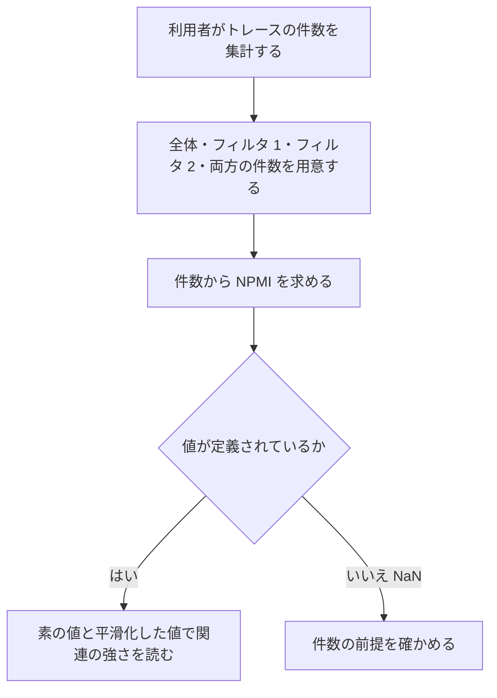

# 変更要件定義書（NPMI の 2 関数の復元：mlflow/store/analytics/trace_correlation.py）

正本: `docs/requirements.md`（`mlflow/claude_code/` の逆引き）。本書は正本を書き換えない。区分は [追加] のみ。

本変更で、正本の対象範囲に新しい範囲 `mlflow/store/analytics/`（トレースの相関分析）を足す。正本の対象は今まで `mlflow/claude_code/` だけだったため、実装後レビューで正本の 1 章（目的・前提）の対象範囲と、対象業務の一覧に追記する（固定回答 ANSWERS.md による）。

## 1. 目的・前提

### 1-0. システムの目的

2 つのトレースのフィルタ（事象）が、同じトレースに現れやすいか・現れにくいかを、正規化した相互情報量（NPMI、-1〜1）で測る。件数（全体、フィルタ 1 の件数、フィルタ 2 の件数、両方に一致する件数）から、利用者が使う 2 つの値（素の値と、Jeffreys 事前分布で平滑化した値）を求める。

### 1-1. 用語集

| 用語 | 業務上の意味 | 本案件での使用範囲 | 同義語/類義語 |
|---|---|---|---|
| NPMI | 正規化相互情報量。-1（決して同時に起きない）、0（独立）、1（常に同時に起きる） | 2 つのフィルタの関連の強さ | normalized PMI |
| PMI | 相互情報量（対数）。同時に起きやすさを独立の場合と比べた値 | NPMI の分子 | pointwise mutual information |
| 2x2 分割表 | 2 つの事象の有無の 4 つの件数（n11、n10、n01、n00） | 件数から作る中間表 | 分割表、コンティンジェンシーテーブル |
| Jeffreys 事前分布 | 4 つの件数に 0.5 を足す平滑化の既定値 | 平滑化した値の計算 | 平滑化（alpha=0.5） |
| NaN | 定義されない値（件数が 0 や不整合） | 戻り値の未定義の表し方 | undefined |

### 1-2. システムの形態

- ライブラリ: Python の関数として呼ぶ。画面・CLI・バッチは無い。
- 入力は 4 つの整数（件数）。永続化はしない。

### 1-3. 技術制約

| 制約項目 | 内容 | 出どころ（誰がいつ答えたか） |
|---|---|---|
| 既存コードベース | Python。mlflow リポジトリの一部。標準ライブラリの math と dataclasses だけを使う（新しい依存は足さない） | 既存コードの確認（2026-11-04）、依頼文 |
| 配備先 | 利用者の Python 環境（mlflow のパッケージの一部） | 依頼文（REQUEST.md） |
| ライセンスとコスト | 既存リポジトリのライセンスに従う | LICENSE.txt |
| 性能と規模の目安 | 特に無い | 固定回答（ANSWERS.md） |

## 2. 業務

### 2-0. 対象業務一覧

| RQ-BZ-ID | 業務名 | 業務の範囲 | 担当者 |
|---|---|---|---|
| `RQ-BZ-TRACE-CORRELATION-ANALYSIS` [追加] | トレースのフィルタどうしの相関分析 | トレースの件数から、2 つのフィルタの関連の強さ（NPMI）を求める | 開発者（ライブラリの利用者） |

業務フロー:

### 2-1. 業務の問題（あるべき姿と現状のギャップ）

| 問題 | 対象業務（RQ-BZ） | あるべき姿 | 現状 | ギャップ（KPI） | 業務影響 |
|---|---|---|---|---|---|
| 相関分析の 2 つの関数が欠けていて、呼び出せない | `RQ-BZ-TRACE-CORRELATION-ANALYSIS` | 件数から素の NPMI と平滑化 NPMI を求め、同じ分析結果の 2 つの値を得られる | 同じモジュールの戻り値の型と定数、パッケージの公開一覧は残っているが、関数の本体が無く、import も欠けている | 関数 2 件が未実装 | 分析結果の算出と、それを使う呼び出し側が動かない |

### 2-2. 業務課題一覧

| RQ-BK-ID | 業務課題（取り組むこと） | 解決する問題（2-1） | 解決後の状態（KPI の目標値） | 対象業務（RQ-BZ） |
|---|---|---|---|---|
| `RQ-BK-NPMI-CORRELATION-ANALYSIS` [追加] | 件数から、素の NPMI と平滑化 NPMI を、依頼された仕様どおりに求められるようにする | 相関分析の関数が欠けている | 2 つの関数が仕様の戻り値・NaN の規則・境界の扱いどおりに値を返す（単体テストで確かめる） | `RQ-BZ-TRACE-CORRELATION-ANALYSIS` |

### 2-3. 見込み経営効果

見込み経営効果は算定しない（固定回答による。ライブラリの復元で、効果の金額の根拠が無いため）。

## 3. 機能要件

### 3-0-2. 機能一覧

| RQ-ID | カテゴリ | 機能名 | 対応業務課題ID（RQ-BK-*） | この機能が無いと何が困るか |
|---|---|---|---|---|
| `RQ-FT-CALCULATE-NPMI-FROM-COUNTS` [追加] | 機能 | 4 つの件数から 2x2 分割表を作り、素の NPMI（件数 0 の -1 の規則を含む）と平滑化 NPMI を 1 つの結果にまとめる。未定義・不整合は NaN | `RQ-BK-NPMI-CORRELATION-ANALYSIS` | 相関の強さを件数から求められない |
| `RQ-FT-CALCULATE-SMOOTHED-NPMI` [追加] | 機能 | 4 つの件数の分割表に平滑化の値（既定は Jeffreys の 0.5）を足して NPMI を求める。件数 0 の -1 の規則は適用しない。信頼区間の推定に使う | `RQ-BK-NPMI-CORRELATION-ANALYSIS` | 少ない件数で極端な値になる平滑化済みの値が得られない |

### 3-1. 帳票・出力ファイル

無し。

### 3-2. 業務ルール

- 件数から作る 2x2 分割表のいずれかが負なら、両方の値を NaN にする（不整合）。
- 全体件数が 0 以下なら NaN。フィルタ 1 かフィルタ 2 の件数が 0 なら、素の値は NaN（未定義）。
- 素の値は、同時件数が 0（かつ両方のフィルタに件数がある）なら -1.0。
- 分割表の 3 つの周辺以外（n10、n01、n00）がすべて 0 なら 1.0（常に同時に起きる）。
- 平滑化の値は、分割表の 4 つのセルに平滑化の値を足してから同じ式で求める。平滑化の後で件数が 0 以下のものがあれば NaN。
- 値は [-1, 1] の範囲に収める（浮動小数点の誤差の吸収）。

### 3-3. 外部連携

無し。

## 4. データ

### 4-1. データ要件一覧

本変更でデータの保存は無い。入力は 4 つの整数、出力は結果の型（`NPMIResult`）と、件数をまとめた型（`TraceCorrelationCounts`）。

### 4-2. 業務エンティティとデータ項目

既存のデータクラス（`TraceCorrelationCounts`、`NPMIResult`）を設計に書き起こす（正本の対象範囲に入れるため）。項目は既存コードのとおり。

### 4-3. CRUD テーブル

無し（永続化なし）。

### 4-4. 状態遷移

無し。

### 4-5. 画面一覧

無し。

## 5. 非機能要件

変更なし（既存要件定義書 セクション 5 に相当する要件は無い）。性能の目標は無い。

## 6. 運用要件

無し（ライブラリのため、運用の作業は無い）。

## 7. テスト用利用シナリオ

| RQ-ID | テスト目的 | 前提条件 | テスト手順 | 期待される結果 | 検証する要件ID | 対応業務課題ID（RQ-BK-*） |
|---|---|---|---|---|---|---|
| `RQ-TS-NPMI-UNSMOOTHED-VALUES` [追加] | 素の NPMI と平滑化 NPMI が、典型的な件数と境界の件数で仕様どおり求まる | 件数 (10, 20, 15, 100)、(0, 50, 50, 100)、(0, 0, 50, 100) | 関数に件数を渡して結果を読む | 1 件目は両方が有限の値。2 件目の素の値は -1.0。3 件目の素の値は NaN | `RQ-FT-CALCULATE-NPMI-FROM-COUNTS` | `RQ-BK-NPMI-CORRELATION-ANALYSIS` |
| `RQ-TS-NPMI-INCONSISTENT-COUNTS` [追加] | 不整合な件数と全体件数が 0 のとき、両方の値が NaN になる | 同時件数がフィルタ件数より多い件数、全体件数 0 | 関数に件数を渡して結果を読む | 両方の値が NaN | `RQ-FT-CALCULATE-NPMI-FROM-COUNTS` | `RQ-BK-NPMI-CORRELATION-ANALYSIS` |
| `RQ-TS-NPMI-PERFECT-COOCCURRENCE` [追加] | 常に同時に起きる件数で NPMI が 1.0 になる | 全件が両方に一致する件数（例: (10, 10, 10, 10)） | 関数に件数を渡して結果を読む | 素の値も平滑化の値も 1.0 | `RQ-FT-CALCULATE-NPMI-FROM-COUNTS` | `RQ-BK-NPMI-CORRELATION-ANALYSIS` |
| `RQ-TS-SMOOTHED-NPMI-JEFFREYS` [追加] | 平滑化の関数が、既定値で結果の平滑化の値と一致し、同時件数 0 でも有限の値を返す | 件数 (0, 50, 50, 100) | 平滑化の関数を既定値で呼び、結果の平滑化の値と比べる | 既定値の結果は結果の平滑化の値と一致し、値は -1.0 にならず有限 | `RQ-FT-CALCULATE-SMOOTHED-NPMI` | `RQ-BK-NPMI-CORRELATION-ANALYSIS` |

変更で [追加] の `RQ-FT` を確かめるのは上の 4 シナリオ。既存の正本のシナリオは変更しない。
