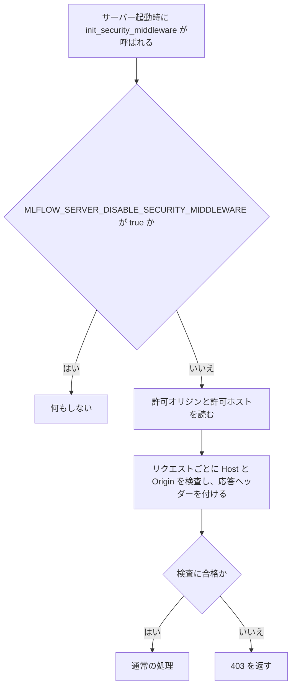

# 変更要件定義書（Flask セキュリティミドルウェアの復元：mlflow/server/security.py と mlflow/server/security_utils.py）

正本: `docs/requirements.md`（`mlflow/claude_code/` と `mlflow/store/analytics/` の逆引き）。本書は正本を書き換えない。区分は [追加] のみ。

依頼（REQUEST.md）により、既存コードから削られた次の関数を復元する。
- `mlflow/server/security.py`: `get_allowed_hosts`、`get_allowed_origins`、`init_security_middleware`
- `mlflow/server/security_utils.py`: `is_allowed_host_header`（同じファイルの、既存の import から参照される補助関数を含む）

本変更で、正本の対象範囲に新しい範囲 `mlflow/server/`（MLflow サーバーの Flask・FastAPI の安全策の部分）を足す（固定回答 ANSWERS.md による）。正本の対象は今まで `mlflow/claude_code/` と `mlflow/store/analytics/` だけだったため、実装後レビューで正本の 1 章（目的・前提）の対象範囲と、対象業務の一覧に追記する。

## 1. 目的・前提

### 1-0. システムの目的

MLflow のサーバーに届くリクエストを、次の 3 つの観点で守る。
- Host ヘッダーの検査（DNS リバインディング攻撃の防止）。許可されたホスト名だけを通す。
- CORS の検査。許可されていない別オリジンからの状態を変える API 要求（POST・PUT・DELETE・PATCH）を止める。
- 応答ヘッダー（`X-Content-Type-Options`、`X-Frame-Options`）の付与（MIME スニッフィングと、埋め込みによる乗っ取りの防止）。

認証・認可・TLS・本番向けのセキュリティの枠組みは対象外。

### 1-1. 用語集

| 用語 | 業務上の意味 | 本案件での使用範囲 | 同義語/類義語 |
|---|---|---|---|
| Host ヘッダー | リクエストの宛先名。DNS リバインディングの検査に使う | 許可ホストの照合の対象 | Host header |
| DNS リバインディング | 別サイトのスクリプトが、悪意ある DNS 名でローカルのサーバーに届く攻撃 | Host 検査の目的 | DNS rebinding |
| CORS | 別オリジンのページからの要求を、ブラウザが許すかを決める仕組み | 許可オリジンの判定 | Cross-Origin Resource Sharing |
| オリジン | スキーム・ホスト名・ポートの組（例: `http://localhost:3000`） | CORS の許可の単位 | origin |
| 許可ホストの規則 | `*` の全許可、`*` を含むパターンの fnmatch 照合、含まない場合の完全一致 | Host 検査の照合 | パターン |
| 健康確認の経路 | `/health` と `/version`。Host 検査の対象外 | 検査の免除 | ヘルスチェック |
| テスト専用の経路 | `/test` と `/api/test`。API 扱いしない | CORS 検査の免除 | - |
| X-Frame-Options | 他サイトの枠（iframe）への埋め込みを制限する応答ヘッダー | 応答ヘッダーの付与 | - |

### 1-2. システムの形態

- Flask アプリケーションへのミドルウェアの登録（`init_security_middleware(app)`）と、その補助の関数。画面は持たない。
- サーバー起動時に `mlflow/server/__init__.py` が呼ぶ（既存の呼び出し）。
- 環境変数で設定する（`MLFLOW_SERVER_ALLOWED_HOSTS`、`MLFLOW_SERVER_CORS_ALLOWED_ORIGINS`、`MLFLOW_SERVER_X_FRAME_OPTIONS`、`MLFLOW_SERVER_DISABLE_SECURITY_MIDDLEWARE`）。

### 1-3. 技術制約

| 制約項目 | 内容 | 出どころ（誰がいつ答えたか） |
|---|---|---|
| 既存コードベース | Python。mlflow リポジトリの一部。Flask、Flask-CORS、既存の環境変数の定義を使う。新しい依存は足さない | 既存コードの確認（2026-11-04）、依頼文 |
| 配備先 | 利用者の Python 環境（mlflow のパッケージの一部） | 依頼文（REQUEST.md） |
| 禁止事項 | 公開版の mlflow のソースを取得して写さない。実装は依頼文と既存コードだけを根拠にする | 依頼文 |
| 性能と規模の目安 | 特に無い | 固定回答（ANSWERS.md） |

## 2. 業務

### 2-0. 対象業務一覧

| RQ-BZ-ID | 業務名 | 業務の範囲 | 担当者 |
|---|---|---|---|
| `RQ-BZ-SERVER-REQUEST-GUARD` [追加] | MLflow サーバーへのリクエストの安全策 | Host・CORS・応答ヘッダーの検査と付与、許可設定の読み出し | 運用者（サーバーを起動する人）、開発者（利用者） |

業務フロー:

### 2-1. 業務の問題（あるべき姿と現状のギャップ）

| 問題 | 対象業務（RQ-BZ） | あるべき姿 | 現状 | ギャップ（KPI） | 業務影響 |
|---|---|---|---|---|---|
| セキュリティ関数が削られ、サーバーの安全策が動かない | `RQ-BZ-SERVER-REQUEST-GUARD` | 許可設定を環境変数から読み、Host・CORS・応答ヘッダーの検査が働く | `security.py` の 3 関数と `security_utils.py` の `is_allowed_host_header` が無く、`security.py` の本体の一部が欠けている（既存の import 行は残っている） | 復元が必要な関数 4 件（`security.py` 3 件、`security_utils.py` 1 件）と、その補助 | 起動時に安全策が組み立てられず、Host 検査と CORS 検査が働かない |

### 2-2. 業務課題一覧

| RQ-BK-ID | 業務課題（取り組むこと） | 解決する問題（2-1） | 解決後の状態（KPI の目標値） | 対象業務（RQ-BZ） |
|---|---|---|---|---|
| `RQ-BK-RESTORE-SERVER-SECURITY-MIDDLEWARE` [追加] | 依頼文の仕様どおりに、許可設定の読み出し、Flask ミドルウェアの登録、Host 照合を復元する | 安全策の関数が欠けている | 依頼文の仕様どおりに動く（E2E で確かめる） | `RQ-BZ-SERVER-REQUEST-GUARD` |

### 2-3. 見込み経営効果

見込み経営効果は算定しない（固定回答による。ライブラリの復元で、効果の金額の根拠が無いため）。

## 3. 機能要件

### 3-0-2. 機能一覧

| RQ-ID | カテゴリ | 機能名 | 対応業務課題ID（RQ-BK-*） | この機能が無いと何が困るか |
|---|---|---|---|---|
| `RQ-FT-GET-ALLOWED-HOSTS` [追加] | 機能 | 環境変数の許可ホストを読む。無い・空なら既定の許可ホスト（localhost、127.0.0.1、[::1]、0.0.0.0 とそのポート付き、10.*、192.168.*、172.16〜31.*、IPv6 のプライベート範囲）を返す | `RQ-BK-RESTORE-SERVER-SECURITY-MIDDLEWARE` | 許可ホストが決まらず、Host 検査の対象が分からない |
| `RQ-FT-GET-ALLOWED-ORIGINS` [追加] | 機能 | 環境変数の許可オリジンを読む。無い・空なら空のリストを返す | `RQ-BK-RESTORE-SERVER-SECURITY-MIDDLEWARE` | 追加の許可オリジンが決まらない |
| `RQ-FT-INIT-SECURITY-MIDDLEWARE` [追加] | 機能 | Flask アプリに CORS（localhost のオリジンを含む）、Host 検査、CORS 遮断、応答ヘッダーを登録する。無効化の環境変数が厳密に `"true"` のときは何もしない | `RQ-BK-RESTORE-SERVER-SECURITY-MIDDLEWARE` | サーバーに安全策が付かない |
| `RQ-FT-IS-ALLOWED-HOST-HEADER` [追加] | 機能 | Host ヘッダーの値が許可パターンに合うかを判定する。`*` を含めば全許可、空や None は拒否、`*` を含むパターンは fnmatch、含まないパターンは完全一致 | `RQ-BK-RESTORE-SERVER-SECURITY-MIDDLEWARE` | Host の照合ができず、DNS リバインディングを防げない |

### 3-1. 帳票・出力ファイル

無し。

### 3-2. 業務ルール

- 許可ホストは、環境変数が設定されていればそれを優先し、無い（空文字・未設定を含む）ときは既定の一覧を使う。
- 許可オリジンは、環境変数が設定されていればそれを使い、無いときは空のリスト。
- CORS は、許可オリジンに `*` があれば全オリジンを許し、無ければ許可オリジンと localhost のパターンを許す。資格情報（credentials）を許し、メソッドは GET・POST・PUT・DELETE・OPTIONS・PATCH。
- Host 検査は、許可ホストに `*` があるとき、または許可ホストが空のときは行わない。`/health`・`/version` は常に検査しない。
- CORS 遮断は、API 経路（`/api/` で始まり、`/api/test`・`/test` 以外）の状態を変える要求（POST・PUT・DELETE・PATCH）で、Origin があり、localhost でなく、許可オリジンに `*` や一致が無いものを 403 にする。許可オリジンに `*` があるときは遮断の検査を行わない。
- 応答ヘッダー: 有効な応答には必ず `X-Content-Type-Options: nosniff` を付ける。`X-Frame-Options` は設定値を大文字にして付けるが、値が空または大文字にして `NONE` のとき、およびノートブックのトレース表示の経路（`/static-files/lib/notebook-trace-renderer` で始まる）では付けない。
- API 経路の OPTIONS 応答は、状態が 200 のときだけ 204 に変え、本文を空にする。それ以外の状態は変えない。

### 3-3. 外部連携

無し。

## 4. データ

### 4-1. データ要件一覧

本変更でデータの保存は無い。読むのは環境変数（4 つ）だけ。

### 4-2. 業務エンティティとデータ項目

無し（データの型は新たに作らない）。

### 4-3. CRUD テーブル

無し。

### 4-4. 状態遷移

無し。

### 4-5. 画面一覧

無し。

## 5. 非機能要件

既存の要件定義書の範囲の要件は無い。性能の目標は無い。セキュリティの目標は本書 1-0 の 3 つに限る（認証・認可は対象外）。

## 6. 運用要件

- 無効化: `MLFLOW_SERVER_DISABLE_SECURITY_MIDDLEWARE` を厳密に `"true"` にすると、安全策は一切付かない（大文字や前後の空白は `"true"` とみなさない）。
- 許可の設定は環境変数で行う（`MLFLOW_SERVER_ALLOWED_HOSTS` と `MLFLOW_SERVER_CORS_ALLOWED_ORIGINS` はカンマ区切り）。

## 7. テスト用利用シナリオ

| RQ-ID | テスト目的 | 前提条件 | テスト手順 | 期待される結果 | 検証する要件ID | 対応業務課題ID（RQ-BK-*） |
|---|---|---|---|---|---|---|
| `RQ-TS-SECURITY-ALLOWED-HOSTS-AND-ORIGINS` [追加] | 許可ホストと許可オリジンが環境変数の有無で切り替わる | 環境変数の未設定・設定・空文字 | 許可ホストと許可オリジンを取得する | 未設定・空文字では既定の一覧（ホスト）と空（オリジン）。設定時はカンマ区切りの値（前後の空白を除く） | `RQ-FT-GET-ALLOWED-HOSTS`、`RQ-FT-GET-ALLOWED-ORIGINS` | `RQ-BK-RESTORE-SERVER-SECURITY-MIDDLEWARE` |
| `RQ-TS-SECURITY-HOST-VALIDATION` [追加] | 不正な Host は 403、健康確認の経路と許可された Host は通る | Flask アプリに安全策を登録（許可ホストは既定） | 不正な Host・許可された Host で GET し、`/health` も GET する | 不正な Host は 403、許可された Host と `/health` は通る。`is_allowed_host_header` は `*`・空・完全一致・fnmatch の規則どおり | `RQ-FT-INIT-SECURITY-MIDDLEWARE`、`RQ-FT-IS-ALLOWED-HOST-HEADER` | `RQ-BK-RESTORE-SERVER-SECURITY-MIDDLEWARE` |
| `RQ-TS-SECURITY-CORS-BLOCKING` [追加] | 許可されていない別オリジンからの API の状態変更要求は 403、localhost と許可オリジンは通る | 許可オリジンは既定（空）と指定の 2 通り | 別オリジンから API に POST し、localhost と許可オリジンからも POST する | 別オリジンは 403、localhost と許可オリジンは通る | `RQ-FT-INIT-SECURITY-MIDDLEWARE` | `RQ-BK-RESTORE-SERVER-SECURITY-MIDDLEWARE` |
| `RQ-TS-SECURITY-RESPONSE-HEADERS` [追加] | 応答に nosniff が付き、X-Frame-Options は設定どおり。ノートブックの経路と NONE では付かない。API の OPTIONS は 200 のとき 204 になる | 既定の X-Frame-Options（SAMEORIGIN）、NONE の設定 | 通常経路・ノートブックの経路・OPTIONS を呼ぶ | nosniff は常に付く。X-Frame-Options は SAMEORIGIN（ノートブックと NONE では無し）。API の OPTIONS 200 は 204 | `RQ-FT-INIT-SECURITY-MIDDLEWARE` | `RQ-BK-RESTORE-SERVER-SECURITY-MIDDLEWARE` |
| `RQ-TS-SECURITY-DISABLED` [追加] | 無効化の環境変数が厳密に true のときだけ安全策が付かない | 環境変数を true・TRUE・未設定にする | 安全策を登録し、不正な Host で GET する | true のときは不正な Host でも通る（安全策なし）。TRUE・未設定では 403 になる | `RQ-FT-INIT-SECURITY-MIDDLEWARE` | `RQ-BK-RESTORE-SERVER-SECURITY-MIDDLEWARE` |

変更で [追加] の `RQ-FT` を確かめるのは上の 5 シナリオ。既存の正本のシナリオは変更しない。

### 7-1. 既存の挙動の保全

- 既存の他の機能（`mlflow/server/fastapi_security.py` など）の挙動は変えない。`fastapi_security.py` が import する補助関数（下の設計書 4-2）は、本変更で `security_utils.py` に戻るため、その import が解決するようになる（副次的な効果として報告する）。
