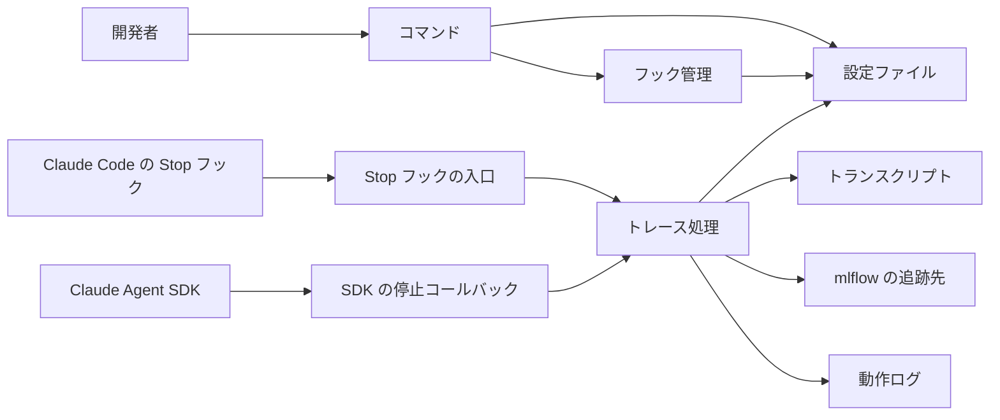
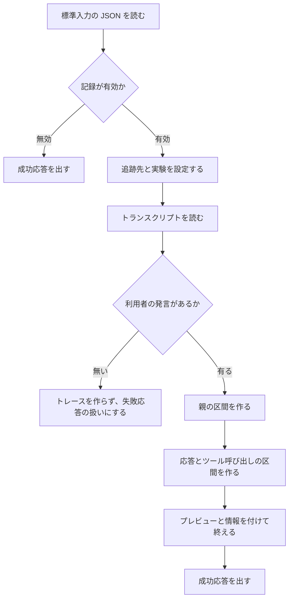
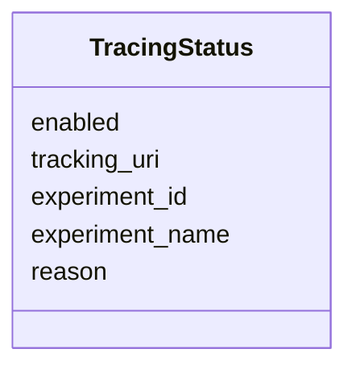
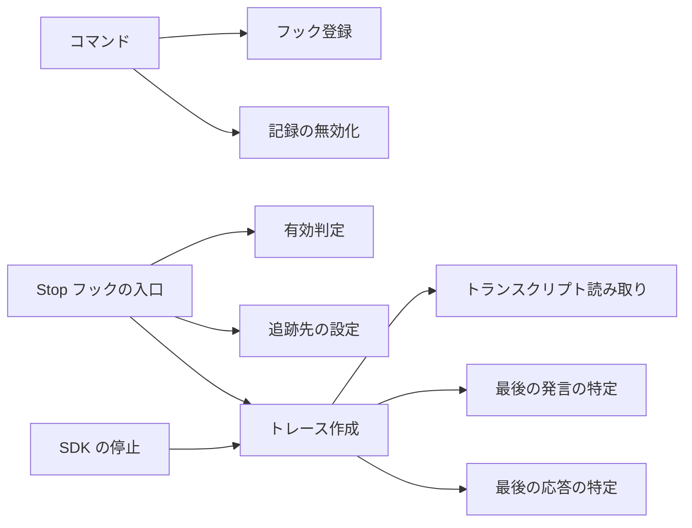

# 詳細設計書（mlflow の Claude Code 連携 `mlflow/claude_code/` と トレースの相関分析 `mlflow/store/analytics/`）

本書は既存コードの逆引きで作った正本である。対象は `mlflow/claude_code/` パッケージと `mlflow/store/analytics/`（相関分析）で、要件定義書の対象と同じ。`mlflow/store/analytics/` は依頼（REQUEST.md）による既存コードへの変更で加えた範囲で、標準ライブラリ（math、dataclasses）だけを使う。

`mlflow/server/security.py` と `mlflow/server/security_utils.py`（Flask の安全策）は依頼（REQUEST.md）による既存コードへの変更で加えた範囲で、Flask と Flask-CORS（既存の依存）を使う。同パッケージの他のファイルは逆引きの未実施で、対象に入れていない。 `mlflow/server` は `security.py` と `security_utils.py` だけが対象で、対応表チェッカーの走査範囲には含めない（チェッカーはディレクトリ単位でしか指定できないため）。

## 1. 言語・フレームワーク・アーキテクチャの選定

既存コードベースの選定をそのまま採用する。既存資産との整合が最優先の判断軸のため、インターネット調査と選び直しは行わない（固定回答による。2026-11-04）。

| 項目 | 選定 | 根拠 |
|---|---|---|
| 言語 | Python | 既存コードの言語 |
| ライブラリ | click（コマンド）、python-dateutil（時刻の解析）、mlflow（トレースの記録）、標準ライブラリ（json、logging、pathlib、dataclasses） | 既存の依存 |
| DB 製品 | 無し（記録先は mlflow の追跡先） | 要件定義書 4-1 |
| 実行形態 | ローカルのコマンド（`mlflow autolog claude`）と、Claude Code のフックとして起動されるプロセス、および Claude Agent SDK から呼ばれる非同期コールバック | 要件定義書 1-2 |
| 承認 | 固定回答により承認済み（2026-11-04） | ANSWERS.md |

## 2. システム構成

### 2-1. コンポーネント一覧

| コンポーネント | 役割 | 対応ファイル |
|---|---|---|
| コマンド | 有効化・状態表示・無効化の利用者向け入口 | `cli.py` |
| フック管理 | 設定ファイルの Stop フックの登録と削除、フックの入口 | `hooks.py` |
| トレース処理 | トランスクリプトの読み取り、トレースの作成、フック応答、動作ログ | `tracing.py` |
| 設定の型 | 記録の状態の値 | `config.py` |
| 相関分析 | 件数から NPMI（素の値と平滑化の値）を求める | `trace_correlation.py` |
| 設定ファイル | プロジェクトの `.claude/settings.json`（Claude Code が読む） | 利用者のプロジェクト |
| 動作ログ | `.claude/mlflow/claude_tracing.log` | 利用者のプロジェクト |

### 2-2. 各コンポーネントの役割と機能

- コマンド: 引数を受け、設定ファイルのパスを求め、フック管理と環境変数の設定を呼び、結果を標準出力に書く。状態表示と無効化の分岐を持つ。
- フック管理: 設定ファイルの Stop フックの一覧に MLflow の呼び出しを 1 件だけ入れる。無効化では MLflow の呼び出しと記録フラグを取り除く（追跡 URI と実験の環境変数は残す。現状の挙動）。Stop フックの入口（標準入力を読み、トレースを作り、応答を標準出力に書く）と、SDK の停止コールバックを持つ。
- トレース処理: 記録の有効判定、追跡先の設定、トランスクリプトの読み取り、会話の解析とトレース作成、フック応答の組み立て、動作ログの設定を持つ。
- 設定の型: 記録の状態（有効、追跡 URI、実験 ID、実験名、理由）を保持する。
- 相関分析: 件数から 2x2 分割表を作り、NPMI の素の値と Jeffreys 事前分布（0.5）による平滑化の値を求める。ライブラリの関数で、画面・CLI・バッチは無い。

### 2-3. コンポーネント間インターフェースとデータフロー



### 2-4. ネットワーク構成図

ネットワーク越しの通信が無いため、ネットワーク構成図は書かない。mlflow の追跡先が遠隔の場合の通信は mlflow ライブラリの責務であり、本パッケージは通信を持たない。

## 3. データ設計

### 3-1. データモデル

DB は必須ではないため、DB 設計は行わない。扱うデータの構造を次のとおり定める。

- 設定ファイル: JSON のオブジェクト。`hooks` 欄に種類ごとのフックの一覧（Stop の一覧は、フックの入れ物の一覧で、各入れ物が `hooks` 欄に呼び出しのエントリを持つ）、`environment` 欄に環境変数の名前と値の対を持つ。利用者の他の欄は変更しない。
- フック登録: 種別（`type` は `command` 固定）とコマンド文字列を持つ。コマンド文字列は MLflow のハンドラ名と識別子 `mlflow.claude_code.hooks` を含む。
- トランスクリプト: 1 行 1 エントリの JSON。エントリの種別（利用者、応答、システム）、メッセージ（役割、内容、モデル、使用量）、時刻、利用者の発言がツール結果かを表す項目を持つ。空行は読まない。
- トレースの保存先: mlflow が追跡先に保存する、親の処理区間（会話）と子の区間（LLM 呼び出し、ツール呼び出し）の木。プレビュー（利用者の発言と最後の応答の先頭）と、セッション・利用者・作業ディレクトリのメタデータを持つ。保存の方式は mlflow の追跡先の設定に従う。
- 動作ログ: `.claude/mlflow/claude_tracing.log` のテキスト行。時刻、名前、レベル、メッセージを 1 行に書く。追記する。
- 記録の状態: 有効、追跡 URI、実験 ID、実験名、理由の 5 項目を持つ値（5-2 で定める）。
- 相関分析の件数と結果: 全体件数、フィルタ 1 の件数、フィルタ 2 の件数、同時件数（`TraceCorrelationCounts`）。結果は素の値と平滑化の値（`NPMIResult`）。保存はしない。

### 3-2. トランザクションと排他制御

トランザクション・排他制御が要る操作は無い。設定ファイルの書き換えは 1 回の読み込みと 1 回の書き込みで行い、同時実行の排他は行わない（利用者が 1 人で、ローカルの操作のため）。

### 3-3. 状態遷移

状態を持つエンティティは無い。記録の有効・無効は設定ファイルの環境変数の値から毎回求める。

## 4. アーキテクチャ設計

### 4-1. 外部設計

利用者向けインターフェース（`DS-IF-*`）:

| DS-ID | 種類 | 内容 |
|---|---|---|
| `DS-IF-AUTOLOG-CLI` | CUI | `mlflow autolog` の command group |
| `DS-IF-AUTOLOG-CLAUDE-COMMAND` | CUI | `mlflow autolog claude` の引数と動作 |
| `DS-IF-STOP-HOOK` | フック | Claude Code の Stop フックの入口（標準入力の JSON、標準出力の応答 JSON） |
| `DS-IF-SDK-STOP-HOOK` | コールバック | Claude Agent SDK の Stop イベントのコールバック |

インターフェース仕様:

- 
  - 入力: ディレクトリ（既定はカレント、省略可）、トラッキング URI（任意）、実験 ID（任意）、実験名（任意）、無効化フラグ、状態表示フラグ。引数の値の形式は検査しない（mlflow が解釈する）。
  - 処理: 状態表示が指定されたら状態を表示して終了。無効化が指定されたら無効化して終了。それ以外は、ディレクトリに `.claude` を作り、フックを登録し、環境変数を書き、結果を表示する。
  - 出力: 標準出力の文章。成功時は終了コード 0。
  - エラー: 設定ファイルの読み書きの失敗は例外として終了する（コマンドが異常終了する）。無効化で設定が無い場合は「設定が無い」と表示し、終了コードは 0。
- 
  - 入力: 標準入力の JSON（会話 ID、トランスクリプトのパス）。
  - 処理: 記録が無効なら何もせず成功応答。有効なら追跡先を設定し、トランスクリプトからトレースを作り、成功応答を出す。
  - 出力: 標準出力に応答 JSON（継続を示す）。
  - エラー: 処理の例外は、理由を入れた応答 JSON を出し、終了コード 1 で終わる。
- 
  - 入力: 会話 ID、トランスクリプトのパス、呼び出し文脈。
  - 処理: SDK の自動記録が無効化されていれば何もせず成功応答。それ以外はトランスクリプトからトレースを作る。
  - 出力: 応答の辞書（継続を示す）。
  - エラー: 処理の例外は、理由を入れた応答の辞書を返す（例外は外に出さない）。

外部システム連携: 無し。

帳票・出力ファイル: 標準出力の文章と応答 JSON のみ（要件定義書 3-1）。

相関分析（`mlflow/store/analytics/`）の利用者向け入口は Python の公開関数である（`DS-IF` は設けない）。`calculate_npmi_from_counts(joint_count, filter1_count, filter2_count, total_count) -> NPMIResult` と `calculate_smoothed_npmi(joint_count, filter1_count, filter2_count, total_count, smoothing=JEFFREYS_PRIOR) -> float`。例外は投げず、未定義・不整合は NaN を返す。

Flask の安全策（`mlflow/server/`）の利用者向け入口は、`get_allowed_hosts()`、`get_allowed_origins()`、`init_security_middleware(app) -> None`（`mlflow/server/security.py`）と、`is_allowed_host_header(allowed_hosts, host) -> bool`（`mlflow/server/security_utils.py`）。拒否は 403 の応答で表し、例外は投げない。無効化は環境変数 `MLFLOW_SERVER_DISABLE_SECURITY_MIDDLEWARE` が厳密に `"true"` のときだけ。

### 4-2. 内部設計

処理フロー（Stop フック）:



各処理の役割:

- 記録の有効判定: 環境変数の記録フラグが true、1、yes のいずれか（大文字小文字を区別しない）なら有効。
- 追跡先の設定: 環境変数の追跡 URI を追跡先に設定する。実験 ID があればそれで、無ければ実験名で実験を設定する。実験の設定の失敗は警告を動作ログに書いて続ける。
- トランスクリプトの読み取り: 1 行ずつ JSON として読む。空行は読まない。
- 会話の解析: 最後の利用者の発言（ツール結果と空の発言を除く）を親の区間の入力にする。親の区間の開始時刻はその発言の時刻。LLM 呼び出しの区間は、テキストだけの応答ごとに作り、入力に、その時点までの会話（システム、利用者、応答の順）を再構成して入れる。ツール呼び出しの区間は、応答内のツール呼び出しごとに、時間を均等に割って作り、結果は同じ ID の結果を入れる（無ければ「結果なし」）。区間の終わりは次のエントリの時刻で決め、無ければ 1 秒とする。
- プレビュー: 利用者の発言と、最後の応答のテキストの先頭 1000 文字。セッション ID（無ければ時刻から作る）、利用者名（環境変数 USER）、作業ディレクトリをメタデータに入れる。
- 親の区間の終わり: 最後のエントリの時刻。開始以前なら開始から 10 秒。
- 応答の組み立て: 成功なら継続を示す応答、エラーなら継続しない応答と理由。
- 動作ログ: 初回の取得時に、カレントディレクトリの `.claude/mlflow` を作り、ファイルに追記する設定を行う。レベルはカスタムのレベル（警告より 5 低い）。上位への伝播は止める。

役割（関数）の対応: 下の 5 章に示す。

相関分析の内部設計: 2x2 分割表（n11、n10、n01、n00）を件数から作り、いずれかが負なら NaN。NPMI は PMI（log(n11・N / (n1・n2))）を −log(n11 / N) で割り、対数の差で計算して [−1, 1] に収める。両関数の順序（全体件数、不整合、フィルタ 0、常に同時、同時 0、式）は第 5 章 5-4 に書く。内部の補助関数は設計 ID を付けない。

### 4-3. バッチ設計

バッチ（定時実行）は無い。Stop フックと SDK の停止コールバックが、出来事ごとに 1 回ずつ会話を記録する。

## 5. クラス設計

### 5-1. クラス一覧

| クラス | 役割（1 文） | ファイル |
|---|---|---|
| `TracingStatus` | 記録の状態の値を 1 つにまとめる | `config.py` |
| `TraceCorrelationCounts` | 相関分析の 4 つの件数をまとめる | `trace_correlation.py` |
| `NPMIResult` | 素の NPMI と平滑化 NPMI の値を返す | `trace_correlation.py` |

`mlflow/claude_code/` のクラスは `TracingStatus` だけである。相関分析（`mlflow/store/analytics/`）のデータクラスは次の 2 つである。

### 5-2. クラスの責務・属性

- `TracingStatus`（データクラス）: 属性は次のとおり。`enabled`（真偽値）、`tracking_uri`（文字列、無ければ無し）、`experiment_id`（文字列、無ければ無し）、`experiment_name`（文字列、無ければ無し）、`reason`（無効の理由、無ければ無し）。メソッドは持たない。

### 5-3. クラス図



### 5-4. 関数の責務

各関数の責務は第 7 章の対応表と第 11 章で示す。公開関数は次のとおり（アンダースコアで始まる内部関数は、上位の公開関数の処理の一部として説明し、設計 ID を付けない）。

| DS-ID | 関数 | 責務（1 文） |
|---|---|---|
| `DS-FN-UPSERT-HOOK` | フック一覧に MLflow の登録を 1 件入れる（同じ識別子があれば更新する） | フック設定の純粋な更新 |
| `DS-FN-SETUP-HOOKS-CONFIG` | 設定ファイルに Stop フックの登録を行い保存する | 設定ファイルへのフック登録 |
| `DS-FN-DISABLE-TRACING-HOOKS` | 設定ファイルから MLflow のフックと記録フラグを取り除き、空なら設定ファイルを消す | 記録の無効化 |
| `DS-FN-STOP-HOOK-HANDLER` | Stop フックの入力を読み、記録が有効なら会話を記録して応答を出す | Stop フックの処理 |
| `DS-FN-SDK-STOP-HOOK-HANDLER` | SDK の停止コールバックで会話を記録し、応答を返す | SDK の停止の処理 |
| `DS-FN-SETUP-LOGGING` | 動作ログのファイルを作り、ロガーを設定する | 動作ログの初期化 |
| `DS-FN-GET-LOGGER` | 動作ログのロガーを 1 つだけ作って返す | ロガーの取得 |
| `DS-FN-SETUP-MLFLOW` | 記録が有効なら追跡先と実験を設定する | 追跡先の設定 |
| `DS-FN-IS-TRACING-ENABLED` | 環境変数の記録フラグが有効を示すかを返す | 有効判定 |
| `DS-FN-READ-HOOK-INPUT` | 標準入力の JSON を読んで辞書にする | フック入力の読み取り |
| `DS-FN-READ-TRANSCRIPT` | トランスクリプトの JSONL を読んでエントリの一覧にする | 会話記録の読み取り |
| `DS-FN-GET-HOOK-RESPONSE` | フックの応答の辞書を組み立てる | 応答の組み立て |
| `DS-FN-PARSE-TIMESTAMP-TO-NS` | 時刻の表現（文字列・秒・ミリ秒・ナノ秒）をナノ秒に直す | 時刻の変換 |
| `DS-FN-EXTRACT-TEXT-CONTENT` | 内容（文字列または部品の一覧）から文章だけを取り出す | 文章の抽出 |
| `DS-FN-FIND-LAST-USER-MESSAGE-INDEX` | 最後の利用者の発言の位置を返す（ツール結果と空を除く） | 発言の特定 |
| `DS-FN-FIND-FINAL-ASSISTANT-RESPONSE` | 指定位置以降の最後の応答の文章を返す | 最後の応答の特定 |
| `DS-FN-PROCESS-TRANSCRIPT` | トランスクリプトから会話 1 回分のトレースを作り、取得して返す | トレース作成 |
| `DS-FN-LOAD-CLAUDE-CONFIG` | 設定ファイルを読み、解析結果を返す（無い・読めない・JSON として壊れている場合は空の辞書。内容の検査はしない） | 設定の読み込み |
| `DS-FN-SAVE-CLAUDE-CONFIG` | 設定を、親ディレクトリを作ったうえで UTF-8 の 2 桁インデント JSON として上書き保存する | 設定の保存 |
| `DS-FN-GET-ENV-VAR` | OS の環境変数、次に設定ファイルの環境欄の順に値を探し、無ければ既定値を返す。設定ファイルの読み取りの例外は既定値に置き換える | 環境変数の取得 |
| `DS-FN-GET-TRACING-STATUS` | 設定ファイルから記録の状態の値を作る（ファイルが無ければ理由つきの無効、記録フラグが true のときだけ有効） | 記録の状態の取得 |
| `DS-FN-SETUP-ENVIRONMENT-CONFIG` | 記録フラグを true にし、追跡 URI は真のときだけ書き、実験 ID が真なら実験名を消して実験 ID を書き、実験 ID が偽で実験名が真なら実験名を書く。保存する | 記録の環境設定 |
| `DS-FN-CALCULATE-NPMI-FROM-COUNTS` | `calculate_npmi_from_counts` | 件数から 2x2 分割表を作り、全体件数が 0 以下・件数が不整合・フィルタ件数が 0 の場合は NaN、同時件数 0 の素の値は −1.0、常に同時に起きる場合は 1.0、それ以外は NPMI の式で求め、平滑化の値は `calculate_smoothed_npmi`（既定値）で求めて、NPMIResult にまとめる |
| `DS-FN-CALCULATE-SMOOTHED-NPMI` | `calculate_smoothed_npmi` | 件数から 2x2 分割表を作って検証し、不整合・全体件数 0 以下は NaN、常に同時に起きる（平滑化の前に n10・n01・n00 が 0）は 1.0、4 セルに平滑化の値を足し、平滑化の後で n1・n2・n11 が 0 以下なら NaN、それ以外は NPMI の式で求めて [−1, 1] に収めて返す |
| | `DS-FN-GET-ALLOWED-HOSTS` | `get_allowed_hosts` | 環境変数の許可ホストを優先し、無ければ既定の許可ホストを返す |
| | `DS-FN-GET-ALLOWED-ORIGINS` | `get_allowed_origins` | 環境変数の許可オリジンを返し、無ければ空のリストを返す |
| | `DS-FN-INIT-SECURITY-MIDDLEWARE` | `init_security_middleware` | 無効化の判定の後、Flask に CORS・Host 検査・CORS 遮断・応答ヘッダーを登録する |
| | `DS-FN-IS-ALLOWED-HOST-HEADER` | `is_allowed_host_header` | Host の値が許可パターンのどれかに合うかを判定する |
| | `DS-FN-GET-ALLOWED-HOSTS-FROM-ENV` | `get_allowed_hosts_from_env` | 環境変数の許可ホストをカンマで分けたリストにする（無い場合は None） |
| | `DS-FN-GET-ALLOWED-ORIGINS-FROM-ENV` | `get_allowed_origins_from_env` | 環境変数の許可オリジンをカンマで分けたリストにする（無い場合は None） |
| | `DS-FN-GET-LOCALHOST-ADDRESSES` | `get_localhost_addresses` | localhost 系のアドレスの一覧を返す |
| | `DS-FN-GET-PRIVATE-IP-PATTERNS` | `get_private_ip_patterns` | プライベートアドレス範囲の fnmatch パターンを返す |
| | `DS-FN-GET-DEFAULT-ALLOWED-HOSTS` | `get_default_allowed_hosts` | 既定の許可ホスト（localhost とポート付き、プライベート範囲）を返す |
| | `DS-FN-IS-API-ENDPOINT` | `is_api_endpoint` | 経路が API 経路（テスト専用を除く）かを判定する |
| | `DS-FN-IS-LOCALHOST-ORIGIN` | `is_localhost_origin` | オリジンが localhost かを判定する（変更なし） |
| | `DS-FN-SHOULD-BLOCK-CORS-REQUEST` | `should_block_cors_request` | 状態を変える要求で、許可されていないオリジンを遮断するかを判定する（変更なし） |

コマンドとフックの入口:

| DS-ID | 関数 | 責務 |
|---|---|---|
| `DS-IF-AUTOLOG-CLI` | コマンドの group | `autolog` の下にコマンドを置く |
| `DS-IF-AUTOLOG-CLAUDE-COMMAND` | `claude` コマンド | 有効化・状態表示・無効化の分岐 |
| `DS-IF-STOP-HOOK` | Stop フックの入口 | 標準入出力でフックを処理する |
| `DS-IF-SDK-STOP-HOOK` | SDK の停止コールバック | 応答の辞書を返す |

### 5-5. クラス図とメッセージ

メッセージ一覧（呼び出しの流れ）:

| 呼び出し元 | 呼び出し先 | 内容 |
|---|---|---|
| コマンド | フック登録 | 有効化時の Stop フックの登録 |
| コマンド | 記録の無効化 | 無効化時 |
| Stop フックの入口 | 追跡先の設定、有効判定、入力の読み取り、トレース作成、応答の組み立て | Stop フックの処理 |
| SDK の停止コールバック | トレース作成、応答の組み立て | SDK の処理 |
| トレース作成 | トランスクリプト読み取り、発言の特定、文章の抽出、時刻の変換、最後の応答の特定 | 会話の解析 |



## 6. エラーハンドリングとセキュリティ設計

### 6-1. エラーハンドリング

| エラー | 扱い | 利用者への見え方 | ログ | 続行か中止か |
|---|---|---|---|---|
| 記録が無効 | 何もしない | 成功応答 | なし | 続行（終了） |
| 追跡先の設定の失敗（実験） | 警告を書く | なし | 警告 | 続行 |
| トランスクリプトの読み取りの失敗、解析の失敗 | 記録を止め、無しを返す | 失敗応答（理由）。Stop フックは終了コード 1 | エラー（詳細つき） | 中止 |
| 利用者の発言が無い | トレースを作らない | 失敗応答ではなく、トレース無しの結果 | 警告 | 中止（記録のみ） |
| 時刻の解釈の失敗 | 無しとして続ける | なし | 警告 | 続行 |
| 標準入力の JSON の失敗 | 例外。Stop フックの入口で失敗応答と終了コード 1 | 失敗応答（理由） | エラー | 中止 |
| 設定ファイルの読み書きの失敗 | 例外。コマンドは異常終了 | エラーの表示 | なし | 中止 |
| 非同期の mlflow 完了待ちの失敗 | デバッグログに残して続ける | なし | デバッグ | 続行 |

### 6-2. 認証・認可・監査ログ

- 認証: 無い（ローカルのプロセスのみ）。
- 認可: 無い（権限制御は無い）。
- 監査ログ: 要件無し。動作ログは第 10 章のとおり。

### 6-3. その他のセキュリティ対策

- 利用者の他の設定（他のフックと環境変数）を消さない。無効化は MLflow の識別子を含むフックと、記録フラグだけを対象にする（現状の挙動。追跡 URI と実験の環境変数は残す）。
- 設定ファイルに秘密情報の値は書かない（書く項目は記録フラグ、追跡 URI、実験 ID、実験名）。

## 7. コード設計

### 7-1. ディレクトリ構成

```
mlflow/claude_code/
  __init__.py   （パッケージの説明のみ）
  config.py     （記録の状態の型と定数）
  hooks.py      （フックの登録・削除・入口）
  cli.py        （mlflow autolog claude コマンド）
  tracing.py    （トランスクリプトの読み取り・トレース作成・動作ログ）
```

```
mlflow/store/analytics/
  __init__.py          （相関分析の公開名の再輸出）
  trace_correlation.py （件数のデータクラス、結果の型、平滑化の既定値、NPMI の 2 関数）
```

### 7-2. ファイルごとの役割

| ファイル | 役割 | 含まれるクラス・公開関数 | 実現する設計 ID |
|---|---|---|---|
| `mlflow/claude_code/__init__.py` | パッケージの説明 | 無し | `DS-MD-PACKAGE-INIT` |
| `mlflow/claude_code/config.py` | 記録の状態の型、設定の定数、設定の読み書きと環境変数の取得、記録の環境設定、記録の状態の取得 | `TracingStatus`、`load_claude_config`、`save_claude_config`、`get_env_var`、`get_tracing_status`、`setup_environment_config` | `DS-MD-CONFIG-MODULE`、`DS-CL-TRACING-STATUS`、`DS-FN-LOAD-CLAUDE-CONFIG`、`DS-FN-SAVE-CLAUDE-CONFIG`、`DS-FN-GET-ENV-VAR`、`DS-FN-GET-TRACING-STATUS`、`DS-FN-SETUP-ENVIRONMENT-CONFIG` |
| `mlflow/claude_code/hooks.py` | フックの登録・削除・入口 | `upsert_hook`、`setup_hooks_config`、`disable_tracing_hooks`、`stop_hook_handler`、`sdk_stop_hook_handler` | `DS-MD-HOOKS-MODULE`、`DS-FN-UPSERT-HOOK`、`DS-FN-SETUP-HOOKS-CONFIG`、`DS-FN-DISABLE-TRACING-HOOKS`、`DS-FN-STOP-HOOK-HANDLER`、`DS-FN-SDK-STOP-HOOK-HANDLER`、`DS-IF-STOP-HOOK`、`DS-IF-SDK-STOP-HOOK` |
| `mlflow/claude_code/cli.py` | コマンドの定義と分岐 | `commands`、`claude` | `DS-MD-CLI-MODULE`、`DS-IF-AUTOLOG-CLI`、`DS-IF-AUTOLOG-CLAUDE-COMMAND` |
| `mlflow/claude_code/tracing.py` | 動作ログ、追跡先、入力、トレース作成、応答 | `setup_logging`、`get_logger`、`setup_mlflow`、`is_tracing_enabled`、`read_hook_input`、`read_transcript`、`get_hook_response`、`parse_timestamp_to_ns`、`extract_text_content`、`find_last_user_message_index`、`find_final_assistant_response`、`process_transcript` | `DS-MD-TRACING-MODULE`、`DS-FN-SETUP-LOGGING`、`DS-FN-GET-LOGGER`、`DS-FN-SETUP-MLFLOW`、`DS-FN-IS-TRACING-ENABLED`、`DS-FN-READ-HOOK-INPUT`、`DS-FN-READ-TRANSCRIPT`、`DS-FN-GET-HOOK-RESPONSE`、`DS-FN-PARSE-TIMESTAMP-TO-NS`、`DS-FN-EXTRACT-TEXT-CONTENT`、`DS-FN-FIND-LAST-USER-MESSAGE-INDEX`、`DS-FN-FIND-FINAL-ASSISTANT-RESPONSE`、`DS-FN-PROCESS-TRANSCRIPT` |
| `mlflow/store/analytics/__init__.py` | 相関分析の公開名を再輸出する | 無し（import のみ） | `DS-MD-ANALYTICS-PACKAGE-INIT` |
| `mlflow/store/analytics/trace_correlation.py` | 件数のデータクラス、結果の型、平滑化の既定値、NPMI の 2 関数 | `TraceCorrelationCounts`、`NPMIResult`、`calculate_npmi_from_counts`、`calculate_smoothed_npmi` | `DS-MD-TRACE-CORRELATION-MODULE`、`DS-CL-TRACE-CORRELATION-COUNTS`、`DS-CL-NPMI-RESULT`、`DS-FN-CALCULATE-NPMI-FROM-COUNTS`、`DS-FN-CALCULATE-SMOOTHED-NPMI` |
| | `mlflow/server/security.py` | Flask の許可設定の読み出しと、ミドルウェアの登録 | `get_allowed_hosts`、`get_allowed_origins`、`init_security_middleware` | `DS-MD-SERVER-SECURITY-MODULE`、`DS-FN-GET-ALLOWED-HOSTS`、`DS-FN-GET-ALLOWED-ORIGINS`、`DS-FN-INIT-SECURITY-MIDDLEWARE` |
| | `mlflow/server/security_utils.py` | 安全策の共通部品（環境変数の読み出し、既定のホスト、照合、API 経路の判定） | `is_allowed_host_header`、`get_allowed_hosts_from_env`、`get_allowed_origins_from_env`、`get_localhost_addresses`、`get_private_ip_patterns`、`get_default_allowed_hosts`、`is_api_endpoint`、`is_localhost_origin`、`should_block_cors_request` | `DS-MD-SERVER-SECURITY-UTILS-MODULE`、`DS-FN-IS-ALLOWED-HOST-HEADER`、`DS-FN-GET-ALLOWED-HOSTS-FROM-ENV`、`DS-FN-GET-ALLOWED-ORIGINS-FROM-ENV`、`DS-FN-GET-LOCALHOST-ADDRESSES`、`DS-FN-GET-PRIVATE-IP-PATTERNS`、`DS-FN-GET-DEFAULT-ALLOWED-HOSTS`、`DS-FN-IS-API-ENDPOINT`、`DS-FN-IS-LOCALHOST-ORIGIN`、`DS-FN-SHOULD-BLOCK-CORS-REQUEST` |

### 7-3. 対応表の粒度

`function`（公開関数まで対応表に載せる）。理由: 公開関数ごとに要件を結ぶため（固定回答による）。

### 7-4. 依存の規則

依存の規則は無い。

### 7-5. コーディング規約

- Python の既存の規約（リポジトリの pyproject と ruff の設定）に従う。
- 関数には、処理の説明、引数、戻り値をドキュメントコメントで書く。
- コードに要件 ID と設計 ID は書かない。設計 ID とコードの対応は `docs/trace_map.md` で管理する。

## 8. テスト設計

### 8-1. テストの種類と方針

- 単体テスト: 既存の `tests/claude_code/` を使う（既存のテスト。変更しない）。相関分析（`mlflow/store/analytics/`）は既存の `tests/store/analytics/` が空のため、E2E（下の `e2e/test_trace_correlation.py`）で確かめる。
- 結合テスト: 既存のテストに含める。
- 総合テスト・E2E: 本書 8-2 のシナリオを `e2e/` で実行する。

単体テスト・結合テストの実行コマンド: `docker exec fb-isdd bash -lc 'cd /testbed && /opt/miniconda3/envs/testbed/bin/python -m pytest tests/claude_code'`

非機能要件の検証: 非機能要件は無いため、非機能の検証テストは設計しない。

### 8-2. E2E テストのシナリオ

| DS-ID | 目的 | 前提条件 | 手順 | 期待結果 |
|---|---|---|---|---|
| `DS-TS-ENABLE-PROJECT-TRACING` | 有効化で設定ファイルにフックと環境変数が入る | 空のプロジェクトディレクトリ | 有効化コマンドを実行し、設定ファイルを読む | Stop の登録が 1 件、記録フラグが true |
| `DS-TS-SHOW-TRACING-STATUS` | 状態表示が有効化の前後で変わる | 空のプロジェクトディレクトリ | 状態表示を実行し、有効化後に再度実行する | 前は無効と理由、後は有効と追跡先 |
| `DS-TS-DISABLE-PROJECT-TRACING` | 無効化で MLflow の項目だけが消え、他の設定は残る | 有効化済みで他の設定を持つ設定ファイル | 無効化コマンドを実行し、設定ファイルを読む | MLflow の登録と記録フラグが消え、追跡 URI と実験の環境変数と他の設定は残る |
| `DS-TS-REGISTER-HOOK-TWICE` | 2 回の登録で MLflow の登録が 1 件のまま | 空の設定 | 登録を 2 回行う | Stop の MLflow 登録が 1 件 |
| `DS-TS-STOP-HOOK-RECORD` | 有効な Stop フックで会話 1 回分のトレースが残り、継続を示す | 記録が有効、会話のトランスクリプト | 入力を与えて Stop フックを実行する | 応答は継続、トレースが 1 件 |
| `DS-TS-STOP-HOOK-DISABLED` | 無効な Stop フックはトレースを作らず、継続を示す | 記録が無効 | 入力を与えて Stop フックを実行する | 応答は継続、トレース無し |
| `DS-TS-SDK-STOP-RECORD` | SDK の停止でトレースが残る | 記録が有効、会話のトランスクリプト | 停止コールバックを呼ぶ | トレースが 1 件、継続 |
| `DS-TS-TRANSCRIPT-WITHOUT-USER` | 利用者の発言が無いとトレースを作らない | 利用者の発言が無い JSONL | トレース作成を実行する | 結果は無し |
| `DS-TS-TRACING-LOG` | 失敗の理由が動作ログに残る | 記録が有効、存在しないトランスクリプトのパス | Stop フックの処理を実行する | 動作ログに失敗の理由 |
| `DS-TS-TRACING-STATUS-VALUE` | 状態の値が有効と無効で正しい項目を持つ | なし | 状態の値を作り、各項目を読む | 有効時は追跡先など、無効時は理由 |
| `DS-TS-LOAD-SAVE-CONFIG` | 保存と読み込みが往復し、壊れた・無い設定は空になる | 空のディレクトリ、壊れた JSON | 保存して読む。壊れたものと無いものを読む | 往復で同じ内容。壊れた・無いものは空 |
| `DS-TS-GET-ENV-VAR-PRECEDENCE` | 環境変数の探索順を確かめる | OS と設定ファイルに同名の値 | OS あり・無しで読む | OS 優先、次に設定ファイル、最後に既定値 |
| `DS-TS-READ-TRACING-STATUS-VALUES` | 記録の状態の値が設定ファイルどおりに求まる | 無し・無効・有効の設定 | 状態を求める | 無しは理由つき無効、無効は無効、有効は追跡先などを含む |
| `DS-TS-SETUP-ENVIRONMENT-PRECEDENCE` | 実験 ID が実験名に優先し、他の設定を保つ | 他の環境変数と実験名を持つ設定 | 実験 ID と実験名を両方与える | 記録フラグ true、実験 ID あり、実験名は消え、他は残る |
| `DS-TS-NPMI-UNSMOOTHED-VALUES` | 素の値と平滑化の値が典型・境界の件数で仕様どおり求まる | 件数 (10,20,15,100)、(0,50,50,100)、(0,0,50,100) | 関数を呼ぶ | 1 件目は有限、2 件目の素の値は −1.0、3 件目の素の値は NaN |
| `DS-TS-NPMI-INCONSISTENT-COUNTS` | 不整合・全体件数 0 で両方の値が NaN | 同時件数がフィルタ件数より多い件数、全体件数 0 | 関数を呼ぶ | 両方の値が NaN |
| `DS-TS-NPMI-PERFECT-COOCCURRENCE` | 常に同時に起きる件数で 1.0 | 件数 (10,10,10,10) | 関数を呼ぶ | 素の値と平滑化の値が 1.0 |
| `DS-TS-SMOOTHED-NPMI-JEFFREYS` | 平滑化の関数が既定値で結果の平滑化の値と一致し、同時件数 0 でも有限 | 件数 (0,50,50,100) | 平滑化の関数を既定値で呼び、結果の平滑化の値と比べる | 一致し、−1.0 ではなく有限 |
| | `DS-TS-SECURITY-ALLOWED-HOSTS-AND-ORIGINS` | 許可ホストと許可オリジンが環境変数の有無で切り替わる | 環境変数の未設定・設定・空文字（monkeypatch） | 2 つの関数を呼ぶ | 未設定・空文字では既定のホスト一覧と空のオリジン。設定時はカンマ区切りの値（空白を除く） |
| | `DS-TS-SECURITY-HOST-VALIDATION` | 不正な Host は 403、健康確認と許可された Host は通る。照合の規則 | Flask アプリに安全策を登録（既定の許可ホスト） | 不正な Host・許可された Host で GET し、`/health` を GET する。`is_allowed_host_header` を各規則で呼ぶ | 不正な Host は 403、許可された Host と `/health` は通る。`*` は全許可、空は False、完全一致と fnmatch は仕様どおり |
| | `DS-TS-SECURITY-CORS-BLOCKING` | 別オリジンからの API の状態変更要求は 403、localhost と許可オリジンは通る | 許可オリジンは既定（空）と指定（`https://app.example.com`）の 2 通り | 別オリジンから `/api/` に POST、localhost と許可オリジンからも POST | 別オリジンは 403、localhost と許可オリジンは通る |
| | `DS-TS-SECURITY-RESPONSE-HEADERS` | 応答ヘッダーの付与と、OPTIONS の 204 | 既定の X-Frame-Options（SAMEORIGIN）と NONE の 2 通り | 通常経路、ノートブックの経路、API の OPTIONS を呼ぶ | nosniff は常に付く。X-Frame-Options は SAMEORIGIN（ノートブックと NONE では付かない）。API の OPTIONS の 200 は 204 |
| | `DS-TS-SECURITY-DISABLED` | 無効化は厳密に `"true"` のときだけ | 環境変数を `true`・`TRUE`・未設定にする | 安全策を登録し、不正な Host で GET する | `true` では不正な Host でも通る。`TRUE`・未設定では 403 |

### 8-3. E2E の実行手段

テスト実行系は pytest（コンテナ内の Python）。CLI と Python の公開インターフェースを直接呼ぶ。

### 8-4. E2E の実行コマンドと運用

- 実行コマンド: `docker exec fb-isdd bash -lc 'cd /testbed && /opt/miniconda3/envs/testbed/bin/python -m pytest e2e --junitxml=e2e/results/e2e.xml'`
- 結果: `e2e/results/e2e.xml`（JUnit XML）。`e2e/results/` は git 管理外。
- テスト資産は `e2e/` に置き、各シナリオを 1 つのテスト関数に結ぶ（第 11 章の対応は `docs/trace_map.md`）。
- 外部連携は無いため、モックのモードは設けない。
- 実装時の必須ゴールは E2E の全件通過。失敗したら修正と再実行を繰り返す。

## 9. 運用設計

### 9-1. 起動・インストール

- 本パッケージは mlflow に含まれる。利用者は mlflow をインストールし、プロジェクトのディレクトリで `mlflow autolog claude` を実行する。
- 初期化は不要（初期ユーザーは無い）。
- 設定値・環境変数の一覧（名前、用途、既定値、必須か）:

| 名前 | 用途 | 既定値 | 必須か |
|---|---|---|---|
| `MLFLOW_CLAUDE_TRACING_ENABLED` | 記録の有効化（true で有効） | 無し（無効） | 有効化に必須 |
| `MLFLOW_TRACKING_URI` | 追跡先 | 無し（mlflow の既定） | 任意 |
| `MLFLOW_EXPERIMENT_ID` | 実験 ID | 無し | 任意（実験名と併用時は ID が優先） |
| `MLFLOW_EXPERIMENT_NAME` | 実験名 | 無し | 任意 |

秘密情報の値は設定ファイルに書かない。

### 9-2. バックアップと復旧

バックアップは必要ない（要件定義書 6）。

### 9-3. データ移行

移行は無い。

### 9-4. 可用性

可用性の要求は無い。

## 10. ログ・監視・アラート・障害対応設計

### 10-1. ログ

| DS-ID | ログの種類 | 内容 | 保存先 | 保存期間 |
|---|---|---|---|---|
| `DS-OP-TRACING-LOG` | 動作ログ | 会話の記録の開始、トレースの作成、各警告・エラーの理由 | `.claude/mlflow/claude_tracing.log` | 定めは無い（利用者が削除する） |

### 10-2. 監視・アラート

監視・アラートの設計は必須ではないため、監視・アラートの内容と対応方法の記述は行わない。

### 10-3. 障害対応

- 記録されない: 動作ログを見る。記録フラグと追跡先の設定を確認する（状態表示の結果）。
- 追跡先の実験の設定に失敗: 動作ログの警告を見て、実験 ID または実験名を直す。
- トランスクリプトの読み取りの失敗: 動作ログのエラーを見て、トランスクリプトのパスと内容を確認する。

## 11. 要件と設計の対応表

| DS-ID | 対応要件ID |
|---|---|
| `DS-MD-PACKAGE-INIT` | `RQ-OP-TRACING-LOG` |
| `DS-MD-CONFIG-MODULE` | `RQ-DT-TRACING-STATUS-VALUE` |
| `DS-MD-HOOKS-MODULE` | `RQ-FT-REGISTER-MLFLOW-HOOK`, `RQ-FT-RECORD-STOP-HOOK-TRACE`, `RQ-FT-RECORD-SDK-STOP-TRACE` |
| `DS-MD-CLI-MODULE` | `RQ-UI-AUTOLOG-CLAUDE-COMMAND` |
| `DS-MD-TRACING-MODULE` | `RQ-FT-RECORD-TRANSCRIPT-TRACE`, `RQ-FT-CHECK-TRACING-ENABLED`, `RQ-FT-SET-MLFLOW-TARGET`, `RQ-FT-RECEIVE-HOOK-INPUT`, `RQ-FT-REPLY-TO-HOOK`, `RQ-OP-TRACING-LOG` |
| `DS-CL-TRACING-STATUS` | `RQ-FT-SHOW-PROJECT-TRACING-STATUS`, `RQ-DT-TRACING-STATUS`, `RQ-DT-TRACING-STATUS-VALUE` |
| `DS-IF-AUTOLOG-CLI` | `RQ-UI-AUTOLOG-CLAUDE-COMMAND` |
| `DS-IF-AUTOLOG-CLAUDE-COMMAND` | `RQ-UI-AUTOLOG-CLAUDE-COMMAND`, `RQ-FT-ENABLE-PROJECT-TRACING`, `RQ-FT-DISABLE-PROJECT-TRACING`, `RQ-FT-SHOW-PROJECT-TRACING-STATUS` |
| `DS-IF-STOP-HOOK` | `RQ-UI-HOOK-RESPONSE-JSON`, `RQ-FT-RECORD-STOP-HOOK-TRACE` |
| `DS-IF-SDK-STOP-HOOK` | `RQ-UI-HOOK-RESPONSE-JSON`, `RQ-FT-RECORD-SDK-STOP-TRACE` |
| `DS-FN-UPSERT-HOOK` | `RQ-FT-REGISTER-MLFLOW-HOOK` |
| `DS-FN-SETUP-HOOKS-CONFIG` | `RQ-FT-ENABLE-PROJECT-TRACING`, `RQ-DT-CLAUDE-SETTINGS-FILE`, `RQ-DT-HOOK-ENTRY` |
| `DS-FN-DISABLE-TRACING-HOOKS` | `RQ-FT-DISABLE-PROJECT-TRACING`, `RQ-FT-ENABLE-DISABLE-RULES`, `RQ-FT-ENABLE-DISABLE-RULES-DETAIL` |
| `DS-FN-STOP-HOOK-HANDLER` | `RQ-FT-RECORD-STOP-HOOK-TRACE`, `RQ-FT-RECORD-RULES` |
| `DS-FN-SDK-STOP-HOOK-HANDLER` | `RQ-FT-RECORD-SDK-STOP-TRACE` |
| `DS-FN-SETUP-LOGGING` | `RQ-OP-TRACING-LOG` |
| `DS-FN-GET-LOGGER` | `RQ-OP-TRACING-LOG` |
| `DS-FN-SETUP-MLFLOW` | `RQ-FT-SET-MLFLOW-TARGET` |
| `DS-FN-IS-TRACING-ENABLED` | `RQ-FT-CHECK-TRACING-ENABLED`, `RQ-FT-RECORD-RULES` |
| `DS-FN-READ-HOOK-INPUT` | `RQ-FT-RECEIVE-HOOK-INPUT` |
| `DS-FN-READ-TRANSCRIPT` | `RQ-FT-RECORD-TRANSCRIPT-TRACE`, `RQ-DT-TRANSCRIPT-FILE` |
| `DS-FN-GET-HOOK-RESPONSE` | `RQ-FT-REPLY-TO-HOOK`, `RQ-UI-HOOK-RESPONSE-JSON` |
| `DS-FN-PARSE-TIMESTAMP-TO-NS` | `RQ-FT-RECORD-TRANSCRIPT-TRACE` |
| `DS-FN-EXTRACT-TEXT-CONTENT` | `RQ-FT-RECORD-TRANSCRIPT-TRACE` |
| `DS-FN-FIND-LAST-USER-MESSAGE-INDEX` | `RQ-FT-TRACE-SHAPE-RULES`, `RQ-FT-RECORD-TRANSCRIPT-TRACE` |
| `DS-FN-FIND-FINAL-ASSISTANT-RESPONSE` | `RQ-FT-RECORD-TRANSCRIPT-TRACE` |
| `DS-FN-PROCESS-TRANSCRIPT` | `RQ-FT-RECORD-TRANSCRIPT-TRACE`, `RQ-FT-TRACE-SHAPE-RULES`, `RQ-DT-TRACE-STORAGE` |
| `DS-SC-CLAUDE-SETTINGS-FILE` | `RQ-DT-CLAUDE-SETTINGS-FILE` |
| `DS-SC-HOOK-ENTRY` | `RQ-DT-HOOK-ENTRY` |
| `DS-SC-TRANSCRIPT-JSONL` | `RQ-DT-TRANSCRIPT-FILE` |
| `DS-SC-TRACE-STORAGE` | `RQ-DT-TRACE-STORAGE` |
| `DS-SC-OPERATION-LOG-FILE` | `RQ-DT-TRACE-OPERATION-LOG-FILE` |
| `DS-OP-TRACING-LOG` | `RQ-OP-TRACING-LOG` |
| `DS-TS-ENABLE-PROJECT-TRACING` | `RQ-TS-ENABLE-PROJECT-TRACING` |
| `DS-TS-SHOW-TRACING-STATUS` | `RQ-TS-SHOW-TRACING-STATUS` |
| `DS-TS-DISABLE-PROJECT-TRACING` | `RQ-TS-DISABLE-PROJECT-TRACING` |
| `DS-TS-REGISTER-HOOK-TWICE` | `RQ-TS-REGISTER-HOOK-TWICE` |
| `DS-TS-STOP-HOOK-RECORD` | `RQ-TS-STOP-HOOK-RECORD` |
| `DS-TS-STOP-HOOK-DISABLED` | `RQ-TS-STOP-HOOK-DISABLED` |
| `DS-TS-SDK-STOP-RECORD` | `RQ-TS-SDK-STOP-RECORD` |
| `DS-TS-TRANSCRIPT-WITHOUT-USER` | `RQ-TS-TRANSCRIPT-WITHOUT-USER` |
| `DS-TS-TRACING-LOG` | `RQ-TS-TRACING-LOG` |
| `DS-TS-TRACING-STATUS-VALUE` | `RQ-TS-TRACING-STATUS-VALUE` |
| `DS-FN-LOAD-CLAUDE-CONFIG` | `RQ-FT-LOAD-SAVE-CLAUDE-CONFIG` |
| `DS-FN-SAVE-CLAUDE-CONFIG` | `RQ-FT-LOAD-SAVE-CLAUDE-CONFIG` |
| `DS-FN-GET-ENV-VAR` | `RQ-FT-GET-ENV-VAR` |
| `DS-FN-GET-TRACING-STATUS` | `RQ-FT-READ-TRACING-STATUS` |
| `DS-FN-SETUP-ENVIRONMENT-CONFIG` | `RQ-FT-SETUP-ENVIRONMENT-CONFIG` |
| `DS-TS-LOAD-SAVE-CONFIG` | `RQ-TS-LOAD-SAVE-CONFIG` |
| `DS-TS-GET-ENV-VAR-PRECEDENCE` | `RQ-TS-GET-ENV-VAR-PRECEDENCE` |
| `DS-TS-READ-TRACING-STATUS-VALUES` | `RQ-TS-READ-TRACING-STATUS-VALUES` |
| `DS-TS-SETUP-ENVIRONMENT-PRECEDENCE` | `RQ-TS-SETUP-ENVIRONMENT-PRECEDENCE` |
| `DS-MD-TRACE-CORRELATION-MODULE` | `RQ-FT-CALCULATE-NPMI-FROM-COUNTS`, `RQ-FT-CALCULATE-SMOOTHED-NPMI` |
| `DS-MD-ANALYTICS-PACKAGE-INIT` | `RQ-FT-CALCULATE-NPMI-FROM-COUNTS`, `RQ-FT-CALCULATE-SMOOTHED-NPMI` |
| `DS-CL-TRACE-CORRELATION-COUNTS` | `RQ-FT-CALCULATE-NPMI-FROM-COUNTS` |
| `DS-CL-NPMI-RESULT` | `RQ-FT-CALCULATE-NPMI-FROM-COUNTS` |
| `DS-FN-CALCULATE-NPMI-FROM-COUNTS` | `RQ-FT-CALCULATE-NPMI-FROM-COUNTS` |
| `DS-FN-CALCULATE-SMOOTHED-NPMI` | `RQ-FT-CALCULATE-SMOOTHED-NPMI` |
| `DS-TS-NPMI-UNSMOOTHED-VALUES` | `RQ-TS-NPMI-UNSMOOTHED-VALUES` |
| `DS-TS-NPMI-INCONSISTENT-COUNTS` | `RQ-TS-NPMI-INCONSISTENT-COUNTS` |
| `DS-TS-NPMI-PERFECT-COOCCURRENCE` | `RQ-TS-NPMI-PERFECT-COOCCURRENCE` |
| `DS-TS-SMOOTHED-NPMI-JEFFREYS` | `RQ-TS-SMOOTHED-NPMI-JEFFREYS` |
| | `DS-MD-SERVER-SECURITY-MODULE` | `RQ-FT-GET-ALLOWED-HOSTS`, `RQ-FT-GET-ALLOWED-ORIGINS`, `RQ-FT-INIT-SECURITY-MIDDLEWARE` |
| | `DS-MD-SERVER-SECURITY-UTILS-MODULE` | `RQ-FT-IS-ALLOWED-HOST-HEADER`, `RQ-FT-GET-ALLOWED-HOSTS`, `RQ-FT-GET-ALLOWED-ORIGINS`, `RQ-FT-INIT-SECURITY-MIDDLEWARE` |
| | `DS-FN-GET-ALLOWED-HOSTS` | `RQ-FT-GET-ALLOWED-HOSTS` |
| | `DS-FN-GET-ALLOWED-ORIGINS` | `RQ-FT-GET-ALLOWED-ORIGINS` |
| | `DS-FN-INIT-SECURITY-MIDDLEWARE` | `RQ-FT-INIT-SECURITY-MIDDLEWARE` |
| | `DS-FN-IS-ALLOWED-HOST-HEADER` | `RQ-FT-IS-ALLOWED-HOST-HEADER` |
| | `DS-FN-GET-ALLOWED-HOSTS-FROM-ENV` | `RQ-FT-GET-ALLOWED-HOSTS` |
| | `DS-FN-GET-ALLOWED-ORIGINS-FROM-ENV` | `RQ-FT-GET-ALLOWED-ORIGINS` |
| | `DS-FN-GET-LOCALHOST-ADDRESSES` | `RQ-FT-GET-ALLOWED-HOSTS` |
| | `DS-FN-GET-PRIVATE-IP-PATTERNS` | `RQ-FT-GET-ALLOWED-HOSTS` |
| | `DS-FN-GET-DEFAULT-ALLOWED-HOSTS` | `RQ-FT-GET-ALLOWED-HOSTS` |
| | `DS-FN-IS-API-ENDPOINT` | `RQ-FT-INIT-SECURITY-MIDDLEWARE` |
| | `DS-FN-IS-LOCALHOST-ORIGIN` | `RQ-FT-INIT-SECURITY-MIDDLEWARE` |
| | `DS-FN-SHOULD-BLOCK-CORS-REQUEST` | `RQ-FT-INIT-SECURITY-MIDDLEWARE` |
| | `DS-TS-SECURITY-ALLOWED-HOSTS-AND-ORIGINS` | `RQ-TS-SECURITY-ALLOWED-HOSTS-AND-ORIGINS` |
| | `DS-TS-SECURITY-HOST-VALIDATION` | `RQ-TS-SECURITY-HOST-VALIDATION` |
| | `DS-TS-SECURITY-CORS-BLOCKING` | `RQ-TS-SECURITY-CORS-BLOCKING` |
| | `DS-TS-SECURITY-RESPONSE-HEADERS` | `RQ-TS-SECURITY-RESPONSE-HEADERS` |
| | `DS-TS-SECURITY-DISABLED` | `RQ-TS-SECURITY-DISABLED` |

### 11-1. 除外要件

除外要件は無い。
