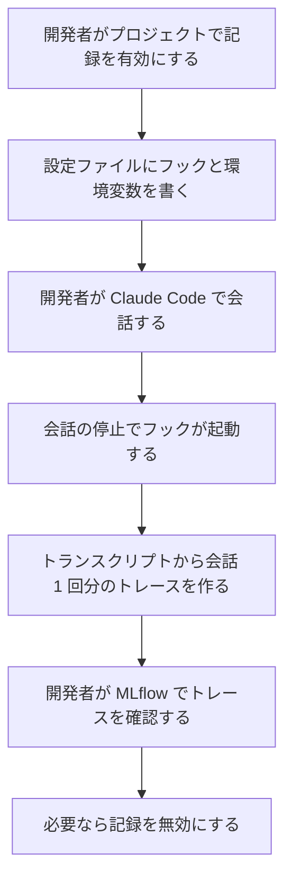
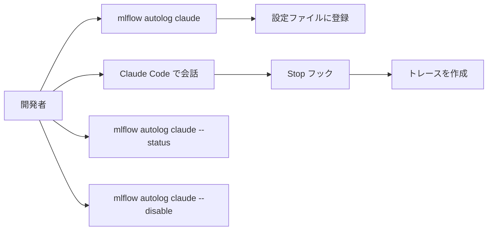

# 要件定義書（mlflow の Claude Code 連携 `mlflow/claude_code/` と トレースの相関分析 `mlflow/store/analytics/`）

本書は既存コードの逆引きで作った正本である。対象は `mlflow/claude_code/` パッケージと `mlflow/store/analytics/`（トレースの相関分析。NPMI）で、リポジトリの他のパッケージは対象外とする。`mlflow/store/analytics/` は、依頼（REQUEST.md）による既存コードへの変更で新しい範囲として加えた。

`mlflow/server/` のうち Flask の安全策（`security.py`・`security_utils.py`。Host 検査、CORS 遮断、応答ヘッダー）は、依頼（REQUEST.md）による既存コードへの変更で新しい範囲として加えた。同パッケージの他のファイル（FastAPI の安全策、ハンドラー、認証など）は逆引きの未実施であり、対象の範囲に入れていない（`isdd-build` の未マッピング一覧で報告する）。 `mlflow/server` は `security.py` と `security_utils.py` だけが対象で、対応表チェッカーの走査範囲には含めない（チェッカーはディレクトリ単位でしか指定できないため）。

## 1. 目的・前提

### 1-0. システムの目的

開発者が Claude Code（と Claude Agent SDK）で行った会話を、MLflow のトレースとして記録し、後から MLflow で確認できるようにする。プロジェクトごとの `.claude/settings.json` に MLflow 用のフックと環境変数を書き、有効化・状態確認・無効化を行えるようにする。

### 1-1. 用語集

| 用語 | 業務上の意味 | 本案件での使用範囲 | 同義語/類義語 |
|---|---|---|---|
| Claude Code | Anthropic の対話型コーディング支援ツール | 会話の発生元 | claude |
| フック | Claude Code が出来事（会話の停止など）のときに実行するコマンド | Stop フックへの登録と呼び出し | hook |
| Stop フック | 会話が終わったときに Claude Code が起動するフック | 会話 1 回の記録の起点 | Stop hook |
| トランスクリプト | Claude Code が会話の記録を 1 行 1 エントリの JSONL で残したファイル | 記録の入力 | transcript、transcript.jsonl |
| トレース | MLflow が 1 回の処理の span（処理区間）の木として保存する記録 | 会話 1 回につき 1 件 | trace |
| 設定ファイル | プロジェクトの `.claude/settings.json`。フックと環境変数を書く | 設定の登録・確認・削除の対象 | settings.json |
| 環境変数（MLflow 設定） | `MLFLOW_CLAUDE_TRACING_ENABLED`、`MLFLOW_TRACKING_URI`、`MLFLOW_EXPERIMENT_ID`、`MLFLOW_EXPERIMENT_NAME` | 設定ファイルの environment 欄に書く | |
| Claude Agent SDK | Claude を Python から呼ぶ SDK | SDK の停止イベントの処理 | claude_agent_sdk |
| 動作ログ | `.claude/mlflow/claude_tracing.log` に書く記録 | 障害の調査 | ログ |
| NPMI | 正規化相互情報量。2 つの事象の関連の強さを -1（決して同時に起きない）、0（独立）、1（常に同時に起きる）の範囲で表す | 2 つのトレースのフィルタの関連の強さ | normalized PMI |
| PMI | 相互情報量（対数）。同時に起きやすさを、独立の場合と比べた値 | NPMI の分子 | pointwise mutual information |
| 2x2 分割表 | 2 つの事象の有無の 4 つの件数（n11、n10、n01、n00） | 件数から作る中間の表 | コンティンジェンシーテーブル |
| Jeffreys 事前分布 | 4 つの件数に 0.5 を足す平滑化の既定値 | 平滑化した NPMI の計算 | alpha=0.5 の平滑化 |

### 1-2. システムの形態

- CUI: `mlflow autolog claude` コマンドで、プロジェクトの設定の登録・状態確認・無効化を行う。
- バッチ（出来事をきっかけに動く処理）: Claude Code の Stop フックの起動（標準入力に JSON を受け取る）と、Claude Agent SDK の Stop イベントのコールバック呼び出しで、会話 1 回分のトレースを作る。
- ライブラリ関数: `mlflow.store.analytics` の `calculate_npmi_from_counts` と `calculate_smoothed_npmi` を Python から呼び、件数から NPMI を求める。画面・CLI・バッチは無い。

### 1-3. 技術制約

| 制約項目 | 内容 | 出どころ（誰がいつ答えたか） |
|---|---|---|
| 既存コードベース | Python。mlflow リポジトリの一部。依存は click、python-dateutil、mlflow（既存の依存だけ使う） | 既存コードの確認（2026-11-04） |
| 配備先 | 開発者の PC（ローカル。Claude Code の実行環境と同じマシン） | 固定回答（ANSWERS.md） |
| チームの技術 | Python | 既存コードの言語 |
| ライセンスとコスト | 既存リポジトリのライセンス（Apache License 2.0）に従う。新しい有償ソフトは使わない | LICENSE.txt の確認、固定回答 |
| 性能と規模の目安 | 特に無い（性能の目標は無い。会話 1 回につき 1 件のトレース） | 固定回答（ANSWERS.md） |

## 2. 業務

### 2-0. 対象業務一覧

| RQ-BZ-ID | 業務名 | 業務の範囲 | 担当者 |
|---|---|---|---|
| `RQ-BZ-CLAUDE-CODE-TRACING` | Claude Code の会話のトレース記録 | 開発者のプロジェクトで Claude Code と SDK の会話を MLflow に記録し、設定と状態を管理する | 開発者 |
| `RQ-BZ-TRACE-CORRELATION-ANALYSIS` | トレースのフィルタどうしの相関分析 | トレースの件数から、2 つのフィルタの関連の強さ（NPMI）を求める | 開発者（ライブラリの利用者） |
| `RQ-BZ-SERVER-REQUEST-GUARD` | MLflow サーバーへのリクエストの安全策 | Host・CORS・応答ヘッダーの検査と付与、許可設定の読み出し | 運用者（サーバーを起動する人）、開発者（利用者） |

業務フロー:

### 2-1. 業務の問題（あるべき姿と現状のギャップ）

| 問題 | 対象業務（RQ-BZ） | あるべき姿 | 現状 | ギャップ（KPI） | 業務影響 |
|---|---|---|---|---|---|
| 既存システムのため、導入前の問題を聞き取れなかった | `RQ-BZ-CLAUDE-CODE-TRACING` | 不明（既存システムのため、導入時の数値を聞き取れなかった） | 不明（同左） | 不明（既存システムのため、導入時の数値を聞き取れなかった） | 不明 |
| 相関分析の 2 つの関数が欠けていて、呼び出せない | `RQ-BZ-TRACE-CORRELATION-ANALYSIS` | 件数から素の NPMI と平滑化 NPMI を求め、同じ分析結果の 2 つの値を得られる | 同じモジュールの戻り値の型と定数、パッケージの公開一覧だけが残っており、関数の本体と import が無い | 関数 2 件が未実装 | 分析結果の算出と、それを使う呼び出し側が動かない |
| セキュリティ関数が削られ、サーバーの安全策が動かない | `RQ-BZ-SERVER-REQUEST-GUARD` | 許可設定を環境変数から読み、Host・CORS・応答ヘッダーの検査が働く | `security.py` の 3 関数と `security_utils.py` の `is_allowed_host_header` が無く、`security.py` の本体の一部が欠けている（既存の import 行は残っている） | 復元が必要な関数 4 件（`security.py` 3 件、`security_utils.py` 1 件）と、その補助 | 起動時に安全策が組み立てられず、Host 検査と CORS 検査が働かない |

### 2-2. 業務課題一覧

| RQ-BK-ID | 業務課題（取り組むこと） | 解決する問題（2-1） | 解決後の状態（KPI の目標値） | 対象業務（RQ-BZ） |
|---|---|---|---|---|
| `RQ-BK-RECORD-CONVERSATION-TRACE` | Claude Code の会話 1 回を、MLflow のトレース 1 件として残す | 不明（2-1） | 会話が停止するたびに、対応するトレースが MLflow に 1 件残る | `RQ-BZ-CLAUDE-CODE-TRACING` |
| `RQ-BK-SDK-CONVERSATION-TRACE` | Claude Agent SDK の会話を、同じ形式のトレースとして残す | 不明（2-1） | SDK の停止イベントごとに、対応するトレースが残る | `RQ-BZ-CLAUDE-CODE-TRACING` |
| `RQ-BK-MANAGE-PROJECT-TRACING` | プロジェクトごとの記録の有効化・状態確認・無効化を、設定ファイルで管理する | 不明（2-1） | コマンド 1 回で有効化・確認・無効化ができ、設定ファイルの他の内容は変わらない | `RQ-BZ-CLAUDE-CODE-TRACING` |
| `RQ-BK-TRACE-OPERATION-LOG` | 記録の動作と失敗を動作ログに残し、障害を調べられるようにする | 不明（2-1） | 失敗した処理の理由がログファイルで分かる | `RQ-BZ-CLAUDE-CODE-TRACING` |
| `RQ-BK-RESTORE-CONFIG-INTERFACES` | 設定ファイルと環境変数を扱う 5 つのインターフェース（設定の読み込み、設定の保存、環境変数の取得、記録の状態の取得、記録のセットアップ）が、既存の呼び出し元から使える状態に戻す | 既存コードでこれらが欠けているため、有効化・状態表示・無効化・フック登録が失敗する | 有効化・状態表示・無効化・フック登録のコマンドが、設定ファイルに対して正しく動く | `RQ-BZ-CLAUDE-CODE-TRACING` |
| `RQ-BK-NPMI-CORRELATION-ANALYSIS` | 件数から、素の NPMI と平滑化 NPMI を、仕様の戻り値・NaN の規則・境界の扱いどおりに求められるようにする | 相関分析の関数が欠けている（2-1） | 2 つの関数が仕様どおりに値を返す（E2E で確かめる） | `RQ-BZ-TRACE-CORRELATION-ANALYSIS` |
| `RQ-BK-RESTORE-SERVER-SECURITY-MIDDLEWARE` | 依頼文の仕様どおりに、許可設定の読み出し、Flask ミドルウェアの登録、Host 照合を復元する | 安全策の関数が欠けている | 依頼文の仕様どおりに動く（E2E で確かめる） | `RQ-BZ-SERVER-REQUEST-GUARD` |

### 2-3. 見込み経営効果

見込み経営効果は算定しない（既存システムのため、導入前の業務の数値が無く、効果を算定する根拠が無いため）。

## 3. 機能要件

### 3-0. 入力データと出力データ

- 入力: 開発者のコマンド引数（ディレクトリ、トラッキング URI、実験 ID・実験名、無効化、状態確認）。Claude Code の Stop フックが標準入力に渡す JSON（会話 ID とトランスクリプトのパス）。Claude Agent SDK が渡す入力データ（会話 ID とトランスクリプトのパス）。
- 出力: 設定ファイルへの書き込み、コマンドの標準出力、フックへの応答 JSON（標準出力）、MLflow のトレース、動作ログ。

### 3-0-1. 利用者フロー

業務フローとの対応: 業務フローの「記録を有効にする」は利用者フローの登録、「会話の停止でフックが起動する」は Stop フック、「トレースを作る」は会話の記録、「記録を無効にする」は無効化に対応する。

### 3-0-2. 機能一覧

| RQ-ID | カテゴリ | 機能名 | 対応業務課題ID（RQ-BK-*） | この機能が無いと何が困るか |
|---|---|---|---|---|
| `RQ-FT-ENABLE-PROJECT-TRACING` | 機能 | プロジェクトの設定ファイルに MLflow フックと環境変数を書いて記録を有効にする | `RQ-BK-MANAGE-PROJECT-TRACING`、`RQ-BK-RECORD-CONVERSATION-TRACE` | 記録を始められない |
| `RQ-FT-SHOW-PROJECT-TRACING-STATUS` | 機能 | 設定ファイルから記録の有効・無効と MLflow の設定を表示する | `RQ-BK-MANAGE-PROJECT-TRACING` | 記録が有効か確認できない |
| `RQ-FT-DISABLE-PROJECT-TRACING` | 機能 | 設定ファイルから MLflow のフックと記録フラグを取り除く | `RQ-BK-MANAGE-PROJECT-TRACING` | 記録を止められない |
| `RQ-FT-REGISTER-MLFLOW-HOOK` | 機能 | Stop フックの一覧に MLflow の呼び出しを 1 件だけ登録または更新する | `RQ-BK-MANAGE-PROJECT-TRACING`、`RQ-BK-RECORD-CONVERSATION-TRACE` | フックが二重に登録され、会話が二重に記録される |
| `RQ-FT-RECEIVE-HOOK-INPUT` | 機能 | Stop フックの標準入力の JSON を読み取る | `RQ-BK-RECORD-CONVERSATION-TRACE` | 会話 ID とトランスクリプトのパスが分からない |
| `RQ-FT-REPLY-TO-HOOK` | 機能 | フックへの応答 JSON（継続するかどうかと理由）を組み立てる | `RQ-BK-RECORD-CONVERSATION-TRACE` | Claude Code が応答の形式を解釈できない |
| `RQ-FT-RECORD-STOP-HOOK-TRACE` | 機能 | Stop フックで、記録が有効なときだけトランスクリプトからトレースを作る | `RQ-BK-RECORD-CONVERSATION-TRACE` | 会話が記録されない |
| `RQ-FT-CHECK-TRACING-ENABLED` | 機能 | 環境変数で記録が有効かを判定する | `RQ-BK-RECORD-CONVERSATION-TRACE`、`RQ-BK-MANAGE-PROJECT-TRACING` | 無効なプロジェクトでも記録が走る |
| `RQ-FT-SET-MLFLOW-TARGET` | 機能 | 環境変数の追跡先（トラッキング URI と実験）を MLflow に設定する | `RQ-BK-RECORD-CONVERSATION-TRACE` | トレースが意図しない保存先・実験に入る |
| `RQ-FT-RECORD-SDK-STOP-TRACE` | 機能 | Claude Agent SDK の Stop イベントで、記録が有効なときだけトレースを作る | `RQ-BK-SDK-CONVERSATION-TRACE` | SDK の会話が記録されない |
| `RQ-FT-RECORD-TRANSCRIPT-TRACE` | 機能 | トランスクリプトから、会話 1 回分の親の処理区間と LLM 呼び出し・ツール呼び出しの区間を作り、プレビューと実行情報を付けて記録する | `RQ-BK-RECORD-CONVERSATION-TRACE`、`RQ-BK-SDK-CONVERSATION-TRACE` | 会話の内容がトレースに残らない |
| `RQ-FT-LOAD-SAVE-CLAUDE-CONFIG` | 機能 | 設定ファイルを読み込み（無い・壊れた JSON は空の設定）、保存する（親ディレクトリを作り、UTF-8 で 2 桁インデント） | `RQ-BK-RESTORE-CONFIG-INTERFACES` | 設定ファイルの登録・無効化・状態表示が動かない |
| `RQ-FT-GET-ENV-VAR` | 機能 | 環境変数を、OS の環境変数、次に設定ファイルの環境欄の順に探し、無ければ既定値を返す | `RQ-BK-RESTORE-CONFIG-INTERFACES` | 記録の有効判定と追跡先の設定が、利用者の設定ファイルの値を読めない |
| `RQ-FT-READ-TRACING-STATUS` | 機能 | 設定ファイルから記録の状態（有効・追跡先・実験 ID・実験名・理由）を求める | `RQ-BK-RESTORE-CONFIG-INTERFACES` | 状態表示が動かない |
| `RQ-FT-SETUP-ENVIRONMENT-CONFIG` | 機能 | 記録フラグを true にし、追跡先と実験を条件付きで書く（実験 ID があれば実験名を消す）。既存の他の設定は保つ | `RQ-BK-RESTORE-CONFIG-INTERFACES` | 有効化の環境変数の書き込みが動かない |
| `RQ-FT-ENABLE-DISABLE-RULES` | 機能 | 記録の有効化と無効化の規則（有効化はフックと環境変数を書き、無効化は MLflow のフックと記録フラグだけを取り除く） | `RQ-BK-MANAGE-PROJECT-TRACING` | 利用者の他の設定が消える |
| `RQ-FT-CALCULATE-NPMI-FROM-COUNTS` | 機能 | 4 つの件数から 2x2 分割表を作り、素の NPMI（件数 0 の -1 の規則を含む）と平滑化 NPMI を 1 つの結果にまとめる。未定義・不整合は NaN | `RQ-BK-NPMI-CORRELATION-ANALYSIS` | 相関の強さを件数から求められない |
| `RQ-FT-CALCULATE-SMOOTHED-NPMI` | 機能 | 4 つの件数の分割表に平滑化の値（既定は Jeffreys の 0.5）を足して NPMI を求める。件数 0 の -1 の規則は適用しない。信頼区間の推定に使う | `RQ-BK-NPMI-CORRELATION-ANALYSIS` | 少ない件数で極端な値になる平滑化済みの値が得られない |
| `RQ-FT-GET-ALLOWED-HOSTS` | 機能 | 環境変数の許可ホストを読む。無い・空なら既定の許可ホスト（localhost、127.0.0.1、[::1]、0.0.0.0 とそのポート付き、10.*、192.168.*、172.16〜31.*、IPv6 のプライベート範囲）を返す | `RQ-BK-RESTORE-SERVER-SECURITY-MIDDLEWARE` | 許可ホストが決まらず、Host 検査の対象が分からない |
| `RQ-FT-GET-ALLOWED-ORIGINS` | 機能 | 環境変数の許可オリジンを読む。無い・空なら空のリストを返す | `RQ-BK-RESTORE-SERVER-SECURITY-MIDDLEWARE` | 追加の許可オリジンが決まらない |
| `RQ-FT-INIT-SECURITY-MIDDLEWARE` | 機能 | Flask アプリに CORS（localhost のオリジンを含む）、Host 検査、CORS 遮断、応答ヘッダーを登録する。無効化の環境変数が厳密に `"true"` のときは何もしない | `RQ-BK-RESTORE-SERVER-SECURITY-MIDDLEWARE` | サーバーに安全策が付かない |
| `RQ-FT-IS-ALLOWED-HOST-HEADER` | 機能 | Host ヘッダーの値が許可パターンに合うかを判定する。`*` を含めば全許可、空や None は拒否、`*` を含むパターンは fnmatch、含まないパターンは完全一致 | `RQ-BK-RESTORE-SERVER-SECURITY-MIDDLEWARE` | Host の照合ができず、DNS リバインディングを防げない |

### 3-1. 帳票・出力ファイル

| RQ-ID | 帳票・出力名 | 形式（PDF / CSV / 標準出力など） | 出力項目 | 出力のきっかけ | 対応業務課題ID（RQ-BK-*） |
|---|---|---|---|---|---|
| `RQ-UI-AUTOLOG-CLAUDE-COMMAND` | `mlflow autolog claude` の標準出力 | 標準出力（テキスト） | 設定先のディレクトリ、トラッキング URI、実験、完了メッセージ、無効化・状態の結果 | コマンドの実行 | `RQ-BK-MANAGE-PROJECT-TRACING` |
| `RQ-UI-HOOK-RESPONSE-JSON` | フックへの応答 | 標準出力（JSON） | 継続の可否、エラー時は理由 | Stop フックの終了時 | `RQ-BK-RECORD-CONVERSATION-TRACE` |

### 3-2. 業務ルール

| RQ-ID | ルール名 | 内容（条件と結果） | 違反時・エラー時の業務上の扱い | 対応業務課題ID（RQ-BK-*） |
|---|---|---|---|---|
| `RQ-FT-RECORD-RULES` | 記録の判定 | 環境変数の記録フラグが真（true・1・yes のいずれか。大文字小文字を区別しない）のときだけ記録する。それ以外は何もしない | 記録しないことは失敗ではない。フックは成功応答を返す | `RQ-BK-RECORD-CONVERSATION-TRACE` |
| `RQ-FT-TRACE-SHAPE-RULES` | トレースの形 | 会話の最後のユーザー発言（ツール結果と空の発言を除く）を親の処理区間の入力にする。テキストだけの応答は LLM 呼び出しの区間、ツール呼び出しはツールの区間にする | トランスクリプトに利用者の発言が無ければ、トレースは作らず無応答扱いにする | `RQ-BK-RECORD-CONVERSATION-TRACE` |
| `RQ-FT-ENABLE-DISABLE-RULES-DETAIL` | 無効化の対象 | 無効化では、Stop フックのうち MLflow の識別子を含むものだけを取り除く。環境変数は記録フラグ（MLFLOW_CLAUDE_TRACING_ENABLED）だけを取り除く。追跡 URI と実験の環境変数は、現状の挙動として残す。空になった欄と空になった設定ファイルは消す | 利用者の他のフックと環境変数は残す | `RQ-BK-MANAGE-PROJECT-TRACING` |

相関分析（`mlflow/store/analytics/`）の算出規則:

- 件数から作る 2x2 分割表（n11 = 同時件数、n10 = フィルタ 1 の件数 − 同時件数、n01 = フィルタ 2 の件数 − 同時件数、n00 = 全体件数 − フィルタ 1 の件数 − フィルタ 2 の件数 + 同時件数）のいずれかが負、または全体件数が 0 以下なら、両方の値を NaN にする。
- フィルタ 1 かフィルタ 2 の件数が 0 なら、素の値は NaN（未定義）。
- 素の値は、同時件数が 0（両方のフィルタに件数がある）なら -1.0。n10・n01・n00 がすべて 0（常に同時に起きる）なら 1.0。
- 平滑化の値は、4 セルに平滑化の値を足してから同じ式で求める。平滑化の後に件数が 0 以下のものがあれば NaN。常に同時に起きる場合は 1.0。
- 値は [-1, 1] に収める（浮動小数点の誤差の吸収）。例外は投げない。

### 3-3. 外部連携

外部連携は無い（固定回答。記録は mlflow ライブラリが設定された追跡先に書くが、外部システムとの通信は本パッケージの要件ではない）。

## 4. データ

### 4-1. データ要件一覧

| RQ-ID | 種別 | 内容 | 対応業務課題ID（RQ-BK-*） | この要件が無いと何が困るか |
|---|---|---|---|---|
| `RQ-DT-CLAUDE-SETTINGS-FILE` | 内部データ | プロジェクトの `.claude/settings.json`。フックの一覧と環境変数の欄を持つ JSON。利用者が手で書いた他の内容を保つ | `RQ-BK-MANAGE-PROJECT-TRACING` | 利用者の他の設定が消える |
| `RQ-DT-TRANSCRIPT-FILE` | 外部データ（Claude Code が書く） | トランスクリプト（JSONL）。1 行が会話の 1 エントリで、利用者の発言、応答、ツール呼び出しと結果、時刻を含む | `RQ-BK-RECORD-CONVERSATION-TRACE`、`RQ-BK-SDK-CONVERSATION-TRACE` | 記録の入力が無い |
| `RQ-DT-TRACE-STORAGE` | 内部データ | トレースは mlflow が設定された追跡先に保存する。保持期間はその追跡先の方針に従う | `RQ-BK-RECORD-CONVERSATION-TRACE` | トレースが残らない |
| `RQ-DT-TRACING-STATUS-VALUE` | 内部データ | 記録の状態（有効か、理由、追跡先、実験）の値 | `RQ-BK-MANAGE-PROJECT-TRACING` | 状態表示の値が決まらない |
| `RQ-DT-TRACE-OPERATION-LOG-FILE` | 内部データ | 動作ログファイル（`.claude/mlflow/claude_tracing.log`）。保持期間の定めは無い | `RQ-BK-TRACE-OPERATION-LOG` | 失敗の調査ができない |

データベースは使わない（記録先は mlflow の追跡先であり、本パッケージでは DB を設計しない）。

### 4-2. 業務エンティティとデータ項目

| RQ-ID | カテゴリ | 業務エンティティ名 | 対応業務課題ID（RQ-BK-*） | この業務エンティティが無いと何が困るか |
|---|---|---|---|---|
| `RQ-DT-HOOK-ENTRY` | 設定 | フック登録（Stop フックに置く MLflow 呼び出しの 1 件） | `RQ-BK-MANAGE-PROJECT-TRACING` | 登録の判定ができない |
| `RQ-DT-TRACING-STATUS` | 状態 | 記録の状態（TracingStatus） | `RQ-BK-MANAGE-PROJECT-TRACING` | 状態表示ができない |

| エンティティ名 | 項目名 | 業務上の意味 | 必須 | 形式・桁 | 値の範囲・制約 | 例 |
|---|---|---|---|---|---|---|
| フック登録 | 種別（type） | 登録の種類 | 必須 | 文字列 | 固定値 command | command |
| フック登録 | コマンド（command） | 呼び出すコマンド。識別子 `mlflow.claude_code.hooks` を含む | 必須 | 文字列 | MLflow のハンドラを呼ぶ 1 行 | python -c "..." |
| 記録の状態 | 有効（enabled） | 記録が有効か | 必須 | 真偽値 | 環境変数の記録フラグが true のときだけ真 | true |
| 記録の状態 | 追跡 URI（tracking_uri） | 追跡先 | 任意 | 文字列 | 無ければ無し | file://./mlruns |
| 記録の状態 | 実験 ID（experiment_id） | 実験 ID | 任意 | 文字列 | 無ければ無し | 123 |
| 記録の状態 | 実験名（experiment_name） | 実験名 | 任意 | 文字列 | 無ければ無し | demo |
| 記録の状態 | 理由（reason） | 無効のときの理由 | 任意 | 文字列 | 無効のときだけ | No configuration found |

相関分析の入出力（`mlflow/store/analytics/`）: 件数の入れ物 `TraceCorrelationCounts`（全体件数、フィルタ 1 の件数、フィルタ 2 の件数、同時件数）と、結果の型 `NPMIResult`（素の値、平滑化の値）。保存はしない。

### 4-3. CRUD テーブル

| エンティティ名 | Create | Read（一覧） | Read（詳細） | 検索 | Update | Delete | 備考 |
|---|---|---|---|---|---|---|---|
| フック登録 | ○ | △ | △ | × | ○ | ○ | 追加は同じ識別子の登録を 1 件に保つ。削除は識別子を含む登録だけ |
| 記録の状態 | × | × | ○ | × | × | × | 設定ファイルから作る一時的な値 |
| トランスクリプト（JSONL） | × | ○ | ○ | × | × | × | 読むだけ。Claude Code が書く |
| トレース | ○ | × | ○ | × | × | × | 記録は mlflow の API で作る |
| 動作ログ | ○ | × | × | × | ○ | × | 追記のみ |

### 4-4. 状態遷移

状態を持つエンティティは無い（記録の有効・無効は設定ファイルの値で決まり、遷移の記録を持たない）。

### 4-5. 画面一覧

画面は無い。

## 5. 非機能要件

| RQ-ID | カテゴリ | 非機能要件名 | 対応業務課題ID（RQ-BK-*） | この非機能要件が無いと何が困るか |
|---|---|---|---|---|
| - | 利用者の種別とアクセス経路 | 利用者は開発者 1 人（ローカルの PC）。インターネット公開は無い | - | - |
| - | 性能 | 性能の目標は無い | - | - |
| - | 利用人数 | 同時接続の要求は無い（ローカル実行） | - | - |
| - | 可用性 | 可用性の要求は無い | - | - |
| - | 移行性 | 移行は無い | - | - |
| - | セキュリティ | 認証は無い。権限制御は無い。監査証跡の改ざん防止は無い（ローカルのファイルを扱う） | - | - |

## 6. 運用要件

| RQ-ID | 種別 | 内容 | 対応業務課題ID（RQ-BK-*） | この要件が無いと何が困るか |
|---|---|---|---|---|
| `RQ-OP-TRACING-LOG` | ログ | 記録の処理の開始、トレースの作成、失敗の理由を動作ログに書く。保存期間の定めは無い（利用者が削除する） | `RQ-BK-TRACE-OPERATION-LOG` | 失敗の原因が分からない |

- 監査ログ: 要件は無い。
- 監視・アラート: 監視・アラートは必要ないため、監視・アラートの内容と対応方法の記述は行わない。
- バックアップと復旧: バックアップは必要ない（設定ファイルとトレースは利用者のプロジェクトと追跡先の管理に従う）。

## 7. テスト用利用シナリオ

| RQ-ID | テスト目的 | 前提条件 | テスト手順 | 期待される結果 | 検証する要件ID | 対応業務課題ID（RQ-BK-*） |
|---|---|---|---|---|---|---|
| `RQ-TS-ENABLE-PROJECT-TRACING` | プロジェクトの記録を有効化すると、フックと環境変数が設定ファイルに入る | 空のプロジェクトディレクトリ | 有効化コマンドを実行し、設定ファイルを読む | Stop フックに MLflow の登録が 1 件あり、環境変数の記録フラグが true になる | `RQ-UI-AUTOLOG-CLAUDE-COMMAND`、`RQ-FT-ENABLE-PROJECT-TRACING`、`RQ-FT-REGISTER-MLFLOW-HOOK` | `RQ-BK-MANAGE-PROJECT-TRACING` |
| `RQ-TS-SHOW-TRACING-STATUS` | 有効化の前後で状態表示が変わる | 空のプロジェクトディレクトリ | 状態表示を実行し、有効化後に再度実行する | 有効化前は無効と理由が出て、有効化後は有効と追跡先が出る | `RQ-UI-AUTOLOG-CLAUDE-COMMAND`、`RQ-FT-SHOW-PROJECT-TRACING-STATUS` | `RQ-BK-MANAGE-PROJECT-TRACING` |
| `RQ-TS-DISABLE-PROJECT-TRACING` | 無効化で MLflow の登録と環境変数だけが消え、他の設定は残る | 有効化済みで、他の環境変数と他のフックを持つ設定ファイル | 無効化コマンドを実行し、設定ファイルを読む | MLflow の登録と記録フラグが消え、追跡 URI と実験の環境変数と他の設定は残る | `RQ-UI-AUTOLOG-CLAUDE-COMMAND`、`RQ-FT-DISABLE-PROJECT-TRACING`、`RQ-FT-ENABLE-DISABLE-RULES`、`RQ-FT-ENABLE-DISABLE-RULES-DETAIL` | `RQ-BK-MANAGE-PROJECT-TRACING` |
| `RQ-TS-REGISTER-HOOK-TWICE` | 同じ登録を 2 回行っても登録は 1 件のまま | 空の設定 | 登録を 2 回行う | Stop フックの MLflow 登録が 1 件だけ | `RQ-FT-REGISTER-MLFLOW-HOOK` | `RQ-BK-RECORD-CONVERSATION-TRACE` |
| `RQ-TS-STOP-HOOK-RECORD` | Stop フックで記録が有効なら会話 1 回分のトレースが残り、応答が継続を示す | 記録が有効な環境、会話のトランスクリプト | Stop フックの入力を与えて実行する | 応答は継続を示し、トレースが 1 件残る | `RQ-FT-RECEIVE-HOOK-INPUT`、`RQ-FT-REPLY-TO-HOOK`、`RQ-FT-RECORD-STOP-HOOK-TRACE`、`RQ-FT-CHECK-TRACING-ENABLED`、`RQ-FT-SET-MLFLOW-TARGET`、`RQ-FT-RECORD-TRANSCRIPT-TRACE`、`RQ-FT-RECORD-RULES`、`RQ-FT-TRACE-SHAPE-RULES`、`RQ-UI-HOOK-RESPONSE-JSON`、`RQ-DT-TRACE-STORAGE` | `RQ-BK-RECORD-CONVERSATION-TRACE` |
| `RQ-TS-STOP-HOOK-DISABLED` | 記録が無効なら Stop フックはトレースを作らず、継続を示す | 記録が無効な環境 | Stop フックの入力を与えて実行する | 応答は継続を示し、トレースは残らない | `RQ-FT-CHECK-TRACING-ENABLED`、`RQ-FT-RECORD-RULES`、`RQ-UI-HOOK-RESPONSE-JSON` | `RQ-BK-RECORD-CONVERSATION-TRACE` |
| `RQ-TS-SDK-STOP-RECORD` | SDK の Stop イベントで会話 1 回分のトレースが残る | 記録が有効な環境、会話のトランスクリプト | SDK の停止コールバックを呼ぶ | トレースが 1 件残り、応答が継続を示す | `RQ-FT-RECORD-SDK-STOP-TRACE`、`RQ-FT-RECORD-TRANSCRIPT-TRACE`、`RQ-UI-HOOK-RESPONSE-JSON`、`RQ-DT-TRANSCRIPT-FILE` | `RQ-BK-SDK-CONVERSATION-TRACE` |
| `RQ-TS-TRANSCRIPT-WITHOUT-USER` | 利用者の発言が無いトランスクリプトではトレースを作らない | 利用者の発言が無い JSONL | トレース作成を実行する | 結果は無し（トレースは作られない） | `RQ-FT-RECORD-TRANSCRIPT-TRACE`、`RQ-FT-TRACE-SHAPE-RULES` | `RQ-BK-RECORD-CONVERSATION-TRACE` |
| `RQ-TS-TRACING-LOG` | 失敗した記録の理由が動作ログに残る | 記録が有効で、壊れたトランスクリプトのパスを与える | Stop フックの処理を実行する | 動作ログに失敗の理由が書かれる | `RQ-OP-TRACING-LOG`、`RQ-FT-RECORD-STOP-HOOK-TRACE` | `RQ-BK-TRACE-OPERATION-LOG` |
| `RQ-TS-TRACING-STATUS-VALUE` | 状態の値が有効・無効と理由を正しく持つ | なし | 状態の値を作って各項目を読む | 有効時は追跡先などが入り、無効時は理由が入る | `RQ-FT-SHOW-PROJECT-TRACING-STATUS`、`RQ-DT-TRACING-STATUS-VALUE` | `RQ-BK-MANAGE-PROJECT-TRACING` |
| `RQ-TS-LOAD-SAVE-CONFIG` | 設定ファイルの保存と読み込みが往復し、壊れた・無い設定は空になる | 空のディレクトリ、壊れた JSON のファイル | 保存して読む。壊れたファイルを読む。無いファイルを読む | 往復で同じ内容。壊れた・無いものは空の設定 | `RQ-FT-LOAD-SAVE-CLAUDE-CONFIG` | `RQ-BK-RESTORE-CONFIG-INTERFACES` |
| `RQ-TS-GET-ENV-VAR-PRECEDENCE` | 環境変数の探索順（OS、次に設定ファイル、次に既定値）を確かめる | 同名の値を OS と設定ファイルに置く | OS に値があるとき、無いときを読む | OS の値が優先し、無ければ設定ファイル、どちらも無ければ既定値 | `RQ-FT-GET-ENV-VAR` | `RQ-BK-RESTORE-CONFIG-INTERFACES` |
| `RQ-TS-READ-TRACING-STATUS-VALUES` | 記録の状態の値が、設定ファイルの内容どおりに求まる | 有効・無効・無しの 3 種類の設定ファイル | 状態を求める | 無しは「設定が無い」理由、無効は無効、有効は追跡先などを含む | `RQ-FT-READ-TRACING-STATUS` | `RQ-BK-RESTORE-CONFIG-INTERFACES` |
| `RQ-TS-SETUP-ENVIRONMENT-PRECEDENCE` | 記録のセットアップで実験 ID が実験名より優先し、他の設定を保つ | 他の環境変数と実験名を持つ設定ファイル | 実験 ID と実験名を両方与えて実行する | 記録フラグが true、実験 ID が入り、実験名は消え、他の設定は残る | `RQ-FT-SETUP-ENVIRONMENT-CONFIG` | `RQ-BK-RESTORE-CONFIG-INTERFACES` |
| `RQ-TS-NPMI-UNSMOOTHED-VALUES` | 素の NPMI と平滑化 NPMI が、典型的な件数と境界の件数で仕様どおり求まる | 件数 (10, 20, 15, 100)、(0, 50, 50, 100)、(0, 0, 50, 100) | 関数に件数を渡して結果を読む | 1 件目は両方が有限の値。2 件目の素の値は -1.0。3 件目の素の値は NaN | `RQ-FT-CALCULATE-NPMI-FROM-COUNTS` | `RQ-BK-NPMI-CORRELATION-ANALYSIS` |
| `RQ-TS-NPMI-INCONSISTENT-COUNTS` | 不整合な件数と全体件数が 0 のとき、両方の値が NaN になる | 同時件数がフィルタ件数より多い件数、全体件数 0 | 関数に件数を渡して結果を読む | 両方の値が NaN | `RQ-FT-CALCULATE-NPMI-FROM-COUNTS` | `RQ-BK-NPMI-CORRELATION-ANALYSIS` |
| `RQ-TS-NPMI-PERFECT-COOCCURRENCE` | 常に同時に起きる件数で NPMI が 1.0 になる | 全件が両方に一致する件数（例: (10, 10, 10, 10)） | 関数に件数を渡して結果を読む | 素の値も平滑化の値も 1.0 | `RQ-FT-CALCULATE-NPMI-FROM-COUNTS` | `RQ-BK-NPMI-CORRELATION-ANALYSIS` |
| `RQ-TS-SMOOTHED-NPMI-JEFFREYS` | 平滑化の関数が、既定値で結果の平滑化の値と一致し、同時件数 0 でも有限の値を返す | 件数 (0, 50, 50, 100) | 平滑化の関数を既定値で呼び、結果の平滑化の値と比べる | 既定値の結果は結果の平滑化の値と一致し、値は -1.0 にならず有限 | `RQ-FT-CALCULATE-SMOOTHED-NPMI` | `RQ-BK-NPMI-CORRELATION-ANALYSIS` |
| `RQ-TS-SECURITY-ALLOWED-HOSTS-AND-ORIGINS` | 許可ホストと許可オリジンが環境変数の有無で切り替わる | 環境変数の未設定・設定・空文字 | 許可ホストと許可オリジンを取得する | 未設定・空文字では既定の一覧（ホスト）と空（オリジン）。設定時はカンマ区切りの値（前後の空白を除く） | `RQ-FT-GET-ALLOWED-HOSTS`、`RQ-FT-GET-ALLOWED-ORIGINS` | `RQ-BK-RESTORE-SERVER-SECURITY-MIDDLEWARE` |
| `RQ-TS-SECURITY-HOST-VALIDATION` | 不正な Host は 403、健康確認の経路と許可された Host は通る | Flask アプリに安全策を登録（許可ホストは既定） | 不正な Host・許可された Host で GET し、`/health` も GET する | 不正な Host は 403、許可された Host と `/health` は通る。`is_allowed_host_header` は `*`・空・完全一致・fnmatch の規則どおり | `RQ-FT-INIT-SECURITY-MIDDLEWARE`、`RQ-FT-IS-ALLOWED-HOST-HEADER` | `RQ-BK-RESTORE-SERVER-SECURITY-MIDDLEWARE` |
| `RQ-TS-SECURITY-CORS-BLOCKING` | 許可されていない別オリジンからの API の状態変更要求は 403、localhost と許可オリジンは通る | 許可オリジンは既定（空）と指定の 2 通り | 別オリジンから API に POST し、localhost と許可オリジンからも POST する | 別オリジンは 403、localhost と許可オリジンは通る | `RQ-FT-INIT-SECURITY-MIDDLEWARE` | `RQ-BK-RESTORE-SERVER-SECURITY-MIDDLEWARE` |
| `RQ-TS-SECURITY-RESPONSE-HEADERS` | 応答に nosniff が付き、X-Frame-Options は設定どおり。ノートブックの経路と NONE では付かない。API の OPTIONS は 200 のとき 204 になる | 既定の X-Frame-Options（SAMEORIGIN）、NONE の設定 | 通常経路・ノートブックの経路・OPTIONS を呼ぶ | nosniff は常に付く。X-Frame-Options は SAMEORIGIN（ノートブックと NONE では無し）。API の OPTIONS 200 は 204 | `RQ-FT-INIT-SECURITY-MIDDLEWARE` | `RQ-BK-RESTORE-SERVER-SECURITY-MIDDLEWARE` |
| `RQ-TS-SECURITY-DISABLED` | 無効化の環境変数が厳密に true のときだけ安全策が付かない | 環境変数を true・TRUE・未設定にする | 安全策を登録し、不正な Host で GET する | true のときは不正な Host でも通る（安全策なし）。TRUE・未設定では 403 になる | `RQ-FT-INIT-SECURITY-MIDDLEWARE` | `RQ-BK-RESTORE-SERVER-SECURITY-MIDDLEWARE` |

SDK の会話は「SDK の停止イベントの記録」のシナリオで確かめる。設定ファイルのフック登録と環境変数、動作ログの内容は、有効化・無効化・記録のシナリオの結果で確かめる。テスト用利用シナリオに現れない項目（データの定義）は、チェッカーの対象外である。
