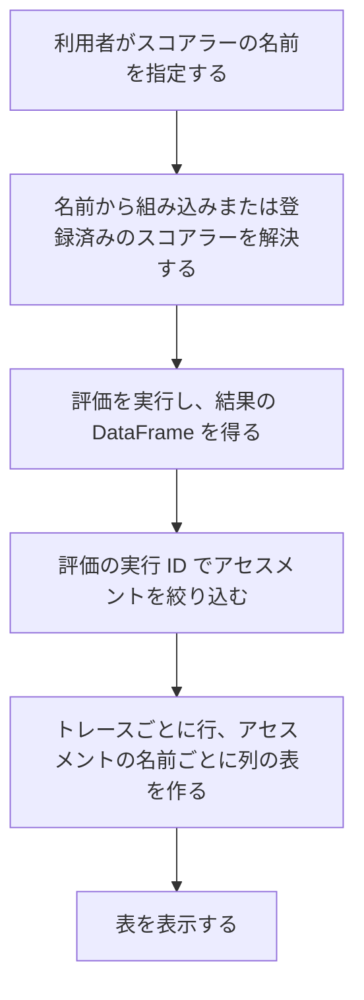

# 変更要件定義書（GenAI 評価結果の整形と表示の復元：mlflow/cli/genai_eval_utils.py）

正本: `docs/requirements.md`（`mlflow/claude_code/` と `mlflow/store/analytics/` の逆引き）。本書は正本を書き換えない。区分は [追加] のみ。

本変更で、正本の対象範囲に新しい範囲 `mlflow/cli/genai_eval_utils.py`（評価結果の整形と表示）を足す。対象はこの 1 ファイルだけで、`mlflow/cli/` の他のファイル（`eval.py`、`scorers.py`、`traces.py` など）は正本の対象外とする（固定回答 ANSWERS.md と依頼文による）。

## 1. 目的・前提

### 1-0. システムの目的

GenAI の評価（`evaluate()`）の結果から、指定した評価の実行（run）で付いたアセスメントだけを取り出し、トレースごとに 1 行、アセスメントの名前ごとに 1 列の表にして表示する。評価に使うスコアラーは、組み込みのクラス名・snake_case 名と、登録済みのスコアラーの名前で指定できる。

### 1-1. 用語集

| 用語 | 業務上の意味 | 本案件での使用範囲 | 同義語/類義語 |
|---|---|---|---|
| アセスメント（assessment） | トレースに付く評価結果（値、根拠、エラー） | 評価結果の 1 件 | feedback |
| 評価の実行（run） | `evaluate()` の 1 回の実行。ID で識別する | アセスメントの絞り込みに使う | evaluation run |
| スコアラー（scorer） | 評価の判定を行う組み込みまたは登録済みの関数・判定器 | 評価に使う判定の指定 | metric |

### 1-2. システムの形態

ライブラリと CLI（`mlflow/cli/eval.py` から呼ぶ補助関数）。画面は無い。入力は DataFrame と名前の一覧、出力は整形用の型。永続化はしない。

### 1-3. 技術制約

| 制約項目 | 内容 | 出どころ（誰がいつ答えたか） |
|---|---|---|
| 既存コードベース | Python。mlflow リポジトリの一部。pandas、click、既存の mlflow 内部モジュールだけを使う（新しい依存は足さない） | 既存コードの確認（2026-11-04）、依頼文 |
| 配備先 | mlflow のパッケージの一部（CLI から呼ばれる） | 依頼文（REQUEST.md） |
| 性能と規模の目安 | 特に無い | 固定回答（ANSWERS.md） |

## 2. 業務

### 2-0. 対象業務一覧

| RQ-BZ-ID | 業務名 | 業務の範囲 | 担当者 |
|---|---|---|---|
| `RQ-BZ-GENAI-EVAL-RESULTS-DISPLAY` [追加] | 評価結果の確認 | 評価の実行の結果を、トレースごとの表で確認する | 開発者（mlflow の利用者） |

業務フロー:

### 2-1. 業務の問題（あるべき姿と現状のギャップ）

| 問題 | 対象業務（RQ-BZ） | あるべき姿 | 現状 | ギャップ（KPI） | 業務影響 |
|---|---|---|---|---|---|
| 評価結果の整形の 3 関数が欠けている | `RQ-BZ-GENAI-EVAL-RESULTS-DISPLAY` | スコアラーの解決、アセスメントの抽出、表の整形が動く | モジュールの型（`Assessment`、`Cell`、`EvalResult`、`TableOutput`）と、セル文字列の関数は残っているが、3 関数が無い | 関数 3 件が未実装 | `mlflow/cli/eval.py` の評価コマンドが動かない |

### 2-2. 業務課題一覧

| RQ-BK-ID | 業務課題（取り組むこと） | 解決する問題（2-1） | 解決後の状態（KPI の目標値） | 対象業務（RQ-BZ） |
|---|---|---|---|---|
| `RQ-BK-GENAI-EVAL-RESULTS-DISPLAY` [追加] | 評価結果を、実行の範囲を取り違えずに表で確認できるようにする | 3 関数が欠けている | 3 関数が依頼の仕様どおりに動く（E2E で確かめる） | `RQ-BZ-GENAI-EVAL-RESULTS-DISPLAY` |

### 2-3. 見込み経営効果

見込み経営効果は算定しない（固定回答による）。

## 3. 機能要件

### 3-0-2. 機能一覧

| RQ-ID | カテゴリ | 機能名 | 対応業務課題ID（RQ-BK-*） | この機能が無いと何が困るか |
|---|---|---|---|---|
| `RQ-FT-EXTRACT-ASSESSMENTS-BY-RUN` [追加] | 機能 | 評価の実行の ID が一致するアセスメントだけを、トレースごとに取り出す。該当が無ければ「No assessments found on trace」を 1 件入れる | `RQ-BK-GENAI-EVAL-RESULTS-DISPLAY` | 別の実行の結果が混ざる |
| `RQ-FT-FORMAT-TABLE-OUTPUT` [追加] | 機能 | トレース ID を先頭列に、アセスメントの名前を並べ替えた列にして、セルの表を作る | `RQ-BK-GENAI-EVAL-RESULTS-DISPLAY` | 結果を表で見られない |
| `RQ-FT-RESOLVE-SCORERS` [追加] | 機能 | スコアラーの名前を、組み込み（クラス名・snake_case）の順に、なければ登録済みの順に解決する | `RQ-BK-GENAI-EVAL-RESULTS-DISPLAY` | 評価に使うスコアラーを指定できない |

### 3-1. 帳票・出力ファイル

無し（表は標準出力に出す。整形の結果は型で返す）。

### 3-2. 業務ルール

- アセスメントは、メタデータの評価の実行 ID が引数の ID と一致するものだけを対象にする（不一致・メタデータ無しは対象外）。
- 1 つも該当しないトレースには、名前が無く、エラーが「No assessments found on trace」のアセスメントを 1 件入れる。
- 表の列はトレース ID（先頭）と、アセスメントの名前（None と "N/A" を除く）を昇順に並べたもの。
- セルの表示: エラーがあれば「error: <エラー>」。値があり根拠もあれば「value: <値>, rationale: <根拠>」。値だけなら「value: <値>」、根拠だけなら「rationale: <根拠>」。どれも無ければ「N/A」（この場合はアセスメントを持たせない）。根拠は切り詰めない。
- スコアラーは組み込みを先に探し、無ければ登録済みを実験から探す。登録済みの探索で例外（未登録を含む）が出たら、利用者向けの使用エラーにする。指定が 0 件なら使用エラーにする。

### 3-3. 外部連携

無し（登録済みスコアラーの探索は既存のスコアラー登録の仕組みを使う。新しい連携は無い）。

## 4. データ

### 4-1. データ要件一覧

本変更でデータの保存は無い。入力は評価結果の DataFrame と評価の実行 ID、出力は整形用の型。

### 4-2. 業務エンティティとデータ項目

既存の型（`Assessment`、`Cell`、`EvalResult`、`TableOutput`）を、設計に書き起こす（正本の対象範囲に入れるため）。項目は既存コードのとおり。

### 4-3. CRUD テーブル

無し（永続化なし）。

### 4-4. 状態遷移

無し。

### 4-5. 画面一覧

無し。

## 5. 非機能要件

変更なし。性能の目標は無い。

## 6. 運用要件

無し（ライブラリと CLI の補助関数のため、運用の作業は無い）。

## 7. テスト用利用シナリオ

| RQ-ID | テスト目的 | 前提条件 | テスト手順 | 期待される結果 | 検証する要件ID | 対応業務課題ID（RQ-BK-*） |
|---|---|---|---|---|---|---|
| `RQ-TS-EXTRACT-ASSESSMENTS-BY-RUN` [追加] | 別の実行のアセスメントが混ざらず、該当が無いトレースに既定のエラーが入る | 実行 A と B のアセスメントを持つ 2 行の DataFrame（片方は該当なし） | 実行 A の ID で抽出する | 実行 A のものだけが入り、該当なしの行は「No assessments found on trace」 | `RQ-FT-EXTRACT-ASSESSMENTS-BY-RUN` | `RQ-BK-GENAI-EVAL-RESULTS-DISPLAY` |
| `RQ-TS-FORMAT-TABLE-CELLS` [追加] | 表の列の並びとセルの文字列が仕様どおりになる | 値・根拠・エラーの異なるアセスメントを持つ 2 トレース | 表を作り、セルの値を読む | 列はトレース ID と名前の昇順。セルは error・value・rationale の規則どおり。該当なしは N/A | `RQ-FT-FORMAT-TABLE-OUTPUT` | `RQ-BK-GENAI-EVAL-RESULTS-DISPLAY` |
| `RQ-TS-RESOLVE-SCORERS-NAMES` [追加] | 組み込みのクラス名と snake_case 名で解決でき、未知の名前と空の指定は使用エラーになる | 組み込みのスコアラー名。登録済みの探索は失敗させる（テストで置き換える） | 名前を解決する。未知の名前と空の一覧を渡す | 2 つの名前は組み込みに解決。未知の名前と空の一覧は使用エラー | `RQ-FT-RESOLVE-SCORERS` | `RQ-BK-GENAI-EVAL-RESULTS-DISPLAY` |
