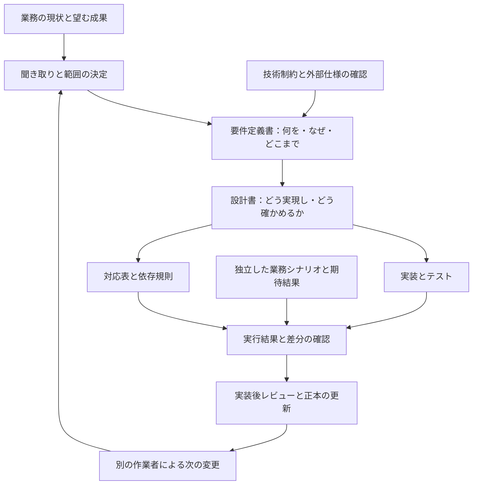

# Codex 再レビュー: isdd 全体の価値・評価方法・不足

作成日: 2026-11-23  
対象: isdd v2.3.1、確認開始時のコミット `d59ff1b` と、同日作業ツリーに追加された評価基盤の修正  
位置づけ: 現行の仕組みと評価を再確認した独立レビュー。改善案は本報告の提案であり、採用済みの決定とは区別する。

## 1. 結論

isdd の価値は、**何を作るべきかを決め、判断の根拠と実装上の制約を残し、次の作業者が変更しても確かめ直せること**にある。質問回数、文書の長さ、最初の実装の合格数だけでは、その価値全体を評価できない。

今回の確認で、次の点が重要だと判断した。

1. **isdd は要件定義・設計の確認項目をかなり広く持っている。** 業務課題、範囲、データ、非機能、運用、外部連携、技術選定、テスト、変更管理、逆解析まである。「非機能や運用の設計が無い」という問題ではない。主な不足は、それらを実際の検証結果と結びつける仕組みと、意味の正しさを確かめる評価にある。
2. **現在の比較は isdd 全体の価値を判定するには不十分である。** 特定の題材では、聞き取りと情報の保存が成果に結びついている。一方、業務課題に合う解決策を選ぶ効果、設計判断の効果、途中で担当が替わる効果、スキルを使わない変更を検出する効果は十分に分離して測れていない。
3. **要件定義書と設計書それぞれの効果は、既存の文書評価からは切り分けられない。** 「コードだけ」と「コードと文書」は、実装、付属テスト、README、エージェント向け規則も異なる。成果物一式の比較としては有用だが、文書だけの効果を示す比較ではない。
4. **完了判定に具体的な穴がある。** 受け入れチェッカーが未実行・スキップ・古い結果を含む入力を合格にするケースを再現した。また、データ・運用要件などは機械的な受け入れ判定の対象から外れている。これは新しい題材を増やすこととは別に直すべき問題である。
5. **「全部必要」「短い指示で十分」のどちらも、現時点では全体について断定できない。** 文書を作る工程、残った文書を読む工程、対応表とチェッカーで変更を制御する工程を分けて比較し、それぞれの上乗せ効果と負担を調べる必要がある。

## 2. 確認した範囲と判断の区別

現行の配布対象は `shared/manifest.json` にある 4 スキルである。`*-workspace` の作業用ディレクトリを別の製品機能として数えてはいない。

| 確認対象 | 確認した内容 |
|---|---|
| 4 スキル | isdd-spec、isdd-build、isdd-setup、isdd-reverse-engineering の開始条件、手順、成果物、承認、完了条件 |
| 共通規則 16 ファイル | 要件・設計の全章、ヒアリング、外部連携、接続情報、ID、除外、タスク化、対応表、実装、レビュー、文書規則、調査の委譲 |
| 共通スクリプト 8 ファイル | 要件整合、要件と設計の対応、コード対応表、依存、受け入れ、実装完了、導入、JUnit 出力の役割と検査範囲 |
| スキル評価と単体テスト | 現行 4 スキルの Waza 定義と計 28 YAML 場面、同梱の evals.json、関連グレーダー、tests の規則対応表と関連実装 |
| 効果測定 | SUMMARY の計測 1〜12、REPORT の根拠、各題材の依頼・契約・台帳・テスト、実行器と採点器、docval の入力資料 |
| 既存の判断 | EVALUATION-REVIEW の追記済み 8・9 章、BACKLOG、前回の Codex レビュー |

本報告では、**確認事実**、そこからの**解釈**、変更すべきだと考える**提案**を区別する。独自題材の全生成コードを全件監査したわけではなく、LLM による開発・採点の再実行もしていない。新たな実行確認は、複製の整合確認、受け入れ判定と採点共通部品の単体テスト、両判定の最小再現である。数値の一部は保存結果から照合した。同日追加された評価基盤の修正についても、未修正の問題と分けて 5.9 節に反映した。

## 3. isdd が行うこと、その価値、確かめる方法

「比較未分離」は、その働きを個別に取り除いた比較が無いことを指す。機能が存在しないことや、価値が無いことを意味しない。「規則検査」は、チェッカーやスキル評価で特定の規則を確認していることを指し、利用効果の実証とは別である。

### 3.1 要件を決める働き

| 番号 | 現行の働き | 得られる価値 | 現在の評価の届き方 | 価値を確かめる評価 |
|---|---|---|---|---|
| V01 | 新規・変更・既存コードからの導入を判別し、進行中の変更を確認する | 別の要求の混入、二重の変更、誤った入口を避ける | 開始ゲートの規則検査。業務上の損失低減は比較未分離 | 別変更が登録された状態、途中中断、再開で、誤上書きと再開成功率を測る |
| V02 | 業務の現状と目標の差、課題、見込み効果を確認する | 頼まれた機能と本当に解く問題のずれを発見する | 現在の主題材は問題を依頼文で提示。聞き出して修正する効果は未分離 | A1 の業務シナリオ達成、誤った解決策の修正、実装前に解消した認識違いを測る |
| V03 | 各要件を課題と結び、不要な要件を削る。複雑さを比較する | 必要な成果を保ちながら不要な実装を減らす | ID の結び付きは検査。課題との意味的な関係は未検証 | A2 で必要機能の欠落と不要機能を別に数える。行数で代用しない |
| V04 | 依存する質問を順に、独立する質問をまとめ、用語を確定する | 誤解や答え直しを減らし、利用者が判断できるようにする | 聞き取り規則の評価、文言・業務ルールの実装比較あり | 前の回答で次の問いが変わる題材で、決定の正しさ、訂正回数、回答負担を測る |
| V05 | 技術制約と、AI が独自に決めた項目を明示して承認を求める | 勝手な前提を見えるようにし、責任のある判断に戻せる | 1-2 節の存在や記載の評価あり。承認の効用は未分離 | 未回答・誤った推奨・回答の一部欠落を与え、未確認事項を承認済みにしないか測る |
| V06 | 機能、業務ルール、GUI・CUI・API・バッチ、帳票を具体化する | 実装者が利用者の意図を推測する箇所を減らす | GUI と API の機能評価あり。全形態に一般化はできない | 各形態の正常・異常・境界・権限の挙動を独立テストで確認する |
| V07 | エンティティ、入力制約、CRUD、保持、同時更新、状態遷移を定義する | 不整合や無効な状態遷移を仕様段階で発見する | 貸出状態や退職処理の保持確認などは一部あり。保持・移行・並行更新の体系的比較はない | 同時実行、再送、途中失敗、削除・保持期限、移行の不変条件を検証する |
| V08 | 性能・可用性・セキュリティ・移行性・運用を確認する | 「動くが使えない」「戻せない」を避ける | 固定条件下の性能・アクセス制御のテストあり。必要条件を発見する効果は未分離 | 制約を聞き出せたかと、負荷・復旧・権限・移行を満たすかを別々に測る |

根拠: [仕様スキル][S1]、[要件の手順][S2]、[要件の全章][S3]、[ヒアリング規則][S4]。

### 3.2 実現方法を決める働き

| 番号 | 現行の働き | 得られる価値 | 現在の評価の届き方 | 価値を確かめる評価 |
|---|---|---|---|---|
| V09 | 接続情報を分離し、外部システムに接続して仕様・スキーマを調査し、要件と突き合わせる | 実現できない前提を実装前に発見する | 接続前提と調査のスキル評価あり。外部連携を含む効果比較はない | B1 で実物と説明書の不一致を発見できるか、実装後の連携結果が正しいか測る |
| V10 | 公式情報、技術制約、保守・費用などから技術とライブラリを選び、根拠を残す | 配備不能・禁止技術・不適切な依存を避け、選定理由を引き継ぐ | 主な計測は言語や DB を固定。比較未分離 | 固定した調査資料と配備環境に対し、適合性と判断根拠を採点する |
| V11 | 構成、データ、トランザクション、状態、インターフェース、エラーを設計する | 実装前に境界と相互作用を確定する | 最終機能は測るが、設計の有無・品質による差は未分離 | 同じ要件から設計あり・なしで別担当に実装させ、結合不良と修正量を測る |
| V12 | 責務、ファイルと公開要素、依存の方向、重複排除を定める | 変更箇所を局所化し、構造の崩れを防ぐ | 対応表・import の規則検査、bigapp の機能単位の影響列挙あり | 同じ変更列で境界違反、不要変更、退行、修正費用を測る。ファイル数を品質点にしない |
| V13 | 単体・結合・E2E の目的と期待結果を決め、要件とテストを結ぶ | 仕様を確かめる手段を実装前に用意する | ID・テスト関数・JUnit の連鎖を検査。期待結果自体の正しさは保証しない | 誤った実装を与えた際の検出率、正しい実装への誤警告、重要な境界の欠落を測る |
| V14 | 外部連携をラッパー経由にし、mock と real の E2E を用意する | 通常の検証を安定させ、実物との相違も確かめられる | 規則あり。効果比較はない | 独立に用意した連携先で mock の誤り、再試行、重複処理、認証失効を検証する |
| V15 | DS-ID、完了条件、検証手順を持つ tasks.md を作り、仕様を承認して引き渡す | 会話を失っても作業の範囲と完了条件を再現できる | 個別生成や停止の評価あり。段階ごとの完全な担当交代は未分離 | 要件確定後・設計確定後に会話を切り、別担当の完成率、追加質問、誤解を測る |

根拠: [外部連携の手順][S5]、[設計の手順][S6]、[設計の全章][S7]、[網羅性チェック][S8]、[タスク化][S9]。

### 3.3 実装・変更・引き継ぎを支える働き

| 番号 | 現行の働き | 得られる価値 | 現在の評価の届き方 | 価値を確かめる評価 |
|---|---|---|---|---|
| V16 | 設計どおりに実装し、不足は proposals に記録して仕様の見直しへ戻す | 実装者が仕様を独断で変えることを防ぐ | 設計不足時に停止するスキル評価あり | 設計の欠落と単なる内部実装判断を分けた題材で、適切な相談と不要停止を測る |
| V17 | 変更中は正本と変更差分を重ね、実装後だけ正本に反映する | 未実装の計画を現在の仕様と混同しない | 重ね読み・反映のテストと変更実験あり。仕組み単独の効果は未分離 | 部分実装、未完了、中断、削除、改名、対応だけの変更を混ぜ、正本の正しさを確認する |
| V18 | 要件 ID、設計 ID、ファイル・クラス・公開関数を対応表で結ぶ | 登録漏れ、改名漏れ、仕様からコードへの探索を支援する | 多数の構造検査あり。意味の対応は別途レビュー | ID があるが内容は違う例も含め、漏れ検出と誤警告を別に測る |
| V19 | 設計の依存規則を import 検査で確認する | 層の越境や連携ライブラリの迂回を検出する | 対応言語の単体テストあり。長期的な保守費用への効果は未分離 | 依存違反を入れた通常の変更を、規則あり・なしで比較する |
| V20 | E2E 結果を対応表に照合し、要件ごとの実装済み判定を出す | 完了という自己申告に検証結果を添える | 単体テストあり。ただし今回、誤合格を再現 | 全件・一部・未実行・古い・混在・不正 XML を与え、誤った完了率を測る |
| V21 | 起動・単体・結合・E2E・README を確認し、実装完了を報告する | 引き渡された成果物を再現して動かせるようにする | ファイル存在の検査と題材の実起動あり | 空の環境から起動・復旧・テストできるか確認する。存在検査と動作確認を区別する |
| V22 | 実装から逆に要件をたどり、作りすぎと不整合をレビューする | 追加された不要機能や仕様とのずれを発見する | 未マッピング場面の評価あり。既存の overbuild は主に規模の集計 | 未登録の不要機能と、登録済みだが不要な機能を別々に仕込み、検出・削除を測る |
| V23 | 既存コードから設計・要件を起こし、分からない背景を聞き、対応表を作る | 導入前の資産を次の変更の起点にできる | hello の場面評価と bigapp の逆引き成果物あり | 現状の観測、合意された仕様、既知不具合、不明な理由を区別できるか検証する |
| V24 | 導入、版照合、配布物の同期、pre-commit、実行環境のフックで検査を残す | スキルが起動していない作業でも一部のずれを拾える | 導入・版のテストあり。フックは環境依存、通常検査では警告で停止しない項目あり | スキルなしの編集・コミット・再開で、実際に検知・停止する範囲を確認する |
| V25 | 日本語・表・図で決定を整理し、自己レビューし、大量の調査を分担して原資料と照合する | 読み取り、承認、調査の根拠確認を支援する | 文章形式・問い方の評価あり。人の理解や分担の精度・費用は未分離 | 同じ情報を持つ成果物で探索時間と誤読を測り、調査では誤引用と取りこぼしを確認する |

根拠: [実装スキル][S10]、[実装の手順][S11]、[実装後レビュー][S12]、[対応表と検査規則][S13]、[逆解析][S14]、[導入][S15]、[配布 manifest][S16]。

上表の関係は次のとおりである。評価は、各矢印で情報や制約が失われていないかを確かめる必要がある。

最後の「独立した期待結果」は、現行 isdd のチェッカーが自動で作るものではない。本報告で、効果評価と重要な仕様検証に必要だと考える要素である。

## 4. 要件定義書と設計書の価値を分ける

### 4.1 要件定義書

要件定義書は「コードの説明」だけではない。**実装がどう動いていても、何を正しいと判断するかの拠り所**を持つ。

| 価値 | isdd が残すもの | 評価する問い |
|---|---|---|
| 意図と範囲 | 業務の問題、課題、必要性、作らない範囲 | 頼まれた機能が課題を解かないときに気づき、必要な成果を保てるか |
| 合意した振る舞い | 条件、数値、権限、状態、データ、非機能、運用 | コードに誤りを入れても、仕様を変えずに修正できるか |
| 根拠と不確実性 | 技術制約の出どころ、独自に決めた項目、承認 | 記録のない理由を捏造せず、未確認事項を見分けられるか |
| 引き継ぎ | 用語、利用シナリオ、現在有効な要件 | 会話を知らない担当が追加の推測なしに判断できるか |
| 変更の基準 | 有効な ID と変更記録 | 過去の決定を守る変更と、承認済みの仕様変更を区別できるか |

「理由を答えられる」という効果は、その情報が保存されていることによる。章立て、長さ、ID の多さに固有の効果まで示したことにはならない。また、保存された理由が誤っていれば誤判断を強めるため、正確さと更新の仕組みを含めて価値を測る。

### 4.2 設計書

設計書は、**要件を満たすために選んだ方法と、変更時に守る境界**を持つ。要件定義書と同じ質問への回答能力だけで評価すると、固有の価値が落ちる。

| 価値 | isdd が残すもの | 評価する問い |
|---|---|---|
| 実現可能性 | 技術選定、制約、外部仕様との整合、選定理由 | 採用した方法が配備先・負荷・連携先の条件を実際に満たすか |
| 相互作用の整合 | インターフェース、データ制約、トランザクション、状態遷移、エラー | 別担当が各部分を実装しても結合し、同時操作や途中失敗で壊れないか |
| 構造を保つ基準 | 責務、依存の方向、配置、連携境界 | 変更を重ねても禁止された依存や重複が増えないか |
| 実装と検証への接続 | DS-ID、要件との対応、テスト設計、実行手段 | 必要な実装・テストが漏れず、誤実装を検出できるか |
| 運用と保守 | 起動、設定、監視、障害対応、復旧・移行 | 開発者不在でも運用担当が復旧や移行を完了できるか |

実装後にコードから書き起こした設計書は、探索や引き継ぎの評価に使える。しかし、実装前に設計したことで防いだ不具合の証拠にはならない。逆に、後の読み取りで差がなくても、作成中に矛盾を発見した価値まで否定できない。

### 4.3 作成・利用・更新は別の効果

| 局面 | 比較する内容 | 主な指標 |
|---|---|---|
| 作成時 | 同じ依頼と依頼者情報から、isdd と対照群が何を発見・確定したか | 誤った前提、見落とした制約、必要機能の欠落、独断の決定、開発後の手戻り |
| 引き渡し時 | 同じコードと利用可能な情報に対し、どの成果物を渡すと次の担当が正しく作業できるか | 変更成功、退行、追加質問、探索時間、根拠を示せた割合 |
| 維持時 | 同じ変更後に、文書が正しく更新され次の判断に使えるか | 古い決まりの残存、誤更新、矛盾、修正量、更新費用 |
| 意思決定時 | 同じ誤りを含む案を、依頼者が承認前に見抜けるか | 誤承認、不要な差し戻し、読む量、回答時間。AI の結果と人の結果は分ける |

**文書の長さを価値の代理にしない。** 必要な根拠を保持した上での正確さ、探しやすさ、更新しやすさを評価する。要件の値を複数箇所にコピーする負担と、読み手のために参照を置くことも区別する。

## 5. 現在の評価方法の再レビュー

### 5.1 評価の三つの層を混同しない

| 層 | 現行の資材 | 言えること | そのままでは言えないこと |
|---|---|---|---|
| 検査器の正しさ | tests、規則とテストの対応表 | 作った入力に対して検査器が所定の判定をする | 規則の意味が妥当か、未知のケースでも誤合格しないか |
| スキルの実行品質 | evals の 28 場面 | 指定モデルが小さな場面で手順や停止条件を守れるか | isdd を使うと開発成果や保守費用が改善するか |
| 利用効果 | measure の生成・変更・文書利用の実験 | 実施した題材・モデル・条件で得た成果 | 他の業務、全機能、全モデルでの優劣、個別機構の寄与 |

Waza は現行 YAML で 1 場面 1 試行であり、claude モードでは失敗時に同じモデルで再試行する。初回と再試行は結果表で区別されている。これは不具合発見に使えるが、再試行込みの合格を初回成功率として扱わない。根拠: [評価設定][E1]、[実行スクリプト][E2]、[規則と単体テストの対応][E3]。

### 5.2 文書の比較には大きな条件差がある【高】

`qa.py` は条件別の材料フォルダを丸ごとコピーする。今回、実際の材料 `/Users/notfolder/isdd-measure-work/docval/material/` を読み取り、キャッシュを除く構成を確認した。

| 条件 | ファイル数 | 主な内容 |
|---|---:|---|
| code | 14 | app.py、テンプレート、起動・準備ファイルなど |
| code_docs | 91 | 別の実装の src、docs 3 ファイル、.history 28 ファイル、E2E、単体テスト、README、AGENTS.md、CLAUDE.md、検査スクリプトなど |
| code_notes | 33 | さらに別の実装の config・lending、DECISIONS.md、起動関連など |
| docs_only | 31 | docs 3 ファイルと .history 28 ファイル |

したがって「42 点から 62 点になった」という観測を、同じコードに要件定義書・設計書を足した効果とは解釈できない。**異なる開発過程で残った成果物一式の有用性の比較**と解釈するのが正確である。どれも隠しテスト 25 本を通ることは、コードの読みやすさ、付属テストから得る情報、指示ファイルの条件が同じことを意味しない。

`docs_only` にも対応表と変更履歴が入る。8,160 行は現行の要件定義書・設計書 2 ファイルだけの量ではない。正解 32 問は主に仕様・理由・経緯を問うため、設計書の境界設計や排他制御の価値を直接測っていない。根拠: [文書評価の実行器][E4] の 19・59 行付近、[材料の出どころ][E5] の 788〜798 行、[質問集][E6]。

### 5.3 古い文書の害と、文書を更新する価値を分離する【高】

現在の古文書は主として後から増えた仕様が欠けたもの。不具合判定の古文書条件では README とテストが最新だったことも記録されている。そこで正しく判断できたとしても、矛盾する古い文書から正しいコードを守れるとは言えない。

同じコードに対して「最新」「情報が欠けている」「現在の仕様と逆の記述がある」を別条件にする。変更日・承認元も揃え、根拠が不足する問題では「判断不能」を正しい回答にする。現在の QA は「資料からは分からない」を 0 点とするため、情報の回収率を見る指標にはなるが、根拠のない断言を避ける能力の指標としては不足する。根拠: [QA の採点基準][E4] の 35〜45 行、[古文書条件の記録][E5] の 831〜846・921〜925 行。

### 5.4 性能・状態・権限を「測っていない」と一括しない【中】

既存レビューの未測定一覧は一部広すぎる。`test_performance.py` は 50 ブラウザでの閲覧と、他の閲覧要求がある状態での貸出・返却について 3 秒の閾値を確認する。ripple では状態が変化した後の貸出・修理・退職条件を確認し、アクセス制御のテストもある。

不足しているのは、**固定条件の充足確認から、必要な非機能条件を発見し適切に設計する効果への橋渡し**である。負荷テストが存在することと、非機能設計全体を評価できていることの双方を混同しない。根拠: [性能テスト][E7]、[ripple の評価内容][E8]、[アクセス制御テスト][E9]。

### 5.5 契約と依頼者役が、評価できる価値を制限する【高】

最小版の契約にも、Python 3.12、ファイル DB、URL、要素 ID、ボタンなどの指定が残る。再現可能な採点には役立つが、技術選定や画面設計の自由は狭くなる。文言の一致と業務上の失敗も、同じ 1 件として集計すると重要度を読み違える。

依頼者役は台帳の回答を返し、承認を求められれば承認し、推奨案に従う。これは条件を揃えるためには便利だが、利用者が誤りを見つけて承認を止める価値を測れない。さらに応答取得が失敗すると「続けてください。分からないことは任せます。」を返す実装になっており、測定基盤の失敗が仕様決定の委任に変わりうる。この挙動は静的確認であり、今回の保存結果への発生頻度は調べていない。

提案: 起動・データ投入・観測のための接点だけを契約に残す。ただし接点をなくして採点を不安定にせず、画面設計の自由を測る題材では、各実装の接点を結果とは独立に対応づける。依頼者役には、状態と権限を持つ固定台帳を与え、承認時に違反を指摘する条件を決める。応答エラーは判断の委任に置換せず、基盤の未完了として記録する。根拠: [最小版契約][E10]、[依頼者役と実行器][E11] の 12〜24・116〜135 行。

### 5.6 「isdd が勝つ題材探し」と「効果の確認」を分ける【高】

探索と本比較を分け、全群を新しく実行する方針は、既に `EVALUATION-REVIEW.md` に取り込まれている。前回の「対照群が落ちた題材だけ isdd を回す」という懸念は、現在の決定をそのまま非難する指摘として繰り返さない。

残る論点は題材への適合である。A1・A2・B1 は現行 isdd の意図に合うが、isdd の質問順序・用語・ファイル形を正解の条件にすると手法固有の採点になる。正解は業務成果と守るべき制約で定め、複数の妥当な実装を通す。簡単な題材で短い指示が十分な結果も残す。未測定であることは、isdd が優位である証拠にはならない。

### 5.7 少数試行、関連した試行、事後の追加を区別する【高】

前回の Codex レビューにあった「0.7% が 4 件以下／5 件以上の区切りから計算された可能性」という疑いは訂正する。`m5full-control-opus-r1`〜`r12` と `m5full-isdd-opus-r1`〜`r3` の **stage1.json** の合格数から、平均差の絶対値による両側並べ替え検定を全 455 通りで計算すると `p = 3 / 455 = 0.0065934066` を再現できる。対照群は `[1, 3, 7, 3, 1, 1, 3, 4, 1, 4, 1, 1]`、isdd は `[7, 5, 8]`。アプリ 1 本が単位になっており、テスト 1 本ずつを独立標本としてはいない。

ただし、同じ 15 回のうち **5 回の summary.json は再採点前の得点のまま**であり、こちらから計算すると `p = 112 / 455 = 0.2461538462` になる。5 回すべてで summary のテスト結果は `stage1-before-testfix.json` と一致した。これは 0.7% の計算誤りではなく、保存された集計ファイルの更新漏れである。どのテスト版・結果ファイルが採用値なのかを記録し、そこから集計を再生成する必要がある。

| 対象 | stage1.json の得点 | summary.json に残る得点 |
|---|---:|---:|
| m5full-control-opus-r2 | 3 / 8 | 2 / 8 |
| m5full-control-opus-r3 | 7 / 8 | 5 / 8 |
| m5full-isdd-opus-r1 | 7 / 8 | 3 / 8 |
| m5full-isdd-opus-r2 | 5 / 8 | 2 / 8 |
| m5full-isdd-opus-r3 | 8 / 8 | 6 / 8 |

一方、対照群の追加 9 回は最初の結果を見た後で決めたとの記録があるため、事前に固定した確認的な結果とは区別する。小さい p 値は効果の大きさや「偶然である確率」を示さない。[ASA の説明](https://www.amstat.org/asa/files/pdfs/P-ValueStatement.pdf)とも整合する表現に直す。

同じ成果物を読者モデルが 3 回読む実験は、読む側のばらつきを測る。独立した文書を 3 回作ったことにはならない。longrun の 10 段も独立した 10 案件ではない。題材、成果物の生成回、読む回、採点する回を区別して集計する。根拠: [取り込み後の見直し][E12] 8 章、[材料と試行の記録][E5]。

### 5.8 費用・時間・依頼者負担の測定範囲を揃える【中】

`SUMMARY.md` 2 章の「費用と時間が 20〜30 倍」は、5 章の時間とは一致しない。表の概数では計測 2 は 24 分対 3 分で約 8 倍、計測 4 は 3.4 時間対 15 分で約 14 倍になる。費用倍率を時間倍率としても説明してはいけない。

`sum_usage` は開発側の呼び出しを合計するが、依頼者役は返答文字列しか返さず、その費用はここに加算されない。実時間は利用上限待ちや依頼者役の待ちも含みうる。また既存の読む文字数は、承認前に読むよう求められる文書を含めないと記録されている。

提案: 開発、依頼者シミュレーション、採点の費用を別に記録する。実作業時間と基盤待機時間も分ける。利用時の価値は「作成＋更新＋後続作業＋手戻り」の累積で比較し、単発の生成費用だけで文書の損得を決めない。AI の質問回数は人の負担の代理指標と明記し、人の回答時間を測っていないならそう表示する。根拠: [集計コード][E13] の 98〜109 行、[再試行と依頼者役][E11] の 104〜135 行、[負担の記録][E5] の 549〜563 行。

### 5.9 採点基盤の健全性と再現性【高】

**前回指摘の多くは、同日の作業ツリーで対処が進んでいる。** 新しい [採点共通部品][E15] は、pytest の期待件数、終了状態、XML 欠落、同名テストの重複を検査し、「未採点」を不合格と分ける。主要 5 系統の採点器に導入され、実行器は消えたテストを未実行として記録する。docval は形式の正しい採点が 3 件揃うまで不正応答を除外して再取得する。この共通部品の単体テスト 28 件は今回も合格した。これらを未着手の問題として再提案しない。

ただし、修正後にも確認すべき範囲が残る。

| 残る点 | 確認事実と必要な扱い |
|---|---|
| 期待テストと結果の識別 | ファイルを含む ID は記録するが、期待一覧との照合は短いテスト名で行う。a.py の期待テストに、b.py 由来の同名テスト結果だけを渡す最小再現でも異常なしになる。ファイル・クラス・引数を含む識別子を正規化して照合する必要がある |
| 過去の結果の扱い | `load_score` は旧形式にテスト結果が 1 件でもあれば scored と扱う。旧形式を読めることと、期待件数まで監査できたことは区別する。5.7 節の集計値の不一致も残っている |
| 応答を作れなかった回 | QA は空の回答を採点しない。t23 は `result_unreadable`・`issues_unreadable` を記録するが、空の結果に置換した判定値も保存するため、集計側で正常な「判断不能」「指摘なし」と分ける必要がある |
| 経路全体の確認 | `conduct`・`conditions` の記録、実モデルを使う採点の再取得は実行未確認と既存記録にも明記されている。28 件の単体テストだけで実行器全体を検証済みとはしない |

既存の確認記録では、対象 223 件に 0 件や採点エラーはなく、QA の 144 採点にも項目欠けはない。今回も QA の 48 結果 × 3 採点について 32 問と点数範囲の欠けがないことを照合した。**上記の境界条件によって既存得点が誤っていたとは結論しない。** 5.7 節で実際に確認した集計ファイルの不一致とは区別する。

再現性には、版、モデル、プロンプト、材料、テスト、依頼者台帳、実行条件の対応が必要である。新しい `conditions` はモデル・版などを残すが、docval の材料は引き続きホーム配下の手作業で用意されたフォルダに依存する。材料の生成手順とファイル単位の構成・ハッシュを保存し、同じ入力を再作成できるようにする。未コミットの変更はコミット ID だけで再現できないため、使用ファイルのハッシュも必要である。

隠しテストを作業ディレクトリに置かないことと、エージェントからアクセスできないことも別である。現在の実行器は Bash・Read 等を許し、OS レベルの隔離を設定するコードは確認できない。流出したとの証拠はないが、本比較では作業領域から台帳・採点器・他群の成果物にアクセスできない環境にする。根拠: [実行器][E11] の 10・31〜40 行、[文書評価の入力パス][E4]、[採点器][E14]、[採点共通部品][E15]、[t23 の保存処理][E16]、[既存確認記録][E12]。

## 6. 現在の isdd 自体に不足しているもの

### 6.1 受け入れ判定の誤合格【最優先・再現済み】

既存単体テストの要件・設計・対応表を基に一時データを作り、`acceptance_checker.py` を strict で実行した。

| 再現条件 | 本来必要な扱い | 実際の結果 |
|---|---|---|
| 一つの DS-TS に二つのテスト関数を対応づけ、一つしか結果を出さない | 残るテストは未実行。全件検証済みとしない | 終了 0、DS-TS 全 3 件合格、要件全 4 件実装済み |
| 対応する結果に合格と skipped を混在させる | スキップを未検証として残す | 同上 |
| 古い合格 XML に、対応するテストと無関係な新しい XML を足す | 古い結果は要再実行 | 同上 |

原因は、DS-TS の全対応行をまとめてから「一件以上の合格があり、失敗がない」状態を合格にすることと、鮮度を全 XML 中の最新日時一つで判定することである。既存の受け入れ単体テスト 10 件はすべて通った。したがって規則の期待に対するテストの追加も必要である。根拠: [受け入れチェッカー][P1] の 251〜281・418〜450 行、[対応表規則][S13] の 91〜96 行。

提案: 対応する各テスト行の結果が揃ったことを確認し、必須テストのスキップを合格に含めない。鮮度と実行対象は結果ごとに検証する。少なくとも実行 ID、対象コード・テスト・仕様の版、対象一覧と結果を結び、別実行の結果が混ざっても完了にしない。これは isdd 本体の受け入れ判定の問題であり、measure の隠しテストの既存得点が同じ理由で誤っているという主張ではない。

### 6.2 全要件に対する検証状態が揃っていない【高・実装確認】

要件から利用シナリオを必須にするのは主に `RQ-FT`・`RQ-UI`・`RQ-EX`。受け入れ判定に `RQ-NF` が入るのも対応が書かれたものに限られ、`RQ-DT` と `RQ-OP` は対象に含まれない。技術制約は ID を持たない前提である。設計規則にデータ・非機能・運用の確認があっても、最終の「要件ごとの実装済み判定」で抜けなく検証できる構造にはなっていない。

提案: 実装で満たす要件と制約には、検証方法・証拠・状態を持たせる。自動テストだけを強制せず、復旧演習、設定確認、実環境確認も証拠にする。未検証を表から消さない。業務 KPI や見込み効果は実装済み判定と分け、導入後の業務結果として確認する。根拠: [要件手順][S2] の 48〜50 行、[受け入れ対象][P1] の 57・474〜476 行、[単体テストの規則表][E3]。

### 6.3 設計の重複を避けるために受け入れ対象まで除外してしまう【高・規則確認】

現在の除外規則は「他の設計で実現済み」の要件を除外でき、その要件だけを検証する利用シナリオも除外する。チェッカーは除外要件を判定の対象から外す。一つの設計が複数の要件を実現すること自体は、既に正常な対応として認められている。

提案: 重複する設計要素はまとめるが、満たすべき要件と検証義務は残す。吸収先の設計・テストへ結び直し、要件を本当に取り下げる場合だけ承認済みの仕様変更として扱う。「他の機能で満たす」は「確認不要」を意味しない。根拠: [除外規則][P2] の 16〜28 行、[設計手順][S6] の 81 行、[受け入れ対象][P1] の 476 行。

### 6.4 合意・根拠・観測事実を継続して管理する仕組み【高・一部は既知】

独自の決め事を示す 1-2 節や、制約の出どころの欄はある。しかし要件の各行について根拠を挙げることは自己レビューの指示であり、チェッカーは主に節の存在を確認する。既存計測には、根拠を落とした決まりを後で消した事例や、最小案との比較で既存の決まりを聞き直した事例がある。

また実装後レビューは proposals を削除し、別の証跡ファイルを残さない規則になっている。変更文書や Git 履歴は残るので「履歴が一切ない」のではないが、実装中の判断と承認の根拠がそれらに必ず残るわけではない。

提案: 既存の要件・変更記録に、原要求・回答・AI の提案・コードからの観測を区別した根拠と、承認した対象・日時を残す。承認済みの内容は明示的な変更要求なしに消さない。追加の大量な記録ではなく、判断を再現する最小限の記録を保存する。根拠: [要件手順][S2] の 105 行、[要件検査器][P3] の 202〜209 行、[レビュー手順][S12] の 9〜13 行、[既知の弱点の記録][E5] の 733〜745・960 行。

### 6.5 意味の対応と、テストの正解を独立に確かめる仕組み【高・保証範囲の不足】

チェッカーが確認できるのは、主に ID・参照・記号・import・テスト結果の構造である。無関係な要件にコードを結んでも、それが意味的に不適切かは判定できない。要件とコードとテストを同じ誤解から作ると、全部一致して全部合格することもある。実装後レビューの逆引きはこの穴を補う規則だが、同じ担当者の自己確認だけでは独立した証拠にならない。

提案: 重要な業務条件の期待結果を実装から独立に確定する。承認する具体例、禁止される結果、境界、失敗時の結果を用意し、誤実装を入れたときに検出できるか確認する。未マッピングだけでなく「登録はあるが内容が違う」「既存関数の内部に不要な処理が増えた」を評価する。根拠: [要件と設計の検査][P4] の 187〜251 行、[実装後レビュー][S12] の 55〜73 行。

### 6.6 文書と実装を一緒に変えるときの状態管理【中・不足】

変更中の文書を正本から分離する仕組みは有用である。一方、新規フローの正本は実装前に作るため、「正本は常に実装済みの仕様」という説明には例外がある。また正本を反映する途中で停止した場合の、一式の版と反映状態を機械的に保証する手順は明示されていない。

提案: 計画・実装中・検証済みの状態を明示し、コード、要件、設計、対応表、依存規則、検証結果を同じ版として確定する。未完了の中断後に、どの状態へ戻るかを確認できるようにする。新規作成時の未実装文書を完成済みと読ませない。根拠: [新規と変更の例外][S2] の 10 行、[正本反映][S12] の 46〜54・73 行。

### 6.7 逆解析で現状と正しい仕様を混同しないこと【中・不足】

逆解析は理由が不明なら捏造しない規則を持つ。これは良い。一方、現状を写すために「現状の機能を維持する」を課題にし、既存コードに合わせて依存規則を直すことも認める。これは現状整理として正しいが、既存不具合や構造上の問題を是認した証拠ではない。

提案: 各項目を「コードから観測した現状」「依頼者が正しいと確認した仕様」「既知の不具合・制約」「不明」に区別する。未確認の挙動や既存テストが無い範囲は、導入完了後も未検証として見えるようにする。根拠: [逆解析][S14] のステップ 3・6・7。

### 6.8 保証範囲と負担を適切に表示すること【中・不足】

- 対応表の検査は Python と、それ以外の言語で深さが異なる。多数の言語はファイルの存在だけで、`class` 粒度では公開関数の登録を緩める。対象外を含む「合格」を全コードの完全な整合と説明しない。
- pre-commit と応答終了フックは通常の `check.sh` を呼ぶ。未登録や受け入れの未実行は警告で、既定では停止しない。スキルなしの変更でもすべての契約が強制されるわけではない。
- 実装完了チェッカーは compose、テストファイル、README の見出し、対応表の存在などを調べる。起動や復旧の実行確認の代わりにはならない。
- 文書の全章と関数単位の対応が、変更頻度に対してどれだけ保守負担を増やすかは測れていない。既存の 120 か所の書き換えは、その検査対象を明確にして評価すべき兆候である。

提案: 最終報告に、検証した対象、確認対象外、未検証、手動確認を分けて出す。記録の重複は、一つの定義を参照する形に整理し、その前後で誤読と更新漏れを測る。根拠: [対応表規則][S13] の 65〜96 行、[実装完了チェッカー][P5]、[文書評価の記録][E5] の 848〜859 行。

### 6.9 規則と評価定義の局所的な矛盾【中・確認済み】

| 場所 | 矛盾 | 修正提案 |
|---|---|---|
| skills/isdd-spec/evals/evals.json の case 4 | expected_output は変更設計時に正本を変えないとする一方、expectations は正本への反映を要求する | 実装前には正本を変えない現行手順に統一する。Waza の YAML とは別の同梱定義なので、これだけで Waza の既存得点が誤りとは言わない |
| build-implement の外部連携の説明 | 「モックとテストは対応表に載せない」とする一方、同じ文書の対応表節と設計規則は E2E を DS-TS に結ぶ | モック実装と E2E テスト関数を区別し、E2E は DS-TS に結ぶと明示する |

根拠: [同梱評価定義][P6] の 58・72 行、[実装手順][S11] の「対応表」「外部連携のコード」。規則が矛盾すると、モデルの失敗と指示の失敗を分けにくくなる。

## 7. 採用を提案する評価方法

### 7.1 答えたい問いごとに比較を固定する

| 比較 | 固定する条件と介入 | 判断できること |
|---|---|---|
| isdd 全体の利用効果 | 同じ依頼、依頼者の知識、初期コード、環境、モデル、利用可能なツールを与える。バイブコーディング・一文つき・isdd を比較する | 手法一式による品質、負担、累積費用の差 |
| 要件定義書・設計書の利用効果 | 同じコード、同じ付属テスト、同じ実行指示を固定し、要件書なし／あり × 設計書なし／ありの 4 条件にする。対応表・履歴・エージェント規則はこの比較に混ぜない | 両文書それぞれの追加情報と組合せの効果 |
| 文書形式の効果 | 同じ事実・理由・承認情報を含む簡潔な記録と、isdd の章立ての文書を比較する | 情報量の差を除いた、整理の仕方の効果 |
| 対応表と検査の効果 | 同じコード・要件書・設計書から、対応表なし、対応表あり、対応表と検査ありを比較する | 探索の支援と、機械的な検出・停止による効果 |
| 作成工程の効果 | 同じ依頼から作成工程を実行し、その成果物だけを新しい実装担当に渡す | 作成中に不備を発見した価値と、引き渡す情報の品質 |

これらは別の問いなので、一つの総合点にまとめない。文書が読む側を助けたという結果から、作成費用まで含めて得だとは言えない。反対に、単発の費用が高いことから、その後の変更でも損だとは言えない。

### 7.2 評価する題材と合否を具体化する

| 評価 | 対象 | 必須の確認内容 | 主な指標 |
|---|---|---|---|
| T01 業務課題と不要機能 | V02〜V05、既決定の A1・A2 | 依頼どおりの解決策では業務の問題が残る。理由を尋ねれば制約を得られる。必要な成果を保ち、不要機能を承認の上で外す | 業務シナリオ達成、必要機能欠落、不要機能の実装、判断根拠、費用 |
| T02 外部連携 | V09・V10・V14、既決定の B1 | 模擬 HTTP API にページ分割、制限、認証失効、説明との不一致を入れる。評価者の連携先を、生成者が作る mock から独立させる | データ欠落・重複、回復可否、制限違反、変更後の退行、修正費用 |
| T03 データ・非機能・運用 | V07・V08・V11・V21 | 同時更新、途中失敗、保持期限、バックアップからの復旧、移行、権限境界を具体的な条件で確認する | 不変条件違反、復旧後の一致、応答時間の分布、未検証要件 |
| T04 技術選定 | V05・V10 | 配備先・禁止技術・費用条件と、確認日時を固定した公式資料を与える。特定製品名を唯一の正解にしない | 制約適合、実起動、選定根拠の正確さ、不要な構成、実測費用 |
| T05 段階間の引き継ぎ | V11〜V17、要件書・設計書 | 要件確定、設計確定、実装途中で会話を切り、別担当が成果物から再開する | 追加質問、推測した仕様、完成率、結合不良、退行、再開時間 |
| T06 文書の利用と更新 | V04・V05・V17・V25 | 正常、欠落、矛盾する古文書を、同じコードと同じ情報源条件に与える。分からない問題も含める | 正答、誤断言、正しい判断保留、根拠の提示、更新漏れ、更新費用 |
| T07 変更と設計構造 | V11・V12・V18・V19 | 機能追加だけでなく削除、改名、境界変更、外部仕様変更を含める。共通部分や運用設定への影響も採点する | 変更の漏れと余分、境界違反、退行、変更ごとの費用 |
| T08 完了判定と作りすぎ | V13・V18・V20〜V22 | 不足実装、対応だけある偽の実装、未実行・古いテスト結果、登録済みの不要処理を入れる | 誤完了率、欠落・不要処理の検出率、誤警告、修正後の外部テスト合格 |
| T09 スキルなしの変更 | V17〜V20・V24 | 同じプロジェクトを通常の担当に渡し、スキルを起動せず編集・コミットさせる | フックの発火、停止、警告の見逃し、次担当による復旧 |
| T10 既存コードからの導入 | V01・V23・V24 | 正しい挙動、既知不具合、理由が不明な挙動、テストが無い範囲を含む資産を渡す | 現状記述の正確さ、不明の保持、誤った仕様の追認、次の変更の成功、導入費用 |

各題材は、正しい実装が通るだけでなく、狙った誤りを入れた実装が落ちることを確認する。複数の妥当な実装も通す。ケース名を知っていることや指定された章名を使うことを、業務成果の加点にしない。規則遵守は別に報告する。

### 7.3 測定と報告の共通ルール

1. **主比較と診断用比較を区別する。** 主比較は isdd 一式の効果。短い記録や機構を外した条件は、何が効いたかを調べる診断に使う。成果物の一部を外した実験を「通常の isdd の成功率」と呼ばない。
2. **既決定の回数を守る。** 通常は対照 6・一文つき 6・isdd 3、isdd と一文つきの差が主題の題材は事前に各 6 回とする決定がある。これは予算上の試行数であり、同等性を証明する数ではない。3 回とも成功しても「安定して必ず成功」としない。新たな比較の回数は実行前に記録する。
3. **同じ題材・版・環境の単位で実行順を無作為化する。** 時間帯、モデル更新、負荷が群と重ならないようにする。題材や環境を揃える方法は [NIST のブロック化の説明](https://www.itl.nist.gov/div898/handbook/pri/section3/pri332.htm)を参考にした提案である。
4. **一連の変更を一つの実行単位として扱う。** 段ごとの結果は経過として出し、同じアプリ内の複数テストや読み直しを独立した案件数に数えない。各回の結果、差、ばらつきを示す。少数試行では分からない範囲を残す。
5. **主要な成果と費用を別々に示す。** 業務達成、機能不良、運用不良、不要機能、誤完了、人への確認負担、生成・維持・後続作業の費用を分ける。総合点の重みで重大な不良を埋め合わせない。
6. **各段階で何が失われたかを記録する。** 台帳の事実が質問され、回答され、要件に入り、設計へ移り、実装され、テストされ、次の変更でも維持されたかを追う。「質問した」だけを成功にしない。
7. **未完了と基盤障害を消さない。** 割り当てた回を全て残し、手順の不遵守、時間切れ、アプリの起動不能、採点器の障害を区別する。基盤エラーの再試行条件は事前に固定する。
8. **LLM 採点は有効な回答を検証してから集計する。** 3 回の同一モデル採点は、共通の誤解を除けない。人の抜き取りは現時点で行わない既決定を尊重し、その条件では人への読みやすさ・判断負担を実証したとは述べない。
9. **材料と結果を再作成できるようにする。** コミット、スキル配布物、モデル識別子、起動引数、依存、依頼・台帳・テスト、材料マニフェスト、実行 ID を結ぶ。結果を見た後に題材を修正した場合は、修正前を本比較に混ぜない。

## 8. 既に決めたこととの関係

既存の A1・A2 と B1 の題材、模擬 HTTP API の使用、isdd を軽くする判断の保留は維持する。本報告は、その決定だけではまだ測れない部分と、isdd の現行実装の穴を追加して整理したものである。

既に取り込まれた採点器の修正、断定表現の修正、探索と本比較の分離、全群の新規実行を重複した新発見として扱わない。今回新しく重要になったのは、**文書比較の入力条件差、要件書と設計書の個別評価、受け入れ判定の誤合格、全要件の検証状態、設計の吸収時に検証を外す規則、会話を切った引き継ぎの評価**である。

isdd の構成要素を減らす判断には、測定した場面で短い指示が並んだことだけでなく、その要素が担う業務・変更・検証上の役割が別の方法で維持できることを確認する。同時に、未測定の役割があることだけを理由に、現行の全手順を有効だとみなさない。

## 9. 実施した確認と自己レビュー

| 確認 | 結果 |
|---|---|
| 配布物と正本 | `tools/build_skills.py --check` が合格。4 スキルの複製は shared と一致 |
| 受け入れ判定の既存テスト | 10 件合格 |
| 同日追加された採点共通部品のテスト | `measure/tests/test_scoring.py` の 28 件合格。実モデルの実行経路は未検証 |
| 採点共通部品の識別子照合 | 別ファイルの同名テスト結果を期待テストの結果として受理する条件を最小再現 |
| 受け入れ判定の追加の最小再現 | 未実行行、pass と skip の混在、古い結果と無関係な新しい結果の混在の 3 条件で strict の誤合格を確認 |
| 文書評価の材料 | 実際のフォルダ構成を確認。code 14、code_docs 91、code_notes 33、docs_only 31 ファイル。コード以外の条件差も確認 |
| 0.7% の根拠 | stage1.json の 12 対 3 回の平均差の並べ替え検定として再現。前回の区切りに関する疑いを訂正。summary.json 5 件の更新漏れも照合 |
| QA 採点の形式 | 48 結果 × 3 採点に、32 問のキーと 0〜2 の整数値が揃うことを確認 |
| 評価対象の整理 | 4 スキルと共通規則の各働きを V01〜V25 に対応づけ、規則検査と効果比較を区別 |
| 報告の自己レビュー | 確認事実・解釈・提案を分け、既存決定と同日修正との整合、前回指摘の訂正、重複、参照先、図の構文規則を確認。図の描画は未確認 |

既存の全生成物・全採点ログの再監査、製品への修正、新しい題材の実行、人による評価は本レビューでは行っていない。外部研究については、既存レビューに並ぶ論文の要約を本報告の根拠に転用せず、統計の解釈と実行条件の整理に関する上記の一次資料を参照した。

## 10. 既存の決定（1A・2A・3A）の再掲

依頼で示された決定を、[既存レビュー][E12] 7 章の内容に沿って再掲する。本報告の追加提案を新たに採用したという意味ではない。

| 決定 | 内容 |
|---|---|
| 1A | 最初の題材は、課題とずれた依頼と作りすぎ（A1・A2）を一つにする。次の題材は外部連携（B1）とする |
| 2A | 外部連携先は手元で動かす模擬 HTTP API とし、ページ分割、回数制限、認証失効、説明との不一致を仕込む |
| 3A | isdd を軽くできるという判断は、新しい評価の結果が出るまで保留する。既存結論の届く範囲を明示する |

[S1]: ../../skills/isdd-spec/SKILL.md
[S2]: ../../shared/references/spec-requirements.md
[S3]: ../../shared/references/requirements-chapters.md
[S4]: ../../shared/references/hearing-rules.md
[S5]: ../../shared/references/spec-external.md
[S6]: ../../shared/references/spec-design.md
[S7]: ../../shared/references/design-chapters.md
[S8]: ../../shared/references/design-completeness.md
[S9]: ../../shared/references/design-tasks-rules.md
[S10]: ../../skills/isdd-build/SKILL.md
[S11]: ../../shared/references/build-implement.md
[S12]: ../../shared/references/build-review.md
[S13]: ../../shared/references/trace-map-rules.md
[S14]: ../../skills/isdd-reverse-engineering/SKILL.md
[S15]: ../../skills/isdd-setup/SKILL.md
[S16]: ../../shared/manifest.json
[E1]: ../../evals/isdd-spec/eval.copilot.yaml
[E2]: ../../evals/run-all.sh
[E3]: ../../tests/README.md
[E4]: ../docval/qa.py
[E5]: REPORT.md
[E6]: ../docval/questions.json
[E7]: ../hidden/test_performance.py
[E8]: ../ripple/README.md
[E9]: ../hidden/test_access.py
[E10]: ../contracts/stage1-min.md
[E11]: ../agentrun.py
[E12]: EVALUATION-REVIEW.md
[E13]: ../run.py
[E14]: ../score.py
[E15]: ../scoring.py
[E16]: ../docval/t23.py
[P1]: ../../shared/scripts/acceptance_checker.py
[P2]: ../../shared/references/requirement-exclusion.md
[P3]: ../../shared/scripts/rq_integrity_checker.py
[P4]: ../../shared/scripts/rq_ds_link_checker.py
[P5]: ../../shared/scripts/implementation_completeness_checker.py
[P6]: ../../skills/isdd-spec/evals/evals.json
