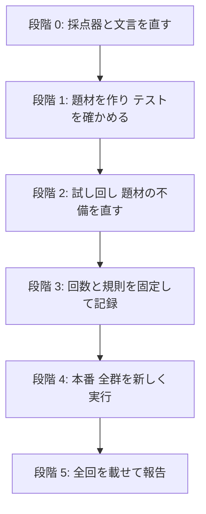

# isdd の評価の見直し: 測れていない範囲と、必要な評価

作成: 2026-11-23。対象: `SUMMARY.md` にまとめた計測 1〜12（2026-11-05 から 11-23）。

この文書は、今の評価が isdd の価値を測れているかを見直した結果です。計測の結果そのものは `SUMMARY.md` にあります。

同じ日に Codex が評価方法をレビューしました（`CODEX-EVALUATION-REVIEW.md`）。取り込んだ内容と、それで変えた進め方は 8 章と 9 章にあります。4 章と 5 章の表は、取り込んだあとの内容に直してあります。

## 1. 結論

今の評価から「isdd は縮小してよい」とは言えません。題材と採点の作りが、isdd が要件定義と設計で決める項目の大半を、差が出ない形に固定していました。差が測れたのは「依頼に無い文言と業務のきまりを聞く」「決めたことを残す」の 2 点だけで、「一文で足りる」が言えるのもその 2 点に限られます。

## 2. 今の評価で差が出ない理由

| 原因 | 確かめた事実 | 測れなくなったもの |
|---|---|---|
| 依頼文に答えが書いてある | `bizrules` の依頼文に、業務の問題（Excel 台帳、問い合わせ 1 回 15 分）、利用人数 50 人、社内サーバー、無償、GUI のみが最初から書いてある | 業務の問題・課題、技術制約、非機能を聞き出す価値 |
| 契約が設計を決めている | `contract.md` が起動方法、URL、要素の id、Python 3.12 と SQLite、「外部のサービスを使わない」まで指定している | 技術選定、構成、インターフェース設計、運用設計 |
| 依頼者役が解決策を間違えない | 台帳は「聞かれたことに答える、案に従う、技術は任せる」。頼まれた機能は常に正しい | 課題と機能を結びつけ、要らない機能を削り、ずれた依頼を直す価値 |
| 作る評価の採点が機能のテストだけ | 備品管理の題材の隠しテストはブラウザ操作で文言と動きを見る。計算の API も機能のテスト。文書を読む評価（計測 5〜8、10）は別に行っている | 非機能、運用、障害時の動き、作りすぎ |
| 外部連携の題材が無い | `measure/` の題材を検索して 0 件 | 接続テスト、仕様との突き合わせ、連携ライブラリ、モックと実物の切り替え |
| 聞くことが同じ種類で独立している | 文言 20 項目、きまり 8 つは、1 回にまとめて聞けば済む | 問題 → 課題 → 機能のように、前の答えで次の問いが変わる聞き取り |

計測 5 の「依頼文 114 行を残すだけで 64.0 点」も、依頼文に理由が書いてあったからです。理由が聞き取りでしか出てこない題材なら、依頼文を残す方式は「なぜ」に答えられません。

## 3. isdd が決める項目ごとの、今の評価の届き方

| isdd が決める項目 | 今の評価 | 状態 |
|---|---|---|
| 業務の問題、業務課題、見込み効果（要件 2 章） | 計測 5 の「なぜ」の質問だけ。作るときの価値は見ていない | ほぼ未測定 |
| 機能を課題に結びつけ、結びつかない機能を削る（要件 3 章） | なし | 未測定 |
| 技術制約（要件 1-1） | 依頼文に記載済み | 未測定 |
| 依頼に無く自分で決めた項目（要件 1-2） | 計測 2・3 で「聞けたか」だけ。未確認の決め事を示す価値は見ていない | 一部 |
| 業務ルール（要件 3-2） | 計測 3 | この題材と指標では測定済み |
| 外部連携（要件 3-3、設計 4-1、8 章） | なし | 未測定 |
| データの保持、同時更新、状態遷移（要件 4 章、設計 3 章） | なし | 未測定 |
| 非機能、運用（要件 5・6 章、設計 9・10 章） | 決まった条件（50 画面で 3 秒以内、権限）を満たすかは、備品管理の題材の隠しテストで測っている。必要な条件を聞き出して設計する価値は見ていない | 一部 |
| 技術選定（設計 1 章） | 契約で固定 | 未測定 |
| クラスの責務、依存の規則（設計 5・7 章） | 計測 8・9 で 60 機能の変更漏れだけ。構造の崩れは見ていない | 一部 |
| 対応表と追跡（未実装と作りすぎの検出） | スキルの eval だけ。バイブコーディングとの比較は無い | 未測定 |
| 決め事を残して読む | 計測 4・5・6・10 | この題材と指標では測定済み |

## 4. 必要な評価

### 要件定義の価値

| 番号 | 評価 | 題材の作り | 採点 |
|---|---|---|---|
| A1 | 課題とずれた依頼を直せるか | 依頼は「〜の機能を作って」だけ。依頼者役は本当の問題を持ち、聞かれれば話す。依頼どおりに作っても問題は解決しない | 業務の問題が解決したかを確かめるシナリオのテスト |
| A2 | 作りすぎを防げるか | 依頼に、課題に結びつかない機能を混ぜる。「無いと何が困るか」と聞かれた依頼者役は「困らない」と答える | 業務シナリオの達成を必須とし、不要と決めた機能の実装の有無、必要な機能の欠落、費用を別々に報告する。行数は参考値 |
| A3 | 非機能・運用・データを聞けるか | 台帳に同時利用、保持期間、監査の記録、既存 Excel からの移行を持たせ、依頼文には手がかりだけ置く | 同時更新のテスト、件数を入れた応答時間、移行の成否、記録の有無 |
| A4 | 技術制約を聞けるか | 依頼者役が配備先と禁止技術を持つ | 採点環境で起動するか、禁止技術を使っていないか |
| A5 | あとの依頼が業務課題と矛盾したら指摘できるか | 変更を重ねる題材に、最初の課題と矛盾する依頼を入れる | 指摘したか、黙って作ったか |

### 設計の価値

| 番号 | 評価 | 題材の作り | 採点 |
|---|---|---|---|
| B1 | 外部連携 | 手元で立てる模擬の外部システム。ページ分割、回数制限、認証の失効、説明書と実物の食い違いを仕込む | 実物相当での隠しテスト、障害を起こしたときの動き、連携先の仕様を変えたあとの直しの費用 |
| B2 | 技術選定 | 保守切れやライセンス違反の候補が選ばれやすい条件にする | 選んだ依存の保守状況、ライセンス、配備先で動くか |
| B3 | データの整合 | 同時更新と、途中で失敗する複数操作を含む業務 | 並行リクエストと障害注入のテスト |
| B4 | 構造の持ち | 変更を 10〜30 回重ねる | 重複実装の数、依存の向きの違反数、1 回の変更の行数と費用の推移 |
| B5 | 未実装と作りすぎの検出 | 要件の多い題材で「完了」と報告させる | 完了と言ったのに未実装の要件数、要件に無いコードの量 |

A1・A2 と B1 は、isdd だけが手順を持つ部分です。A3 は一文つきでも聞ける可能性があり、isdd の上乗せが出るかどうか自体が知りたい点です。

## 5. 測り方の直し

| 直すこと | 理由 |
|---|---|
| 依頼文から業務の問題と制約を外し、依頼者役の台帳に移す | 聞き出す価値を測るため |
| 契約を起動方法とポートまで減らし、採点を業務シナリオ・非機能・障害時の結果に寄せる | 契約が設計を決めると、設計の差が出ないため |
| 依頼者役に、解決策を間違える、理由を聞かれて初めて本当の問題を話す、という性格を持たせる | 今の依頼者役は頼む機能が常に正しい |
| 質問は回数ではなく、その質問で防げた手戻りで数える | 今は質問が費用としてしか現れない |
| 各評価はまずバイブコーディングと一文つきだけで試す。この試し回しは題材とテストの不備を直すための探索で、本番の比較には数えない | 対照群の結果で題材を選ぶと、対照群がたまたま低かった題材だけが残り、isdd に有利な差が見えやすくなる（9 章） |
| 結論に「測っていない範囲」を並べて書く | 測った 2 点の結果が、全体の結論として読まれたため |

## 6. 外部の研究との照合

検索結果の要約で確かめた範囲で、論文の本文は読んでいません。

- 曖昧な依頼への質問を測る評価（Ambig-SWE、ClarEval、ICAE-Bench）はありますが、どれも「足りない前提を聞けたか」と機能の出来を見るもので、計測 2・3 と同じ範囲です。業務課題との整合、非機能、外部連携を測る既存の評価は見つかりませんでした。題材は自作になります。
- ICAE-Bench の著者は、難所は質問することより、聞いた要件を保って実装に反映することだと述べています。計測 4 の結果と合います。
- 仕様駆動開発の調査では、実装の細部まで書いた仕様は古くなりやすい（Agarwal ら）、仕様の成果物があっても不具合は減らなかった（Hill、ESEM 2026）という報告があります。

出典:

- [Ambig-SWE: Interactive Agents to Overcome Underspecificity in Software Engineering](https://arxiv.org/abs/2502.13069v3)
- [ClarEval](https://arxiv.org/html/2603.00187)
- [ICAE-Bench: Evaluating Coding Agents as Interactive Project Builders](https://huggingface.co/papers/2607.21217.md)
- [Spec-Driven Development as Prescribed and as Practiced](https://arxiv.org/pdf/2608.25202)
- [Hill, ESEM 2026](https://drops.dagstuhl.de/storage/00lipics/lipics-vol394-esem2026/LIPIcs.ESEM.2026.84/LIPIcs.ESEM.2026.84.pdf)

## 7. 決めたこと（2026-11-23）

| 項目 | 決定 |
|---|---|
| 最初に作る題材 | 課題とずれた依頼と作りすぎ（A1・A2）を 1 つの題材で作る。次に外部連携（B1） |
| 外部連携の連携先 | 手元で立てる模擬の外部システム（HTTP の API）に癖を仕込む |
| 「isdd を軽くできる」という結論 | 新しい評価の結果が出るまで保留。`SUMMARY.md` に測っていない範囲の注記を置く |
| 本番の比較の回数 | バイブコーディング 6 回、一文つき 6 回、isdd 3 回。結果を見る前に固定する。isdd と一文つきの差が主題になる題材だけ、3 群とも 6 回を事前に選ぶ |
| 採点器と文言の直し | 題材づくりの前に両方やる（9 章の段階 0） |
| AI の採点を人が抜き取りで確かめるか | やらない。限界として「採点は AI で、人の確認はしていない」と書く。記事でこの数字を主な根拠に使うと決めたときにやる |

## 8. Codex のレビューの取り込み（2026-11-23）

Codex のレビュー（`CODEX-EVALUATION-REVIEW.md`）の 7 件を、コードと既存の結果で確かめました。

| 番号 | Codex の指摘 | 確かめた事実 | 判定 |
|---|---|---|---|
| 1 | 採点できなかった結果が点や退行に混ざりうる | コードは指摘どおり（終了コードを記録しない、テスト名だけがキー、XML が無いと 0 件、消えたテストは退行に数えない、採点者の応答が壊れると 0 点）。既存の結果では起きていない | 取り込む。対象は今後の採点器の直しで、既存の数字の訂正は不要 |
| 2 | 結論が注記より強い | `SUMMARY.md` の 2 章「省ける所が多くあります」、6 章「出来は同じ」「効き目の芯」が残る。計測 3 の isdd は 2 回、計測 4 の isdd と数文つきは 1 回ずつ | 取り込む |
| 3 | 対照群の結果だけで題材を選ぶと偏る | 「両方落ちる題材だけ isdd を回す」は、対照群がたまたま低かった題材を選ぶことになる | 取り込む。先に安く回すことは残し、探索として扱う |
| 4 | 試行数と統計の解釈 | 0.7% は、アプリ 1 本を単位にした平均の差の並べ替え検定（12 回対 3 回、p=0.0066）で、単位と区切りの懸念は当たらない。「偶然で出る確率」という言い回しは不正確。対照群の 9 回追加は、3 回の結果（p=0.30）を見たあとに決めた | 一部取り込む。言い回しの直しと、回数と止める条件の事前の固定 |
| 5 | 作りすぎを行数と機能数で測ると価値とずれる | `score.py` の作りすぎは行数と公開関数の数だけ。必要な機能を省いても減る | 取り込む |
| 6 | 割り当て・手順の実施・完了を分ける | `run.py` の `valid` は「スキルを呼んだ、または文書がある」。変更の段では、前の段の文書があるだけで真になる | 取り込む |
| 7 | AI の採点の一致は正しさを保証しない | 同じモデルの 3 回の中央値 | 一部取り込む。新しい題材は固定テストで採点する。人による抜き取りはやらない（7 章） |

既存の結果で確かめたこと:

| 確かめたこと | 結果 |
|---|---|
| 隠しテストの名前の重複（4 題材） | 0 件 |
| 段ごとの採点結果 223 件のうち、テスト 0 件や採点エラーのもの | 0 件 |
| 仕様の質問の採点者の応答 144 件のうち、32 問がそろっていないもの | 0 件 |
| 比較記事の「4 件以下・5 件以上」 | 0.7% は平均の差の検定の値で、この区切りから出した値ではない。記事では区切りの文の直後に置かれ、区切りから計算したように読める |

確かめていないのは、文書を読むほかの評価（不具合の判定など）の採点者の応答と、期待件数との厳密な照合です。

取り込まなかったこと:

| Codex の提案 | 扱い | 理由 |
|---|---|---|
| 既存の結果への採点検査の適用 | 上の確認で足りるとする | 重複・0 件・応答欠けはどれも 0 件だった |
| 比較の単位をアプリ 1 本にする | 対応済み | 0.7% の検定はすでにその単位 |
| 条件を伏せた答えを人が採点する | 新しい題材では不要にする | 固定テストで採点できる題材にするため |

## 9. 進め方

| 段階 | やること |
|---|---|
| 0 | 採点器の直し。テストをファイル名込みで記録し、期待件数との差、終了状態、XML の欠落を「未採点」として分ける。採点者の応答は全項目を検査し、3 つそろわなければ点を確定しない。実行器は、割り当て・スキルが見えたか・呼んだか・文書を更新したか・完了・採点できたかを別々に記録する。単体テストで確かめる |
| 0 | `SUMMARY.md` とこの文書の断定を「この題材・指標・回数では差が見つからなかった」にそろえ、数字に回数を添える。0.7% の言い回しを直す。計測 9 は isdd を回していないことを結論にも添える |
| 1 | 題材の台帳に、本当の業務の問題、必要な成果、課題に不要な機能の一覧を先に書く。テストは、正しい実装・依頼どおりの実装・作りすぎた実装の 3 つで確かめる |
| 2 | バイブコーディングと一文つきで試す。目的は題材とテストの不備の直しで、結果は本番に数えない。直した内容を残す |
| 3 | 主な指標、各群の回数、足すときの条件、除外の規則を、本番の前に題材のフォルダに書いてコミットする |
| 4 | 全群を新しく実行する。試し回しで一文つきが満点でも isdd を回す |
| 5 | 割り当てた回をすべて載せる。未完了と環境の障害は理由別に出す。手順を実施できた回だけの集計は補助として併記する。作らなかった題材と理由も書く |

### 段階 0 の実施（2026-11-23）

| やったこと | 中身 |
|---|---|
| 採点の共通部品 `measure/scoring.py` | 回すはずのテストを `pytest --collect-only` で数え、結果との差、終了コード、XML の欠落、名前の重なりを「未採点」として不合格と分ける。アプリが起動せずテストが落ちるのは不合格のまま |
| 題材ごとの採点スクリプト | `score.py`、`bizrules`、`longrun`、`bigapp`、`ripple` を共通部品に載せ替えた |
| 実行器と集計 | `run.py`・`stage.py`・`rescore.py`・`report.py` が未採点を「未採点」と出し、前の段で合格したテストが結果から消えたものを、退行と分けて「未実行」に出す |
| 手順の実施状況 | `run.py` が段ごとに、割り当て、スキルが見えたか、呼んだか、その段で文書を更新したか、完了、採点できたかを `conduct` に残す。モデル、依頼者役、上限、isdd の版は `conditions` に残す |
| AI の採点 | `docval/qa.py` と `docval/t23.py` が、形の壊れた応答を 0 点として数えずに捨てて聞き直し、3 件そろわなければ点を確定しない。答えのファイルを作れなかった回は採点しない |
| 単体テスト | `measure/tests/test_scoring.py`（28 件）。モデルもブラウザも動かさない |
| 実物での確認 | 既存の成果物 1 本を採点し直し、記録済みの点（11 件中 4 件）と一致した。pytest の無い Python を渡すと「未採点」になった |
| 文言 | `SUMMARY.md` の 2 章・4 章・6 章の断定を「この題材と回数では差が見つからなかった」にそろえ、回数を添えた。0.7% の説明を直した |

載せ替えていない採点器: `scicalc`、`swedev`、`featurebench`、`webgen`（今後の評価では使わない題材）。

実物で確かめていないもの: `run.py` の `conduct` と `conditions` の記録、`docval` の聞き直し。どちらもモデルを動かさないと通らない経路で、次に実行するときの最初の 1 回で中身を確かめる。

## 10. Codex の 2 回目のレビューの取り込み（2026-11-23）

Codex が isdd 全体の価値と評価方法をもう一度レビューしました（`CODEX-ISDD-VALUE-AND-EVALUATION-REVIEW-2026-11-23.md`）。主な指摘をコードと保存済みの結果で確かめました。

| Codex の指摘 | 確かめた事実 | 判定 |
|---|---|---|
| 受け入れ判定が誤って合格を出す（6.1） | `acceptance_checker.py` は、1 つの `DS-TS` に結んだ行をまとめ、「合格が 1 件以上、失敗なし」で合格にする。未実行やスキップが混ざっても合格。鮮度は全結果ファイルの最新の日時 1 つで見る | 取り込む。isdd 本体の不具合 |
| データ・運用の要件が受け入れ判定の対象外（6.2） | 対象は `RQ-FT`・`RQ-UI`・`RQ-EX` だけ | 取り込む |
| 「他の設計で実現済み」の除外で検証も外れる（6.3） | `requirement-exclusion.md` の 5 番 | 取り込む |
| 規則と評価定義の矛盾 2 件（6.9） | `evals.json` の 4 番、`build-implement.md` の 24 行目と 35 行目 | 取り込む |
| 採点の共通部品が短いテスト名で照合する（5.9） | 段階 0 の実装がそのとおり | 取り込む |
| 集計ファイルの更新漏れ（5.7） | 計測 2 の `summary.json` 8 件（バイブコーディング 2、isdd 3、AI-DLC 3）がテストを直す前の点のまま。`SUMMARY.md` の数字は直したあとの点で、訂正は不要 | 取り込む |
| 文書評価の条件差（5.2） | 材料のファイル数は 14・91・33・31。条件ごとに実装もテストも規則ファイルも違う | 取り込む。「成果物一式の比較」と書き、同じコードで 4 条件のやり直しをする |
| 依頼者役が失敗すると「任せます」と返す（5.5） | `agentrun.py` | 取り込む |
| 費用と時間が 20〜30 倍（5.8） | 時間は 8〜14 倍。依頼者役の費用は集計に入っていない | 取り込む |
| 性能・権限を「未測定」と書きすぎ（5.4） | `test_performance.py` と `test_access.py` がある。3 章の「非機能、運用」は「固定した条件を満たすかは測定済み。必要な条件を聞き出して設計する価値は未測定」が正しい | 取り込む |
| 隠しテストを読める状態（5.9） | 実行器は Bash と Read を許し、隔離の設定は無い | 実行後にログを検索し、隠しテスト・台帳・他の回の成果物に触れた回を無効にする |
| 根拠の管理、状態管理、逆解析、保証範囲の表示（6.4〜6.8） | 未確認 | BACKLOG に置く |

決めたこと:

| 項目 | 決定 |
|---|---|
| 受け入れ判定の誤合格 | 本番の比較の前に直し、版を上げて固定する。矛盾 2 件も直す |
| データ・運用の要件の検証、除外で検証が外れる規則 | 同じ版で一緒に直す |
| 隠しテストと台帳を読まれない対策 | 実行後のログの検索 |
| 文書評価のやり直し（同じコードで、要件定義書あり・なし × 設計書あり・なし） | 題材づくりと並行でやる |
