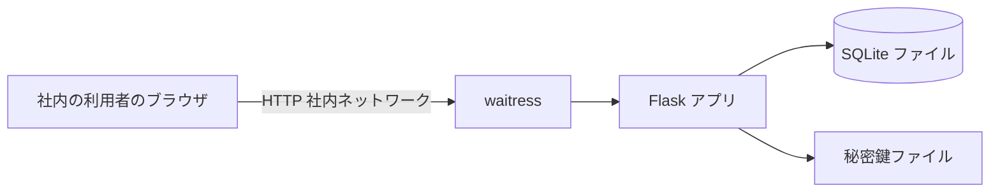
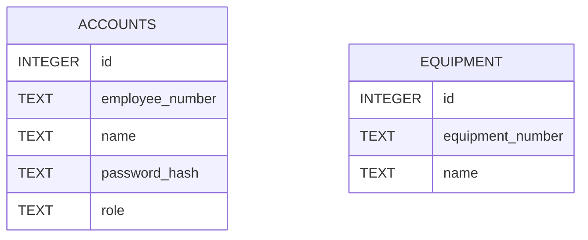
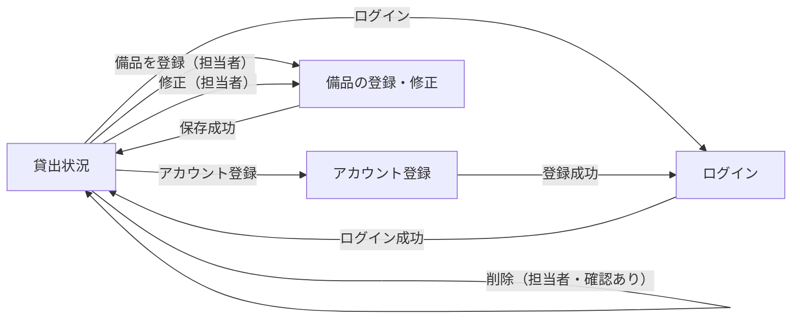
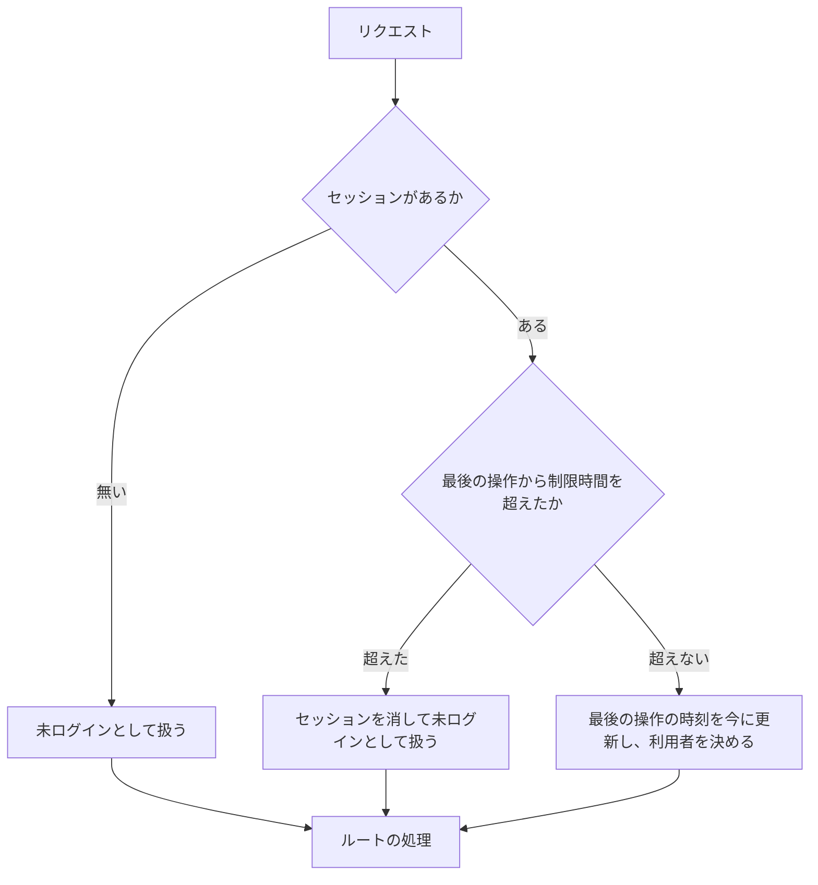

# 詳細設計書: 備品台帳と貸出状況の閲覧（段 1）

入力要件書: `docs/requirements.md`

## 1. 言語・フレームワーク・アーキテクチャの選定

### 判定日時

2026-11-04（判定と承認は依頼者の固定回答 ANSWERS.md により与えられたものとして進めた）

### 技術制約の要約（要件定義書 1-1）

無償のものだけ。社内の Linux サーバーで `bash run.sh` により直接起動する（コンテナ無し）。Python 3.12 と SQLite で足りる。既存コード無し。利用者 50 人、備品数百件、アカウント 50 件まで。操作から表示まで 3 秒以内。

### 判断軸ごとの該当有無と理由

| 判断軸 | 該当 | 理由 |
|---|---|---|
| 既存資産との整合 | 無し | 新規開発 |
| チームの技術 | 無し（Python 3.12 と SQLite で足りる） | 依頼者の指定 |
| 配備先 | 有り | 社内 Linux、コンテナ無しで起動すること。Python の実行環境とサーバープロセスだけで動く構成にする |
| 認証と認可の境界 | 有り | パスワード認証（SSO 無し）。ロールは 3 つ（担当者・社員・未ログイン）。ボタンの出し分けと要求の拒否の両方。認証は 1 箇所に集める |
| 画面の規模 | 有り（小） | 画面 4 種（貸出状況、アカウント登録、ログイン、備品の登録・修正）。画面遷移は単純 |
| データの規模と構造 | 有り | 備品数百件、アカウント 50 件まで。テーブル間の参照は無い。複数の担当者が同時に更新するため、トランザクションが要る |
| 外部連携 | 無し | 外部連携は無い |
| ライセンスとコスト | 有り | 無償のものだけ |
| 保守性 | 有り | 保守が続いている無償のライブラリを選ぶ |

### 候補の比較

| 候補 | 判断軸ごとの評価 | 出典 URL | 確認日 |
|---|---|---|---|
| Flask 3.1.3 | 軽量で、サーバーで HTML を描画するフォーム画面に向く。BSD-3-Clause。Python 3.9 以上に対応と記載。画面が 4 種で小さいため、規模に見合う | https://pypi.org/project/Flask/ | 2026-11-04 |
| Django 6.1.3 | 全部入りの枠組み（認証・管理画面・ORM）。BSD-3-Clause。Python 3.12 以上が必要と記載。今回の要件（独自の社員番号認証、3 ロール）では認証の標準機能をほぼ作り替えることになり、規模に対して部品が過剰 | https://pypi.org/project/Django/ | 2026-11-04 |
| waitress 3.0.2（Flask を動かす WSGI サーバー） | 純粋な Python の WSGI サーバー。ZPL 2.1（無償）。Python 3.9 以上に対応と記載。コンテナ無しで社内サーバーに置ける | https://pypi.org/project/waitress/ | 2026-11-04 |
| SQLite（標準ライブラリ sqlite3） | Python 3.12 に標準で入る。ファイル 1 つで動く。IMMEDIATE のトランザクションが使える。SQLite 3.7.15 以上が必要と記載 | https://docs.python.org/3.12/library/sqlite3.html | 2026-11-04 |

### 最終選定結果

| 項目 | 選定 |
|---|---|
| 言語 | Python 3.12 |
| フレームワーク | Flask 3.1.3（HTML をサーバーで描画する。セッションは署名付き Cookie） |
| WSGI サーバー | waitress 3.0.2（`run.sh` が起動する） |
| DB | SQLite（標準ライブラリ sqlite3。ファイル DATA_DIR/app.db） |
| パスワードのハッシュ | Werkzeug の `generate_password_hash` と `check_password_hash`（Flask に含まれる。BSD-3-Clause） |
| 実行形態 | サーバー（`bash run.sh` で起動。コンテナ無し） |

選定理由: 要件の画面は 4 種で、業務ロジックは単純。HTML フォームの描画と、社員番号とパスワードの自前認証を、少ない部品で作れる Flask が規模に合う。Django は部品が過剰になる。DB は複数の担当者の同時更新で記録を失わないために要るため SQLite を選ぶ（ファイルが 1 つで、トランザクションが使え、外部サーバーが要らない）。

### 承認の記録

依頼者の固定回答（ANSWERS.md の「技術選定」: 推奨の案でよい）により承認（2026-11-04）。

### フロントエンドとバックエンドを分ける構成か

分けない。Flask が HTML を描画する 1 つのサーバーにする。静的ファイルは base.html に埋め込み、別の配信は作らない。

## 2. システム構成

### コンポーネント一覧

| コンポーネント | 役割 | 技術 |
|---|---|---|
| Web アプリ | 画面の描画、入力の検査、ログインの状態の管理、備品とアカウントの処理 | Flask 3.1.3 |
| WSGI サーバー | HTTP の受け付け（社内ネットワークの待ち受け） | waitress 3.0.2 |
| データベース | アカウントと備品の記録 | SQLite（DATA_DIR/app.db） |
| 起動スクリプト | 依存の導入（setup.sh）と起動（run.sh） | bash |

### システム全体構成図



### 各コンポーネントの役割

- Flask アプリ: 4 画面の描画と、入力の受け付け。ログインの状態（セッション）の判定と、担当者の権限の判定。業務の処理（アカウント登録、認証、備品の登録・修正・削除、一覧）。
- waitress: 接続を受け、Flask アプリに渡す。スレッド数を固定する。
- SQLite: 2 つのテーブル（アカウント、備品）を持つ。
- 秘密鍵ファイル: セッション Cookie の署名に使う。初回起動時に作り、以後は同じものを使う。

### コンポーネント間インターフェースとデータフロー

- ブラウザと Flask: HTML フォームの POST と GET。Cookie でセッションを運ぶ。
- Flask と SQLite: 同期的な SQL。1 リクエストごとに接続を開き、終わったら閉じる。

### ネットワーク構成図

社内サーバーの 1 つの待ち受けポート（環境変数 PORT）を社内ネットワークからだけ開く。構成図は上の全体構成図に含む。

## 3. データ設計

### 3-1. データモデル

DB を使う（理由: 複数の担当者が同時に更新しても記録が失われないようにするため。SQLite のトランザクションで守る）。第 1 章で選定した SQLite を使う。

テーブル `accounts`:

| カラム | 型 | 制約 | 対応する要件 |
|---|---|---|---|
| id | INTEGER | 主キー | 内部の識別子 |
| employee_number | TEXT | NOT NULL、UNIQUE、6 桁の数字（検査はアプリ側） | 社員番号 |
| name | TEXT | NOT NULL、1〜30 文字（検査はアプリ側） | 名前 |
| password_hash | TEXT | NOT NULL | パスワードのハッシュ |
| role | TEXT | NOT NULL、CHECK（'manager' か 'member'） | 役割 |

テーブル `equipment`:

| カラム | 型 | 制約 | 対応する要件 |
|---|---|---|---|
| id | INTEGER | 主キー | 内部の識別子 |
| equipment_number | TEXT | NOT NULL、UNIQUE（大文字と小文字を区別する） | 管理番号 |
| name | TEXT | NOT NULL | 備品名 |

リレーション図: テーブル間の参照は無い（外部キーは無い）。



テーブルごとの設計要素: `accounts` は DS-SC-ACCOUNT、`equipment` は DS-SC-EQUIPMENT。

### 3-2. トランザクションと排他制御

- アカウント登録: 1 つのトランザクションで、アカウント数の確認、社員番号の重複の確認、役割の決定、挿入を行う。SQLite の書き込みトランザクションを先に開く方式（BEGIN IMMEDIATE）で開始し、同時の登録でも 1 件だけが担当者になるようにする。途中でエラーになったら全体を取り消す。
- 社員番号の重複: トランザクション内で確認し、UNIQUE 制約を最後の守りにする（制約違反が出たら重複のエラーとして扱う）。
- 備品の登録・修正: 管理番号の重複の確認は UNIQUE 制約で行う。制約違反は「この管理番号は既に使われています」として扱う。修正の重複確認は自分自身を除く。
- 備品の削除: 1 件の行を削除する 1 つの操作。トランザクションは 1 件で閉じる。
- 排他制御の方式: 悲観的（書き込みの開始時に SQLite の書き込みロックを取る）。理由: 件数が少なく、同時の更新は少ないため、競合時の再試行の仕組みを作るより単純なため。
- 同時更新の競合（同じ備品を 2 人が修正）: 後から保存した内容が残る。これは要件に無いため許容する（備品の修正は担当者だけが行い、件数も少ないため）。

### 3-3. 状態遷移

状態を持つエンティティは無い。備品の空き・貸出中の状態は、貸出の記録が無いため持たない（一覧ではすべて「空き」として表示する）。

## 4. アーキテクチャ設計

### 4-1. 外部設計

利用者向けインターフェース（`DS-IF-*`）:

- 貸出状況（`DS-IF-LOAN-STATUS-SCREEN`）: パス `/`。備品の表（管理番号、備品名、状態、借りている社員の名前、貸出日）。ログイン状態に応じて表示が変わる。
- アカウント登録（`DS-IF-ACCOUNT-REGISTER-SCREEN`）: パス `/accounts/register/`。入力欄は社員番号、名前、パスワード。ボタン「登録」。
- ログイン（`DS-IF-LOGIN-SCREEN`）: パス `/login/`。入力欄は社員番号、パスワード。ボタン「ログイン」。
- 備品の登録・修正（`DS-IF-EQUIPMENT-FORM-SCREEN`）: 登録はパス `/equipment/new/`、修正はパス `/equipment/<管理番号>/edit/`。入力欄は管理番号、備品名。ボタン「保存」。

画面の要素の id と文言は契約（contract.md）のとおりにする（入力欄の id は `id_employee_number`、`id_name`、`id_password`、`id_equipment_number`。ボタン「登録」「ログイン」「ログアウト」「保存」「修正」「削除」。リンク「ログイン」「アカウント登録」「備品を登録」）。

画面遷移図:



インターフェース仕様:

| 画面 / 操作 | 入力とバリデーション | 出力 | エラー仕様 |
|---|---|---|---|
| 貸出状況（GET `/`） | なし | 全備品を管理番号の昇順に並べた表。0 件なら「備品は登録されていません」 | なし |
| アカウント登録（POST） | 社員番号: 6 桁の数字、必須、重複不可。名前: 必須、30 文字以内。パスワード: 8 文字以上 | 成功: ログイン画面へ移動し「登録しました。ログインしてください」 | 各入力欄の `.field-error`。入力値は社員番号と名前を残す。パスワードは再表示しない |
| ログイン（POST） | 社員番号とパスワードのどちらも必須（空なら失敗として扱う） | 成功: 貸出状況へ移動。ログイン中の名前を `.current-user` に出す | 失敗: `.error` に「社員番号またはパスワードが違います」。社員番号を残す |
| 備品の登録（POST `/equipment/new/`） | 管理番号: 半角の英数字とハイフン、20 文字以内、必須、重複不可。備品名: 必須、50 文字以内 | 成功: 貸出状況へ移動し「備品を登録しました」 | 各入力欄の `.field-error`。入力値は残す。担当者以外は貸出状況へ戻し `.message` に「この操作は担当者だけが行えます」 |
| 備品の修正（POST `/equipment/<管理番号>/edit/`） | 登録と同じ。重複の確認は自分を除く | 成功: 貸出状況へ移動し「備品を保存しました」 | 登録と同じ。対象が無いときは貸出状況へ戻し「備品が見つかりません」 |
| 備品の削除（POST `/equipment/<管理番号>/delete/`） | 無し（画面では確認ダイアログで「はい」のときだけ送る） | 成功: 貸出状況へ戻し「備品を削除しました」 | 担当者以外は貸出状況へ戻し `.message` に「この操作は担当者だけが行えます」。未ログインはログイン画面へ。対象が無いときは「備品が見つかりません」 |
| ログアウト（POST `/logout/`） | 無し | 貸出状況へ移動 | 無し |

外部システム連携: 無し。

### 4-2. 内部設計

処理フロー（リクエストごと）:



処理の役割:

- 設定の読み込み: 環境変数（PORT、DATA_DIR、SESSION_IDLE_TIMEOUT_SECONDS）を読み、既定値を当てる。不正な値なら起動を止めて理由を標準エラーに出す。
- DB の初期化: 起動時に 2 つのテーブルを作る（無ければ）。
- 認証: 社員番号で行を引き、パスワードのハッシュを照合する。
- 備品の処理: 一覧、登録、修正、削除。
- 権限の判定: 担当者かどうかを確かめる。担当者でなければ処理せずに拒否する。

バッチ設計: 無し。

## 5. クラス設計

クラスは作らない。モジュール単位の関数で構成する（対応表の粒度は関数）。各モジュールの責務は次の 1 文で書ける。

| モジュール | 責務（1 文） |
|---|---|
| 設定 | 環境変数を読み、既定値を当てて設定値を返す |
| DB | SQLite の接続とテーブルの初期化を行う |
| 検査 | 入力値の形式・桁数・重複の検査結果を返す |
| アカウント | アカウントの登録と、社員番号とパスワードの照合を行う |
| 備品 | 備品の一覧・登録・修正・削除を行う |
| 認証 | セッションでログイン・ログアウトと、利用者の判定と権限の確認を行う |
| 画面（ルート） | HTTP の要求を受け、業務の関数を呼び、画面を返す |

関数の一覧は第 7 章のファイル一覧の「実現する設計 ID」に書く。

主要な関数（責務）:

- 設定: 設定値を読み込む関数。
- DB: 接続を開く関数、テーブルを作る関数。
- 検査: アカウント入力の検査関数、備品入力の検査関数（どちらも、検査で見つかったエラーを入力欄ごとに返す）。
- アカウント: 登録関数（担当者か社員かを決めて保存する）、照合関数。
- 備品: 一覧関数（管理番号の昇順）、取得関数、登録関数、修正関数（自分を除く重複の確認）、削除関数。
- 認証: ログイン関数（セッションに利用者を入れる）、ログアウト関数（セッションを消す）、現在の利用者を読む関数（制限時間を判定し、最後の操作を更新する）、担当者の確認関数（担当者でなければ拒否の結果を返す）。
- 画面: 各画面の表示と送信の関数。

メッセージフロー: 画面の関数 → 認証（担当者の確認） → 検査 → 備品またはアカウントの関数 → DB。認証の結果が拒否なら、業務の関数は呼ばない。

## 6. エラーハンドリングとセキュリティ設計

### エラーハンドリング

| 想定エラー | 利用者への見え方 | 処理 |
|---|---|---|
| 入力の形式・桁数・必須の違反 | 入力欄の `.field-error` | 保存せず、入力値を残す |
| 社員番号・管理番号の重複 | 入力欄の `.field-error` | 保存せず、入力値を残す |
| ログインの失敗（社員番号またはパスワードの違い） | `.error`（どちらが違うかは示さない） | 保存せず、社員番号を残す |
| 担当者以外の操作 | 貸出状況へ戻し `.message` | 処理せず、記録を変えない |
| 未ログインの操作 | ログイン画面へ移動 | 処理せず、記録を変えない |
| 制限時間を超えた操作 | ログイン画面へ移動し、「一定時間操作がなかったため、ログアウトしました」を知らせる | セッションを消す |
| 対象の備品が無い（修正・削除） | 貸出状況へ戻し `.message` | 処理せず終了 |
| DB の接続失敗など想定外 | 標準の 500 の応答 | 処理を中止する（ログは不要。要件の運用要件のとおり） |

### 認証

方式: 社員番号とパスワード。SSO は無い。パスワードは Werkzeug のハッシュで保存する（一方向）。ログインのセッションは署名付き Cookie（HttpOnly、SameSite=Lax）で持つ。Cookie には利用者の ID と最後の操作時刻を入れる。

### 認可

ロールと操作の権限表:

| 操作 | 未ログイン | 社員 | 担当者 |
|---|---|---|---|
| 貸出状況の閲覧 | 可 | 可 | 可 |
| アカウント登録 | 可 | 可 | 可 |
| ログイン・ログアウト | 可 | 可 | 可 |
| 備品の登録・修正・削除（画面と要求） | ログイン画面へ送る | 拒否（貸出状況へ戻し、知らせる） | 可 |

制御の単位は画面単位とボタン単位（担当者だけ表示）と、要求単位（受け付けない）。データ単位の制御は無い。

### 監査ログ

無し（運用要件で不要）。

### その他のセキュリティ対策

- 秘密鍵: 初回起動時に乱数で作り、DATA_DIR の内側に権限 0600 で保存する。Git 管理に含めない。
- 制限時間: 最後の操作から設定値（既定 1800 秒）を超えたらログアウトとして扱う。
- 社内ネットワークからだけ開く: 本アプリは認証を持つが、アクセス経路は社内に限る（待ち受けは社内サーバーの 1 ポート。外部からの通行は止める運用とする）。
- パスワード: 画面に再表示しない。ログのに出さない。
- CSRF: SameSite=Lax の Cookie で、他サイトからの POST にはセッションを付けない方式にする。CSRF のトークンは作らない（社内利用・50 人のため）。

## 7. コード設計

### ディレクトリ構成

```
run.sh
setup.sh
requirements.txt
app/
  __init__.py
  __main__.py
  config.py
  db.py
  validation.py
  accounts.py
  equipment.py
  auth.py
  views.py
  templates/
    base.html
    loan_status.html
    account_register.html
    login.html
    equipment_form.html
tests/unit/
e2e/
```

### ファイル一覧

| ファイル | 役割 | 実現する設計 ID |
|---|---|---|
| `app/__init__.py` | Flask アプリの生成、DB の初期化、秘密鍵の準備、画面の登録 | `DS-MD-APP-FACTORY`, `DS-FN-CREATE-APP`, `DS-OP-SECRET-KEY` |
| `app/__main__.py` | 設定を読み、waitress でアプリを起動する | `DS-MD-SERVER`, `DS-OP-SERVER-THREADS` |
| `app/config.py` | 環境変数を読み、設定値を返す | `DS-MD-CONFIG`, `DS-FN-LOAD-CONFIG`, `DS-OP-ENV-CONFIG` |
| `app/db.py` | SQLite の接続とテーブルの初期化 | `DS-MD-DB`, `DS-FN-CONNECT-DB`, `DS-FN-INIT-SCHEMA` |
| `app/validation.py` | 入力値の検査（アカウント・備品） | `DS-MD-VALIDATION`, `DS-FN-VALIDATE-ACCOUNT-INPUT`, `DS-FN-VALIDATE-EQUIPMENT-INPUT` |
| `app/accounts.py` | アカウントの登録と照合 | `DS-MD-ACCOUNTS`, `DS-FN-REGISTER-ACCOUNT`, `DS-FN-AUTHENTICATE-ACCOUNT` |
| `app/equipment.py` | 備品の一覧・取得・登録・修正・削除 | `DS-MD-EQUIPMENT`, `DS-FN-LIST-EQUIPMENT`, `DS-FN-GET-EQUIPMENT`, `DS-FN-CREATE-EQUIPMENT`, `DS-FN-UPDATE-EQUIPMENT`, `DS-FN-DELETE-EQUIPMENT` |
| `app/auth.py` | セッションでのログイン・ログアウト、利用者の判定、担当者の確認 | `DS-MD-AUTH`, `DS-FN-LOGIN-USER`, `DS-FN-LOGOUT-USER`, `DS-FN-LOAD-CURRENT-USER`, `DS-FN-REQUIRE-MANAGER` |
| `app/views.py` | 画面の要求の受け付けと応答（4 画面の入口と、テンプレートの描画） | `DS-MD-VIEWS`, `DS-FN-SHOW-LOAN-STATUS`, `DS-FN-SUBMIT-ACCOUNT-REGISTER`, `DS-FN-SUBMIT-LOGIN`, `DS-FN-SUBMIT-LOGOUT`, `DS-FN-SHOW-EQUIPMENT-FORM`, `DS-FN-SUBMIT-EQUIPMENT-FORM`, `DS-FN-SUBMIT-EQUIPMENT-DELETE`, `DS-IF-LOAN-STATUS-SCREEN`, `DS-IF-ACCOUNT-REGISTER-SCREEN`, `DS-IF-LOGIN-SCREEN`, `DS-IF-EQUIPMENT-FORM-SCREEN` |

`DS-MD-*` を付けるのは `app/` 配下の Python のソースファイルだけ。HTML テンプレート（`app/templates/`）と起動スクリプト（`run.sh`、`setup.sh`）は、対応表チェッカーの読めない種類のファイルのため `DS-MD-*` を付けない。テンプレートの要素は `DS-IF-*`（画面の入口は `app/views.py` の関数）で、起動スクリプトの要素は `DS-OP-START` で受ける（`DS-OP-*` は対応表に載せなくてよいため）。`requirements.txt` は設定ファイルのため対象外。テストファイル（`tests/unit/`、`e2e/`）も `DS-MD-*` を付けない。

### 対応表の粒度

`function`（公開関数まで対応表に載せる）。理由: 関数が 20 件前後で、各関数が要件の 1 つに対応するため、関数の粒度で追える。

### 依存の規則

| 依存元（ファイル） | 依存してはいけない先（プロジェクト内のパスか外部モジュール名） | 理由 |
|---|---|---|
| `app/accounts.py` | `flask`、`app/views.py`、`app/auth.py` | 業務の関数を Web の枠組みから独立させる。パスワードのハッシュに `werkzeug.security` を使うため、`werkzeug` は禁止の対象にしない |
| `app/equipment.py` | `flask`、`werkzeug`、`app/views.py`、`app/auth.py` | 業務の関数を Web の枠組みから独立させる |
| `app/validation.py` | `flask`、`werkzeug`、`app/views.py`、`app/auth.py` | 業務の関数を Web の枠組みから独立させる |
| `app/db.py` | `flask`、`werkzeug`、`app/views.py`、`app/auth.py` | 業務の関数を Web の枠組みから独立させる |
| `app/config.py` | `flask`、`werkzeug`、`app/views.py`、`app/auth.py` | 業務の関数を Web の枠組みから独立させる |

依存の規則はファイル単位で書く（対応表チェッカーの依存チェックはディレクトリ単位の書き方のため、`scripts/isdd/dependencies.json` にファイル単位で書き写す）。

外部連携は無いため、外部 API のライブラリを業務ロジックから直接 import しない規則は適用しない。

### コーディング規約

- Python 3.12。型注釈を付ける。標準ライブラリと Flask、waitress、Werkzeug だけを使う。
- 関数は 1 つの責務にする。SQL は `app/db.py` と業務の関数の中だけに書く（画面の関数には書かない）。
- コメントは処理の説明だけにする。要件 ID と設計 ID はコードに書かない。

## 8. テスト設計

### 8-1. テストの種類と方針

- 単体テスト（`tests/unit/`）: 検査の関数、アカウントの登録と照合（一時 DB）、備品の一覧・登録・修正・削除（一時 DB）、設定の読み込み。実行コマンド: `.venv/bin/python -m unittest discover -s tests/unit`（仮想環境の Flask を使うため `.venv` の Python を使う）。
- 結合テスト: 単体テストの中で、DB と業務の関数を組み合わせて確かめる。結合テストの実行はこれに含める（同じ実行コマンド）。
- 総合テスト: E2E（8-2）で、実際のサーバーに対して画面の流れを確かめる。
- E2E テストの実行コマンド: `python3 scripts/isdd/unittest_junit.py -s e2e -o e2e/results/e2e.xml`（標準ライブラリだけの実行器で、JUnit XML を出す）。
- 非機能要件の検証: 応答時間（3 秒以内）を、備品 500 件の状態で一覧画面を開くテストで確かめる（`DS-TS-LIST-RESPONSE-TIME`）。利用人数 50 人は、サーバーのスレッド数（`DS-OP-SERVER-THREADS`）で実現する。同時 50 人の負荷試験は作らない（実現要素が設計にあるため）。

### 8-2. E2E テストのシナリオ

E2E は、実際に起動したサーバーに対して HTTP で要求を送り、返った HTML の要素（id、クラス、文言）を確かめる。ブラウザ自動化は使わない（画面の要素はサーバーの応答で確かめられ、ブラウザの導入が要らないため。ブラウザ上の確認ダイアログは、削除ボタンの要素に確認用の属性があることで確かめる）。

| DS-ID | 目的 | 前提条件 | 手順 | 期待結果 |
|---|---|---|---|---|
| `DS-TS-REGISTER-FIRST-ACCOUNT` | 最初のアカウントが担当者になる | DB が空 | アカウント登録の画面で登録し、ログインする | 登録の知らせが出る。ログイン後に名前と「備品を登録」が出る |
| `DS-TS-REGISTER-SECOND-ACCOUNT-AS-MEMBER` | 2 件目は社員になる | 1 件登録済み | 別のアカウントを登録してログインする | 「備品を登録」が出ない |
| `DS-TS-REGISTER-ACCOUNT-VALIDATION` | アカウント入力の検査と重複 | 1 件登録済み | 不正な社員番号、空の名前、31 文字の名前、7 文字のパスワードで登録し、既存の社員番号で登録する | 指定の文言が各入力欄の `.field-error` に出る。登録されない |
| `DS-TS-LOGIN-AND-LOGOUT` | ログインとログアウト | 1 件登録済み | ログインし、ログアウトする | ログイン中の名前が出る。ログアウト後にリンクが出る |
| `DS-TS-LOGIN-FAILURE-NO-HINT` | 失敗時に理由を示さない | 1 件登録済み | 違うパスワードと、存在しない社員番号でログインする | 両方とも同じ文言が `.error` に出る |
| `DS-TS-AUTO-LOGOUT-AFTER-IDLE` | 制限時間で自動ログアウト | 制限時間 2 秒のサーバー。1 件登録済み | ログインし、3 秒待ってから備品の登録画面を開く | ログイン画面へ移る |
| `DS-TS-MANAGER-REGISTER-EQUIPMENT` | 担当者が備品を登録する | 担当者でログイン | 備品を登録し、同じ管理番号で再登録する | 1 件目が一覧に出る。2 件目は管理番号の重複が出て登録されない |
| `DS-TS-EQUIPMENT-VALIDATION` | 備品入力の検査 | 担当者でログイン | 全角の管理番号、21 文字の管理番号、空の備品名、51 文字の備品名で保存する | 指定の文言が出て、登録されない |
| `DS-TS-MANAGER-EDIT-EQUIPMENT` | 担当者が備品を修正する | 担当者でログイン、備品 1 件 | 備品名を変えて保存し、管理番号を既存の別の番号に変えて保存する | 1 回目は一覧に反映される。2 回目は重複が出て変わらない |
| `DS-TS-MANAGER-DELETE-EQUIPMENT` | 担当者が備品を削除する（確認あり） | 担当者でログイン、備品 1 件 | 削除の要素が確認を出す属性を持つことを確かめ、削除を送って一覧を見る | 確認が「はい」のときだけ削除され、一覧から消える |
| `DS-TS-MEMBER-CANNOT-OPERATE-EQUIPMENT` | 社員の操作の要求が拒否される | 社員でログイン、備品 1 件 | 社員で備品の登録画面を開き、削除を直接送る | 貸出状況へ戻り、指定の知らせが出る。記録は変わらない。行のボタンが出ない |
| `DS-TS-GUEST-CANNOT-OPERATE-EQUIPMENT` | 未ログインの操作の要求が拒否される | 未ログイン、備品 1 件 | 備品の登録画面を開き、削除を直接送る | ログイン画面へ移る。記録は変わらない |
| `DS-TS-VIEW-LOAN-STATUS-AS-GUEST` | 未ログインで一覧を見られる | 備品 2 件 | 未ログインで貸出状況を開く | 管理番号の昇順に 2 行が出る。状態は「空き」。ボタンは無く、リンクが出る |
| `DS-TS-VIEW-EMPTY-LOAN-STATUS` | 0 件の表示 | 備品 0 件 | 未ログインで貸出状況を開く | 指定の文言が出る。行は無い |
| `DS-TS-ROLE-BUTTON-VISIBILITY` | 役割ごとのボタンの出し分け | 備品 1 件、社員と担当者のアカウント | 未ログイン、社員、担当者の順に貸出状況を開く | 役割ごとに、リンクとボタンの出方が仕様どおり |
| `DS-TS-LIST-RESPONSE-TIME` | 3 秒以内に表示する | 備品 500 件 | 貸出状況を開き、応答までの時間を測る | 応答が 3 秒以内 |

### 8-3. E2E の実行手段

Web の GUI だが、ブラウザ自動化は使わず、標準ライブラリの HTTP クライアントで実サーバーに対して確かめる（理由は 8-2 のとおり）。承認は依頼者の固定回答による。

### 8-4. E2E の実行コマンドと運用

- 実行コマンド: `python3 scripts/isdd/unittest_junit.py -s e2e -o e2e/results/e2e.xml`。結果は `e2e/results/e2e.xml` に出す（git 管理外）。
- テスト資産は `e2e/` に置く。E2E は一時ディレクトリに DATA_DIR を作り、空いたポートでサーバーを起動して終了時に止める。
- 外部連携は無いため、モックは作らない。
- 実装時・CI の必須ゴールは E2E の全件通過。テストが失敗したら修正と再実行を繰り返す。

## 9. 運用設計

### DS-OP-START: 起動方式

- 採用: サーバーとして `bash run.sh` で起動する（コンテナは使わない）。
- 初回: `bash setup.sh` で仮想環境（`.venv`）を作り、requirements.txt（flask、waitress）を導入する。採点の前に 1 回実行する。
- 起動: `bash run.sh`。環境変数 PORT で待ち受けポートを決める。
- 利用時間: 平日の日中に使い、夜間・休日は止めてよい。
- 社内ネットワーク: 待ち受けは社内サーバーのポートだけを社内ネットワークに開く（外部からの通行は止める）。

### DS-OP-ENV-CONFIG: 設定値・環境変数

| 名前 | 用途 | 既定値 | 必須か |
|---|---|---|---|
| PORT | 待ち受けポート | 8000 | 任意 |
| DATA_DIR | データの置き場（app.db と秘密鍵） | プロジェクトルート直下の `data` | 任意（無ければ作る） |
| SESSION_IDLE_TIMEOUT_SECONDS | 操作しないまま自動でログアウトするまでの秒数（正の整数） | 1800 | 任意 |

秘密情報の値は書かない（秘密鍵はファイルとして DATA_DIR に作る）。

### DS-OP-SECRET-KEY: 秘密鍵

初回起動時に、DATA_DIR に秘密鍵ファイルが無ければ作る（乱数 32 バイト、権限 0600）。あれば読む。

### DS-OP-SERVER-THREADS: サーバーのスレッド数

waitress のスレッド数を 8 にする（利用者 50 人の同時利用を、順番待ちで捌ける数）。

### DS-OP-FIRST-ACCOUNT-SETUP: 初期ユーザー

初期ユーザーは置かない。導入の手順として、社員に URL を知らせる前に、担当者が最初のアカウントを登録する。

### データ移行

既存の Excel の取り込みは作らない。担当者が画面から手で入力する。

### 可用性・バックアップ

可用性の要求は無い（平日の日中だけ使う）。バックアップは作らない（運用要件のとおり）。

## 10. ログ・監視・アラート・障害対応設計

- ログ: ログの設計は必須ではないため、ログの種類と内容の記述は行わない（運用要件のとおり）。
- 監視・アラート: 監視・アラートの設計は必須ではないため、監視・アラートの内容と対応方法の記述は行わない。
- 障害対応: 想定する障害は次のとおり。
  - DB ファイルが開けない（権限の誤り）: 起動時またはアクセス時に失敗する。対応: 権限を直して再起動する。
  - 起動時の設定値の誤り（PORT や SESSION_IDLE_TIMEOUT_SECONDS が不正）: 起動を止め、標準エラーに理由を出す。対応: 設定を直す。
  - 利用者が障害に気づいたとき: 画面に応答が無ければ、担当者が `bash run.sh` の標準出力を確かめて再起動する。

## 11. 要件と設計の対応表

| DS-ID | 対応要件ID |
|---|---|
| `DS-MD-APP-FACTORY` | `RQ-DT-DB-REQUIRED` |
| `DS-MD-SERVER` | `RQ-NF-USERS-50`, `RQ-NF-INTERNAL-NETWORK-ACCESS` |
| `DS-MD-CONFIG` | `RQ-FT-AUTO-LOGOUT-IDLE` |
| `DS-MD-DB` | `RQ-DT-DB-REQUIRED`, `RQ-DT-INTERNAL-DATA` |
| `DS-MD-VALIDATION` | `RQ-FT-REGISTER-ACCOUNT`, `RQ-FT-REGISTER-EQUIPMENT`, `RQ-FT-UNIQUE-EMPLOYEE-AND-EQUIPMENT-NUMBER` |
| `DS-MD-ACCOUNTS` | `RQ-FT-REGISTER-ACCOUNT`, `RQ-FT-FIRST-ACCOUNT-IS-MANAGER`, `RQ-FT-LOGIN`, `RQ-FT-LOGIN-FAILURE-NO-HINT`, `RQ-NF-PASSWORD-HASHED`, `RQ-DT-ACCOUNT` |
| `DS-MD-EQUIPMENT` | `RQ-FT-REGISTER-EQUIPMENT`, `RQ-FT-EDIT-EQUIPMENT`, `RQ-FT-DELETE-EQUIPMENT`, `RQ-FT-VIEW-LOAN-STATUS`, `RQ-DT-EQUIPMENT`, `RQ-DT-NO-DELETED-HISTORY` |
| `DS-MD-AUTH` | `RQ-FT-LOGIN`, `RQ-FT-LOGOUT`, `RQ-FT-AUTO-LOGOUT-IDLE`, `RQ-FT-MANAGER-ONLY-EQUIPMENT-OPERATION` |
| `DS-MD-VIEWS` | `RQ-UI-LOAN-STATUS-SCREEN`, `RQ-UI-ACCOUNT-REGISTER-SCREEN`, `RQ-UI-LOGIN-SCREEN`, `RQ-UI-EQUIPMENT-FORM-SCREEN`, `RQ-FT-LOGOUT` |
| `DS-FN-CREATE-APP` | `RQ-DT-DB-REQUIRED` |
| `DS-FN-LOAD-CONFIG` | `RQ-FT-AUTO-LOGOUT-IDLE` |
| `DS-FN-CONNECT-DB` | `RQ-DT-DB-REQUIRED` |
| `DS-FN-INIT-SCHEMA` | `RQ-DT-DB-REQUIRED` |
| `DS-FN-VALIDATE-ACCOUNT-INPUT` | `RQ-FT-REGISTER-ACCOUNT`, `RQ-FT-UNIQUE-EMPLOYEE-AND-EQUIPMENT-NUMBER` |
| `DS-FN-VALIDATE-EQUIPMENT-INPUT` | `RQ-FT-REGISTER-EQUIPMENT`, `RQ-FT-EDIT-EQUIPMENT`, `RQ-FT-UNIQUE-EMPLOYEE-AND-EQUIPMENT-NUMBER` |
| `DS-FN-REGISTER-ACCOUNT` | `RQ-FT-REGISTER-ACCOUNT`, `RQ-FT-FIRST-ACCOUNT-IS-MANAGER`, `RQ-NF-PASSWORD-HASHED` |
| `DS-FN-AUTHENTICATE-ACCOUNT` | `RQ-FT-LOGIN`, `RQ-FT-LOGIN-FAILURE-NO-HINT` |
| `DS-FN-LIST-EQUIPMENT` | `RQ-FT-VIEW-LOAN-STATUS` |
| `DS-FN-GET-EQUIPMENT` | `RQ-FT-EDIT-EQUIPMENT` |
| `DS-FN-CREATE-EQUIPMENT` | `RQ-FT-REGISTER-EQUIPMENT`, `RQ-FT-UNIQUE-EMPLOYEE-AND-EQUIPMENT-NUMBER` |
| `DS-FN-UPDATE-EQUIPMENT` | `RQ-FT-EDIT-EQUIPMENT`, `RQ-FT-UNIQUE-EMPLOYEE-AND-EQUIPMENT-NUMBER` |
| `DS-FN-DELETE-EQUIPMENT` | `RQ-FT-DELETE-EQUIPMENT`, `RQ-DT-NO-DELETED-HISTORY` |
| `DS-FN-LOGIN-USER` | `RQ-FT-LOGIN` |
| `DS-FN-LOGOUT-USER` | `RQ-FT-LOGOUT` |
| `DS-FN-LOAD-CURRENT-USER` | `RQ-FT-AUTO-LOGOUT-IDLE`, `RQ-FT-MANAGER-ONLY-EQUIPMENT-OPERATION` |
| `DS-FN-REQUIRE-MANAGER` | `RQ-FT-MANAGER-ONLY-EQUIPMENT-OPERATION` |
| `DS-FN-SHOW-LOAN-STATUS` | `RQ-UI-LOAN-STATUS-SCREEN`, `RQ-FT-VIEW-LOAN-STATUS` |
| `DS-FN-SUBMIT-ACCOUNT-REGISTER` | `RQ-UI-ACCOUNT-REGISTER-SCREEN`, `RQ-FT-REGISTER-ACCOUNT` |
| `DS-FN-SUBMIT-LOGIN` | `RQ-UI-LOGIN-SCREEN`, `RQ-FT-LOGIN` |
| `DS-FN-SUBMIT-LOGOUT` | `RQ-FT-LOGOUT` |
| `DS-FN-SHOW-EQUIPMENT-FORM` | `RQ-UI-EQUIPMENT-FORM-SCREEN`, `RQ-FT-EDIT-EQUIPMENT` |
| `DS-FN-SUBMIT-EQUIPMENT-FORM` | `RQ-UI-EQUIPMENT-FORM-SCREEN`, `RQ-FT-REGISTER-EQUIPMENT`, `RQ-FT-EDIT-EQUIPMENT` |
| `DS-FN-SUBMIT-EQUIPMENT-DELETE` | `RQ-FT-DELETE-EQUIPMENT`, `RQ-UI-LOAN-STATUS-SCREEN` |
| `DS-SC-ACCOUNT` | `RQ-DT-ACCOUNT`, `RQ-DT-INTERNAL-DATA`, `RQ-DT-DB-REQUIRED` |
| `DS-SC-EQUIPMENT` | `RQ-DT-EQUIPMENT`, `RQ-DT-INTERNAL-DATA`, `RQ-DT-NO-DELETED-HISTORY` |
| `DS-IF-LOAN-STATUS-SCREEN` | `RQ-UI-LOAN-STATUS-SCREEN` |
| `DS-IF-ACCOUNT-REGISTER-SCREEN` | `RQ-UI-ACCOUNT-REGISTER-SCREEN` |
| `DS-IF-LOGIN-SCREEN` | `RQ-UI-LOGIN-SCREEN` |
| `DS-IF-EQUIPMENT-FORM-SCREEN` | `RQ-UI-EQUIPMENT-FORM-SCREEN` |
| `DS-OP-START` | `RQ-NF-USE-HOURS-WEEKDAY-DAYTIME`, `RQ-NF-INTERNAL-NETWORK-ACCESS` |
| `DS-OP-ENV-CONFIG` | `RQ-FT-AUTO-LOGOUT-IDLE` |
| `DS-OP-SECRET-KEY` | `RQ-NF-PASSWORD-HASHED` |
| `DS-OP-SERVER-THREADS` | `RQ-NF-USERS-50` |
| `DS-OP-FIRST-ACCOUNT-SETUP` | `RQ-OP-FIRST-ACCOUNT-SETUP` |
| `DS-TS-REGISTER-FIRST-ACCOUNT` | `RQ-TS-REGISTER-FIRST-ACCOUNT` |
| `DS-TS-REGISTER-SECOND-ACCOUNT-AS-MEMBER` | `RQ-TS-REGISTER-SECOND-ACCOUNT-AS-MEMBER` |
| `DS-TS-REGISTER-ACCOUNT-VALIDATION` | `RQ-TS-REGISTER-ACCOUNT-VALIDATION` |
| `DS-TS-LOGIN-AND-LOGOUT` | `RQ-TS-LOGIN-AND-LOGOUT` |
| `DS-TS-LOGIN-FAILURE-NO-HINT` | `RQ-TS-LOGIN-FAILURE-NO-HINT` |
| `DS-TS-AUTO-LOGOUT-AFTER-IDLE` | `RQ-TS-AUTO-LOGOUT-AFTER-IDLE` |
| `DS-TS-MANAGER-REGISTER-EQUIPMENT` | `RQ-TS-MANAGER-REGISTER-EQUIPMENT` |
| `DS-TS-EQUIPMENT-VALIDATION` | `RQ-TS-EQUIPMENT-VALIDATION` |
| `DS-TS-MANAGER-EDIT-EQUIPMENT` | `RQ-TS-MANAGER-EDIT-EQUIPMENT` |
| `DS-TS-MANAGER-DELETE-EQUIPMENT` | `RQ-TS-MANAGER-DELETE-EQUIPMENT` |
| `DS-TS-MEMBER-CANNOT-OPERATE-EQUIPMENT` | `RQ-TS-MEMBER-CANNOT-OPERATE-EQUIPMENT` |
| `DS-TS-GUEST-CANNOT-OPERATE-EQUIPMENT` | `RQ-TS-GUEST-CANNOT-OPERATE-EQUIPMENT` |
| `DS-TS-VIEW-LOAN-STATUS-AS-GUEST` | `RQ-TS-VIEW-LOAN-STATUS-AS-GUEST` |
| `DS-TS-VIEW-EMPTY-LOAN-STATUS` | `RQ-TS-VIEW-EMPTY-LOAN-STATUS` |
| `DS-TS-ROLE-BUTTON-VISIBILITY` | `RQ-TS-ROLE-BUTTON-VISIBILITY` |
| `DS-TS-LIST-RESPONSE-TIME` | `RQ-NF-RESPONSE-3S` |

### 11-1. 除外要件

除外要件は無い。
