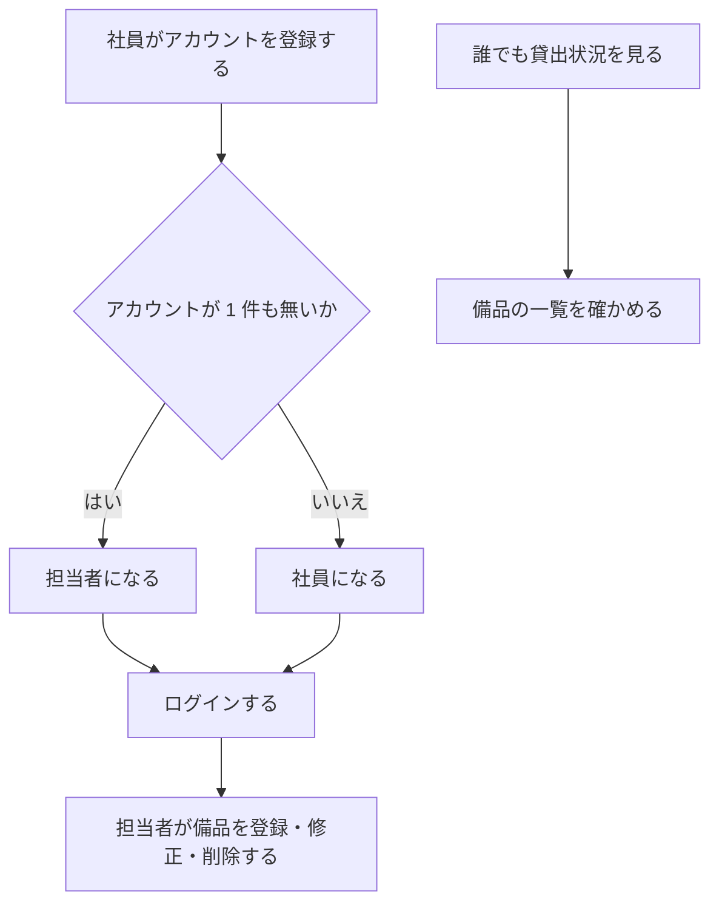
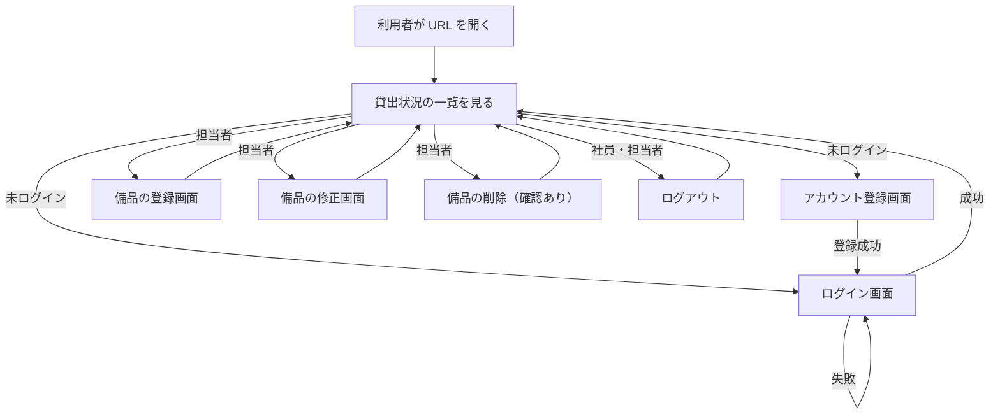
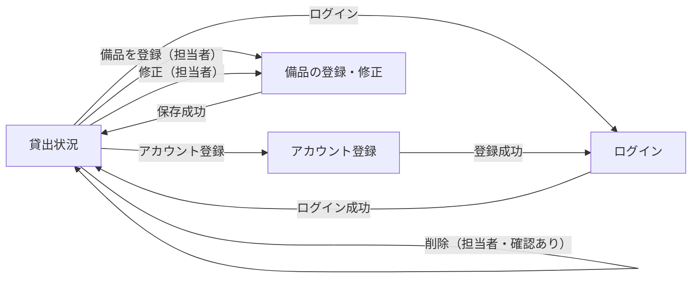

# 要件定義書: 備品台帳と貸出状況の閲覧（段 1）

## 1. 目的・前提

### 目的

会社の備品の台帳を 1 つのアプリにまとめ、記録の食い違いと消失をなくす。社員が「どの備品があり、空いているか」を担当者に問い合わせずに自分で確かめられるようにする。

### 用語集

| 用語 | 業務上の意味 | 本案件での使用範囲 | 同義語/類義語 |
|---|---|---|---|
| 社員 | 会社に所属し、備品を借りる人 | ログインして備品を借りる側の利用者（この段では備品の閲覧のみ） | 利用者 |
| 担当者 | 備品の台帳を管理し、備品を登録・修正・削除する社員 | 最初に登録されたアカウントの利用者。備品の登録・修正・削除ができる | 管理者 |
| 未ログインの人 | ログインしていない、社内の閲覧者 | 貸出状況の閲覧のみ可能 | ゲスト |
| 備品 | 会社が管理する物品。管理番号と備品名を持つ | 台帳の 1 件 | 物品 |
| 管理番号 | 備品を一意に指す番号（半角の英数字とハイフン、20 文字以内） | 備品の識別子 | 備品番号 |
| 貸出状況 | 備品ごとの「空き」か「貸出中」か、借りている社員の名前、貸出日 | 一覧画面の表示。この段では貸出の登録が無いため、すべて「空き」 | 貸出の状態 |
| 社員番号 | 社員を一意に指す 6 桁の数字 | ログインの識別子 | 社員 ID |

### システムの形態

GUI（ブラウザで開く画面）。Web API・バッチ・CUI は作らない。

### 1-1. 技術制約

| 制約項目 | 内容 | 出どころ（誰がいつ答えたか） |
|---|---|---|
| 既存コードベース | 無し（新規開発） | 依頼者、2026-11-04（ANSWERS.md） |
| 配備先 | 社内の Linux サーバー。採点では `bash run.sh` で直接起動するため、コンテナ無しで動くこと | 依頼者、2026-11-04（ANSWERS.md） |
| チームの技術 | 決まり無し。Python 3.12 と SQLite で足りる | 依頼者、2026-11-04（ANSWERS.md） |
| ライセンスとコスト | 無償のものだけ。有償ソフトと外部サービスは使わない | 依頼者、2026-11-04（ANSWERS.md） |
| 性能と規模の目安 | 利用者 50 人（社員と担当者の合計）、備品は数百件、アカウントは 50 件まで。操作から表示まで 3 秒以内 | 依頼者、2026-11-04（ANSWERS.md） |

## 2. 業務

### 対象業務一覧

| RQ-BZ-ID | 業務名 | 業務の範囲 | 担当者 |
|---|---|---|---|
| `RQ-BZ-EQUIPMENT-LEDGER` | 備品台帳の管理 | 備品の登録・修正・削除、アカウントの登録とログイン | 担当者（登録・修正・削除）、社員（アカウントの登録とログイン） |
| `RQ-BZ-EQUIPMENT-STATUS-VIEW` | 備品の貸出状況の閲覧 | 全備品の一覧（管理番号、備品名、空きか貸出中か、借りている社員の名前、貸出日） | 誰でも（ログインは不要） |

### 業務フロー

### 2-1. 業務の問題（あるべき姿と現状のギャップ）

| 問題 | 対象業務（RQ-BZ） | あるべき姿 | 現状 | ギャップ（KPI） | 業務影響 |
|---|---|---|---|---|---|
| 備品の記録が複数の管理用 Excel に分かれ、どれが最新か分からない。記録が食い違い、消えている | `RQ-BZ-EQUIPMENT-LEDGER` | 備品の記録が 1 つだけあり、誰が更新しても食い違わず、失われない | 複数の人が別々の Excel を更新している。食い違いと消失が起きている（件数は確認していない） | 食い違い・消失の件数: 不明（確認していないため数値を作らない） | 備品の所在と貸出を正確に把握できない |
| 社員が「どの備品を誰が借りているか」を知るには担当者に問い合わせる必要があり、担当者が毎回 15 分かけて調べている | `RQ-BZ-EQUIPMENT-STATUS-VIEW` | 社員が自分で備品の一覧と空き状況を確かめられる | 問い合わせのたびに担当者が Excel を調べる | 担当者の問い合わせ対応 1 回あたり 15 分（問い合わせの頻度: 不明） | 担当者の作業時間を取られ、社員の待ち時間も生じる |

### 2-2. 業務課題一覧

| RQ-BK-ID | 業務課題（取り組むこと） | 解決する問題（2-1） | 解決後の状態（KPI の目標値） | 対象業務（RQ-BZ） |
|---|---|---|---|---|
| `RQ-BK-SINGLE-EQUIPMENT-RECORD` | 備品の記録を 1 つのアプリにまとめ、複数の担当者が更新しても記録が失われないようにする | 備品の記録が複数の Excel に分かれ、食い違いと消失が起きている | 備品の記録が 1 つだけあり、食い違いと消失が起きない（目標件数: 0 件） | `RQ-BZ-EQUIPMENT-LEDGER` |
| `RQ-BK-SELF-SERVICE-STATUS-VIEW` | 社員が担当者に問い合わせず、備品の一覧と空き状況を自分で確かめられるようにする | 担当者への問い合わせと、担当者による 1 回 15 分の調べ作業 | 担当者の問い合わせ対応の 1 回 15 分が無くなる（削減後の対応時間: 0 分） | `RQ-BZ-EQUIPMENT-STATUS-VIEW` |

### 2-3. 見込み経営効果

| RQ-EF-ID | 効果の種類 | 内容 | 見込み（金額・時間などと算定根拠） | 対応業務課題ID（RQ-BK-*） |
|---|---|---|---|---|
| `RQ-EF-SOFT-SAVING-INQUIRY-TIME` | Soft Saving | 担当者が備品の問い合わせに答える作業時間の削減 | 1 回あたり 15 分の作業が無くなる。問い合わせの頻度は不明のため、月の合計は算定しない | `RQ-BK-SELF-SERVICE-STATUS-VIEW` |

## 3. 機能要件

### 入力データと出力データ

- 入力データ: 人手入力（アカウントの登録、ログイン、備品の登録・修正・削除の画面からの入力）。外部からの入力は無い
- 出力データ: 画面の表示（貸出状況の一覧、入力の結果の知らせ、入力のエラー）。帳票・ファイル出力は無い

### 利用フロー

業務フローとの対応: 「アカウントの登録とログイン」は業務フローの「社員がアカウントを登録する」「ログインする」に、「備品の登録・修正・削除」は「担当者が備品を登録・修正・削除する」に、「貸出状況の一覧」は「誰でも貸出状況を見る」に対応する。

### 機能一覧

| RQ-ID | カテゴリ | 機能名 | 対応業務課題ID（RQ-BK-*） | この機能が無いと何が困るか |
|---|---|---|---|---|
| `RQ-FT-REGISTER-ACCOUNT` | 共通（認証・認可・ログ） | アカウントを登録する | `RQ-BK-SINGLE-EQUIPMENT-RECORD` | 担当者と社員がアプリを使い始められず、記録を更新できる人がいない |
| `RQ-FT-LOGIN` | 共通（認証・認可・ログ） | 社員番号とパスワードでログインする | `RQ-BK-SINGLE-EQUIPMENT-RECORD` | 担当者だけが備品を更新する制限をかけられず、記録の食い違いが起きる |
| `RQ-FT-LOGOUT` | 共通（認証・認可・ログ） | ログアウトする | `RQ-BK-SINGLE-EQUIPMENT-RECORD` | 共有の端末で、前の人の権限のまま操作が続いてしまう |
| `RQ-FT-AUTO-LOGOUT-IDLE` | 共通（認証・認可・ログ） | 操作しないまま 30 分たったら自動でログアウトする | `RQ-BK-SINGLE-EQUIPMENT-RECORD` | 離席した端末から、他人が担当者の権限で備品を更新できてしまう |
| `RQ-FT-REGISTER-EQUIPMENT` | 業務機能 | 備品を登録する（担当者だけ） | `RQ-BK-SINGLE-EQUIPMENT-RECORD` | 備品の記録を 1 つのアプリに集められず、Excel が残り続ける |
| `RQ-FT-EDIT-EQUIPMENT` | 業務機能 | 備品の管理番号と備品名を修正する（担当者だけ） | `RQ-BK-SINGLE-EQUIPMENT-RECORD` | 誤った記録を直せず、記録の食い違いが残る |
| `RQ-FT-DELETE-EQUIPMENT` | 業務機能 | 備品を削除する（担当者だけ。確認ダイアログで「はい」のときだけ） | `RQ-BK-SINGLE-EQUIPMENT-RECORD` | 廃棄した備品が一覧に残り、空き状況が実態と食い違う |
| `RQ-FT-VIEW-LOAN-STATUS` | 業務機能 | 誰でも貸出状況の一覧を見る | `RQ-BK-SELF-SERVICE-STATUS-VIEW` | 社員が担当者に問い合わせるしかなく、15 分の調べ作業が無くならない |

### 3-1. 帳票・出力ファイル

帳票・出力ファイルは無い。

### 3-2. 業務ルール

| RQ-ID | ルール名 | 内容（条件と結果） | 違反時・エラー時の業務上の扱い | 対応業務課題ID（RQ-BK-*） |
|---|---|---|---|---|
| `RQ-FT-FIRST-ACCOUNT-IS-MANAGER` | 最初のアカウントは担当者 | アカウントが 1 件も無い状態でアカウントを登録した人は担当者になる。2 件目以降に登録した人は社員になる。登録の判定は同時の登録でも 1 件だけが担当者になるよう、一体で行う | 該当しない（登録は成功する） | `RQ-BK-SINGLE-EQUIPMENT-RECORD` |
| `RQ-FT-MANAGER-ONLY-EQUIPMENT-OPERATION` | 備品の登録・修正・削除は担当者だけ | 備品の登録・修正・削除（画面と、その操作を要求する通信の両方）は担当者だけが行える。社員の要求は、画面を出さないだけでなく、受け付けずに備品の記録を変えない。未ログインの要求はログイン画面へ送る | 社員の要求は貸出状況の画面に戻し、「この操作は担当者だけが行えます」と知らせる。未ログインの要求はログイン画面へ送る | `RQ-BK-SINGLE-EQUIPMENT-RECORD` |
| `RQ-FT-LOGIN-FAILURE-NO-HINT` | ログイン失敗時は理由を示さない | 社員番号かパスワードが違うとき、どちらが違うかを示さず、同じ文言を返す | 「社員番号またはパスワードが違います」と表示し、社員番号は入力欄に残す | `RQ-BK-SINGLE-EQUIPMENT-RECORD` |
| `RQ-FT-UNIQUE-EMPLOYEE-AND-EQUIPMENT-NUMBER` | 社員番号と管理番号の重複禁止 | 社員番号は全アカウントの中で重複しない。管理番号は全備品の中で重複しない（修正のときは自分自身を除いて判定する） | 重複するときは登録・修正をせず、その入力欄に「この社員番号は既に登録されています」または「この管理番号は既に使われています」と表示する | `RQ-BK-SINGLE-EQUIPMENT-RECORD` |

### 3-3. 外部連携

外部連携は無い。

## 4. データ

### 4-1. データ要件一覧

| RQ-ID | 種別 | 内容 | 対応業務課題ID（RQ-BK-*） | この要件が無いと何が困るか |
|---|---|---|---|---|
| `RQ-DT-INTERNAL-DATA` | 内部データ / 外部データ | 扱うデータはすべて内部データ（アカウントと備品）。外部 DB は無い | `RQ-BK-SINGLE-EQUIPMENT-RECORD` | 外部のデータとの同期を設計に含めるべきか判断できない |
| `RQ-DT-DB-REQUIRED` | DB の必要性 | DB を使う。理由は、複数の担当者が同時に更新しても記録が失われないようにするため。初期件数は 0 件、想定は備品が数百件・アカウントが 50 件まで。1 年後の件数と年間増加率は不明のため、上限（備品数百件、アカウント 50 件）で設計する。参照関係は単純（テーブル間の参照は無い）。検索・集計は一覧の表示だけ | `RQ-BK-SINGLE-EQUIPMENT-RECORD` | ファイルへの書き込みが競合し、記録が失われる |
| `RQ-DT-NO-DELETED-HISTORY` | データ保持期間 | 削除した備品とアカウントの記録は残さない（削除は物理削除。履歴の表を持たない） | `RQ-BK-SINGLE-EQUIPMENT-RECORD` | 削除の履歴の保持方針を決められず、設計が膨らむ |

### 4-2. 業務エンティティとデータ項目

| RQ-ID | カテゴリ | 業務エンティティ名 | 対応業務課題ID（RQ-BK-*） | この業務エンティティが無いと何が困るか |
|---|---|---|---|---|
| `RQ-DT-ACCOUNT` | データ | アカウント | `RQ-BK-SINGLE-EQUIPMENT-RECORD` | 誰が備品を更新できるか（担当者か社員か）を判定できない |
| `RQ-DT-EQUIPMENT` | データ | 備品 | `RQ-BK-SINGLE-EQUIPMENT-RECORD`, `RQ-BK-SELF-SERVICE-STATUS-VIEW` | 備品の台帳そのものが無く、一覧も作れない |

エンティティ「アカウント」の項目:

| エンティティ名 | 項目名 | 業務上の意味 | 必須 | 形式・桁 | 値の範囲・制約 | 例 |
|---|---|---|---|---|---|---|
| アカウント | 社員番号 | 社員を一意に指す番号 | 必須 | 6 桁の数字 | 全アカウントで重複不可（`RQ-FT-UNIQUE-EMPLOYEE-AND-EQUIPMENT-NUMBER`） | 123456 |
| アカウント | 名前 | 社員の名前。貸出状況で借りている人の名前としても使う（この段では表示しない） | 必須 | 文字列 | 1 文字以上 30 文字以内 | 山田太郎 |
| アカウント | パスワード | ログインに使う秘密の文字列。保存するのは一方向のハッシュだけ | 必須 | 文字列 | 8 文字以上（桁数の上限は設けない） | （登録時に本人が入力） |
| アカウント | 役割 | 担当者か社員か | 必須 | 「担当者」か「社員」 | 最初のアカウントは「担当者」、2 件目以降は「社員」（`RQ-FT-FIRST-ACCOUNT-IS-MANAGER`） | 担当者 |

エンティティ「備品」の項目:

| エンティティ名 | 項目名 | 業務上の意味 | 必須 | 形式・桁 | 値の範囲・制約 | 例 |
|---|---|---|---|---|---|---|
| 備品 | 管理番号 | 備品を一意に指す番号 | 必須 | 半角の英数字とハイフン、20 文字以内 | 全備品で重複不可（`RQ-FT-UNIQUE-EMPLOYEE-AND-EQUIPMENT-NUMBER`）。大文字と小文字は区別する | PC-0001 |
| 備品 | 備品名 | 備品の名前 | 必須 | 文字列 | 1 文字以上 50 文字以内 | ノートパソコン A |

備品の貸出状況（空きか貸出中か、借りている社員の名前、貸出日）は、この段では貸出の記録を持たないため、テーブルの項目にせず、一覧では常に「空き」、名前と貸出日は空欄として表示する。

### 4-3. CRUD テーブル

| エンティティ名 | Create | Read（一覧） | Read（詳細） | 検索 | Update | Delete | 備考 |
|---|---|---|---|---|---|---|---|
| アカウント | ○（誰でも、自分で登録。`RQ-FT-REGISTER-ACCOUNT`） | × | ○（ログイン時に社員番号で引く） | × | × | × | 社員番号の重複を、登録時の同時実行でも防ぐ必要がある（トランザクションで判定する）。一覧・修正・削除の画面は無い |
| 備品 | ○（担当者のみ） | ○（誰でも。貸出状況の一覧） | ○（担当者のみ。修正画面を開くとき） | × | ○（担当者のみ） | ○（担当者のみ） | 管理番号の重複を、登録・修正時の同時実行でも防ぐ必要がある（一意制約で判定する）。検索は無い（一覧は全件を管理番号の昇順で出す） |

### 4-4. 状態遷移

状態を持つエンティティは無い（貸出の記録が無いため、備品の空き・貸出中は持たない）。

### 4-5. 画面一覧

| RQ-ID | 画面名 | 対応する CRUD 操作（エンティティ名:操作種別） | 主な機能・目的 | 対応業務課題ID（RQ-BK-*） |
|---|---|---|---|---|
| `RQ-UI-LOAN-STATUS-SCREEN` | 貸出状況（トップ） | 備品:Read（一覧）、備品:Delete | 全備品の一覧を見る。ログインしていれば、ログイン中の名前、ログアウト、（担当者は）備品の登録への入口、行ごとの修正と削除を出す | `RQ-BK-SELF-SERVICE-STATUS-VIEW`, `RQ-BK-SINGLE-EQUIPMENT-RECORD` |
| `RQ-UI-ACCOUNT-REGISTER-SCREEN` | アカウント登録 | アカウント:Create | 社員番号、名前、パスワードを入力してアカウントを作る | `RQ-BK-SINGLE-EQUIPMENT-RECORD` |
| `RQ-UI-LOGIN-SCREEN` | ログイン | アカウント:Read（詳細） | 社員番号とパスワードでログインする | `RQ-BK-SINGLE-EQUIPMENT-RECORD` |
| `RQ-UI-EQUIPMENT-FORM-SCREEN` | 備品の登録・修正 | 備品:Create、備品:Read（詳細）、備品:Update | 管理番号と備品名を入力して、備品を登録または修正する（担当者だけ） | `RQ-BK-SINGLE-EQUIPMENT-RECORD` |

画面の仕様（3 章の画面ごとの 5 項目）:

- 貸出状況（`RQ-UI-LOAN-STATUS-SCREEN`）
  - 目的: 全備品の空き状況を一覧で見る
  - 主要要素: 見出し、ログイン中の表示（`.current-user`）または「ログイン」「アカウント登録」のリンク、担当者だけの「備品を登録」リンクと、行ごとの「修正」「削除」ボタン、備品の表
  - 入力項目: 無し（削除の確認ダイアログ）
  - 表示項目: 管理番号、備品名、状態（「空き」または「貸出中」）、借りている社員の名前、貸出日（`YYYY-MM-DD`）。備品が 0 件なら「備品は登録されていません」
  - エラー時の見え方: 担当者以外の操作の要求は、この画面に戻して `.message` に「この操作は担当者だけが行えます」を出す
- アカウント登録（`RQ-UI-ACCOUNT-REGISTER-SCREEN`）
  - 目的: 社員が自分のアカウントを作る
  - 主要要素: 社員番号、名前、パスワードの入力欄、「登録」ボタン
  - 入力項目: 社員番号、名前、パスワード
  - 表示項目: 入力の結果（成功時はログイン画面に移って知らせる）
  - エラー時の見え方: 入力欄ごとのエラーを `.field` の中の `.field-error` に出す。入力した社員番号と名前は消さない。パスワードは再表示しない
- ログイン（`RQ-UI-LOGIN-SCREEN`）
  - 目的: 社員番号とパスワードでログインする
  - 主要要素: 社員番号、パスワードの入力欄、「ログイン」ボタン
  - 入力項目: 社員番号、パスワード
  - 表示項目: 無し（成功時は貸出状況の画面へ）
  - エラー時の見え方: 「社員番号またはパスワードが違います」を `.error` に出す。社員番号は残す
- 備品の登録・修正（`RQ-UI-EQUIPMENT-FORM-SCREEN`）
  - 目的: 担当者が備品を登録または修正する
  - 主要要素: 管理番号、備品名の入力欄、「保存」ボタン
  - 入力項目: 管理番号、備品名
  - 表示項目: 修正のときは現在の値を入力欄に入れて開く
  - エラー時の見え方: 入力欄ごとのエラーを `.field-error` に出す。入力した値は消さない。担当者以外は貸出状況の画面に戻して `.message` に出す

画面遷移図:

## 5. 非機能要件

| RQ-ID | カテゴリ | 非機能要件名 | 対応業務課題ID（RQ-BK-*） | この非機能要件が無いと何が困るか |
|---|---|---|---|---|
| `RQ-NF-INTERNAL-NETWORK-ACCESS` | 利用者・アクセス経路 | 利用者は社員・担当者・社内の未ログインの閲覧者とし、アクセス経路は社内ネットワークに限る（インターネットには公開しない） | `RQ-BK-SELF-SERVICE-STATUS-VIEW` | 社外から備品の記録が見られ、情報が漏れる |
| `RQ-NF-USERS-50` | 利用人数 | 利用者は合計 50 人まで（同時接続の目安も 50 人） | `RQ-BK-SELF-SERVICE-STATUS-VIEW` | 同時に使うと応答が遅くなり、業務が止まる |
| `RQ-NF-RESPONSE-3S` | 性能 | 操作してから表示されるまで 3 秒以内（備品 500 件の一覧でも） | `RQ-BK-SELF-SERVICE-STATUS-VIEW` | 待ち時間が長く、社員が使わなくなる |
| `RQ-NF-PASSWORD-HASHED` | セキュリティ | パスワード認証のみ（SSO は無し）。パスワードは平文で保存せず、ハッシュにする | `RQ-BK-SINGLE-EQUIPMENT-RECORD` | サーバーの記録が漏れた際に、パスワードがそのまま知られる |
| `RQ-NF-USE-HOURS-WEEKDAY-DAYTIME` | 可用性 | 平日の日中に使う。夜間・休日は止まってよい。障害からの復旧の目標時間は要求しない | `RQ-BK-SINGLE-EQUIPMENT-RECORD` | 常時稼働のための運用を設計することになり、作業が増える |

- 移行性: 既存の Excel の内容を取り込む機能は無い。担当者が画面から手で入力する（移行は無い。取り込みは作らない）。
- 監査証跡の改ざん防止: 不要（運用要件の監査ログを参照）。

## 6. 運用要件

| RQ-ID | 種別 | 内容 | 対応業務課題ID（RQ-BK-*） | この要件が無いと何が困るか |
|---|---|---|---|---|
| `RQ-OP-FIRST-ACCOUNT-SETUP` | 導入手順 | 社員に URL を知らせる前に、担当者が最初のアカウントを登録する。初期ユーザーは置かない | `RQ-BK-SINGLE-EQUIPMENT-RECORD` | 最初に登録した人が担当者にならず、誰も備品を登録できない |

- ログ: ログは必要ないため、ログの内容と保存期間の記述は行わない。
- 監査ログ: 不要。
- 監視・アラート: 監視・アラートは必要ないため、監視・アラートの内容と対応方法の記述は行わない。
- バックアップと復旧: バックアップは必要ない。

## 7. テスト用利用シナリオ

| RQ-ID | テスト目的 | 前提条件 | テスト手順 | 期待される結果 | 検証する要件ID | 対応業務課題ID（RQ-BK-*） |
|---|---|---|---|---|---|---|
| `RQ-TS-REGISTER-FIRST-ACCOUNT` | 最初のアカウントが担当者になる | アカウントが 0 件 | アカウント登録画面で社員番号 `000001`、名前、8 文字以上のパスワードを入力し「登録」を押す。ログイン画面で同じ社員番号とパスワードでログインする | 「登録しました。ログインしてください」が出る。ログイン後、`.current-user` に名前が出て、「備品を登録」リンクが出る | `RQ-FT-REGISTER-ACCOUNT`, `RQ-FT-FIRST-ACCOUNT-IS-MANAGER`, `RQ-UI-ACCOUNT-REGISTER-SCREEN` | `RQ-BK-SINGLE-EQUIPMENT-RECORD` |
| `RQ-TS-REGISTER-SECOND-ACCOUNT-AS-MEMBER` | 2 件目以降のアカウントは社員になる | アカウントが 1 件ある | 別の社員番号と名前とパスワードでアカウントを登録し、ログインする | ログイン後に「備品を登録」リンクが出ない | `RQ-FT-REGISTER-ACCOUNT`, `RQ-FT-FIRST-ACCOUNT-IS-MANAGER`, `RQ-UI-ACCOUNT-REGISTER-SCREEN` | `RQ-BK-SINGLE-EQUIPMENT-RECORD` |
| `RQ-TS-REGISTER-ACCOUNT-VALIDATION` | アカウント登録の入力の検査と重複の禁止 | アカウントが 1 件ある | 社員番号に 5 桁、名前に空、名前に 31 文字、パスワードに 7 文字を入力して登録する。次に既存の社員番号で登録する | 各入力欄の `.field` 内の `.field-error` に、指定の文言（社員番号の形式、名前を入力してください、名前は 30 文字以内、パスワードは 8 文字以上、この社員番号は既に登録されています）が出る。入力した社員番号と名前は残り、登録されない | `RQ-FT-REGISTER-ACCOUNT`, `RQ-FT-UNIQUE-EMPLOYEE-AND-EQUIPMENT-NUMBER`, `RQ-UI-ACCOUNT-REGISTER-SCREEN` | `RQ-BK-SINGLE-EQUIPMENT-RECORD` |
| `RQ-TS-LOGIN-AND-LOGOUT` | ログインとログアウト | アカウントが 1 件ある | ログイン画面で正しい社員番号とパスワードでログインし、「ログアウト」を押す | ログイン後に `.current-user` に名前が出る。ログアウト後に「ログイン」「アカウント登録」のリンクが出る | `RQ-FT-LOGIN`, `RQ-FT-LOGOUT`, `RQ-UI-LOGIN-SCREEN` | `RQ-BK-SINGLE-EQUIPMENT-RECORD` |
| `RQ-TS-LOGIN-FAILURE-NO-HINT` | ログイン失敗時に理由を示さない | アカウントが 1 件ある | 正しい社員番号と違うパスワード、存在しない社員番号と任意のパスワードの 2 通りでログインする | どちらの場合も `.error` に「社員番号またはパスワードが違います」が出る。社員番号は入力欄に残る | `RQ-FT-LOGIN`, `RQ-FT-LOGIN-FAILURE-NO-HINT`, `RQ-UI-LOGIN-SCREEN` | `RQ-BK-SINGLE-EQUIPMENT-RECORD` |
| `RQ-TS-AUTO-LOGOUT-AFTER-IDLE` | 操作しないまま待つと自動でログアウトする | 有効期限を短くした環境（`SESSION_IDLE_TIMEOUT_SECONDS=2`）。アカウントが 1 件ある | ログインし、有効期限を超えるまで操作せず、その後に備品の登録画面を開く | ログイン画面に戻る。貸出状況の画面では「ログイン」「アカウント登録」のリンクが出る | `RQ-FT-AUTO-LOGOUT-IDLE`, `RQ-FT-LOGOUT`, `RQ-UI-LOAN-STATUS-SCREEN` | `RQ-BK-SINGLE-EQUIPMENT-RECORD` |
| `RQ-TS-MANAGER-REGISTER-EQUIPMENT` | 担当者が備品を登録する | 担当者でログイン済み | 「備品を登録」から、管理番号 `PC-0001`、備品名を入力して「保存」を押す。同じ管理番号で再度登録する | 1 件目は貸出状況の一覧に出る（管理番号、備品名、「空き」、空欄の名前と貸出日）。2 件目は `id_equipment_number` の `.field` 内の `.field-error` に「この管理番号は既に使われています」が出て、登録されない | `RQ-FT-REGISTER-EQUIPMENT`, `RQ-FT-UNIQUE-EMPLOYEE-AND-EQUIPMENT-NUMBER`, `RQ-UI-EQUIPMENT-FORM-SCREEN`, `RQ-UI-LOAN-STATUS-SCREEN` | `RQ-BK-SINGLE-EQUIPMENT-RECORD` |
| `RQ-TS-EQUIPMENT-VALIDATION` | 備品の入力の形式と桁数の検査 | 担当者でログイン済み | 管理番号に全角文字、21 文字の英数字、備品名に空と 51 文字を入力して「保存」を押す | 各入力欄の `.field-error` に、指定の文言（管理番号は半角の英数字とハイフンで 20 文字以内、備品名は 50 文字以内）が出て、登録されない。入力値は残る | `RQ-FT-REGISTER-EQUIPMENT`, `RQ-UI-EQUIPMENT-FORM-SCREEN` | `RQ-BK-SINGLE-EQUIPMENT-RECORD` |
| `RQ-TS-MANAGER-EDIT-EQUIPMENT` | 担当者が備品を修正する | 担当者でログイン済み、備品 `PC-0001` が 1 件ある | 一覧の「修正」を押し、備品名を変えて「保存」を押す。次に管理番号を既存の別の管理番号に変えて「保存」を押す | 1 回目は一覧に新しい備品名が出る。2 回目は管理番号の `.field` 内に「この管理番号は既に使われています」が出て、変わらない | `RQ-FT-EDIT-EQUIPMENT`, `RQ-FT-UNIQUE-EMPLOYEE-AND-EQUIPMENT-NUMBER`, `RQ-UI-EQUIPMENT-FORM-SCREEN` | `RQ-BK-SINGLE-EQUIPMENT-RECORD` |
| `RQ-TS-MANAGER-DELETE-EQUIPMENT` | 担当者が備品を削除する（確認ダイアログ） | 担当者でログイン済み、備品 `PC-0001` が 1 件ある | 一覧の「削除」を押し、確認ダイアログで「キャンセル」を選ぶ。次に「削除」を押し、「はい」を選ぶ | キャンセルのときは一覧に残る。「はい」のあとは一覧から消え、`data-equipment-number="PC-0001"` の行が無くなる | `RQ-FT-DELETE-EQUIPMENT`, `RQ-UI-LOAN-STATUS-SCREEN` | `RQ-BK-SINGLE-EQUIPMENT-RECORD` |
| `RQ-TS-MEMBER-CANNOT-OPERATE-EQUIPMENT` | 社員が備品の操作を要求しても受け付けられない | 社員でログイン済み、備品 `PC-0001` が 1 件ある | 社員の画面で、備品の登録画面 `/equipment/new/` を直接開く。備品の修正・削除の要求を直接送る（`/equipment/PC-0001/delete/` に POST） | 貸出状況の画面に戻り、`.message` に「この操作は担当者だけが行えます」が出る。備品の記録は変わらない。行の「修正」「削除」ボタンも出ない | `RQ-FT-MANAGER-ONLY-EQUIPMENT-OPERATION`, `RQ-UI-LOAN-STATUS-SCREEN` | `RQ-BK-SINGLE-EQUIPMENT-RECORD` |
| `RQ-TS-GUEST-CANNOT-OPERATE-EQUIPMENT` | 未ログインの人が備品の操作を要求しても受け付けられない | ログインしていない。備品 `PC-0001` が 1 件ある | ログインせずに `/equipment/new/` を開く。ログインせずに `/equipment/PC-0001/delete/` に POST する | ログイン画面へ送られる。備品の記録は変わらない | `RQ-FT-MANAGER-ONLY-EQUIPMENT-OPERATION`, `RQ-UI-LOAN-STATUS-SCREEN` | `RQ-BK-SINGLE-EQUIPMENT-RECORD` |
| `RQ-TS-VIEW-LOAN-STATUS-AS-GUEST` | ログインしていない人が貸出状況を見られる | 備品 `PC-0001`（備品名 `ノートパソコン A`）と `PC-0002`（備品名 `プロジェクタ`）が登録されている | ログインせずに `/` を開く | 表に 2 行が管理番号の昇順（`PC-0001`、`PC-0002`）で出る。各行に管理番号、備品名、「空き」が出る。ボタンは出ず、「ログイン」「アカウント登録」のリンクが出る | `RQ-FT-VIEW-LOAN-STATUS`, `RQ-UI-LOAN-STATUS-SCREEN` | `RQ-BK-SELF-SERVICE-STATUS-VIEW` |
| `RQ-TS-VIEW-EMPTY-LOAN-STATUS` | 備品が 0 件のときの表示 | 備品が 0 件 | ログインせずに `/` を開く | 「備品は登録されていません」が出る。表の行は無い | `RQ-FT-VIEW-LOAN-STATUS`, `RQ-UI-LOAN-STATUS-SCREEN` | `RQ-BK-SELF-SERVICE-STATUS-VIEW` |
| `RQ-TS-ROLE-BUTTON-VISIBILITY` | 役割ごとにボタンが出し分けられる | 備品 `PC-0001` が 1 件ある。担当者と社員のアカウントがある | 未ログイン、社員、担当者の順に `/` を開く | 未ログインは「ログイン」「アカウント登録」のリンクだけ。社員は `.current-user` と「ログアウト」だけで、「備品を登録」と行の「修正」「削除」が出ない。担当者はすべて出る | `RQ-FT-MANAGER-ONLY-EQUIPMENT-OPERATION`, `RQ-UI-LOAN-STATUS-SCREEN` | `RQ-BK-SINGLE-EQUIPMENT-RECORD` |
