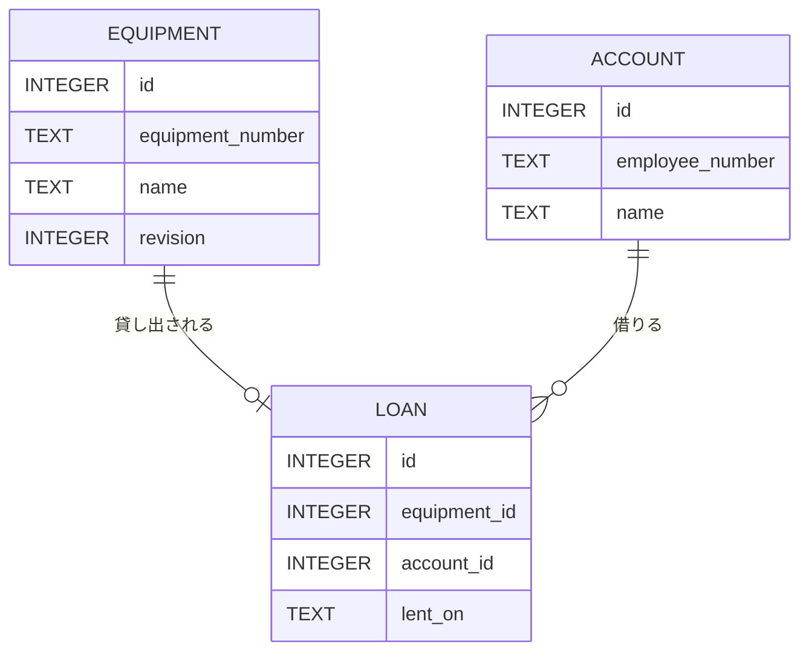
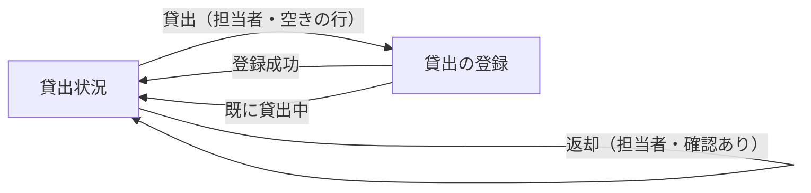
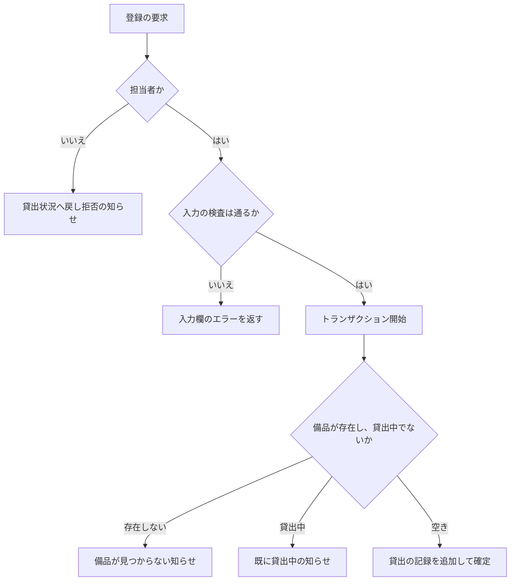

# 変更設計書: 備品の貸出と返却（段 2）

入力: `.history/20261104-lending-return/change_requirements.md`（[追加] の要件）。正本の設計書: `docs/detail_design.md`（段 1）。
この文書は正本を書き換えない。[追加] と [削除] の区分は、設計要素・行ごとに付ける。中身が変わった設計要素は、旧 ID を [削除]、新 ID を [追加] にする。
変更しない既存の設計要素は、その ID のままにする。

## 1. 言語・フレームワーク・アーキテクチャの選定

変更なし。既存設計 `docs/detail_design.md` 1 章を参照（Python 3.12、Flask 3.1.3、waitress 3.0.2、SQLite、Werkzeug のハッシュ）。貸出の登録と返却の排他に SQLite の書き込みトランザクション（BEGIN IMMEDIATE）を使う。標準ライブラリだけで足りるため、新しいライブラリは足さない。

## 2. システム構成

### コンポーネント一覧

変更なし（コンポーネントは段 1 と同じ）。Flask アプリの中に貸出の業務の関数（`app/loans.py`）を 1 つ足す。

### システム全体構成図

変更なし。既存設計 `docs/detail_design.md` 2 章を参照。

### 各コンポーネントの役割

- [追加] Flask アプリ: 貸出の登録画面と、返却と、貸出状況の一覧の貸出の情報の表示を足す。
- 他は変更なし。

### コンポーネント間インターフェースとデータフロー

変更なし。

### ネットワーク構成図

変更なし。

## 3. データ設計

### 3-1. データモデル

#### テーブルの変更

[削除] テーブル `equipment` の定義（既存設計 3-1 の `DS-SC-EQUIPMENT`）。理由: 版番号の列を足すため、中身が変わる。

[追加] `DS-SC-EQUIPMENT-WITH-REVISION`: テーブル `equipment` の定義。既存の列（id、equipment_number、name）に加えて、次の列を持つ。

| カラム | 型 | 制約 | 対応する要件 |
|---|---|---|---|
| revision | INTEGER | NOT NULL、既定値 1 | 修正の版番号（`RQ-FT-EDIT-CONFLICT-REJECT`） |

既存の列の制約は段 1 のとおり（equipment_number は NOT NULL、UNIQUE で大文字と小文字を区別する）。

[追加] `DS-SC-LOAN`: テーブル `loans`（貸出の記録）。

| カラム | 型 | 制約 | 対応する要件 |
|---|---|---|---|
| id | INTEGER | 主キー | 内部の識別子 |
| equipment_id | INTEGER | NOT NULL、UNIQUE（備品 1 件に 0 か 1 件）、外部キー（`equipment.id`） | 貸出している備品（`RQ-DT-EQUIPMENT-LOAN-STATE`） |
| account_id | INTEGER | NOT NULL、外部キー（`accounts.id`） | 借りる社員（`RQ-DT-LOAN-RECORD`） |
| lent_on | TEXT | NOT NULL（YYYY-MM-DD） | 貸出日 |

返却した貸出は行を削除する（物理削除。履歴の表は持たない。`RQ-DT-LOAN-RECORD`）。外部キーを使うため、接続ごとに外部キーの検査を有効にする。

リレーション図（追加分）:



テーブルごとの設計要素: `equipment` は `DS-SC-EQUIPMENT-WITH-REVISION`、`loans` は `DS-SC-LOAN`。`accounts` は変更なし（`DS-SC-ACCOUNT`）。

#### 既存データの移行

起動時の初期化（`DS-FN-INIT-SCHEMA`、変更なし）で、`loans` テーブルが無ければ作る。`equipment` に `revision` 列が無ければ、既定値 1 の列を足す。段 1 で作った DB も、この処理で新しい形になる。

### 3-2. トランザクションと排他制御

すべて BEGIN IMMEDIATE で始め、1 つの操作を 1 つのトランザクションで行う（段 1 と同じ方式。同時の要求は SQLite の書き込みロックで順番に処理される）。

- [追加] 貸出の登録: 次の順で行う。
  1. 入力の検査（借りる社員の未選択、貸出日の形式と未来の日付）は、トランザクションの前に行う。
  2. トランザクションを開始し、管理番号で備品を引く。無ければ「備品が見つかりません」（貸出状況の画面に戻す）。
  3. 借りる社員が存在するか確かめる。存在しなければ借りる社員の入力欄に「借りる社員を選んでください」を出す。
  4. その備品の貸出の記録が既にあれば「この備品は既に貸出中です」（貸出状況の画面に戻す）。
  5. 貸出の記録を追加し、確定する。
  - 同時の 2 つの登録は、先の登録が確定するまで後の登録が待つ。後の登録は手順 4 で「既に貸出中」になる。一意制約の違反も「既に貸出中」として扱う（最後の守り）。
- [追加] 返却: トランザクションを開始し、管理番号で備品を引く。無ければ「備品が見つかりません」。その備品の貸出の記録を削除し、削除した件数が 0 件なら「この備品は既に返却されています」。確定する。
- [追加] 備品の修正（版番号つき）: 修正画面を開いたときの版番号と、保存のときの版番号を比べる。トランザクションを開始し、元の管理番号で備品を引く。備品が無い、または版番号が一致しなければ、他の担当者の更新・削除として扱い、保存しない。一致すれば、管理番号と備品名を更新し、版番号を 1 増やす。更新の件数が 0 件なら同様に扱う。管理番号の重複は一意制約の違反として入力欄のエラーにする（自分自身を除く判定は一意制約で行う）。貸出の記録（`loans`）には触れないため、貸出は引き継がれる。
- [追加] 備品の削除（貸出中は不可）: トランザクションを開始し、管理番号で備品を引く。無ければ「備品が見つかりません」。その備品の貸出の記録があれば削除せず、「この備品は貸出中のため削除できません。先に返却を処理してください」を出す。無ければ備品の行を削除する。確定する。
- 段 1 の登録（備品）は変更なし。
- 排他制御の方式: 悲観的（BEGIN IMMEDIATE で書き込みロックを取る）。理由: 件数が少なく、短い処理のため。

### 3-3. 状態遷移

[追加] 備品の貸出状況（貸出の記録の有無で決まる。`RQ-DT-EQUIPMENT-LOAN-STATE`）:

| 遷移 | 契機 | 許されない遷移の扱い |
|---|---|---|
| 空き → 貸出中 | 貸出の登録（担当者） | 貸出中の備品への登録は行わず、「この備品は既に貸出中です」 |
| 貸出中 → 空き | 返却の処理（担当者） | 空きの備品への返却は行わず、「この備品は既に返却されています」 |

貸出中の備品の削除は遷移ではなく拒否する（3-2）。貸出中の備品の修正は状態を変えない。

## 4. アーキテクチャ設計

### 4-1. 外部設計

利用者向けインターフェース（`DS-IF-*`）:

- [追加] 貸出の登録画面（`DS-IF-LOAN-REGISTER-SCREEN`）: 登録画面のパスは `/equipment/<管理番号>/loan/`（GET で表示、POST で登録）。入力欄は借りる社員（`id_borrower`、select。選択肢の表示は「名前（社員番号）」）と貸出日（`id_lent_on`、YYYY-MM-DD。既定は日本時間の今日）。ボタン「登録」。`.lending-equipment` に「備品: <管理番号> <備品名>」。
- 貸出状況（`DS-IF-LOAN-STATUS-SCREEN`）: 変更なし（ID も同じ）。ただし表の列の中身と行の操作は変わる。表の「状態」は貸出の記録で決まり、借りている社員の名前と貸出日を出す。担当者の行には、空きなら「貸出」、貸出中なら「返却」のボタンを出す。返却のボタンは確認ダイアログ（`window.confirm`）を通す。
- 返却（POST `/equipment/<管理番号>/return/`）: 画面の要求ではなく、貸出状況の画面の行の操作（DS-FN-SUBMIT-RETURN）。
- 他の画面は変更なし。

画面遷移図（追加分）:



インターフェース仕様（追加分）:

| 画面 / 操作 | 入力とバリデーション | 出力 | エラー仕様 |
|---|---|---|---|
| [追加] 貸出の登録画面（GET `/equipment/<管理番号>/loan/`） | なし | 借りる社員の選択肢（名前（社員番号）、名前の昇順）、貸出日の既定（今日） | 担当者以外は貸出状況へ戻し `.message`。未ログインはログイン画面へ。備品が無ければ貸出状況へ戻し「備品が見つかりません」 |
| [追加] 貸出の登録（POST `/equipment/<管理番号>/loan/`） | 借りる社員: 必須（選ばれていて、アカウントに存在）。貸出日: YYYY-MM-DD の日付で、今日以前 | 成功: 貸出状況へ移動し「貸出を登録しました」 | 借りる社員と貸出日は入力欄ごとの `.field-error`（文言は契約と一致）。入力値は残す。既に貸出中なら貸出状況へ戻し `.message` に「この備品は既に貸出中です」 |
| [追加] 返却（POST `/equipment/<管理番号>/return/`） | なし（画面では確認ダイアログで「はい」のときだけ送る） | 成功: 貸出状況へ移動し「返却しました」 | 既に返却済みなら「この備品は既に返却されています」。担当者以外は貸出状況へ戻し `.message`。未ログインはログイン画面へ |
| [追加] 削除（貸出中の備品。既存の削除の要求） | なし | 貸出中なら削除せず、貸出状況へ戻し `.message` に「この備品は貸出中のため削除できません。先に返却を処理してください」 | 既存の削除と同じ |
| [追加] 備品の修正（POST `/equipment/<管理番号>/edit/`） | 段 1 の検査に加え、隠し項目の版番号（修正画面を開いたときの値） | 成功: 段 1 のとおり | 段 1 のエラーに加え、他の担当者の更新・削除を検出したら、修正画面を `.error`（「他の担当者が先にこの備品を更新しました。貸出状況の画面から開き直してください」）つきで表示し、保存しない。入力値は残すが、保存はしない |

外部システム連携: 無し。

### 4-2. 内部設計

処理フロー（貸出の登録）:



処理の役割（追加分）:

- 貸出の登録の関数: 3-2 の手順で行う。
- 返却の関数: 3-2 の手順で行う。
- 貸出状況の一覧の関数: 備品を管理番号の昇順に、貸出の記録と借りている社員の名前と結び、1 行ごとに「貸出中か」「借りている社員の名前」「貸出日」を返す。備品が 0 件なら空の一覧。

バッチ設計: 無し。

## 5. クラス設計

変更なし（クラスは作らない。モジュール単位の関数）。

モジュール単位の責務（変更分）:

| モジュール | 責務（1 文） |
|---|---|
| [追加] 貸出 | 備品の貸出の登録、返却、貸出状況の一覧を行う |
| 備品（変更） | 備品の一覧（取得）・登録・修正（版番号を確かめる）・削除（貸出中は不可）を行う |
| 検査（変更） | 貸出の入力（借りる社員、貸出日）の検査結果を返す |
| 画面（ルート）（変更） | 貸出の登録画面と返却の要求を受け、業務の関数を呼ぶ |

主要な関数（変更分）:

- [追加] 貸出の登録（`DS-FN-REGISTER-LOAN`）: 管理番号、借りる社員の ID、貸出日を受け、3-2 の手順で登録する。結果（成功、備品が無い、既に貸出中、借りる社員が無い）を返す。
- [追加] 返却（`DS-FN-RETURN-LOAN`）: 管理番号を受け、貸出の記録を削除する。結果（成功、備品が無い、既に返却済み）を返す。
- [追加] 貸出状況の一覧（`DS-FN-LIST-LOAN-STATUS`）: 3-2 に書いた結合で、1 行ごとの状況を返す。
- [追加] 貸出の入力の検査（`DS-FN-VALIDATE-LOAN-INPUT`）: 借りる社員の ID（空または存在しなければ「借りる社員を選んでください」）と、貸出日（YYYY-MM-DD の形式、今日以前）を検査し、入力欄ごとのエラーを返す。今日の日付は引数で受ける（日本時間の今日を画面の関数が渡す）。
- [追加] 備品の取得（`DS-FN-GET-EQUIPMENT-WITH-REVISION`）: 管理番号で備品を引き、版番号を含めて返す（段 1 の取得の項目に版番号を足す）。
- [追加] 備品の修正（`DS-FN-UPDATE-EQUIPMENT-IF-CURRENT`）: 3-2 のとおり、版番号を確かめて更新する。
- [追加] 備品の削除（`DS-FN-DELETE-EQUIPMENT-IF-NOT-LOANED`）: 3-2 のとおり、貸出中なら削除しない。
- 変更なし: 備品の登録（`DS-FN-CREATE-EQUIPMENT`）、認証の関数群、画面の関数群（既存の ID のまま。3 章の変更を受ける）。
- [削除] 備品の一覧（`DS-FN-LIST-EQUIPMENT`）: 貸出状況の一覧は `DS-FN-LIST-LOAN-STATUS` に移る。これを呼ぶ箇所が無くなるため削除する。
- [追加] 貸出の画面の関数（`DS-FN-SHOW-LOAN-FORM`）、貸出の登録の送信（`DS-FN-SUBMIT-LOAN-FORM`）、返却の送信（`DS-FN-SUBMIT-RETURN`）: 画面の要求を受け、担当者の確認を行い、業務の関数を呼び、画面を返す。

メッセージフロー（追加分）: 画面の関数 → 担当者の確認 → 貸出の入力の検査 → 貸出の関数 → DB。担当者の確認が拒否なら業務の関数は呼ばない。

## 6. エラーハンドリングとセキュリティ設計

### エラーハンドリング（追加分）

| 想定エラー | 利用者への見え方 | 処理 |
|---|---|---|
| 借りる社員の未選択、貸出日の未来の日付・形式の誤り | 入力欄の `.field-error` | 保存せず、入力値を残す |
| 既に貸出中（登録） | 貸出状況の `.message`「この備品は既に貸出中です」 | 記録を変えない |
| 既に返却済み（返却） | 貸出状況の `.message`「この備品は既に返却されています」 | 記録を変えない |
| 貸出中の備品の削除 | 貸出状況の `.message`「この備品は貸出中のため削除できません。先に返却を処理してください」 | 削除しない |
| 修正の保存で、他の担当者が更新・削除していた | 修正画面の `.error`「他の担当者が先にこの備品を更新しました。貸出状況の画面から開き直してください」 | 保存しない |
| 備品が無い（貸出・返却・修正・削除） | 貸出状況の `.message`「備品が見つかりません」 | 記録を変えない |

### 認証

変更なし。

### 認可（追加分）

| 操作 | 未ログイン | 社員 | 担当者 |
|---|---|---|---|
| [追加] 貸出の登録画面・貸出の登録 | ログイン画面へ送る | 拒否（貸出状況へ戻し、知らせる） | 可 |
| [追加] 返却 | ログイン画面へ送る | 拒否（貸出状況へ戻し、知らせる） | 可 |
| [追加] 貸出状況の確認 | 可 | 可 | 可 |

制御の単位: 画面（担当者だけ表示）、ボタン（貸出・返却・削除は担当者だけ表示）、要求（貸出・返却の要求は担当者だけ受け付ける）。認可の判定は `DS-FN-REQUIRE-MANAGER`（段 1）を使い、貸出の画面と送信と返却で呼ぶ。

### 監査ログ

変更なし（無し）。

### その他のセキュリティ対策

変更なし。

## 7. コード設計

### ディレクトリ構成（変更分）

```
app/
  loans.py（追加）
  templates/
    loan_register.html（追加。貸出の登録画面）
```

他は段 1 のとおり。

### ファイル一覧（変更分）

| 区分 | ファイル | 役割 | 実現する設計 ID |
|---|---|---|---|
| [追加] | `app/loans.py` | 貸出の登録、返却、貸出状況の一覧 | `DS-MD-LOANS`, `DS-FN-REGISTER-LOAN`, `DS-FN-RETURN-LOAN`, `DS-FN-LIST-LOAN-STATUS` |
| [削除] | `app/equipment.py` | 備品の一覧・取得・修正・削除（段 1 の行） | `DS-FN-LIST-EQUIPMENT`, `DS-FN-GET-EQUIPMENT`, `DS-FN-UPDATE-EQUIPMENT`, `DS-FN-DELETE-EQUIPMENT` |
| [追加] | `app/equipment.py` | 備品の登録・取得（版番号つき）・修正（版番号を確かめる）・削除（貸出中は不可） | `DS-MD-EQUIPMENT`, `DS-FN-CREATE-EQUIPMENT`, `DS-FN-GET-EQUIPMENT-WITH-REVISION`, `DS-FN-UPDATE-EQUIPMENT-IF-CURRENT`, `DS-FN-DELETE-EQUIPMENT-IF-NOT-LOANED` |
| [追加] | `app/validation.py` | 入力値の検査（貸出の入力を含む） | `DS-FN-VALIDATE-LOAN-INPUT` |
| [追加] | `app/views.py` | 貸出の登録画面と返却の要求の受け付け | `DS-FN-SHOW-LOAN-FORM`, `DS-FN-SUBMIT-LOAN-FORM`, `DS-FN-SUBMIT-RETURN`, `DS-IF-LOAN-REGISTER-SCREEN` |
| [追加] | `app/templates/loan_register.html` | 貸出の登録画面（テンプレート） | `DS-IF-LOAN-REGISTER-SCREEN`（テンプレートの要素。`DS-MD-*` は付けない） |
| 変更なし | `app/db.py` | SQLite の接続とテーブルの初期化（`loans` と版番号の列を含む） | `DS-MD-DB`, `DS-FN-CONNECT-DB`, `DS-FN-INIT-SCHEMA` |
| 変更なし | `app/accounts.py`、`app/auth.py`、`app/config.py`、`app/__init__.py`、`app/__main__.py` | 段 1 のとおり | 段 1 のとおり |

`app/views.py` と `app/validation.py` と `app/equipment.py` の `DS-MD-*` は段 1 のまま（同じ責務）。

テンプレートの要素（`DS-IF-*`）は、`app/views.py` の画面の関数に結ぶ。テンプレートにも `DS-MD-*` は付けない。

### 対応表の粒度

変更なし（`function`）。

### 依存の規則（変更分）

| 依存元（ファイル） | 依存してはいけない先（プロジェクト内のパスか外部モジュール名） | 理由 |
|---|---|---|
| [追加] `app/loans.py` | `flask`、`werkzeug`、`app/views.py`、`app/auth.py` | 業務の関数を Web の枠組みから独立させる（段 1 の依存の規則と同じ） |

段 1 の依存の規則（`app/accounts.py`、`app/equipment.py`、`app/validation.py`、`app/db.py`、`app/config.py`）は変更なし。`app/validation.py` は `app/loans.py` を読まない（検査は値だけを見る）。

### コーディング規約

変更なし。段 1 のとおり（Python 3.12、型注釈、SQL は `app/db.py` と業務の関数の中だけ、要件 ID と設計 ID をコードに書かない）。

## 8. テスト設計

### 8-1. テストの種類と方針（変更分）

- 単体テスト（`tests/unit/`）に追加: 貸出の入力の検査（借りる社員の未選択、貸出日の未来・形式・今日と過去の境界）、貸出の登録（空き・貸出中・備品が無い・借りる社員が無い）、返却（貸出中・既に返却済み）、修正の版番号（一致・不一致・削除後）、貸出中の備品の削除の拒否、貸出状況の一覧（貸出中の行と空きの行）。一時 DB を使う。
- 実行コマンドは段 1 と同じ（`.venv/bin/python -m unittest discover -s tests/unit`）。
- 非機能の検証: 50 人の同時の閲覧は、E2E（`DS-TS-CONCURRENT-RESPONSE-TIME`）で確かめる。

### 8-2. E2E テストのシナリオ（追加分）

段 1 の 16 件（`DS-TS-*`）は変更しない。下の 11 件を追加する。すべて段 1 と同じく HTTP で確かめる。

| DS-ID | 目的 | 前提条件 | 手順 | 期待結果 |
|---|---|---|---|---|
| [追加] `DS-TS-REGISTER-LOAN` | 担当者が貸し出し、一覧に出る | 担当者でログイン、備品 1 件、社員 1 件 | 貸出の登録画面で社員を選んで登録する | 一覧の行が「貸出中」、名前、今日の日付 |
| [追加] `DS-TS-LOAN-INPUT-VALIDATION` | 貸出の入力の検査 | 担当者でログイン、備品が空き、社員 1 件 | 借りる社員を選ばずに登録、明日の日付で登録、今日と過去（2026-01-01）で登録 | 未選択と未来の文言が各入力欄の `.field-error` に出て登録されない。今日と過去は登録される |
| [追加] `DS-TS-NO-DOUBLE-LOAN` | 貸出中の備品は貸せず、同時の貸出は 1 件だけ | 担当者でログイン、備品 2 件、社員 2 人 | 貸出中の備品に別の社員で登録する。空きの備品に 2 つの登録を同時に送る | 2 回目は「この備品は既に貸出中です」。同時は 1 件だけ記録され、残りは同じ文言 |
| [追加] `DS-TS-RETURN-EQUIPMENT` | 返却の確認で「はい」のときだけ空きに戻す | 担当者でログイン、備品が貸出中 | 返却の要素が確認を出す属性を持つことを確かめ、返却を送って一覧を見る | 一覧の行が「空き」になり、名前と日付が空欄 |
| [追加] `DS-TS-NO-DOUBLE-RETURN` | 返却済みは返却できず、同時の返却は 1 件だけ | 担当者でログイン、備品が貸出中 | 返却を 2 回送る。貸出中の備品に 2 つの返却を同時に送る | 2 回目と同時の残りは「この備品は既に返却されています」。記録は 1 回分だけ消える |
| [追加] `DS-TS-NO-DELETE-LOANED-EQUIPMENT` | 貸出中の備品は削除できない | 担当者でログイン、備品が貸出中 | 削除を送る | 「この備品は貸出中のため削除できません。先に返却を処理してください」。行は残る |
| [追加] `DS-TS-EDIT-KEEPS-LOAN` | 修正しても貸出を引き継ぐ | 担当者でログイン、備品が貸出中 | 備品名と管理番号を変えて保存する | 新しい値が一覧に出て、名前と日付は変わらず「貸出中」 |
| [追加] `DS-TS-EDIT-CONFLICT-REJECT` | 他の担当者の更新・削除のあとの保存を拒否する | 担当者 2 人が同じ備品の修正画面を開いている（備品 2 件） | A が保存したあと、古い画面の B が保存する。別の備品について、A が画面を開いたあとに削除し、もう一方の画面で保存する | `.error` に「他の担当者が先にこの備品を更新しました。貸出状況の画面から開き直してください」。保存されない |
| [追加] `DS-TS-MEMBER-AND-GUEST-CANNOT-LOAN-OR-RETURN` | 社員と未ログインの人の貸出・返却の要求を受け付けない | 社員でログインした場合と未ログインの場合。備品 1 件 | 社員で貸出画面を開き、返却を直接送る。未ログインで同じ 2 つを送る | 社員は貸出状況へ戻し `.message`「この操作は担当者だけが行えます」。未ログインはログイン画面へ。記録は変わらない。社員の画面に「貸出」「返却」のボタンが無い |
| [追加] `DS-TS-VIEW-LOAN-DETAILS-AS-GUEST` | 未ログインで貸出中の名前と日付を見られる | 備品 2 件（1 件は貸出中、借りる社員は山田太郎、貸出日は 2026-11-01） | 未ログインで貸出状況を開く | 貸出中の行に名前と日付。空きの行は空欄。ボタンは無く、リンクが出る |
| [追加] `DS-TS-CONCURRENT-RESPONSE-TIME` | 50 人が同時に開いても 3 秒以内に表示する | 備品 500 件（数件は貸出中） | 50 件の要求を同時に `/` に送り、応答までの時間を測る | 50 件すべてが 3 秒以内 |

段 1 の `DS-TS-LIST-RESPONSE-TIME` と `DS-TS-VIEW-LOAN-STATUS-AS-GUEST`、`DS-TS-ROLE-BUTTON-VISIBILITY` は、期待結果を変えずに通ること（貸出が無い前提）。

### 8-3. E2E の実行手段

変更なし（HTTP で確かめる。ブラウザ自動化は使わない）。

### 8-4. E2E の実行コマンドと運用

変更なし。`python3 scripts/isdd/unittest_junit.py -s e2e -o e2e/results/e2e.xml`。並行の要求（50 件、同時の貸出・返却）は、標準ライブラリのスレッドで送る。

## 9. 運用設計

変更なし。

## 10. ログ・監視・アラート・障害対応設計

変更なし。

## 11. 要件と設計の対応表

### 11-0. 対応表の書き方

[追加] と [削除] を行の先頭につける。設計要素を変えずに要件の対応だけを変えるものは、旧い対応を [削除]、新しい対応を [追加] で書く。

| DS-ID | 対応要件ID |
|---|---|
| [追加] `DS-MD-LOANS` | `RQ-FT-REGISTER-LOAN`, `RQ-FT-RETURN-EQUIPMENT`, `RQ-FT-SHOW-LOAN-DETAILS`, `RQ-FT-NO-DOUBLE-LOAN`, `RQ-FT-NO-DOUBLE-RETURN`, `RQ-DT-EQUIPMENT-LOAN-STATE` |
| [追加] `DS-FN-REGISTER-LOAN` | `RQ-FT-REGISTER-LOAN`, `RQ-FT-NO-DOUBLE-LOAN`, `RQ-DT-EQUIPMENT-LOAN-STATE` |
| [追加] `DS-FN-RETURN-LOAN` | `RQ-FT-RETURN-EQUIPMENT`, `RQ-FT-NO-DOUBLE-RETURN`, `RQ-DT-EQUIPMENT-LOAN-STATE` |
| [追加] `DS-FN-LIST-LOAN-STATUS` | `RQ-FT-SHOW-LOAN-DETAILS`, `RQ-FT-VIEW-LOAN-STATUS` |
| [追加] `DS-FN-VALIDATE-LOAN-INPUT` | `RQ-FT-LOAN-DATE-NOT-FUTURE`, `RQ-FT-REGISTER-LOAN` |
| [追加] `DS-FN-SHOW-LOAN-FORM` | `RQ-UI-LOAN-REGISTER-SCREEN`, `RQ-FT-MANAGER-ONLY-LOAN-OPERATION` |
| [追加] `DS-FN-SUBMIT-LOAN-FORM` | `RQ-UI-LOAN-REGISTER-SCREEN`, `RQ-FT-REGISTER-LOAN`, `RQ-FT-LOAN-DATE-NOT-FUTURE`, `RQ-FT-MANAGER-ONLY-LOAN-OPERATION` |
| [追加] `DS-FN-SUBMIT-RETURN` | `RQ-FT-RETURN-EQUIPMENT`, `RQ-FT-MANAGER-ONLY-LOAN-OPERATION` |
| [追加] `DS-FN-SHOW-LOAN-STATUS` | `RQ-FT-SHOW-LOAN-DETAILS`, `RQ-FT-MANAGER-ONLY-LOAN-OPERATION` |
| [削除] `DS-FN-LIST-EQUIPMENT` | `RQ-FT-VIEW-LOAN-STATUS` |
| [削除] `DS-FN-GET-EQUIPMENT` | `RQ-FT-EDIT-EQUIPMENT` |
| [削除] `DS-FN-UPDATE-EQUIPMENT` | `RQ-FT-EDIT-EQUIPMENT`, `RQ-FT-UNIQUE-EMPLOYEE-AND-EQUIPMENT-NUMBER` |
| [削除] `DS-FN-DELETE-EQUIPMENT` | `RQ-FT-DELETE-EQUIPMENT`, `RQ-DT-NO-DELETED-HISTORY` |
| [追加] `DS-FN-GET-EQUIPMENT-WITH-REVISION` | `RQ-FT-EDIT-EQUIPMENT`, `RQ-FT-EDIT-CONFLICT-REJECT` |
| [追加] `DS-FN-UPDATE-EQUIPMENT-IF-CURRENT` | `RQ-FT-EDIT-EQUIPMENT`, `RQ-FT-EDIT-CONFLICT-REJECT`, `RQ-FT-EDIT-KEEPS-LOAN`, `RQ-FT-UNIQUE-EMPLOYEE-AND-EQUIPMENT-NUMBER` |
| [追加] `DS-FN-DELETE-EQUIPMENT-IF-NOT-LOANED` | `RQ-FT-DELETE-EQUIPMENT`, `RQ-FT-NO-DELETE-LOANED-EQUIPMENT`, `RQ-DT-NO-DELETED-HISTORY` |
| [追加] `DS-FN-SUBMIT-EQUIPMENT-FORM` | `RQ-FT-EDIT-CONFLICT-REJECT` |
| [追加] `DS-FN-SUBMIT-EQUIPMENT-DELETE` | `RQ-FT-NO-DELETE-LOANED-EQUIPMENT` |
| [追加] `DS-FN-INIT-SCHEMA` | `RQ-DT-LOAN-RECORD` |
| [追加] `DS-SC-EQUIPMENT-WITH-REVISION` | `RQ-DT-EQUIPMENT`, `RQ-DT-INTERNAL-DATA`, `RQ-DT-NO-DELETED-HISTORY`, `RQ-FT-EDIT-CONFLICT-REJECT` |
| [削除] `DS-SC-EQUIPMENT` | `RQ-DT-EQUIPMENT`, `RQ-DT-INTERNAL-DATA`, `RQ-DT-NO-DELETED-HISTORY` |
| [追加] `DS-SC-LOAN` | `RQ-DT-LOAN-RECORD`, `RQ-DT-EQUIPMENT-LOAN-STATE` |
| [追加] `DS-IF-LOAN-REGISTER-SCREEN` | `RQ-UI-LOAN-REGISTER-SCREEN` |
| [追加] `DS-IF-LOAN-STATUS-SCREEN` | `RQ-UI-LOAN-STATUS-SCREEN`, `RQ-FT-SHOW-LOAN-DETAILS`, `RQ-FT-RETURN-EQUIPMENT` |
| [追加] `DS-TS-REGISTER-LOAN` | `RQ-TS-REGISTER-LOAN` |
| [追加] `DS-TS-LOAN-INPUT-VALIDATION` | `RQ-TS-LOAN-INPUT-VALIDATION` |
| [追加] `DS-TS-NO-DOUBLE-LOAN` | `RQ-TS-NO-DOUBLE-LOAN` |
| [追加] `DS-TS-RETURN-EQUIPMENT` | `RQ-TS-RETURN-EQUIPMENT` |
| [追加] `DS-TS-NO-DOUBLE-RETURN` | `RQ-TS-NO-DOUBLE-RETURN` |
| [追加] `DS-TS-NO-DELETE-LOANED-EQUIPMENT` | `RQ-TS-NO-DELETE-LOANED-EQUIPMENT` |
| [追加] `DS-TS-EDIT-KEEPS-LOAN` | `RQ-TS-EDIT-KEEPS-LOAN` |
| [追加] `DS-TS-EDIT-CONFLICT-REJECT` | `RQ-TS-EDIT-CONFLICT-REJECT` |
| [追加] `DS-TS-MEMBER-AND-GUEST-CANNOT-LOAN-OR-RETURN` | `RQ-TS-MEMBER-AND-GUEST-CANNOT-LOAN-OR-RETURN` |
| [追加] `DS-TS-VIEW-LOAN-DETAILS-AS-GUEST` | `RQ-TS-VIEW-LOAN-DETAILS-AS-GUEST` |
| [追加] `DS-TS-CONCURRENT-RESPONSE-TIME` | `RQ-TS-CONCURRENT-RESPONSE-TIME`, `RQ-NF-RESPONSE-3S-AT-50-USERS` |
| `DS-MD-DB` | `RQ-DT-DB-REQUIRED`, `RQ-DT-INTERNAL-DATA` |
| `DS-MD-EQUIPMENT` | `RQ-FT-REGISTER-EQUIPMENT`, `RQ-FT-EDIT-EQUIPMENT`, `RQ-FT-DELETE-EQUIPMENT`, `RQ-FT-VIEW-LOAN-STATUS`, `RQ-DT-EQUIPMENT`, `RQ-DT-NO-DELETED-HISTORY` |
| `DS-FN-CONNECT-DB` | `RQ-DT-DB-REQUIRED` |
| `DS-FN-CREATE-EQUIPMENT` | `RQ-FT-REGISTER-EQUIPMENT`, `RQ-FT-UNIQUE-EMPLOYEE-AND-EQUIPMENT-NUMBER` |
| `DS-FN-REQUIRE-MANAGER` | `RQ-FT-MANAGER-ONLY-EQUIPMENT-OPERATION` |
| `DS-SC-ACCOUNT` | `RQ-DT-ACCOUNT`, `RQ-DT-INTERNAL-DATA`, `RQ-DT-DB-REQUIRED` |
| `DS-IF-EQUIPMENT-FORM-SCREEN` | `RQ-UI-EQUIPMENT-FORM-SCREEN` |
| `DS-TS-LIST-RESPONSE-TIME` | `RQ-NF-RESPONSE-3S` |
| `DS-TS-ROLE-BUTTON-VISIBILITY` | `RQ-TS-ROLE-BUTTON-VISIBILITY` |
| `DS-TS-VIEW-LOAN-STATUS-AS-GUEST` | `RQ-TS-VIEW-LOAN-STATUS-AS-GUEST` |

上の表のうち、[追加] も [削除] も付いていない行は、段 1 の対応のまま変更しない既存の行（変更なし（既存））。段 1 の対応表のそのほかの行（`DS-OP-*` など）は、この文書に書かないので変更しない。

### 11-1. 除外要件

変更なし。除外要件は無い。
