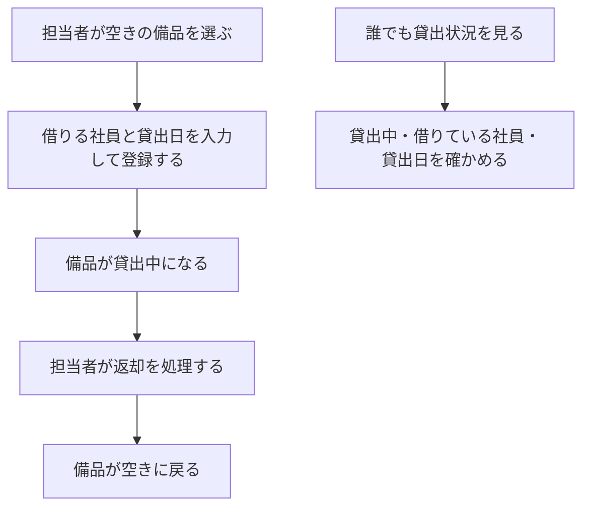
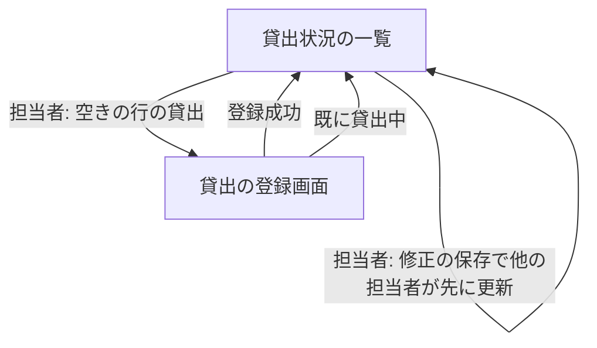

# 変更要件定義書: 備品の貸出と返却（段 2）

正本: `docs/requirements.md`（段 1 の要件定義書）。この文書は正本を書き換えず、変更する要件だけを [追加] か [削除] で書く。
変更の依頼: `REQUEST.md`（段 2）。固定回答: `ANSWERS.md`。

## 1. 目的・前提

### 目的

段 1 のアプリに貸出と返却を足し、貸出の記録も同じアプリにまとめる。社員が「どの備品を誰が借りているか」を担当者に問い合わせずに自分で確かめられるようにする（担当者の問い合わせ対応 1 回 15 分が無くなる）。

### 用語集

| 用語 | 業務上の意味 | 本案件での使用範囲 | 同義語/類義語 |
|---|---|---|---|
| [追加] 貸出 | 空いている備品を、ある社員に渡して使ってもらうこと | 担当者が貸出の登録をすると、その備品は貸出中になる | 貸し出し |
| [追加] 借りる社員 | 貸出の相手の社員。アカウントから選ぶ | 貸出の登録で選ぶ。名前（社員番号）の形で選択肢に出す | 借り手 |
| [追加] 貸出日 | 貸し出した日 | 既定は今日（日本時間）。未来の日付は受け付けない。今日と過去は可 | 貸出の日付 |
| [追加] 返却 | 貸出中の備品が戻ること | 担当者が返却を処理すると、貸出の記録を消して空きに戻す。返却した記録は残さない | 返品 |

### システムの形態

変更なし。GUI（ブラウザで開く画面）。既存要件定義書 `docs/requirements.md` 1 章を参照。

### 1-1. 技術制約

変更なし。既存要件定義書 `docs/requirements.md` 1-1 を参照。

## 2. 業務

### 対象業務一覧

| RQ-BZ-ID | 業務名 | 業務の範囲 | 担当者 |
|---|---|---|---|
| [追加] `RQ-BZ-EQUIPMENT-LENDING` | 備品の貸出と返却 | 空いている備品の貸出の登録、貸出中の備品の返却の処理、貸出状況の確認 | 担当者（貸出・返却）、社員と未ログインの人（貸出状況の確認） |

業務フロー（追加分）:

業務フローとの対応: 「担当者が空きの備品を選ぶ」から「備品が空きに戻る」までは「備品の貸出と返却」の業務、「誰でも貸出状況を見る」は既存の「誰でも貸出状況を見る」に対応する。

### 2-1. 業務の問題（あるべき姿と現状のギャップ）

変更なし。既存要件定義書 `docs/requirements.md` 2-1 の 2 つの問題を、今回の業務課題で解決する。

### 2-2. 業務課題一覧

| RQ-BK-ID | 業務課題（取り組むこと） | 解決する問題（2-1） | 解決後の状態（KPI の目標値） | 対象業務（RQ-BZ） |
|---|---|---|---|---|
| [追加] `RQ-BK-LOAN-RECORD-IN-APP` | 貸出の記録を備品の台帳と同じアプリで持ち、貸出中かどうかと借りている社員を、担当者の調べ作業なしに分かるようにする | 既存 2-1 の 1 行目（記録が複数の Excel に分かれ、食い違いと消失が起きている）、2 行目（社員が担当者に問い合わせ、担当者が 1 回 15 分調べている） | 貸出の記録が 1 つのアプリにあり、貸出中の備品の二重の貸出と返却の記録の消失が起きない（目標件数: 0 件）。問い合わせ対応の 1 回 15 分が 0 分になる | [追加] `RQ-BZ-EQUIPMENT-LENDING` |

### 2-3. 見込み経営効果

変更なし。既存要件定義書 `docs/requirements.md` 2-3 の見込み経営効果を参照。

## 3. 機能要件

### 入力データと出力データ

- 入力データ: 人手入力（貸出の登録画面の借りる社員と貸出日、返却の確認、備品の修正の保存）。外部からの入力は無い
- 出力データ: 画面の表示（貸出状況の一覧に貸出中・借りている社員・貸出日、入力の結果の知らせ、入力のエラー）。帳票・ファイル出力は無い

### 利用フロー（追加分）

業務フローとの対応: 「貸出の登録」は「担当者が空きの備品を選ぶ」「借りる社員と貸出日を入力して登録する」に、「返却」は「担当者が返却を処理する」に対応する。

### 機能一覧（追加分）

| RQ-ID | カテゴリ | 機能名 | 対応業務課題ID（RQ-BK-*） | この機能が無いと何が困るか |
|---|---|---|---|---|
| [追加] `RQ-FT-REGISTER-LOAN` | 業務機能 | 空いている備品を、借りる社員と貸出日を記録して貸し出す（担当者だけ） | `RQ-BK-LOAN-RECORD-IN-APP` | 貸出の記録がアプリに無く、貸出中かどうかを担当者が調べることになる |
| [追加] `RQ-FT-RETURN-EQUIPMENT` | 業務機能 | 貸出中の備品の返却を処理する（担当者だけ。確認ダイアログで「はい」のときだけ） | `RQ-BK-LOAN-RECORD-IN-APP` | 返却されても貸出中のままになり、空き状況が実態と食い違う |
| [追加] `RQ-FT-SHOW-LOAN-DETAILS` | 業務機能 | 貸出状況の一覧に、貸出中か、借りている社員の名前、貸出日を出す | `RQ-BK-SELF-SERVICE-STATUS-VIEW` | 社員が「誰が借りているか」を一覧で確かめられず、担当者に問い合わせることになる |

### 業務ルール（追加分）

| RQ-ID | ルール名 | 内容（条件と結果） | 違反時・エラー時の業務上の扱い | 対応業務課題ID（RQ-BK-*） |
|---|---|---|---|---|
| [追加] `RQ-FT-MANAGER-ONLY-LOAN-OPERATION` | 貸出・返却は担当者だけ | 貸出の登録と返却（画面と、その操作を要求する通信の両方）は担当者だけが行える。社員と未ログインの人の要求は、受け付けずに貸出の記録を変えない。未ログインの要求はログイン画面へ送る | 社員の要求は貸出状況の画面に戻し、「この操作は担当者だけが行えます」と知らせる。未ログインの要求はログイン画面へ送る | `RQ-BK-LOAN-RECORD-IN-APP` |
| [追加] `RQ-FT-NO-DOUBLE-LOAN` | 貸出中の備品は貸し出せない | 貸出中の備品には、新しく貸出を登録できない。2 人の担当者がほぼ同時に同じ備品を貸し出したときは、先に登録した 1 件だけを記録し、後の登録は記録しない | 後の登録は貸出状況の画面に戻し、「この備品は既に貸出中です」と知らせる | `RQ-BK-LOAN-RECORD-IN-APP` |
| [追加] `RQ-FT-NO-DOUBLE-RETURN` | 返却済みの備品は返却できない | 空きの備品には返却を処理できない。2 人の担当者がほぼ同時に同じ備品の返却を処理したときは、先の処理だけを行い、後の処理は行わない | 後の処理は貸出状況の画面に戻し、「この備品は既に返却されています」と知らせる | `RQ-BK-LOAN-RECORD-IN-APP` |
| [追加] `RQ-FT-LOAN-DATE-NOT-FUTURE` | 貸出日に未来の日付は使えない | 貸出日は今日または過去の日付だけを受け付ける。既定は日本時間の今日。借りる社員が未選択のときも登録しない | 貸出日が未来のときは貸出日の入力欄に「貸出日に未来の日付は入力できません」を出す。借りる社員が未選択のときは借りる社員の入力欄に「借りる社員を選んでください」を出す。どちらも登録せず、入力値を残す | `RQ-BK-LOAN-RECORD-IN-APP` |
| [追加] `RQ-FT-NO-DELETE-LOANED-EQUIPMENT` | 貸出中の備品は削除できない | 貸出中の備品の削除は行わない。削除の処理の中で貸出の有無を確かめ、貸出中なら削除しない | 貸出状況の画面に戻し、「この備品は貸出中のため削除できません。先に返却を処理してください」と知らせる | `RQ-BK-LOAN-RECORD-IN-APP` |
| [追加] `RQ-FT-EDIT-KEEPS-LOAN` | 修正しても貸出を引き継ぐ | 備品の管理番号と備品名を修正しても、その備品の貸出の記録はそのまま残す（借りる社員と貸出日は変わらない） | 該当なし | `RQ-BK-LOAN-RECORD-IN-APP` |
| [追加] `RQ-FT-EDIT-CONFLICT-REJECT` | 修正中の他の担当者の更新・削除を検出する | 修正画面を開いてから保存するまでに、他の担当者が同じ備品を修正または削除していたら、保存を受け付けず、修正画面を開き直してもらう | 修正画面に「他の担当者が先にこの備品を更新しました。貸出状況の画面から開き直してください」を `.error` に出し、保存しない | `RQ-BK-SINGLE-EQUIPMENT-RECORD`, `RQ-BK-LOAN-RECORD-IN-APP` |

### 3-1. 帳票・出力ファイル

変更なし。帳票・出力ファイルは無い。

### 3-3. 外部連携

変更なし。外部連携は無い。

## 4. データ

### 4-1. データ要件一覧（追加分）

| RQ-ID | 種別 | 内容 | 対応業務課題ID（RQ-BK-*） | この要件が無いと何が困るか |
|---|---|---|---|---|
| [追加] `RQ-DT-LOAN-RECORD` | DB の必要性・保持 | 貸出の記録を DB に持つ。備品 1 件に対して貸出の記録は 0 件か 1 件。返却した貸出の記録は消し、残さない（履歴の表を持たない）。同時の更新で記録が失われないよう、書き込みを排他する。初期件数は 0 件、想定は備品が数百件・アカウント 50 件まで | `RQ-BK-LOAN-RECORD-IN-APP` | 同時の貸出・返却で記録が食い違い、二重の貸出が起きる |

### 4-2. 業務エンティティとデータ項目（追加分）

[追加] エンティティ「貸出」の項目:

| エンティティ名 | 項目名 | 業務上の意味 | 必須 | 形式・桁 | 値の範囲・制約 | 例 |
|---|---|---|---|---|---|---|
| [追加] 貸出 | 備品 | 貸し出している備品 | 必須 | 備品の内部の識別子 | 備品 1 件に対して 0 件か 1 件（同時に 2 件は作らない） | （備品の識別子） |
| [追加] 貸出 | 借りる社員 | 借りている社員 | 必須 | アカウントの内部の識別子 | アカウントの 1 件を指す | （アカウントの識別子） |
| [追加] 貸出 | 貸出日 | 貸し出した日 | 必須 | 日付（YYYY-MM-DD） | 今日または過去（`RQ-FT-LOAN-DATE-NOT-FUTURE`） | 2026-11-04 |

[追加] エンティティ「備品」の追加項目（内部の版番号。修正のたびに 1 増える。画面では修正画面の隠し項目として持ち、保存の時に確かめる）:

| エンティティ名 | 項目名 | 業務上の意味 | 必須 | 形式・桁 | 値の範囲・制約 | 例 |
|---|---|---|---|---|---|---|
| [追加] 備品 | 版番号 | 修正の回数の目印。修正画面を開いたときの値と保存時の値を比べ、他の担当者の更新を検出する（`RQ-FT-EDIT-CONFLICT-REJECT`） | 必須 | 整数 | 1 以上。登録時は 1 | 1 |

### 4-3. CRUD テーブル

| エンティティ名 | Create | Read（一覧） | Read（詳細） | 検索 | Update | Delete | 備考 |
|---|---|---|---|---|---|---|---|
| アカウント | 変更なし（既存要件定義書 4-3 を参照） | 変更なし | 変更なし | 変更なし | 変更なし | 変更なし | 変更なし |
| [削除] 備品 | ○（担当者のみ） | ○（誰でも。貸出状況の一覧） | ○（担当者のみ。修正画面を開くとき） | × | ○（担当者のみ） | ○（担当者のみ） | 段 1 の表。一覧の状態は常に「空き」 |
| [追加] 備品 | ○（担当者のみ） | ○（誰でも。貸出状況の一覧。貸出中なら借りている社員と貸出日を結ぶ） | ○（担当者のみ。修正画面を開くとき。版番号を含む） | × | ○（担当者のみ。版番号が開いたときと同じ時だけ保存する。貸出の記録は引き継ぐ） | ○（担当者のみ。貸出中は削除しない） | 管理番号の重複は一意制約で判定する（変更なし） |
| [追加] 貸出 | ○（担当者のみ。空きの備品への貸出の登録） | ○（誰でも。貸出状況の一覧で備品と結ぶ） | × | × | × | ○（担当者のみ。返却で記録を消す。物理削除） | 同じ備品に 2 件の貸出は作らない（一意制約） |

### 4-4. 状態遷移（追加分）

| RQ-ID | 対象 | 状態 | 遷移の契機 | 許されない遷移の扱い | 対応業務課題ID（RQ-BK-*） |
|---|---|---|---|---|---|
| [追加] `RQ-DT-EQUIPMENT-LOAN-STATE` | 備品の貸出状況（貸出の記録の有無で決まる） | 空き（貸出の記録が無い）、貸出中（貸出の記録が 1 件ある） | 空き → 貸出中: 担当者が貸出を登録する。貸出中 → 空き: 担当者が返却を処理する | 貸出中 → 貸出中（既に貸出中の登録）と、空き → 空き（既に返却済みの返却）は行わず、知らせる（`RQ-FT-NO-DOUBLE-LOAN`、`RQ-FT-NO-DOUBLE-RETURN`） | `RQ-BK-LOAN-RECORD-IN-APP` |

### 4-5. 画面一覧（追加分）

| RQ-ID | 画面名 | 対応する CRUD 操作（エンティティ名:操作種別） | 主な機能・目的 | 対応業務課題ID（RQ-BK-*） |
|---|---|---|---|---|
| [追加] `RQ-UI-LOAN-REGISTER-SCREEN` | 貸出の登録 | 貸出:Create、備品:Read（詳細） | 空いている備品について、借りる社員と貸出日を選んで貸出を登録する（担当者だけ） | `RQ-BK-LOAN-RECORD-IN-APP` |

変更なし: 貸出状況の画面（一覧画面）は段 1 のまま。表示項目（貸出中・借りている社員・貸出日）と行の操作（担当者だけ、「貸出」「返却」）は `RQ-FT-SHOW-LOAN-DETAILS`、`RQ-FT-REGISTER-LOAN`、`RQ-FT-RETURN-EQUIPMENT` で定義する。

[追加] 貸出の登録画面（`RQ-UI-LOAN-REGISTER-SCREEN`）の 5 項目:

- 目的: 担当者が空きの備品を貸し出す
- 主要要素: 備品の表示（`.lending-equipment` に「備品: <管理番号> <備品名>」）、借りる社員の選択（`id_borrower`）、貸出日の入力欄（`id_lent_on`。既定は今日）、「登録」ボタン
- 入力項目: 借りる社員（アカウントから選ぶ。選択肢の表示は「名前（社員番号）」）、貸出日（YYYY-MM-DD）
- 表示項目: 無し（成功時は貸出状況の画面に戻し「貸出を登録しました」）
- エラー時の見え方: 借りる社員の未選択と未来の貸出日は入力欄ごとの `.field-error`。入力値は残す。既に貸出中なら貸出状況の画面に戻して `.message` に「この備品は既に貸出中です」。担当者以外は貸出状況の画面に戻し `.message` に「この操作は担当者だけが行えます」

## 5. 非機能要件（追加分）

| RQ-ID | カテゴリ | 非機能要件名 | 対応業務課題ID（RQ-BK-*） | この非機能要件が無いと何が困るか |
|---|---|---|---|---|
| [追加] `RQ-NF-RESPONSE-3S-AT-50-USERS` | 性能 | 利用者 50 人が同時に画面を開き、ボタンを押しても、操作から結果の表示まで 3 秒以内（備品 500 件の一覧の画面でも） | `RQ-BK-SELF-SERVICE-STATUS-VIEW`, `RQ-BK-LOAN-RECORD-IN-APP` | 同時に使うと応答が遅くなり、業務が止まる |

## 6. 運用要件

変更なし。既存要件定義書 `docs/requirements.md` 6 章を参照。

## 7. テスト用利用シナリオ（追加分）

| RQ-ID | テスト目的 | 前提条件 | テスト手順 | 期待される結果 | 検証する要件ID | 対応業務課題ID（RQ-BK-*） |
|---|---|---|---|---|---|---|
| [追加] `RQ-TS-REGISTER-LOAN` | 担当者が空きの備品を貸し出し、一覧に貸出中と借りている社員・貸出日が出る | 担当者でログイン済み。備品 `PC-0001` が 1 件ある。社員 1 人が登録されている | 一覧の「貸出」を押す。借りる社員を選び、貸出日は既定の今日のまま「登録」を押す | 一覧に戻り、`PC-0001` の行に「貸出中」、借りている社員の名前、今日の日付が出る | `RQ-FT-REGISTER-LOAN`, `RQ-FT-SHOW-LOAN-DETAILS`, `RQ-UI-LOAN-REGISTER-SCREEN` | `RQ-BK-LOAN-RECORD-IN-APP` |
| [追加] `RQ-TS-LOAN-INPUT-VALIDATION` | 貸出の入力の検査 | 担当者でログイン済み。備品 `PC-0001` が空き。社員 1 人が登録されている | 借りる社員を選ばずに「登録」を押す。次に、貸出日に明日の日付を入力して「登録」を押す。次に、貸出日に今日と過去の日付（例: 2026-01-01）で登録する | 未選択は `id_borrower` の `.field-error` に「借りる社員を選んでください」。未来の日付は `id_lent_on` の `.field-error` に「貸出日に未来の日付は入力できません」が出て、登録されない。今日と過去の日付は登録される | `RQ-FT-LOAN-DATE-NOT-FUTURE`, `RQ-FT-REGISTER-LOAN`, `RQ-UI-LOAN-REGISTER-SCREEN` | `RQ-BK-LOAN-RECORD-IN-APP` |
| [追加] `RQ-TS-NO-DOUBLE-LOAN` | 貸出中の備品は貸し出せず、同時の貸出は先の 1 件だけになる | 担当者でログイン済み。備品 `PC-0001` が空き。社員 2 人が登録されている | 1 件貸し出したあと、同じ備品に別の社員で貸出を登録する。次に、空きの `PC-0002` に対して、2 つの要求を同時に送る（別の社員を借りる社員にする） | 2 回目は貸出状況の画面の `.message` に「この備品は既に貸出中です」が出て、記録は変わらない。同時の 2 つの要求は、1 件だけ記録され、もう 1 件は「この備品は既に貸出中です」になる | `RQ-FT-NO-DOUBLE-LOAN`, `RQ-UI-LOAN-REGISTER-SCREEN` | `RQ-BK-LOAN-RECORD-IN-APP` |
| [追加] `RQ-TS-RETURN-EQUIPMENT` | 返却の確認で「はい」のときだけ返却し、空きに戻る | 担当者でログイン済み。備品 `PC-0001` が貸出中 | 一覧の「返却」を押し、確認ダイアログで「キャンセル」を選ぶ。次に「返却」を押し、「はい」を選ぶ | キャンセルのときは貸出中のまま。「はい」のあとは `PC-0001` の行が「空き」になり、名前と貸出日が空欄になる | `RQ-FT-RETURN-EQUIPMENT`, `RQ-FT-SHOW-LOAN-DETAILS` | `RQ-BK-LOAN-RECORD-IN-APP` |
| [追加] `RQ-TS-NO-DOUBLE-RETURN` | 返却済みの備品は返却できず、同時の返却は先の 1 件だけになる | 担当者でログイン済み。備品 `PC-0001` が貸出中 | 返却を 1 回処理したあと、同じ備品の返却を再度送る。次に、貸出中の `PC-0002` に対して 2 つの返却要求を同時に送る | 2 回目は `.message` に「この備品は既に返却されています」が出る。同時の 2 つは、1 件だけ処理され、もう 1 件は「この備品は既に返却されています」になる。記録は 1 回分だけ消える | `RQ-FT-NO-DOUBLE-RETURN` | `RQ-BK-LOAN-RECORD-IN-APP` |
| [追加] `RQ-TS-NO-DELETE-LOANED-EQUIPMENT` | 貸出中の備品は削除できない | 担当者でログイン済み。備品 `PC-0001` が貸出中 | 一覧の「削除」を押し、確認ダイアログで「はい」を選ぶ | 一覧の `.message` に「この備品は貸出中のため削除できません。先に返却を処理してください」が出る。`PC-0001` の行は残り、貸出中のまま | `RQ-FT-NO-DELETE-LOANED-EQUIPMENT` | `RQ-BK-LOAN-RECORD-IN-APP` |
| [追加] `RQ-TS-EDIT-KEEPS-LOAN` | 修正しても貸出の記録を引き継ぐ | 担当者でログイン済み。備品 `PC-0001` が貸出中 | 貸出中の備品の修正画面を開き、備品名を変えて「保存」を押す。管理番号も別の未使用の番号に変えて「保存」を押す | 一覧に新しい備品名と新しい管理番号が出て、借りている社員の名前と貸出日は変わらず「貸出中」のまま | `RQ-FT-EDIT-KEEPS-LOAN` | `RQ-BK-LOAN-RECORD-IN-APP` |
| [追加] `RQ-TS-EDIT-CONFLICT-REJECT` | 修正画面を開いたあとに他の担当者が更新・削除していたら保存を拒否する | 担当者 2 人（A と B）が、備品 `PC-0001` の修正画面を開いている | 担当者 B が `PC-0001` の備品名を変えて保存する。次に担当者 A が古い画面で別の備品名にして保存する。次に、担当者 B が `PC-0002` を削除し、担当者 A が古い画面で保存する | A の 1 回目は修正画面に「他の担当者が先にこの備品を更新しました。貸出状況の画面から開き直してください」が `.error` に出て保存されない。削除された後の保存も同じ `.error` が出て保存されない。一覧の内容は B の変更のままになる | `RQ-FT-EDIT-CONFLICT-REJECT`, `RQ-UI-EQUIPMENT-FORM-SCREEN` | `RQ-BK-SINGLE-EQUIPMENT-RECORD`, `RQ-BK-LOAN-RECORD-IN-APP` |
| [追加] `RQ-TS-MEMBER-AND-GUEST-CANNOT-LOAN-OR-RETURN` | 社員と未ログインの人が貸出・返却を要求しても受け付けられない | 社員でログイン済みの場合と、ログインしていない場合。備品 `PC-0001` が空き（返却の要求は貸出中にして試す） | 社員で貸出の登録画面 `/equipment/PC-0001/loan/` を開く。社員で返却を直接送る（`/equipment/PC-0001/return/` に POST）。ログインせずに同じ 2 つを送る | 社員は貸出状況の画面に戻り `.message` に「この操作は担当者だけが行えます」が出る。未ログインはログイン画面へ送られる。備品の記録は変わらない。社員の画面に「貸出」「返却」のボタンが出ない | `RQ-FT-MANAGER-ONLY-LOAN-OPERATION`, `RQ-UI-LOAN-REGISTER-SCREEN`, `RQ-UI-LOAN-STATUS-SCREEN` | `RQ-BK-LOAN-RECORD-IN-APP` |
| [追加] `RQ-TS-VIEW-LOAN-DETAILS-AS-GUEST` | ログインしていない人が貸出中の名前と貸出日を見られる | 備品 `PC-0001` が貸出中（社員 `山田太郎` に貸出、貸出日は 2026-11-01）。`PC-0002` は空き | ログインせずに `/` を開く | `PC-0001` の行に「貸出中」「山田太郎」「2026-11-01」が出る。`PC-0002` の行は「空き」で名前と日付は空欄。ボタンは出ず、「ログイン」「アカウント登録」のリンクが出る | `RQ-FT-SHOW-LOAN-DETAILS`, `RQ-FT-VIEW-LOAN-STATUS`, `RQ-UI-LOAN-STATUS-SCREEN` | `RQ-BK-SELF-SERVICE-STATUS-VIEW` |
| [追加] `RQ-TS-CONCURRENT-RESPONSE-TIME` | 50 人が同時に開いても 3 秒以内に表示する | 備品 500 件（うち数件は貸出中）。社員と担当者のアカウントがある | 50 人分の要求を同時に `/` に送り、各応答までの時間を測る | 50 件すべての応答が 3 秒以内 | `RQ-NF-RESPONSE-3S-AT-50-USERS` | `RQ-BK-SELF-SERVICE-STATUS-VIEW`, `RQ-BK-LOAN-RECORD-IN-APP` |

### 7-1. 変更が無い章

テスト用利用シナリオの段 1 の行は変更しない。段 1 の「未ログインで貸出状況を見る」と「役割ごとのボタンの出し分け」は、貸出が無い前提で段 1 の期待結果のまま有効。
