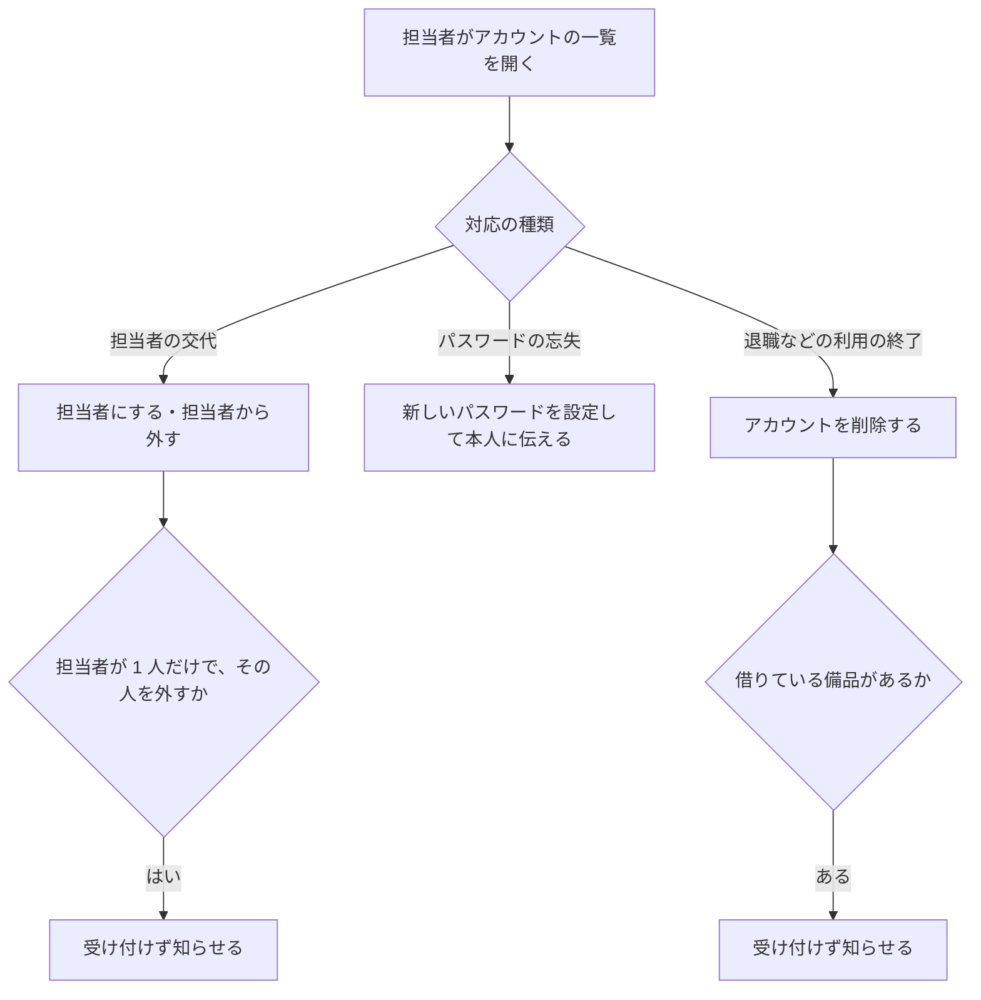
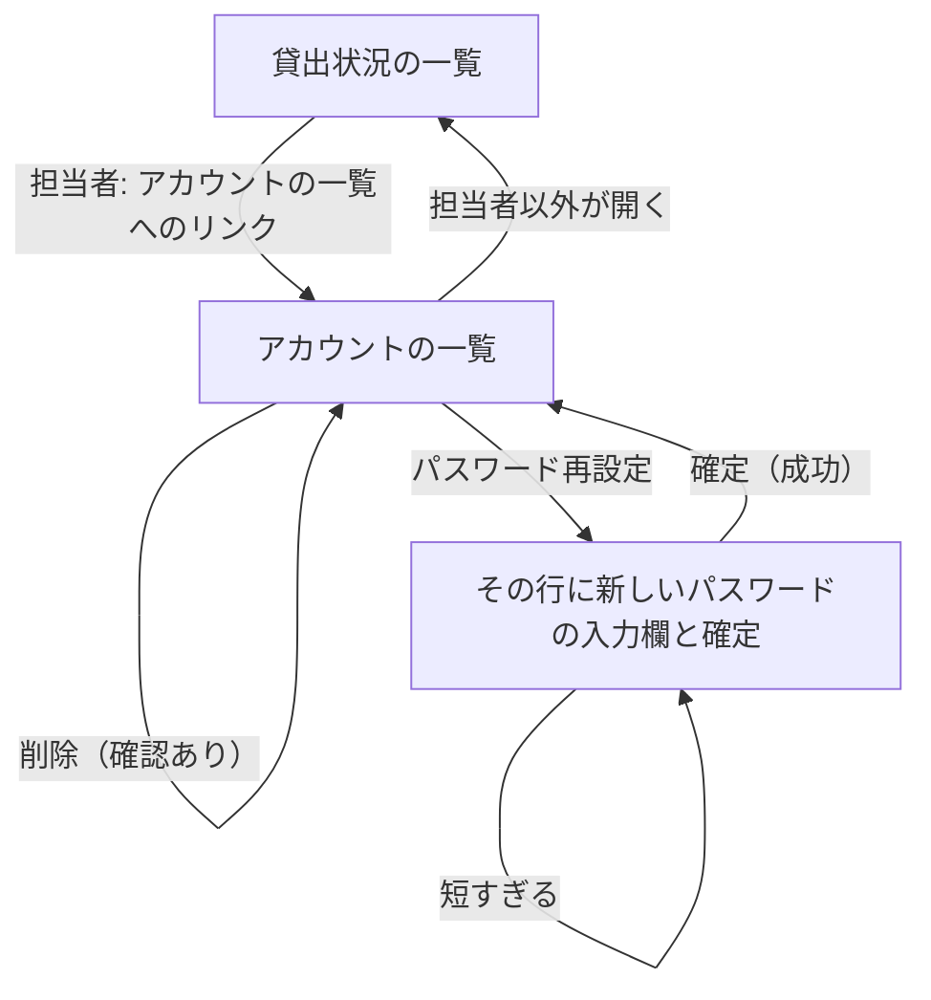

# 変更要件定義書: アカウントの管理（段 3）

正本: `docs/requirements.md`（段 1・2 の要件定義書）。この文書は正本を書き換えず、変更する要件だけを [追加] か [削除] で書く。
変更の依頼: `REQUEST.md`（段 3）。固定回答: `ANSWERS.md`。採点の契約: `contract.md`（段 3 の節）。

## 1. 目的・前提

### 目的

担当者の交代、退職による利用の終了、パスワードの忘失に、担当者が画面から対応できるようにする。今は DB を直接操作するしかなく、対応のたびに手作業が生じている。

### 用語集（追加分）

| 用語 | 業務上の意味 | 本案件での使用範囲 | 同義語/類義語 |
|---|---|---|---|
| [追加] アカウントの管理 | 担当者が、アカウントの一覧を見て、担当者の付け外し、パスワードの再設定、削除を行うこと | 担当者だけが行える。一覧の行のボタンから操作する | 利用者の管理 |
| [追加] 担当者の付け外し | アカウントを担当者にする、または担当者から外すこと | 担当者が 1 人だけのとき、その人を外すことはできない（担当者を 0 人にしない） | 役割の変更 |
| [追加] パスワードの再設定 | 担当者が、社員の新しいパスワードを設定して本人に伝えること | 8 文字以上。再設定の後は古いパスワードではログインできない | パスワードの初期化 |
| [追加] アカウントの削除 | 退職などで使わなくなったアカウントを消すこと | 借りている備品が 1 台も無いアカウントだけ削除できる。削除したアカウントではログインできず、借りる社員の候補にも出ない。削除の記録は残さない | 退職処理 |

### システムの形態

変更なし。GUI（ブラウザで開く画面）。既存要件定義書 `docs/requirements.md` 1 章を参照。

### 1-1. 技術制約

変更なし。既存要件定義書 `docs/requirements.md` 1-1 を参照。

## 2. 業務

### 対象業務一覧（追加分）

| RQ-BZ-ID | 業務名 | 業務の範囲 | 担当者 |
|---|---|---|---|
| [追加] `RQ-BZ-ACCOUNT-MANAGEMENT` | アカウントの管理 | アカウントの一覧、担当者の付け外し、パスワードの再設定、アカウントの削除 | 担当者だけ |

業務フロー（追加分）:

業務フローとの対応: 「担当者がアカウントの一覧を開く」から各対応までは「アカウントの管理」の業務に対応する。

### 2-1. 業務の問題（あるべき姿と現状のギャップ）

変更なし。既存要件定義書 `docs/requirements.md` 2-1 の問題を前提とする。本変更では、既存 2-1 に無い新しい課題（担当者の交代・退職・パスワードの忘失の対応が DB の直接操作になっている）を扱う。

### 2-2. 業務課題一覧（追加分）

| RQ-BK-ID | 業務課題（取り組むこと） | 解決する問題（2-1） | 解決後の状態（KPI の目標値） | 対象業務（RQ-BZ） |
|---|---|---|---|---|
| [追加] `RQ-BK-MANAGER-ACCOUNT-SCREEN` | 担当者の交代、退職、パスワードの忘失の対応を、担当者が画面から行えるようにし、DB の直接操作をなくす | 既存 2-1 には無い新しい課題（依頼者の現状: 対応のたびに DB を直接触っている） | 担当者の交代・退職・パスワードの忘失の対応が、DB を直接触らずに画面だけで済む（DB の直接操作の件数: 0 件） | [追加] `RQ-BZ-ACCOUNT-MANAGEMENT` |

### 2-3. 見込み経営効果（追加分）

変更なし。既存要件定義書 `docs/requirements.md` 2-3 を参照。DB の直接操作が無くなることで、対応の手戻りを防ぐ。

## 3. 機能要件

### 入力データと出力データ（追加分）

- 入力データ: 人手入力（アカウントの一覧の操作ボタン、確認ダイアログ、新しいパスワードの入力欄）。外部からの入力は無い
- 出力データ: 画面の表示（アカウントの一覧、操作の結果の知らせ、入力のエラー）。帳票・ファイル出力は無い

### 利用フロー（追加分）

業務フローとの対応: 「担当者にする・担当者から外す」「パスワードの再設定」「削除」は、業務フローの 3 つの対応に対応する。

### 機能一覧（追加分）

| RQ-ID | カテゴリ | 機能名 | 対応業務課題ID（RQ-BK-*） | この機能が無いと何が困るか |
|---|---|---|---|---|
| [追加] `RQ-FT-LIST-ACCOUNTS` | 業務機能 | 担当者が全アカウントの一覧（社員番号、名前、担当者か社員か）を見る | `RQ-BK-MANAGER-ACCOUNT-SCREEN` | 担当者が、誰がどの役割かを画面で確かめられず、DB を直接見ることになる |
| [追加] `RQ-FT-CHANGE-ACCOUNT-ROLE` | 業務機能 | 担当者が、アカウントを担当者にする、または担当者から外す（確認ダイアログで「はい」のときだけ） | `RQ-BK-MANAGER-ACCOUNT-SCREEN` | 担当者の交代を DB の直接操作でしかできない |
| [追加] `RQ-FT-RESET-ACCOUNT-PASSWORD` | 業務機能 | 担当者が、社員の新しいパスワード（8 文字以上）を設定する。再設定の後は古いパスワードではログインできない | `RQ-BK-MANAGER-ACCOUNT-SCREEN` | パスワードを忘れた社員が、ログインできないまま業務が止まる |
| [追加] `RQ-FT-DELETE-ACCOUNT` | 業務機能 | 担当者が、アカウントを削除する（確認ダイアログで「はい」のときだけ）。削除したアカウントではログインできず、借りる社員の候補にも出ない | `RQ-BK-MANAGER-ACCOUNT-SCREEN` | 退職した人のアカウントが残り、ログインや貸出の候補に出続ける |

### 業務ルール（追加分）

| RQ-ID | ルール名 | 内容（条件と結果） | 違反時・エラー時の業務上の扱い | 対応業務課題ID（RQ-BK-*） |
|---|---|---|---|---|
| [追加] `RQ-FT-MANAGER-ONLY-ACCOUNT-MANAGEMENT` | アカウントの管理は担当者だけ | アカウントの一覧と、担当者の付け外し・パスワードの再設定・削除の操作（画面と、その操作を要求する通信の両方）は担当者だけが行える。社員と未ログインの人の要求は受け付けず、アカウントの記録を変えない | 社員の要求は貸出状況の画面に戻し、「この操作は担当者だけが行えます」と知らせる。未ログインの要求はログイン画面へ送る | `RQ-BK-MANAGER-ACCOUNT-SCREEN` |
| [追加] `RQ-FT-KEEP-ONE-MANAGER` | 担当者を 0 人にしない | 担当者が 1 人だけのとき、その人を担当者から外す操作と、その人のアカウントを削除する操作は行わない。担当者が 2 人以上いれば可能 | アカウントの一覧に「担当者が 1 人もいなくなるため、この操作はできません」を `.message` に出し、何も変えない | `RQ-BK-MANAGER-ACCOUNT-SCREEN` |
| [追加] `RQ-FT-NO-DELETE-BORROWING-ACCOUNT` | 備品を借りている社員は削除できない | 1 台以上の備品を借りている社員のアカウントは削除しない。貸出の記録がある間は、削除の処理の中で貸出の有無を確かめて止める | アカウントの一覧に「この社員は備品を借りているため削除できません。先に返却を処理してください」を `.message` に出し、削除しない | `RQ-BK-MANAGER-ACCOUNT-SCREEN` |
| [追加] `RQ-FT-ACCOUNT-CHANGE-TAKES-EFFECT` | 担当者の変更と削除は次の要求から効く | 担当者の付け外しと削除は、その人の次の要求から効く。ログイン中の人も、要求ごとに DB の記録を見直す。担当者から外された人は担当者の画面を開けず、削除された人は未ログインとして扱う | 担当者でなくなった人の操作は「この操作は担当者だけが行えます」で拒否する。削除された人は未ログインとして扱い、ログイン画面へ送る | `RQ-BK-MANAGER-ACCOUNT-SCREEN` |

### 3-1. 帳票・出力ファイル

変更なし。帳票・出力ファイルは無い。

### 3-3. 外部連携

変更なし。外部連携は無い。

## 4. データ

### 4-1. データ要件一覧（追加分）

| RQ-ID | 種別 | 内容 | 対応業務課題ID（RQ-BK-*） | この要件が無いと何が困るか |
|---|---|---|---|---|
| [追加] `RQ-DT-ACCOUNT-HARD-DELETE` | DB の必要性・保持 | 削除したアカウントは、行ごと消す。削除の記録（履歴の表）は持たない。パスワードは再設定のたびにハッシュで置き換える | `RQ-BK-MANAGER-ACCOUNT-SCREEN` | 退職者のアカウントが残り、ログインや貸出の候補に出続ける |

### 4-2. 業務エンティティとデータ項目（追加分）

変更なし。アカウントの項目（社員番号、名前、パスワードのハッシュ、役割）は既存のまま。役割は「担当者」（manager）か「社員」（member）。

### 4-3. CRUD テーブル（変更分）

| エンティティ名 | Create | Read（一覧） | Read（詳細） | 検索 | Update | Delete | 備考 |
|---|---|---|---|---|---|---|---|
| [追加] アカウント（管理） | 変更なし（登録は既存の画面） | ○（担当者のみ。アカウントの一覧） | × | × | ○（担当者のみ。役割の付け外し、パスワードの再設定） | ○（担当者のみ。借りていない社員のみ。担当者が 1 人だけのときは不可） | 段 1 の登録の画面は変更なし。削除は物理削除（`RQ-DT-ACCOUNT-HARD-DELETE`） |

### 4-4. 状態遷移（追加分）

| RQ-ID | 対象 | 状態 | 遷移の契機 | 許されない遷移の扱い | 対応業務課題ID（RQ-BK-*） |
|---|---|---|---|---|---|
| [追加] `RQ-DT-ACCOUNT-ROLE-STATE` | アカウントの役割 | 担当者、社員 | 社員 → 担当者: 担当者が「担当者にする」を行う。担当者 → 社員: 担当者が「担当者から外す」を行う（担当者が 2 人以上のとき） | 担当者が 0 人になる遷移は行わない（`RQ-FT-KEEP-ONE-MANAGER`） | `RQ-BK-MANAGER-ACCOUNT-SCREEN` |

### 4-5. 画面一覧（追加分）

| RQ-ID | 画面名 | 対応する CRUD 操作（エンティティ名:操作種別） | 主な機能・目的 | 対応業務課題ID（RQ-BK-*） |
|---|---|---|---|---|
| [追加] `RQ-UI-ACCOUNT-LIST-SCREEN` | アカウントの一覧 | アカウント:Read（一覧）、アカウント:Update（役割、パスワード）、アカウント:Delete | 担当者が全アカウントを見て、担当者の付け外し、パスワードの再設定、削除を行う（担当者だけ） | `RQ-BK-MANAGER-ACCOUNT-SCREEN` |

[追加] アカウントの一覧（`RQ-UI-ACCOUNT-LIST-SCREEN`）の 5 項目:

- 目的: 担当者がアカウントを管理する
- 主要要素: 表（`tbody tr`、各行に社員番号を `data-employee-number` で付ける。列は社員番号、名前、「担当者」または「社員」、操作）。操作のボタンは「担当者にする」「担当者から外す」「パスワード再設定」「削除」。リンク「アカウントの一覧」は貸出状況の画面に出す（担当者だけ）
- 入力項目: パスワード再設定を押した行にだけ、新しいパスワードの入力欄（`input[name=new_password]`）と「確定」ボタン
- 表示項目: 操作の結果の知らせ（`.message`）、パスワードの入力のエラー（その行の `.field-error`）
- エラー時の見え方: 担当者以外は貸出状況の画面に戻し `.message` に「この操作は担当者だけが行えます」。未ログインはログイン画面へ。借りている社員の削除と担当者 0 人は `.message`。確認ダイアログで「いいえ」のときは何もしない

## 5. 非機能要件（追加分）

変更なし。既存要件定義書 `docs/requirements.md` 5 章の性能の要件（50 人、3 秒以内）を、アカウントの一覧にも適用する（新しい非機能要件は無い）。
| RQ-ID | カテゴリ | 非機能要件名 | 対応業務課題ID（RQ-BK-*） | この非機能要件が無いと何が困るか |
|---|---|---|---|---|

## 6. 運用要件

変更なし。既存要件定義書 `docs/requirements.md` 6 章を参照。

## 7. テスト用利用シナリオ（追加分）

| RQ-ID | テスト目的 | 前提条件 | テスト手順 | 期待される結果 | 検証する要件ID | 対応業務課題ID（RQ-BK-*） |
|---|---|---|---|---|---|---|
| [追加] `RQ-TS-LIST-ACCOUNTS` | 担当者がアカウントの一覧を見られる | 担当者 `000001`（山田太郎）と社員 `000002`（佐藤花子）が登録されている。担当者でログイン済み | 「アカウントの一覧」のリンクを開く | 一覧に 2 行あり、`000001` は「担当者」、`000002` は「社員」と出る | `RQ-FT-LIST-ACCOUNTS`, `RQ-UI-ACCOUNT-LIST-SCREEN` | `RQ-BK-MANAGER-ACCOUNT-SCREEN` |
| [追加] `RQ-TS-CHANGE-ACCOUNT-ROLE` | 担当者にする・担当者から外す。確認で「はい」のときだけ変わる | 担当者 `000001`、社員 `000002`。担当者でログイン済み | `000002` の行の「担当者にする」を押し、確認で「キャンセル」を選ぶ。次に「担当者にする」を押し、「はい」を選ぶ。次に `000001` の行の「担当者から外す」を押し、「はい」を選ぶ（2 人のうちの 1 人を外す） | キャンセルのときは「社員」のまま。「はい」の後は `000002` が「担当者」になる。`000001` を外した後は `000001` が「社員」と出る | `RQ-FT-CHANGE-ACCOUNT-ROLE`, `RQ-UI-ACCOUNT-LIST-SCREEN` | `RQ-BK-MANAGER-ACCOUNT-SCREEN` |
| [追加] `RQ-TS-KEEP-ONE-MANAGER` | 担当者が 1 人だけのとき、外すことも削除することもできない | 担当者 `000001` だけがいる（社員 `000002` がいる）。担当者でログイン済み | `000001` の行の「担当者から外す」を押し、「はい」を選ぶ。次に「削除」を押し、「はい」を選ぶ | 両方とも一覧の `.message` に「担当者が 1 人もいなくなるため、この操作はできません」が出て、`000001` は「担当者」のまま残る | `RQ-FT-KEEP-ONE-MANAGER`, `RQ-FT-DELETE-ACCOUNT` | `RQ-BK-MANAGER-ACCOUNT-SCREEN` |
| [追加] `RQ-TS-RESET-ACCOUNT-PASSWORD` | 担当者が社員のパスワードを再設定し、古いパスワードでは入れなくなる | 担当者 `000001`、社員 `000002`（パスワード `password1`）。担当者でログイン済み | `000002` の行の「パスワード再設定」を押す。`input[name=new_password]` に `abc` を入れて「確定」を押す。次に `newpass99` を入れて「確定」を押す。次にログアウトし、`000002` で `password1` でログインする。次に `newpass99` でログインする | 1 回目は同じ行の `.field-error` に「パスワードは 8 文字以上で入力してください」が出て、変わらない。2 回目は一覧に戻り `.message` が出る。古い `password1` のログインは「社員番号またはパスワードが違います」で失敗し、`newpass99` は成功する | `RQ-FT-RESET-ACCOUNT-PASSWORD`, `RQ-UI-ACCOUNT-LIST-SCREEN` | `RQ-BK-MANAGER-ACCOUNT-SCREEN` |
| [追加] `RQ-TS-DELETE-ACCOUNT` | 借りていない社員のアカウントを削除すると、ログインできず借りる社員の候補にも出なくなる | 担当者 `000001`、社員 `000002`（借りている備品なし）。備品 `PC-0001` が空き。担当者でログイン済み | `000002` の行の「削除」を押し、確認で「キャンセル」を選ぶ。次に「削除」を押し、「はい」を選ぶ。次に `000002` で元のパスワードでログインする。次に担当者で備品の貸出の登録画面を開き、借りる社員の選択肢を見る | キャンセルのときは残る。「はい」の後は `.message` に「アカウントを削除しました」が出て、`000002` の行が消える。ログインは「社員番号またはパスワードが違います」で失敗する。選択肢に `000002` の名前は出ない | `RQ-FT-DELETE-ACCOUNT`, `RQ-DT-ACCOUNT-HARD-DELETE`, `RQ-UI-ACCOUNT-LIST-SCREEN` | `RQ-BK-MANAGER-ACCOUNT-SCREEN` |
| [追加] `RQ-TS-NO-DELETE-BORROWING-ACCOUNT` | 備品を借りている社員は削除できない | 担当者 `000001`、社員 `000002` が備品 `PC-0001` を借りている（貸出中） | 担当者で `000002` の行の「削除」を押し、「はい」を選ぶ | 一覧の `.message` に「この社員は備品を借りているため削除できません。先に返却を処理してください」が出て、`000002` の行は残る | `RQ-FT-NO-DELETE-BORROWING-ACCOUNT` | `RQ-BK-MANAGER-ACCOUNT-SCREEN` |
| [追加] `RQ-TS-MEMBER-AND-GUEST-CANNOT-MANAGE-ACCOUNTS` | 社員と未ログインの人は、一覧も操作も受け付けられない | 担当者 `000001`、社員 `000002`。社員 `000002` でログイン済みの場合と、ログインしていない場合 | 社員で `/accounts/` を開く。社員で `/accounts/000001/role/` に担当者から外す要求を送る。社員で `/accounts/000001/delete/` に削除の要求を送る。ログインせずに `/accounts/` を開く | 社員は貸出状況の画面に戻り `.message` に「この操作は担当者だけが行えます」が出る。未ログインはログイン画面へ送られる。アカウントの記録は変わらない。貸出状況の画面に「アカウントの一覧」のリンクが出ない | `RQ-FT-MANAGER-ONLY-ACCOUNT-MANAGEMENT`, `RQ-UI-ACCOUNT-LIST-SCREEN` | `RQ-BK-MANAGER-ACCOUNT-SCREEN` |
| [追加] `RQ-TS-DEMOTED-MANAGER-LOSES-ACCESS` | 担当者から外された人は、次の要求から担当者の操作を受け付けられない | 担当者 `000001` と `000002` の 2 人。`000001` が `000002` を担当者にしている。`000002` は担当者から外される前に、別のブラウザでログイン済み | `000001` が `000002` を担当者から外す。次に `000002` の画面で `/accounts/` を開く | `000002` は貸出状況の画面に戻り `.message` に「この操作は担当者だけが行えます」が出る | `RQ-FT-ACCOUNT-CHANGE-TAKES-EFFECT`, `RQ-FT-MANAGER-ONLY-ACCOUNT-MANAGEMENT` | `RQ-BK-MANAGER-ACCOUNT-SCREEN` |

### 7-1. 変更が無い章

テスト用利用シナリオの段 1・段 2 の行は変更しない。段 1 の「未ログインで貸出状況を見る」「役割ごとのボタンの出し分け」と段 2 の貸出・返却の場面は、この変更の後も期待結果のまま有効。
