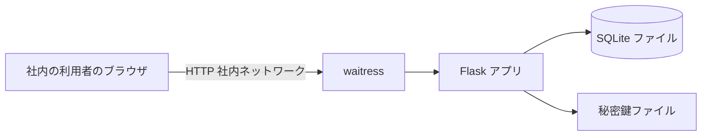
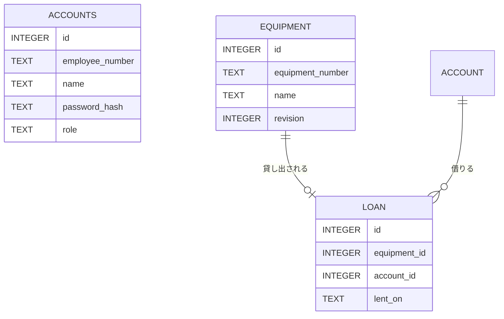
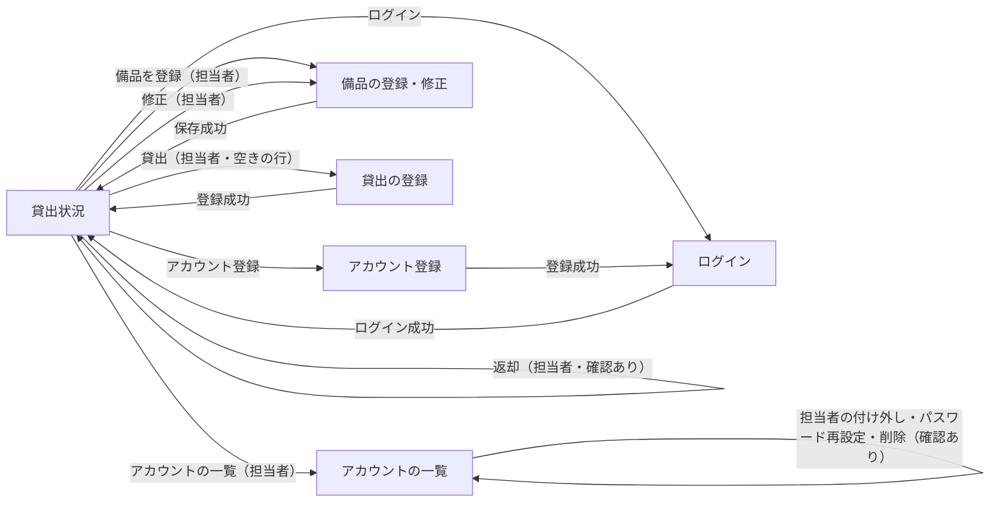
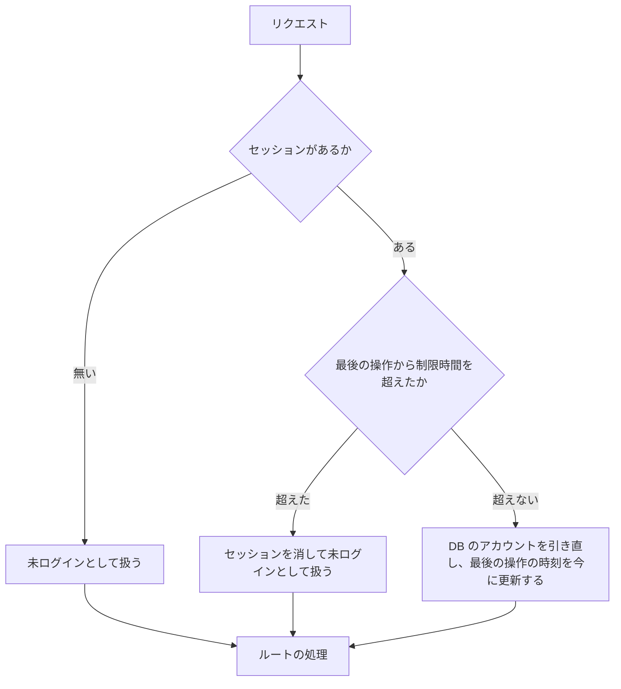

# 詳細設計書: 備品台帳と貸出状況の閲覧（段 1）、備品の貸出と返却（段 2）、アカウントの管理（段 3）

入力要件書: `docs/requirements.md`

## 1. 言語・フレームワーク・アーキテクチャの選定

### 判定日時

2026-11-04（判定と承認は依頼者の固定回答 ANSWERS.md により与えられたものとして進めた）

### 技術制約の要約（要件定義書 1-1）

無償のものだけ。社内の Linux サーバーで `bash run.sh` により直接起動する（コンテナ無し）。Python 3.12 と SQLite で足りる。既存コード無し。利用者 50 人、備品数百件、アカウント 50 件まで。操作から表示まで 3 秒以内。

### 判断軸ごとの該当有無と理由

| 判断軸 | 該当 | 理由 |
|---|---|---|
| 既存資産との整合 | 無し | 新規開発 |
| チームの技術 | 無し（Python 3.12 と SQLite で足りる） | 依頼者の指定 |
| 配備先 | 有り | 社内 Linux、コンテナ無しで起動すること。Python の実行環境とサーバープロセスだけで動く構成にする |
| 認証と認可の境界 | 有り | パスワード認証（SSO 無し）。ロールは 3 つ（担当者・社員・未ログイン）。ボタンの出し分けと要求の拒否の両方。認証は 1 箇所に集める |
| 画面の規模 | 有り（小） | 画面 5 種（貸出状況、アカウント登録、ログイン、備品の登録・修正、貸出の登録）。画面遷移は単純 |
| データの規模と構造 | 有り | 備品数百件、アカウント 50 件まで。貸出の記録が備品と社員を参照する。複数の担当者が同時に更新するため、トランザクションが要る |
| 外部連携 | 無し | 外部連携は無い |
| ライセンスとコスト | 有り | 無償のものだけ |
| 保守性 | 有り | 保守が続いている無償のライブラリを選ぶ |

### 候補の比較

| 候補 | 判断軸ごとの評価 | 出典 URL | 確認日 |
|---|---|---|---|
| Flask 3.1.3 | 軽量で、サーバーで HTML を描画するフォーム画面に向く。BSD-3-Clause。Python 3.9 以上に対応と記載。画面が 5 種で小さいため、規模に見合う | https://pypi.org/project/Flask/ | 2026-11-04 |
| Django 6.1.3 | 全部入りの枠組み（認証・管理画面・ORM）。BSD-3-Clause。Python 3.12 以上が必要と記載。今回の要件（独自の社員番号認証、3 ロール）では認証の標準機能をほぼ作り替えることになり、規模に対して部品が過剰 | https://pypi.org/project/Django/ | 2026-11-04 |
| waitress 3.0.2（Flask を動かす WSGI サーバー） | 純粋な Python の WSGI サーバー。ZPL 2.1（無償）。Python 3.9 以上に対応と記載。コンテナ無しで社内サーバーに置ける | https://pypi.org/project/waitress/ | 2026-11-04 |
| SQLite（標準ライブラリ sqlite3） | Python 3.12 に標準で入る。ファイル 1 つで動く。IMMEDIATE のトランザクションが使える。SQLite 3.7.15 以上が必要と記載 | https://docs.python.org/3.12/library/sqlite3.html | 2026-11-04 |

### 最終選定結果

| 項目 | 選定 |
|---|---|
| 言語 | Python 3.12 |
| フレームワーク | Flask 3.1.3（HTML をサーバーで描画する。セッションは署名付き Cookie） |
| WSGI サーバー | waitress 3.0.2（`run.sh` が起動する） |
| DB | SQLite（標準ライブラリ sqlite3。ファイル DATA_DIR/app.db） |
| パスワードのハッシュ | Werkzeug の `generate_password_hash` と `check_password_hash`（Flask に含まれる。BSD-3-Clause） |
| 実行形態 | サーバー（`bash run.sh` で起動。コンテナ無し） |

選定理由: 要件の画面は 5 種で、業務ロジックは単純。HTML フォームの描画と、社員番号とパスワードの自前認証を、少ない部品で作れる Flask が規模に合う。Django は部品が過剰になる。DB は複数の担当者の同時更新で記録を失わないために要るため SQLite を選ぶ（ファイルが 1 つで、トランザクションが使え、外部サーバーが要らない）。

### 承認の記録

依頼者の固定回答（ANSWERS.md の「技術選定」: 推奨の案でよい）により承認（2026-11-04）。

### フロントエンドとバックエンドを分ける構成か

分けない。Flask が HTML を描画する 1 つのサーバーにする。静的ファイルは base.html に埋め込み、別の配信は作らない。

## 2. システム構成

### コンポーネント一覧

| コンポーネント | 役割 | 技術 |
|---|---|---|
| Web アプリ | 画面の描画、入力の検査、ログインの状態の管理、備品とアカウントの処理 | Flask 3.1.3 |
| WSGI サーバー | HTTP の受け付け（社内ネットワークの待ち受け） | waitress 3.0.2 |
| データベース | アカウントと備品の記録 | SQLite（DATA_DIR/app.db） |
| 起動スクリプト | 依存の導入（setup.sh）と起動（run.sh） | bash |

### システム全体構成図



### 各コンポーネントの役割

- Flask アプリ: 5 画面の描画と、入力の受け付け。ログインの状態（セッション）の判定と、担当者の権限の判定。業務の処理（アカウント登録、認証、備品の登録・修正・削除、貸出の登録と返却、一覧）。
- waitress: 接続を受け、Flask アプリに渡す。スレッド数を固定する。
- SQLite: 3 つのテーブル（アカウント、備品、貸出）を持つ。
- 秘密鍵ファイル: セッション Cookie の署名に使う。初回起動時に作り、以後は同じものを使う。

### コンポーネント間インターフェースとデータフロー

- ブラウザと Flask: HTML フォームの POST と GET。Cookie でセッションを運ぶ。
- Flask と SQLite: 同期的な SQL。1 リクエストごとに接続を開き、終わったら閉じる。

### ネットワーク構成図

社内サーバーの 1 つの待ち受けポート（環境変数 PORT）を社内ネットワークからだけ開く。構成図は上の全体構成図に含む。

## 3. データ設計

### 3-1. データモデル

DB を使う（理由: 複数の担当者が同時に更新しても記録が失われないようにするため。SQLite のトランザクションで守る）。第 1 章で選定した SQLite を使う。

テーブル `accounts`:

| カラム | 型 | 制約 | 対応する要件 |
|---|---|---|---|
| id | INTEGER | 主キー | 内部の識別子 |
| employee_number | TEXT | NOT NULL、UNIQUE、6 桁の数字（検査はアプリ側） | 社員番号 |
| name | TEXT | NOT NULL、1〜30 文字（検査はアプリ側） | 名前 |
| password_hash | TEXT | NOT NULL | パスワードのハッシュ |
| role | TEXT | NOT NULL、CHECK（'manager' か 'member'） | 役割 |

テーブル `equipment`:

| カラム | 型 | 制約 | 対応する要件 |
|---|---|---|---|
| id | INTEGER | 主キー | 内部の識別子 |
| equipment_number | TEXT | NOT NULL、UNIQUE（大文字と小文字を区別する） | 管理番号 |
| name | TEXT | NOT NULL | 備品名 |
| revision | INTEGER | NOT NULL、既定値 1 | 修正の版番号（修正画面を開いたときの値と保存時の値を比べる） |

テーブル `loans`（貸出の記録）:

| カラム | 型 | 制約 | 対応する要件 |
|---|---|---|---|
| id | INTEGER | 主キー | 内部の識別子 |
| equipment_id | INTEGER | NOT NULL、UNIQUE（備品 1 件に 0 か 1 件）、外部キー（equipment の id） | 貸出している備品 |
| account_id | INTEGER | NOT NULL、外部キー（accounts の id） | 借りる社員 |
| lent_on | TEXT | NOT NULL（YYYY-MM-DD） | 貸出日 |

返却した貸出は行を削除する（物理削除。履歴は持たない）。外部キーを使うため、接続ごとに外部キーの検査を有効にする。

リレーション図: 貸出は備品と社員を外部キーで参照する。



テーブルごとの設計要素: `accounts` は DS-SC-ACCOUNT、`equipment` は DS-SC-EQUIPMENT-WITH-REVISION、`loans` は DS-SC-LOAN。

### 3-2. トランザクションと排他制御

- アカウント登録: 1 つのトランザクションで、アカウント数の確認、社員番号の重複の確認、役割の決定、挿入を行う。SQLite の書き込みトランザクションを先に開く方式（BEGIN IMMEDIATE）で開始し、同時の登録でも 1 件だけが担当者になるようにする。途中でエラーになったら全体を取り消す。
- 社員番号の重複: トランザクション内で確認し、UNIQUE 制約を最後の守りにする（制約違反が出たら重複のエラーとして扱う）。
- 備品の登録・修正: 管理番号の重複の確認は UNIQUE 制約で行う。制約違反は「この管理番号は既に使われています」として扱う。修正の重複確認は自分自身を除く。
- 備品の修正（版番号つき）: 修正画面を開いたときの版番号と保存時の版番号を比べる。トランザクションを開始し、元の管理番号で備品を引く。備品が無い、または版番号が違えば、他の担当者の更新・削除として扱い、保存しない（「他の担当者が先にこの備品を更新しました。貸出状況の画面から開き直してください」を修正画面の `.error` に出す）。一致すれば管理番号と備品名を更新し、版番号を 1 増やす。貸出の記録には触れないため、貸出は引き継がれる。
- 備品の削除（貸出中は不可）: トランザクションを開始し、管理番号で備品を引く。その備品の貸出の記録があれば削除せず、「この備品は貸出中のため削除できません。先に返却を処理してください」を出す。無ければ備品の行を削除する。確定する。
- 貸出の登録: 入力の検査（借りる社員の未選択、貸出日の形式と未来の日付）はトランザクションの前に行う。トランザクションを開始し、管理番号で備品を引く（無ければ「備品が見つかりません」）。借りる社員が存在するか確かめる（無ければ借りる社員の入力欄に「借りる社員を選んでください」）。その備品の貸出の記録が既にあれば「この備品は既に貸出中です」。無ければ貸出の記録を追加して確定する。同時の 2 つの登録は、先の登録が確定するまで後の登録が待つため、後の登録は貸出中として扱われる。一意制約の違反も「既に貸出中」として扱う。
- 返却: トランザクションを開始し、管理番号で備品を引く（無ければ「備品が見つかりません」）。その備品の貸出の記録を削除し、削除した件数が 0 件なら「この備品は既に返却されています」。確定する。
- 排他制御の方式: 悲観的（書き込みの開始時に SQLite の書き込みロックを取る）。理由: 件数が少なく、同時の更新は少ないため、競合時の再試行の仕組みを作るより単純なため。

### 3-3. 状態遷移

備品の貸出状況（空き・貸出中）は、貸出の記録の有無で決まる（テーブルに状態の列は持たない）。

| 遷移 | 契機 | 許されない遷移の扱い |
|---|---|---|
| 空き → 貸出中 | 貸出の登録（担当者） | 貸出中の備品への登録は行わず、「この備品は既に貸出中です」 |
| 貸出中 → 空き | 返却の処理（担当者） | 空きの備品への返却は行わず、「この備品は既に返却されています」 |

貸出中の備品の削除は遷移ではなく拒否する。貸出中の備品の修正は状態を変えない。

## 4. アーキテクチャ設計

### 4-1. 外部設計

利用者向けインターフェース（`DS-IF-*`）:

- 貸出状況（`DS-IF-LOAN-STATUS-SCREEN`）: パス `/`。備品の表（管理番号、備品名、状態、借りている社員の名前、貸出日）。ログイン状態に応じて表示が変わる。担当者の行には、空きなら「貸出」、貸出中なら「返却」のボタンを出す。返却は確認ダイアログ（`window.confirm`）を通す。
- 貸出の登録画面（`DS-IF-LOAN-REGISTER-SCREEN`）: パス `/equipment/<管理番号>/loan/`（GET で表示、POST で登録）。入力欄は借りる社員（`id_borrower`、select。選択肢は「名前（社員番号）」）と貸出日（`id_lent_on`、YYYY-MM-DD。既定は日本時間の今日）。ボタン「登録」。`.lending-equipment` に「備品: 管理番号 備品名」。
- アカウント登録（`DS-IF-ACCOUNT-REGISTER-SCREEN`）: パス `/accounts/register/`。入力欄は社員番号、名前、パスワード。ボタン「登録」。
- ログイン（`DS-IF-LOGIN-SCREEN`）: パス `/login/`。入力欄は社員番号、パスワード。ボタン「ログイン」。
- 備品の登録・修正（`DS-IF-EQUIPMENT-FORM-SCREEN`）: 登録はパス `/equipment/new/`、修正はパス `/equipment/<管理番号>/edit/`。入力欄は管理番号、備品名。ボタン「保存」。
- アカウントの一覧（`DS-IF-ACCOUNT-LIST-SCREEN`）: パス `/accounts/`。担当者だけ。表（`tbody tr`、各行に `data-employee-number`）の列は社員番号、名前、「担当者」か「社員」、操作。操作のボタンは「担当者にする」「担当者から外す」「パスワード再設定」「削除」。貸出状況の画面（`DS-IF-LOAN-STATUS-SCREEN`）に担当者だけに出すリンク「アカウントの一覧」を追加する。
- パスワードの再設定（同じ画面）: パス `/accounts/<社員番号>/password/`。GET で、その行を開いた一覧を表示する（`input[name=new_password]` と「確定」）。POST で再設定し、成功したら一覧へ戻して `.message` に「パスワードを再設定しました」を出す。短いときはその行の `.field-error` に「パスワードは 8 文字以上で入力してください」を出し、一覧を再表示する（新しいパスワードの入力は残さない）。
- 役割の変更: パス `/accounts/<社員番号>/role/`（POST。フォームの値 `role` は `manager` か `member`）。成功は `.message` に「担当者にしました」か「担当者から外しました」。
- 削除: パス `/accounts/<社員番号>/delete/`（POST）。成功は `.message` に「アカウントを削除しました」。

画面の要素の id と文言は契約（contract.md）のとおりにする（入力欄の id は `id_employee_number`、`id_name`、`id_password`、`id_equipment_number`。ボタン「登録」「ログイン」「ログアウト」「保存」「修正」「削除」。リンク「ログイン」「アカウント登録」「備品を登録」）。

画面遷移図:



インターフェース仕様:

| 画面 / 操作 | 入力とバリデーション | 出力 | エラー仕様 |
|---|---|---|---|
| 貸出状況（GET `/`） | なし | 全備品を管理番号の昇順に並べた表。0 件なら「備品は登録されていません」 | なし |
| アカウント登録（POST） | 社員番号: 6 桁の数字、必須、重複不可。名前: 必須、30 文字以内。パスワード: 8 文字以上 | 成功: ログイン画面へ移動し「登録しました。ログインしてください」 | 各入力欄の `.field-error`。入力値は社員番号と名前を残す。パスワードは再表示しない |
| ログイン（POST） | 社員番号とパスワードのどちらも必須（空なら失敗として扱う） | 成功: 貸出状況へ移動。ログイン中の名前を `.current-user` に出す | 失敗: `.error` に「社員番号またはパスワードが違います」。社員番号を残す |
| 備品の登録（POST `/equipment/new/`） | 管理番号: 半角の英数字とハイフン、20 文字以内、必須、重複不可。備品名: 必須、50 文字以内 | 成功: 貸出状況へ移動し「備品を登録しました」 | 各入力欄の `.field-error`。入力値は残す。担当者以外は貸出状況へ戻し `.message` に「この操作は担当者だけが行えます」 |
| 備品の修正（POST `/equipment/<管理番号>/edit/`） | 段 1 の検査に加え、隠し項目の版番号（修正画面を開いたときの値） | 成功: 段 1 のとおり | 段 1 のエラーに加え、他の担当者の更新・削除を検出したら、修正画面を `.error`（「他の担当者が先にこの備品を更新しました。貸出状況の画面から開き直してください」）つきで表示し、保存しない。入力値は残すが、保存はしない |
| 備品の削除（POST `/equipment/<管理番号>/delete/`） | 無し（画面では確認ダイアログで「はい」のときだけ送る） | 成功: 貸出状況へ戻し「備品を削除しました」 | 担当者以外は貸出状況へ戻し `.message` に「この操作は担当者だけが行えます」。未ログインはログイン画面へ。対象が無いときは「備品が見つかりません」 |
| 貸出の登録画面（GET `/equipment/<管理番号>/loan/`） | なし | 借りる社員の選択肢（名前（社員番号）、名前の昇順）、貸出日の既定（今日） | 担当者以外は貸出状況へ戻し `.message`。未ログインはログイン画面へ。備品が無ければ貸出状況へ戻し「備品が見つかりません」 |
| 貸出の登録（POST `/equipment/<管理番号>/loan/`） | 借りる社員: 必須（選ばれていて、アカウントに存在）。貸出日: YYYY-MM-DD の日付で、今日以前 | 成功: 貸出状況へ移動し「貸出を登録しました」 | 借りる社員と貸出日は入力欄ごとの `.field-error`（文言は契約と一致）。入力値は残す。既に貸出中なら貸出状況へ戻し `.message` に「この備品は既に貸出中です」 |
| 返却（POST `/equipment/<管理番号>/return/`） | なし（画面では確認ダイアログで「はい」のときだけ送る） | 成功: 貸出状況へ移動し「返却しました」 | 既に返却済みなら「この備品は既に返却されています」。担当者以外は貸出状況へ戻し `.message`。未ログインはログイン画面へ |
| 削除（貸出中の備品。既存の削除の要求） | なし | 貸出中なら削除せず、貸出状況へ戻し `.message` に「この備品は貸出中のため削除できません。先に返却を処理してください」 | 既存の削除と同じ |
| ログアウト（POST `/logout/`） | 無し | 貸出状況へ移動 | 無し |
| アカウントの一覧（GET `/accounts/`） | なし | 全アカウントを社員番号の昇順に並べた表（担当者か社員か） | 担当者以外は貸出状況へ戻し `.message`。未ログインはログイン画面へ |
| パスワードの再設定（GET・POST `/accounts/<社員番号>/password/`） | 新しいパスワード: 8 文字以上（`DS-FN-VALIDATE-PASSWORD`） | 成功: 一覧へ移動し「パスワードを再設定しました」 | 短いときは、その行の `.field-error`。対象が無ければ一覧へ戻し「アカウントが見つかりません」 |
| 役割の変更（POST `/accounts/<社員番号>/role/`） | 役割は `manager` か `member` のみ | 成功: 一覧へ移動し成功の知らせ | 担当者が 1 人だけで外す → 「担当者が 1 人もいなくなるため、この操作はできません」 |
| 削除（POST `/accounts/<社員番号>/delete/`） | なし（画面では確認ダイアログで「はい」のときだけ送る） | 成功: 一覧へ移動し「アカウントを削除しました」 | 借りている社員 → 削除しない。担当者が 1 人だけ → 削除しない |

知らせの文言（アカウントの管理）:

| 場面 | 出し方 | 文言 |
|---|---|---|
| 担当者以外が操作・閲覧 | 貸出状況の画面へ戻し `.message` | この操作は担当者だけが行えます（既存の文言） |
| 借りている社員の削除 | 一覧の `.message` | この社員は備品を借りているため削除できません。先に返却を処理してください |
| 担当者が 1 人だけ（外す・削除） | 一覧の `.message` | 担当者が 1 人もいなくなるため、この操作はできません |
| 対象のアカウントが無い | 一覧の `.message` | アカウントが見つかりません |
| 役割の変更・再設定・削除の成功 | 一覧の `.message` | 担当者にしました／担当者から外しました／パスワードを再設定しました／アカウントを削除しました |

外部システム連携: 無し。

### 4-2. 内部設計

処理フロー（リクエストごと）:



処理の役割:

- 設定の読み込み: 環境変数（PORT、DATA_DIR、SESSION_IDLE_TIMEOUT_SECONDS）を読み、既定値を当てる。不正な値なら起動を止めて理由を標準エラーに出す。
- DB の初期化: 起動時に 3 つのテーブルを作る（無ければ）。版番号の列が無い既存の DB には列を足す。
- 認証: 社員番号で行を引き、パスワードのハッシュを照合する。
- 利用者の判定（要求ごと）: セッションの利用者を DB のアカウントで引き直す。アカウントが無ければ（削除された）未ログインとして扱い、役割は DB の値を使う。担当者から外された人は、次の要求から社員として扱われる。
- 備品の処理: 一覧、登録、修正（版番号を確かめる）、削除（貸出中は削除しない）。
- 貸出の処理: 貸出の登録（空きの備品への記録。同時の登録は先の 1 件だけ）、返却（貸出の記録を消す）、貸出状況の一覧（管理番号の昇順。貸出の記録と借りている社員の名前を結ぶ）、貸出の登録画面の借りる社員の選択肢。
- アカウントの管理: 一覧、役割の付け外し（担当者が 1 人だけなら外さない）、パスワードの再設定、削除（借りている社員と担当者が 1 人だけの場合は削除しない）。
- 権限の判定: 担当者かどうかを確かめる。担当者でなければ処理せずに拒否する。

バッチ設計: 無し。

## 5. クラス設計

クラスは作らない。モジュール単位の関数で構成する（対応表の粒度は関数）。各モジュールの責務は次の 1 文で書ける。

| モジュール | 責務（1 文） |
|---|---|
| 設定 | 環境変数を読み、既定値を当てて設定値を返す |
| DB | SQLite の接続とテーブルの初期化を行う |
| 検査 | 入力値の形式・桁数・重複の検査結果を返す |
| アカウント | アカウントの登録と照合、一覧、役割の付け外し、パスワードの再設定、削除を行う |
| 備品 | 備品の取得・登録・修正（版番号を確かめる）・削除（貸出中は削除しない）を行う |
| 貸出 | 備品の貸出の登録、返却、貸出状況の一覧を行う |
| 認証 | セッションでログイン・ログアウトと、DB のアカウントで利用者を引き直す判定と権限の確認を行う |
| 画面（ルート） | HTTP の要求を受け、業務の関数を呼び、画面を返す |

関数の一覧は第 7 章のファイル一覧の「実現する設計 ID」に書く。

主要な関数（責務）:

- 設定: 設定値を読み込む関数。
- DB: 接続を開く関数、テーブルを作る関数。
- 検査: パスワードの検査関数（8 文字以上）、アカウント入力の検査関数、備品入力の検査関数、貸出入力の検査関数（どれも、検査で見つかったエラーを入力欄ごとに返す。貸出の検査は今日の日付を引数で受ける）。
- アカウント: 登録関数（担当者か社員かを決めて保存する）、照合関数、一覧、利用者の 1 件の取得、役割の変更、パスワードの再設定、削除（いずれも書き込みのトランザクションで、借りている社員と担当者 0 人の制約を確かめる）。
- 備品: 取得関数（版番号を含む）、登録関数、修正関数（版番号を確かめ、自分を除く重複を確認）、削除関数（貸出中なら削除しない）。
- 認証: ログイン関数（セッションに利用者を入れる）、ログアウト関数（セッションを消す）、現在の利用者を読む関数（制限時間を判定し、DB のアカウントで引き直す）、担当者の確認関数（担当者でなければ拒否の結果を返す）。
- 画面: 各画面の表示と送信の関数（アカウントの一覧、役割の付け外し、パスワードの再設定、削除を含む）。

メッセージフロー: 画面の関数 → 認証（担当者の確認） → 検査 → 備品またはアカウントの関数 → DB。認証の結果が拒否なら、業務の関数は呼ばない。

## 6. エラーハンドリングとセキュリティ設計

### エラーハンドリング

| 想定エラー | 利用者への見え方 | 処理 |
|---|---|---|
| 入力の形式・桁数・必須の違反 | 入力欄の `.field-error` | 保存せず、入力値を残す |
| 社員番号・管理番号の重複 | 入力欄の `.field-error` | 保存せず、入力値を残す |
| ログインの失敗（社員番号またはパスワードの違い） | `.error`（どちらが違うかは示さない） | 保存せず、社員番号を残す |
| 担当者以外の操作 | 貸出状況へ戻し `.message` | 処理せず、記録を変えない |
| 未ログインの操作 | ログイン画面へ移動 | 処理せず、記録を変えない |
| 制限時間を超えた操作 | ログイン画面へ移動し、「一定時間操作がなかったため、ログアウトしました」を知らせる | セッションを消す |
| 対象の備品が無い（修正・削除） | 貸出状況へ戻し `.message` | 処理せず終了 |
| 借りる社員の未選択、貸出日の未来・形式の誤り | 入力欄の `.field-error` | 保存せず、入力値を残す |
| 既に貸出中（登録） | 貸出状況の `.message`「この備品は既に貸出中です」 | 記録を変えない |
| 既に返却済み（返却） | 貸出状況の `.message`「この備品は既に返却されています」 | 記録を変えない |
| 貸出中の備品の削除 | 貸出状況の `.message`「この備品は貸出中のため削除できません。先に返却を処理してください」 | 削除しない |
| 修正の保存で、他の担当者が更新・削除していた | 修正画面の `.error`「他の担当者が先にこの備品を更新しました。貸出状況の画面から開き直してください」 | 保存しない |
| 借りている社員の削除（アカウントの管理） | アカウントの一覧の `.message`「この社員は備品を借りているため削除できません。先に返却を処理してください」 | 削除しない |
| 担当者が 1 人だけで、外す・削除する（アカウントの管理） | アカウントの一覧の `.message`「担当者が 1 人もいなくなるため、この操作はできません」 | 何も変えない |
| DB の接続失敗など想定外 | 標準の 500 の応答 | 処理を中止する（ログは不要。要件の運用要件のとおり） |

### 認証

方式: 社員番号とパスワード。SSO は無い。パスワードは Werkzeug のハッシュで保存する（一方向）。ログインのセッションは署名付き Cookie（HttpOnly、SameSite=Lax）で持つ。Cookie には利用者の ID と最後の操作時刻を入れる。要求ごとに DB のアカウントを引き直すため、削除された人は未ログインになり、役割の変更は次の要求から効く。

### 認可

ロールと操作の権限表:

| 操作 | 未ログイン | 社員 | 担当者 |
|---|---|---|---|
| 貸出状況の閲覧 | 可 | 可 | 可 |
| アカウント登録 | 可 | 可 | 可 |
| ログイン・ログアウト | 可 | 可 | 可 |
| 備品の登録・修正・削除（画面と要求） | ログイン画面へ送る | 拒否（貸出状況へ戻し、知らせる） | 可 |
| 貸出の登録・返却（画面と要求） | ログイン画面へ送る | 拒否（貸出状況へ戻し、知らせる） | 可 |
| アカウントの一覧と管理（役割・パスワード・削除。画面と要求） | ログイン画面へ送る | 拒否（貸出状況へ戻し、知らせる） | 可 |

制御の単位は画面単位とボタン単位（担当者だけ表示）と、要求単位（受け付けない）。データ単位の制御は無い。

### 監査ログ

無し（運用要件で不要）。

### その他のセキュリティ対策

- 秘密鍵: 初回起動時に乱数で作り、DATA_DIR の内側に権限 0600 で保存する。Git 管理に含めない。
- 制限時間: 最後の操作から設定値（既定 1800 秒）を超えたらログアウトとして扱う。
- 社内ネットワークからだけ開く: 本アプリは認証を持つが、アクセス経路は社内に限る（待ち受けは社内サーバーの 1 ポート。外部からの通行は止める運用とする）。
- パスワード: 画面に再表示しない。ログのに出さない。
- CSRF: SameSite=Lax の Cookie で、他サイトからの POST にはセッションを付けない方式にする。CSRF のトークンは作らない（社内利用・50 人のため）。

## 7. コード設計

### ディレクトリ構成

```
run.sh
setup.sh
requirements.txt
app/
  __init__.py
  __main__.py
  config.py
  db.py
  validation.py
  accounts.py
  equipment.py
  loans.py
  auth.py
  views.py
  templates/
    base.html
    loan_status.html
    account_register.html
    login.html
    equipment_form.html
    loan_register.html
    account_list.html
tests/unit/
e2e/
```

### ファイル一覧

| ファイル | 役割 | 実現する設計 ID |
|---|---|---|
| `app/__init__.py` | Flask アプリの生成、DB の初期化、秘密鍵の準備、画面の登録 | `DS-MD-APP-FACTORY`, `DS-FN-CREATE-APP`, `DS-OP-SECRET-KEY` |
| `app/__main__.py` | 設定を読み、waitress でアプリを起動する | `DS-MD-SERVER`, `DS-OP-SERVER-THREADS` |
| `app/config.py` | 環境変数を読み、設定値を返す | `DS-MD-CONFIG`, `DS-FN-LOAD-CONFIG`, `DS-OP-ENV-CONFIG` |
| `app/db.py` | SQLite の接続とテーブルの初期化 | `DS-MD-DB`, `DS-FN-CONNECT-DB`, `DS-FN-INIT-SCHEMA` |
| `app/validation.py` | 入力値の検査（アカウント・備品・貸出・パスワード） | `DS-MD-VALIDATION`, `DS-FN-VALIDATE-ACCOUNT-INPUT`, `DS-FN-VALIDATE-EQUIPMENT-INPUT`, `DS-FN-VALIDATE-LOAN-INPUT`, `DS-FN-VALIDATE-PASSWORD` |
| `app/accounts.py` | アカウントの登録と照合、一覧、役割の変更、パスワードの再設定、削除 | `DS-MD-ACCOUNTS`, `DS-FN-REGISTER-ACCOUNT`, `DS-FN-AUTHENTICATE-ACCOUNT`, `DS-FN-LIST-ACCOUNTS`, `DS-FN-GET-ACCOUNT`, `DS-FN-CHANGE-ACCOUNT-ROLE`, `DS-FN-RESET-ACCOUNT-PASSWORD`, `DS-FN-DELETE-ACCOUNT` |
| `app/loans.py` | 貸出の登録、返却、貸出状況の一覧と借りる社員の選択肢 | `DS-MD-LOANS`, `DS-FN-REGISTER-LOAN`, `DS-FN-RETURN-LOAN`, `DS-FN-LIST-LOAN-STATUS`, `DS-FN-SHOW-LOAN-FORM` |
| `app/equipment.py` | 備品の取得・登録・修正（版番号を確かめる）・削除（貸出中は不可） | `DS-MD-EQUIPMENT`, `DS-FN-CREATE-EQUIPMENT`, `DS-FN-GET-EQUIPMENT-WITH-REVISION`, `DS-FN-UPDATE-EQUIPMENT-IF-CURRENT`, `DS-FN-DELETE-EQUIPMENT-IF-NOT-LOANED` |
| `app/auth.py` | セッションでのログイン・ログアウト、利用者の判定、担当者の確認 | `DS-MD-AUTH`, `DS-FN-LOGIN-USER`, `DS-FN-LOGOUT-USER`, `DS-FN-LOAD-CURRENT-USER`, `DS-FN-REQUIRE-MANAGER` |
| `app/views.py` | 画面の要求の受け付けと応答（5 画面の入口と、テンプレートの描画） | `DS-MD-VIEWS`, `DS-FN-SHOW-LOAN-STATUS`, `DS-FN-SUBMIT-ACCOUNT-REGISTER`, `DS-FN-SUBMIT-LOGIN`, `DS-FN-SUBMIT-LOGOUT`, `DS-FN-SHOW-EQUIPMENT-FORM`, `DS-FN-SUBMIT-EQUIPMENT-FORM`, `DS-FN-SUBMIT-EQUIPMENT-DELETE`, `DS-IF-LOAN-STATUS-SCREEN`, `DS-IF-ACCOUNT-REGISTER-SCREEN`, `DS-IF-LOGIN-SCREEN`, `DS-IF-EQUIPMENT-FORM-SCREEN`, `DS-FN-SHOW-LOAN-FORM`, `DS-FN-SUBMIT-LOAN-FORM`, `DS-FN-SUBMIT-RETURN`, `DS-IF-LOAN-REGISTER-SCREEN`, `DS-FN-SHOW-ACCOUNT-LIST`, `DS-FN-SUBMIT-ACCOUNT-ROLE`, `DS-FN-SHOW-PASSWORD-RESET`, `DS-FN-SUBMIT-PASSWORD-RESET`, `DS-FN-SUBMIT-ACCOUNT-DELETE`, `DS-IF-ACCOUNT-LIST-SCREEN` |

`DS-MD-*` を付けるのは `app/` 配下の Python のソースファイルだけ。HTML テンプレート（`app/templates/`）と起動スクリプト（`run.sh`、`setup.sh`）は、対応表チェッカーの読めない種類のファイルのため `DS-MD-*` を付けない。テンプレートの要素は `DS-IF-*`（画面の入口は `app/views.py` の関数）で、起動スクリプトの要素は `DS-OP-START` で受ける（`DS-OP-*` は対応表に載せなくてよいため）。`requirements.txt` は設定ファイルのため対象外。テストファイル（`tests/unit/`、`e2e/`）も `DS-MD-*` を付けない。

### 対応表の粒度

`function`（公開関数まで対応表に載せる）。理由: 関数が 20 件前後で、各関数が要件の 1 つに対応するため、関数の粒度で追える。

### 依存の規則

| 依存元（ファイル） | 依存してはいけない先（プロジェクト内のパスか外部モジュール名） | 理由 |
|---|---|---|
| `app/accounts.py` | `flask`、`app/views.py`、`app/auth.py` | 業務の関数を Web の枠組みから独立させる。パスワードのハッシュに `werkzeug.security` を使うため、`werkzeug` は禁止の対象にしない |
| `app/equipment.py` | `flask`、`werkzeug`、`app/views.py`、`app/auth.py` | 業務の関数を Web の枠組みから独立させる |
| `app/validation.py` | `flask`、`werkzeug`、`app/views.py`、`app/auth.py` | 業務の関数を Web の枠組みから独立させる |
| `app/db.py` | `flask`、`werkzeug`、`app/views.py`、`app/auth.py` | 業務の関数を Web の枠組みから独立させる |
| `app/config.py` | `flask`、`werkzeug`、`app/views.py`、`app/auth.py` | 業務の関数を Web の枠組みから独立させる |
| `app/loans.py` | `flask`、`werkzeug`、`app/views.py`、`app/auth.py` | 業務の関数を Web の枠組みから独立させる（段 1 の依存の規則と同じ） |

依存の規則はファイル単位で書く（対応表チェッカーの依存チェックはディレクトリ単位の書き方のため、`scripts/isdd/dependencies.json` にファイル単位で書き写す）。

外部連携は無いため、外部 API のライブラリを業務ロジックから直接 import しない規則は適用しない。

### コーディング規約

- Python 3.12。型注釈を付ける。標準ライブラリと Flask、waitress、Werkzeug だけを使う。
- 関数は 1 つの責務にする。SQL は `app/db.py` と業務の関数の中だけに書く（画面の関数には書かない）。
- コメントは処理の説明だけにする。要件 ID と設計 ID はコードに書かない。

## 8. テスト設計

### 8-1. テストの種類と方針

- 単体テスト（`tests/unit/`）: 検査の関数、アカウントの登録と照合・一覧・役割・パスワード・削除（一時 DB）、備品の登録・取得・修正（版番号）・削除（一時 DB）、貸出の登録・返却・貸出状況の一覧（一時 DB）、貸出の入力の検査、設定の読み込み。実行コマンド: `.venv/bin/python -m unittest discover -s tests/unit`（仮想環境の Flask を使うため `.venv` の Python を使う）。
- 結合テスト: 単体テストの中で、DB と業務の関数を組み合わせて確かめる。結合テストの実行はこれに含める（同じ実行コマンド）。
- 総合テスト: E2E（8-2）で、実際のサーバーに対して画面の流れを確かめる。
- E2E テストの実行コマンド: `python3 scripts/isdd/unittest_junit.py -s e2e -o e2e/results/e2e.xml`（標準ライブラリだけの実行器で、JUnit XML を出す）。
- 非機能要件の検証: 応答時間（3 秒以内）を、備品 500 件の状態で一覧画面を開くテストで確かめる（`DS-TS-LIST-RESPONSE-TIME`）。利用人数 50 人は、サーバーのスレッド数（`DS-OP-SERVER-THREADS`）で実現する。同時 50 人の表示は、50 件の同時要求で応答時間を確かめる（`DS-TS-CONCURRENT-RESPONSE-TIME`）。

### 8-2. E2E テストのシナリオ

E2E は、実際に起動したサーバーに対して HTTP で要求を送り、返った HTML の要素（id、クラス、文言）を確かめる。ブラウザ自動化は使わない（画面の要素はサーバーの応答で確かめられ、ブラウザの導入が要らないため。ブラウザ上の確認ダイアログは、削除ボタンの要素に確認用の属性があることで確かめる）。

| DS-ID | 目的 | 前提条件 | 手順 | 期待結果 |
|---|---|---|---|---|
| `DS-TS-REGISTER-FIRST-ACCOUNT` | 最初のアカウントが担当者になる | DB が空 | アカウント登録の画面で登録し、ログインする | 登録の知らせが出る。ログイン後に名前と「備品を登録」が出る |
| `DS-TS-REGISTER-SECOND-ACCOUNT-AS-MEMBER` | 2 件目は社員になる | 1 件登録済み | 別のアカウントを登録してログインする | 「備品を登録」が出ない |
| `DS-TS-REGISTER-ACCOUNT-VALIDATION` | アカウント入力の検査と重複 | 1 件登録済み | 不正な社員番号、空の名前、31 文字の名前、7 文字のパスワードで登録し、既存の社員番号で登録する | 指定の文言が各入力欄の `.field-error` に出る。登録されない |
| `DS-TS-LOGIN-AND-LOGOUT` | ログインとログアウト | 1 件登録済み | ログインし、ログアウトする | ログイン中の名前が出る。ログアウト後にリンクが出る |
| `DS-TS-LOGIN-FAILURE-NO-HINT` | 失敗時に理由を示さない | 1 件登録済み | 違うパスワードと、存在しない社員番号でログインする | 両方とも同じ文言が `.error` に出る |
| `DS-TS-AUTO-LOGOUT-AFTER-IDLE` | 制限時間で自動ログアウト | 制限時間 2 秒のサーバー。1 件登録済み | ログインし、3 秒待ってから備品の登録画面を開く | ログイン画面へ移る |
| `DS-TS-MANAGER-REGISTER-EQUIPMENT` | 担当者が備品を登録する | 担当者でログイン | 備品を登録し、同じ管理番号で再登録する | 1 件目が一覧に出る。2 件目は管理番号の重複が出て登録されない |
| `DS-TS-EQUIPMENT-VALIDATION` | 備品入力の検査 | 担当者でログイン | 全角の管理番号、21 文字の管理番号、空の備品名、51 文字の備品名で保存する | 指定の文言が出て、登録されない |
| `DS-TS-MANAGER-EDIT-EQUIPMENT` | 担当者が備品を修正する | 担当者でログイン、備品 1 件 | 備品名を変えて保存し、管理番号を既存の別の番号に変えて保存する | 1 回目は一覧に反映される。2 回目は重複が出て変わらない |
| `DS-TS-MANAGER-DELETE-EQUIPMENT` | 担当者が備品を削除する（確認あり） | 担当者でログイン、備品 1 件 | 削除の要素が確認を出す属性を持つことを確かめ、削除を送って一覧を見る | 確認が「はい」のときだけ削除され、一覧から消える |
| `DS-TS-MEMBER-CANNOT-OPERATE-EQUIPMENT` | 社員の操作の要求が拒否される | 社員でログイン、備品 1 件 | 社員で備品の登録画面を開き、削除を直接送る | 貸出状況へ戻り、指定の知らせが出る。記録は変わらない。行のボタンが出ない |
| `DS-TS-GUEST-CANNOT-OPERATE-EQUIPMENT` | 未ログインの操作の要求が拒否される | 未ログイン、備品 1 件 | 備品の登録画面を開き、削除を直接送る | ログイン画面へ移る。記録は変わらない |
| `DS-TS-VIEW-LOAN-STATUS-AS-GUEST` | 未ログインで一覧を見られる | 備品 2 件 | 未ログインで貸出状況を開く | 管理番号の昇順に 2 行が出る。状態は「空き」。ボタンは無く、リンクが出る |
| `DS-TS-VIEW-EMPTY-LOAN-STATUS` | 0 件の表示 | 備品 0 件 | 未ログインで貸出状況を開く | 指定の文言が出る。行は無い |
| `DS-TS-ROLE-BUTTON-VISIBILITY` | 役割ごとのボタンの出し分け | 備品 1 件、社員と担当者のアカウント | 未ログイン、社員、担当者の順に貸出状況を開く | 役割ごとに、リンクとボタンの出方が仕様どおり |
| `DS-TS-LIST-RESPONSE-TIME` | 3 秒以内に表示する | 備品 500 件 | 貸出状況を開き、応答までの時間を測る | 応答が 3 秒以内 |
| `DS-TS-REGISTER-LOAN` | 担当者が貸し出し、一覧に出る | 担当者でログイン、備品 1 件、社員 1 件 | 貸出の登録画面で社員を選んで登録する | 一覧の行が「貸出中」、名前、今日の日付 |
| `DS-TS-LOAN-INPUT-VALIDATION` | 貸出の入力の検査 | 担当者でログイン、備品が空き、社員 1 件 | 借りる社員を選ばずに登録、明日の日付で登録、今日と過去（2026-01-01）で登録 | 未選択と未来の文言が各入力欄の `.field-error` に出て登録されない。今日と過去は登録される |
| `DS-TS-NO-DOUBLE-LOAN` | 貸出中の備品は貸せず、同時の貸出は 1 件だけ | 担当者でログイン、備品 2 件、社員 2 人 | 貸出中の備品に別の社員で登録する。空きの備品に 2 つの登録を同時に送る | 2 回目は「この備品は既に貸出中です」。同時は 1 件だけ記録され、残りは同じ文言 |
| `DS-TS-RETURN-EQUIPMENT` | 返却の確認で「はい」のときだけ空きに戻す | 担当者でログイン、備品が貸出中 | 返却の要素が確認を出す属性を持つことを確かめ、返却を送って一覧を見る | 一覧の行が「空き」になり、名前と日付が空欄 |
| `DS-TS-NO-DOUBLE-RETURN` | 返却済みは返却できず、同時の返却は 1 件だけ | 担当者でログイン、備品が貸出中 | 返却を 2 回送る。貸出中の備品に 2 つの返却を同時に送る | 2 回目と同時の残りは「この備品は既に返却されています」。記録は 1 回分だけ消える |
| `DS-TS-NO-DELETE-LOANED-EQUIPMENT` | 貸出中の備品は削除できない | 担当者でログイン、備品が貸出中 | 削除を送る | 「この備品は貸出中のため削除できません。先に返却を処理してください」。行は残る |
| `DS-TS-EDIT-KEEPS-LOAN` | 修正しても貸出を引き継ぐ | 担当者でログイン、備品が貸出中 | 備品名と管理番号を変えて保存する | 新しい値が一覧に出て、名前と日付は変わらず「貸出中」 |
| `DS-TS-EDIT-CONFLICT-REJECT` | 他の担当者の更新・削除のあとの保存を拒否する | 担当者 2 人が同じ備品の修正画面を開いている（備品 2 件） | A が保存したあと、古い画面の B が保存する。別の備品について、A が画面を開いたあとに削除し、もう一方の画面で保存する | `.error` に「他の担当者が先にこの備品を更新しました。貸出状況の画面から開き直してください」。保存されない |
| `DS-TS-MEMBER-AND-GUEST-CANNOT-LOAN-OR-RETURN` | 社員と未ログインの人の貸出・返却の要求を受け付けない | 社員でログインした場合と未ログインの場合。備品 1 件 | 社員で貸出画面を開き、返却を直接送る。未ログインで同じ 2 つを送る | 社員は貸出状況へ戻し `.message`「この操作は担当者だけが行えます」。未ログインはログイン画面へ。記録は変わらない。社員の画面に「貸出」「返却」のボタンが無い |
| `DS-TS-VIEW-LOAN-DETAILS-AS-GUEST` | 未ログインで貸出中の名前と日付を見られる | 備品 2 件（1 件は貸出中、借りる社員は山田太郎、貸出日は 2026-11-01） | 未ログインで貸出状況を開く | 貸出中の行に名前と日付。空きの行は空欄。ボタンは無く、リンクが出る |
| `DS-TS-CONCURRENT-RESPONSE-TIME` | 50 人が同時に開いても 3 秒以内に表示する | 備品 500 件（数件は貸出中） | 50 件の要求を同時に `/` に送り、応答までの時間を測る | 50 件すべてが 3 秒以内 |
| `DS-TS-LIST-ACCOUNTS` | 担当者 `000001`（山田太郎）と社員 `000002`（佐藤花子）が登録されている。担当者でログイン済み | 「アカウントの一覧」のリンクを開く | 一覧に 2 行あり、`000001` は「担当者」、`000002` は「社員」と出る | `RQ-FT-LIST-ACCOUNTS`, `RQ-UI-ACCOUNT-LIST-SCREEN` |
| `DS-TS-CHANGE-ACCOUNT-ROLE` | 担当者 `000001`、社員 `000002`。担当者でログイン済み | `000002` の行の「担当者にする」を押し、確認で「キャンセル」を選ぶ。次に「担当者にする」を押し、「はい」を選ぶ。次に `000001` の行の「担当者から外す」を押し、「はい」を選ぶ（2 人のうちの 1 人を外す） | キャンセルのときは「社員」のまま。「はい」の後は `000002` が「担当者」になる。`000001` を外した後は `000001` が「社員」と出る | `RQ-FT-CHANGE-ACCOUNT-ROLE`, `RQ-UI-ACCOUNT-LIST-SCREEN` |
| `DS-TS-KEEP-ONE-MANAGER` | 担当者 `000001` だけがいる（社員 `000002` がいる）。担当者でログイン済み | `000001` の行の「担当者から外す」を押し、「はい」を選ぶ。次に「削除」を押し、「はい」を選ぶ | 両方とも一覧の `.message` に「担当者が 1 人もいなくなるため、この操作はできません」が出て、`000001` は「担当者」のまま残る | `RQ-FT-KEEP-ONE-MANAGER`, `RQ-FT-DELETE-ACCOUNT` |
| `DS-TS-RESET-ACCOUNT-PASSWORD` | 担当者 `000001`、社員 `000002`（パスワード `password1`）。担当者でログイン済み | `000002` の行の「パスワード再設定」を押す。`input[name=new_password]` に `abc` を入れて「確定」を押す。次に `newpass99` を入れて「確定」を押す。次にログアウトし、`000002` で `password1` でログインする。次に `newpass99` でログインする | 1 回目は同じ行の `.field-error` に「パスワードは 8 文字以上で入力してください」が出て、変わらない。2 回目は一覧に戻り `.message` が出る。古い `password1` のログインは「社員番号またはパスワードが違います」で失敗し、`newpass99` は成功する | `RQ-FT-RESET-ACCOUNT-PASSWORD`, `RQ-UI-ACCOUNT-LIST-SCREEN` |
| `DS-TS-DELETE-ACCOUNT` | 担当者 `000001`、社員 `000002`（借りている備品なし）。備品 `PC-0001` が空き。担当者でログイン済み | `000002` の行の「削除」を押し、確認で「キャンセル」を選ぶ。次に「削除」を押し、「はい」を選ぶ。次に `000002` で元のパスワードでログインする。次に担当者で備品の貸出の登録画面を開き、借りる社員の選択肢を見る | キャンセルのときは残る。「はい」の後は `.message` に「アカウントを削除しました」が出て、`000002` の行が消える。ログインは「社員番号またはパスワードが違います」で失敗する。選択肢に `000002` の名前は出ない | `RQ-FT-DELETE-ACCOUNT`, `RQ-DT-ACCOUNT-HARD-DELETE`, `RQ-UI-ACCOUNT-LIST-SCREEN` |
| `DS-TS-NO-DELETE-BORROWING-ACCOUNT` | 担当者 `000001`、社員 `000002` が備品 `PC-0001` を借りている（貸出中） | 担当者で `000002` の行の「削除」を押し、「はい」を選ぶ | 一覧の `.message` に「この社員は備品を借りているため削除できません。先に返却を処理してください」が出て、`000002` の行は残る | `RQ-FT-NO-DELETE-BORROWING-ACCOUNT` |
| `DS-TS-MEMBER-AND-GUEST-CANNOT-MANAGE-ACCOUNTS` | 担当者 `000001`、社員 `000002`。社員 `000002` でログイン済みの場合と、ログインしていない場合 | 社員で `/accounts/` を開く。社員で `/accounts/000001/role/` に担当者から外す要求を送る。社員で `/accounts/000001/delete/` に削除の要求を送る。ログインせずに `/accounts/` を開く | 社員は貸出状況の画面に戻り `.message` に「この操作は担当者だけが行えます」が出る。未ログインはログイン画面へ送られる。アカウントの記録は変わらない。貸出状況の画面に「アカウントの一覧」のリンクが出ない | `RQ-FT-MANAGER-ONLY-ACCOUNT-MANAGEMENT`, `RQ-UI-ACCOUNT-LIST-SCREEN` |
| `DS-TS-DEMOTED-MANAGER-LOSES-ACCESS` | 担当者 `000001` と `000002` の 2 人。`000001` が `000002` を担当者にしている。`000002` は担当者から外される前に、別のブラウザでログイン済み | `000001` が `000002` を担当者から外す。次に `000002` の画面で `/accounts/` を開く | `000002` は貸出状況の画面に戻り `.message` に「この操作は担当者だけが行えます」が出る | `RQ-FT-ACCOUNT-CHANGE-TAKES-EFFECT`, `RQ-FT-MANAGER-ONLY-ACCOUNT-MANAGEMENT` |

### 8-3. E2E の実行手段

Web の GUI だが、ブラウザ自動化は使わず、標準ライブラリの HTTP クライアントで実サーバーに対して確かめる（理由は 8-2 のとおり）。承認は依頼者の固定回答による。

### 8-4. E2E の実行コマンドと運用

- 実行コマンド: `python3 scripts/isdd/unittest_junit.py -s e2e -o e2e/results/e2e.xml`。結果は `e2e/results/e2e.xml` に出す（git 管理外）。
- テスト資産は `e2e/` に置く。E2E は一時ディレクトリに DATA_DIR を作り、空いたポートでサーバーを起動して終了時に止める。
- 外部連携は無いため、モックは作らない。
- 実装時・CI の必須ゴールは E2E の全件通過。テストが失敗したら修正と再実行を繰り返す。

## 9. 運用設計

### DS-OP-START: 起動方式

- 採用: サーバーとして `bash run.sh` で起動する（コンテナは使わない）。
- 初回: `bash setup.sh` で仮想環境（`.venv`）を作り、requirements.txt（flask、waitress）を導入する。採点の前に 1 回実行する。
- 起動: `bash run.sh`。環境変数 PORT で待ち受けポートを決める。
- 利用時間: 平日の日中に使い、夜間・休日は止めてよい。
- 社内ネットワーク: 待ち受けは社内サーバーのポートだけを社内ネットワークに開く（外部からの通行は止める）。

### DS-OP-ENV-CONFIG: 設定値・環境変数

| 名前 | 用途 | 既定値 | 必須か |
|---|---|---|---|
| PORT | 待ち受けポート | 8000 | 任意 |
| DATA_DIR | データの置き場（app.db と秘密鍵） | プロジェクトルート直下の `data` | 任意（無ければ作る） |
| SESSION_IDLE_TIMEOUT_SECONDS | 操作しないまま自動でログアウトするまでの秒数（正の整数） | 1800 | 任意 |

秘密情報の値は書かない（秘密鍵はファイルとして DATA_DIR に作る）。

### DS-OP-SECRET-KEY: 秘密鍵

初回起動時に、DATA_DIR に秘密鍵ファイルが無ければ作る（乱数 32 バイト、権限 0600）。あれば読む。

### DS-OP-SERVER-THREADS: サーバーのスレッド数

waitress のスレッド数を 8 にする（利用者 50 人の同時利用を、順番待ちで捌ける数）。

### DS-OP-FIRST-ACCOUNT-SETUP: 初期ユーザー

初期ユーザーは置かない。導入の手順として、社員に URL を知らせる前に、担当者が最初のアカウントを登録する。

### データ移行

既存の Excel の取り込みは作らない。担当者が画面から手で入力する。

### 可用性・バックアップ

可用性の要求は無い（平日の日中だけ使う）。バックアップは作らない（運用要件のとおり）。

## 10. ログ・監視・アラート・障害対応設計

- ログ: ログの設計は必須ではないため、ログの種類と内容の記述は行わない（運用要件のとおり）。
- 監視・アラート: 監視・アラートの設計は必須ではないため、監視・アラートの内容と対応方法の記述は行わない。
- 障害対応: 想定する障害は次のとおり。
  - DB ファイルが開けない（権限の誤り）: 起動時またはアクセス時に失敗する。対応: 権限を直して再起動する。
  - 起動時の設定値の誤り（PORT や SESSION_IDLE_TIMEOUT_SECONDS が不正）: 起動を止め、標準エラーに理由を出す。対応: 設定を直す。
  - 利用者が障害に気づいたとき: 画面に応答が無ければ、担当者が `bash run.sh` の標準出力を確かめて再起動する。

## 11. 要件と設計の対応表

| DS-ID | 対応要件ID |
| `DS-MD-APP-FACTORY` | `RQ-DT-DB-REQUIRED` |
| `DS-MD-SERVER` | `RQ-NF-USERS-50`, `RQ-NF-INTERNAL-NETWORK-ACCESS` |
| `DS-MD-CONFIG` | `RQ-FT-AUTO-LOGOUT-IDLE` |
| `DS-MD-DB` | `RQ-DT-DB-REQUIRED`, `RQ-DT-INTERNAL-DATA` |
| `DS-MD-VALIDATION` | `RQ-FT-REGISTER-ACCOUNT`, `RQ-FT-REGISTER-EQUIPMENT`, `RQ-FT-UNIQUE-EMPLOYEE-AND-EQUIPMENT-NUMBER`, `RQ-FT-RESET-ACCOUNT-PASSWORD` |
| `DS-MD-ACCOUNTS` | `RQ-FT-REGISTER-ACCOUNT`, `RQ-FT-FIRST-ACCOUNT-IS-MANAGER`, `RQ-FT-LOGIN`, `RQ-FT-LOGIN-FAILURE-NO-HINT`, `RQ-NF-PASSWORD-HASHED`, `RQ-DT-ACCOUNT`, `RQ-FT-LIST-ACCOUNTS`, `RQ-FT-CHANGE-ACCOUNT-ROLE`, `RQ-FT-RESET-ACCOUNT-PASSWORD`, `RQ-FT-DELETE-ACCOUNT`, `RQ-FT-KEEP-ONE-MANAGER`, `RQ-FT-NO-DELETE-BORROWING-ACCOUNT`, `RQ-DT-ACCOUNT-HARD-DELETE`, `RQ-DT-ACCOUNT-ROLE-STATE` |
| `DS-MD-EQUIPMENT` | `RQ-FT-REGISTER-EQUIPMENT`, `RQ-FT-EDIT-EQUIPMENT`, `RQ-FT-DELETE-EQUIPMENT`, `RQ-FT-VIEW-LOAN-STATUS`, `RQ-DT-EQUIPMENT`, `RQ-DT-NO-DELETED-HISTORY` |
| `DS-MD-AUTH` | `RQ-FT-LOGIN`, `RQ-FT-LOGOUT`, `RQ-FT-AUTO-LOGOUT-IDLE`, `RQ-FT-MANAGER-ONLY-EQUIPMENT-OPERATION`, `RQ-FT-MANAGER-ONLY-ACCOUNT-MANAGEMENT`, `RQ-FT-ACCOUNT-CHANGE-TAKES-EFFECT`, `RQ-FT-DELETE-ACCOUNT` |
| `DS-MD-VIEWS` | `RQ-UI-LOAN-STATUS-SCREEN`, `RQ-UI-ACCOUNT-REGISTER-SCREEN`, `RQ-UI-LOGIN-SCREEN`, `RQ-UI-EQUIPMENT-FORM-SCREEN`, `RQ-FT-LOGOUT`, `RQ-UI-ACCOUNT-LIST-SCREEN`, `RQ-FT-MANAGER-ONLY-ACCOUNT-MANAGEMENT` |
| `DS-FN-CREATE-APP` | `RQ-DT-DB-REQUIRED` |
| `DS-FN-LOAD-CONFIG` | `RQ-FT-AUTO-LOGOUT-IDLE` |
| `DS-FN-CONNECT-DB` | `RQ-DT-DB-REQUIRED` |
| `DS-FN-INIT-SCHEMA` | `RQ-DT-DB-REQUIRED`, `RQ-DT-LOAN-RECORD` |
| `DS-FN-VALIDATE-ACCOUNT-INPUT` | `RQ-FT-REGISTER-ACCOUNT`, `RQ-FT-UNIQUE-EMPLOYEE-AND-EQUIPMENT-NUMBER` |
| `DS-FN-VALIDATE-EQUIPMENT-INPUT` | `RQ-FT-REGISTER-EQUIPMENT`, `RQ-FT-EDIT-EQUIPMENT`, `RQ-FT-UNIQUE-EMPLOYEE-AND-EQUIPMENT-NUMBER` |
| `DS-FN-REGISTER-ACCOUNT` | `RQ-FT-REGISTER-ACCOUNT`, `RQ-FT-FIRST-ACCOUNT-IS-MANAGER`, `RQ-NF-PASSWORD-HASHED` |
| `DS-FN-AUTHENTICATE-ACCOUNT` | `RQ-FT-LOGIN`, `RQ-FT-LOGIN-FAILURE-NO-HINT` |
| `DS-FN-CREATE-EQUIPMENT` | `RQ-FT-REGISTER-EQUIPMENT`, `RQ-FT-UNIQUE-EMPLOYEE-AND-EQUIPMENT-NUMBER` |
| `DS-FN-LOGIN-USER` | `RQ-FT-LOGIN` |
| `DS-FN-LOGOUT-USER` | `RQ-FT-LOGOUT` |
| `DS-FN-LOAD-CURRENT-USER` | `RQ-FT-AUTO-LOGOUT-IDLE`, `RQ-FT-MANAGER-ONLY-EQUIPMENT-OPERATION`, `RQ-FT-ACCOUNT-CHANGE-TAKES-EFFECT`, `RQ-FT-MANAGER-ONLY-ACCOUNT-MANAGEMENT` |
| `DS-FN-REQUIRE-MANAGER` | `RQ-FT-MANAGER-ONLY-EQUIPMENT-OPERATION`, `RQ-FT-MANAGER-ONLY-ACCOUNT-MANAGEMENT` |
| `DS-FN-SHOW-LOAN-STATUS` | `RQ-UI-LOAN-STATUS-SCREEN`, `RQ-FT-VIEW-LOAN-STATUS`, `RQ-FT-SHOW-LOAN-DETAILS`, `RQ-FT-MANAGER-ONLY-LOAN-OPERATION` |
| `DS-FN-SUBMIT-ACCOUNT-REGISTER` | `RQ-UI-ACCOUNT-REGISTER-SCREEN`, `RQ-FT-REGISTER-ACCOUNT` |
| `DS-FN-SUBMIT-LOGIN` | `RQ-UI-LOGIN-SCREEN`, `RQ-FT-LOGIN` |
| `DS-FN-SUBMIT-LOGOUT` | `RQ-FT-LOGOUT` |
| `DS-FN-SHOW-EQUIPMENT-FORM` | `RQ-UI-EQUIPMENT-FORM-SCREEN`, `RQ-FT-EDIT-EQUIPMENT` |
| `DS-FN-SUBMIT-EQUIPMENT-FORM` | `RQ-UI-EQUIPMENT-FORM-SCREEN`, `RQ-FT-REGISTER-EQUIPMENT`, `RQ-FT-EDIT-EQUIPMENT`, `RQ-FT-EDIT-CONFLICT-REJECT` |
| `DS-FN-SUBMIT-EQUIPMENT-DELETE` | `RQ-FT-DELETE-EQUIPMENT`, `RQ-UI-LOAN-STATUS-SCREEN`, `RQ-FT-NO-DELETE-LOANED-EQUIPMENT` |
| `DS-SC-ACCOUNT` | `RQ-DT-ACCOUNT`, `RQ-DT-INTERNAL-DATA`, `RQ-DT-DB-REQUIRED` |
| `DS-IF-LOAN-STATUS-SCREEN` | `RQ-UI-LOAN-STATUS-SCREEN`, `RQ-FT-SHOW-LOAN-DETAILS`, `RQ-FT-RETURN-EQUIPMENT`, `RQ-FT-MANAGER-ONLY-ACCOUNT-MANAGEMENT` |
| `DS-IF-ACCOUNT-REGISTER-SCREEN` | `RQ-UI-ACCOUNT-REGISTER-SCREEN` |
| `DS-IF-LOGIN-SCREEN` | `RQ-UI-LOGIN-SCREEN` |
| `DS-IF-EQUIPMENT-FORM-SCREEN` | `RQ-UI-EQUIPMENT-FORM-SCREEN` |
| `DS-OP-START` | `RQ-NF-USE-HOURS-WEEKDAY-DAYTIME`, `RQ-NF-INTERNAL-NETWORK-ACCESS` |
| `DS-OP-ENV-CONFIG` | `RQ-FT-AUTO-LOGOUT-IDLE` |
| `DS-OP-SECRET-KEY` | `RQ-NF-PASSWORD-HASHED` |
| `DS-OP-SERVER-THREADS` | `RQ-NF-USERS-50` |
| `DS-OP-FIRST-ACCOUNT-SETUP` | `RQ-OP-FIRST-ACCOUNT-SETUP` |
| `DS-TS-REGISTER-FIRST-ACCOUNT` | `RQ-TS-REGISTER-FIRST-ACCOUNT` |
| `DS-TS-REGISTER-SECOND-ACCOUNT-AS-MEMBER` | `RQ-TS-REGISTER-SECOND-ACCOUNT-AS-MEMBER` |
| `DS-TS-REGISTER-ACCOUNT-VALIDATION` | `RQ-TS-REGISTER-ACCOUNT-VALIDATION` |
| `DS-TS-LOGIN-AND-LOGOUT` | `RQ-TS-LOGIN-AND-LOGOUT` |
| `DS-TS-LOGIN-FAILURE-NO-HINT` | `RQ-TS-LOGIN-FAILURE-NO-HINT` |
| `DS-TS-AUTO-LOGOUT-AFTER-IDLE` | `RQ-TS-AUTO-LOGOUT-AFTER-IDLE` |
| `DS-TS-MANAGER-REGISTER-EQUIPMENT` | `RQ-TS-MANAGER-REGISTER-EQUIPMENT` |
| `DS-TS-EQUIPMENT-VALIDATION` | `RQ-TS-EQUIPMENT-VALIDATION` |
| `DS-TS-MANAGER-EDIT-EQUIPMENT` | `RQ-TS-MANAGER-EDIT-EQUIPMENT` |
| `DS-TS-MANAGER-DELETE-EQUIPMENT` | `RQ-TS-MANAGER-DELETE-EQUIPMENT` |
| `DS-TS-MEMBER-CANNOT-OPERATE-EQUIPMENT` | `RQ-TS-MEMBER-CANNOT-OPERATE-EQUIPMENT` |
| `DS-TS-GUEST-CANNOT-OPERATE-EQUIPMENT` | `RQ-TS-GUEST-CANNOT-OPERATE-EQUIPMENT` |
| `DS-TS-VIEW-LOAN-STATUS-AS-GUEST` | `RQ-TS-VIEW-LOAN-STATUS-AS-GUEST` |
| `DS-TS-VIEW-EMPTY-LOAN-STATUS` | `RQ-TS-VIEW-EMPTY-LOAN-STATUS` |
| `DS-TS-ROLE-BUTTON-VISIBILITY` | `RQ-TS-ROLE-BUTTON-VISIBILITY` |
| `DS-TS-LIST-RESPONSE-TIME` | `RQ-NF-RESPONSE-3S` |
| `DS-MD-LOANS` | `RQ-FT-REGISTER-LOAN`, `RQ-FT-RETURN-EQUIPMENT`, `RQ-FT-SHOW-LOAN-DETAILS`, `RQ-FT-NO-DOUBLE-LOAN`, `RQ-FT-NO-DOUBLE-RETURN`, `RQ-DT-EQUIPMENT-LOAN-STATE` |
| `DS-FN-REGISTER-LOAN` | `RQ-FT-REGISTER-LOAN`, `RQ-FT-NO-DOUBLE-LOAN`, `RQ-DT-EQUIPMENT-LOAN-STATE` |
| `DS-FN-RETURN-LOAN` | `RQ-FT-RETURN-EQUIPMENT`, `RQ-FT-NO-DOUBLE-RETURN`, `RQ-DT-EQUIPMENT-LOAN-STATE` |
| `DS-FN-LIST-LOAN-STATUS` | `RQ-FT-SHOW-LOAN-DETAILS`, `RQ-FT-VIEW-LOAN-STATUS` |
| `DS-FN-VALIDATE-LOAN-INPUT` | `RQ-FT-LOAN-DATE-NOT-FUTURE`, `RQ-FT-REGISTER-LOAN` |
| `DS-FN-SHOW-LOAN-FORM` | `RQ-UI-LOAN-REGISTER-SCREEN`, `RQ-FT-MANAGER-ONLY-LOAN-OPERATION` |
| `DS-FN-SUBMIT-LOAN-FORM` | `RQ-UI-LOAN-REGISTER-SCREEN`, `RQ-FT-REGISTER-LOAN`, `RQ-FT-LOAN-DATE-NOT-FUTURE`, `RQ-FT-MANAGER-ONLY-LOAN-OPERATION` |
| `DS-FN-SUBMIT-RETURN` | `RQ-FT-RETURN-EQUIPMENT`, `RQ-FT-MANAGER-ONLY-LOAN-OPERATION` |
| `DS-FN-GET-EQUIPMENT-WITH-REVISION` | `RQ-FT-EDIT-EQUIPMENT`, `RQ-FT-EDIT-CONFLICT-REJECT` |
| `DS-FN-UPDATE-EQUIPMENT-IF-CURRENT` | `RQ-FT-EDIT-EQUIPMENT`, `RQ-FT-EDIT-CONFLICT-REJECT`, `RQ-FT-EDIT-KEEPS-LOAN`, `RQ-FT-UNIQUE-EMPLOYEE-AND-EQUIPMENT-NUMBER` |
| `DS-FN-DELETE-EQUIPMENT-IF-NOT-LOANED` | `RQ-FT-DELETE-EQUIPMENT`, `RQ-FT-NO-DELETE-LOANED-EQUIPMENT`, `RQ-DT-NO-DELETED-HISTORY` |
| `DS-SC-EQUIPMENT-WITH-REVISION` | `RQ-DT-EQUIPMENT`, `RQ-DT-INTERNAL-DATA`, `RQ-DT-NO-DELETED-HISTORY`, `RQ-FT-EDIT-CONFLICT-REJECT` |
| `DS-SC-LOAN` | `RQ-DT-LOAN-RECORD`, `RQ-DT-EQUIPMENT-LOAN-STATE` |
| `DS-IF-LOAN-REGISTER-SCREEN` | `RQ-UI-LOAN-REGISTER-SCREEN` |
| `DS-TS-REGISTER-LOAN` | `RQ-TS-REGISTER-LOAN` |
| `DS-TS-LOAN-INPUT-VALIDATION` | `RQ-TS-LOAN-INPUT-VALIDATION` |
| `DS-TS-NO-DOUBLE-LOAN` | `RQ-TS-NO-DOUBLE-LOAN` |
| `DS-TS-RETURN-EQUIPMENT` | `RQ-TS-RETURN-EQUIPMENT` |
| `DS-TS-NO-DOUBLE-RETURN` | `RQ-TS-NO-DOUBLE-RETURN` |
| `DS-TS-NO-DELETE-LOANED-EQUIPMENT` | `RQ-TS-NO-DELETE-LOANED-EQUIPMENT` |
| `DS-TS-EDIT-KEEPS-LOAN` | `RQ-TS-EDIT-KEEPS-LOAN` |
| `DS-TS-EDIT-CONFLICT-REJECT` | `RQ-TS-EDIT-CONFLICT-REJECT` |
| `DS-TS-MEMBER-AND-GUEST-CANNOT-LOAN-OR-RETURN` | `RQ-TS-MEMBER-AND-GUEST-CANNOT-LOAN-OR-RETURN` |
| `DS-TS-VIEW-LOAN-DETAILS-AS-GUEST` | `RQ-TS-VIEW-LOAN-DETAILS-AS-GUEST` |
| `DS-TS-CONCURRENT-RESPONSE-TIME` | `RQ-TS-CONCURRENT-RESPONSE-TIME`, `RQ-NF-RESPONSE-3S-AT-50-USERS` |
| `DS-TS-LIST-ACCOUNTS` | `RQ-TS-LIST-ACCOUNTS` |
| `DS-TS-CHANGE-ACCOUNT-ROLE` | `RQ-TS-CHANGE-ACCOUNT-ROLE` |
| `DS-TS-KEEP-ONE-MANAGER` | `RQ-TS-KEEP-ONE-MANAGER` |
| `DS-TS-RESET-ACCOUNT-PASSWORD` | `RQ-TS-RESET-ACCOUNT-PASSWORD` |
| `DS-TS-DELETE-ACCOUNT` | `RQ-TS-DELETE-ACCOUNT` |
| `DS-TS-NO-DELETE-BORROWING-ACCOUNT` | `RQ-TS-NO-DELETE-BORROWING-ACCOUNT` |
| `DS-TS-MEMBER-AND-GUEST-CANNOT-MANAGE-ACCOUNTS` | `RQ-TS-MEMBER-AND-GUEST-CANNOT-MANAGE-ACCOUNTS` |
| `DS-TS-DEMOTED-MANAGER-LOSES-ACCESS` | `RQ-TS-DEMOTED-MANAGER-LOSES-ACCESS` |
| `DS-MD-APP-FACTORY` | `RQ-FT-ACCOUNT-CHANGE-TAKES-EFFECT` |
| `DS-FN-LIST-ACCOUNTS` | `RQ-FT-LIST-ACCOUNTS` |
| `DS-FN-GET-ACCOUNT` | `RQ-FT-ACCOUNT-CHANGE-TAKES-EFFECT`, `RQ-FT-DELETE-ACCOUNT` |
| `DS-FN-CHANGE-ACCOUNT-ROLE` | `RQ-FT-CHANGE-ACCOUNT-ROLE`, `RQ-FT-KEEP-ONE-MANAGER`, `RQ-DT-ACCOUNT-ROLE-STATE` |
| `DS-FN-RESET-ACCOUNT-PASSWORD` | `RQ-FT-RESET-ACCOUNT-PASSWORD` |
| `DS-FN-DELETE-ACCOUNT` | `RQ-FT-DELETE-ACCOUNT`, `RQ-FT-KEEP-ONE-MANAGER`, `RQ-FT-NO-DELETE-BORROWING-ACCOUNT`, `RQ-DT-ACCOUNT-HARD-DELETE` |
| `DS-FN-VALIDATE-PASSWORD` | `RQ-FT-RESET-ACCOUNT-PASSWORD` |
| `DS-FN-SHOW-ACCOUNT-LIST` | `RQ-FT-LIST-ACCOUNTS`, `RQ-UI-ACCOUNT-LIST-SCREEN` |
| `DS-FN-SUBMIT-ACCOUNT-ROLE` | `RQ-FT-CHANGE-ACCOUNT-ROLE`, `RQ-FT-KEEP-ONE-MANAGER` |
| `DS-FN-SHOW-PASSWORD-RESET` | `RQ-FT-RESET-ACCOUNT-PASSWORD`, `RQ-UI-ACCOUNT-LIST-SCREEN` |
| `DS-FN-SUBMIT-PASSWORD-RESET` | `RQ-FT-RESET-ACCOUNT-PASSWORD`, `RQ-FT-ACCOUNT-CHANGE-TAKES-EFFECT` |
| `DS-FN-SUBMIT-ACCOUNT-DELETE` | `RQ-FT-DELETE-ACCOUNT`, `RQ-FT-NO-DELETE-BORROWING-ACCOUNT`, `RQ-FT-KEEP-ONE-MANAGER` |
| `DS-IF-ACCOUNT-LIST-SCREEN` | `RQ-UI-ACCOUNT-LIST-SCREEN`, `RQ-FT-MANAGER-ONLY-ACCOUNT-MANAGEMENT` |
| `DS-TS-LIST-ACCOUNTS` | `RQ-TS-LIST-ACCOUNTS` |
| `DS-TS-CHANGE-ACCOUNT-ROLE` | `RQ-TS-CHANGE-ACCOUNT-ROLE` |
| `DS-TS-KEEP-ONE-MANAGER` | `RQ-TS-KEEP-ONE-MANAGER` |
| `DS-TS-RESET-ACCOUNT-PASSWORD` | `RQ-TS-RESET-ACCOUNT-PASSWORD` |
| `DS-TS-DELETE-ACCOUNT` | `RQ-TS-DELETE-ACCOUNT` |
| `DS-TS-NO-DELETE-BORROWING-ACCOUNT` | `RQ-TS-NO-DELETE-BORROWING-ACCOUNT` |
| `DS-TS-MEMBER-AND-GUEST-CANNOT-MANAGE-ACCOUNTS` | `RQ-TS-MEMBER-AND-GUEST-CANNOT-MANAGE-ACCOUNTS` |
| `DS-TS-DEMOTED-MANAGER-LOSES-ACCESS` | `RQ-TS-DEMOTED-MANAGER-LOSES-ACCESS` |

### 11-1. 除外要件

除外要件は無い。
