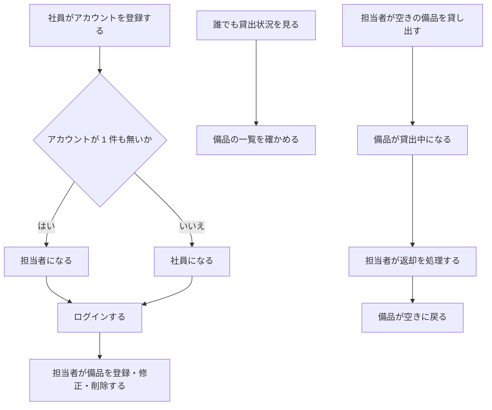
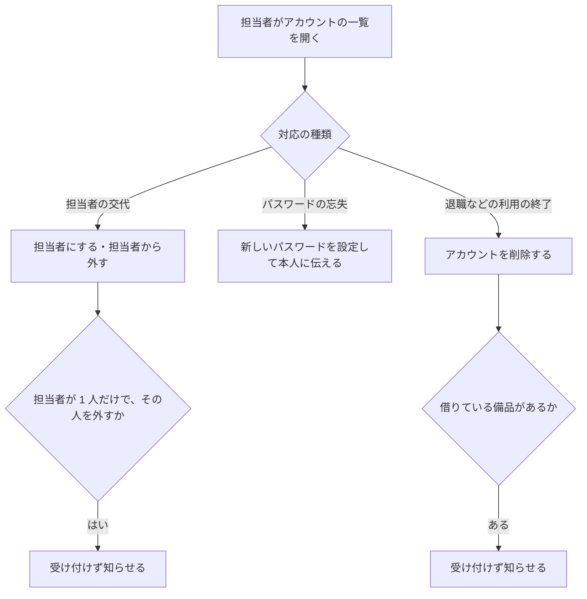
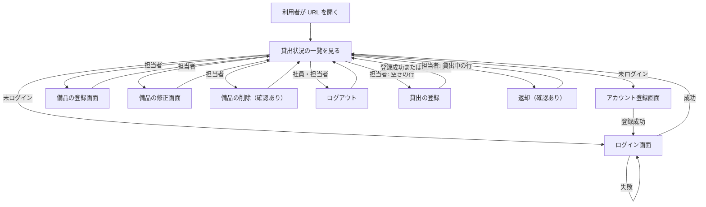
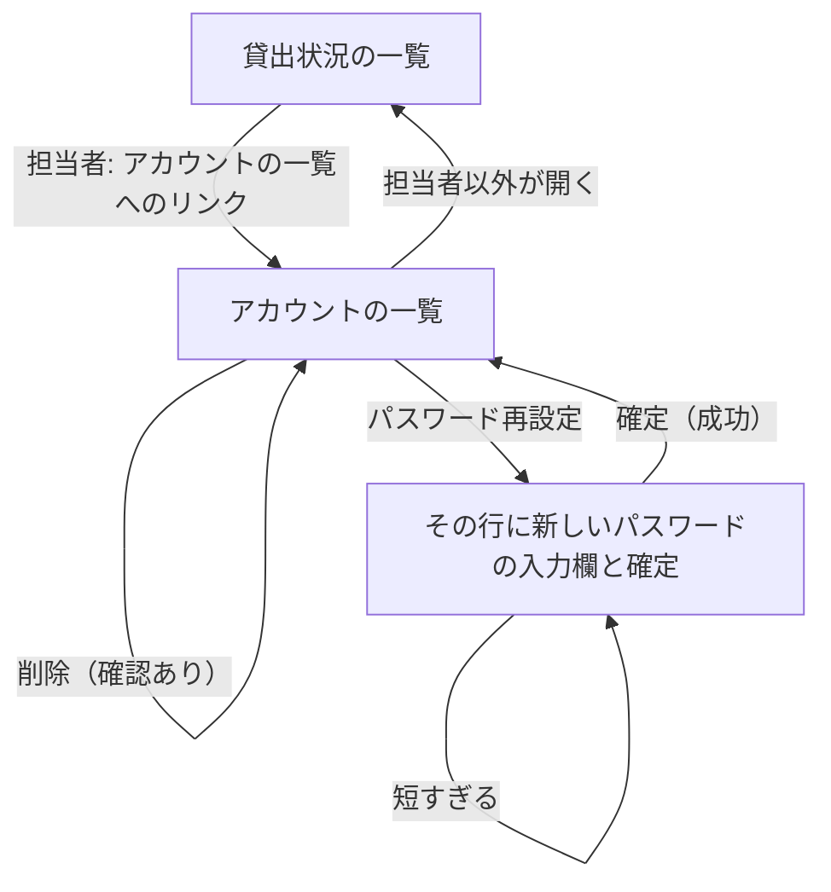
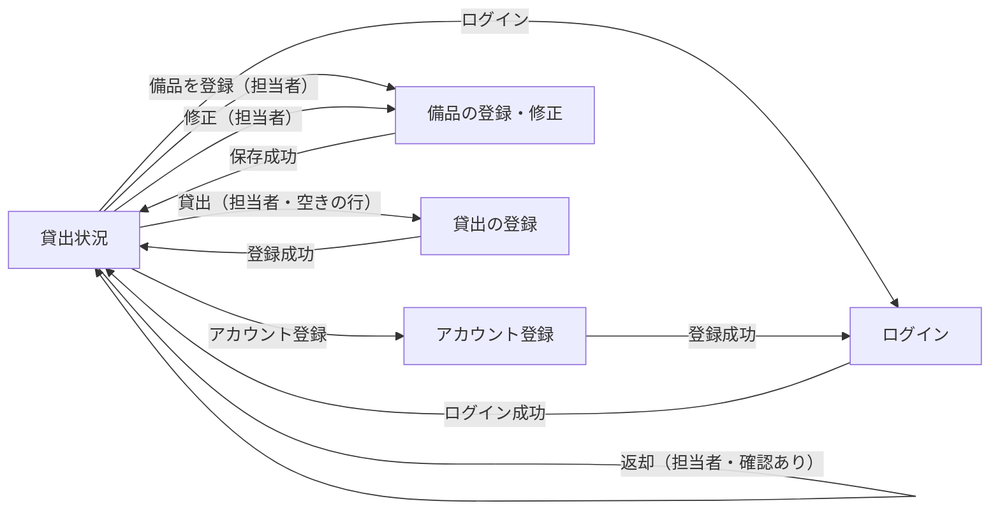

# 要件定義書: 備品台帳と貸出状況の閲覧（段 1）、備品の貸出と返却（段 2）、アカウントの管理（段 3）

## 1. 目的・前提

### 目的

会社の備品の台帳を 1 つのアプリにまとめ、記録の食い違いと消失をなくす。社員が「どの備品があり、空いているか」を担当者に問い合わせずに自分で確かめられるようにする。

### 用語集

| 用語 | 業務上の意味 | 本案件での使用範囲 | 同義語/類義語 |
|---|---|---|---|
| 社員 | 会社に所属し、備品を借りる人 | ログインして備品を借りる側の利用者（備品の閲覧のみ。貸出は担当者が登録する） | 利用者 |
| 担当者 | 備品の台帳を管理し、備品を登録・修正・削除する社員 | 最初に登録されたアカウントの利用者と、担当者が担当者にしたアカウントの利用者。備品の登録・修正・削除と、アカウントの管理（担当者の付け外し、パスワードの再設定、削除）ができる | 管理者 |
| 未ログインの人 | ログインしていない、社内の閲覧者 | 貸出状況の閲覧のみ可能 | ゲスト |
| 備品 | 会社が管理する物品。管理番号と備品名を持つ | 台帳の 1 件 | 物品 |
| 管理番号 | 備品を一意に指す番号（半角の英数字とハイフン、20 文字以内） | 備品の識別子 | 備品番号 |
| 貸出状況 | 備品ごとの「空き」か「貸出中」か、借りている社員の名前、貸出日 | 一覧画面の表示。貸出の記録から求める（貸出中か、借りている社員の名前、貸出日） | 貸出の状態 |
| 貸出 | 空いている備品を社員に渡して使ってもらうこと | 担当者が貸出を登録すると、その備品は貸出中になる | 貸し出し |
| 借りる社員 | 貸出の相手の社員。アカウントから選ぶ | 貸出の登録で選ぶ（選択肢は「名前（社員番号）」） | 借り手 |
| 貸出日 | 貸し出した日 | 既定は今日（日本時間）。未来の日付は受け付けない | 貸出の日付 |
| 返却 | 貸出中の備品が戻ること | 担当者が返却を処理すると、貸出の記録を消して空きに戻す。返却した記録は残さない | 返品 |
| 社員番号 | 社員を一意に指す 6 桁の数字 | ログインの識別子 | 社員 ID |
| アカウントの管理 | 担当者が、アカウントの一覧を見て、担当者の付け外し、パスワードの再設定、削除を行うこと | 担当者だけが行える。一覧の行のボタンから操作する | 利用者の管理 |
| 担当者の付け外し | アカウントを担当者にする、または担当者から外すこと | 担当者が 1 人だけのとき、その人を外すことはできない（担当者を 0 人にしない） | 役割の変更 |
| パスワードの再設定 | 担当者が、社員の新しいパスワードを設定して本人に伝えること | 8 文字以上。再設定の後は古いパスワードではログインできない | パスワードの初期化 |
| アカウントの削除 | 退職などで使わなくなったアカウントを消すこと | 借りている備品が 1 台も無いアカウントだけ削除できる。削除したアカウントではログインできず、借りる社員の候補にも出ない。削除の記録は残さない | 退職処理 |

### システムの形態

GUI（ブラウザで開く画面）。Web API・バッチ・CUI は作らない。

### 1-1. 技術制約

| 制約項目 | 内容 | 出どころ（誰がいつ答えたか） |
|---|---|---|
| 既存コードベース | 無し（新規開発） | 依頼者、2026-11-04（ANSWERS.md） |
| 配備先 | 社内の Linux サーバー。採点では `bash run.sh` で直接起動するため、コンテナ無しで動くこと | 依頼者、2026-11-04（ANSWERS.md） |
| チームの技術 | 決まり無し。Python 3.12 と SQLite で足りる | 依頼者、2026-11-04（ANSWERS.md） |
| ライセンスとコスト | 無償のものだけ。有償ソフトと外部サービスは使わない | 依頼者、2026-11-04（ANSWERS.md） |
| 性能と規模の目安 | 利用者 50 人（社員と担当者の合計）、備品は数百件、アカウントは 50 件まで。操作から表示まで 3 秒以内 | 依頼者、2026-11-04（ANSWERS.md） |

## 2. 業務

### 対象業務一覧

| RQ-BZ-ID | 業務名 | 業務の範囲 | 担当者 |
|---|---|---|---|
| `RQ-BZ-EQUIPMENT-LEDGER` | 備品台帳の管理 | 備品の登録・修正・削除、アカウントの登録とログイン | 担当者（登録・修正・削除）、社員（アカウントの登録とログイン） |
| `RQ-BZ-EQUIPMENT-STATUS-VIEW` | 備品の貸出状況の閲覧 | 全備品の一覧（管理番号、備品名、空きか貸出中か、借りている社員の名前、貸出日） | 誰でも（ログインは不要） |
| `RQ-BZ-EQUIPMENT-LENDING` | 備品の貸出と返却 | 空いている備品の貸出の登録、貸出中の備品の返却の処理、貸出状況の確認 | 担当者（貸出・返却）、社員と未ログインの人（貸出状況の確認） |
| `RQ-BZ-ACCOUNT-MANAGEMENT` | アカウントの管理 | アカウントの一覧、担当者の付け外し、パスワードの再設定、アカウントの削除 | 担当者だけ |

### 業務フロー

アカウントの管理の業務フロー（段 3）:

### 2-1. 業務の問題（あるべき姿と現状のギャップ）

| 問題 | 対象業務（RQ-BZ） | あるべき姿 | 現状 | ギャップ（KPI） | 業務影響 |
|---|---|---|---|---|---|
| 備品の記録が複数の管理用 Excel に分かれ、どれが最新か分からない。記録が食い違い、消えている | `RQ-BZ-EQUIPMENT-LEDGER` | 備品の記録が 1 つだけあり、誰が更新しても食い違わず、失われない | 複数の人が別々の Excel を更新している。食い違いと消失が起きている（件数は確認していない） | 食い違い・消失の件数: 不明（確認していないため数値を作らない） | 備品の所在と貸出を正確に把握できない |
| 社員が「どの備品を誰が借りているか」を知るには担当者に問い合わせる必要があり、担当者が毎回 15 分かけて調べている | `RQ-BZ-EQUIPMENT-STATUS-VIEW` | 社員が自分で備品の一覧と空き状況を確かめられる | 問い合わせのたびに担当者が Excel を調べる | 担当者の問い合わせ対応 1 回あたり 15 分（問い合わせの頻度: 不明） | 担当者の作業時間を取られ、社員の待ち時間も生じる |

### 2-2. 業務課題一覧

| RQ-BK-ID | 業務課題（取り組むこと） | 解決する問題（2-1） | 解決後の状態（KPI の目標値） | 対象業務（RQ-BZ） |
|---|---|---|---|---|
| `RQ-BK-SINGLE-EQUIPMENT-RECORD` | 備品の記録を 1 つのアプリにまとめ、複数の担当者が更新しても記録が失われないようにする | 備品の記録が複数の Excel に分かれ、食い違いと消失が起きている | 備品の記録が 1 つだけあり、食い違いと消失が起きない（目標件数: 0 件） | `RQ-BZ-EQUIPMENT-LEDGER` |
| `RQ-BK-SELF-SERVICE-STATUS-VIEW` | 社員が担当者に問い合わせず、備品の一覧と空き状況を自分で確かめられるようにする | 担当者への問い合わせと、担当者による 1 回 15 分の調べ作業 | 担当者の問い合わせ対応の 1 回 15 分が無くなる（削減後の対応時間: 0 分） | `RQ-BZ-EQUIPMENT-STATUS-VIEW` |
| `RQ-BK-LOAN-RECORD-IN-APP` | 貸出の記録を備品の台帳と同じアプリで持ち、貸出中かどうかと借りている社員を、担当者の調べ作業なしに分かるようにする | 既存 2-1 の 1 行目（記録が複数の Excel に分かれ、食い違いと消失が起きている）、2 行目（社員が担当者に問い合わせ、担当者が 1 回 15 分調べている） | 貸出の記録が 1 つのアプリにあり、貸出中の備品の二重の貸出と返却の記録の消失が起きない（目標件数: 0 件）。問い合わせ対応の 1 回 15 分が 0 分になる | [追加] `RQ-BZ-EQUIPMENT-LENDING` |
| `RQ-BK-MANAGER-ACCOUNT-SCREEN` | 担当者の交代、退職、パスワードの忘失の対応を、担当者が画面から行えるようにし、DB の直接操作をなくす | 既存 2-1 には無い新しい課題（依頼者の現状: 対応のたびに DB を直接触っている） | 担当者の交代・退職・パスワードの忘失の対応が、DB を直接触らずに画面だけで済む（DB の直接操作の件数: 0 件） | [追加] `RQ-BZ-ACCOUNT-MANAGEMENT` |

### 2-3. 見込み経営効果

| RQ-EF-ID | 効果の種類 | 内容 | 見込み（金額・時間などと算定根拠） | 対応業務課題ID（RQ-BK-*） |
|---|---|---|---|---|
| `RQ-EF-SOFT-SAVING-INQUIRY-TIME` | Soft Saving | 担当者が備品の問い合わせに答える作業時間の削減 | 1 回あたり 15 分の作業が無くなる。問い合わせの頻度は不明のため、月の合計は算定しない | `RQ-BK-SELF-SERVICE-STATUS-VIEW` |

## 3. 機能要件

### 入力データと出力データ

- 入力データ: 人手入力（アカウントの登録、ログイン、備品の登録・修正・削除、貸出の登録と返却の画面からの入力）。外部からの入力は無い
- 出力データ: 画面の表示（貸出状況の一覧、入力の結果の知らせ、入力のエラー）。帳票・ファイル出力は無い

### 利用フロー

業務フローとの対応: 「アカウントの登録とログイン」は業務フローの「社員がアカウントを登録する」「ログインする」に、「備品の登録・修正・削除」は「担当者が備品を登録・修正・削除する」に、「貸出状況の一覧」は「誰でも貸出状況を見る」に、「貸出の登録・返却」は「担当者が空きの備品を貸し出す」「担当者が返却を処理する」に対応する。

アカウントの管理の利用フロー（段 3）:

### 機能一覧

| RQ-ID | カテゴリ | 機能名 | 対応業務課題ID（RQ-BK-*） | この機能が無いと何が困るか |
|---|---|---|---|---|
| `RQ-FT-REGISTER-ACCOUNT` | 共通（認証・認可・ログ） | アカウントを登録する | `RQ-BK-SINGLE-EQUIPMENT-RECORD` | 担当者と社員がアプリを使い始められず、記録を更新できる人がいない |
| `RQ-FT-LOGIN` | 共通（認証・認可・ログ） | 社員番号とパスワードでログインする | `RQ-BK-SINGLE-EQUIPMENT-RECORD` | 担当者だけが備品を更新する制限をかけられず、記録の食い違いが起きる |
| `RQ-FT-LOGOUT` | 共通（認証・認可・ログ） | ログアウトする | `RQ-BK-SINGLE-EQUIPMENT-RECORD` | 共有の端末で、前の人の権限のまま操作が続いてしまう |
| `RQ-FT-AUTO-LOGOUT-IDLE` | 共通（認証・認可・ログ） | 操作しないまま 30 分たったら自動でログアウトする | `RQ-BK-SINGLE-EQUIPMENT-RECORD` | 離席した端末から、他人が担当者の権限で備品を更新できてしまう |
| `RQ-FT-REGISTER-EQUIPMENT` | 業務機能 | 備品を登録する（担当者だけ） | `RQ-BK-SINGLE-EQUIPMENT-RECORD` | 備品の記録を 1 つのアプリに集められず、Excel が残り続ける |
| `RQ-FT-EDIT-EQUIPMENT` | 業務機能 | 備品の管理番号と備品名を修正する（担当者だけ） | `RQ-BK-SINGLE-EQUIPMENT-RECORD` | 誤った記録を直せず、記録の食い違いが残る |
| `RQ-FT-DELETE-EQUIPMENT` | 業務機能 | 備品を削除する（担当者だけ。確認ダイアログで「はい」のときだけ） | `RQ-BK-SINGLE-EQUIPMENT-RECORD` | 廃棄した備品が一覧に残り、空き状況が実態と食い違う |
| `RQ-FT-VIEW-LOAN-STATUS` | 業務機能 | 誰でも貸出状況の一覧を見る | `RQ-BK-SELF-SERVICE-STATUS-VIEW` | 社員が担当者に問い合わせるしかなく、15 分の調べ作業が無くならない |
| `RQ-FT-REGISTER-LOAN` | 業務機能 | 空いている備品を、借りる社員と貸出日を記録して貸し出す（担当者だけ） | `RQ-BK-LOAN-RECORD-IN-APP` | 貸出の記録がアプリに無く、貸出中かどうかを担当者が調べることになる |
| `RQ-FT-RETURN-EQUIPMENT` | 業務機能 | 貸出中の備品の返却を処理する（担当者だけ。確認ダイアログで「はい」のときだけ） | `RQ-BK-LOAN-RECORD-IN-APP` | 返却されても貸出中のままになり、空き状況が実態と食い違う |
| `RQ-FT-SHOW-LOAN-DETAILS` | 業務機能 | 貸出状況の一覧に、貸出中か、借りている社員の名前、貸出日を出す | `RQ-BK-SELF-SERVICE-STATUS-VIEW` | 社員が「誰が借りているか」を一覧で確かめられず、担当者に問い合わせることになる |
| `RQ-FT-LIST-ACCOUNTS` | 業務機能 | 担当者が全アカウントの一覧（社員番号、名前、担当者か社員か）を見る | `RQ-BK-MANAGER-ACCOUNT-SCREEN` | 担当者が、誰がどの役割かを画面で確かめられず、DB を直接見ることになる |
| `RQ-FT-CHANGE-ACCOUNT-ROLE` | 業務機能 | 担当者が、アカウントを担当者にする、または担当者から外す（確認ダイアログで「はい」のときだけ） | `RQ-BK-MANAGER-ACCOUNT-SCREEN` | 担当者の交代を DB の直接操作でしかできない |
| `RQ-FT-RESET-ACCOUNT-PASSWORD` | 業務機能 | 担当者が、社員の新しいパスワード（8 文字以上）を設定する。再設定の後は古いパスワードではログインできない | `RQ-BK-MANAGER-ACCOUNT-SCREEN` | パスワードを忘れた社員が、ログインできないまま業務が止まる |
| `RQ-FT-DELETE-ACCOUNT` | 業務機能 | 担当者が、アカウントを削除する（確認ダイアログで「はい」のときだけ）。削除したアカウントではログインできず、借りる社員の候補にも出ない | `RQ-BK-MANAGER-ACCOUNT-SCREEN` | 退職した人のアカウントが残り、ログインや貸出の候補に出続ける |

### 3-1. 帳票・出力ファイル

帳票・出力ファイルは無い。

### 3-2. 業務ルール

| RQ-ID | ルール名 | 内容（条件と結果） | 違反時・エラー時の業務上の扱い | 対応業務課題ID（RQ-BK-*） |
|---|---|---|---|---|
| `RQ-FT-FIRST-ACCOUNT-IS-MANAGER` | 最初のアカウントは担当者 | アカウントが 1 件も無い状態でアカウントを登録した人は担当者になる。2 件目以降に登録した人は社員になる。登録の判定は同時の登録でも 1 件だけが担当者になるよう、一体で行う | 該当しない（登録は成功する） | `RQ-BK-SINGLE-EQUIPMENT-RECORD` |
| `RQ-FT-MANAGER-ONLY-EQUIPMENT-OPERATION` | 備品の登録・修正・削除は担当者だけ | 備品の登録・修正・削除（画面と、その操作を要求する通信の両方）は担当者だけが行える。社員の要求は、画面を出さないだけでなく、受け付けずに備品の記録を変えない。未ログインの要求はログイン画面へ送る | 社員の要求は貸出状況の画面に戻し、「この操作は担当者だけが行えます」と知らせる。未ログインの要求はログイン画面へ送る | `RQ-BK-SINGLE-EQUIPMENT-RECORD` |
| `RQ-FT-LOGIN-FAILURE-NO-HINT` | ログイン失敗時は理由を示さない | 社員番号かパスワードが違うとき、どちらが違うかを示さず、同じ文言を返す | 「社員番号またはパスワードが違います」と表示し、社員番号は入力欄に残す | `RQ-BK-SINGLE-EQUIPMENT-RECORD` |
| `RQ-FT-UNIQUE-EMPLOYEE-AND-EQUIPMENT-NUMBER` | 社員番号と管理番号の重複禁止 | 社員番号は全アカウントの中で重複しない。管理番号は全備品の中で重複しない（修正のときは自分自身を除いて判定する） | 重複するときは登録・修正をせず、その入力欄に「この社員番号は既に登録されています」または「この管理番号は既に使われています」と表示する | `RQ-BK-SINGLE-EQUIPMENT-RECORD` |
| `RQ-FT-MANAGER-ONLY-LOAN-OPERATION` | 貸出・返却は担当者だけ | 貸出の登録と返却（画面と、その操作を要求する通信の両方）は担当者だけが行える。社員と未ログインの人の要求は、受け付けずに貸出の記録を変えない。未ログインの要求はログイン画面へ送る | 社員の要求は貸出状況の画面に戻し、「この操作は担当者だけが行えます」と知らせる。未ログインの要求はログイン画面へ送る | `RQ-BK-LOAN-RECORD-IN-APP` |
| `RQ-FT-NO-DOUBLE-LOAN` | 貸出中の備品は貸し出せない | 貸出中の備品には、新しく貸出を登録できない。2 人の担当者がほぼ同時に同じ備品を貸し出したときは、先に登録した 1 件だけを記録し、後の登録は記録しない | 後の登録は貸出状況の画面に戻し、「この備品は既に貸出中です」と知らせる | `RQ-BK-LOAN-RECORD-IN-APP` |
| `RQ-FT-NO-DOUBLE-RETURN` | 返却済みの備品は返却できない | 空きの備品には返却を処理できない。2 人の担当者がほぼ同時に同じ備品の返却を処理したときは、先の処理だけを行い、後の処理は行わない | 後の処理は貸出状況の画面に戻し、「この備品は既に返却されています」と知らせる | `RQ-BK-LOAN-RECORD-IN-APP` |
| `RQ-FT-LOAN-DATE-NOT-FUTURE` | 貸出日に未来の日付は使えない | 貸出日は今日または過去の日付だけを受け付ける。既定は日本時間の今日。借りる社員が未選択のときも登録しない | 貸出日が未来のときは貸出日の入力欄に「貸出日に未来の日付は入力できません」を出す。借りる社員が未選択のときは借りる社員の入力欄に「借りる社員を選んでください」を出す。どちらも登録せず、入力値を残す | `RQ-BK-LOAN-RECORD-IN-APP` |
| `RQ-FT-NO-DELETE-LOANED-EQUIPMENT` | 貸出中の備品は削除できない | 貸出中の備品の削除は行わない。削除の処理の中で貸出の有無を確かめ、貸出中なら削除しない | 貸出状況の画面に戻し、「この備品は貸出中のため削除できません。先に返却を処理してください」と知らせる | `RQ-BK-LOAN-RECORD-IN-APP` |
| `RQ-FT-EDIT-KEEPS-LOAN` | 修正しても貸出を引き継ぐ | 備品の管理番号と備品名を修正しても、その備品の貸出の記録はそのまま残す（借りる社員と貸出日は変わらない） | 該当なし | `RQ-BK-LOAN-RECORD-IN-APP` |
| `RQ-FT-EDIT-CONFLICT-REJECT` | 修正中の他の担当者の更新・削除を検出する | 修正画面を開いてから保存するまでに、他の担当者が同じ備品を修正または削除していたら、保存を受け付けず、修正画面を開き直してもらう | 修正画面に「他の担当者が先にこの備品を更新しました。貸出状況の画面から開き直してください」を `.error` に出し、保存しない | `RQ-BK-SINGLE-EQUIPMENT-RECORD`, `RQ-BK-LOAN-RECORD-IN-APP` |
| `RQ-FT-MANAGER-ONLY-ACCOUNT-MANAGEMENT` | アカウントの管理は担当者だけ | アカウントの一覧と、担当者の付け外し・パスワードの再設定・削除の操作（画面と、その操作を要求する通信の両方）は担当者だけが行える。社員と未ログインの人の要求は受け付けず、アカウントの記録を変えない | 社員の要求は貸出状況の画面に戻し、「この操作は担当者だけが行えます」と知らせる。未ログインの要求はログイン画面へ送る | `RQ-BK-MANAGER-ACCOUNT-SCREEN` |
| `RQ-FT-KEEP-ONE-MANAGER` | 担当者を 0 人にしない | 担当者が 1 人だけのとき、その人を担当者から外す操作と、その人のアカウントを削除する操作は行わない。担当者が 2 人以上いれば可能 | アカウントの一覧に「担当者が 1 人もいなくなるため、この操作はできません」を `.message` に出し、何も変えない | `RQ-BK-MANAGER-ACCOUNT-SCREEN` |
| `RQ-FT-NO-DELETE-BORROWING-ACCOUNT` | 備品を借りている社員は削除できない | 1 台以上の備品を借りている社員のアカウントは削除しない。貸出の記録がある間は、削除の処理の中で貸出の有無を確かめて止める | アカウントの一覧に「この社員は備品を借りているため削除できません。先に返却を処理してください」を `.message` に出し、削除しない | `RQ-BK-MANAGER-ACCOUNT-SCREEN` |
| `RQ-FT-ACCOUNT-CHANGE-TAKES-EFFECT` | 担当者の変更と削除は次の要求から効く | 担当者の付け外しと削除は、その人の次の要求から効く。ログイン中の人も、要求ごとに DB の記録を見直す。担当者から外された人は担当者の画面を開けず、削除された人は未ログインとして扱う | 担当者でなくなった人の操作は「この操作は担当者だけが行えます」で拒否する。削除された人は未ログインとして扱い、ログイン画面へ送る | `RQ-BK-MANAGER-ACCOUNT-SCREEN` |

### 3-3. 外部連携

外部連携は無い。

## 4. データ

### 4-1. データ要件一覧

| RQ-ID | 種別 | 内容 | 対応業務課題ID（RQ-BK-*） | この要件が無いと何が困るか |
|---|---|---|---|---|
| `RQ-DT-INTERNAL-DATA` | 内部データ / 外部データ | 扱うデータはすべて内部データ（アカウントと備品）。外部 DB は無い | `RQ-BK-SINGLE-EQUIPMENT-RECORD` | 外部のデータとの同期を設計に含めるべきか判断できない |
| `RQ-DT-DB-REQUIRED` | DB の必要性 | DB を使う。理由は、複数の担当者が同時に更新しても記録が失われないようにするため。初期件数は 0 件、想定は備品が数百件・アカウントが 50 件まで。1 年後の件数と年間増加率は不明のため、上限（備品数百件、アカウント 50 件）で設計する。参照関係は単純（貸出の記録が備品と社員を参照する。外部キーで結ぶ）。検索・集計は一覧の表示だけ | `RQ-BK-SINGLE-EQUIPMENT-RECORD` | ファイルへの書き込みが競合し、記録が失われる |
| `RQ-DT-NO-DELETED-HISTORY` | データ保持期間 | 削除した備品とアカウントの記録は残さない（削除は物理削除。履歴の表を持たない） | `RQ-BK-SINGLE-EQUIPMENT-RECORD` | 削除の履歴の保持方針を決められず、設計が膨らむ |
| `RQ-DT-LOAN-RECORD` | DB の必要性・保持 | 貸出の記録を DB に持つ。備品 1 件に対して貸出の記録は 0 件か 1 件。返却した貸出の記録は消し、残さない（履歴の表を持たない）。同時の更新で記録が失われないよう、書き込みを排他する。初期件数は 0 件、想定は備品が数百件・アカウント 50 件まで | `RQ-BK-LOAN-RECORD-IN-APP` | 同時の貸出・返却で記録が食い違い、二重の貸出が起きる |
| `RQ-DT-ACCOUNT-HARD-DELETE` | DB の必要性・保持 | 削除したアカウントは、行ごと消す。削除の記録（履歴の表）は持たない。パスワードは再設定のたびにハッシュで置き換える | `RQ-BK-MANAGER-ACCOUNT-SCREEN` | 退職者のアカウントが残り、ログインや貸出の候補に出続ける |

### 4-2. 業務エンティティとデータ項目

| RQ-ID | カテゴリ | 業務エンティティ名 | 対応業務課題ID（RQ-BK-*） | この業務エンティティが無いと何が困るか |
|---|---|---|---|---|
| `RQ-DT-ACCOUNT` | データ | アカウント | `RQ-BK-SINGLE-EQUIPMENT-RECORD` | 誰が備品を更新できるか（担当者か社員か）を判定できない |
| `RQ-DT-EQUIPMENT` | データ | 備品 | `RQ-BK-SINGLE-EQUIPMENT-RECORD`, `RQ-BK-SELF-SERVICE-STATUS-VIEW` | 備品の台帳そのものが無く、一覧も作れない |

エンティティ「アカウント」の項目:

| エンティティ名 | 項目名 | 業務上の意味 | 必須 | 形式・桁 | 値の範囲・制約 | 例 |
|---|---|---|---|---|---|---|
| アカウント | 社員番号 | 社員を一意に指す番号 | 必須 | 6 桁の数字 | 全アカウントで重複不可（`RQ-FT-UNIQUE-EMPLOYEE-AND-EQUIPMENT-NUMBER`） | 123456 |
| アカウント | 名前 | 社員の名前。貸出状況で借りている人の名前としても使う（貸出状況の一覧に表示する） | 必須 | 文字列 | 1 文字以上 30 文字以内 | 山田太郎 |
| アカウント | パスワード | ログインに使う秘密の文字列。保存するのは一方向のハッシュだけ | 必須 | 文字列 | 8 文字以上（桁数の上限は設けない） | （登録時に本人が入力） |
| アカウント | 役割 | 担当者か社員か | 必須 | 「担当者」か「社員」 | 最初のアカウントは「担当者」、2 件目以降は「社員」（`RQ-FT-FIRST-ACCOUNT-IS-MANAGER`）。その後は担当者が付け外しできる（`RQ-FT-CHANGE-ACCOUNT-ROLE`） | 担当者 |

エンティティ「備品」の項目:

| エンティティ名 | 項目名 | 業務上の意味 | 必須 | 形式・桁 | 値の範囲・制約 | 例 |
|---|---|---|---|---|---|---|
| 備品 | 管理番号 | 備品を一意に指す番号 | 必須 | 半角の英数字とハイフン、20 文字以内 | 全備品で重複不可（`RQ-FT-UNIQUE-EMPLOYEE-AND-EQUIPMENT-NUMBER`）。大文字と小文字は区別する | PC-0001 |
| 備品 | 備品名 | 備品の名前 | 必須 | 文字列 | 1 文字以上 50 文字以内 | ノートパソコン A |
| 備品 | 版番号 | 修正の回数の目印。修正画面を開いたときの値と保存時の値を比べ、他の担当者の更新・削除を検出する | 必須 | 整数 | 1 以上。登録時は 1 | 1 |

エンティティ「貸出」の項目:

| エンティティ名 | 項目名 | 業務上の意味 | 必須 | 形式・桁 | 値の範囲・制約 | 例 |
|---|---|---|---|---|---|---|
| 貸出 | 備品 | 貸し出している備品 | 必須 | 備品の内部の識別子 | 備品 1 件に対して 0 件か 1 件（同時に 2 件は作らない） | （備品の識別子） |
| 貸出 | 借りる社員 | 借りている社員 | 必須 | アカウントの内部の識別子 | アカウントの 1 件を指す | （アカウントの識別子） |
| 貸出 | 貸出日 | 貸し出した日 | 必須 | 日付（YYYY-MM-DD） | 今日または過去（未来の日付は不可） | 2026-11-04 |

備品の貸出状況（空きか貸出中か、借りている社員の名前、貸出日）は、貸出のエンティティから求める。貸出の記録が無い備品は「空き」で、名前と貸出日は空欄になる。返却した貸出の記録は消し、残さない。

### 4-3. CRUD テーブル

| エンティティ名 | Create | Read（一覧） | Read（詳細） | 検索 | Update | Delete | 備考 |
|---|---|---|---|---|---|---|---|
| アカウント | ○（誰でも、自分で登録。`RQ-FT-REGISTER-ACCOUNT`） | ○（担当者だけ。アカウントの一覧。`RQ-FT-LIST-ACCOUNTS`） | ○（ログイン時に社員番号で引く） | × | ○（担当者だけ。役割の付け外しとパスワードの再設定。`RQ-FT-CHANGE-ACCOUNT-ROLE`、`RQ-FT-RESET-ACCOUNT-PASSWORD`） | ○（担当者だけ。借りていない社員のみ。担当者が 1 人だけのときは不可。`RQ-FT-DELETE-ACCOUNT`） | 社員番号の重複を、登録時の同時実行でも防ぐ必要がある（トランザクションで判定する）。削除は行ごと消す（`RQ-DT-ACCOUNT-HARD-DELETE`） |
| 備品 | ○（担当者のみ） | ○（誰でも。貸出状況の一覧。貸出中なら借りている社員と貸出日を結ぶ） | ○（担当者のみ。修正画面を開くとき。版番号を含む） | × | ○（担当者のみ。開いたときの版番号と同じときだけ保存する。貸出の記録は引き継ぐ） | ○（担当者のみ。貸出中は削除しない） | 管理番号の重複を、登録・修正時の同時実行でも防ぐ必要がある（一意制約で判定する）。検索は無い（一覧は全件を管理番号の昇順で出す） |
| 貸出 | ○（担当者のみ。空きの備品への貸出の登録） | ○（誰でも。貸出状況の一覧で備品と結ぶ） | × | × | × | ○（担当者のみ。返却で記録を消す。物理削除） | 同じ備品に 2 件の貸出は作らない（一意制約で判定する） |

### 4-4. 状態遷移

| RQ-ID | 対象 | 状態 | 遷移の契機 | 許されない遷移の扱い | 対応業務課題ID（RQ-BK-*） |
|---|---|---|---|---|---|
| `RQ-DT-ACCOUNT-ROLE-STATE` | アカウントの役割 | 担当者、社員 | 社員 → 担当者: 担当者が「担当者にする」を行う。担当者 → 社員: 担当者が「担当者から外す」を行う（担当者が 2 人以上のとき） | 担当者が 0 人になる遷移は行わない（`RQ-FT-KEEP-ONE-MANAGER`） | `RQ-BK-MANAGER-ACCOUNT-SCREEN` |

| `RQ-DT-EQUIPMENT-LOAN-STATE` | 備品の貸出状況（貸出の記録の有無で決まる） | 空き（貸出の記録が無い）、貸出中（貸出の記録が 1 件ある） | 空き → 貸出中: 担当者が貸出を登録する。貸出中 → 空き: 担当者が返却を処理する | 貸出中 → 貸出中（既に貸出中の登録）と、空き → 空き（既に返却済みの返却）は行わず、知らせる（`RQ-FT-NO-DOUBLE-LOAN`、`RQ-FT-NO-DOUBLE-RETURN`） | `RQ-BK-LOAN-RECORD-IN-APP` |
### 4-5. 画面一覧

| RQ-ID | 画面名 | 対応する CRUD 操作（エンティティ名:操作種別） | 主な機能・目的 | 対応業務課題ID（RQ-BK-*） |
|---|---|---|---|---|
| `RQ-UI-LOAN-STATUS-SCREEN` | 貸出状況（トップ） | 備品:Read（一覧）、備品:Delete | 全備品の一覧を見る。ログインしていれば、ログイン中の名前、ログアウト、（担当者は）備品の登録への入口、行ごとの修正と削除を出す | `RQ-BK-SELF-SERVICE-STATUS-VIEW`, `RQ-BK-SINGLE-EQUIPMENT-RECORD` |
| `RQ-UI-LOAN-REGISTER-SCREEN` | 貸出の登録 | 貸出:Create、備品:Read（詳細） | 空いている備品について、借りる社員と貸出日を選んで貸出を登録する（担当者だけ） | `RQ-BK-LOAN-RECORD-IN-APP` |
| `RQ-UI-ACCOUNT-REGISTER-SCREEN` | アカウント登録 | アカウント:Create | 社員番号、名前、パスワードを入力してアカウントを作る | `RQ-BK-SINGLE-EQUIPMENT-RECORD` |
| `RQ-UI-LOGIN-SCREEN` | ログイン | アカウント:Read（詳細） | 社員番号とパスワードでログインする | `RQ-BK-SINGLE-EQUIPMENT-RECORD` |
| `RQ-UI-EQUIPMENT-FORM-SCREEN` | 備品の登録・修正 | 備品:Create、備品:Read（詳細）、備品:Update | 管理番号と備品名を入力して、備品を登録または修正する（担当者だけ） | `RQ-BK-SINGLE-EQUIPMENT-RECORD` |
| `RQ-UI-ACCOUNT-LIST-SCREEN` | アカウントの一覧 | アカウント:Read（一覧）、アカウント:Update（役割、パスワード）、アカウント:Delete | 担当者が全アカウントを見て、担当者の付け外し、パスワードの再設定、削除を行う（担当者だけ） | `RQ-BK-MANAGER-ACCOUNT-SCREEN` |

画面の仕様（3 章の画面ごとの 5 項目）:

- 貸出状況（`RQ-UI-LOAN-STATUS-SCREEN`）
  - 目的: 全備品の空き状況を一覧で見る
  - 主要要素: 見出し、ログイン中の表示（`.current-user`）または「ログイン」「アカウント登録」のリンク、担当者だけの「備品を登録」リンクと、行ごとの「貸出」「返却」「修正」「削除」ボタン、備品の表
  - 入力項目: 無し（削除の確認ダイアログ）
  - 表示項目: 管理番号、備品名、状態（「空き」または「貸出中」）、借りている社員の名前、貸出日（`YYYY-MM-DD`）。備品が 0 件なら「備品は登録されていません」
  - エラー時の見え方: 担当者以外の操作の要求は、この画面に戻して `.message` に「この操作は担当者だけが行えます」を出す
- アカウント登録（`RQ-UI-ACCOUNT-REGISTER-SCREEN`）
  - 目的: 社員が自分のアカウントを作る
  - 主要要素: 社員番号、名前、パスワードの入力欄、「登録」ボタン
  - 入力項目: 社員番号、名前、パスワード
  - 表示項目: 入力の結果（成功時はログイン画面に移って知らせる）
  - エラー時の見え方: 入力欄ごとのエラーを `.field` の中の `.field-error` に出す。入力した社員番号と名前は消さない。パスワードは再表示しない
- ログイン（`RQ-UI-LOGIN-SCREEN`）
  - 目的: 社員番号とパスワードでログインする
  - 主要要素: 社員番号、パスワードの入力欄、「ログイン」ボタン
  - 入力項目: 社員番号、パスワード
  - 表示項目: 無し（成功時は貸出状況の画面へ）
  - エラー時の見え方: 「社員番号またはパスワードが違います」を `.error` に出す。社員番号は残す
- 備品の登録・修正（`RQ-UI-EQUIPMENT-FORM-SCREEN`）
  - 目的: 担当者が備品を登録または修正する
  - 主要要素: 管理番号、備品名の入力欄、「保存」ボタン
  - 入力項目: 管理番号、備品名
  - 表示項目: 修正のときは現在の値を入力欄に入れて開く
  - エラー時の見え方: 入力欄ごとのエラーを `.field-error` に出す。入力した値は消さない。担当者以外は貸出状況の画面に戻して `.message` に出す
- 貸出の登録（担当者だけ）
  - 目的: 担当者が空きの備品を貸し出す
  - 主要要素: 備品の表示（「備品: 管理番号 備品名」）、借りる社員の選択、貸出日の入力欄（既定は今日）、「登録」ボタン
  - 入力項目: 借りる社員（アカウントから選ぶ。表示は「名前（社員番号）」）、貸出日（YYYY-MM-DD）
  - 表示項目: 無し（成功時は貸出状況の画面へ戻し「貸出を登録しました」）
  - エラー時の見え方: 借りる社員の未選択と未来の貸出日は入力欄ごとの `.field-error`。入力した値は消さない。既に貸出中なら貸出状況の画面へ戻し「この備品は既に貸出中です」。担当者以外は貸出状況の画面に戻して `.message` に出す

画面遷移図:

アカウントの一覧（`RQ-UI-ACCOUNT-LIST-SCREEN`）の 5 項目:

- 目的: 担当者がアカウントを管理する
- 主要要素: 表（`tbody tr`、各行に社員番号を `data-employee-number` で付ける。列は社員番号、名前、「担当者」または「社員」、操作）。操作のボタンは「担当者にする」「担当者から外す」「パスワード再設定」「削除」。リンク「アカウントの一覧」は貸出状況の画面に出す（担当者だけ）
- 入力項目: パスワード再設定を押した行にだけ、新しいパスワードの入力欄（`input[name=new_password]`）と「確定」ボタン
- 表示項目: 操作の結果の知らせ（`.message`）、パスワードの入力のエラー（その行の `.field-error`）
- エラー時の見え方: 担当者以外は貸出状況の画面に戻し `.message` に「この操作は担当者だけが行えます」。未ログインはログイン画面へ。借りている社員の削除と担当者 0 人は `.message`。確認ダイアログで「いいえ」のときは何もしない

## 5. 非機能要件

| RQ-ID | カテゴリ | 非機能要件名 | 対応業務課題ID（RQ-BK-*） | この非機能要件が無いと何が困るか |
|---|---|---|---|---|
| `RQ-NF-INTERNAL-NETWORK-ACCESS` | 利用者・アクセス経路 | 利用者は社員・担当者・社内の未ログインの閲覧者とし、アクセス経路は社内ネットワークに限る（インターネットには公開しない） | `RQ-BK-SELF-SERVICE-STATUS-VIEW` | 社外から備品の記録が見られ、情報が漏れる |
| `RQ-NF-USERS-50` | 利用人数 | 利用者は合計 50 人まで（同時接続の目安も 50 人） | `RQ-BK-SELF-SERVICE-STATUS-VIEW` | 同時に使うと応答が遅くなり、業務が止まる |
| `RQ-NF-RESPONSE-3S` | 性能 | 操作してから表示されるまで 3 秒以内（備品 500 件の一覧でも） | `RQ-BK-SELF-SERVICE-STATUS-VIEW` | 待ち時間が長く、社員が使わなくなる |
| `RQ-NF-RESPONSE-3S-AT-50-USERS` | 性能 | 利用者 50 人が同時に画面を開き、ボタンを押しても、操作から結果の表示まで 3 秒以内（備品 500 件の一覧の画面でも） | `RQ-BK-SELF-SERVICE-STATUS-VIEW`, `RQ-BK-LOAN-RECORD-IN-APP` | 同時に使うと応答が遅くなり、業務が止まる |
| `RQ-NF-PASSWORD-HASHED` | セキュリティ | パスワード認証のみ（SSO は無し）。パスワードは平文で保存せず、ハッシュにする | `RQ-BK-SINGLE-EQUIPMENT-RECORD` | サーバーの記録が漏れた際に、パスワードがそのまま知られる |
| `RQ-NF-USE-HOURS-WEEKDAY-DAYTIME` | 可用性 | 平日の日中に使う。夜間・休日は止まってよい。障害からの復旧の目標時間は要求しない | `RQ-BK-SINGLE-EQUIPMENT-RECORD` | 常時稼働のための運用を設計することになり、作業が増える |

- 移行性: 既存の Excel の内容を取り込む機能は無い。担当者が画面から手で入力する（移行は無い。取り込みは作らない）。
- 監査証跡の改ざん防止: 不要（運用要件の監査ログを参照）。

## 6. 運用要件

| RQ-ID | 種別 | 内容 | 対応業務課題ID（RQ-BK-*） | この要件が無いと何が困るか |
|---|---|---|---|---|
| `RQ-OP-FIRST-ACCOUNT-SETUP` | 導入手順 | 社員に URL を知らせる前に、担当者が最初のアカウントを登録する。初期ユーザーは置かない | `RQ-BK-SINGLE-EQUIPMENT-RECORD` | 最初に登録した人が担当者にならず、誰も備品を登録できない |

- ログ: ログは必要ないため、ログの内容と保存期間の記述は行わない。
- 監査ログ: 不要。
- 監視・アラート: 監視・アラートは必要ないため、監視・アラートの内容と対応方法の記述は行わない。
- バックアップと復旧: バックアップは必要ない。

## 7. テスト用利用シナリオ

| RQ-ID | テスト目的 | 前提条件 | テスト手順 | 期待される結果 | 検証する要件ID | 対応業務課題ID（RQ-BK-*） |
|---|---|---|---|---|---|---|
| `RQ-TS-REGISTER-FIRST-ACCOUNT` | 最初のアカウントが担当者になる | アカウントが 0 件 | アカウント登録画面で社員番号 `000001`、名前、8 文字以上のパスワードを入力し「登録」を押す。ログイン画面で同じ社員番号とパスワードでログインする | 「登録しました。ログインしてください」が出る。ログイン後、`.current-user` に名前が出て、「備品を登録」リンクが出る | `RQ-FT-REGISTER-ACCOUNT`, `RQ-FT-FIRST-ACCOUNT-IS-MANAGER`, `RQ-UI-ACCOUNT-REGISTER-SCREEN` | `RQ-BK-SINGLE-EQUIPMENT-RECORD` |
| `RQ-TS-REGISTER-SECOND-ACCOUNT-AS-MEMBER` | 2 件目以降のアカウントは社員になる | アカウントが 1 件ある | 別の社員番号と名前とパスワードでアカウントを登録し、ログインする | ログイン後に「備品を登録」リンクが出ない | `RQ-FT-REGISTER-ACCOUNT`, `RQ-FT-FIRST-ACCOUNT-IS-MANAGER`, `RQ-UI-ACCOUNT-REGISTER-SCREEN` | `RQ-BK-SINGLE-EQUIPMENT-RECORD` |
| `RQ-TS-REGISTER-ACCOUNT-VALIDATION` | アカウント登録の入力の検査と重複の禁止 | アカウントが 1 件ある | 社員番号に 5 桁、名前に空、名前に 31 文字、パスワードに 7 文字を入力して登録する。次に既存の社員番号で登録する | 各入力欄の `.field` 内の `.field-error` に、指定の文言（社員番号の形式、名前を入力してください、名前は 30 文字以内、パスワードは 8 文字以上、この社員番号は既に登録されています）が出る。入力した社員番号と名前は残り、登録されない | `RQ-FT-REGISTER-ACCOUNT`, `RQ-FT-UNIQUE-EMPLOYEE-AND-EQUIPMENT-NUMBER`, `RQ-UI-ACCOUNT-REGISTER-SCREEN` | `RQ-BK-SINGLE-EQUIPMENT-RECORD` |
| `RQ-TS-LOGIN-AND-LOGOUT` | ログインとログアウト | アカウントが 1 件ある | ログイン画面で正しい社員番号とパスワードでログインし、「ログアウト」を押す | ログイン後に `.current-user` に名前が出る。ログアウト後に「ログイン」「アカウント登録」のリンクが出る | `RQ-FT-LOGIN`, `RQ-FT-LOGOUT`, `RQ-UI-LOGIN-SCREEN` | `RQ-BK-SINGLE-EQUIPMENT-RECORD` |
| `RQ-TS-LOGIN-FAILURE-NO-HINT` | ログイン失敗時に理由を示さない | アカウントが 1 件ある | 正しい社員番号と違うパスワード、存在しない社員番号と任意のパスワードの 2 通りでログインする | どちらの場合も `.error` に「社員番号またはパスワードが違います」が出る。社員番号は入力欄に残る | `RQ-FT-LOGIN`, `RQ-FT-LOGIN-FAILURE-NO-HINT`, `RQ-UI-LOGIN-SCREEN` | `RQ-BK-SINGLE-EQUIPMENT-RECORD` |
| `RQ-TS-AUTO-LOGOUT-AFTER-IDLE` | 操作しないまま待つと自動でログアウトする | 有効期限を短くした環境（`SESSION_IDLE_TIMEOUT_SECONDS=2`）。アカウントが 1 件ある | ログインし、有効期限を超えるまで操作せず、その後に備品の登録画面を開く | ログイン画面に戻る。貸出状況の画面では「ログイン」「アカウント登録」のリンクが出る | `RQ-FT-AUTO-LOGOUT-IDLE`, `RQ-FT-LOGOUT`, `RQ-UI-LOAN-STATUS-SCREEN` | `RQ-BK-SINGLE-EQUIPMENT-RECORD` |
| `RQ-TS-MANAGER-REGISTER-EQUIPMENT` | 担当者が備品を登録する | 担当者でログイン済み | 「備品を登録」から、管理番号 `PC-0001`、備品名を入力して「保存」を押す。同じ管理番号で再度登録する | 1 件目は貸出状況の一覧に出る（管理番号、備品名、「空き」、空欄の名前と貸出日）。2 件目は `id_equipment_number` の `.field` 内の `.field-error` に「この管理番号は既に使われています」が出て、登録されない | `RQ-FT-REGISTER-EQUIPMENT`, `RQ-FT-UNIQUE-EMPLOYEE-AND-EQUIPMENT-NUMBER`, `RQ-UI-EQUIPMENT-FORM-SCREEN`, `RQ-UI-LOAN-STATUS-SCREEN` | `RQ-BK-SINGLE-EQUIPMENT-RECORD` |
| `RQ-TS-EQUIPMENT-VALIDATION` | 備品の入力の形式と桁数の検査 | 担当者でログイン済み | 管理番号に全角文字、21 文字の英数字、備品名に空と 51 文字を入力して「保存」を押す | 各入力欄の `.field-error` に、指定の文言（管理番号は半角の英数字とハイフンで 20 文字以内、備品名は 50 文字以内）が出て、登録されない。入力値は残る | `RQ-FT-REGISTER-EQUIPMENT`, `RQ-UI-EQUIPMENT-FORM-SCREEN` | `RQ-BK-SINGLE-EQUIPMENT-RECORD` |
| `RQ-TS-MANAGER-EDIT-EQUIPMENT` | 担当者が備品を修正する | 担当者でログイン済み、備品 `PC-0001` が 1 件ある | 一覧の「修正」を押し、備品名を変えて「保存」を押す。次に管理番号を既存の別の管理番号に変えて「保存」を押す | 1 回目は一覧に新しい備品名が出る。2 回目は管理番号の `.field` 内に「この管理番号は既に使われています」が出て、変わらない | `RQ-FT-EDIT-EQUIPMENT`, `RQ-FT-UNIQUE-EMPLOYEE-AND-EQUIPMENT-NUMBER`, `RQ-UI-EQUIPMENT-FORM-SCREEN` | `RQ-BK-SINGLE-EQUIPMENT-RECORD` |
| `RQ-TS-MANAGER-DELETE-EQUIPMENT` | 担当者が備品を削除する（確認ダイアログ） | 担当者でログイン済み、備品 `PC-0001` が 1 件ある | 一覧の「削除」を押し、確認ダイアログで「キャンセル」を選ぶ。次に「削除」を押し、「はい」を選ぶ | キャンセルのときは一覧に残る。「はい」のあとは一覧から消え、`data-equipment-number="PC-0001"` の行が無くなる | `RQ-FT-DELETE-EQUIPMENT`, `RQ-UI-LOAN-STATUS-SCREEN` | `RQ-BK-SINGLE-EQUIPMENT-RECORD` |
| `RQ-TS-MEMBER-CANNOT-OPERATE-EQUIPMENT` | 社員が備品の操作を要求しても受け付けられない | 社員でログイン済み、備品 `PC-0001` が 1 件ある | 社員の画面で、備品の登録画面 `/equipment/new/` を直接開く。備品の修正・削除の要求を直接送る（`/equipment/PC-0001/delete/` に POST） | 貸出状況の画面に戻り、`.message` に「この操作は担当者だけが行えます」が出る。備品の記録は変わらない。行の「修正」「削除」ボタンも出ない | `RQ-FT-MANAGER-ONLY-EQUIPMENT-OPERATION`, `RQ-UI-LOAN-STATUS-SCREEN` | `RQ-BK-SINGLE-EQUIPMENT-RECORD` |
| `RQ-TS-GUEST-CANNOT-OPERATE-EQUIPMENT` | 未ログインの人が備品の操作を要求しても受け付けられない | ログインしていない。備品 `PC-0001` が 1 件ある | ログインせずに `/equipment/new/` を開く。ログインせずに `/equipment/PC-0001/delete/` に POST する | ログイン画面へ送られる。備品の記録は変わらない | `RQ-FT-MANAGER-ONLY-EQUIPMENT-OPERATION`, `RQ-UI-LOAN-STATUS-SCREEN` | `RQ-BK-SINGLE-EQUIPMENT-RECORD` |
| `RQ-TS-VIEW-LOAN-STATUS-AS-GUEST` | ログインしていない人が貸出状況を見られる | 備品 `PC-0001`（備品名 `ノートパソコン A`）と `PC-0002`（備品名 `プロジェクタ`）が登録されている | ログインせずに `/` を開く | 表に 2 行が管理番号の昇順（`PC-0001`、`PC-0002`）で出る。各行に管理番号、備品名、「空き」が出る。ボタンは出ず、「ログイン」「アカウント登録」のリンクが出る | `RQ-FT-VIEW-LOAN-STATUS`, `RQ-UI-LOAN-STATUS-SCREEN` | `RQ-BK-SELF-SERVICE-STATUS-VIEW` |
| `RQ-TS-VIEW-EMPTY-LOAN-STATUS` | 備品が 0 件のときの表示 | 備品が 0 件 | ログインせずに `/` を開く | 「備品は登録されていません」が出る。表の行は無い | `RQ-FT-VIEW-LOAN-STATUS`, `RQ-UI-LOAN-STATUS-SCREEN` | `RQ-BK-SELF-SERVICE-STATUS-VIEW` |
| `RQ-TS-ROLE-BUTTON-VISIBILITY` | 役割ごとにボタンが出し分けられる | 備品 `PC-0001` が 1 件ある。担当者と社員のアカウントがある | 未ログイン、社員、担当者の順に `/` を開く | 未ログインは「ログイン」「アカウント登録」のリンクだけ。社員は `.current-user` と「ログアウト」だけで、「備品を登録」と行の「修正」「削除」が出ない。担当者はすべて出る | `RQ-FT-MANAGER-ONLY-EQUIPMENT-OPERATION`, `RQ-UI-LOAN-STATUS-SCREEN` | `RQ-BK-SINGLE-EQUIPMENT-RECORD` |
| `RQ-TS-REGISTER-LOAN` | 担当者が空きの備品を貸し出し、一覧に貸出中と借りている社員・貸出日が出る | 担当者でログイン済み。備品 `PC-0001` が 1 件ある。社員 1 人が登録されている | 一覧の「貸出」を押す。借りる社員を選び、貸出日は既定の今日のまま「登録」を押す | 一覧に戻り、`PC-0001` の行に「貸出中」、借りている社員の名前、今日の日付が出る | `RQ-FT-REGISTER-LOAN`, `RQ-FT-SHOW-LOAN-DETAILS`, `RQ-UI-LOAN-REGISTER-SCREEN` | `RQ-BK-LOAN-RECORD-IN-APP` |
| `RQ-TS-LOAN-INPUT-VALIDATION` | 貸出の入力の検査 | 担当者でログイン済み。備品 `PC-0001` が空き。社員 1 人が登録されている | 借りる社員を選ばずに「登録」を押す。次に、貸出日に明日の日付を入力して「登録」を押す。次に、貸出日に今日と過去の日付（例: 2026-01-01）で登録する | 未選択は `id_borrower` の `.field-error` に「借りる社員を選んでください」。未来の日付は `id_lent_on` の `.field-error` に「貸出日に未来の日付は入力できません」が出て、登録されない。今日と過去の日付は登録される | `RQ-FT-LOAN-DATE-NOT-FUTURE`, `RQ-FT-REGISTER-LOAN`, `RQ-UI-LOAN-REGISTER-SCREEN` | `RQ-BK-LOAN-RECORD-IN-APP` |
| `RQ-TS-NO-DOUBLE-LOAN` | 貸出中の備品は貸し出せず、同時の貸出は先の 1 件だけになる | 担当者でログイン済み。備品 `PC-0001` が空き。社員 2 人が登録されている | 1 件貸し出したあと、同じ備品に別の社員で貸出を登録する。次に、空きの `PC-0002` に対して、2 つの要求を同時に送る（別の社員を借りる社員にする） | 2 回目は貸出状況の画面の `.message` に「この備品は既に貸出中です」が出て、記録は変わらない。同時の 2 つの要求は、1 件だけ記録され、もう 1 件は「この備品は既に貸出中です」になる | `RQ-FT-NO-DOUBLE-LOAN`, `RQ-UI-LOAN-REGISTER-SCREEN` | `RQ-BK-LOAN-RECORD-IN-APP` |
| `RQ-TS-RETURN-EQUIPMENT` | 返却の確認で「はい」のときだけ返却し、空きに戻る | 担当者でログイン済み。備品 `PC-0001` が貸出中 | 一覧の「返却」を押し、確認ダイアログで「キャンセル」を選ぶ。次に「返却」を押し、「はい」を選ぶ | キャンセルのときは貸出中のまま。「はい」のあとは `PC-0001` の行が「空き」になり、名前と貸出日が空欄になる | `RQ-FT-RETURN-EQUIPMENT`, `RQ-FT-SHOW-LOAN-DETAILS` | `RQ-BK-LOAN-RECORD-IN-APP` |
| `RQ-TS-NO-DOUBLE-RETURN` | 返却済みの備品は返却できず、同時の返却は先の 1 件だけになる | 担当者でログイン済み。備品 `PC-0001` が貸出中 | 返却を 1 回処理したあと、同じ備品の返却を再度送る。次に、貸出中の `PC-0002` に対して 2 つの返却要求を同時に送る | 2 回目は `.message` に「この備品は既に返却されています」が出る。同時の 2 つは、1 件だけ処理され、もう 1 件は「この備品は既に返却されています」になる。記録は 1 回分だけ消える | `RQ-FT-NO-DOUBLE-RETURN` | `RQ-BK-LOAN-RECORD-IN-APP` |
| `RQ-TS-NO-DELETE-LOANED-EQUIPMENT` | 貸出中の備品は削除できない | 担当者でログイン済み。備品 `PC-0001` が貸出中 | 一覧の「削除」を押し、確認ダイアログで「はい」を選ぶ | 一覧の `.message` に「この備品は貸出中のため削除できません。先に返却を処理してください」が出る。`PC-0001` の行は残り、貸出中のまま | `RQ-FT-NO-DELETE-LOANED-EQUIPMENT` | `RQ-BK-LOAN-RECORD-IN-APP` |
| `RQ-TS-EDIT-KEEPS-LOAN` | 修正しても貸出の記録を引き継ぐ | 担当者でログイン済み。備品 `PC-0001` が貸出中 | 貸出中の備品の修正画面を開き、備品名を変えて「保存」を押す。管理番号も別の未使用の番号に変えて「保存」を押す | 一覧に新しい備品名と新しい管理番号が出て、借りている社員の名前と貸出日は変わらず「貸出中」のまま | `RQ-FT-EDIT-KEEPS-LOAN` | `RQ-BK-LOAN-RECORD-IN-APP` |
| `RQ-TS-EDIT-CONFLICT-REJECT` | 修正画面を開いたあとに他の担当者が更新・削除していたら保存を拒否する | 担当者 2 人（A と B）が、備品 `PC-0001` の修正画面を開いている | 担当者 B が `PC-0001` の備品名を変えて保存する。次に担当者 A が古い画面で別の備品名にして保存する。次に、担当者 B が `PC-0002` を削除し、担当者 A が古い画面で保存する | A の 1 回目は修正画面に「他の担当者が先にこの備品を更新しました。貸出状況の画面から開き直してください」が `.error` に出て保存されない。削除された後の保存も同じ `.error` が出て保存されない。一覧の内容は B の変更のままになる | `RQ-FT-EDIT-CONFLICT-REJECT`, `RQ-UI-EQUIPMENT-FORM-SCREEN` | `RQ-BK-SINGLE-EQUIPMENT-RECORD`, `RQ-BK-LOAN-RECORD-IN-APP` |
| `RQ-TS-MEMBER-AND-GUEST-CANNOT-LOAN-OR-RETURN` | 社員と未ログインの人が貸出・返却を要求しても受け付けられない | 社員でログイン済みの場合と、ログインしていない場合。備品 `PC-0001` が空き（返却の要求は貸出中にして試す） | 社員で貸出の登録画面 `/equipment/PC-0001/loan/` を開く。社員で返却を直接送る（`/equipment/PC-0001/return/` に POST）。ログインせずに同じ 2 つを送る | 社員は貸出状況の画面に戻り `.message` に「この操作は担当者だけが行えます」が出る。未ログインはログイン画面へ送られる。備品の記録は変わらない。社員の画面に「貸出」「返却」のボタンが出ない | `RQ-FT-MANAGER-ONLY-LOAN-OPERATION`, `RQ-UI-LOAN-REGISTER-SCREEN`, `RQ-UI-LOAN-STATUS-SCREEN` | `RQ-BK-LOAN-RECORD-IN-APP` |
| `RQ-TS-VIEW-LOAN-DETAILS-AS-GUEST` | ログインしていない人が貸出中の名前と貸出日を見られる | 備品 `PC-0001` が貸出中（社員 `山田太郎` に貸出、貸出日は 2026-11-01）。`PC-0002` は空き | ログインせずに `/` を開く | `PC-0001` の行に「貸出中」「山田太郎」「2026-11-01」が出る。`PC-0002` の行は「空き」で名前と日付は空欄。ボタンは出ず、「ログイン」「アカウント登録」のリンクが出る | `RQ-FT-SHOW-LOAN-DETAILS`, `RQ-FT-VIEW-LOAN-STATUS`, `RQ-UI-LOAN-STATUS-SCREEN` | `RQ-BK-SELF-SERVICE-STATUS-VIEW` |
| `RQ-TS-CONCURRENT-RESPONSE-TIME` | 50 人が同時に開いても 3 秒以内に表示する | 備品 500 件（うち数件は貸出中）。社員と担当者のアカウントがある | 50 人分の要求を同時に `/` に送り、各応答までの時間を測る | 50 件すべての応答が 3 秒以内 | `RQ-NF-RESPONSE-3S-AT-50-USERS` | `RQ-BK-SELF-SERVICE-STATUS-VIEW`, `RQ-BK-LOAN-RECORD-IN-APP` |
| `RQ-TS-LIST-ACCOUNTS` | 担当者がアカウントの一覧を見られる | 担当者 `000001`（山田太郎）と社員 `000002`（佐藤花子）が登録されている。担当者でログイン済み | 「アカウントの一覧」のリンクを開く | 一覧に 2 行あり、`000001` は「担当者」、`000002` は「社員」と出る | `RQ-FT-LIST-ACCOUNTS`, `RQ-UI-ACCOUNT-LIST-SCREEN` | `RQ-BK-MANAGER-ACCOUNT-SCREEN` |
| `RQ-TS-CHANGE-ACCOUNT-ROLE` | 担当者にする・担当者から外す。確認で「はい」のときだけ変わる | 担当者 `000001`、社員 `000002`。担当者でログイン済み | `000002` の行の「担当者にする」を押し、確認で「キャンセル」を選ぶ。次に「担当者にする」を押し、「はい」を選ぶ。次に `000001` の行の「担当者から外す」を押し、「はい」を選ぶ（2 人のうちの 1 人を外す） | キャンセルのときは「社員」のまま。「はい」の後は `000002` が「担当者」になる。`000001` を外した後は `000001` が「社員」と出る | `RQ-FT-CHANGE-ACCOUNT-ROLE`, `RQ-UI-ACCOUNT-LIST-SCREEN` | `RQ-BK-MANAGER-ACCOUNT-SCREEN` |
| `RQ-TS-KEEP-ONE-MANAGER` | 担当者が 1 人だけのとき、外すことも削除することもできない | 担当者 `000001` だけがいる（社員 `000002` がいる）。担当者でログイン済み | `000001` の行の「担当者から外す」を押し、「はい」を選ぶ。次に「削除」を押し、「はい」を選ぶ | 両方とも一覧の `.message` に「担当者が 1 人もいなくなるため、この操作はできません」が出て、`000001` は「担当者」のまま残る | `RQ-FT-KEEP-ONE-MANAGER`, `RQ-FT-DELETE-ACCOUNT` | `RQ-BK-MANAGER-ACCOUNT-SCREEN` |
| `RQ-TS-RESET-ACCOUNT-PASSWORD` | 担当者が社員のパスワードを再設定し、古いパスワードでは入れなくなる | 担当者 `000001`、社員 `000002`（パスワード `password1`）。担当者でログイン済み | `000002` の行の「パスワード再設定」を押す。`input[name=new_password]` に `abc` を入れて「確定」を押す。次に `newpass99` を入れて「確定」を押す。次にログアウトし、`000002` で `password1` でログインする。次に `newpass99` でログインする | 1 回目は同じ行の `.field-error` に「パスワードは 8 文字以上で入力してください」が出て、変わらない。2 回目は一覧に戻り `.message` が出る。古い `password1` のログインは「社員番号またはパスワードが違います」で失敗し、`newpass99` は成功する | `RQ-FT-RESET-ACCOUNT-PASSWORD`, `RQ-UI-ACCOUNT-LIST-SCREEN` | `RQ-BK-MANAGER-ACCOUNT-SCREEN` |
| `RQ-TS-DELETE-ACCOUNT` | 借りていない社員のアカウントを削除すると、ログインできず借りる社員の候補にも出なくなる | 担当者 `000001`、社員 `000002`（借りている備品なし）。備品 `PC-0001` が空き。担当者でログイン済み | `000002` の行の「削除」を押し、確認で「キャンセル」を選ぶ。次に「削除」を押し、「はい」を選ぶ。次に `000002` で元のパスワードでログインする。次に担当者で備品の貸出の登録画面を開き、借りる社員の選択肢を見る | キャンセルのときは残る。「はい」の後は `.message` に「アカウントを削除しました」が出て、`000002` の行が消える。ログインは「社員番号またはパスワードが違います」で失敗する。選択肢に `000002` の名前は出ない | `RQ-FT-DELETE-ACCOUNT`, `RQ-DT-ACCOUNT-HARD-DELETE`, `RQ-UI-ACCOUNT-LIST-SCREEN` | `RQ-BK-MANAGER-ACCOUNT-SCREEN` |
| `RQ-TS-NO-DELETE-BORROWING-ACCOUNT` | 備品を借りている社員は削除できない | 担当者 `000001`、社員 `000002` が備品 `PC-0001` を借りている（貸出中） | 担当者で `000002` の行の「削除」を押し、「はい」を選ぶ | 一覧の `.message` に「この社員は備品を借りているため削除できません。先に返却を処理してください」が出て、`000002` の行は残る | `RQ-FT-NO-DELETE-BORROWING-ACCOUNT` | `RQ-BK-MANAGER-ACCOUNT-SCREEN` |
| `RQ-TS-MEMBER-AND-GUEST-CANNOT-MANAGE-ACCOUNTS` | 社員と未ログインの人は、一覧も操作も受け付けられない | 担当者 `000001`、社員 `000002`。社員 `000002` でログイン済みの場合と、ログインしていない場合 | 社員で `/accounts/` を開く。社員で `/accounts/000001/role/` に担当者から外す要求を送る。社員で `/accounts/000001/delete/` に削除の要求を送る。ログインせずに `/accounts/` を開く | 社員は貸出状況の画面に戻り `.message` に「この操作は担当者だけが行えます」が出る。未ログインはログイン画面へ送られる。アカウントの記録は変わらない。貸出状況の画面に「アカウントの一覧」のリンクが出ない | `RQ-FT-MANAGER-ONLY-ACCOUNT-MANAGEMENT`, `RQ-UI-ACCOUNT-LIST-SCREEN` | `RQ-BK-MANAGER-ACCOUNT-SCREEN` |
| `RQ-TS-DEMOTED-MANAGER-LOSES-ACCESS` | 担当者から外された人は、次の要求から担当者の操作を受け付けられない | 担当者 `000001` と `000002` の 2 人。`000001` が `000002` を担当者にしている。`000002` は担当者から外される前に、別のブラウザでログイン済み | `000001` が `000002` を担当者から外す。次に `000002` の画面で `/accounts/` を開く | `000002` は貸出状況の画面に戻り `.message` に「この操作は担当者だけが行えます」が出る | `RQ-FT-ACCOUNT-CHANGE-TAKES-EFFECT`, `RQ-FT-MANAGER-ONLY-ACCOUNT-MANAGEMENT` | `RQ-BK-MANAGER-ACCOUNT-SCREEN` |
