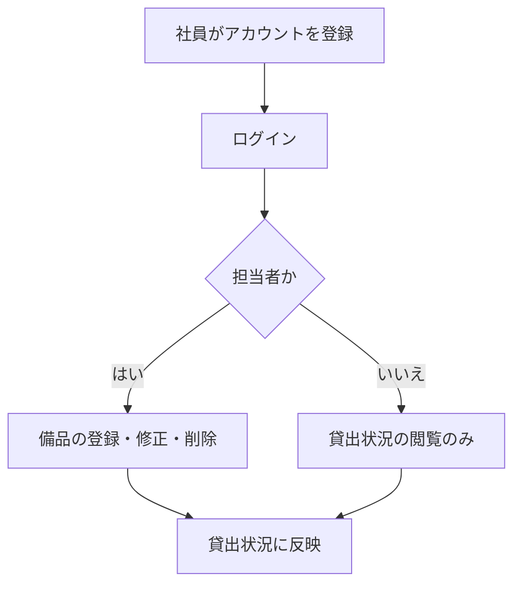
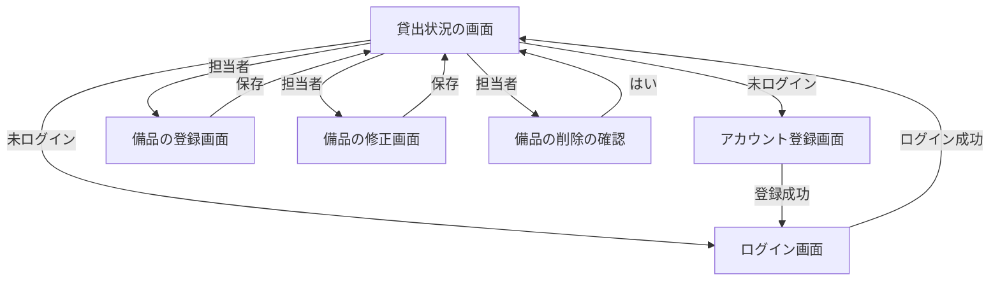

# 要件定義書: 備品台帳と貸出状況の閲覧

## 1. 目的・前提

- システムの目的: 会社の備品の台帳を 1 つのアプリにまとめ、記録の食い違いと消失をなくす。社員が「どの備品があり、空いているか」を担当者に問い合わせずに自分で確かめられるようにする。
- システムの形態: GUI（ブラウザで開く画面）。Web API・バッチは作らない。

用語集:

| 用語 | 業務上の意味 | 本案件での使用範囲 | 同義語/類義語 |
|---|---|---|---|
| 備品 | 会社が所有し、社員が借りて使う物品 | 備品台帳に登録する単位 | 備品台帳の品目 |
| 管理番号 | 備品 1 件を区別する番号（半角の英数字とハイフン、20 文字以内） | 備品の主キー | 備品番号 |
| 担当者 | 備品の登録・修正・削除を行う社員（最初に登録した社員が担当者になる） | 権限のロール | 管理者 |
| 社員 | 備品を借りる社員。担当者以外のアカウント | 権限のロール | 一般利用者 |
| 未ログイン | ログインしていない利用者。貸出状況だけを見られる | 権限のロール | ゲスト |
| 空き | 貸出中でない状態。今回の段ではすべての備品がこの状態 | 貸出状況の表示 | 貸出可能 |

### 1-1. 技術制約（前提として記録する。要件ではないため ID は付与しない）

| 制約項目 | 内容 | 出どころ（誰がいつ答えたか） |
|---|---|---|
| 既存コードベース | 無し（新規開発） | 依頼者（ANSWERS.md、段 1 の固定回答） |
| 配備先 | 社内の Linux サーバー。コンテナは可だが、採点では `bash run.sh` で直接起動するので、コンテナ無しで動くこと。OS は Linux。社内ネットワークからだけ開く | 依頼者（ANSWERS.md） |
| チームの技術 | 決まりは無い。Python 3.12 と SQLite で足りる | 依頼者（ANSWERS.md） |
| ライセンスとコスト | 無償のものだけを使う。有償ソフトは使わない | 依頼者（REQUEST.md） |
| 性能と規模の目安 | 利用者 50 人まで（社員と担当者の合計）、備品は数百件、アカウントは 50 件まで。操作から表示まで 3 秒以内 | 依頼者（REQUEST.md） |

## 2. 業務

対象業務一覧:

| RQ-BZ-ID | 業務名 | 業務の範囲 | 担当者 |
|---|---|---|---|
| `RQ-BZ-EQUIPMENT-LEDGER` | 備品台帳の管理 | 備品の登録・修正・削除 | 担当者 |
| `RQ-BZ-EQUIPMENT-STATUS-VIEW` | 備品の貸出状況の閲覧 | 備品の一覧と空き状況の表示 | 誰でも（ログインしていない人を含む） |
| `RQ-BZ-USER-ACCOUNT` | 利用者アカウントの管理 | 社員が自分でアカウントを登録し、ログイン・ログアウトする | 社員・担当者 |

業務フロー:

### 2-1. 業務の問題（あるべき姿と現状のギャップ）

| 問題 | 対象業務（RQ-BZ） | あるべき姿 | 現状 | ギャップ（KPI） | 業務影響 |
|---|---|---|---|---|---|
| 備品の記録が複数の Excel に分かれ、どれが最新か分からない | `RQ-BZ-EQUIPMENT-LEDGER` | 記録が 1 つだけあり、誰が更新しても食い違わず失われない | 複数の人が別々の Excel を更新し、記録が食い違ったり消えたりしている。食い違いの件数は不明（調査していないため） | 食い違い件数: 不明（理由: 集計していないため） | 正しい記録を探す手間が増える |
| 借りたい社員が、備品の空き状況を担当者に問い合わせないと分からない | `RQ-BZ-EQUIPMENT-STATUS-VIEW` | 社員が自分で備品の一覧と空き状況を確かめられる | 担当者に問い合わせ、担当者が 1 回 15 分かけて調べている。問い合わせの頻度は不明 | 問い合わせ対応: 1 回 15 分（頻度は不明） | 担当者の時間を取られる。借りたい社員の待ち時間が増える |

### 2-2. 業務課題一覧（必須）

| RQ-BK-ID | 業務課題（取り組むこと） | 解決する問題（2-1） | 解決後の状態（KPI の目標値） | 対象業務（RQ-BZ） |
|---|---|---|---|---|
| `RQ-BK-CENTRALIZE-EQUIPMENT-LEDGER` | 備品の記録を 1 つのアプリにまとめ、担当者だけが更新できるようにする | 備品の記録が複数の Excel に分かれている | 記録が 1 つだけになり、食い違いと消失が無い（件数は今回の段では計測しない） | `RQ-BZ-EQUIPMENT-LEDGER` |
| `RQ-BK-PUBLIC-EQUIPMENT-STATUS` | 社員と未ログインの利用者が、備品の一覧と空き状況を自分で確かめられるようにする | 借りたい社員が担当者に問い合わせないと分からない | 担当者への問い合わせが無くなる（1 回 15 分の対応が無くなる） | `RQ-BZ-EQUIPMENT-STATUS-VIEW` |
| `RQ-BK-ACCOUNT-ROLE-ACCESS` | 社員が自分でアカウントを登録し、担当者と社員の権限を分けて、備品の登録・修正・削除を担当者だけに限る | 複数の人が記録を更新して食い違う（記録の更新者を担当者に限るため） | 備品の登録・修正・削除は担当者だけができる（社員と未ログインの利用者は操作できない） | `RQ-BZ-USER-ACCOUNT`、`RQ-BZ-EQUIPMENT-LEDGER` |

### 2-3. 見込み経営効果

| RQ-EF-ID | 効果の種類 | 内容 | 見込み（金額・時間などと算定根拠） | 対応業務課題ID（RQ-BK-*） |
|---|---|---|---|---|
| `RQ-EF-STAFF-INQUIRY-TIME` | Soft Saving | 担当者の問い合わせ対応（1 回 15 分）が無くなる | 見込み経営効果は算定しない（理由: 問い合わせの頻度が不明で、月の合計を算定できないため。1 回あたりの削減は 15 分と分かっている） | `RQ-BK-PUBLIC-EQUIPMENT-STATUS` |

## 3. 機能要件

- 入力データ: 人手入力のみ（備品の登録・修正・削除、アカウント登録、ログイン）。外部からの入力は無い。
- 出力データ: 画面の表示のみ（貸出状況の一覧、入力エラーと操作の知らせ）。
- 全機能のユーザー利用フロー:

- 業務フローとの対応: 業務フローの「アカウントを登録」は、アカウント登録の機能で受ける。「ログイン」はログインの機能、「備品の登録・修正・削除」は担当者の登録・修正・削除の機能、「貸出状況の閲覧」は貸出状況の閲覧の機能で受ける（対応する ID は機能一覧の表を参照）。
- システムの形態（GUI）の仕様は、画面一覧（4-5）と各画面の 5 項目（画面の目的、主要要素、入力項目、表示項目、エラー時の見え方）で書く。

画面ごとの 5 項目:

| 画面 | 目的 | 主要要素 | 入力項目 | 表示項目 | エラー時の見え方 |
|---|---|---|---|---|---|
| 貸出状況（`RQ-UI-EQUIPMENT-STATUS-SCREEN`） | 備品の一覧と空き状況を見る | 備品の表（行ごとに修正・削除ボタン、担当者だけ）、ログイン・アカウント登録リンク（未ログインだけ）、「備品を登録」リンク（担当者だけ）、ログアウトボタン（ログイン中だけ） | 無し | 管理番号、備品名、空き・貸出中、借りている社員の名前、貸出日（管理番号の昇順）。備品が 0 件なら「備品は登録されていません」 | 担当者以外の操作の拒否は `.message` に「この操作は担当者だけが行えます」 |
| アカウント登録（`RQ-UI-ACCOUNT-REGISTER-SCREEN`） | 社員が自分のアカウントを登録する | 社員番号・名前・パスワードの入力欄、登録ボタン | 社員番号、名前、パスワード | 入力欄ごとのエラー | 入力欄ごとのエラーを `.field-error` に出す。値は消さない |
| ログイン（`RQ-UI-LOGIN-SCREEN`） | 社員番号とパスワードでログインする | 社員番号・パスワードの入力欄、ログインボタン | 社員番号、パスワード | 無し | 画面全体のエラーを `.error` に出す |
| 備品の登録（`RQ-UI-EQUIPMENT-FORM-SCREEN`、登録と修正で共用） | 担当者が備品を登録・修正する | 管理番号・備品名の入力欄、保存ボタン | 管理番号、備品名 | 修正時は現在の値を入れておく | 入力欄ごとのエラーを `.field-error` に出す。値は消さない。修正の画面で管理番号は変えられない（表示のみ） |

### 3-1. 帳票・出力ファイル

帳票・出力ファイルは無い。画面の一覧だけを出す。

### 3-2. 業務ルール

| RQ-ID | ルール名 | 内容（条件と結果） | 違反時・エラー時の業務上の扱い | 対応業務課題ID（RQ-BK-*） |
|---|---|---|---|---|
| `RQ-FT-RULE-FIRST-ACCOUNT-IS-STAFF` | 最初のアカウントは担当者 | アカウントが 1 件も無いときに登録した社員は担当者になり、2 件目以降は社員になる | 無し | `RQ-BK-ACCOUNT-ROLE-ACCESS` |
| `RQ-FT-RULE-UNIQUE-EMPLOYEE-NUMBER` | 社員番号は重複不可 | 既に登録されている社員番号では登録できない | 「この社員番号は既に登録されています」を社員番号の入力欄に出す | `RQ-BK-ACCOUNT-ROLE-ACCESS` |
| `RQ-FT-RULE-UNIQUE-EQUIPMENT-NUMBER` | 管理番号は重複不可 | 既に使われている管理番号では登録できない | 「この管理番号は既に使われています」を管理番号の入力欄に出す | `RQ-BK-CENTRALIZE-EQUIPMENT-LEDGER` |

### 3-3. 外部連携

外部連携は無い。

### 機能一覧

| RQ-ID | カテゴリ | 機能名 | 対応業務課題ID（RQ-BK-*） | この機能が無いと何が困るか |
|---|---|---|---|---|
| `RQ-FT-REGISTER-ACCOUNT` | 共通（認証・認可・ログ） | 社員が自分でアカウントを登録する | `RQ-BK-ACCOUNT-ROLE-ACCESS` | 社員がログインできず、担当者にアカウントを作ってもらう手間が要る |
| `RQ-FT-LOGIN` | 共通（認証・認可・ログ） | 社員番号とパスワードでログインする | `RQ-BK-ACCOUNT-ROLE-ACCESS` | 担当者と社員の権限を区別できず、備品の登録・修正・削除を誰でも行えてしまう |
| `RQ-FT-LOGOUT` | 共通（認証・認可・ログ） | ログアウトする | `RQ-BK-ACCOUNT-ROLE-ACCESS` | 共用の PC でログインしたままになり、他の人が操作できてしまう |
| `RQ-FT-AUTO-LOGOUT-IDLE` | 共通（認証・認可・ログ） | 操作しないまま 30 分たったら自動でログアウトする | `RQ-BK-ACCOUNT-ROLE-ACCESS` | 離席した PC から他の人が担当者の操作をできてしまう |
| `RQ-FT-DENY-NON-STAFF-OPERATION` | 共通（認証・認可・ログ） | 担当者以外が備品の登録・修正・削除を要求したとき、その操作を受け付けない | `RQ-BK-ACCOUNT-ROLE-ACCESS` | ボタンを隠すだけでは、要求を直接送られたときに記録を書き換えられてしまう |
| `RQ-FT-REGISTER-EQUIPMENT` | 業務機能 | 担当者が備品を登録する | `RQ-BK-CENTRALIZE-EQUIPMENT-LEDGER`、`RQ-BK-ACCOUNT-ROLE-ACCESS` | 備品の記録を 1 つのアプリに入れられない |
| `RQ-FT-UPDATE-EQUIPMENT` | 業務機能 | 担当者が備品の備品名を修正する | `RQ-BK-CENTRALIZE-EQUIPMENT-LEDGER`、`RQ-BK-ACCOUNT-ROLE-ACCESS` | 誤った備品名を直せず、記録の食い違いが残る |
| `RQ-FT-DELETE-EQUIPMENT` | 業務機能 | 担当者が備品を削除する（削除の記録は残さない） | `RQ-BK-CENTRALIZE-EQUIPMENT-LEDGER`、`RQ-BK-ACCOUNT-ROLE-ACCESS` | 廃止した備品が一覧に残り、空き状況が正しく見えない |
| `RQ-FT-VIEW-EQUIPMENT-STATUS` | 業務機能 | 誰でも（ログインしていなくても）備品の一覧と空き状況を見る | `RQ-BK-PUBLIC-EQUIPMENT-STATUS` | 社員が担当者に問い合わせないと空き状況を確かめられない |

機能一覧の 1 行が 1 機能で、業務課題ごとに機能が 1 つ以上ある。

## 4. データ

### 4-1. データ要件一覧

| RQ-ID | 種別 | 内容 | 対応業務課題ID（RQ-BK-*） | この要件が無いと何が困るか |
|---|---|---|---|---|
| `RQ-DT-STORE-IN-SQLITE` | 内部データ | 備品とアカウントのデータはすべて内部データとして、SQLite のファイル DB に保存する。外部 DB は無い。保存先は環境変数 `DATA_DIR` のディレクトリ | `RQ-BK-CENTRALIZE-EQUIPMENT-LEDGER` | 複数の人が同時に更新すると記録が失われる（DB の排他で防ぐため DB を使う） |
| `RQ-DT-NO-DELETION-HISTORY` | データ保持期間 | 削除した備品とアカウントの記録は残さない（物理削除。履歴テーブルを持たない）。データは期限を設けず保持する | `RQ-BK-CENTRALIZE-EQUIPMENT-LEDGER` | 削除の記録が無いことは、業務で要らない（依頼者の決定） |
| `RQ-DT-DB-NECESSITY` | 種別（DB の必要性） | DB が必要。理由: 複数の担当者・社員が同時に更新しても記録が失われないようにするため。初期件数は備品 0 件、アカウント 0 件。1 年後の想定は備品 数百件、アカウント 50 件まで（増加率は小さい）。エンティティの参照関係は無く、検索・集計は無い（一覧の表示のみ） | `RQ-BK-CENTRALIZE-EQUIPMENT-LEDGER` | ファイルに書くと同時更新で記録が消える |

### 4-2. 業務エンティティとデータ項目

| RQ-ID | カテゴリ | 業務エンティティ名 | 対応業務課題ID（RQ-BK-*） | この業務エンティティが無いと何が困るか |
|---|---|---|---|---|
| `RQ-DT-EQUIPMENT` | 業務 | 備品 | `RQ-BK-CENTRALIZE-EQUIPMENT-LEDGER`、`RQ-BK-PUBLIC-EQUIPMENT-STATUS` | 備品の台帳と貸出状況が表せない |
| `RQ-DT-EMPLOYEE-ACCOUNT` | 業務 | 社員アカウント | `RQ-BK-ACCOUNT-ROLE-ACCESS` | ログインと担当者・社員の区別ができない |

| エンティティ名 | 項目名 | 業務上の意味 | 必須 | 形式・桁 | 値の範囲・制約 | 例 |
|---|---|---|---|---|---|---|
| 備品 | 管理番号 | 備品 1 件を区別する番号 | 必須 | 半角の英数字とハイフン、20 文字以内 | 重複不可（既に使われている管理番号は登録できない） | `PC-0001` |
| 備品 | 備品名 | 備品の名前 | 必須 | 文字列、50 文字以内 | 空は不可 | ノートパソコン |
| 社員アカウント | 社員番号 | 社員を区別する番号 | 必須 | 6 桁の数字 | 重複不可 | `123456` |
| 社員アカウント | 名前 | 社員の名前 | 必須 | 文字列、30 文字以内 | 空は不可 | 山田太郎 |
| 社員アカウント | パスワード（保存時はハッシュ） | ログインの合言葉 | 必須 | 8 文字以上 | 平文では保存しない | （入力時のみ） |
| 社員アカウント | 権限 | 担当者か社員か | 必須 | 担当者・社員の 2 値 | 最初の 1 件だけ担当者、以後は社員 | 担当者 |

備品の貸出状況（空き・貸出中、借りている社員、貸出日）は、今回の段では貸出の登録が無いため、すべて空き（借りている社員と貸出日は空欄）として表示する。これらは保存項目としては持たない（将来の段で貸出のエンティティを足す）。

### 4-3. CRUD テーブル（必須）

| エンティティ名 | Create | Read（一覧） | Read（詳細） | 検索 | Update | Delete | 備考 |
|---|---|---|---|---|---|---|---|
| 備品 | ○（担当者） | ○（担当者以外・未ログインを含む全員） | △（修正画面を開く担当者だけ） | × | ○（担当者。管理番号は変えられない） | ○（担当者） | Create・Update は管理番号の重複を同時更新でも防ぐ（DB の一意制約で確かめ、競合は `.field-error` に出す）。Delete は 1 件の削除をトランザクションで行う |
| 社員アカウント | ○（誰でも、登録画面から） | ×（一覧は無い） | △（ログイン時に内部で照合するだけ。画面では見せない） | × | ×（変更は無い） | ×（削除は無い） | Create は社員番号の重複を一意制約で防ぐ。同じ社員番号の同時登録は、後から来た方を重複エラーにする |

### 4-4. 状態遷移

状態を持つエンティティは無い（備品の空き・貸出中は今回の段では貸出の登録が無いため、すべて空き）。

### 4-5. 画面一覧（GUI の場合のみ）

| RQ-ID | 画面名 | 対応する CRUD 操作（エンティティ名:操作種別） | 主な機能・目的 | 対応業務課題ID（RQ-BK-*） |
|---|---|---|---|---|
| `RQ-UI-EQUIPMENT-STATUS-SCREEN` | 貸出状況（トップ `/`） | 備品:Read（一覧） | 備品の一覧と空き状況を見る。担当者には修正・削除の行ボタン、「備品を登録」リンク（担当者だけ）、ログイン中はログアウトボタンと名前を出す | `RQ-BK-PUBLIC-EQUIPMENT-STATUS`、`RQ-BK-ACCOUNT-ROLE-ACCESS` |
| `RQ-UI-ACCOUNT-REGISTER-SCREEN` | アカウント登録（`/accounts/register/`） | 社員アカウント:Create | 社員が自分のアカウントを登録する | `RQ-BK-ACCOUNT-ROLE-ACCESS` |
| `RQ-UI-LOGIN-SCREEN` | ログイン（`/login/`） | 社員アカウント:Read（詳細）（ログイン照合） | 社員番号とパスワードでログインする | `RQ-BK-ACCOUNT-ROLE-ACCESS` |
| `RQ-UI-EQUIPMENT-FORM-SCREEN` | 備品の登録（`/equipment/new/`）と修正（`/equipment/<管理番号>/edit/`） | 備品:Create、備品:Update、備品:Read（詳細） | 担当者が備品を登録・修正する | `RQ-BK-CENTRALIZE-EQUIPMENT-LEDGER` |

### 4-5 の補足: 画面の操作

- 修正・削除の行ボタンは、貸出状況の表の各行に置く。修正は修正画面を開き、削除は `window.confirm` の確認で「はい」のときだけ行う。削除は独立した画面を持たず、貸出状況の画面から行う。

## 5. 非機能要件

| RQ-ID | カテゴリ | 非機能要件名 | 対応業務課題ID（RQ-BK-*） | この非機能要件が無いと何が困るか |
|---|---|---|---|---|
| `RQ-NF-INTRANET-ONLY` | 利用者・アクセス経路 | 利用者は社員と担当者（合計 50 人まで）と未ログインの利用者で、社内ネットワークからだけアクセスできる | `RQ-BK-PUBLIC-EQUIPMENT-STATUS` | 社外から備品の記録が見られてしまう |
| `RQ-NF-RESPONSE-3S` | 性能 | 操作してから画面が表示されるまで 3 秒以内（利用者 50 人、備品数百件） | `RQ-BK-PUBLIC-EQUIPMENT-STATUS` | 担当者の待ち時間が増える |
| `RQ-NF-PASSWORD-AUTH` | セキュリティ | 認証は社員番号とパスワードで行う（SSO は無い）。ロールは担当者・社員・未ログインの 3 つで、ボタンの出し分けと要求の拒否の両方で制御する | `RQ-BK-ACCOUNT-ROLE-ACCESS` | 担当者以外が記録を更新できてしまう |

- 可用性: 要求は無い。平日の日中に使い、夜間・休日は止まってよい。
- 移行性: 既存の Excel からの取り込みは無い（取り込み機能は作らない）。担当者が画面から手で入力する。
- 利用人数の前提: 利用者は社員と担当者の合計で 50 人まで。利用者の種別は社員・担当者・未ログインの 3 種で、取引先や一般公開は無い。

## 6. 運用要件

- ログ: 一般的な動作ログ・エラーログ以外には要らない。ログの内容と保存期間の記述は行わない。
- 監査ログ: 無い（監査証跡は不要）。
- 監視・アラート: 監視・アラートは必要ないため、監視・アラートの内容と対応方法の記述は行わない。
- バックアップと復旧: バックアップは必要ない。
- 導入手順: 社員に URL を知らせる前に、担当者が最初のアカウントを登録する。

| RQ-ID | 種別 | 内容 | 対応業務課題ID（RQ-BK-*） | この要件が無いと何が困るか |
|---|---|---|---|---|
| `RQ-OP-FIRST-ACCOUNT-SETUP` | 導入手順 | 社員に URL を知らせる前に、担当者が最初のアカウントを登録する。最初に登録した社員が担当者になる | `RQ-BK-ACCOUNT-ROLE-ACCESS` | 最初のアカウントが社員になり、担当者が 1 人もいなくなって備品を登録できなくなる |

## 7. テスト用利用シナリオ

全機能の利用フローを網羅する。各シナリオの「検証する要件ID」に、そのシナリオが確かめる `RQ-FT`・`RQ-UI`・`RQ-EX`（必要なら `RQ-NF`）を書く。

| RQ-ID | テスト目的 | 前提条件 | テスト手順 | 期待される結果 | 検証する要件ID | 対応業務課題ID（RQ-BK-*） |
|---|---|---|---|---|---|---|
| `RQ-TS-REGISTER-FIRST-ACCOUNT-AS-STAFF` | 最初のアカウントが担当者になり、2 件目以降は社員になることを確かめる | アカウントが 0 件 | 貸出状況から「アカウント登録」を開き、社員番号・名前・パスワードを入力して「登録」。ログイン画面で「ログイン」。次の社員で登録してログイン | 1 件目は担当者（備品の登録リンクが出る）。2 件目は社員（備品の登録リンクが出ない）。`.message` に「登録しました。ログインしてください」 | `RQ-FT-REGISTER-ACCOUNT`、`RQ-FT-RULE-FIRST-ACCOUNT-IS-STAFF`、`RQ-UI-ACCOUNT-REGISTER-SCREEN`、`RQ-UI-LOGIN-SCREEN` | `RQ-BK-ACCOUNT-ROLE-ACCESS` |
| `RQ-TS-REJECT-INVALID-ACCOUNT-INPUT` | アカウント登録の入力チェックと社員番号の重複を確かめる | 社員番号 123456 が登録済み | 社員番号を 12345、名前を空、パスワードを 7 文字で登録。次に社員番号 123456 で正しい値を登録 | 各入力欄の `.field-error` に「社員番号は 6 桁の数字で入力してください」「名前を入力してください」「パスワードは 8 文字以上で入力してください」が出て、入力値は残る。重複は「この社員番号は既に登録されています」 | `RQ-FT-REGISTER-ACCOUNT`、`RQ-FT-RULE-UNIQUE-EMPLOYEE-NUMBER`、`RQ-UI-ACCOUNT-REGISTER-SCREEN` | `RQ-BK-ACCOUNT-ROLE-ACCESS` |
| `RQ-TS-LOGIN-AND-LOGOUT` | ログインとログアウト、ログイン失敗の文言を確かめる | 社員番号 123456 のアカウント（パスワード 12345678） | ログイン画面で誤ったパスワードを入力。次に正しい値でログインし、`.current-user` に名前が出ることを確かめ、「ログアウト」 | 誤りは `.error` に「社員番号またはパスワードが違います」（どちらが違うかは示さない）。正しい値でログインでき、ログアウトでログイン前の表示に戻る | `RQ-FT-LOGIN`、`RQ-FT-LOGOUT`、`RQ-UI-LOGIN-SCREEN` | `RQ-BK-ACCOUNT-ROLE-ACCESS` |
| `RQ-TS-AUTO-LOGOUT-AFTER-IDLE` | 30 分の無操作で自動ログアウトすることを確かめる | ログイン済み（`SESSION_IDLE_TIMEOUT_SECONDS` を 2 秒にして起動） | ログイン後に 3 秒待ち、貸出状況の画面を開く | ログアウトされ、ログイン画面（または未ログインの表示）に戻る | `RQ-FT-AUTO-LOGOUT-IDLE` | `RQ-BK-ACCOUNT-ROLE-ACCESS` |
| `RQ-TS-REGISTER-EQUIPMENT-AS-STAFF` | 担当者が備品を登録し、貸出状況に出ることを確かめる | 担当者でログイン済み | 「備品を登録」を開き、管理番号 `PC-0001` と備品名「ノートパソコン」を入力して「保存」 | 貸出状況の表に `data-equipment-number="PC-0001"` の行が出て、「空き」と表示される | `RQ-FT-REGISTER-EQUIPMENT`、`RQ-UI-EQUIPMENT-FORM-SCREEN`、`RQ-UI-EQUIPMENT-STATUS-SCREEN` | `RQ-BK-CENTRALIZE-EQUIPMENT-LEDGER` |
| `RQ-TS-REJECT-INVALID-EQUIPMENT-INPUT` | 備品の入力チェックと管理番号の重複を確かめる | 管理番号 `PC-0001` が登録済み | 管理番号に「PC 0001」（空白）、備品名を 51 文字で保存。次に管理番号 `PC-0001` で保存 | `.field-error` に「管理番号は半角の英数字とハイフンで 20 文字以内で入力してください」「備品名は 50 文字以内で入力してください」。重複は「この管理番号は既に使われています」。入力値は残る | `RQ-FT-REGISTER-EQUIPMENT`、`RQ-FT-RULE-UNIQUE-EQUIPMENT-NUMBER`、`RQ-UI-EQUIPMENT-FORM-SCREEN` | `RQ-BK-CENTRALIZE-EQUIPMENT-LEDGER` |
| `RQ-TS-UPDATE-EQUIPMENT-AS-STAFF` | 担当者が備品名を修正できることを確かめる | 管理番号 `PC-0001` が登録済み、担当者でログイン済み | 貸出状況の `PC-0001` 行の「修正」を押し、備品名を「ノートパソコン（新）」に変えて「保存」 | 一覧の `PC-0001` 行の備品名が変わる。管理番号は変えられない | `RQ-FT-UPDATE-EQUIPMENT`、`RQ-UI-EQUIPMENT-FORM-SCREEN`、`RQ-UI-EQUIPMENT-STATUS-SCREEN` | `RQ-BK-CENTRALIZE-EQUIPMENT-LEDGER` |
| `RQ-TS-DELETE-EQUIPMENT-AS-STAFF` | 担当者が削除の確認で「はい」を選んだときだけ削除されることを確かめる | 管理番号 `PC-0001` が登録済み、担当者でログイン済み | 「削除」を押して確認ダイアログで「いいえ」。次に「削除」を押して「はい」 | 「いいえ」では残る。「はい」で一覧から `PC-0001` の行が消え、削除の記録は残らない | `RQ-FT-DELETE-EQUIPMENT`、`RQ-UI-EQUIPMENT-STATUS-SCREEN` | `RQ-BK-CENTRALIZE-EQUIPMENT-LEDGER` |
| `RQ-TS-VIEW-STATUS-WITHOUT-LOGIN` | ログインしていない利用者が一覧を見られ、操作ボタンが出ないことを確かめる | 備品 2 件（`PC-0002`、`PC-0001`）が登録済み。未ログイン | 貸出状況の画面を開く | 管理番号の昇順に `PC-0001`、`PC-0002` の 2 行。「空き」と表示され、借りている社員の名前と貸出日は空欄。修正・削除のボタンと「備品を登録」は出ず、「ログイン」「アカウント登録」のリンクが出る | `RQ-FT-VIEW-EQUIPMENT-STATUS`、`RQ-UI-EQUIPMENT-STATUS-SCREEN` | `RQ-BK-PUBLIC-EQUIPMENT-STATUS` |
| `RQ-TS-VIEW-EMPTY-STATUS` | 備品が 0 件のとき案内が出ることを確かめる | 備品が 0 件 | 貸出状況の画面を開く | 「備品は登録されていません」が表示される | `RQ-UI-EQUIPMENT-STATUS-SCREEN`、`RQ-FT-VIEW-EQUIPMENT-STATUS` | `RQ-BK-PUBLIC-EQUIPMENT-STATUS` |
| `RQ-TS-DENY-NON-STAFF-OPERATION` | 社員と未ログインの利用者が、備品の登録・修正・削除を要求しても受け付けられないことを確かめる | 社員でログイン済み。未ログインの状態も確かめる | 社員で `/equipment/new/` を開く。直接の要求（削除・保存の送信）を送る。未ログインでも同じ要求を送る | 社員は `.message` に「この操作は担当者だけが行えます」が出て、備品は変わらない。未ログインはログイン画面へ移る。どちらも記録は変わらない | `RQ-FT-DENY-NON-STAFF-OPERATION`、`RQ-UI-EQUIPMENT-FORM-SCREEN`、`RQ-UI-EQUIPMENT-STATUS-SCREEN` | `RQ-BK-ACCOUNT-ROLE-ACCESS` |
| `RQ-TS-OPERATE-WITHIN-LIMITS` | 利用者 50 人と備品数百件で 3 秒以内に表示されることを確かめる | 備品 300 件、アカウント 50 件 | 貸出状況の画面を開き、表示までの時間を計る | 3 秒以内に表示される | `RQ-NF-RESPONSE-3S`、`RQ-FT-VIEW-EQUIPMENT-STATUS` | `RQ-BK-PUBLIC-EQUIPMENT-STATUS` |

