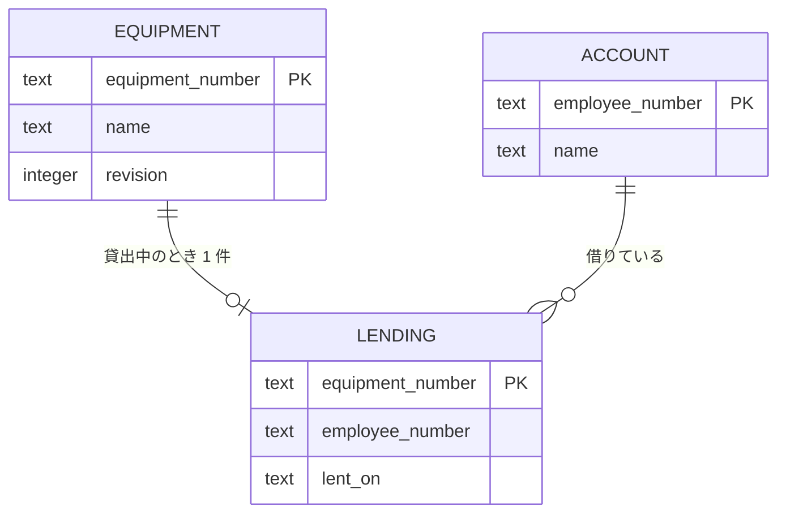
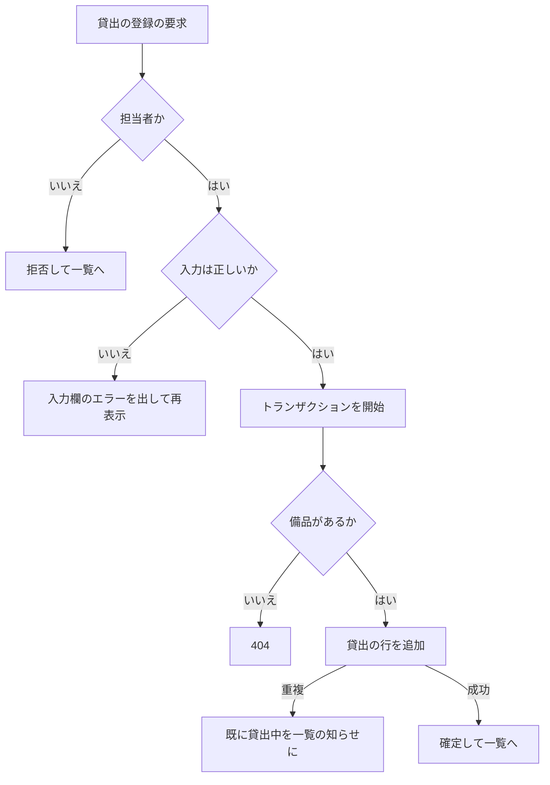

# 変更設計書: 備品の貸出と返却（段 2）

入力は `change_requirements.md` の [追加] 要件。既存設計（`docs/detail_design.md`）の要素は、中身が変わるものを [削除] と [追加] に分ける。中身が変わらない要素は ID を変えない。変更が無い章は「変更なし」と書く。

## 1. 言語・フレームワーク・アーキテクチャの選定

変更なし。既存設計書 `docs/detail_design.md` 第 1 章を参照（Python 3.12、Flask、waitress、SQLite、Playwright）。

## 2. システム構成

変更なし（コンポーネントは増えない）。業務ロジックの `core` に貸出の部品を 1 つ足す（2-1 の「業務ロジック」の役割に「貸出・返却」を含める）。

## 3. データ設計

### 3-1. データモデル

既存の備品テーブルと社員アカウントテーブルは次のとおり変える。

- 備品テーブル（[削除] `DS-SC-EQUIPMENT-TABLE`、削除理由: 版番号の列を足すため。同時に修正されたことを確かめる仕組みを入れる）
- 備品テーブル（[追加] `DS-SC-EQUIPMENT-TABLE-WITH-REVISION`）

  | カラム | 型 | 制約 | 対応する要件項目 |
  |---|---|---|---|
  | equipment_number | TEXT | 主キー（一意）。NOT NULL | 管理番号 |
  | name | TEXT | NOT NULL、50 文字以内（アプリ側で確かめる） | 備品名 |
  | revision | INTEGER | NOT NULL、既定 0。修正のたびに 1 増やす | 開いたあとに他の担当者が変えた修正を拒否する（画面には出さない内部の項目） |

社員アカウントテーブルは変更なし。

- 貸出テーブル（[追加] `DS-SC-LENDING-TABLE`）

  | カラム | 型 | 制約 | 対応する要件項目 |
  |---|---|---|---|
  | equipment_number | TEXT | 主キー（一意）。NOT NULL。備品の管理番号を入れる（参照制約は付けない。備品の削除は貸出の確認で防ぐ） | 1 件の備品に貸出は 0 か 1 件 |
  | employee_number | TEXT | NOT NULL。社員アカウントの社員番号 | 借りる社員 |
  | lent_on | TEXT | NOT NULL。YYYY-MM-DD | 貸出日 |

リレーション図（貸出は備品と社員の参照だけを持つ。参照制約は付けない）:

- 返却した貸出の記録は残さない（履歴のテーブルは持たない。`RQ-DT-NO-HISTORY-ON-RETURN` の対応）。

### 3-2. トランザクションと排他制御（変更分）

- 貸出の登録（`DS-FN-LEND-EQUIPMENT`）: `BEGIN IMMEDIATE` で開始し、備品が存在するか確かめ、貸出テーブルに 1 件を INSERT する。主キーの重複（既に貸出中）は一意制約違反として捉え、「既に貸出中」の結果にする。COMMIT する。後から来た要求は先のトランザクションが終わるまで待つため、先に登録した方だけが記録される。
- 返却（`DS-FN-RETURN-EQUIPMENT`）: `BEGIN IMMEDIATE` で開始し、備品が無ければ「無い」、貸出テーブルから管理番号の行を DELETE する。削除した行数が 0 なら「既に返却されています」。COMMIT する。
- 備品の削除（`DS-FN-DELETE-EQUIPMENT-IF-NOT-LENT`）: `BEGIN IMMEDIATE` で開始し、貸出の行があれば「貸出中」の結果で終える（削除しない）。無ければ備品を DELETE する。貸出の登録と同じロックで直列化されるため、貸出と削除が同時に起きても食い違わない。
- 備品の修正（`DS-FN-UPDATE-EQUIPMENT-IF-UNCHANGED`）: 1 文の `UPDATE` で、管理番号と開いた時点の版番号（`revision`）が一致する行だけを更新し、版番号を 1 増やす。更新行数が 0 なら「他の担当者が変えた」の結果にする（削除された場合も同じ）。貸出の行は触らないため、貸出は引き継がれる。
- 排他の方式は既存設計のとおり悲観的（書き込みのトランザクションを `BEGIN IMMEDIATE` で開始する）。修正だけは版番号による楽観的な確認（1 文の条件付き更新）を使う。修正の画面を長く開いたままにできるため、ロックを保ち続けない。
- 初回起動時のスキーマ移行（`DS-FN-INITIALIZE-SCHEMA-WITH-MIGRATION`）: 備品テーブルに版番号の列が無ければ列を足す（既存の段 1 の DB を壊さない）。貸出テーブルは無ければ作る。

### 3-3. 状態遷移

備品の状態は、貸出テーブルの行の有無で決まる（空き: 行が無い、貸出中: 行がある）。状態の遷移は要件定義書 `change_requirements.md` 4-4 を正とする。遷移を行う処理は貸出の登録（`DS-FN-LEND-EQUIPMENT`）と返却（`DS-FN-RETURN-EQUIPMENT`）。

## 4. アーキテクチャ設計

### 4-1. 外部設計

#### 利用者向けインターフェース（変更分）

| DS-ID | 区分 | 画面 / 操作 | URL・メソッド | 利用者 |
|---|---|---|---|---|
| `DS-IF-LEND-SCREEN` | [追加] | 貸出の登録 | `/equipment/<管理番号>/lend/` GET と POST | 担当者 |
| `DS-IF-RETURN-EQUIPMENT` | [追加] | 返却 | `/equipment/<管理番号>/return/` POST | 担当者 |

既存の画面は ID を変えない。内容の変更は次のとおり（画面の責務は同じ）。

- 貸出状況（`DS-IF-EQUIPMENT-STATUS-SCREEN`）: 表の「状態」の列に、貸出中の備品は「貸出中」、借りている社員の名前と貸出日を出す（段 1 は空欄）。担当者の行ボタンに、空きの備品は「貸出」（貸出の登録の画面へ）、貸出中の備品は「返却」（確認ダイアログの「はい」で送信）を出す。
- 備品の登録・修正（`DS-IF-EQUIPMENT-FORM-SCREEN`）: 修正の画面は開いた時点の版番号を隠し項目で持ち、保存時に他の担当者の変更があれば `.error` に出して保存しない。
- 備品の削除（`DS-IF-EQUIPMENT-DELETE`）: 貸出中の備品は削除せず、貸出状況の画面の `.message` に出す。

#### インターフェース仕様（変更分）

- 貸出の登録（`DS-IF-LEND-SCREEN`）
  - 入力: 借りる社員（選択。候補は `DS-FN-LIST-BORROWER-CANDIDATES` の全アカウント、表示は「名前（社員番号）」、欄の id は `id_borrower`）、貸出日（既定は日本時間の今日、欄の id は `id_lent_on`、形式は YYYY-MM-DD）。
  - 表示: 「備品: 管理番号 備品名」を `.lending-equipment` に出す。
  - 検査: 借りる社員が空または登録されていない → 借りる社員の `.field-error`「借りる社員を選んでください」。貸出日が形式違い → `.field-error`「貸出日は YYYY-MM-DD の形式で入力してください」。今日より後 → `.field-error`「貸出日に未来の日付は入力できません」。
  - 出力: 成功時は貸出状況の画面へリダイレクト。既に貸出中（登録の時点で別の担当者が先に貸した）→ 貸出状況の画面へリダイレクトし、`.message` に「この備品は既に貸出中です」。
  - 備品が無い → 404。
  - 入力値は残す。
  - 担当者以外: 要求を受け付けず、`DS-FN-REQUIRE-MANAGER` の扱い（`.message` に「この操作は担当者だけが行えます」）。
- 返却（`DS-IF-RETURN-EQUIPMENT`）
  - 入力: 管理番号（URL）。確認は一覧画面の `window.confirm` で行い、「はい」のときだけ送信する。
  - 出力: 成功時は貸出状況の画面へリダイレクト（知らせは出さず、「空き」になることで確かめる）。既に返却済み → 貸出状況の画面の `.message` に「この備品は既に返却されています」。備品が無い → 404。
  - 担当者以外: `DS-FN-REQUIRE-MANAGER` の扱い。
- 備品の修正の保存（`DS-IF-EQUIPMENT-FORM-SCREEN`、変更分）
  - 入力: 備品名に加えて隠し項目の版番号。
  - 出力: 版番号が一致すれば保存して貸出状況の画面へ。一致しない（他の担当者が修正・削除した）→ 修正の画面を、入力した備品名を残したまま `.error` に「他の担当者が先にこの備品を更新しました。貸出状況の画面から開き直してください」を出して再表示する。保存しない。版番号は画面に表示せず、開き直しの時点の値を使う。

#### 外部システム連携

無し。

### 4-2. 内部設計（変更分）

#### 処理フロー（貸出の登録）

#### 処理の役割（変更分）

- 貸出状況の一覧（`DS-FN-LIST-EQUIPMENT-STATUS-WITH-LENDING`）: 備品と貸出の行、借りている社員の名前を管理番号の昇順に取り出す。貸出の行があれば「貸出中」と借りている社員の名前、貸出日を出す。無ければ「空き」と空欄。
- 入力チェック（`DS-FN-VALIDATE-LENDING-INPUT`）: 借りる社員の空、貸出日の形式、貸出日が今日より後、を検査する。今日の日付は呼び出し側から受け取る（日本時間の今日を画面の処理で求める）。
- 借りる社員の候補（`DS-FN-LIST-BORROWER-CANDIDATES`）: 全アカウントを社員番号の昇順に、名前と社員番号を返す。

#### バッチ設計

バッチは無い。

## 5. クラス設計

変更なし（クラスは使わない。関数で表す）。

### 5-1. 関数の一覧（変更分）

| DS-ID | 区分 | 関数（モジュール内） | 責務 | 主な入力・出力 |
|---|---|---|---|---|
| `DS-MD-LENDING` | [追加] | `equipment_ledger/core/lending.py` | 貸出と返却の処理 | — |
| `DS-FN-LEND-EQUIPMENT` | [追加] | `lend_equipment`（lending） | 貸出の行を 1 件追加する。備品が無い・既に貸出中・借りる社員が登録されていない、の結果を返す | 管理番号・社員番号・貸出日 → 結果（`LEND_OK`、`LEND_ALREADY_LENT`、`LEND_NO_EQUIPMENT`、`LEND_NO_BORROWER`） |
| `DS-FN-RETURN-EQUIPMENT` | [追加] | `return_equipment`（lending） | 貸出の行を消す。無ければ「既に返却済み」、備品が無ければ「無い」 | 管理番号 → 結果（`RETURN_OK`、`RETURN_ALREADY`、`RETURN_NO_EQUIPMENT`） |
| `DS-FN-VALIDATE-LENDING-INPUT` | [追加] | `validate_lending_input`（validation） | 借りる社員と貸出日を検査する | 社員番号・貸出日・今日の日付 → 欄ごとのエラー |
| `DS-FN-LIST-BORROWER-CANDIDATES` | [追加] | `list_borrower_candidates`（accounts） | 貸出の登録で選べる社員の一覧を返す | なし → 社員番号・名前の一覧 |
| `DS-FN-LIST-EQUIPMENT-STATUS` | [削除] | `list_equipment_status`（equipment） | 段 1 の「すべて空き」の一覧 | 削除理由: 貸出の行を結び、貸出中の表示を出すため。後継は次の行の関数 |
| `DS-FN-LIST-EQUIPMENT-STATUS-WITH-LENDING` | [追加] | `list_equipment_status`（equipment） | 備品と貸出を結んだ一覧（管理番号の昇順） | なし → 行の一覧（管理番号、備品名、状態、借りている社員の名前、貸出日、版番号） |
| `DS-FN-GET-EQUIPMENT` | [削除] | `get_equipment`（equipment） | 管理番号で 1 件を返す | 削除理由: 版番号を返すため |
| `DS-FN-GET-EQUIPMENT-WITH-REVISION` | [追加] | `get_equipment`（equipment） | 管理番号で 1 件（備品名と版番号）を返す。無ければ無し | 管理番号 → 備品または無し |
| `DS-FN-REGISTER-EQUIPMENT` | 変更なし | `register_equipment`（equipment） | 1 件を追加する（版番号は 0） | 既存のまま（ID は変えない） |
| `DS-FN-UPDATE-EQUIPMENT` | [削除] | `update_equipment`（equipment） | 備品名を変える | 削除理由: 開いた時点の版番号を確かめるため |
| `DS-FN-UPDATE-EQUIPMENT-IF-UNCHANGED` | [追加] | `update_equipment`（equipment） | 版番号が一致するときだけ備品名を変え、版番号を 1 増やす | 管理番号・備品名・開いた時点の版番号 → 結果（更新、または他の担当者が変えた） |
| `DS-FN-DELETE-EQUIPMENT` | [削除] | `delete_equipment`（equipment） | 備品を 1 件削除する | 削除理由: 貸出中の備品を削除させないため |
| `DS-FN-DELETE-EQUIPMENT-IF-NOT-LENT` | [追加] | `delete_equipment`（equipment） | 貸出中でなければ備品を削除する | 管理番号 → 結果（削除、貸出中、対象無し） |
| `DS-FN-INITIALIZE-SCHEMA` | [削除] | `initialize_schema`（db） | 2 テーブルを作る | 削除理由: 貸出テーブルと版番号の移行を加えるため |
| `DS-FN-INITIALIZE-SCHEMA-WITH-MIGRATION` | [追加] | `initialize_schema`（db） | 備品・社員・貸出の 3 テーブルを作る（無ければ）。版番号の列が無い既存の備品テーブルには列を足す | 接続 → なし |
| `DS-FN-OPEN-CONNECTION` | 変更なし | `open_connection`（db） | DB を開く（WAL と busy timeout） | 既存のまま |
| `DS-FN-REQUIRE-MANAGER` | 変更なし | `require_manager`（auth） | 担当者以外の要求を拒否する | 既存のまま。貸出と返却の画面にも使う |

### 5-2. クラス図

使わない。

### 5-3. メッセージ一覧

使わない（HTTP の要求と応答だけ）。

## 6. エラーハンドリングとセキュリティ設計（変更分）

| 想定エラー | 利用者への見え方 | ログ | 続行か中止か |
|---|---|---|---|
| 借りる社員が空・登録されていない | 借りる社員の `.field-error`「借りる社員を選んでください」 | 出さない | 中止（再入力） |
| 貸出日が形式違い | 貸出日の `.field-error` | 出さない | 中止 |
| 貸出日が未来 | 貸出日の `.field-error`「貸出日に未来の日付は入力できません」 | 出さない | 中止 |
| 既に貸出中 | 貸出状況の `.message`「この備品は既に貸出中です」 | 出さない | 中止 |
| 既に返却済み | 貸出状況の `.message`「この備品は既に返却されています」 | 出さない | 中止 |
| 貸出中の備品の削除 | 貸出状況の `.message`「この備品は貸出中のため削除できません。先に返却を処理してください」 | 出さない | 中止 |
| 修正の保存で他の担当者が変更 | 修正の画面の `.error`「他の担当者が先にこの備品を更新しました。貸出状況の画面から開き直してください」 | 出さない | 中止（保存しない） |
| 備品が無い（貸出・返却） | 404 | 標準のエラーログ | 中止 |
| DB のロック待ちが長い | 「しばらくしてから操作してください」（段 1 と同じ） | 標準のエラーログ | 中止 |

セキュリティ: 貸出と返却は担当者だけ（`DS-FN-REQUIRE-MANAGER` を両方の画面に付ける）。社員番号は貸出の入力で受け取るため、SQL はパラメータ化して扱う（段 1 と同じ）。

## 7. コード設計（変更分）

### 7-1. ディレクトリ構成

変更なし。`equipment_ledger/core/lending.py` を足す。テンプレートに `lend.html` を足す。

### 7-2. ファイル一覧（変更分）

| ファイル | 区分 | 役割 | 含まれる関数・クラス | 実現する設計 ID |
|---|---|---|---|---|
| `equipment_ledger/core/lending.py` | [追加] | 貸出と返却 | `lend_equipment`、`return_equipment` | `DS-MD-LENDING`、`DS-FN-LEND-EQUIPMENT`、`DS-FN-RETURN-EQUIPMENT` |
| `equipment_ledger/templates/lend.html` | [追加]（テンプレート。`DS-IF-LEND-SCREEN` で受ける） | 貸出の登録の画面 | — | `DS-IF-LEND-SCREEN` |
| `equipment_ledger/core/validation.py` | 変更（ファイルの ID は変えない） | 入力チェック | 既存に `validate_lending_input` を追加 | `DS-MD-VALIDATION`、`DS-FN-VALIDATE-LENDING-INPUT` |
| `equipment_ledger/core/accounts.py` | 変更（同上） | アカウント | 既存に `list_borrower_candidates` を追加 | `DS-MD-ACCOUNTS`、`DS-FN-LIST-BORROWER-CANDIDATES` |
| `equipment_ledger/core/equipment.py` | 変更（同上） | 備品 | 関数の入れ替え（7-2 の 5-1 を参照） | `DS-MD-EQUIPMENT` |
| `equipment_ledger/core/db.py` | 変更（同上） | DB | `initialize_schema` の移行と貸出テーブル | `DS-MD-DB`、`DS-SC-LENDING-TABLE`、`DS-SC-EQUIPMENT-TABLE-WITH-REVISION` |
| `equipment_ledger/views.py` | 変更（同上） | 画面の受け口 | 貸出・返却の関数と既存画面の変更 | `DS-MD-VIEWS`、`DS-IF-LEND-SCREEN`、`DS-IF-RETURN-EQUIPMENT` |
| `equipment_ledger/templates/equipment_status.html`、`equipment_form.html` | 変更（テンプレート） | 画面 | — | `DS-IF-EQUIPMENT-STATUS-SCREEN`、`DS-IF-EQUIPMENT-FORM-SCREEN` |

7-3 対応表の粒度: 変更なし（`function`）。
7-4 依存の規則: 変更なし。`lending.py` は `core/` の中だけに依存する（既存の規則のとおり、`flask` と画面の層に依存しない）。
7-5 コーディング規約: 変更なし。

## 8. テスト設計（変更分）

### 8-1. テストの種類と方針

変更なし。貸出と返却の単体・結合は `tests/` の unittest（同時の貸出・返却は別々の DB 接続とスレッドで確かめる）。

### 8-2. E2E テストのシナリオ（追加分）

`change_requirements.md` 第 7 章の追加分の 9 本を、次の 9 個の `DS-TS` で受け、`e2e/test_equipment_ledger.py` の関数に結ぶ（1 DS-TS 1 関数）。

| DS-ID | 目的 | 前提条件 | 手順 | 期待結果 |
|---|---|---|---|---|
| `DS-TS-LEND-EQUIPMENT-E2E` | 担当者の貸出と貸出状況の表示 | 担当者、社員、備品 `PC-0001` が空き | 「貸出」→ 借りる社員を選び「登録」 | 行が「貸出中」、名前、今日の日付 |
| `DS-TS-REJECT-INVALID-LEND-E2E` | 借りる社員の未選択、未来の貸出日、貸出中の再貸出 | 担当者、`PC-0001` 貸出中 | 未選択で登録、明日の貸出日で登録、貸出の登録の再度 | 各 `.field-error`、`.message`「既に貸出中」 |
| `DS-TS-RETURN-EQUIPMENT-E2E` | 返却の確認と二度目の返却 | 担当者、`PC-0001` 貸出中 | 「返却」→「いいえ」→「返却」→「はい」→ もう一度返却 | 空きに戻る、二度目は「既に返却」 |
| `DS-TS-DENY-DELETE-WHILE-LENT-E2E` | 貸出中の削除の拒否 | 担当者、`PC-0001` 貸出中 | 「削除」→「はい」 | `.message`、行は残る |
| `DS-TS-EDIT-KEEPS-LENDING-E2E` | 修正で貸出が残ること | 担当者、`PC-0001` 貸出中 | 備品名を変えて保存 | 貸出中のまま |
| `DS-TS-REJECT-STALE-EDIT-E2E` | 開いたあとの他の担当者の変更で保存を拒否 | 担当者 A と B、`PC-0001` | A が修正を開く、B が修正して保存、A が保存 | A は `.error`、備品名は B の変更のまま |
| `DS-TS-CONCURRENT-LEND-E2E` | 同時の貸出で先の 1 件だけ | 担当者 2 つの接続、`PC-0001` 空き | 2 つの要求を同時に送る | 1 件だけ記録、後は「既に貸出中」 |
| `DS-TS-CONCURRENT-RETURN-E2E` | 同時の返却で先の処理だけ | 担当者 2 つの接続、`PC-0001` 貸出中 | 2 つの返却を同時に送る | 先の 1 件だけ、後は「既に返却」 |
| `DS-TS-DENY-NON-STAFF-LENDING-E2E` | 社員と未ログインの貸出・返却の拒否 | 社員でログイン済み、未ログイン | 貸出・返却の要求を直接送る | 社員は `.message`、未ログインはログイン画面、記録は変わらない |

E2E の同時要求は、Playwright の別々のブラウザ文脈から HTTP の要求を同時に送る（ログイン済みの Cookie を持つ 2 つの要求をスレッドで送る）。段 1 のシナリオは変更なし。

### 8-3 〜 8-4: 変更なし（E2E の実行手段と実行コマンドは段 1 のまま）。

## 9. 運用設計（変更分）

- 起動時の DB の移行: 既存の DB に版番号の列と貸出テーブルを足す（DS-FN-INITIALIZE-SCHEMA-WITH-MIGRATION）。手作業は要らない。
- 設定値・環境変数: 変更なし。
- そのほか変更なし。

## 10. ログ・監視・アラート・障害対応設計

変更なし。

## 11. 要件と設計の対応表

| DS-ID | 対応要件ID | 区分 |
|---|---|---|
| `DS-MD-LENDING` | `RQ-FT-LEND-EQUIPMENT`、`RQ-FT-RETURN-EQUIPMENT` | [追加] |
| `DS-FN-LEND-EQUIPMENT` | `RQ-FT-LEND-EQUIPMENT`、`RQ-FT-RULE-NO-LEND-WHILE-LENT`、`RQ-DT-LENDING` | [追加] |
| `DS-FN-RETURN-EQUIPMENT` | `RQ-FT-RETURN-EQUIPMENT`、`RQ-FT-RULE-RETURN-ONCE`、`RQ-DT-NO-HISTORY-ON-RETURN` | [追加] |
| `DS-FN-VALIDATE-LENDING-INPUT` | `RQ-FT-RULE-LEND-BORROWER-REQUIRED`、`RQ-FT-RULE-LEND-DATE-NOT-FUTURE` | [追加] |
| `DS-FN-LIST-BORROWER-CANDIDATES` | `RQ-FT-LEND-EQUIPMENT`、`RQ-UI-LEND-SCREEN` | [追加] |
| `DS-FN-LIST-EQUIPMENT-STATUS-WITH-LENDING` | `RQ-FT-VIEW-LENDING-STATUS` | [追加] |
| `DS-FN-LIST-EQUIPMENT-STATUS` | `RQ-FT-VIEW-EQUIPMENT-STATUS`、`RQ-NF-RESPONSE-3S` | [削除]（後継は上の行） |
| `DS-FN-GET-EQUIPMENT-WITH-REVISION` | `RQ-FT-RULE-REJECT-STALE-EDIT`、`RQ-FT-RULE-EDIT-KEEPS-LENDING` | [追加] |
| `DS-FN-GET-EQUIPMENT` | `RQ-UI-EQUIPMENT-FORM-SCREEN` | [削除]（後継は上の行） |
| `DS-FN-UPDATE-EQUIPMENT-IF-UNCHANGED` | `RQ-FT-RULE-REJECT-STALE-EDIT`、`RQ-FT-RULE-EDIT-KEEPS-LENDING`、`RQ-FT-UPDATE-EQUIPMENT` | [追加] |
| `DS-FN-UPDATE-EQUIPMENT` | `RQ-FT-UPDATE-EQUIPMENT` | [削除]（後継は上の行） |
| `DS-FN-DELETE-EQUIPMENT-IF-NOT-LENT` | `RQ-FT-RULE-NO-DELETE-WHILE-LENT`、`RQ-FT-DELETE-EQUIPMENT` | [追加] |
| `DS-FN-DELETE-EQUIPMENT` | `RQ-FT-DELETE-EQUIPMENT` | [削除]（後継は上の行） |
| `DS-FN-INITIALIZE-SCHEMA-WITH-MIGRATION` | `RQ-DT-LENDING`、`RQ-DT-STORE-IN-SQLITE` | [追加] |
| `DS-FN-INITIALIZE-SCHEMA` | `RQ-DT-STORE-IN-SQLITE` | [削除]（後継は上の行） |
| `DS-SC-LENDING-TABLE` | `RQ-DT-LENDING`、`RQ-DT-NO-HISTORY-ON-RETURN` | [追加] |
| `DS-SC-EQUIPMENT-TABLE-WITH-REVISION` | `RQ-FT-RULE-REJECT-STALE-EDIT`、`RQ-DT-EQUIPMENT` | [追加] |
| `DS-SC-EQUIPMENT-TABLE` | `RQ-DT-EQUIPMENT` | [削除]（後継は上の行） |
| `DS-IF-LEND-SCREEN` | `RQ-UI-LEND-SCREEN`、`RQ-FT-DENY-NON-STAFF-LENDING` | [追加] |
| `DS-IF-RETURN-EQUIPMENT` | `RQ-FT-RETURN-EQUIPMENT`、`RQ-FT-DENY-NON-STAFF-LENDING`、`RQ-FT-RULE-RETURN-ONCE` | [追加] |
| `DS-IF-EQUIPMENT-STATUS-SCREEN` | 変更なし（既存）。`RQ-FT-VIEW-LENDING-STATUS`、`RQ-FT-RULE-NO-LEND-WHILE-LENT`、`RQ-FT-RULE-RETURN-ONCE` | 変更なし（既存） |
| `DS-IF-EQUIPMENT-FORM-SCREEN` | 変更なし（既存）。`RQ-FT-RULE-REJECT-STALE-EDIT`、`RQ-FT-RULE-EDIT-KEEPS-LENDING` | 変更なし（既存） |
| `DS-IF-EQUIPMENT-DELETE` | 変更なし（既存）。`RQ-FT-RULE-NO-DELETE-WHILE-LENT` | 変更なし（既存） |
| `DS-MD-VIEWS` | 変更なし（既存）。`RQ-UI-LEND-SCREEN`、`RQ-FT-RETURN-EQUIPMENT` | 変更なし（既存） |
| `DS-MD-DB` | 変更なし（既存）。`RQ-DT-LENDING` | 変更なし（既存） |
| `DS-MD-EQUIPMENT` | 変更なし（既存）。`RQ-FT-RULE-EDIT-KEEPS-LENDING` | 変更なし（既存） |
| `DS-MD-ACCOUNTS` | 変更なし（既存）。`RQ-FT-LEND-EQUIPMENT` | 変更なし（既存） |
| `DS-MD-VALIDATION` | 変更なし（既存）。`RQ-FT-RULE-LEND-DATE-NOT-FUTURE` | 変更なし（既存） |
| `DS-FN-REQUIRE-MANAGER` | 変更なし（既存）。`RQ-FT-DENY-NON-STAFF-LENDING` | 変更なし（既存） |
| `DS-FN-REGISTER-EQUIPMENT` | 変更なし（既存）。`RQ-FT-REGISTER-EQUIPMENT` | 変更なし（既存） |
| `DS-FN-OPEN-CONNECTION` | 変更なし（既存）。`RQ-DT-STORE-IN-SQLITE` | 変更なし（既存） |
| `DS-TS-LEND-EQUIPMENT-E2E` | `RQ-TS-LEND-EQUIPMENT-AS-STAFF` | [追加] |
| `DS-TS-REJECT-INVALID-LEND-E2E` | `RQ-TS-REJECT-INVALID-LEND` | [追加] |
| `DS-TS-RETURN-EQUIPMENT-E2E` | `RQ-TS-RETURN-EQUIPMENT-AS-STAFF` | [追加] |
| `DS-TS-DENY-DELETE-WHILE-LENT-E2E` | `RQ-TS-DENY-DELETE-WHILE-LENT` | [追加] |
| `DS-TS-EDIT-KEEPS-LENDING-E2E` | `RQ-TS-EDIT-KEEPS-LENDING` | [追加] |
| `DS-TS-REJECT-STALE-EDIT-E2E` | `RQ-TS-REJECT-STALE-EDIT` | [追加] |
| `DS-TS-CONCURRENT-LEND-E2E` | `RQ-TS-CONCURRENT-LEND-ONE-WINS` | [追加] |
| `DS-TS-CONCURRENT-RETURN-E2E` | `RQ-TS-CONCURRENT-RETURN-ONE-WINS` | [追加] |
| `DS-TS-DENY-NON-STAFF-LENDING-E2E` | `RQ-TS-DENY-NON-STAFF-LENDING` | [追加] |

### 11-1. 除外要件

除外要件は無い。
