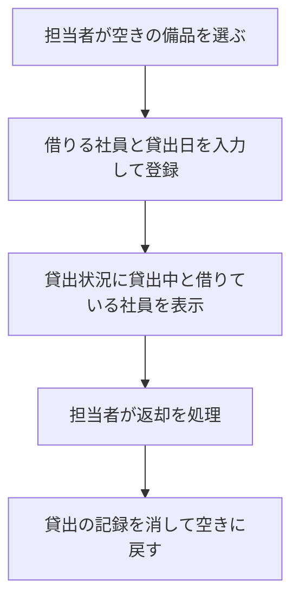

# 変更要件定義書: 備品の貸出と返却（段 2）

変更の対象は既存の要件定義書 `docs/requirements.md`（段 1）。変更のない章は「変更なし」と書く。すべての要件項目に [追加] か [削除] を付ける。

## 1. 目的・前提

- 変更の目的: 貸出の記録も同じアプリにまとめ、社員が「どの備品を誰が借りているか」を担当者に問い合わせずに自分で確かめられるようにする（担当者の問い合わせ対応 1 回 15 分が無くなる）。
- システムの形態: GUI（段 1 と同じ）。変更なし。既存要件定義書 `docs/requirements.md` セクション 1 を参照。

用語集（追加分）:

| 用語 | 業務上の意味 | 本案件での使用範囲 | 同義語/類義語 |
|---|---|---|---|
| 貸出 | 備品 1 件を、社員 1 人に、ある日から貸している状態 | 貸出の登録で記録する | 貸し出し |
| 返却 | 貸出中の備品が担当者に戻り、空きになること | 返却の処理で貸出の記録を消す | 戻し |
| 貸出中 | 貸出の記録がある状態 | 貸出状況の表示 | 借りられている |
| 借りる社員 | 備品を借りる、アカウントの登録者（担当者でも社員でもよい） | 貸出の登録で選ぶ | 借用者 |
| 貸出日 | 貸し出した日（日本時間の日付、YYYY-MM-DD）。今日と過去のみ | 貸出の登録で入力する | 貸出開始日 |

### 1-1. 技術制約

変更なし。既存要件定義書 `docs/requirements.md` セクション 1-1 を参照。

## 2. 業務

### 2-0. 対象業務一覧（追加分）

| RQ-BZ-ID | 業務名 | 業務の範囲 | 担当者 | 区分 |
|---|---|---|---|---|
| `RQ-BZ-EQUIPMENT-LENDING` | 備品の貸出・返却 | 担当者が備品の貸出の登録と返却を処理する。社員と未ログインの利用者は貸出状況で貸出中と借りている社員を確認する | 担当者（貸出・返却）、誰でも（確認） | [追加] |

業務フロー（追加分）:

### 2-1. 業務の問題（変更なし）

変更なし。既存要件定義書 `docs/requirements.md` セクション 2-1 の「借りたい社員が、備品の空き状況を担当者に問い合わせないと分からない」を、今回の業務課題が解決する。

### 2-2. 業務課題一覧（追加分）

| RQ-BK-ID | 業務課題（取り組むこと） | 解決する問題（2-1） | 解決後の状態（KPI の目標値） | 対象業務（RQ-BZ） | 区分 |
|---|---|---|---|---|---|
| `RQ-BK-LENDING-RECORD` | 備品の貸出と返却を同じアプリに記録し、貸出中の備品と借りている社員を貸出状況に出す | 借りたい社員が、備品の空き状況を担当者に問い合わせないと分からない | 貸出中の状況が担当者への問い合わせ無しで確かめられる（問い合わせ対応 1 回 15 分が無くなる） | `RQ-BZ-EQUIPMENT-LENDING` | [追加] |

### 2-3. 見込み経営効果（変更なし）

変更なし。既存要件定義書 `docs/requirements.md` セクション 2-3 を参照（`RQ-EF-STAFF-INQUIRY-TIME` は対応業務課題 `RQ-BK-PUBLIC-EQUIPMENT-STATUS` に残す）。

## 3. 機能要件

### 3-0. 画面の変更（画面ごとの 5 項目の追加分）

| 画面 | 区分 | 目的 | 主要要素 | 入力項目 | 表示項目 | エラー時の見え方 |
|---|---|---|---|---|---|---|
| 貸出の登録（`RQ-UI-LEND-SCREEN`） | [追加] | 担当者が空きの備品を社員に貸し出す | 備品の表示（`.lending-equipment`）、借りる社員の選択、貸出日の入力欄、登録ボタン、貸出状況に戻るリンク | 借りる社員（選択）、貸出日（既定は今日） | 「備品: 管理番号 備品名」 | 入力欄ごとのエラーを `.field-error` に出す。値は消さない。他の担当者の貸出で既に貸出中なら、貸出状況の画面に `.message` で知らせる |
| 貸出状況（`貸出状況の画面`） | 変更（表示の追加。ID は変えない） | 備品の一覧と貸出状況を見る | 担当者には各行に「貸出」（空き）か「返却」（貸出中）のボタン。「返却」は確認ダイアログ（`window.confirm`）で「はい」のときだけ送信する | 無し | 状態（空き・貸出中）、借りている社員の名前、貸出日 | 担当者以外の操作の拒否は `.message` |

### 3-1. 帳票・出力ファイル

変更なし。

### 3-2. 業務ルール（追加分）

| RQ-ID | 区分 | ルール名 | 内容（条件と結果） | 違反時・エラー時の業務上の扱い | 対応業務課題ID（RQ-BK-*） |
|---|---|---|---|---|---|
| `RQ-FT-RULE-NO-LEND-WHILE-LENT` | [追加] | 貸出中の備品は貸し出せない | 貸出の記録がある備品には、貸出を登録できない。同時に 2 人の担当者が同じ空きの備品を貸し出したときは、先に登録した 1 件だけを記録し、後の方は記録しない | 後の方には `.message` で「この備品は既に貸出中です」 | `RQ-BK-LENDING-RECORD` |
| `RQ-FT-RULE-RETURN-ONCE` | [追加] | 返却済みの備品は返却できない | 貸出の記録が無い備品の返却は受け付けない。同時に 2 人の担当者が同じ備品の返却を処理したときは、先の処理だけを行う | 後の方には `.message` で「この備品は既に返却されています」 | `RQ-BK-LENDING-RECORD` |
| `RQ-FT-RULE-NO-DELETE-WHILE-LENT` | [追加] | 貸出中の備品は削除できない | 貸出の記録がある備品は削除しない | 貸出状況の画面の `.message` で「この備品は貸出中のため削除できません。先に返却を処理してください」 | `RQ-BK-CENTRALIZE-EQUIPMENT-LEDGER` |
| `RQ-FT-RULE-LEND-DATE-NOT-FUTURE` | [追加] | 貸出日に未来の日付は入れられない | 貸出日は今日（日本時間）以前だけ受け付ける。既定は今日。形式は YYYY-MM-DD | 貸出日の `.field-error` に「貸出日に未来の日付は入力できません」（形式が違うときは「貸出日は YYYY-MM-DD の形式で入力してください」） | `RQ-BK-LENDING-RECORD` |
| `RQ-FT-RULE-LEND-BORROWER-REQUIRED` | [追加] | 借りる社員は必ず選ぶ | 借りる社員は登録済みのアカウントから選ぶ。未選択、または登録されていない社員番号は受け付けない | 借りる社員の `.field-error` に「借りる社員を選んでください」 | `RQ-BK-LENDING-RECORD` |
| `RQ-FT-RULE-REJECT-STALE-EDIT` | [追加] | 開いたあとに他の担当者が変えた備品の修正は受け付けない | 修正画面を開いてから保存するまでに、他の担当者がその備品を修正または削除していたら、保存を受け付けない | `.error` に「他の担当者が先にこの備品を更新しました。貸出状況の画面から開き直してください」を出し、保存しない | `RQ-BK-CENTRALIZE-EQUIPMENT-LEDGER` |
| `RQ-FT-RULE-EDIT-KEEPS-LENDING` | [追加] | 備品を修正しても貸出を引き継ぐ | 備品名を修正しても、その備品の貸出の記録（借りる社員と貸出日）はそのまま残る | 無し | `RQ-BK-LENDING-RECORD` |
| `RQ-FT-DENY-NON-STAFF-LENDING` | [追加] | 担当者以外は貸出・返却を行えない | 担当者以外が貸出の登録または返却の要求を送っても、その操作を受け付けない（段 1 の備品の登録・修正・削除と同じ扱い） | 社員は貸出状況の `.message` に「この操作は担当者だけが行えます」。未ログインはログイン画面へ | `RQ-BK-ACCOUNT-ROLE-ACCESS` |

既存の業務ルール（`最初のアカウントは担当者という業務ルール`、`社員番号の重複不可という業務ルール`、`管理番号の重複不可という業務ルール`）は変更なし。

### 3-3. 外部連携

変更なし（外部連携は無い）。

### 機能一覧（追加分）

| RQ-ID | 区分 | カテゴリ | 機能名 | 対応業務課題ID（RQ-BK-*） | この機能が無いと何が困るか |
|---|---|---|---|---|---|
| `RQ-FT-LEND-EQUIPMENT` | [追加] | 業務機能 | 担当者が空きの備品を、借りる社員と貸出日を記録して貸し出す | `RQ-BK-LENDING-RECORD` | 誰がどの備品を借りているか記録できず、貸出状況の表示が空きのままになる |
| `RQ-FT-RETURN-EQUIPMENT` | [追加] | 業務機能 | 担当者が返却を処理する。確認で「はい」を選んだときだけ、その備品の貸出の記録を消して空きに戻す | `RQ-BK-LENDING-RECORD` | 返却された備品が貸出中のまま残り、次の貸出ができない |
| `RQ-FT-VIEW-LENDING-STATUS` | [追加] | 業務機能 | 貸出状況の一覧に、貸出中か、借りている社員の名前、貸出日を出す | `RQ-BK-PUBLIC-EQUIPMENT-STATUS`、`RQ-BK-LENDING-RECORD` | 社員が貸出中の備品と借りている社員を、担当者に問い合わせないと分からない |

既存の機能（`アカウント登録`、`ログイン`、`ログアウト`、`無操作の自動ログアウト`、`担当者以外の備品操作の拒否`、`備品の登録`、`備品の修正`、`備品の削除`、`貸出状況の閲覧`）は変更なし。ただし `備品の削除` は貸出中の備品を削除できない制限を受ける（上の `RQ-FT-RULE-NO-DELETE-WHILE-LENT`）。

## 4. データ

### 4-1. データ要件一覧（追加分）

| RQ-ID | 区分 | 種別 | 内容 | 対応業務課題ID（RQ-BK-*） | この要件が無いと何が困るか |
|---|---|---|---|---|---|
| `RQ-DT-NO-HISTORY-ON-RETURN` | [追加] | データ保持期間 | 返却した貸出の記録は残さない。貸出の記録は貸出中の間だけ保持し、履歴のテーブルは持たない | `RQ-BK-LENDING-RECORD` | 返却の記録が残らず、誰が過去に借りたかは確かめられない（依頼者の決定: 返却した記録は残さない） |

変更なし: `SQLite への保存の要件`、`削除の記録を残さない要件`、`DB が必要という要件`。

### 4-2. 業務エンティティとデータ項目

| RQ-ID | 区分 | カテゴリ | 業務エンティティ名 | 対応業務課題ID（RQ-BK-*） | この業務エンティティが無いと何が困るか |
|---|---|---|---|---|---|
| `RQ-DT-LENDING` | [追加] | 業務 | 貸出 | `RQ-BK-LENDING-RECORD` | 貸出中の備品と借りている社員を表せない |

| エンティティ名 | 区分 | 項目名 | 業務上の意味 | 必須 | 形式・桁 | 値の範囲・制約 | 例 |
|---|---|---|---|---|---|---|---|
| 貸出 | [追加] | 管理番号 | 貸し出している備品 | 必須 | 備品の管理番号（既存の形式） | 1 件の備品に貸出は 0 件か 1 件（管理番号で一意）。備品が無ければ貸出も無い | `PC-0001` |
| 貸出 | [追加] | 社員番号 | 借りている社員 | 必須 | 6 桁の数字 | 登録済みのアカウントの社員番号 | `123456` |
| 貸出 | [追加] | 貸出日 | 貸し出した日 | 必須 | YYYY-MM-DD | 今日（日本時間）以前 | `2026-11-04` |

段 1 の項目（備品・社員アカウント）は変更なし。ただし備品は、同時更新で記録を失わないための版番号（改定の回数、内部で使う項目）を持つ（変更の内容は 第 4 章 4-2 の備考を参照）。版番号は画面に出さない内部の項目（業務項目ではない）。

### 4-3. CRUD テーブル（全エンティティ分）

| エンティティ名 | Create | Read（一覧） | Read（詳細） | 検索 | Update | Delete | 備考 |
|---|---|---|---|---|---|---|---|
| 備品 | ○（担当者） | ○（全員） | △（修正画面を開く担当者だけ） | × | ○（担当者。管理番号は変えられない。貸出は引き継ぐ。開いたあとの他の担当者の変更は保存を拒否） | ○（担当者。貸出中は削除できない） | 変更あり（Update と Delete の制限） |
| 社員アカウント | ○（誰でも、登録画面から） | ×（一覧は無い） | △（ログイン時の照合と、貸出の登録で借りる社員を選ぶ一覧の内部利用のみ） | × | ×（変更は無い） | ×（削除は無い） | 変更あり（Read（詳細）に貸出の登録での選択を追加。画面では社員の一覧を見せない） |
| 貸出 | ○（担当者。同時の登録は先の 1 件だけ） | ○（貸出状況の一覧に、貸出中の備品ごとに出す） | △（貸出の登録画面で備品の貸出中か確かめるためだけ） | × | ×（貸出の内容は変えない。貸し直すときは返却してから登録） | ○（担当者の返却処理。記録は残さない） | [追加] |

### 4-4. 状態遷移（変更分）

備品の状態（空き・貸出中）は、貸出の記録の有無で決まる。

| 現在の状態 | 操作 | 条件 | 次の状態 | 備考 |
|---|---|---|---|---|
| 空き | 貸出の登録（担当者） | 貸出日が今日以前、借りる社員が選ばれている | 貸出中 | [追加] |
| 貸出中 | 返却（担当者、確認で「はい」） | 貸出の記録がある | 空き | [追加]。返却の記録は残さない |
| 貸出中 | 貸出の登録 | - | 変わらない（貸出中のまま） | [追加]。「この備品は既に貸出中です」 |
| 空き | 返却 | - | 変わらない（空きのまま） | [追加]。「この備品は既に返却されています」 |
| 貸出中 | 削除 | - | 変わらない（削除できない） | [追加] |
| 貸出中 | 修正（備品名） | - | 変わらない（貸出を引き継ぐ） | [追加] |

### 4-5. 画面一覧（追加分）

| RQ-ID | 区分 | 画面名 | 対応する CRUD 操作（エンティティ名:操作種別） | 主な機能・目的 | 対応業務課題ID（RQ-BK-*） |
|---|---|---|---|---|---|
| `RQ-UI-LEND-SCREEN` | [追加] | 貸出の登録（`/equipment/<管理番号>/lend/`） | 貸出:Create、社員アカウント:Read（貸出の登録の選択） | 担当者が空きの備品を、借りる社員と貸出日で貸し出す | `RQ-BK-LENDING-RECORD` |

貸出状況の画面（`貸出状況の画面`）と修正画面（`備品の登録・修正の画面`）は ID を変えない。貸出状況の画面は貸出の表示と行の「貸出」「返却」ボタンを足し（3-0）、修正画面は開いた時点の版番号を持ち、保存時に他の担当者の変更を確かめる（`RQ-FT-RULE-REJECT-STALE-EDIT`）。

## 5. 非機能要件

変更なし（追加の非機能要件は無い）。既存の `3 秒以内の非機能要件`（操作から表示まで 3 秒以内、50 人が同時に開く）を、貸出状況と貸出の登録にも適用する。

## 6. 運用要件

変更なし。

## 7. テスト用利用シナリオ（追加分）

| RQ-ID | 区分 | テスト目的 | 前提条件 | テスト手順 | 期待される結果 | 検証する要件ID | 対応業務課題ID（RQ-BK-*） |
|---|---|---|---|---|---|---|---|
| `RQ-TS-LEND-EQUIPMENT-AS-STAFF` | [追加] | 担当者が空きの備品を社員に貸し出し、貸出状況に出ることを確かめる | 担当者でログイン済み、社員のアカウント 1 件、備品 `PC-0001` が空き | 貸出状況の `PC-0001` 行の「貸出」を開き、借りる社員を選んで、貸出日は既定の今日のまま「登録」 | 貸出状況の `PC-0001` 行が「貸出中」、借りている社員の名前、今日の貸出日を表示 | `RQ-FT-LEND-EQUIPMENT`、`RQ-FT-VIEW-LENDING-STATUS`、`RQ-UI-LEND-SCREEN`、`RQ-DT-LENDING` | `RQ-BK-LENDING-RECORD` |
| `RQ-TS-REJECT-INVALID-LEND` | [追加] | 借りる社員の未選択、未来の貸出日、貸出中の備品への貸出を確かめる | 担当者でログイン済み、備品 `PC-0001` が貸出中 | 借りる社員を選ばずに登録。次に借りる社員を選び、貸出日を明日にして登録。次に `PC-0001` の貸出の登録（貸出中の備品）を開き直して登録 | 社員は `.field-error` に「借りる社員を選んでください」、貸出日は「貸出日に未来の日付は入力できません」。貸出中の備品は `.message` に「この備品は既に貸出中です」 | `RQ-FT-RULE-LEND-BORROWER-REQUIRED`、`RQ-FT-RULE-LEND-DATE-NOT-FUTURE`、`RQ-FT-RULE-NO-LEND-WHILE-LENT`、`RQ-UI-LEND-SCREEN` | `RQ-BK-LENDING-RECORD` |
| `RQ-TS-RETURN-EQUIPMENT-AS-STAFF` | [追加] | 返却の確認で「いいえ」では残り、「はい」で空きに戻ること、二度目の返却を確かめる | 担当者でログイン済み、備品 `PC-0001` が貸出中 | 「返却」を押して確認で「いいえ」。次に「返却」を押して「はい」。さらに、もう一度 `PC-0001` の「返却」を送る（別のタブで同じ画面から） | 「いいえ」で貸出中のまま。「はい」で「空き」に戻り貸出の記録は残らない。二度目は `.message` に「この備品は既に返却されています」 | `RQ-FT-RETURN-EQUIPMENT`、`RQ-FT-RULE-RETURN-ONCE`、`RQ-DT-NO-HISTORY-ON-RETURN`、`貸出状況の画面` | `RQ-BK-LENDING-RECORD` |
| `RQ-TS-DENY-DELETE-WHILE-LENT` | [追加] | 貸出中の備品は削除できないことを確かめる | 担当者でログイン済み、備品 `PC-0001` が貸出中 | 「削除」を押して確認で「はい」 | `.message` に「この備品は貸出中のため削除できません。先に返却を処理してください」。`PC-0001` の行は残る | `RQ-FT-RULE-NO-DELETE-WHILE-LENT` | `RQ-BK-CENTRALIZE-EQUIPMENT-LEDGER` |
| `RQ-TS-EDIT-KEEPS-LENDING` | [追加] | 貸出中の備品の備品名を修正しても貸出が残ることを確かめる | 担当者でログイン済み、備品 `PC-0001` が貸出中 | 「修正」で備品名を変えて「保存」 | 備品名が変わり、`PC-0001` は貸出中のまま借りている社員と貸出日が残る | `RQ-FT-RULE-EDIT-KEEPS-LENDING`、`備品の登録・修正の画面` | `RQ-BK-LENDING-RECORD` |
| `RQ-TS-REJECT-STALE-EDIT` | [追加] | 修正画面を開いたあと他の担当者が変えた備品の保存を拒否することを確かめる | 担当者 A と B がログイン済み、備品 `PC-0001` が登録済み | A が `PC-0001` の「修正」を開く。B が `PC-0001` の備品名を修正して保存。A が備品名を変えて「保存」 | A の保存は受け付けず `.error` に「他の担当者が先にこの備品を更新しました。貸出状況の画面から開き直してください」。備品名は B の変更のまま | `RQ-FT-RULE-REJECT-STALE-EDIT`、`備品の登録・修正の画面` | `RQ-BK-CENTRALIZE-EQUIPMENT-LEDGER` |
| `RQ-TS-CONCURRENT-LEND-ONE-WINS` | [追加] | 同時に 2 人が同じ空きの備品を貸し出したとき、先の 1 件だけが記録されることを確かめる | 担当者 2 人（別の接続）、備品 `PC-0001` が空き | 2 つの接続から同時に `PC-0001` の貸出を登録する | 1 件だけ記録され（借りる社員が 1 人）、後の方は `.message` に「この備品は既に貸出中です」 | `RQ-FT-RULE-NO-LEND-WHILE-LENT` | `RQ-BK-LENDING-RECORD` |
| `RQ-TS-CONCURRENT-RETURN-ONE-WINS` | [追加] | 同時に 2 人が同じ貸出中の備品を返却したとき、先の処理だけが行われることを確かめる | 担当者 2 人（別の接続）、備品 `PC-0001` が貸出中 | 2 つの接続から同時に `PC-0001` の返却を処理する | 先の 1 件だけ返却され、後の方は `.message` に「この備品は既に返却されています」 | `RQ-FT-RULE-RETURN-ONCE` | `RQ-BK-LENDING-RECORD` |
| `RQ-TS-DENY-NON-STAFF-LENDING` | [追加] | 社員と未ログインの利用者が貸出・返却の要求を送っても受け付けられないことを確かめる | 社員でログイン済み。未ログインの状態も確かめる | 社員で貸出の登録の画面を開き、返却と貸出の要求を直接送る。未ログインでも同じ要求を送る | 社員は `.message` に「この操作は担当者だけが行えます」。未ログインはログイン画面へ。どちらも貸出の記録は変わらない | `RQ-FT-DENY-NON-STAFF-LENDING`、`RQ-UI-LEND-SCREEN` | `RQ-BK-ACCOUNT-ROLE-ACCESS` |

既存のテスト用利用シナリオ（`段 1 の最初のアカウントの場面` から `段 1 の性能の場面`）は変更なし。段 1 の備品は貸出の無い状態で確かめるため、そのまま通る。

## 8. 変更の影響と既存の記述の更新（ID を持たない文）

正本へ反映するとき（実装後レビュー）に、次の文を更新する。

- 1 目的・前提（段 1 の「今回の段では備品の登録・修正・削除と、貸出状況（すべて空き）の閲覧」と書いた箇所）を、貸出と返却を含む内容に直す。
- 4-2 の「備品の貸出状況（空き・貸出中、借りている社員、貸出日）は、今回の段では貸出の登録が無いため、すべて空き…保存項目としては持たない」の段落を、貸出のエンティティ（`RQ-DT-LENDING`）の保存に直す。
- 4-4 の「状態を持つエンティティは無い」を、備品の状態（空き・貸出中）の遷移（4-4 の表）に直す。
- 3 の画面表の貸出状況の「表示項目」の「すべて空き」の記述（段 1 の注）を、貸出中の表示に直す。
- `備品のデータ項目` の項目表の「備品の貸出状況（すべて空き）」の注記。

## 9. 採った判断（ユーザーの固定回答から。ユーザー不在のため決定を記録）

| 判断 | 内容 | 根拠 |
|---|---|---|
| 借りる社員の候補 | 登録済みの全アカウント（担当者を含む） | 依頼「借りる社員はアカウントから選ぶ」。候補を社員だけに絞る指示は無い |
| 貸出の修正 | 貸出の内容は直接変えない。貸し直すときは返却してから登録する | 依頼に貸出の修正は無い（依頼に無いことは作らない） |
| 修正の競合の判定 | 備品ごとの版番号（画面に出さない）で、開いた時点から変わったかを確かめる | 依頼「開いてから保存するまでに修正または削除されていたら拒否」。版番号なら削除と修正の両方を同じ仕組みで拒否できる |
| 同時の貸出・返却 | 貸出は DB の主キーで 1 件に制限し、登録と返却はトランザクションで直列化する | 依頼「先に登録した方だけ」「先の処理だけ」。ANSWERS.md の「DB の制約かトランザクションで排他」 |
| 貸出日の形式エラー | 形式違いは「貸出日は YYYY-MM-DD の形式で入力してください」を出す | 契約に無い入力エラーのため、契約外の文言として新設（契約に無いことは自由に決めてよい） |
| 返却の成功時の知らせ | 知らせは出さず、貸出状況に戻して空きになったことで確かめる | 契約・依頼に成功時の文言が無い |
