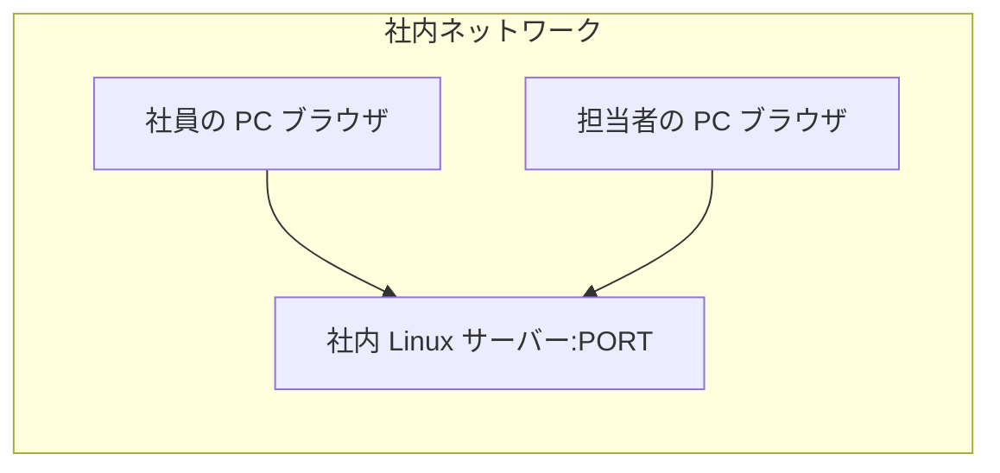
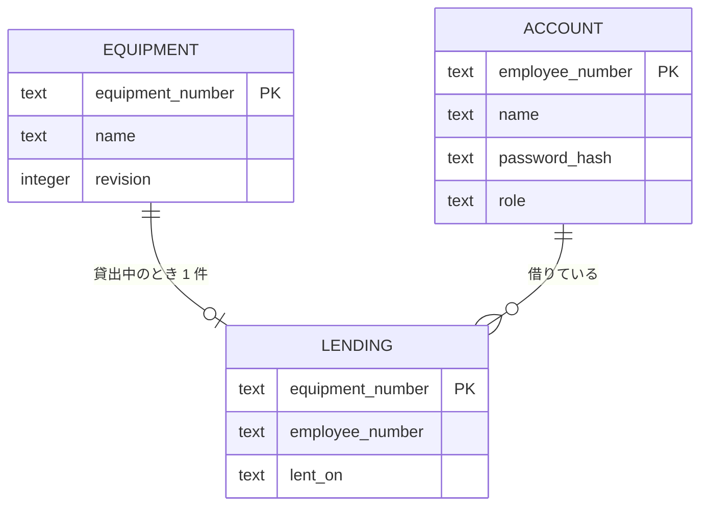
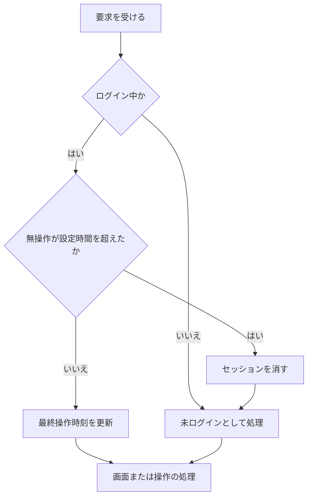

# 詳細設計書: 備品台帳と貸出状況の閲覧

## 1. 言語・フレームワーク・アーキテクチャの選定

### 1-1. 選定の前提（要件定義書 1-1 と要件から）

| 判断軸 | この案件で効く条件 |
|---|---|
| 既存資産との整合 | 既存コードは無い。新規に選ぶ |
| チームの技術 | 決まりは無い。Python 3.12 と SQLite で足りる（依頼者の回答） |
| 配備先 | 社内の Linux サーバー。コンテナは可だが、採点では `bash run.sh` で直接起動するためコンテナ無しで動くこと |
| 認証と認可の境界 | 社員番号とパスワード、ロールは 3 つ、要求の拒否をサーバー側で行う。SSO は無い |
| 画面の規模 | 画面は 5 種（貸出状況、アカウント登録、ログイン、備品の登録・修正、貸出の登録）。画面遷移は単純 |
| データの規模と構造 | 備品は数百件、アカウントは 50 件まで。参照関係は無く、検索・集計は無い。同時更新で記録が失われないことが必要 |
| 外部連携 | 無い |
| ライセンスとコスト | 無償のものだけ。有償は使わない |
| 性能 | 利用者 50 人、操作から表示まで 3 秒以内 |
| 保守性 | 公式情報で保守中であること |

### 1-2. 候補の比較

| 判断軸 | Flask 3.1 系（Python） | FastAPI（Python） | Django（Python） | 備考 |
|---|---|---|---|---|
| 画面の規模 | 画面 5 種の HTML フォームに十分 | テンプレートは Starlette 経由で可能だが、画面中心の構成には部品が多い | 管理画面や認証が標準装備で、今回の規模には過剰 | 単純な画面なら Flask が最も軽い |
| 認証 | セッション Cookie を自前で扱う（署名付き） | 同左 | 標準の認証を使える | 30 分の無操作ログアウトは Flask のセッションで自前に作る |
| ライセンス | BSD-3-Clause | MIT | BSD-3-Clause | すべて無償 |
| 公式情報 | PyPI の最新 3.1.3（2026-02-19 公開）、要件は Python 3.9 以上（https://pypi.org/project/Flask/、確認日 2026-11-04）。Python 3.12 の分類子は表示されないため、実装時に 3.12 でテストして確かめる | 最新 0.138.0 系（2026-06 公開）、MIT（確認: WebSearch、確認日 2026-11-04。出典 https://releasebot.io/updates/tiangolo/fastapi ほか） | 未調査（今回は選ばないため省略） | Django は規模に対して過剰のため候補から外す |
| 複雑さ | 小さい。学習コストが低い | 型と非同期の前提が増える | 規模に対して大きい | 最小の案は Flask |

- 比較の結果、Python 3.12 + Flask（テンプレートは Jinja2）を選ぶ。Jinja2 と Werkzeug は Flask に含まれる BSD 系のライブラリ。
- 本番向けの WSGI サーバーとして waitress を使う（ZPL-2.1、無償。出典 https://github.com/Estartu/waitress、確認日 2026-11-04。Python 3.9 以上で動くと明記されている）。Flask の開発用サーバーは本番向けではないため採らない。
- データベースは Python 標準ライブラリの sqlite3 と SQLite（パブリックドメイン。出典 https://sqlite.org/copyright.html、確認日 2026-11-04）。WAL モードと busy timeout で同時更新を直列化する。
- E2E のブラウザ自動化は Playwright for Python（Apache-2.0、Python 3.10 以上。出典 https://pypi.org/project/playwright/、確認日 2026-11-04）。ブラウザは `python3 -m playwright install chromium` で入れる。

### 1-3. 最終選定結果

| 項目 | 選定 |
|---|---|
| 言語 | Python 3.12（実行は環境の `PATH` 先頭の 3.12） |
| Web フレームワーク | Flask 3.1 系（BSD-3-Clause） |
| テンプレート | Jinja2（Flask に含まれる） |
| WSGI サーバー | waitress（ZPL-2.1） |
| DB | SQLite（sqlite3 標準ライブラリ、WAL モード） |
| パスワードのハッシュ | Werkzeug の `generate_password_hash`（Flask に含まれる） |
| E2E | Playwright for Python（Apache-2.0）と Python 標準の unittest |
| 実行形態 | サーバー（コンテナ無し。`bash run.sh` で起動） |

選定理由: 業務要件の画面 5 種とロール 3 種を最小の構成で満たし、無償のライブラリだけで社内サーバーに配備できるため。

承認記録: 技術選定は依頼者の回答により「推奨の案でよい」と決まっている（ANSWERS.md、承認日 2026-11-04）。

### 1-4. 構成の補足

- フロントエンドとバックエンドを分けない。サーバーが HTML を返す構成。認証境界は Flask のサーバー側で 1 か所（要求の拒否も同じ場所）にまとめる。

## 2. システム構成

### 2-1. コンポーネント一覧

| コンポーネント | 役割 | 実装 |
|---|---|---|
| Web アプリ | 画面の表示、入力の受け付け、ログインの状態の管理、要求の拒否 | Flask アプリ（`equipment_ledger` パッケージ） |
| 業務ロジック | 入力チェック、アカウントの登録と照合、備品の登録・修正・削除・一覧、貸出の登録と返却 | `equipment_ledger/core` |
| データ保存 | 備品とアカウントの保存 | SQLite ファイル（`DATA_DIR` 配下） |
| WSGI サーバー | HTTP の受け付け | waitress（`PORT` で待ち受け） |
| 起動・準備スクリプト | 依存の導入、起動 | `setup.sh`、`run.sh` |

### 2-2. システム全体構成図


### 2-3. 各コンポーネントの役割と機能

- Flask アプリ: 6 つの画面（貸出状況、アカウント登録、ログイン、備品の登録・修正、貸出の登録）と、ログアウト、備品の削除、返却の要求を受ける。ログイン状態は署名付きのセッション Cookie で持ち、各要求の前に無操作時間を確かめる。
- 業務ロジック: 画面に依存しない。入力チェックの規則、社員番号とパスワードの照合、最初のアカウントを担当者にする判定、備品の登録・更新・削除を行う。
- SQLite: 備品、アカウント、貸出の 3 テーブル。同時更新は SQLite のトランザクションで直列化する。

### 2-4. コンポーネント間インターフェースとデータフロー

- ブラウザ → waitress → Flask: HTTP（GET と POST）。フォームの送信は POST、一覧や画面表示は GET。
- Flask → 業務ロジック: 関数呼び出し。入力は文字列、戻り値は成功か、入力エラーの一覧か、業務上の結果。
- 業務ロジック → SQLite: 同じプロセス内の接続。接続は要求ごとに開いて閉じる。

### 2-5. ネットワーク構成図

ネットワーク越しの通信はブラウザとサーバーの HTTP だけ。構成図は次のとおり。



## 3. データ設計

### 3-1. データモデル

DB を使う。理由: 複数の担当者と社員が同時に更新しても記録が失われないようにするため（要件定義書 4-1）。SQLite を使う（第 1 章）。

- 備品テーブル（`DS-SC-EQUIPMENT-TABLE-WITH-REVISION`）

  | カラム | 型 | 制約 | 対応する要件項目 |
  |---|---|---|---|
  | equipment_number | TEXT | 主キー（一意）。NOT NULL | 管理番号: 半角英数字とハイフン、20 文字以内 |
  | name | TEXT | NOT NULL、50 文字以内（アプリ側で確かめる） | 備品名: 50 文字以内、空は不可 |
  | revision | INTEGER | NOT NULL、既定 0。修正のたびに 1 増やす | 版番号（画面に出さない内部の項目。開いたあとの他の担当者の修正を拒否するため） |

- アカウントテーブル（`DS-SC-ACCOUNT-TABLE`）

  | カラム | 型 | 制約 | 対応する要件項目 |
  |---|---|---|---|
  | employee_number | TEXT | 主キー（一意）。NOT NULL。6 桁の数字 | 社員番号: 6 桁の数字、重複不可 |
  | name | TEXT | NOT NULL、30 文字以内 | 名前: 30 文字以内、空は不可 |
  | password_hash | TEXT | NOT NULL | パスワード: 8 文字以上（平文では保存しない） |
  | role | TEXT | NOT NULL。値は `manager` か `member` のみ（CHECK 制約） | 権限: 担当者か社員 |

- 貸出テーブル（`DS-SC-LENDING-TABLE`）

  | カラム | 型 | 制約 | 対応する要件項目 |
  |---|---|---|---|
  | equipment_number | TEXT | 主キー（一意）。NOT NULL。参照制約は付けない（備品の削除は貸出の確認で防ぐ） | 1 件の備品に貸出は 0 か 1 件 |
  | employee_number | TEXT | NOT NULL。社員アカウントの社員番号 | 借りる社員 |
  | lent_on | TEXT | NOT NULL。YYYY-MM-DD | 貸出日 |

リレーション図: 貸出は備品と社員を管理番号・社員番号で参照する（参照制約は付けない）。



- 削除の記録を残さないため、履歴のテーブルは持たない（`RQ-DT-NO-DELETION-HISTORY` の対応）。
- 空き・貸出中は行の有無で表す（貸出テーブルに行があれば貸出中）。貸出状況の表示では、備品と貸出を管理番号で結び、貸出中の行は借りている社員の名前と貸出日を出す。

### 3-2. トランザクションと排他制御

- 備品の登録: 1 件の INSERT。管理番号の一意制約で重複を防ぐ。重複は一意制約違反として捉え、管理番号の入力欄のエラーに変換する。
- 備品の修正: 版番号が一致する 1 件を 1 文の UPDATE で更新し、版番号を 1 増やす（`revision = revision + 1`）。管理番号は変えられない。更新行数が 0 なら、他の担当者による修正または削除として保存を拒否する。貸出の行は触らないため、貸出は引き継がれる。
- 備品の削除: `BEGIN IMMEDIATE` で、貸出の行があれば削除せず「貸出中」で終える。無ければ 1 件を DELETE する。
- 貸出の登録: `BEGIN IMMEDIATE` で、備品と借りる社員が存在するかを確かめ、貸出テーブルに 1 件を INSERT する。主キーの一意制約違反は「既に貸出中」として扱う。先に登録した方だけが記録される。
- 返却: `BEGIN IMMEDIATE` で、貸出テーブルの行を DELETE する。行数が 0 なら「既に返却されています」。返却した記録は残さない。
- 初回起動時のスキーマ移行: 版番号の列が無い既存の備品テーブルには列を足す。
- アカウント登録: 「件数の確認」と「1 件の INSERT」を 1 つのトランザクションで行う。件数の確認は即時トランザクション（`BEGIN IMMEDIATE`）で行い、最初の 1 件を担当者にする判定と挿入が割り込まれないようにする。社員番号の重複は一意制約で防ぐ。
- 排他制御の方式: 悲観的（書き込みのトランザクションを `BEGIN IMMEDIATE` で開始する）。理由: 更新が少なく、件数を見てから登録する処理の競合を確実に防ぐため。楽観的にすると、最初のアカウントが同時に 2 件作られる競合を防げないため。
- 接続ごとに WAL モードと busy timeout（5 秒）を設定する。書き込みが重なったときは待って再試行し、待ち切ったときは「しばらくしてから操作してください」の一般エラーにする。

### 3-3. 状態遷移

備品の状態（空き・貸出中）は貸出テーブルの行の有無で決まる。遷移は要件定義書 4-4 の表のとおり。遷移を行う処理は貸出の登録と返却。貸出中の備品の削除と修正は状態を変えない。

## 4. アーキテクチャ設計

### 4-1. 外部設計

#### 利用者向けインターフェース

| DS-ID | 画面 / 操作 | URL・メソッド | 利用者 |
|---|---|---|---|
| `DS-IF-EQUIPMENT-STATUS-SCREEN` | 貸出状況の画面 | `/` GET | 全員 |
| `DS-IF-ACCOUNT-REGISTER-SCREEN` | アカウント登録 | `/accounts/register/` GET と POST | 誰でも（登録前の利用者） |
| `DS-IF-LOGIN-SCREEN` | ログイン | `/login/` GET と POST | 未ログイン |
| `DS-IF-EQUIPMENT-FORM-SCREEN` | 備品の登録・修正 | `/equipment/new/` GET と POST、`/equipment/<管理番号>/edit/` GET と POST | 担当者 |
| `DS-IF-LOGOUT` | ログアウト | `/logout/` POST | ログイン中 |
| `DS-IF-EQUIPMENT-DELETE` | 備品の削除 | `/equipment/<管理番号>/delete/` POST | 担当者 |
| `DS-IF-LEND-SCREEN` | 貸出の登録 | `/equipment/<管理番号>/lend/` GET と POST | 担当者 |
| `DS-IF-RETURN-EQUIPMENT` | 返却 | `/equipment/<管理番号>/return/` POST | 担当者 |

#### インターフェース仕様

- 貸出状況（`DS-IF-EQUIPMENT-STATUS-SCREEN`）
  - 入力: なし。
  - 出力: 管理番号の昇順に、管理番号、備品名、「空き」または「貸出中」、借りている社員の名前、貸出日の列を持つ行（貸出中の行は名前と日付を出す）。0 件なら「備品は登録されていません」。ログイン中なら名前と「ログアウト」ボタン。担当者なら各行の「修正」「削除」ボタンと、空きの行の「貸出」・貸出中の行の「返却」、「備品を登録」リンク。未ログインなら「ログイン」「アカウント登録」のリンク。
  - エラー: 通常は無い。担当者以外の操作の拒否は、ログイン後の画面に `.message` で「この操作は担当者だけが行えます」を出す（リダイレクト先）。
- アカウント登録（`DS-IF-ACCOUNT-REGISTER-SCREEN`）
  - 入力と検査: 社員番号（6 桁の数字）、名前（前後の空白を除いて 1 文字以上、30 文字以内）、パスワード（8 文字以上）。
  - 出力: 成功時はログイン画面へリダイレクトし、`.message` に「登録しました。ログインしてください」。
  - エラー: 入力欄ごとのエラーを `.field-error` に出す（社員番号の形式、社員番号の重複、名前の空・長さ、パスワードの短さ）。入力値は残す（パスワード欄も含む。契約の「入力した値は消さない」に従う）。パスワードを画面に再表示する点は、平文を HTML に出す危険を伴うため、利用者向けの注意として README に書く。
- ログイン（`DS-IF-LOGIN-SCREEN`）
  - 入力: 社員番号、パスワード。
  - 出力: 成功時は貸出状況の画面へリダイレクト。
  - エラー: 社員番号またはパスワードのどちらが違うかは示さず、`.error` に「社員番号またはパスワードが違います」。社員番号の形式が不正な場合も同じ文言（形式で分けると、社員番号の存在を推測させるため）。入力値の社員番号は残す。
- 備品の登録・修正（`DS-IF-EQUIPMENT-FORM-SCREEN`）
  - 入力: 管理番号（登録のみ、修正では表示のみで変更不可）、備品名。
  - 検査: 管理番号は半角の英数字とハイフンのみ、1〜20 文字。備品名は前後の空白を除いて 1 文字以上、50 文字以内。
  - 出力: 成功時は貸出状況の画面へリダイレクト。
  - エラー: 入力欄ごとの `.field-error`。管理番号の重複は「この管理番号は既に使われています」。入力値は残す。
  - 担当者以外: 要求を受け付けず、貸出状況の画面へリダイレクトして `.message` に「この操作は担当者だけが行えます」。未ログインはログイン画面へリダイレクトし、同じ文言を `.message` に出す。
  - 修正の画面を開くとき、備品が無ければ 404 を返す。
  - 修正の画面は開いた時点の版番号を隠し項目で持つ。保存で版番号が一致すれば備品名を変えて貸出状況の画面へリダイレクトする。一致しない（他の担当者が修正した、または削除した）ときは保存せず、入力した備品名を残したまま `.error` に「他の担当者が先にこの備品を更新しました。貸出状況の画面から開き直してください」を出す。
- 貸出の登録（`DS-IF-LEND-SCREEN`）
  - 入力: 借りる社員（選択。候補は全アカウント、表示は「名前（社員番号）」、欄の id は `id_borrower`）、貸出日（既定は日本時間の今日、欄の id は `id_lent_on`、形式は YYYY-MM-DD）。
  - 表示: 「備品: 管理番号 備品名」を `.lending-equipment` に出す。
  - 検査: 借りる社員が空、または登録されていない場合は借りる社員の `.field-error` に「借りる社員を選んでください」。貸出日の形式違いは `.field-error` に「貸出日は YYYY-MM-DD の形式で入力してください」、今日より後は「貸出日に未来の日付は入力できません」。
  - 出力: 成功時は貸出状況の画面へリダイレクト。既に貸出中なら貸出状況の画面へリダイレクトし、`.message` に「この備品は既に貸出中です」。備品が無ければ 404。入力値は残す。担当者以外は拒否（備品の登録と同じ扱い）。
- 返却（`DS-IF-RETURN-EQUIPMENT`）
  - 入力: 管理番号（URL）。確認は貸出状況の画面の `window.confirm` で行い、「はい」のときだけ送信する。
  - 出力: 成功時は貸出状況の画面へリダイレクト（成功の知らせは出さず、空きに戻ることで確かめる）。既に返却済みなら `.message` に「この備品は既に返却されています」。備品が無ければ 404。担当者以外は拒否。
- ログアウト（`DS-IF-LOGOUT`）: セッションを消して貸出状況の画面へリダイレクト。
- 備品の削除（`DS-IF-EQUIPMENT-DELETE`）: 担当者なら削除して貸出状況の画面へリダイレクト。貸出中の備品は削除せず、貸出状況の画面の `.message` に「この備品は貸出中のため削除できません。先に返却を処理してください」を出す。担当者以外は要求を拒否（上と同じ扱い）。対象が無ければ 404。確認ダイアログは一覧の画面側で `window.confirm` を使い、「はい」のときだけ送信する。

#### 外部システム連携

無し。

### 4-2. 内部設計

#### 処理フロー（要求の共通処理）



- 担当者だけの操作は、処理の前にロールを確かめる。担当者でなければ拒否する。
- 無操作の判定は要求の前に行い、超えていればセッションを消して未ログインとして続ける。

#### 処理の役割

- 貸出状況の一覧: 備品を管理番号の昇順に取り出し、すべてを「空き」として表示する。
- アカウント登録: 入力チェック、社員番号の重複確認、件数の確認と挿入（トランザクション）、パスワードのハッシュ化。
- 照合: 社員番号で 1 件を引き、パスワードのハッシュを比べる。見つからない場合も同じ処理を行い、判定を同じ文言にする。

#### バッチ設計

バッチは無い。

## 5. クラス設計

クラスは使わない。設計要素は関数と、それを入れるモジュール、テーブルで表す（Python の関数中心の構成のため）。

- 責務の 1 文ずつ: 設定の読み込み（環境変数を読んで値にする）、DB 接続（接続の開き方と初期化）、入力チェック（規則ごとに失敗の文言を返す）、アカウント（登録と照合）、備品（登録・修正・削除・一覧）、認証（セッションの状態を扱う）、画面（HTTP の受け口）。
- 依存の向き: 画面 → 認証・業務ロジック、認証 → 業務ロジック（照合）と設定、業務ロジック → DB 接続、DB 接続 → 設定。逆向きの依存は無い。

### 5-1. 関数の一覧（責務と主要な扱い）

| 関数（モジュール内） | 責務 | 主な入力・出力 |
|---|---|---|
| `load_settings`（config） | 環境変数（`PORT`、`DATA_DIR`、`SESSION_IDLE_TIMEOUT_SECONDS`、`HOST`）を読んで設定にする | 環境変数 → 設定値 |
| `open_connection`（db） | DB ファイルを開き、WAL モードと busy timeout を設定する | 設定 → 接続 |
| `initialize_schema`（db） | 3 テーブルを作り、版番号の列が無い旧い備品テーブルには列を足す | 接続 → なし |
| `validate_account_input`（validation） | 社員番号・名前・パスワードを検査し、失敗した欄と文言を返す | 入力値 → 欄ごとのエラー |
| `validate_equipment_input`（validation） | 管理番号・備品名を検査する | 入力値 → 欄ごとのエラー |
| `register_account`（accounts） | 件数を見て、最初の 1 件なら担当者、以後は社員で登録する。社員番号の重複を扱う | 社員番号・名前・パスワード → 登録結果（役割または重複） |
| `authenticate`（accounts） | 社員番号とパスワードを照合する | 社員番号・パスワード → 担当者・社員の役割、または失敗 |
| `get_account_role`（accounts） | 社員番号から役割を返す（無ければ無し） | 社員番号 → 役割または無し |
| `list_equipment_status`（equipment） | 備品と貸出を結び、管理番号の昇順の一覧を返す（貸出中の行は借りている社員の名前と貸出日を含む） | なし → 行の一覧 |
| `get_equipment`（equipment） | 1 件を管理番号で返す（版番号を含む） | 管理番号 → 備品または無し |
| `register_equipment`（equipment） | 1 件を追加する。重複は結果で返す | 管理番号・備品名 → 結果（成功または重複） |
| `update_equipment`（equipment） | 開いた時点の版番号と一致するときだけ備品名を変え、版番号を 1 増やす | 管理番号・備品名・版番号 → 結果（成功、または他の担当者が変えた） |
| `delete_equipment`（equipment） | 貸出中でなければ 1 件を削除する（記録は残さない） | 管理番号 → 結果（削除、貸出中、対象無し） |
| `lend_equipment`（lending） | 貸出の行を 1 件追加する。備品が無い、借りる社員が無い、既に貸出中の結果を返す | 管理番号・社員番号・貸出日 → 結果 |
| `return_equipment`（lending） | 貸出の行を消す。行が無ければ既に返却済み、備品が無ければ無し | 管理番号 → 結果 |
| `validate_lending_input`（validation） | 借りる社員、貸出日（形式と未来の日付）を検査する | 社員番号・貸出日・今日の日付 → 欄ごとのエラー |
| `list_borrower_candidates`（accounts） | 貸出の登録で選べる社員を社員番号の昇順に返す | なし → 社員番号と名前の一覧 |
| `log_in_user`、`log_out_user`（auth） | セッションに社員番号と最終操作時刻を入れる・消す | 社員番号 → なし |
| `check_idle_timeout`（auth） | 無操作時間を確かめ、超えていればセッションを消す | 現在時刻 → なし |
| `current_user`（auth） | 今のログイン中の社員の番号と役割を返す（無ければ無し） | なし → 社員番号・役割または無し |
| `require_manager`（auth） | 担当者でなければ拒否する（デコレータ） | 画面の関数 → 拒否または処理 |
| `create_app`（app） | Flask アプリを作り、設定・DB 初期化・画面を登録する | 設定 → アプリ |
| 画面の関数（views） | 上の表の画面と操作を受ける | HTTP 要求 → HTTP 応答 |

### 5-2. クラス図

使わない。

### 5-3. メッセージ一覧

使わない（HTTP の要求と応答だけ）。

## 6. エラーハンドリングとセキュリティ設計

### 6-1. エラーハンドリング

| 想定エラー | 利用者への見え方 | ログ | 続行か中止か |
|---|---|---|---|
| 入力の形式・長さ・空 | 入力欄ごとの `.field-error` | 出さない | 入力は中止（再入力） |
| 社員番号の重複 | 社員番号の `.field-error` | 出さない | 中止 |
| ログイン失敗 | `.error` の文言（どちらが違うか示さない） | 出さない | 中止 |
| 担当者以外の操作 | `.message` の文言（リダイレクト） | 出さない | 中止 |
| 管理番号の重複 | 管理番号の `.field-error` | 出さない | 中止 |
| 借りる社員が空・未登録 | 借りる社員の `.field-error`（「借りる社員を選んでください」） | 出さない | 中止 |
| 貸出日の形式違い・未来の日付 | 貸出日の `.field-error` | 出さない | 中止 |
| 既に貸出中 | 貸出状況の `.message`（「この備品は既に貸出中です」） | 出さない | 中止 |
| 既に返却済み | 貸出状況の `.message`（「この備品は既に返却されています」） | 出さない | 中止 |
| 貸出中の備品の削除 | 貸出状況の `.message`（「この備品は貸出中のため削除できません。先に返却を処理してください」） | 出さない | 中止 |
| 修正の保存で他の担当者が変更・削除 | 修正の画面の `.error`（「他の担当者が先にこの備品を更新しました。貸出状況の画面から開き直してください」） | 出さない | 中止（保存しない） |
| 対象の備品が無い | 404 | 標準のエラーログ | 中止 |
| DB のロック待ちが長い | 「しばらくしてから操作してください」 | 標準のエラーログ | 中止 |
| DB ファイルが開けない | 500 の標準の応答 | 標準のエラーログ（起動時に止まる） | 起動を中止 |

### 6-2. 認証

- 方式: 社員番号とパスワード（SSO は無い）。パスワードは Werkzeug のハッシュ（scrypt）で保存し、平文は保存しない。
- ログイン状態: 署名付きのセッション Cookie（`SECRET_KEY` で署名）。Cookie は HttpOnly、SameSite=Lax。
- 秘密鍵: `DATA_DIR` 配下の `secret_key` ファイル。無ければ初回起動時に乱数で作って保存する（権限は所有者だけ読めるようにする）。
- 無操作の判定: 最終操作時刻をセッションに保存し、要求ごとに更新する。設定秒数（既定 1800 秒）を超えたらセッションを消す。

### 6-3. 認可

| ロール | 貸出状況の閲覧 | 備品の登録・修正・削除、貸出・返却 | 備考 |
|---|---|---|---|
| 未ログイン | 可（ボタン無し） | 不可（ログイン画面へ） | |
| 社員 | 可（ボタン無し） | 不可（拒否と `.message`） | |
| 担当者 | 可（修正・削除・登録・貸出・返却のボタン） | 可（貸出・返却を含む） | |

- 制御の単位: 画面の出し分け（ボタン・リンク）と、要求の拒否（サーバー側で各要求の前に確かめる）の両方。
- 最初のアカウントだけが担当者になる。担当者の追加・変更の画面は無い（要件に無い）。

### 6-4. 監査ログ

無し（要件定義書 6 章で不要）。

### 6-5. その他のセキュリティ対策

- 社内ネットワークからだけ開く（`DS-OP-RUN-SCRIPT` の待ち受けとサーバーのファイアウォールで制御する）。
- 入力は SQL のパラメータ化で扱い、文字列連結で SQL を組み立てない。
- 削除の確認は利用者の誤操作対策（`window.confirm`）。
- セッション Cookie の SameSite=Lax で、他サイトからの POST の送信を制限する。

## 7. コード設計

### 7-1. ディレクトリ構成

```
プロジェクトルート/
  run.sh
  setup.sh
  requirements.txt
  README.md
  equipment_ledger/
    __init__.py
    __main__.py
    app.py
    views.py
    auth.py
    core/
      __init__.py
      config.py
      db.py
      validation.py
      accounts.py
      equipment.py
      lending.py
    templates/
      base.html
      equipment_status.html
      register.html
      login.html
      equipment_form.html
      lend.html
    static/
      style.css
  e2e/
    （E2E テスト）
  tests/
    （単体テスト）
```

### 7-2. ファイル一覧

| ファイル | 役割 | 含まれる関数・クラス | 実現する設計 ID |
|---|---|---|---|
| `equipment_ledger/__init__.py` | パッケージの印 | なし | `DS-MD-PACKAGE-INIT` |
| `equipment_ledger/__main__.py` | 設定を読み、waitress でアプリを起動する | `main` | `DS-MD-MAIN`、`DS-FN-START-SERVER` |
| `equipment_ledger/app.py` | Flask アプリの作成、要求の前処理、DB 初期化、画面の登録 | `create_app` | `DS-MD-APP`、`DS-FN-CREATE-APP`、`DS-FN-CHECK-IDLE-TIMEOUT` |
| `equipment_ledger/views.py` | 6 画面と 2 つの操作の HTTP の受け口（貸出の登録と返却を含む） | 各画面の関数 | `DS-MD-VIEWS`、`DS-IF-EQUIPMENT-STATUS-SCREEN`、`DS-IF-ACCOUNT-REGISTER-SCREEN`、`DS-IF-LOGIN-SCREEN`、`DS-IF-EQUIPMENT-FORM-SCREEN`、`DS-IF-LOGOUT`、`DS-IF-EQUIPMENT-DELETE`、`DS-IF-LEND-SCREEN`、`DS-IF-RETURN-EQUIPMENT` |
| `equipment_ledger/auth.py` | ログイン状態の管理と担当者の要求の拒否 | `log_in_user`、`log_out_user`、`current_user`、`require_manager` | `DS-MD-AUTH`、`DS-FN-LOG-IN-USER`、`DS-FN-LOG-OUT-USER`、`DS-FN-CURRENT-USER`、`DS-FN-REQUIRE-MANAGER` |
| `equipment_ledger/core/__init__.py` | パッケージの印 | なし | `DS-MD-CORE-PACKAGE-INIT` |
| `equipment_ledger/core/config.py` | 環境変数の読み込み | `load_settings` | `DS-MD-CONFIG`、`DS-FN-LOAD-SETTINGS`、`DS-OP-ENVIRONMENT-CONFIG` |
| `equipment_ledger/core/db.py` | DB 接続とスキーマ初期化 | `open_connection`、`initialize_schema` | `DS-MD-DB`、`DS-FN-OPEN-CONNECTION`、`DS-FN-INITIALIZE-SCHEMA-WITH-MIGRATION`、`DS-SC-EQUIPMENT-TABLE-WITH-REVISION`、`DS-SC-LENDING-TABLE`、`DS-SC-ACCOUNT-TABLE` |
| `equipment_ledger/core/validation.py` | 入力チェック | `validate_account_input`、`validate_equipment_input`、`validate_lending_input` | `DS-MD-VALIDATION`、`DS-FN-VALIDATE-ACCOUNT-INPUT`、`DS-FN-VALIDATE-EQUIPMENT-INPUT`、`DS-FN-VALIDATE-LENDING-INPUT` |
| `equipment_ledger/core/accounts.py` | アカウントの登録と照合、貸出の借りる社員の候補 | `register_account`、`authenticate`、`list_borrower_candidates` | `DS-MD-ACCOUNTS`、`DS-FN-REGISTER-ACCOUNT`、`DS-FN-AUTHENTICATE`、`DS-FN-LIST-BORROWER-CANDIDATES` |
| `equipment_ledger/core/equipment.py` | 備品の一覧・登録・修正・削除 | `list_equipment_status`、`get_equipment`、`register_equipment`、`update_equipment`、`delete_equipment` | `DS-MD-EQUIPMENT`、`DS-FN-LIST-EQUIPMENT-STATUS-WITH-LENDING`、`DS-FN-GET-EQUIPMENT-WITH-REVISION`、`DS-FN-REGISTER-EQUIPMENT`、`DS-FN-UPDATE-EQUIPMENT-IF-UNCHANGED`、`DS-FN-DELETE-EQUIPMENT-IF-NOT-LENT` |
| `equipment_ledger/core/lending.py` | 貸出と返却 | `lend_equipment`、`return_equipment` | `DS-MD-LENDING`、`DS-FN-LEND-EQUIPMENT`、`DS-FN-RETURN-EQUIPMENT` |
| `equipment_ledger/templates/lend.html` | 貸出の登録の画面 | —（テンプレート） | `DS-IF-LEND-SCREEN` |

- テストファイルは `e2e/` と `tests/` に置き、設計の対象外（`DS-MD-*` を付けない）。
- 非コードの資産（起動・準備スクリプト、依存の一覧、HTML テンプレート、CSS）は `DS-MD-*` を付けない。対応表チェッカーは src 配下の対応言語のコードだけを対象にするため、これらに対応表の行を書けない。スクリプトは `DS-OP-*`（第 9 章）、テンプレートは画面の `DS-IF-*`（第 4 章 4-1）で受け、テンプレートの実装は `equipment_ledger/views.py` の画面の関数と同じ `DS-IF-*` の行に含める。

### 7-3. 対応表の粒度

`function`（公開関数まで対応表に載せる。既定）。`isdd-setup` の `--granularity function` で渡す。

### 7-4. 依存の規則

| 依存元（ディレクトリ） | 依存してよい先（プロジェクト内） | 依存してはいけない先（プロジェクト内のパスか外部モジュール名） | 理由 |
|---|---|---|---|
| `equipment_ledger/core/` | `equipment_ledger/core/` の中だけ | `equipment_ledger/app.py`、`equipment_ledger/views.py`、`equipment_ledger/auth.py`、`flask` | 業務ロジックを Web の層から独立させ、画面を変えても業務の規則を保つため |
| `equipment_ledger/auth.py` | `equipment_ledger/core/`、`flask` | `equipment_ledger/views.py`、`equipment_ledger/app.py` | 認証は画面の層から呼ぶ部品にするため |
| `equipment_ledger/app.py`・`views.py`・`__main__.py` | `equipment_ledger/` の中、`equipment_ledger/core/`、`flask`、`waitress` | なし | 画面の層は HTTP の受け口として全体を組み立てるため |

外部連携は無いため、連携ライブラリの規則は無い。

### 7-5. コーディング規約

- Python 3.12 の標準の書き方（PEP 8 に準拠）。型ヒントを関数の引数と戻り値に付ける。
- 関数は 1 つの責務。ファイルは 300 行を目安に分ける。
- コメントは処理の説明だけ。ID は書かない。

コードには要件 ID・設計 ID を書かない。設計 ID とコードの対応は実装時に `docs/trace_map.md` へ記録する（trace-map-rules.md の書式）。

## 8. テスト設計

### 8-1. テストの種類と方針

- 単体テスト: `core` の各関数（入力チェック、登録と照合、備品の操作）を `tests/` の標準の unittest で確かめる。
- 結合テスト: DB を含む業務ロジックを一時 DB で確かめる（同じ `tests/` の中）。
- E2E テスト: `e2e/` で、ブラウザ（Playwright の Chromium）から画面を操作して確かめる（8-2）。
- 非機能: 性能テストは E2E の 1 件として確かめる（8-2 の `DS-TS-PERFORMANCE-E2E`）。

単体テスト・結合テストの実行コマンド: `cd プロジェクトルート && .venv/bin/python -m unittest discover -s tests -t .`

### 8-2. E2E テストのシナリオ

要件定義書 第 7 章の 21 本を網羅する（段 1 の 12 本と段 2 の 9 本）。

| DS-ID | 目的 | 前提条件 | 手順 | 期待結果 |
|---|---|---|---|---|
| `DS-TS-REGISTER-FIRST-ACCOUNT-E2E` | 最初のアカウントが担当者になり、2 件目が社員になる | アカウント 0 件 | アカウント登録で 2 件登録し、それぞれログインする | 1 件目は担当者（備品の登録リンク有り）、2 件目は社員（無し）。登録成功の文言が出る |
| `DS-TS-REJECT-ACCOUNT-INPUT-E2E` | アカウント登録の入力チェックと重複を確かめる | 社員番号 123456 が登録済み | 不正な値（社員番号 12345、名前空、パスワード 7 文字）と重複の社員番号で登録する | 各入力欄の `.field-error` に定められた文言。入力値は残る |
| `DS-TS-LOGIN-LOGOUT-E2E` | ログイン・ログアウトと失敗の文言を確かめる | 社員番号 123456、パスワード 12345678 のアカウント | 誤ったパスワードでログイン後、正しい値でログインし、ログアウトする | 失敗は `.error` の文言。成功で `.current-user` に名前。ログアウトで未ログインの表示 |
| `DS-TS-AUTO-LOGOUT-E2E` | 無操作の自動ログアウト | `SESSION_IDLE_TIMEOUT_SECONDS` を 2 秒にして起動し、ログイン済み | 3 秒待ってから貸出状況を開く | 未ログインの表示に戻っている |
| `DS-TS-REGISTER-EQUIPMENT-E2E` | 担当者の備品登録 | 担当者でログイン済み | 管理番号 PC-0001、備品名を入力して保存 | 一覧に PC-0001 の行があり「空き」 |
| `DS-TS-REJECT-EQUIPMENT-INPUT-E2E` | 備品の入力チェックと重複 | PC-0001 が登録済み、担当者 | 不正な管理番号と 51 文字の備品名、次に重複の管理番号 | 各文言が `.field-error` に出る。入力値は残る |
| `DS-TS-UPDATE-EQUIPMENT-E2E` | 備品名の修正と管理番号が変わらないこと | PC-0001 が登録済み、担当者 | 修正画面で備品名を変えて保存 | 一覧の備品名が変わり、管理番号は同じ |
| `DS-TS-DELETE-EQUIPMENT-E2E` | 削除の確認 | PC-0001 が登録済み、担当者 | 削除を押し、確認で「いいえ」、次に「はい」 | 「いいえ」で残り、「はい」で行が消える |
| `DS-TS-VIEW-STATUS-WITHOUT-LOGIN-E2E` | 未ログインの閲覧と操作ボタンの無し | 備品 PC-0002、PC-0001 が登録済み | 未ログインで貸出状況を開く | 昇順の 2 行、「空き」、ボタンは無く「ログイン」「アカウント登録」のリンクのみ |
| `DS-TS-VIEW-EMPTY-STATUS-E2E` | 備品 0 件の案内 | 備品 0 件 | 貸出状況を開く | 「備品は登録されていません」 |
| `DS-TS-DENY-NON-STAFF-E2E` | 社員と未ログインの要求の拒否 | 社員でログイン済み、また未ログイン | 社員で登録画面を開き、削除と保存の要求を送る。未ログインでも同じ要求を送る | 社員は `.message` の文言で備品は変わらない。未ログインはログイン画面へ |
| `DS-TS-PERFORMANCE-E2E` | 備品 300 件、アカウント 50 件で 3 秒以内に表示 | 備品 300 件、アカウント 50 件を投入済み | 貸出状況を開き、表示完了までの時間を計る | 3 秒以内 |
| `DS-TS-LEND-EQUIPMENT-E2E` | 担当者の貸出と貸出状況の表示 | 担当者、社員、備品 `PC-0001` が空き | 「貸出」→ 借りる社員を選び「登録」 | 行が「貸出中」、名前、今日の日付 |
| `DS-TS-REJECT-INVALID-LEND-E2E` | 借りる社員の未選択、未来の貸出日、貸出中の再貸出 | 担当者、`PC-0001` 貸出中 | 未選択で登録、明日の貸出日で登録、貸出の登録の再度 | 各 `.field-error`、`.message`「既に貸出中」 |
| `DS-TS-RETURN-EQUIPMENT-E2E` | 返却の確認と二度目の返却 | 担当者、`PC-0001` 貸出中 | 「返却」→「いいえ」→「返却」→「はい」→ もう一度返却 | 空きに戻る。二度目は「既に返却」 |
| `DS-TS-DENY-DELETE-WHILE-LENT-E2E` | 貸出中の削除の拒否 | 担当者、`PC-0001` 貸出中 | 「削除」→「はい」 | `.message`、行は残る |
| `DS-TS-EDIT-KEEPS-LENDING-E2E` | 修正で貸出が残ること | 担当者、`PC-0001` 貸出中 | 備品名を変えて保存 | 貸出中のまま |
| `DS-TS-REJECT-STALE-EDIT-E2E` | 開いたあとの他の担当者の変更で保存を拒否 | 担当者 A と B、`PC-0001` | A が修正を開く、B が修正して保存、A が保存 | A は `.error`、備品名は B の変更のまま |
| `DS-TS-CONCURRENT-LEND-E2E` | 同時の貸出で先の 1 件だけ | 担当者 2 つの接続、`PC-0001` 空き | 2 つの要求を同時に送る | 1 件だけ記録、後は「既に貸出中」 |
| `DS-TS-CONCURRENT-RETURN-E2E` | 同時の返却で先の処理だけ | 担当者 2 つの接続、`PC-0001` 貸出中 | 2 つの返却を同時に送る | 先の 1 件だけ、後は「既に返却」 |
| `DS-TS-DENY-NON-STAFF-LENDING-E2E` | 社員と未ログインの貸出・返却の拒否 | 社員でログイン済み、未ログイン | 貸出・返却の要求を直接送る | 社員は `.message`、未ログインはログイン画面、記録は変わらない |

E2E は mock モードの概念は無い（外部連携が無いため）。モードは設けない。

### 8-3. E2E の実行手段

- Web の GUI のため、ブラウザ自動化の Playwright for Python（Chromium）を使う。バージョンは `requirements.txt` に固定して書く（実装時に `pip` で入る最新の 1.x を固定値にする）。
- 承認記録: 依頼者の回答により「E2E はローカルで直接実行」と決まっている（ANSWERS.md、承認日 2026-11-04）。ブラウザ自動化の採否も同じ回答の範囲で承認済みとして扱う。
- 単体テストと結合テストは標準の unittest を使う。

### 8-4. E2E の実行コマンドと運用

- E2E の実行コマンド: `cd プロジェクトルート && .venv/bin/python -m pytest e2e --junitxml=e2e/results/e2e.xml`
- 結果は JUnit XML で `e2e/results/e2e.xml` に出す（git 管理外）。
- テスト関数は `e2e/test_equipment_ledger.py` の関数名で対応表に結ぶ（1 DS-TS 1 関数）。
- E2E テストの起動: テスト側で一時の `DATA_DIR` と空きポートを使い、`bash run.sh` と同じ `python -m equipment_ledger` で起動してから操作する。
- モックは無い（外部連携が無いため）。
- 失敗したときは修正と再実行を全件通過まで続ける。

## 9. 運用設計

### 9-1. 起動

- 準備: `bash setup.sh` が `.venv` を作り、`requirements.txt` を入れ、Playwright の Chromium を入れる（採点の前に 1 回）。
- 起動: `bash run.sh`。`.venv` の Python で `python -m equipment_ledger` を実行し、waitress で `HOST`（既定 0.0.0.0）と `PORT`（既定 8000）で待ち受ける。
- DB とスキーマ: 起動時に `DATA_DIR`（既定 `./data`）を作り、無ければ 3 テーブルを作る（版番号の列が無い旧い備品テーブルには列を足す）（`DS-FN-INITIALIZE-SCHEMA-WITH-MIGRATION`）。DB ファイルは `DATA_DIR/equipment_ledger.db`。
- 初期ユーザー: 無い（最初のアカウントを画面から登録する）。

### 9-2. 設定値・環境変数

| 名前 | 用途 | 既定値 | 必須 |
|---|---|---|---|
| `PORT` | 待ち受けポート | 8000 | 無し（既定あり） |
| `HOST` | 待ち受けアドレス | 0.0.0.0 | 無し |
| `DATA_DIR` | DB と秘密鍵の置き場所 | `./data` | 無し |
| `SESSION_IDLE_TIMEOUT_SECONDS` | 無操作で自動ログアウトするまでの秒数 | 1800 | 無し |

秘密情報（パスワード・秘密鍵の値）は設定値として書かない。秘密鍵はファイルとして `DATA_DIR` に保存する。

### 9-3. バックアップと復旧

バックアップは必要ない（要件定義書 6 章）。

### 9-4. データ移行

移行は無い。担当者が画面から手で入力する（要件定義書 5 章）。

### 9-5. 可用性

可用性の要求は無い。夜間・休日は止めてよい。止める作業は `run.sh` を止めるだけ。

### 9-6. 導入手順

- 社員に URL を知らせる前に、担当者が最初のアカウントを登録する（`DS-OP-FIRST-ACCOUNT-SETUP`）。README に手順を書く。

### 9-7. 起動方法と操作説明の記載

README.md に、準備（`setup.sh`）、起動（`run.sh`）、初回の担当者登録の手順を書く。

## 10. ログ・監視・アラート・障害対応設計

### 10-1. ログ

ログの設計は必須ではないため、ログの種類と内容の記述は行わない。標準のエラー出力に出るものだけ。

### 10-2. 監視・アラート

監視・アラートの設計は必須ではないため、監視・アラートの内容と対応方法の記述は行わない。

### 10-3. 障害対応

| 障害 | 検知 | 対応手順 | 復旧の確認 |
|---|---|---|---|
| 起動しない | `bash run.sh` のエラー | エラー出力を見て、依存の導入（`setup.sh`）と `DATA_DIR` の権限を確かめる | `bash run.sh` が待ち受けを始め、貸出状況が開く |
| DB がロックされたまま | 操作が「しばらくしてから」と出る | 他の操作が終わるまで待つ。続くときは `run.sh` を再起動する | 操作が通る |
| DB ファイルの破損 | 起動時または操作時のエラー | 手作業の台帳から画面で再入力する（バックアップは無い） | 貸出状況が開く |

## 11. 要件と設計の対応表

| DS-ID | 対応要件ID |
|---|---|
| `DS-MD-PACKAGE-INIT` | `RQ-NF-PASSWORD-AUTH` |
| `DS-MD-CORE-PACKAGE-INIT` | `RQ-NF-PASSWORD-AUTH` |
| `DS-MD-MAIN` | `RQ-NF-INTRANET-ONLY` |
| `DS-MD-APP` | `RQ-FT-AUTO-LOGOUT-IDLE` |
| `DS-MD-VIEWS` | `RQ-UI-EQUIPMENT-STATUS-SCREEN`、`RQ-UI-ACCOUNT-REGISTER-SCREEN`、`RQ-UI-LOGIN-SCREEN`、`RQ-UI-EQUIPMENT-FORM-SCREEN`、`RQ-UI-LEND-SCREEN`、`RQ-FT-RETURN-EQUIPMENT` |
| `DS-MD-AUTH` | `RQ-FT-LOGIN`、`RQ-FT-LOGOUT`、`RQ-FT-DENY-NON-STAFF-OPERATION`、`RQ-NF-PASSWORD-AUTH` |
| `DS-MD-CONFIG` | `RQ-FT-AUTO-LOGOUT-IDLE` |
| `DS-MD-DB` | `RQ-DT-STORE-IN-SQLITE`、`RQ-DT-DB-NECESSITY`、`RQ-DT-LENDING` |
| `DS-MD-VALIDATION` | `RQ-FT-REGISTER-ACCOUNT`、`RQ-FT-REGISTER-EQUIPMENT`、`RQ-FT-RULE-UNIQUE-EMPLOYEE-NUMBER`、`RQ-FT-RULE-UNIQUE-EQUIPMENT-NUMBER`、`RQ-FT-RULE-LEND-DATE-NOT-FUTURE` |
| `DS-MD-ACCOUNTS` | `RQ-FT-REGISTER-ACCOUNT`、`RQ-FT-LOGIN`、`RQ-FT-RULE-FIRST-ACCOUNT-IS-STAFF`、`RQ-FT-RULE-UNIQUE-EMPLOYEE-NUMBER`、`RQ-DT-EMPLOYEE-ACCOUNT`、`RQ-FT-LEND-EQUIPMENT` |
| `DS-MD-EQUIPMENT` | `RQ-FT-REGISTER-EQUIPMENT`、`RQ-FT-UPDATE-EQUIPMENT`、`RQ-FT-DELETE-EQUIPMENT`、`RQ-FT-VIEW-EQUIPMENT-STATUS`、`RQ-FT-RULE-UNIQUE-EQUIPMENT-NUMBER`、`RQ-DT-EQUIPMENT`、`RQ-DT-NO-DELETION-HISTORY`、`RQ-FT-RULE-EDIT-KEEPS-LENDING` |
| `DS-IF-EQUIPMENT-STATUS-SCREEN` | `RQ-UI-EQUIPMENT-STATUS-SCREEN`、`RQ-FT-VIEW-LENDING-STATUS`、`RQ-FT-RULE-NO-LEND-WHILE-LENT`、`RQ-FT-RULE-RETURN-ONCE` |
| `DS-IF-ACCOUNT-REGISTER-SCREEN` | `RQ-UI-ACCOUNT-REGISTER-SCREEN` |
| `DS-IF-LOGIN-SCREEN` | `RQ-UI-LOGIN-SCREEN` |
| `DS-IF-EQUIPMENT-FORM-SCREEN` | `RQ-UI-EQUIPMENT-FORM-SCREEN`、`RQ-FT-RULE-REJECT-STALE-EDIT`、`RQ-FT-RULE-EDIT-KEEPS-LENDING` |
| `DS-IF-LOGOUT` | `RQ-FT-LOGOUT` |
| `DS-IF-EQUIPMENT-DELETE` | `RQ-FT-DELETE-EQUIPMENT`、`RQ-FT-DENY-NON-STAFF-OPERATION`、`RQ-FT-RULE-NO-DELETE-WHILE-LENT` |
| `DS-FN-START-SERVER` | `RQ-NF-INTRANET-ONLY` |
| `DS-FN-CREATE-APP` | `RQ-FT-AUTO-LOGOUT-IDLE` |
| `DS-FN-CHECK-IDLE-TIMEOUT` | `RQ-FT-AUTO-LOGOUT-IDLE` |
| `DS-FN-LOG-IN-USER` | `RQ-FT-LOGIN` |
| `DS-FN-LOG-OUT-USER` | `RQ-FT-LOGOUT` |
| `DS-FN-CURRENT-USER` | `RQ-NF-PASSWORD-AUTH` |
| `DS-FN-REQUIRE-MANAGER` | `RQ-FT-DENY-NON-STAFF-OPERATION`、`RQ-NF-PASSWORD-AUTH`、`RQ-FT-DENY-NON-STAFF-LENDING` |
| `DS-FN-LOAD-SETTINGS` | `RQ-FT-AUTO-LOGOUT-IDLE` |
| `DS-FN-OPEN-CONNECTION` | `RQ-DT-STORE-IN-SQLITE` |
| `DS-FN-INITIALIZE-SCHEMA-WITH-MIGRATION` | `RQ-DT-STORE-IN-SQLITE`、`RQ-DT-DB-NECESSITY`、`RQ-DT-LENDING` |
| `DS-FN-VALIDATE-ACCOUNT-INPUT` | `RQ-FT-REGISTER-ACCOUNT`、`RQ-FT-RULE-UNIQUE-EMPLOYEE-NUMBER` |
| `DS-FN-VALIDATE-EQUIPMENT-INPUT` | `RQ-FT-REGISTER-EQUIPMENT`、`RQ-FT-RULE-UNIQUE-EQUIPMENT-NUMBER` |
| `DS-FN-REGISTER-ACCOUNT` | `RQ-FT-REGISTER-ACCOUNT`、`RQ-FT-RULE-FIRST-ACCOUNT-IS-STAFF`、`RQ-FT-RULE-UNIQUE-EMPLOYEE-NUMBER` |
| `DS-FN-AUTHENTICATE` | `RQ-FT-LOGIN`、`RQ-NF-PASSWORD-AUTH` |
| `DS-FN-LIST-EQUIPMENT-STATUS-WITH-LENDING` | `RQ-FT-VIEW-EQUIPMENT-STATUS`、`RQ-NF-RESPONSE-3S`、`RQ-FT-VIEW-LENDING-STATUS` |
| `DS-FN-GET-EQUIPMENT-WITH-REVISION` | `RQ-UI-EQUIPMENT-FORM-SCREEN`、`RQ-FT-RULE-REJECT-STALE-EDIT`、`RQ-FT-RULE-EDIT-KEEPS-LENDING` |
| `DS-FN-REGISTER-EQUIPMENT` | `RQ-FT-REGISTER-EQUIPMENT`、`RQ-FT-RULE-UNIQUE-EQUIPMENT-NUMBER` |
| `DS-FN-UPDATE-EQUIPMENT-IF-UNCHANGED` | `RQ-FT-UPDATE-EQUIPMENT`、`RQ-FT-RULE-REJECT-STALE-EDIT`、`RQ-FT-RULE-EDIT-KEEPS-LENDING` |
| `DS-FN-DELETE-EQUIPMENT-IF-NOT-LENT` | `RQ-FT-DELETE-EQUIPMENT`、`RQ-DT-NO-DELETION-HISTORY`、`RQ-FT-RULE-NO-DELETE-WHILE-LENT` |
| `DS-SC-EQUIPMENT-TABLE-WITH-REVISION` | `RQ-DT-EQUIPMENT`、`RQ-DT-STORE-IN-SQLITE`、`RQ-DT-NO-DELETION-HISTORY`、`RQ-NF-RESPONSE-3S`、`RQ-FT-RULE-REJECT-STALE-EDIT` |
| `DS-SC-ACCOUNT-TABLE` | `RQ-DT-EMPLOYEE-ACCOUNT`、`RQ-DT-STORE-IN-SQLITE` |
| `DS-OP-ENVIRONMENT-CONFIG` | `RQ-FT-AUTO-LOGOUT-IDLE` |
| `DS-OP-RUN-SCRIPT` | `RQ-NF-INTRANET-ONLY` |
| `DS-OP-SETUP-SCRIPT` | `RQ-NF-INTRANET-ONLY` |
| `DS-OP-FIRST-ACCOUNT-SETUP` | `RQ-OP-FIRST-ACCOUNT-SETUP` |
| `DS-TS-REGISTER-FIRST-ACCOUNT-E2E` | `RQ-TS-REGISTER-FIRST-ACCOUNT-AS-STAFF` |
| `DS-TS-REJECT-ACCOUNT-INPUT-E2E` | `RQ-TS-REJECT-INVALID-ACCOUNT-INPUT` |
| `DS-TS-LOGIN-LOGOUT-E2E` | `RQ-TS-LOGIN-AND-LOGOUT` |
| `DS-TS-AUTO-LOGOUT-E2E` | `RQ-TS-AUTO-LOGOUT-AFTER-IDLE` |
| `DS-TS-REGISTER-EQUIPMENT-E2E` | `RQ-TS-REGISTER-EQUIPMENT-AS-STAFF` |
| `DS-TS-REJECT-EQUIPMENT-INPUT-E2E` | `RQ-TS-REJECT-INVALID-EQUIPMENT-INPUT` |
| `DS-TS-UPDATE-EQUIPMENT-E2E` | `RQ-TS-UPDATE-EQUIPMENT-AS-STAFF` |
| `DS-TS-DELETE-EQUIPMENT-E2E` | `RQ-TS-DELETE-EQUIPMENT-AS-STAFF` |
| `DS-TS-VIEW-STATUS-WITHOUT-LOGIN-E2E` | `RQ-TS-VIEW-STATUS-WITHOUT-LOGIN` |
| `DS-TS-VIEW-EMPTY-STATUS-E2E` | `RQ-TS-VIEW-EMPTY-STATUS` |
| `DS-TS-DENY-NON-STAFF-E2E` | `RQ-TS-DENY-NON-STAFF-OPERATION` |
| `DS-TS-PERFORMANCE-E2E` | `RQ-TS-OPERATE-WITHIN-LIMITS` |
| `DS-MD-LENDING` | `RQ-FT-LEND-EQUIPMENT`、`RQ-FT-RETURN-EQUIPMENT` |
| `DS-FN-LEND-EQUIPMENT` | `RQ-FT-LEND-EQUIPMENT`、`RQ-FT-RULE-NO-LEND-WHILE-LENT`、`RQ-DT-LENDING` |
| `DS-FN-RETURN-EQUIPMENT` | `RQ-FT-RETURN-EQUIPMENT`、`RQ-FT-RULE-RETURN-ONCE`、`RQ-DT-NO-HISTORY-ON-RETURN` |
| `DS-FN-VALIDATE-LENDING-INPUT` | `RQ-FT-RULE-LEND-BORROWER-REQUIRED`、`RQ-FT-RULE-LEND-DATE-NOT-FUTURE` |
| `DS-FN-LIST-BORROWER-CANDIDATES` | `RQ-FT-LEND-EQUIPMENT`、`RQ-UI-LEND-SCREEN` |
| `DS-SC-LENDING-TABLE` | `RQ-DT-LENDING`、`RQ-DT-NO-HISTORY-ON-RETURN` |
| `DS-IF-LEND-SCREEN` | `RQ-UI-LEND-SCREEN`、`RQ-FT-DENY-NON-STAFF-LENDING` |
| `DS-IF-RETURN-EQUIPMENT` | `RQ-FT-RETURN-EQUIPMENT`、`RQ-FT-DENY-NON-STAFF-LENDING`、`RQ-FT-RULE-RETURN-ONCE` |
| `DS-TS-LEND-EQUIPMENT-E2E` | `RQ-TS-LEND-EQUIPMENT-AS-STAFF` |
| `DS-TS-REJECT-INVALID-LEND-E2E` | `RQ-TS-REJECT-INVALID-LEND` |
| `DS-TS-RETURN-EQUIPMENT-E2E` | `RQ-TS-RETURN-EQUIPMENT-AS-STAFF` |
| `DS-TS-DENY-DELETE-WHILE-LENT-E2E` | `RQ-TS-DENY-DELETE-WHILE-LENT` |
| `DS-TS-EDIT-KEEPS-LENDING-E2E` | `RQ-TS-EDIT-KEEPS-LENDING` |
| `DS-TS-REJECT-STALE-EDIT-E2E` | `RQ-TS-REJECT-STALE-EDIT` |
| `DS-TS-CONCURRENT-LEND-E2E` | `RQ-TS-CONCURRENT-LEND-ONE-WINS` |
| `DS-TS-CONCURRENT-RETURN-E2E` | `RQ-TS-CONCURRENT-RETURN-ONE-WINS` |
| `DS-TS-DENY-NON-STAFF-LENDING-E2E` | `RQ-TS-DENY-NON-STAFF-LENDING` |

### 11-1. 除外要件

除外要件は無い。
