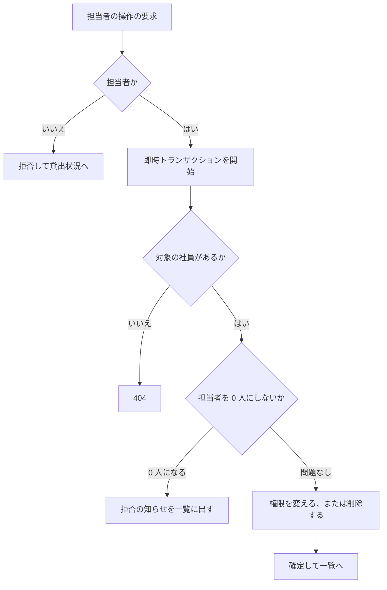

# 変更設計書: アカウントの管理（段 3）

入力は `change_requirements.md` の [追加] 要件。既存設計（`docs/detail_design.md`）の要素は、中身が変わるものを [削除] と [追加] に分ける。中身が変わらない要素は ID を変えない。変更が無い章は「変更なし」と書く。

## 1. 言語・フレームワーク・アーキテクチャの選定

変更なし。既存設計書 `docs/detail_design.md` 第 1 章を参照（Python 3.12、Flask、waitress、SQLite、Playwright）。

## 2. システム構成

変更なし（コンポーネントは増えない）。業務ロジックの `core` にアカウントの管理の関数を足し、画面の受け口に一覧と 3 つの操作の画面を足す。

## 3. データ設計

### 3-1. データモデル

変更なし（テーブルと項目は増えない。SQLite のスキーマは変えない）。削除は物理削除で、履歴テーブルは持たない。

### 3-2. トランザクションと排他制御（変更分）

- 担当者の付け外し（`DS-FN-CHANGE-ACCOUNT-ROLE`）: 即時トランザクション（`BEGIN IMMEDIATE`）の中で、担当者の数を数えてから権限を書き換える。同時に 2 人の担当者が互いを外しても、2 件目は数え直しで 1 人だけになっているため拒否される。
- 削除（`DS-FN-DELETE-ACCOUNT`）: 即時トランザクションの中で、貸出の行の有無、担当者の数を確かめてから削除する。貸出の登録も即時トランザクションで借りる社員の存在を確かめるため、貸出の登録と削除は直列化され、削除された社員への貸出は残らない。
- パスワードの再設定（`DS-FN-RESET-PASSWORD`）: 1 件の更新文で行う。対象が無ければ行数 0 を結果にする。

### 3-3. 状態遷移（変更分）

社員アカウントの権限と存在の遷移は、要件定義書 4-4 の追加分に従う。遷移を行う処理は次のとおり。

- 権限の付け外し: `DS-FN-CHANGE-ACCOUNT-ROLE`（担当者にする、担当者から外す）
- パスワードの再設定: `DS-FN-RESET-PASSWORD`（権限は変えない）
- 削除: `DS-FN-DELETE-ACCOUNT`（記録は残さない）

許されない遷移（担当者が 1 人のときの外す・削除、貸出中の備品を借りている社員の削除）は、各処理が結果として返し、画面が `.message` に出す。

## 4. アーキテクチャ設計

### 4-1. 外部設計

#### 利用者向けインターフェース（変更分）

| DS-ID | 区分 | 画面 / 操作 | URL・メソッド | 利用者 |
|---|---|---|---|---|
| `DS-IF-ACCOUNT-LIST-SCREEN` | [追加] | アカウントの一覧 | `/accounts/` GET（`?reset=社員番号` で、その行にパスワードの入力欄を開く） | 担当者 |
| `DS-IF-ACCOUNT-ROLE-CHANGE` | [追加] | 担当者の付け外し | `/accounts/<社員番号>/role/` POST（欄 `role` は `manager` か `member`） | 担当者 |
| `DS-IF-ACCOUNT-PASSWORD-RESET` | [追加] | パスワードの再設定 | `/accounts/<社員番号>/password/` POST（欄 `new_password`） | 担当者 |
| `DS-IF-ACCOUNT-DELETE` | [追加] | アカウントの削除 | `/accounts/<社員番号>/delete/` POST | 担当者 |

既存の画面は ID を変えない。内容の変更は次のとおり。

- 貸出状況の画面（既存の画面。ID は変えない）: 担当者に「アカウントの一覧」リンク（`/accounts/` へ）を出す。「備品を登録」と同じく担当者だけに出す。

#### インターフェース仕様（変更分）

- アカウントの一覧（`DS-IF-ACCOUNT-LIST-SCREEN`）
  - 入力: 無し（`?reset=社員番号` のときは、その行を再設定の欄つきで出す）。
  - 表示: 社員番号の昇順に、社員番号、名前、「担当者」または「社員」を出す。行は `tbody tr` で `data-employee-number` を持つ。行の操作は、担当者の行に「担当者から外す」、社員の行に「担当者にする」、どの行にも「パスワード再設定」と「削除」。「担当者にする」と「担当者から外す」と「削除」は `window.confirm` の「はい」のときだけ送信する。「パスワード再設定」は `?reset=社員番号` へ GET で移り、その行に `new_password`（入力欄）と「確定」ボタンを出す。
  - 検査と出力: 再設定の入力が 8 文字未満のときは、その行の `.field-error` に「パスワードは 8 文字以上で入力してください」を出し、入力値を残す（`new_password` の値を再表示する）。
  - 担当者以外: `DS-FN-REQUIRE-MANAGER` の扱い（未ログインはログイン画面、社員は貸出状況の画面へ戻し `.message` に「この操作は担当者だけが行えます」）。
- 担当者の付け外し（`DS-IF-ACCOUNT-ROLE-CHANGE`）
  - 入力: 社員番号（URL）と欄 `role`（`manager` か `member`）。
  - 出力: 変えた場合は一覧へリダイレクトし、`.message` に「担当者にしました」か「担当者から外しました」。結果が「担当者が 1 人だけ」のときは、一覧へリダイレクトし `.message` に「担当者が 1 人もいなくなるため、この操作はできません」。すでに同じ権限のときは何も変えず一覧へ戻す。対象が無いときは 404。
  - 担当者以外: `DS-FN-REQUIRE-MANAGER` の扱い。
- パスワードの再設定（`DS-IF-ACCOUNT-PASSWORD-RESET`）
  - 入力: 社員番号（URL）と欄 `new_password`。
  - 検査: 8 文字未満は `DS-FN-VALIDATE-PASSWORD-INPUT` の文言を、その行の `.field-error` に出して一覧を再表示する（その行の再設定の欄を開いたまま、入力値を残す）。
  - 出力: 成功時は一覧へリダイレクトし、`.message` に「パスワードを再設定しました」。対象が無いときは 404。
  - 再設定の後は古いパスワードの照合が失敗する（照合は既存の処理）。
  - 担当者以外: `DS-FN-REQUIRE-MANAGER` の扱い。
- アカウントの削除（`DS-IF-ACCOUNT-DELETE`）
  - 入力: 社員番号（URL）。
  - 出力: 削除できたら一覧へリダイレクトし、`.message` に「アカウントを削除しました」。自分自身を削除したときは、ログアウトして貸出状況の画面へ戻す（知らせは出さない）。貸出中の備品を借りている社員なら、一覧の `.message` に「この社員は備品を借りているため削除できません。先に返却を処理してください」。担当者が 1 人だけなら `.message` に「担当者が 1 人もいなくなるため、この操作はできません」。対象が無いときは 404。
  - 担当者以外: `DS-FN-REQUIRE-MANAGER` の扱い。

#### 外部システム連携

無し。

### 4-2. 内部設計（変更分）

#### 処理フロー（担当者の付け外しと削除）

#### 処理の役割（変更分）

- 要求ごとのセッションの同期（`DS-FN-SYNC-SESSION-WITH-ACCOUNT`）: 要求の前に、セッションの社員番号で DB のアカウントを読む。無ければ（削除された）セッションを消して未ログインとして扱う。あれば、名前と権限をセッションに入れ直す。これにより、担当者から外された人、削除された人の次の要求は、DB の現在の状態で判定される。
- 担当者の付け外し（`DS-FN-CHANGE-ACCOUNT-ROLE`）: 社員を担当者にする、または担当者を社員にする。担当者を社員にするときだけ、担当者の数を数え、1 人だけなら拒否する。
- パスワードの再設定（`DS-FN-RESET-PASSWORD`）: 新しいパスワードをハッシュにして社員番号の行を更新する。古いハッシュは残さない。
- 削除（`DS-FN-DELETE-ACCOUNT`）: 貸出の行で借りていれば拒否する。担当者なら数を数え、1 人だけなら拒否する。問題が無ければ行を物理削除する。
- 一覧（`DS-FN-LIST-ACCOUNTS`）: 全アカウントを社員番号の昇順で、社員番号、名前、権限を返す（パスワードのハッシュは返さない）。
- 借りる社員の候補（`DS-FN-LIST-BORROWER-CANDIDATES`）: 変更なし。削除された社員は行が無いため候補に出ない。

#### バッチ設計

なし。

## 5. クラス設計

### 5-1. 関数の一覧（変更分）

| DS-ID | 区分 | 関数（モジュール内） | 責務 | 主な入力・出力 |
|---|---|---|---|---|
| `DS-FN-LIST-ACCOUNTS` | [追加] | `list_accounts`（accounts） | 全アカウントを社員番号の昇順で返す（パスワードは返さない） | なし → 社員番号、名前、権限の一覧 |
| `DS-FN-CHANGE-ACCOUNT-ROLE` | [追加] | `change_account_role`（accounts） | 権限を変える。担当者を社員にするとき、担当者が 1 人だけなら拒否する | 社員番号・新しい権限 → 結果（`ROLE_CHANGE_OK`、`ROLE_NO_ACCOUNT`、`ROLE_LAST_MANAGER`） |
| `DS-FN-RESET-PASSWORD` | [追加] | `reset_password`（accounts） | 新しいパスワードのハッシュに置き換える | 社員番号・新しいパスワード → 結果（`RESET_OK`、`RESET_NO_ACCOUNT`） |
| `DS-FN-DELETE-ACCOUNT` | [追加] | `delete_account`（accounts） | 借りていない、かつ担当者を 0 人にしないときだけ行を消す | 社員番号 → 結果（`DELETE_OK`、`DELETE_NO_ACCOUNT`、`DELETE_LENT`、`DELETE_LAST_MANAGER`） |
| `DS-FN-VALIDATE-PASSWORD-INPUT` | [追加] | `validate_password_input`（validation） | 再設定の新しいパスワードの長さを検査する | パスワード → 欄ごとのエラー（空、または問題なし） |
| `DS-FN-SYNC-SESSION-WITH-ACCOUNT` | [追加] | `sync_session_user`（auth） | 要求ごとに、セッションの社員を DB の現在の状態に合わせる。無ければセッションを消す | DB 接続 → なし |
| `DS-FN-REQUIRE-MANAGER` | 変更なし | `require_manager`（auth） | 担当者以外の要求を拒否する | 既存のまま。アカウントの一覧と操作にも使う |
| `DS-FN-LIST-BORROWER-CANDIDATES` | 変更なし | `list_borrower_candidates`（accounts） | 借りる社員の候補を返す | 既存のまま |

### 5-2. クラス図

変更なし（クラスは作らない）。

### 5-3. メッセージ一覧

変更なし。画面の文言は 6 と 4-1 に書く。

## 6. エラーハンドリングとセキュリティ設計（変更分）

- 担当者以外の要求: 一覧と 3 つの操作は、段 1 と同じ `DS-FN-REQUIRE-MANAGER` で拒否する（画面の出し分けだけに頼らない）。
- 結果の扱い: 業務上の拒否（最後の担当者、貸出中、対象の無し）は、結果の値で返し、例外にしない。対象の無いときだけ 404。
- セッション: 権限と存在は要求ごとに DB から確かめる（`DS-FN-SYNC-SESSION-WITH-ACCOUNT`）。これにより、外された担当者と削除された社員は、ログイン中でも次の要求から権限を失う。
- パスワード: 再設定の値もハッシュにして保存する（平文は保存しない）。画面の入力値は、登録の画面と同じく入力エラーの後に残す（共用の PC の注意は README に書く）。

## 7. コード設計（変更分）

### 7-1. ディレクトリ構成

変更なし。

### 7-2. ファイル一覧（変更分）

| ファイル | 区分 | 役割 | 含まれる関数・クラス | 実現する設計 ID |
|---|---|---|---|---|
| `equipment_ledger/core/accounts.py` | 変更（ファイルの ID は変えない） | アカウント | 既存に `list_accounts`、`change_account_role`、`reset_password`、`delete_account` を追加 | `DS-MD-ACCOUNTS`、`DS-FN-LIST-ACCOUNTS`、`DS-FN-CHANGE-ACCOUNT-ROLE`、`DS-FN-RESET-PASSWORD`、`DS-FN-DELETE-ACCOUNT` |
| `equipment_ledger/core/validation.py` | 変更（同上） | 入力チェック | 既存に `validate_password_input` を追加 | `DS-MD-VALIDATION`、`DS-FN-VALIDATE-PASSWORD-INPUT` |
| `equipment_ledger/auth.py` | 変更（同上） | ログイン状態 | 既存に `sync_session_user` を追加 | `DS-MD-AUTH`、`DS-FN-SYNC-SESSION-WITH-ACCOUNT` |
| `equipment_ledger/views.py` | 変更（同上） | 画面の受け口 | アカウントの一覧と 3 つの操作、要求ごとの同期 | `DS-MD-VIEWS`、`DS-IF-ACCOUNT-LIST-SCREEN`、`DS-IF-ACCOUNT-ROLE-CHANGE`、`DS-IF-ACCOUNT-PASSWORD-RESET`、`DS-IF-ACCOUNT-DELETE` |
| `equipment_ledger/templates/accounts.html` | [追加]（テンプレート。`DS-IF-ACCOUNT-LIST-SCREEN` で受ける） | アカウントの一覧の画面 | — | `DS-IF-ACCOUNT-LIST-SCREEN` |
| `equipment_ledger/templates/equipment_status.html` | 変更（テンプレート） | 貸出状況 | 担当者に「アカウントの一覧」リンク | 既存の画面（ID は変えない。`DS-MD-VIEWS` の画面の一部） |

7-3 対応表の粒度: 変更なし（`function`）。
7-4 依存の規則: 変更なし。`core/` の追加関数は `flask` と画面の層に依存しない。`sync_session_user` は `auth.py`（Flask の層）に置き、`core` の関数を呼ぶ。
7-5 コーディング規約: 変更なし。

## 8. テスト設計（変更分）

### 8-1. テストの種類と方針

- 単体テスト（`tests/`）: 追加した関数の結果を確かめる。担当者の数の境界（2 人から 1 人、1 人の拒否）、再設定後の照合、削除の拒否（貸出中、最後の担当者）、削除後の候補一覧、同期（削除と権限の変更の反映）、パスワードの長さの境界（7、8 文字）。担当者の付け外しと削除の同時実行は、別々の接続とスレッドで 1 件だけが通ることを確かめる。
- 結合・E2E（`e2e/`）: 8-2 の追加分。段 1・2 の E2E は変えない。

### 8-2. E2E テストのシナリオ（追加分）

| DS-ID | 区分 | 対応する RQ-TS | 確かめること |
|---|---|---|---|
| `DS-TS-VIEW-ACCOUNT-LIST-E2E` | [追加] | `RQ-TS-VIEW-ACCOUNT-LIST-AS-STAFF` | 一覧の行、3 列目の権限、社員番号の昇順、パスワードの非表示 |
| `DS-TS-CHANGE-ROLE-E2E` | [追加] | `RQ-TS-CHANGE-ROLE-AS-STAFF` | 担当者にする、外す、外された人の次の要求の拒否、確認で「いいえ」 |
| `DS-TS-KEEP-ONE-STAFF-E2E` | [追加] | `RQ-TS-KEEP-ONE-STAFF` | 担当者が 1 人のときの外す・削除の拒否 |
| `DS-TS-CONCURRENT-DEMOTE-E2E` | [追加] | `RQ-TS-CONCURRENT-DEMOTE-KEEPS-ONE-STAFF` | 2 人が同時に互いを外しても 1 人は残る。2 つの要求を同時に送る（ログイン済みの Cookie を持つ 2 つの HTTP 要求をスレッドで送る） |
| `DS-TS-RESET-PASSWORD-E2E` | [追加] | `RQ-TS-RESET-PASSWORD-AS-STAFF` | 8 文字未満の行内のエラー、再設定後の古いパスワードの拒否と新しいパスワードの成功 |
| `DS-TS-DELETE-ACCOUNT-E2E` | [追加] | `RQ-TS-DELETE-ACCOUNT-AS-STAFF` | 確認で「いいえ」では残る、「はい」で消える、消えた人のログインと候補の不在 |
| `DS-TS-DENY-DELETE-LENT-BORROWER-E2E` | [追加] | `RQ-TS-DENY-DELETE-LENT-BORROWER` | 貸出中の社員の削除の拒否、返却の後の削除 |
| `DS-TS-DENY-NON-STAFF-ACCOUNT-E2E` | [追加] | `RQ-TS-DENY-NON-STAFF-ACCOUNT` | 社員と未ログインの一覧と操作の拒否 |

### 8-3 〜 8-4: 変更なし（E2E の実行手段と実行コマンドは段 1 のまま）。

## 9. 運用設計（変更分）

変更なし。

## 10. ログ・監視・アラート・障害対応設計

変更なし。

## 11. 要件と設計の対応表

| DS-ID | 対応要件ID | 区分 |
|---|---|---|
| `DS-IF-ACCOUNT-LIST-SCREEN` | `RQ-UI-ACCOUNT-LIST-SCREEN` | [追加] |
| `DS-IF-ACCOUNT-ROLE-CHANGE` | `RQ-UI-ACCOUNT-LIST-SCREEN` | [追加] |
| `DS-IF-ACCOUNT-PASSWORD-RESET` | `RQ-UI-ACCOUNT-LIST-SCREEN` | [追加] |
| `DS-IF-ACCOUNT-DELETE` | `RQ-UI-ACCOUNT-LIST-SCREEN` | [追加] |
| `DS-FN-LIST-ACCOUNTS` | `RQ-FT-VIEW-ACCOUNT-LIST` | [追加] |
| `DS-FN-CHANGE-ACCOUNT-ROLE` | `RQ-FT-CHANGE-ACCOUNT-ROLE`、`RQ-FT-RULE-KEEP-ONE-STAFF` | [追加] |
| `DS-FN-RESET-PASSWORD` | `RQ-FT-RESET-PASSWORD`、`RQ-FT-RULE-RESET-REPLACES-PASSWORD` | [追加] |
| `DS-FN-DELETE-ACCOUNT` | `RQ-FT-DELETE-ACCOUNT`、`RQ-FT-RULE-NO-DELETE-LENT-BORROWER`、`RQ-FT-RULE-KEEP-ONE-STAFF`、`RQ-FT-RULE-DELETED-ACCOUNT-UNUSABLE` | [追加] |
| `DS-FN-VALIDATE-PASSWORD-INPUT` | `RQ-FT-RULE-RESET-PASSWORD-MIN-LENGTH` | [追加] |
| `DS-FN-SYNC-SESSION-WITH-ACCOUNT` | `RQ-FT-RULE-ROLE-FOLLOWS-ACCOUNT`、`RQ-FT-RULE-DELETED-ACCOUNT-UNUSABLE` | [追加] |
| `DS-MD-ACCOUNTS` | `RQ-FT-VIEW-ACCOUNT-LIST`、`RQ-FT-CHANGE-ACCOUNT-ROLE`、`RQ-FT-RESET-PASSWORD`、`RQ-FT-DELETE-ACCOUNT` | 変更なし（既存） |
| `DS-MD-VALIDATION` | `RQ-FT-RULE-RESET-PASSWORD-MIN-LENGTH` | 変更なし（既存） |
| `DS-MD-AUTH` | `RQ-FT-RULE-ROLE-FOLLOWS-ACCOUNT`、`RQ-FT-DENY-NON-STAFF-ACCOUNT` | 変更なし（既存） |
| `DS-MD-VIEWS` | `RQ-UI-ACCOUNT-LIST-SCREEN` | 変更なし（既存） |
| `DS-FN-REQUIRE-MANAGER` | `RQ-FT-DENY-NON-STAFF-ACCOUNT` | 変更なし（既存。適用先が増える） |
| `DS-FN-LIST-BORROWER-CANDIDATES` | `RQ-FT-RULE-DELETED-ACCOUNT-UNUSABLE` | 変更なし（既存） |
| `DS-TS-VIEW-ACCOUNT-LIST-E2E` | `RQ-TS-VIEW-ACCOUNT-LIST-AS-STAFF` | [追加] |
| `DS-TS-CHANGE-ROLE-E2E` | `RQ-TS-CHANGE-ROLE-AS-STAFF` | [追加] |
| `DS-TS-KEEP-ONE-STAFF-E2E` | `RQ-TS-KEEP-ONE-STAFF` | [追加] |
| `DS-TS-CONCURRENT-DEMOTE-E2E` | `RQ-TS-CONCURRENT-DEMOTE-KEEPS-ONE-STAFF` | [追加] |
| `DS-TS-RESET-PASSWORD-E2E` | `RQ-TS-RESET-PASSWORD-AS-STAFF` | [追加] |
| `DS-TS-DELETE-ACCOUNT-E2E` | `RQ-TS-DELETE-ACCOUNT-AS-STAFF` | [追加] |
| `DS-TS-DENY-DELETE-LENT-BORROWER-E2E` | `RQ-TS-DENY-DELETE-LENT-BORROWER` | [追加] |
| `DS-TS-DENY-NON-STAFF-ACCOUNT-E2E` | `RQ-TS-DENY-NON-STAFF-ACCOUNT` | [追加] |

### 11-1. 除外要件

除外要件は無い。
