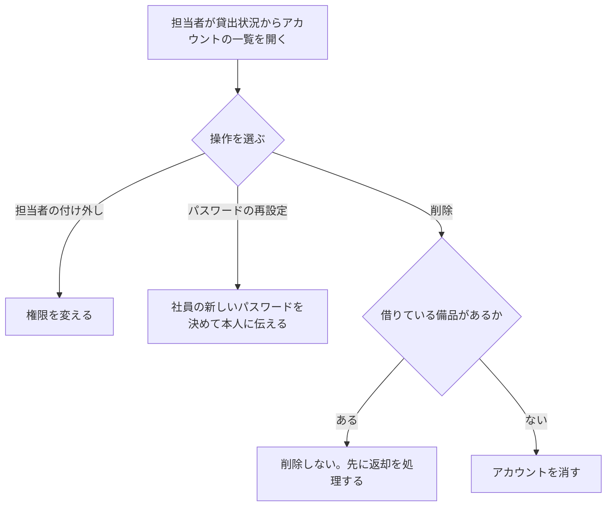

# 変更要件定義書: アカウントの管理（段 3）

変更の対象は既存の要件定義書 `docs/requirements.md`（段 1・2 の正本）。変更のない章は「変更なし」と書く。すべての要件項目に [追加] か [削除] を付ける。

## 1. 目的・前提

- 変更の目的: 担当者の交代や退職、社員のパスワードの忘失に、担当者が画面から対応できるようにする。今は DB を直接触るしかない。
- システムの形態: GUI（段 1 と同じ）。変更なし。既存要件定義書 `docs/requirements.md` セクション 1 を参照。
- 依頼の決定の出どころ: 依頼者（ユーザーは不在のため、作業ディレクトリの ANSWERS.md の固定回答と REQUEST.md の依頼文）。

用語集（追加分）:

| 用語 | 業務上の意味 | 本案件での使用範囲 | 同義語/類義語 |
|---|---|---|---|
| アカウントの管理 | 担当者が、社員のアカウントの権限・パスワード・存在を画面から変えること | 担当者だけが行う（一覧、担当者の付け外し、パスワードの再設定、削除） | アカウント管理 |
| 担当者の付け外し | 社員を担当者にする、または担当者を社員に戻すこと | 一覧の行の操作 | 権限の変更 |
| パスワードの再設定 | 担当者が、社員の新しいパスワードを決めて本人に伝えること。古いパスワードは使えなくなる | 一覧の行の操作（8 文字以上） | パスワードのリセット |
| アカウントの削除 | アカウントを記録ごと消し、そのアカウントではログインできず、借りる社員の候補にも出なくなること。削除の記録は残さない | 一覧の行の操作（貸出中の備品を借りている社員は不可） | 退職処理 |

### 1-1. 技術制約

変更なし。既存要件定義書 `docs/requirements.md` セクション 1-1 を参照。

## 2. 業務

### 2-0. 対象業務一覧（追加分）

| RQ-BZ-ID | 業務名 | 業務の範囲 | 担当者 | 区分 |
|---|---|---|---|---|
| `RQ-BZ-ACCOUNT-MANAGEMENT` | アカウントの管理 | 担当者が、全アカウントの一覧を見て、担当者の付け外し、パスワードの再設定、アカウントの削除を行う | 担当者だけ | [追加] |

業務フロー（追加分）:

### 2-1. 業務の問題（追加分）

| 問題 | 対象業務（RQ-BZ） | あるべき姿 | 現状 | ギャップ（KPI） | 業務影響 |
|---|---|---|---|---|---|
| 担当者の交代、退職、パスワードの忘失に、DB を直接触って対応している | `RQ-BZ-ACCOUNT-MANAGEMENT` | 担当者が画面から、担当者の付け外し、パスワードの再設定、削除をできる | DB を直接操作している。件数と頻度は不明（集計していないため） | 件数: 不明（理由: 集計していないため） | DB を誤って触ると、担当者が 0 人になったり、貸出中の記録と食い違ったりする |

### 2-2. 業務課題一覧（追加分）

| RQ-BK-ID | 業務課題（取り組むこと） | 解決する問題（2-1） | 解決後の状態（KPI の目標値） | 対象業務（RQ-BZ） | 区分 |
|---|---|---|---|---|---|
| `RQ-BK-ACCOUNT-MANAGEMENT-BY-STAFF` | 担当者が画面から、アカウントの一覧、担当者の付け外し、パスワードの再設定、削除を行えるようにする | 担当者の交代、退職、パスワードの忘失に、DB を直接触って対応している | DB を直接触らずに、担当者の交代、退職、パスワードの忘失に対応できる（件数は今回の段では計測しない） | `RQ-BZ-ACCOUNT-MANAGEMENT` | [追加] |

### 2-3. 見込み経営効果（追加分）

| RQ-EF-ID | 効果の種類 | 内容 | 見込み（金額・時間などと算定根拠） | 対応業務課題ID（RQ-BK-*） | 区分 |
|---|---|---|---|---|---|
| `RQ-EF-ACCOUNT-DB-WORK` | Soft Saving | DB を直接触る作業が画面の操作に置き換わる | 見込み経営効果は算定しない（理由: DB を直接触った回数を集計しておらず、削減の時間を算定できないため） | `RQ-BK-ACCOUNT-MANAGEMENT-BY-STAFF` | [追加] |

既存の見込み経営効果（担当者の問い合わせ対応の削減）は変更なし。

## 3. 機能要件

### 3-0. 画面の変更（画面ごとの 5 項目の追加分）

| 画面 | 区分 | 目的 | 主要要素 | 入力項目 | 表示項目 | エラー時の見え方 |
|---|---|---|---|---|---|---|
| アカウントの一覧（`RQ-UI-ACCOUNT-LIST-SCREEN`、`/accounts/`） | [追加] | 担当者がアカウントの一覧を見て、担当者の付け外し、パスワードの再設定、削除を行う | 社員番号、名前、担当者か社員の表（行ごとに「担当者にする」か「担当者から外す」、「パスワード再設定」、「削除」）。「パスワード再設定」を押すと、その行に新しいパスワードの入力欄と「確定」ボタンが出る。貸出状況に戻るリンク | 新しいパスワード（再設定の行だけ） | 社員番号、名前、「担当者」または「社員」（社員番号の昇順） | パスワードが短いときは、その行の `.field-error`。担当者以外の要求は貸出状況の画面に戻して `.message`。操作の知らせは `.message`。担当者の付け外し・削除は確認ダイアログ（`window.confirm`）で「はい」のときだけ行う |
| 貸出状況（`貸出状況の画面`） | 変更（表示の追加。ID は変えない） | 備品の一覧と貸出状況を見る | 担当者には「アカウントの一覧」リンクを出す（段 1 の「備品を登録」リンクと同じ扱い） | 無し | 変更なし | 変更なし |

### 3-1. 帳票・出力ファイル

変更なし。

### 3-2. 業務ルール（追加分）

| RQ-ID | 区分 | ルール名 | 内容（条件と結果） | 違反時・エラー時の業務上の扱い | 対応業務課題ID（RQ-BK-*） |
|---|---|---|---|---|---|
| `RQ-FT-RULE-RESET-REPLACES-PASSWORD` | [追加] | 再設定の後は古いパスワードを使えない | 担当者がパスワードを再設定したら、そのアカウントのパスワードは新しいものだけになる。古いパスワードでのログインは失敗する | 古いパスワードのログインは `.error` に「社員番号またはパスワードが違います」 | `RQ-BK-ACCOUNT-MANAGEMENT-BY-STAFF` |
| `RQ-FT-RULE-RESET-PASSWORD-MIN-LENGTH` | [追加] | 再設定するパスワードは 8 文字以上 | 再設定の新しいパスワードは 8 文字以上を受け付ける（登録時と同じ） | その行の `.field-error` に「パスワードは 8 文字以上で入力してください」。パスワードは変えない | `RQ-BK-ACCOUNT-MANAGEMENT-BY-STAFF` |
| `RQ-FT-RULE-NO-DELETE-LENT-BORROWER` | [追加] | 備品を借りている社員のアカウントは削除できない | 貸出の記録（1 台以上）で借りている社員のアカウントは削除しない。返却で貸出の記録が無くなれば削除できる | アカウントの一覧の `.message` に「この社員は備品を借りているため削除できません。先に返却を処理してください」 | `RQ-BK-ACCOUNT-MANAGEMENT-BY-STAFF` |
| `RQ-FT-RULE-KEEP-ONE-STAFF` | [追加] | 担当者を 0 人にしない | 担当者が 1 人だけのとき、その人を担当者から外す操作と、その人のアカウントを削除する操作を受け付けない。担当者が 2 人以上のときは受け付ける。同時に 2 人の担当者が互いを外そうとしたときは、先の 1 件だけを処理し、後の方は受け付けない | アカウントの一覧の `.message` に「担当者が 1 人もいなくなるため、この操作はできません」 | `RQ-BK-ACCOUNT-MANAGEMENT-BY-STAFF` |
| `RQ-FT-RULE-DELETED-ACCOUNT-UNUSABLE` | [追加] | 削除したアカウントは使えない | 削除したアカウントではログインできない。そのアカウントで既にログインしている人の次の要求は、未ログインとして扱う。借りる社員の候補（貸出の登録）にも出ない | 次の要求はログイン画面へ | `RQ-BK-ACCOUNT-MANAGEMENT-BY-STAFF` |
| `RQ-FT-RULE-ROLE-FOLLOWS-ACCOUNT` | [追加] | 権限は次の要求から、アカウントの現在の権限に従う | 担当者から外された人は、ログイン中でも次の要求から社員として扱われ、担当者の操作と一覧は拒否される。社員から担当者にされた人は、次の要求から担当者として扱われる | 拒否は `.message` に「この操作は担当者だけが行えます」（貸出状況の画面へ） | `RQ-BK-ACCOUNT-MANAGEMENT-BY-STAFF` |

既存の業務ルール（`最初のアカウントは担当者という業務ルール`、`社員番号の重複不可という業務ルール`、`管理番号の重複不可という業務ルール`、`貸出中の備品は貸し出せない`、`返却済みの備品は返却できない`、`貸出中の備品は削除できない`、`貸出日に未来の日付は入れられない`、`借りる社員は必ず選ぶ`、`開いたあとに他の担当者が変えた備品の修正は受け付けない`、`備品を修正しても貸出を引き継ぐ`、`担当者以外は貸出・返却を行えない`）は変更なし。

### 3-3. 外部連携

変更なし（外部連携は無い）。

### 機能一覧（追加分）

| RQ-ID | 区分 | カテゴリ | 機能名 | 対応業務課題ID（RQ-BK-*） | この機能が無いと何が困るか |
|---|---|---|---|---|---|
| `RQ-FT-VIEW-ACCOUNT-LIST` | [追加] | 業務機能 | 担当者がアカウントの一覧（社員番号、名前、担当者か社員）を見る | `RQ-BK-ACCOUNT-MANAGEMENT-BY-STAFF` | 担当者が、誰がどの権限を持つかを画面で確かめられず、DB を直接見るしかない |
| `RQ-FT-CHANGE-ACCOUNT-ROLE` | [追加] | 業務機能 | 担当者が、アカウントを担当者にする、または担当者から外す（確認で「はい」のときだけ） | `RQ-BK-ACCOUNT-MANAGEMENT-BY-STAFF` | 担当者の交代に DB を直接触るしかない |
| `RQ-FT-RESET-PASSWORD` | [追加] | 業務機能 | 担当者が、社員の新しいパスワードを設定する。設定したパスワードを担当者が本人に伝える | `RQ-BK-ACCOUNT-MANAGEMENT-BY-STAFF` | パスワードを忘れた社員がログインできず、DB を直接触るしかない |
| `RQ-FT-DELETE-ACCOUNT` | [追加] | 業務機能 | 担当者が、アカウントを削除する（確認で「はい」のときだけ。削除の記録は残さない） | `RQ-BK-ACCOUNT-MANAGEMENT-BY-STAFF` | 退職した人のアカウントが残り、ログインや借りる社員の候補に出続ける |
| `RQ-FT-DENY-NON-STAFF-ACCOUNT` | [追加] | 共通（認証・認可・ログ） | 担当者以外がアカウントの一覧を開く、または担当者の操作を要求したとき、その要求を受け付けない | `RQ-BK-ACCOUNT-ROLE-ACCESS` | 社員が要求を直接送って、アカウントの権限やパスワードを変えられてしまう |

既存の機能（`アカウント登録`、`ログイン`、`ログアウト`、`無操作の自動ログアウト`、`担当者以外の備品操作の拒否`、`備品の登録`、`備品の修正`、`備品の削除`、`貸出状況の閲覧`、`備品の貸出`、`備品の返却`、`担当者以外の貸出・返却の拒否`）は変更なし。

## 4. データ

### 4-1. データ要件一覧

変更なし。削除したアカウントの記録は残さないことは既存の「削除の記録を残さない要件」（物理削除。履歴テーブルを持たない）で既に定めている。

### 4-2. 業務エンティティとデータ項目

変更なし（項目は増えない）。ただし社員アカウントの「権限」の注記を次のとおり補う（[追加]）。

| エンティティ名 | 項目名 | 区分 | 追加する注記 |
|---|---|---|---|
| 社員アカウント | 権限 | [追加] | 登録時は最初の 1 件だけ担当者、以後は社員（既存の規則）。登録の後は、担当者が付け外しできる（`RQ-FT-CHANGE-ACCOUNT-ROLE`）。担当者は常に 1 人以上（`RQ-FT-RULE-KEEP-ONE-STAFF`） |

### 4-3. CRUD テーブル（全エンティティ分）

| エンティティ名 | 区分 | Create | Read（一覧） | Read（詳細） | 検索 | Update | Delete | 備考 |
|---|---|---|---|---|---|---|---|---|
| 備品 | 変更なし | ○（担当者） | ○（全員） | △（修正画面を開く担当者だけ） | × | ○（担当者） | ○（担当者。貸出中は削除できない） | 変更なし |
| 社員アカウント | [追加]（既存の行を置き換える。旧い行は [削除]） | ○（誰でも、登録画面から） | ○（担当者だけ。社員番号、名前、権限。パスワードは見せない） | △（ログイン時の照合、貸出の登録の候補、パスワードの再設定の対象。画面に出すのは社員番号と名前と権限だけ） | × | ○（担当者。権限の付け外し、パスワードの再設定。社員番号と名前は変えない） | ○（担当者。貸出中の備品を借りている社員は不可。担当者が 1 人だけのときの担当者は不可） | Create は社員番号の重複を一意制約で防ぐ。権限の付け外しと削除は、担当者の数を同じ即時トランザクションで確かめる |
| 貸出 | 変更なし | ○（担当者） | ○（貸出状況の一覧） | △（貸出の登録画面で備品の貸出中かを確かめるため） | × | ×（貸し直すときは返却してから登録） | ○（担当者の返却処理。記録は残さない） | 変更なし。アカウントの削除は貸出の行を消さず、削除を拒否する側で扱う |

[削除] 旧い社員アカウントの行: `社員アカウント | ○（誰でも、登録画面から） | ×（一覧は無い） | △（ログイン時の照合と、貸出の登録で借りる社員を選ぶ一覧の内部利用のみ） | × | ×（変更は無い） | ×（削除は無い）`。理由: 担当者の一覧、権限の付け外し、パスワードの再設定、削除を追加したため（`RQ-FT-VIEW-ACCOUNT-LIST` など）。

### 4-4. 状態遷移（追加分）

社員アカウントの権限と、アカウントの存在の状態。

| 現在の状態 | 操作 | 条件 | 次の状態 | 備考 |
|---|---|---|---|---|
| 社員 | 担当者にする（担当者） | - | 担当者 | [追加] |
| 担当者 | 担当者から外す（担当者） | 担当者が 2 人以上 | 社員 | [追加]。1 人だけのときは「担当者が 1 人もいなくなるため、この操作はできません」 |
| 社員 | 削除（担当者） | 貸出の記録で借りていない | 無し（記録は残さない） | [追加] |
| 担当者 | 削除（担当者） | 貸出の記録で借りていない、担当者が 2 人以上 | 無し（記録は残さない） | [追加]。1 人だけのときは受け付けない |
| 社員・担当者 | パスワードの再設定（担当者） | 新しいパスワードが 8 文字以上 | 同じ（パスワードだけが変わる） | [追加]。古いパスワードは使えなくなる |

### 4-5. 画面一覧（追加分）

| RQ-ID | 区分 | 画面名 | 対応する CRUD 操作（エンティティ名:操作種別） | 主な機能・目的 | 対応業務課題ID（RQ-BK-*） |
|---|---|---|---|---|---|
| `RQ-UI-ACCOUNT-LIST-SCREEN` | [追加] | アカウントの一覧（`/accounts/`） | 社員アカウント:Read（一覧）、社員アカウント:Update（権限、パスワード）、社員アカウント:Delete | 担当者がアカウントの一覧を見て、担当者の付け外し、パスワードの再設定、削除を行う | `RQ-BK-ACCOUNT-MANAGEMENT-BY-STAFF` |

貸出状況の画面（`貸出状況の画面`）は ID を変えない。担当者に「アカウントの一覧」リンクを足す（3-0）。

## 5. 非機能要件

変更なし。

## 6. 運用要件

変更なし。

## 7. テスト用利用シナリオ（追加分）

[追加] の `RQ-FT`・`RQ-UI` を確かめるシナリオを足す。既存のシナリオは変えない。

| RQ-ID | 区分 | テスト目的 | 前提条件 | テスト手順 | 期待される結果 | 検証する要件ID | 対応業務課題ID（RQ-BK-*） |
|---|---|---|---|---|---|---|---|
| `RQ-TS-VIEW-ACCOUNT-LIST-AS-STAFF` | [追加] | 担当者がアカウントの一覧を見られ、社員は見られないことを確かめる | 担当者 1 人（社員番号 123456）と社員 1 人（社員番号 234567）が登録済み。担当者でログイン済み | 貸出状況の「アカウントの一覧」を開く | 社員番号の昇順に 2 行。各行の 3 列目に「担当者」「社員」が出る。パスワードは出ない | `RQ-FT-VIEW-ACCOUNT-LIST`、`RQ-UI-ACCOUNT-LIST-SCREEN` | `RQ-BK-ACCOUNT-MANAGEMENT-BY-STAFF` |
| `RQ-TS-CHANGE-ROLE-AS-STAFF` | [追加] | 担当者の付け外しと、外された人の次の要求の扱いを確かめる | 担当者 A（123456）と社員 B（234567）が登録済み。A でログイン済み。B でも別のブラウザでログイン済み | A の一覧で B の行の「担当者にする」を押し、確認で「はい」。B の行が「担当者」になる。次に B の行の「担当者から外す」を押し、確認で「はい」。B のブラウザで `/accounts/` を開く | 担当者にできる。外すと B の行は「社員」に戻る。B の次の要求は `.message`「この操作は担当者だけが行えます」で貸出状況へ戻る。確認で「いいえ」のときは何も変わらない | `RQ-FT-CHANGE-ACCOUNT-ROLE`、`RQ-FT-RULE-ROLE-FOLLOWS-ACCOUNT`、`RQ-UI-ACCOUNT-LIST-SCREEN` | `RQ-BK-ACCOUNT-MANAGEMENT-BY-STAFF` |
| `RQ-TS-KEEP-ONE-STAFF` | [追加] | 担当者が 1 人だけのとき、外す操作と削除を受け付けないことを確かめる | 担当者 A（123456）だけが登録済み。A でログイン済み | A の行の「担当者から外す」を押し、確認で「はい」。次に A の行の「削除」を押し、確認で「はい」 | 両方とも受け付けず、`.message` に「担当者が 1 人もいなくなるため、この操作はできません」。A は担当者のまま | `RQ-FT-RULE-KEEP-ONE-STAFF`、`RQ-UI-ACCOUNT-LIST-SCREEN` | `RQ-BK-ACCOUNT-MANAGEMENT-BY-STAFF` |
| `RQ-TS-CONCURRENT-DEMOTE-KEEPS-ONE-STAFF` | [追加] | 担当者 2 人が同時に互いを外そうとしても、1 人は担当者のままであることを確かめる | 担当者 A（123456）と B（234567）が登録済み。両方ログイン済み（別の接続） | A と B が、それぞれ相手の「担当者から外す」を同時に送る | 先の 1 件だけが社員に戻り、後の方は `.message` に「担当者が 1 人もいなくなるため、この操作はできません」。担当者は 1 人残る | `RQ-FT-RULE-KEEP-ONE-STAFF` | `RQ-BK-ACCOUNT-MANAGEMENT-BY-STAFF` |
| `RQ-TS-RESET-PASSWORD-AS-STAFF` | [追加] | パスワードの再設定、短いパスワードの拒否、古いパスワードの無効化を確かめる | 担当者 A（123456）と社員 B（234567、パスワード 12345678）が登録済み。A でログイン済み | A の一覧で B の行の「パスワード再設定」を押す。`input[name=new_password]` に 7 文字を入れて「確定」。次に 8 文字以上（87654321）を入れて「確定」。ログアウトし、B の社員番号と古いパスワード（12345678）でログイン、次に新しいパスワード（87654321）でログイン | 7 文字は B の行の `.field-error` に「パスワードは 8 文字以上で入力してください」。8 文字以上は受け付けて `.message` に知らせる。古いパスワードは `.error` に「社員番号またはパスワードが違います」。新しいパスワードでログインできる | `RQ-FT-RESET-PASSWORD`、`RQ-FT-RULE-RESET-REPLACES-PASSWORD`、`RQ-FT-RULE-RESET-PASSWORD-MIN-LENGTH`、`RQ-UI-ACCOUNT-LIST-SCREEN` | `RQ-BK-ACCOUNT-MANAGEMENT-BY-STAFF` |
| `RQ-TS-DELETE-ACCOUNT-AS-STAFF` | [追加] | 担当者がアカウントを削除でき、削除後はログインできず借りる社員の候補にも出ないことを確かめる | 担当者 A（123456）と社員 B（234567）が登録済み。A でログイン済み。B で別のブラウザからログイン済み。備品 `PC-0001` が空き | A の一覧で B の行の「削除」を押し、確認で「いいえ」。次に「削除」を押し、確認で「はい」。B のブラウザで `/accounts/` を開き、B の社員番号と正しいパスワードでログインを試す。A で `PC-0001` の「貸出」を開く | 「いいえ」では残る。「はい」で B の行が消える。B の次の要求は未ログインとして扱われ、ログインは `.error` の「社員番号またはパスワードが違います」。貸出の登録の借りる社員の候補に B が出ない | `RQ-FT-DELETE-ACCOUNT`、`RQ-FT-RULE-DELETED-ACCOUNT-UNUSABLE`、`RQ-UI-ACCOUNT-LIST-SCREEN` | `RQ-BK-ACCOUNT-MANAGEMENT-BY-STAFF` |
| `RQ-TS-DENY-DELETE-LENT-BORROWER` | [追加] | 備品を借りている社員のアカウントは削除できず、返却の後に削除できることを確かめる | 担当者 A（123456）と社員 B（234567）が登録済み。B が備品 `PC-0001` を借りている（貸出中） | A の一覧で B の行の「削除」を押し、確認で「はい」。次に A で `PC-0001` の「返却」を処理し、B の「削除」を押し、確認で「はい」 | 1 回目は B の行が残り、`.message` に「この社員は備品を借りているため削除できません。先に返却を処理してください」。返却の後の 2 回目は B の行が消える | `RQ-FT-RULE-NO-DELETE-LENT-BORROWER`、`RQ-UI-ACCOUNT-LIST-SCREEN` | `RQ-BK-ACCOUNT-MANAGEMENT-BY-STAFF` |
| `RQ-TS-DENY-NON-STAFF-ACCOUNT` | [追加] | 社員と未ログインの利用者が、アカウントの一覧と操作を受け付けられないことを確かめる | 社員 B（234567）が登録済み。B でログイン済み。未ログインの状態も確かめる | B で `/accounts/` を開く。B で一覧の操作（担当者にする、削除）を直接送る。未ログインでも `/accounts/` を開く | B は `.message` に「この操作は担当者だけが行えます」で貸出状況へ戻り、アカウントは変わらない。未ログインはログイン画面へ戻る | `RQ-FT-DENY-NON-STAFF-ACCOUNT`、`RQ-UI-ACCOUNT-LIST-SCREEN` | `RQ-BK-ACCOUNT-ROLE-ACCESS` |
