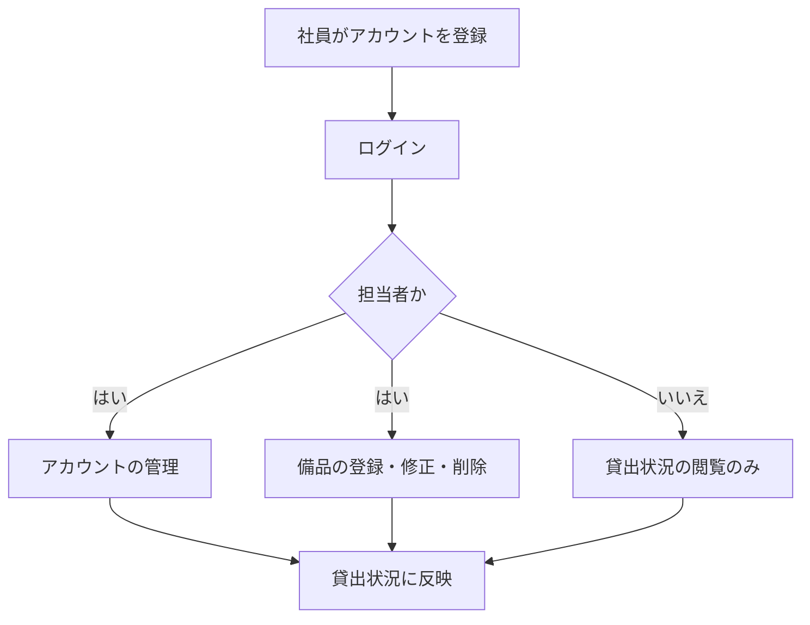
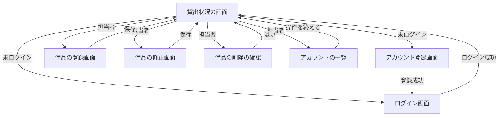

# 要件定義書: 備品台帳と貸出状況の閲覧

## 1. 目的・前提

- システムの目的: 会社の備品の台帳を 1 つのアプリにまとめ、記録の食い違いと消失をなくす。社員が「どの備品があり、空いているか」を担当者に問い合わせずに自分で確かめられるようにする。
- システムの形態: GUI（ブラウザで開く画面）。Web API・バッチは作らない。

用語集:

| 用語 | 業務上の意味 | 本案件での使用範囲 | 同義語/類義語 |
|---|---|---|---|
| 備品 | 会社が所有し、社員が借りて使う物品 | 備品台帳に登録する単位 | 備品台帳の品目 |
| 管理番号 | 備品 1 件を区別する番号（半角の英数字とハイフン、20 文字以内） | 備品の主キー | 備品番号 |
| 担当者 | 備品の登録・修正・削除を行う社員（最初に登録した社員が担当者になる） | 権限のロール | 管理者 |
| 社員 | 備品を借りる社員。担当者以外のアカウント | 権限のロール | 一般利用者 |
| 未ログイン | ログインしていない利用者。貸出状況だけを見られる | 権限のロール | ゲスト |
| 空き | 貸出の記録が無い備品の状態（貸出中でない）。貸出の登録の前の備品はこの状態 | 貸出状況の表示 | 貸出可能 |
| 貸出 | 備品 1 件を、社員 1 人に、ある日から貸している状態を記録すること | 担当者が貸出の登録で記録する | 貸し出し |
| 返却 | 貸出中の備品を担当者が受け取り、空きに戻すこと。返却した記録は残さない | 担当者が返却の処理で行う | 戻し |
| 貸出中 | 貸出の記録がある状態 | 貸出状況の表示 | 借りられている |
| 借りる社員 | 備品を借りる社員（担当者でも社員でもよい。アカウントから選ぶ） | 貸出の登録 | 借用者 |
| 貸出日 | 貸し出した日（日本時間の日付、YYYY-MM-DD）。今日と過去のみ | 貸出の登録 | 貸出開始日 |
| アカウントの管理 | 担当者が、社員のアカウントの権限・パスワード・存在を画面から変えること | 担当者だけが行う（一覧、担当者の付け外し、パスワードの再設定、削除） | アカウント管理 |
| 担当者の付け外し | 社員を担当者にする、または担当者を社員に戻すこと | 一覧の行の操作 | 権限の変更 |
| パスワードの再設定 | 担当者が、社員の新しいパスワードを決めて本人に伝えること。古いパスワードは使えなくなる | 一覧の行の操作（8 文字以上） | パスワードのリセット |
| アカウントの削除 | アカウントを記録ごと消し、そのアカウントではログインできず、借りる社員の候補にも出なくなること。削除の記録は残さない | 一覧の行の操作（貸出中の備品を借りている社員は不可） | 退職処理 |

### 1-1. 技術制約（前提として記録する。要件ではないため ID は付与しない）

| 制約項目 | 内容 | 出どころ（誰がいつ答えたか） |
|---|---|---|
| 既存コードベース | 無し（新規開発） | 依頼者（ANSWERS.md、段 1 の固定回答） |
| 配備先 | 社内の Linux サーバー。コンテナは可だが、採点では `bash run.sh` で直接起動するので、コンテナ無しで動くこと。OS は Linux。社内ネットワークからだけ開く | 依頼者（ANSWERS.md） |
| チームの技術 | 決まりは無い。Python 3.12 と SQLite で足りる | 依頼者（ANSWERS.md） |
| ライセンスとコスト | 無償のものだけを使う。有償ソフトは使わない | 依頼者（REQUEST.md） |
| 性能と規模の目安 | 利用者 50 人まで（社員と担当者の合計）、備品は数百件、アカウントは 50 件まで。操作から表示まで 3 秒以内 | 依頼者（REQUEST.md） |

## 2. 業務

対象業務一覧:

| RQ-BZ-ID | 業務名 | 業務の範囲 | 担当者 |
|---|---|---|---|
| `RQ-BZ-EQUIPMENT-LEDGER` | 備品台帳の管理 | 備品の登録・修正・削除 | 担当者 |
| `RQ-BZ-EQUIPMENT-STATUS-VIEW` | 備品の貸出状況の閲覧 | 備品の一覧と空き状況の表示 | 誰でも（ログインしていない人を含む） |
| `RQ-BZ-USER-ACCOUNT` | 利用者アカウントの管理 | 社員が自分でアカウントを登録し、ログイン・ログアウトする | 社員・担当者 |
| `RQ-BZ-EQUIPMENT-LENDING` | 備品の貸出・返却 | 担当者が備品の貸出の登録と返却を処理する。社員と未ログインの利用者は貸出状況で貸出中と借りている社員を確認する | 担当者（貸出・返却）、誰でも（確認） |
| `RQ-BZ-ACCOUNT-MANAGEMENT` | アカウントの管理 | 担当者が、全アカウントの一覧を見て、担当者の付け外し、パスワードの再設定、アカウントの削除を行う | 担当者だけ |

業務フロー:

### 2-1. 業務の問題（あるべき姿と現状のギャップ）

| 問題 | 対象業務（RQ-BZ） | あるべき姿 | 現状 | ギャップ（KPI） | 業務影響 |
|---|---|---|---|---|---|
| 備品の記録が複数の Excel に分かれ、どれが最新か分からない | `RQ-BZ-EQUIPMENT-LEDGER` | 記録が 1 つだけあり、誰が更新しても食い違わず失われない | 複数の人が別々の Excel を更新し、記録が食い違ったり消えたりしている。食い違いの件数は不明（調査していないため） | 食い違い件数: 不明（理由: 集計していないため） | 正しい記録を探す手間が増える |
| 借りたい社員が、備品の空き状況を担当者に問い合わせないと分からない | `RQ-BZ-EQUIPMENT-STATUS-VIEW` | 社員が自分で備品の一覧と空き状況を確かめられる | 担当者に問い合わせ、担当者が 1 回 15 分かけて調べている。問い合わせの頻度は不明 | 問い合わせ対応: 1 回 15 分（頻度は不明） | 担当者の時間を取られる。借りたい社員の待ち時間が増える |
| 担当者の交代、退職、パスワードの忘失に、DB を直接触って対応している | `RQ-BZ-ACCOUNT-MANAGEMENT` | 担当者が画面から、担当者の付け外し、パスワードの再設定、削除をできる | DB を直接操作している。件数と頻度は不明（集計していないため） | 件数: 不明（理由: 集計していないため） | DB を誤って触ると、担当者が 0 人になったり、貸出中の記録と食い違ったりする |

### 2-2. 業務課題一覧（必須）

| RQ-BK-ID | 業務課題（取り組むこと） | 解決する問題（2-1） | 解決後の状態（KPI の目標値） | 対象業務（RQ-BZ） |
|---|---|---|---|---|
| `RQ-BK-CENTRALIZE-EQUIPMENT-LEDGER` | 備品の記録を 1 つのアプリにまとめ、担当者だけが更新できるようにする | 備品の記録が複数の Excel に分かれている | 記録が 1 つだけになり、食い違いと消失が無い（件数は今回の段では計測しない） | `RQ-BZ-EQUIPMENT-LEDGER` |
| `RQ-BK-PUBLIC-EQUIPMENT-STATUS` | 社員と未ログインの利用者が、備品の一覧と空き状況を自分で確かめられるようにする | 借りたい社員が担当者に問い合わせないと分からない | 担当者への問い合わせが無くなる（1 回 15 分の対応が無くなる） | `RQ-BZ-EQUIPMENT-STATUS-VIEW` |
| `RQ-BK-ACCOUNT-ROLE-ACCESS` | 社員が自分でアカウントを登録し、担当者と社員の権限を分けて、備品の登録・修正・削除を担当者だけに限る | 複数の人が記録を更新して食い違う（記録の更新者を担当者に限るため） | 備品の登録・修正・削除は担当者だけができる（社員と未ログインの利用者は操作できない） | `RQ-BZ-USER-ACCOUNT`、`RQ-BZ-EQUIPMENT-LEDGER` |
| `RQ-BK-LENDING-RECORD` | 備品の貸出と返却を同じアプリに記録し、貸出中の備品と借りている社員を貸出状況に出す | 借りたい社員が、備品の空き状況を担当者に問い合わせないと分からない | 貸出中の状況が担当者への問い合わせ無しで確かめられる（問い合わせ対応 1 回 15 分が無くなる） | `RQ-BZ-EQUIPMENT-LENDING` |
| `RQ-BK-ACCOUNT-MANAGEMENT-BY-STAFF` | 担当者が画面から、アカウントの一覧、担当者の付け外し、パスワードの再設定、削除を行えるようにする | 担当者の交代、退職、パスワードの忘失に、DB を直接触って対応している | DB を直接触らずに、担当者の交代、退職、パスワードの忘失に対応できる（件数は今回の段では計測しない） | `RQ-BZ-ACCOUNT-MANAGEMENT` |

### 2-3. 見込み経営効果

| RQ-EF-ID | 効果の種類 | 内容 | 見込み（金額・時間などと算定根拠） | 対応業務課題ID（RQ-BK-*） |
|---|---|---|---|---|
| `RQ-EF-STAFF-INQUIRY-TIME` | Soft Saving | 担当者の問い合わせ対応（1 回 15 分）が無くなる | 見込み経営効果は算定しない（理由: 問い合わせの頻度が不明で、月の合計を算定できないため。1 回あたりの削減は 15 分と分かっている） | `RQ-BK-PUBLIC-EQUIPMENT-STATUS` |
| `RQ-EF-ACCOUNT-DB-WORK` | Soft Saving | DB を直接触る作業が画面の操作に置き換わる | 見込み経営効果は算定しない（理由: DB を直接触った回数を集計しておらず、削減の時間を算定できないため） | `RQ-BK-ACCOUNT-MANAGEMENT-BY-STAFF` |

## 3. 機能要件

- 入力データ: 人手入力のみ（備品の登録・修正・削除、アカウント登録、ログイン）。外部からの入力は無い。
- 出力データ: 画面の表示のみ（貸出状況の一覧、入力エラーと操作の知らせ）。
- 全機能のユーザー利用フロー:

- 業務フローとの対応: 業務フローの「アカウントを登録」は、アカウント登録の機能で受ける。「ログイン」はログインの機能、「備品の登録・修正・削除」は担当者の登録・修正・削除の機能、「貸出状況の閲覧」は貸出状況の閲覧の機能で受ける（対応する ID は機能一覧の表を参照）。
- システムの形態（GUI）の仕様は、画面一覧（4-5）と各画面の 5 項目（画面の目的、主要要素、入力項目、表示項目、エラー時の見え方）で書く。

画面ごとの 5 項目:

| 画面 | 目的 | 主要要素 | 入力項目 | 表示項目 | エラー時の見え方 |
|---|---|---|---|---|---|
| 貸出状況（`RQ-UI-EQUIPMENT-STATUS-SCREEN`） | 備品の一覧と貸出状況を見る | 備品の表（行ごとに修正・削除ボタン、担当者だけ。空きの行には「貸出」、貸出中の行には「返却」（確認で「はい」のとき送信）、担当者だけ）、ログイン・アカウント登録リンク（未ログインだけ）、「備品を登録」リンク（担当者だけ）、「アカウントの一覧」リンク（担当者だけ）、ログアウトボタン（ログイン中だけ） | 無し | 管理番号、備品名、空き・貸出中、借りている社員の名前、貸出日（管理番号の昇順）。備品が 0 件なら「備品は登録されていません」 | 担当者以外の操作の拒否は `.message` に「この操作は担当者だけが行えます」。貸出・返却の知らせは `.message` |
| アカウント登録（`RQ-UI-ACCOUNT-REGISTER-SCREEN`） | 社員が自分のアカウントを登録する | 社員番号・名前・パスワードの入力欄、登録ボタン | 社員番号、名前、パスワード | 入力欄ごとのエラー | 入力欄ごとのエラーを `.field-error` に出す。値は消さない |
| ログイン（`RQ-UI-LOGIN-SCREEN`） | 社員番号とパスワードでログインする | 社員番号・パスワードの入力欄、ログインボタン | 社員番号、パスワード | 無し | 画面全体のエラーを `.error` に出す |
| 備品の登録（`RQ-UI-EQUIPMENT-FORM-SCREEN`、登録と修正で共用） | 担当者が備品を登録・修正する | 管理番号・備品名の入力欄、保存ボタン | 管理番号、備品名 | 修正時は現在の値を入れておく | 入力欄ごとのエラーを `.field-error` に出す。値は消さない。修正の画面で管理番号は変えられない（表示のみ） |
| 貸出の登録（`RQ-UI-LEND-SCREEN`、`/equipment/<管理番号>/lend/`） | 担当者が空きの備品を社員に貸し出す | 備品の表示（`.lending-equipment`）、借りる社員の選択、貸出日の入力欄（既定は今日）、登録ボタン、貸出状況に戻るリンク | 借りる社員（選択）、貸出日 | 「備品: 管理番号 備品名」 | 入力欄ごとのエラーを `.field-error` に出す。値は消さない。既に貸出中なら貸出状況の画面に `.message` で「この備品は既に貸出中です」 |
| アカウントの一覧（`RQ-UI-ACCOUNT-LIST-SCREEN`、`/accounts/`） | 担当者がアカウントの一覧を見て、担当者の付け外し、パスワードの再設定、削除を行う | 社員番号、名前、担当者か社員の表（行ごとに「担当者にする」か「担当者から外す」、「パスワード再設定」、「削除」）。「パスワード再設定」を押すと、その行に新しいパスワードの入力欄と「確定」ボタンが出る。貸出状況に戻るリンク | 新しいパスワード（再設定の行だけ） | 社員番号、名前、「担当者」または「社員」（社員番号の昇順） | パスワードが短いときは、その行の `.field-error`。担当者以外の要求は貸出状況の画面に戻して `.message`。操作の知らせは `.message`。担当者の付け外し・削除は確認ダイアログ（`window.confirm`）で「はい」のときだけ行う |

### 3-1. 帳票・出力ファイル

帳票・出力ファイルは無い。画面の一覧だけを出す。

### 3-2. 業務ルール

| RQ-ID | ルール名 | 内容（条件と結果） | 違反時・エラー時の業務上の扱い | 対応業務課題ID（RQ-BK-*） |
|---|---|---|---|---|
| `RQ-FT-RULE-FIRST-ACCOUNT-IS-STAFF` | 最初のアカウントは担当者 | アカウントが 1 件も無いときに登録した社員は担当者になり、2 件目以降は社員になる | 無し | `RQ-BK-ACCOUNT-ROLE-ACCESS` |
| `RQ-FT-RULE-UNIQUE-EMPLOYEE-NUMBER` | 社員番号は重複不可 | 既に登録されている社員番号では登録できない | 「この社員番号は既に登録されています」を社員番号の入力欄に出す | `RQ-BK-ACCOUNT-ROLE-ACCESS` |
| `RQ-FT-RULE-UNIQUE-EQUIPMENT-NUMBER` | 管理番号は重複不可 | 既に使われている管理番号では登録できない | 「この管理番号は既に使われています」を管理番号の入力欄に出す | `RQ-BK-CENTRALIZE-EQUIPMENT-LEDGER` |
| `RQ-FT-RULE-NO-LEND-WHILE-LENT` | 貸出中の備品は貸し出せない | 貸出の記録がある備品には、貸出を登録できない。同時に 2 人の担当者が同じ空きの備品を貸し出したときは、先に登録した 1 件だけを記録し、後の方は記録しない | 後の方には `.message` で「この備品は既に貸出中です」 | `RQ-BK-LENDING-RECORD` |
| `RQ-FT-RULE-RETURN-ONCE` | 返却済みの備品は返却できない | 貸出の記録が無い備品の返却は受け付けない。同時に 2 人の担当者が同じ備品の返却を処理したときは、先の処理だけを行う | 後の方には `.message` で「この備品は既に返却されています」 | `RQ-BK-LENDING-RECORD` |
| `RQ-FT-RULE-NO-DELETE-WHILE-LENT` | 貸出中の備品は削除できない | 貸出の記録がある備品は削除しない | 貸出状況の画面の `.message` で「この備品は貸出中のため削除できません。先に返却を処理してください」 | `RQ-BK-CENTRALIZE-EQUIPMENT-LEDGER` |
| `RQ-FT-RULE-LEND-DATE-NOT-FUTURE` | 貸出日に未来の日付は入れられない | 貸出日は今日（日本時間）以前だけ受け付ける。既定は今日。形式は YYYY-MM-DD | 貸出日の `.field-error` に「貸出日に未来の日付は入力できません」（形式が違うときは「貸出日は YYYY-MM-DD の形式で入力してください」） | `RQ-BK-LENDING-RECORD` |
| `RQ-FT-RULE-LEND-BORROWER-REQUIRED` | 借りる社員は必ず選ぶ | 借りる社員は登録済みのアカウントから選ぶ。未選択、または登録されていない社員番号は受け付けない | 借りる社員の `.field-error` に「借りる社員を選んでください」 | `RQ-BK-LENDING-RECORD` |
| `RQ-FT-RULE-REJECT-STALE-EDIT` | 開いたあとに他の担当者が変えた備品の修正は受け付けない | 修正画面を開いてから保存するまでに、他の担当者がその備品を修正または削除していたら、保存を受け付けない | `.error` に「他の担当者が先にこの備品を更新しました。貸出状況の画面から開き直してください」を出し、保存しない | `RQ-BK-CENTRALIZE-EQUIPMENT-LEDGER` |
| `RQ-FT-RULE-EDIT-KEEPS-LENDING` | 備品を修正しても貸出を引き継ぐ | 備品名を修正しても、その備品の貸出の記録（借りる社員と貸出日）はそのまま残る | 無し | `RQ-BK-LENDING-RECORD` |
| `RQ-FT-DENY-NON-STAFF-LENDING` | 担当者以外は貸出・返却を行えない | 担当者以外が貸出の登録または返却の要求を送っても、その操作を受け付けない（備品の登録・修正・削除と同じ扱い） | 社員は貸出状況の `.message` に「この操作は担当者だけが行えます」。未ログインはログイン画面へ | `RQ-BK-ACCOUNT-ROLE-ACCESS` |
| `RQ-FT-RULE-RESET-REPLACES-PASSWORD` | 再設定の後は古いパスワードを使えない | 担当者がパスワードを再設定したら、そのアカウントのパスワードは新しいものだけになる。古いパスワードでのログインは失敗する | 古いパスワードのログインは `.error` に「社員番号またはパスワードが違います」 | `RQ-BK-ACCOUNT-MANAGEMENT-BY-STAFF` |
| `RQ-FT-RULE-RESET-PASSWORD-MIN-LENGTH` | 再設定するパスワードは 8 文字以上 | 再設定の新しいパスワードは 8 文字以上を受け付ける（登録時と同じ） | その行の `.field-error` に「パスワードは 8 文字以上で入力してください」。パスワードは変えない | `RQ-BK-ACCOUNT-MANAGEMENT-BY-STAFF` |
| `RQ-FT-RULE-NO-DELETE-LENT-BORROWER` | 備品を借りている社員のアカウントは削除できない | 貸出の記録（1 台以上）で借りている社員のアカウントは削除しない。返却で貸出の記録が無くなれば削除できる | アカウントの一覧の `.message` に「この社員は備品を借りているため削除できません。先に返却を処理してください」 | `RQ-BK-ACCOUNT-MANAGEMENT-BY-STAFF` |
| `RQ-FT-RULE-KEEP-ONE-STAFF` | 担当者を 0 人にしない | 担当者が 1 人だけのとき、その人を担当者から外す操作と、その人のアカウントを削除する操作を受け付けない。担当者が 2 人以上のときは受け付ける。同時に 2 人の担当者が互いを外そうとしたときは、先の 1 件だけを処理し、後の方は受け付けない | アカウントの一覧の `.message` に「担当者が 1 人もいなくなるため、この操作はできません」 | `RQ-BK-ACCOUNT-MANAGEMENT-BY-STAFF` |
| `RQ-FT-RULE-DELETED-ACCOUNT-UNUSABLE` | 削除したアカウントは使えない | 削除したアカウントではログインできない。そのアカウントで既にログインしている人の次の要求は、未ログインとして扱う。借りる社員の候補（貸出の登録）にも出ない | 次の要求はログイン画面へ | `RQ-BK-ACCOUNT-MANAGEMENT-BY-STAFF` |
| `RQ-FT-RULE-ROLE-FOLLOWS-ACCOUNT` | 権限は次の要求から、アカウントの現在の権限に従う | 担当者から外された人は、ログイン中でも次の要求から社員として扱われ、担当者の操作と一覧は拒否される。社員から担当者にされた人は、次の要求から担当者として扱われる | 拒否は `.message` に「この操作は担当者だけが行えます」（貸出状況の画面へ） | `RQ-BK-ACCOUNT-MANAGEMENT-BY-STAFF` |

### 3-3. 外部連携

外部連携は無い。

### 機能一覧

| RQ-ID | カテゴリ | 機能名 | 対応業務課題ID（RQ-BK-*） | この機能が無いと何が困るか |
|---|---|---|---|---|
| `RQ-FT-REGISTER-ACCOUNT` | 共通（認証・認可・ログ） | 社員が自分でアカウントを登録する | `RQ-BK-ACCOUNT-ROLE-ACCESS` | 社員がログインできず、担当者にアカウントを作ってもらう手間が要る |
| `RQ-FT-LOGIN` | 共通（認証・認可・ログ） | 社員番号とパスワードでログインする | `RQ-BK-ACCOUNT-ROLE-ACCESS` | 担当者と社員の権限を区別できず、備品の登録・修正・削除を誰でも行えてしまう |
| `RQ-FT-LOGOUT` | 共通（認証・認可・ログ） | ログアウトする | `RQ-BK-ACCOUNT-ROLE-ACCESS` | 共用の PC でログインしたままになり、他の人が操作できてしまう |
| `RQ-FT-AUTO-LOGOUT-IDLE` | 共通（認証・認可・ログ） | 操作しないまま 30 分たったら自動でログアウトする | `RQ-BK-ACCOUNT-ROLE-ACCESS` | 離席した PC から他の人が担当者の操作をできてしまう |
| `RQ-FT-DENY-NON-STAFF-OPERATION` | 共通（認証・認可・ログ） | 担当者以外が備品の登録・修正・削除を要求したとき、その操作を受け付けない | `RQ-BK-ACCOUNT-ROLE-ACCESS` | ボタンを隠すだけでは、要求を直接送られたときに記録を書き換えられてしまう |
| `RQ-FT-REGISTER-EQUIPMENT` | 業務機能 | 担当者が備品を登録する | `RQ-BK-CENTRALIZE-EQUIPMENT-LEDGER`、`RQ-BK-ACCOUNT-ROLE-ACCESS` | 備品の記録を 1 つのアプリに入れられない |
| `RQ-FT-UPDATE-EQUIPMENT` | 業務機能 | 担当者が備品の備品名を修正する | `RQ-BK-CENTRALIZE-EQUIPMENT-LEDGER`、`RQ-BK-ACCOUNT-ROLE-ACCESS` | 誤った備品名を直せず、記録の食い違いが残る |
| `RQ-FT-DELETE-EQUIPMENT` | 業務機能 | 担当者が備品を削除する（削除の記録は残さない） | `RQ-BK-CENTRALIZE-EQUIPMENT-LEDGER`、`RQ-BK-ACCOUNT-ROLE-ACCESS` | 廃止した備品が一覧に残り、空き状況が正しく見えない |
| `RQ-FT-VIEW-EQUIPMENT-STATUS` | 業務機能 | 誰でも（ログインしていなくても）備品の一覧と空き状況を見る | `RQ-BK-PUBLIC-EQUIPMENT-STATUS` | 社員が担当者に問い合わせないと空き状況を確かめられない |
| `RQ-FT-LEND-EQUIPMENT` | 業務機能 | 担当者が空きの備品を、借りる社員と貸出日を記録して貸し出す | `RQ-BK-LENDING-RECORD` | 誰がどの備品を借りているか記録できず、貸出状況の表示が空きのままになる |
| `RQ-FT-RETURN-EQUIPMENT` | 業務機能 | 担当者が返却を処理する。確認で「はい」を選んだときだけ、その備品の貸出の記録を消して空きに戻す | `RQ-BK-LENDING-RECORD` | 返却された備品が貸出中のまま残り、次の貸出ができない |
| `RQ-FT-VIEW-LENDING-STATUS` | 業務機能 | 貸出状況の一覧に、貸出中か、借りている社員の名前、貸出日を出す | `RQ-BK-PUBLIC-EQUIPMENT-STATUS`、`RQ-BK-LENDING-RECORD` | 社員が貸出中の備品と借りている社員を、担当者に問い合わせないと分からない |
| `RQ-FT-DENY-NON-STAFF-LENDING` | 共通（認証・認可・ログ） | 担当者以外が貸出の登録・返却を要求したとき、その操作を受け付けない | `RQ-BK-ACCOUNT-ROLE-ACCESS` | 社員が直接の要求で貸出・返却を変えてしまう |
| `RQ-FT-VIEW-ACCOUNT-LIST` | 業務機能 | 担当者がアカウントの一覧（社員番号、名前、担当者か社員）を見る | `RQ-BK-ACCOUNT-MANAGEMENT-BY-STAFF` | 担当者が、誰がどの権限を持つかを画面で確かめられず、DB を直接見るしかない |
| `RQ-FT-CHANGE-ACCOUNT-ROLE` | 業務機能 | 担当者が、アカウントを担当者にする、または担当者から外す（確認で「はい」のときだけ） | `RQ-BK-ACCOUNT-MANAGEMENT-BY-STAFF` | 担当者の交代に DB を直接触るしかない |
| `RQ-FT-RESET-PASSWORD` | 業務機能 | 担当者が、社員の新しいパスワードを設定する。設定したパスワードを担当者が本人に伝える | `RQ-BK-ACCOUNT-MANAGEMENT-BY-STAFF` | パスワードを忘れた社員がログインできず、DB を直接触るしかない |
| `RQ-FT-DELETE-ACCOUNT` | 業務機能 | 担当者が、アカウントを削除する（確認で「はい」のときだけ。削除の記録は残さない） | `RQ-BK-ACCOUNT-MANAGEMENT-BY-STAFF` | 退職した人のアカウントが残り、ログインや借りる社員の候補に出続ける |
| `RQ-FT-DENY-NON-STAFF-ACCOUNT` | 共通（認証・認可・ログ） | 担当者以外がアカウントの一覧を開く、または担当者の操作を要求したとき、その要求を受け付けない | `RQ-BK-ACCOUNT-ROLE-ACCESS` | 社員が要求を直接送って、アカウントの権限やパスワードを変えられてしまう |

機能一覧の 1 行が 1 機能で、業務課題ごとに機能が 1 つ以上ある。

## 4. データ

### 4-1. データ要件一覧

| RQ-ID | 種別 | 内容 | 対応業務課題ID（RQ-BK-*） | この要件が無いと何が困るか |
|---|---|---|---|---|
| `RQ-DT-STORE-IN-SQLITE` | 内部データ | 備品とアカウントのデータはすべて内部データとして、SQLite のファイル DB に保存する。外部 DB は無い。保存先は環境変数 `DATA_DIR` のディレクトリ | `RQ-BK-CENTRALIZE-EQUIPMENT-LEDGER` | 複数の人が同時に更新すると記録が失われる（DB の排他で防ぐため DB を使う） |
| `RQ-DT-NO-DELETION-HISTORY` | データ保持期間 | 削除した備品とアカウントの記録は残さない（物理削除。履歴テーブルを持たない）。データは期限を設けず保持する | `RQ-BK-CENTRALIZE-EQUIPMENT-LEDGER` | 削除の記録が無いことは、業務で要らない（依頼者の決定） |
| `RQ-DT-DB-NECESSITY` | 種別（DB の必要性） | DB が必要。理由: 複数の担当者・社員が同時に更新しても記録が失われないようにするため。初期件数は備品 0 件、アカウント 0 件。1 年後の想定は備品 数百件、アカウント 50 件まで（増加率は小さい）。エンティティの参照関係は無く、検索・集計は無い（一覧の表示のみ） | `RQ-BK-CENTRALIZE-EQUIPMENT-LEDGER` | ファイルに書くと同時更新で記録が消える |
| `RQ-DT-NO-HISTORY-ON-RETURN` | データ保持期間 | 返却した貸出の記録は残さない。貸出の記録は貸出中の間だけ保持し、履歴のテーブルは持たない | `RQ-BK-LENDING-RECORD` | 返却の記録が残らず、誰が過去に借りたかは確かめられない（依頼者の決定: 返却した記録は残さない） |

### 4-2. 業務エンティティとデータ項目

| RQ-ID | カテゴリ | 業務エンティティ名 | 対応業務課題ID（RQ-BK-*） | この業務エンティティが無いと何が困るか |
|---|---|---|---|---|
| `RQ-DT-EQUIPMENT` | 業務 | 備品 | `RQ-BK-CENTRALIZE-EQUIPMENT-LEDGER`、`RQ-BK-PUBLIC-EQUIPMENT-STATUS` | 備品の台帳と貸出状況が表せない |
| `RQ-DT-EMPLOYEE-ACCOUNT` | 業務 | 社員アカウント | `RQ-BK-ACCOUNT-ROLE-ACCESS` | ログインと担当者・社員の区別ができない |
| `RQ-DT-LENDING` | 業務 | 貸出 | `RQ-BK-LENDING-RECORD` | 貸出中の備品と借りている社員を表せない |

| エンティティ名 | 項目名 | 業務上の意味 | 必須 | 形式・桁 | 値の範囲・制約 | 例 |
|---|---|---|---|---|---|---|
| 備品 | 管理番号 | 備品 1 件を区別する番号 | 必須 | 半角の英数字とハイフン、20 文字以内 | 重複不可（既に使われている管理番号は登録できない） | `PC-0001` |
| 備品 | 備品名 | 備品の名前 | 必須 | 文字列、50 文字以内 | 空は不可 | ノートパソコン |
| 社員アカウント | 社員番号 | 社員を区別する番号 | 必須 | 6 桁の数字 | 重複不可 | `123456` |
| 社員アカウント | 名前 | 社員の名前 | 必須 | 文字列、30 文字以内 | 空は不可 | 山田太郎 |
| 社員アカウント | パスワード（保存時はハッシュ） | ログインの合言葉 | 必須 | 8 文字以上 | 平文では保存しない | （入力時のみ） |
| 社員アカウント | 権限 | 担当者か社員か | 必須 | 担当者・社員の 2 値 | 最初の 1 件だけ担当者、以後は社員。登録の後は担当者が付け外しでき、担当者は常に 1 人以上 | 担当者 |
| 貸出 | 管理番号 | 貸し出している備品 | 必須 | 備品の管理番号（既存の形式） | 1 件の備品に貸出は 0 件か 1 件（管理番号で一意）。備品が無ければ貸出も無い | `PC-0001` |
| 貸出 | 社員番号 | 借りている社員 | 必須 | 6 桁の数字 | 登録済みのアカウントの社員番号 | `123456` |
| 貸出 | 貸出日 | 貸し出した日 | 必須 | YYYY-MM-DD | 今日（日本時間）以前 | `2026-11-04` |

貸出の状態（空き・貸出中、借りている社員、貸出日）は、貸出の記録（貸出の行）から決まる。貸出の記録は `RQ-DT-LENDING` の項目で、備品 1 件につき 0 か 1 件。返却した記録は残さない（`RQ-DT-NO-HISTORY-ON-RETURN`）。

### 4-3. CRUD テーブル（必須）

| エンティティ名 | Create | Read（一覧） | Read（詳細） | 検索 | Update | Delete | 備考 |
|---|---|---|---|---|---|---|---|
| 備品 | ○（担当者） | ○（担当者以外・未ログインを含む全員） | △（修正画面を開く担当者だけ） | × | ○（担当者。管理番号は変えられない。貸出は引き継ぐ。開いたあとに他の担当者が修正・削除していたら保存を拒否） | ○（担当者。貸出中は削除できない） | Create・Update は管理番号の重複を同時更新でも防ぐ（DB の一意制約で確かめ、競合は `.field-error` に出す）。Delete は 1 件の削除をトランザクションで行う |
| 社員アカウント | ○（誰でも、登録画面から） | ○（担当者だけ。社員番号、名前、権限。パスワードは見せない） | △（ログイン時の照合、貸出の登録の候補、パスワード再設定の対象。画面に出すのは社員番号・名前・権限だけ） | × | ○（担当者。権限の付け外し、パスワードの再設定。社員番号と名前は変えない） | ○（担当者。貸出中の備品を借りている社員は不可。担当者が 1 人だけのときの担当者は不可） | Create は社員番号の重複を一意制約で防ぐ。権限の付け外しと削除は、担当者の数を同じ即時トランザクションで確かめる。削除の記録は残さない |
| 貸出 | ○（担当者。同時の登録は先の 1 件だけ） | ○（貸出状況の一覧に、貸出中の備品ごとに出す） | △（貸出の登録画面で備品の貸出中かを確かめるためだけ） | × | ×（貸出の内容は変えない。貸し直すときは返却してから登録） | ○（担当者の返却処理。記録は残さない） | 貸出の登録は主キーの一意制約と即時トランザクションで、返却は即時トランザクションで直列化する |

### 4-4. 状態遷移

備品の状態（空き・貸出中）を持つ。状態は貸出の記録の有無で決まる。

| 現在の状態 | 操作 | 条件 | 次の状態 | 備考 |
|---|---|---|---|---|
| 空き | 貸出の登録（担当者） | 貸出日が今日以前、借りる社員が選ばれている | 貸出中 | - |
| 貸出中 | 返却（担当者、確認で「はい」） | 貸出の記録がある | 空き | 返却の記録は残さない |
| 貸出中 | 貸出の登録 | - | 貸出中のまま | 「この備品は既に貸出中です」 |
| 空き | 返却 | - | 空きのまま | 「この備品は既に返却されています」 |
| 貸出中 | 削除 | - | 貸出中のまま（削除できない） | 「この備品は貸出中のため削除できません」 |
| 貸出中 | 修正（備品名） | - | 貸出中のまま（貸出を引き継ぐ） | - |
| 社員 | 担当者にする（担当者） | - | 担当者 | 社員アカウントの権限 |
| 担当者 | 担当者から外す（担当者） | 担当者が 2 人以上 | 社員 | 1 人だけのときは「担当者が 1 人もいなくなるため、この操作はできません」 |
| 社員 | 削除（担当者） | 貸出の記録で借りていない | 無し（記録は残さない） | - |
| 担当者 | 削除（担当者） | 貸出の記録で借りていない、担当者が 2 人以上 | 無し（記録は残さない） | 1 人だけのときは受け付けない |
| 社員・担当者 | パスワードの再設定（担当者） | 新しいパスワードが 8 文字以上 | 同じ（パスワードだけが変わる） | 古いパスワードは使えなくなる |

### 4-5. 画面一覧（GUI の場合のみ）

| RQ-ID | 画面名 | 対応する CRUD 操作（エンティティ名:操作種別） | 主な機能・目的 | 対応業務課題ID（RQ-BK-*） |
|---|---|---|---|---|
| `RQ-UI-EQUIPMENT-STATUS-SCREEN` | 貸出状況（トップ `/`） | 備品:Read（一覧） | 備品の一覧と空き状況を見る。担当者には修正・削除の行ボタン、「備品を登録」リンク（担当者だけ）、「アカウントの一覧」リンク（担当者だけ）、ログイン中はログアウトボタンと名前を出す | `RQ-BK-PUBLIC-EQUIPMENT-STATUS`、`RQ-BK-ACCOUNT-ROLE-ACCESS` |
| `RQ-UI-ACCOUNT-REGISTER-SCREEN` | アカウント登録（`/accounts/register/`） | 社員アカウント:Create | 社員が自分のアカウントを登録する | `RQ-BK-ACCOUNT-ROLE-ACCESS` |
| `RQ-UI-LOGIN-SCREEN` | ログイン（`/login/`） | 社員アカウント:Read（詳細）（ログイン照合） | 社員番号とパスワードでログインする | `RQ-BK-ACCOUNT-ROLE-ACCESS` |
| `RQ-UI-EQUIPMENT-FORM-SCREEN` | 備品の登録（`/equipment/new/`）と修正（`/equipment/<管理番号>/edit/`） | 備品:Create、備品:Update、備品:Read（詳細） | 担当者が備品を登録・修正する | `RQ-BK-CENTRALIZE-EQUIPMENT-LEDGER` |
| `RQ-UI-LEND-SCREEN` | 貸出の登録（`/equipment/<管理番号>/lend/`） | 貸出:Create、社員アカウント:Read（貸出の登録の選択） | 担当者が空きの備品を、借りる社員と貸出日で貸し出す | `RQ-BK-LENDING-RECORD` |
| `RQ-UI-ACCOUNT-LIST-SCREEN` | アカウントの一覧（`/accounts/`） | 社員アカウント:Read（一覧）、社員アカウント:Update（権限、パスワード）、社員アカウント:Delete | 担当者がアカウントの一覧を見て、担当者の付け外し、パスワードの再設定、削除を行う | `RQ-BK-ACCOUNT-MANAGEMENT-BY-STAFF` |

### 4-5 の補足: 画面の操作

- 修正・削除の行ボタンは、貸出状況の表の各行に置く。貸出の行ボタンは空きの行に「貸出」（貸出の登録画面へ）、貸出中の行に「返却」（`window.confirm` の確認で「はい」のときだけ送信）を置く。修正の画面は開いた時点の版番号を持ち、保存時に他の担当者の変更を確かめる。

## 5. 非機能要件

| RQ-ID | カテゴリ | 非機能要件名 | 対応業務課題ID（RQ-BK-*） | この非機能要件が無いと何が困るか |
|---|---|---|---|---|
| `RQ-NF-INTRANET-ONLY` | 利用者・アクセス経路 | 利用者は社員と担当者（合計 50 人まで）と未ログインの利用者で、社内ネットワークからだけアクセスできる | `RQ-BK-PUBLIC-EQUIPMENT-STATUS` | 社外から備品の記録が見られてしまう |
| `RQ-NF-RESPONSE-3S` | 性能 | 操作してから画面が表示されるまで 3 秒以内（利用者 50 人、備品数百件） | `RQ-BK-PUBLIC-EQUIPMENT-STATUS` | 担当者の待ち時間が増える |
| `RQ-NF-PASSWORD-AUTH` | セキュリティ | 認証は社員番号とパスワードで行う（SSO は無い）。ロールは担当者・社員・未ログインの 3 つで、ボタンの出し分けと要求の拒否の両方で制御する | `RQ-BK-ACCOUNT-ROLE-ACCESS` | 担当者以外が記録を更新できてしまう |

- 可用性: 要求は無い。平日の日中に使い、夜間・休日は止まってよい。
- 移行性: 既存の Excel からの取り込みは無い（取り込み機能は作らない）。担当者が画面から手で入力する。
- 利用人数の前提: 利用者は社員と担当者の合計で 50 人まで。利用者の種別は社員・担当者・未ログインの 3 種で、取引先や一般公開は無い。

## 6. 運用要件

- ログ: 一般的な動作ログ・エラーログ以外には要らない。ログの内容と保存期間の記述は行わない。
- 監査ログ: 無い（監査証跡は不要）。
- 監視・アラート: 監視・アラートは必要ないため、監視・アラートの内容と対応方法の記述は行わない。
- バックアップと復旧: バックアップは必要ない。
- 導入手順: 社員に URL を知らせる前に、担当者が最初のアカウントを登録する。

| RQ-ID | 種別 | 内容 | 対応業務課題ID（RQ-BK-*） | この要件が無いと何が困るか |
|---|---|---|---|---|
| `RQ-OP-FIRST-ACCOUNT-SETUP` | 導入手順 | 社員に URL を知らせる前に、担当者が最初のアカウントを登録する。最初に登録した社員が担当者になる | `RQ-BK-ACCOUNT-ROLE-ACCESS` | 最初のアカウントが社員になり、担当者が 1 人もいなくなって備品を登録できなくなる |

## 7. テスト用利用シナリオ

全機能の利用フローを網羅する。各シナリオの「検証する要件ID」に、そのシナリオが確かめる `RQ-FT`・`RQ-UI`・`RQ-EX`（必要なら `RQ-NF`）を書く。

| RQ-ID | テスト目的 | 前提条件 | テスト手順 | 期待される結果 | 検証する要件ID | 対応業務課題ID（RQ-BK-*） |
|---|---|---|---|---|---|---|
| `RQ-TS-REGISTER-FIRST-ACCOUNT-AS-STAFF` | 最初のアカウントが担当者になり、2 件目以降は社員になることを確かめる | アカウントが 0 件 | 貸出状況から「アカウント登録」を開き、社員番号・名前・パスワードを入力して「登録」。ログイン画面で「ログイン」。次の社員で登録してログイン | 1 件目は担当者（備品の登録リンクが出る）。2 件目は社員（備品の登録リンクが出ない）。`.message` に「登録しました。ログインしてください」 | `RQ-FT-REGISTER-ACCOUNT`、`RQ-FT-RULE-FIRST-ACCOUNT-IS-STAFF`、`RQ-UI-ACCOUNT-REGISTER-SCREEN`、`RQ-UI-LOGIN-SCREEN` | `RQ-BK-ACCOUNT-ROLE-ACCESS` |
| `RQ-TS-REJECT-INVALID-ACCOUNT-INPUT` | アカウント登録の入力チェックと社員番号の重複を確かめる | 社員番号 123456 が登録済み | 社員番号を 12345、名前を空、パスワードを 7 文字で登録。次に社員番号 123456 で正しい値を登録 | 各入力欄の `.field-error` に「社員番号は 6 桁の数字で入力してください」「名前を入力してください」「パスワードは 8 文字以上で入力してください」が出て、入力値は残る。重複は「この社員番号は既に登録されています」 | `RQ-FT-REGISTER-ACCOUNT`、`RQ-FT-RULE-UNIQUE-EMPLOYEE-NUMBER`、`RQ-UI-ACCOUNT-REGISTER-SCREEN` | `RQ-BK-ACCOUNT-ROLE-ACCESS` |
| `RQ-TS-LOGIN-AND-LOGOUT` | ログインとログアウト、ログイン失敗の文言を確かめる | 社員番号 123456 のアカウント（パスワード 12345678） | ログイン画面で誤ったパスワードを入力。次に正しい値でログインし、`.current-user` に名前が出ることを確かめ、「ログアウト」 | 誤りは `.error` に「社員番号またはパスワードが違います」（どちらが違うかは示さない）。正しい値でログインでき、ログアウトでログイン前の表示に戻る | `RQ-FT-LOGIN`、`RQ-FT-LOGOUT`、`RQ-UI-LOGIN-SCREEN` | `RQ-BK-ACCOUNT-ROLE-ACCESS` |
| `RQ-TS-AUTO-LOGOUT-AFTER-IDLE` | 30 分の無操作で自動ログアウトすることを確かめる | ログイン済み（`SESSION_IDLE_TIMEOUT_SECONDS` を 2 秒にして起動） | ログイン後に 3 秒待ち、貸出状況の画面を開く | ログアウトされ、ログイン画面（または未ログインの表示）に戻る | `RQ-FT-AUTO-LOGOUT-IDLE` | `RQ-BK-ACCOUNT-ROLE-ACCESS` |
| `RQ-TS-REGISTER-EQUIPMENT-AS-STAFF` | 担当者が備品を登録し、貸出状況に出ることを確かめる | 担当者でログイン済み | 「備品を登録」を開き、管理番号 `PC-0001` と備品名「ノートパソコン」を入力して「保存」 | 貸出状況の表に `data-equipment-number="PC-0001"` の行が出て、「空き」と表示される | `RQ-FT-REGISTER-EQUIPMENT`、`RQ-UI-EQUIPMENT-FORM-SCREEN`、`RQ-UI-EQUIPMENT-STATUS-SCREEN` | `RQ-BK-CENTRALIZE-EQUIPMENT-LEDGER` |
| `RQ-TS-REJECT-INVALID-EQUIPMENT-INPUT` | 備品の入力チェックと管理番号の重複を確かめる | 管理番号 `PC-0001` が登録済み | 管理番号に「PC 0001」（空白）、備品名を 51 文字で保存。次に管理番号 `PC-0001` で保存 | `.field-error` に「管理番号は半角の英数字とハイフンで 20 文字以内で入力してください」「備品名は 50 文字以内で入力してください」。重複は「この管理番号は既に使われています」。入力値は残る | `RQ-FT-REGISTER-EQUIPMENT`、`RQ-FT-RULE-UNIQUE-EQUIPMENT-NUMBER`、`RQ-UI-EQUIPMENT-FORM-SCREEN` | `RQ-BK-CENTRALIZE-EQUIPMENT-LEDGER` |
| `RQ-TS-UPDATE-EQUIPMENT-AS-STAFF` | 担当者が備品名を修正できることを確かめる | 管理番号 `PC-0001` が登録済み、担当者でログイン済み | 貸出状況の `PC-0001` 行の「修正」を押し、備品名を「ノートパソコン（新）」に変えて「保存」 | 一覧の `PC-0001` 行の備品名が変わる。管理番号は変えられない | `RQ-FT-UPDATE-EQUIPMENT`、`RQ-UI-EQUIPMENT-FORM-SCREEN`、`RQ-UI-EQUIPMENT-STATUS-SCREEN` | `RQ-BK-CENTRALIZE-EQUIPMENT-LEDGER` |
| `RQ-TS-DELETE-EQUIPMENT-AS-STAFF` | 担当者が削除の確認で「はい」を選んだときだけ削除されることを確かめる | 管理番号 `PC-0001` が登録済み、担当者でログイン済み | 「削除」を押して確認ダイアログで「いいえ」。次に「削除」を押して「はい」 | 「いいえ」では残る。「はい」で一覧から `PC-0001` の行が消え、削除の記録は残らない | `RQ-FT-DELETE-EQUIPMENT`、`RQ-UI-EQUIPMENT-STATUS-SCREEN` | `RQ-BK-CENTRALIZE-EQUIPMENT-LEDGER` |
| `RQ-TS-VIEW-STATUS-WITHOUT-LOGIN` | ログインしていない利用者が一覧を見られ、操作ボタンが出ないことを確かめる | 備品 2 件（`PC-0002`、`PC-0001`）が登録済み。未ログイン | 貸出状況の画面を開く | 管理番号の昇順に `PC-0001`、`PC-0002` の 2 行。「空き」と表示され、借りている社員の名前と貸出日は空欄。修正・削除のボタンと「備品を登録」は出ず、「ログイン」「アカウント登録」のリンクが出る | `RQ-FT-VIEW-EQUIPMENT-STATUS`、`RQ-UI-EQUIPMENT-STATUS-SCREEN` | `RQ-BK-PUBLIC-EQUIPMENT-STATUS` |
| `RQ-TS-VIEW-EMPTY-STATUS` | 備品が 0 件のとき案内が出ることを確かめる | 備品が 0 件 | 貸出状況の画面を開く | 「備品は登録されていません」が表示される | `RQ-UI-EQUIPMENT-STATUS-SCREEN`、`RQ-FT-VIEW-EQUIPMENT-STATUS` | `RQ-BK-PUBLIC-EQUIPMENT-STATUS` |
| `RQ-TS-DENY-NON-STAFF-OPERATION` | 社員と未ログインの利用者が、備品の登録・修正・削除を要求しても受け付けられないことを確かめる | 社員でログイン済み。未ログインの状態も確かめる | 社員で `/equipment/new/` を開く。直接の要求（削除・保存の送信）を送る。未ログインでも同じ要求を送る | 社員は `.message` に「この操作は担当者だけが行えます」が出て、備品は変わらない。未ログインはログイン画面へ移る。どちらも記録は変わらない | `RQ-FT-DENY-NON-STAFF-OPERATION`、`RQ-UI-EQUIPMENT-FORM-SCREEN`、`RQ-UI-EQUIPMENT-STATUS-SCREEN` | `RQ-BK-ACCOUNT-ROLE-ACCESS` |
| `RQ-TS-OPERATE-WITHIN-LIMITS` | 利用者 50 人と備品数百件で 3 秒以内に表示されることを確かめる | 備品 300 件、アカウント 50 件 | 貸出状況の画面を開き、表示までの時間を計る | 3 秒以内に表示される | `RQ-NF-RESPONSE-3S`、`RQ-FT-VIEW-EQUIPMENT-STATUS` | `RQ-BK-PUBLIC-EQUIPMENT-STATUS` |
| `RQ-TS-LEND-EQUIPMENT-AS-STAFF` | 担当者が空きの備品を社員に貸し出し、貸出状況に出ることを確かめる | 担当者でログイン済み、社員のアカウント 1 件、備品 `PC-0001` が空き | 貸出状況の `PC-0001` 行の「貸出」を開き、借りる社員を選んで、貸出日は既定の今日のまま「登録」 | 貸出状況の `PC-0001` 行が「貸出中」、借りている社員の名前、今日の貸出日を表示 | `RQ-FT-LEND-EQUIPMENT`、`RQ-FT-VIEW-LENDING-STATUS`、`RQ-UI-LEND-SCREEN`、`RQ-DT-LENDING` | `RQ-BK-LENDING-RECORD` |
| `RQ-TS-REJECT-INVALID-LEND` | 借りる社員の未選択、未来の貸出日、貸出中の備品への貸出を確かめる | 担当者でログイン済み、備品 `PC-0001` が貸出中 | 借りる社員を選ばずに登録。次に借りる社員を選び、貸出日を明日にして登録。次に `PC-0001` の貸出の登録を開き直して登録 | 借りる社員は `.field-error` に「借りる社員を選んでください」、貸出日は「貸出日に未来の日付は入力できません」。貸出中の備品は `.message` に「この備品は既に貸出中です」 | `RQ-FT-RULE-LEND-BORROWER-REQUIRED`、`RQ-FT-RULE-LEND-DATE-NOT-FUTURE`、`RQ-FT-RULE-NO-LEND-WHILE-LENT`、`RQ-UI-LEND-SCREEN` | `RQ-BK-LENDING-RECORD` |
| `RQ-TS-RETURN-EQUIPMENT-AS-STAFF` | 返却の確認で「いいえ」では残り、「はい」で空きに戻ること、二度目の返却を確かめる | 担当者でログイン済み、備品 `PC-0001` が貸出中 | 「返却」を押して確認で「いいえ」。次に「返却」を押して「はい」。さらに、もう一度 `PC-0001` の返却を送る | 「いいえ」で貸出中のまま。「はい」で「空き」に戻り貸出の記録は残らない。二度目は `.message` に「この備品は既に返却されています」 | `RQ-FT-RETURN-EQUIPMENT`、`RQ-FT-RULE-RETURN-ONCE`、`RQ-DT-NO-HISTORY-ON-RETURN`、`RQ-UI-EQUIPMENT-STATUS-SCREEN` | `RQ-BK-LENDING-RECORD` |
| `RQ-TS-DENY-DELETE-WHILE-LENT` | 貸出中の備品は削除できないことを確かめる | 担当者でログイン済み、備品 `PC-0001` が貸出中 | 「削除」を押して確認で「はい」 | `.message` に「この備品は貸出中のため削除できません。先に返却を処理してください」。`PC-0001` の行は残る | `RQ-FT-RULE-NO-DELETE-WHILE-LENT` | `RQ-BK-CENTRALIZE-EQUIPMENT-LEDGER` |
| `RQ-TS-EDIT-KEEPS-LENDING` | 貸出中の備品の備品名を修正しても貸出が残ることを確かめる | 担当者でログイン済み、備品 `PC-0001` が貸出中 | 「修正」で備品名を変えて「保存」 | 備品名が変わり、`PC-0001` は貸出中のまま借りている社員と貸出日が残る | `RQ-FT-RULE-EDIT-KEEPS-LENDING`、`RQ-UI-EQUIPMENT-FORM-SCREEN` | `RQ-BK-LENDING-RECORD` |
| `RQ-TS-REJECT-STALE-EDIT` | 修正画面を開いたあと他の担当者が変えた備品の保存を拒否することを確かめる | 担当者 A と B がログイン済み、備品 `PC-0001` が登録済み | A が `PC-0001` の「修正」を開く。B が `PC-0001` の備品名を修正して保存。A が備品名を変えて「保存」 | A の保存は受け付けず `.error` に「他の担当者が先にこの備品を更新しました。貸出状況の画面から開き直してください」。備品名は B の変更のまま | `RQ-FT-RULE-REJECT-STALE-EDIT`、`RQ-UI-EQUIPMENT-FORM-SCREEN` | `RQ-BK-CENTRALIZE-EQUIPMENT-LEDGER` |
| `RQ-TS-CONCURRENT-LEND-ONE-WINS` | 同時に 2 人が同じ空きの備品を貸し出したとき、先の 1 件だけが記録されることを確かめる | 担当者 2 人（別の接続）、備品 `PC-0001` が空き | 2 つの接続から同時に `PC-0001` の貸出を登録する | 1 件だけ記録され（借りる社員が 1 人）、後の方は `.message` に「この備品は既に貸出中です」 | `RQ-FT-RULE-NO-LEND-WHILE-LENT` | `RQ-BK-LENDING-RECORD` |
| `RQ-TS-CONCURRENT-RETURN-ONE-WINS` | 同時に 2 人が同じ貸出中の備品を返却したとき、先の処理だけが行われることを確かめる | 担当者 2 人（別の接続）、備品 `PC-0001` が貸出中 | 2 つの接続から同時に `PC-0001` の返却を処理する | 先の 1 件だけ返却され、後の方は `.message` に「この備品は既に返却されています」 | `RQ-FT-RULE-RETURN-ONCE` | `RQ-BK-LENDING-RECORD` |
| `RQ-TS-DENY-NON-STAFF-LENDING` | 社員と未ログインの利用者が、貸出・返却の要求を送っても受け付けられないことを確かめる | 社員でログイン済み。未ログインの状態も確かめる | 社員で貸出の登録の画面を開き、返却と貸出の要求を直接送る。未ログインでも同じ要求を送る | 社員は `.message` に「この操作は担当者だけが行えます」。未ログインはログイン画面へ。どちらも貸出の記録は変わらない | `RQ-FT-DENY-NON-STAFF-LENDING`、`RQ-UI-LEND-SCREEN` | `RQ-BK-ACCOUNT-ROLE-ACCESS` |
| `RQ-TS-VIEW-ACCOUNT-LIST-AS-STAFF` | 担当者がアカウントの一覧を見られ、社員は見られないことを確かめる | 担当者 1 人（社員番号 123456）と社員 1 人（社員番号 234567）が登録済み。担当者でログイン済み | 貸出状況の「アカウントの一覧」を開く | 社員番号の昇順に 2 行。各行の 3 列目に「担当者」「社員」が出る。パスワードは出ない | `RQ-FT-VIEW-ACCOUNT-LIST`、`RQ-UI-ACCOUNT-LIST-SCREEN` | `RQ-BK-ACCOUNT-MANAGEMENT-BY-STAFF` |
| `RQ-TS-CHANGE-ROLE-AS-STAFF` | 担当者の付け外しと、外された人の次の要求の扱いを確かめる | 担当者 A（123456）と社員 B（234567）が登録済み。A でログイン済み。B でも別のブラウザでログイン済み | A の一覧で B の行の「担当者にする」を押し、確認で「はい」。B の行が「担当者」になる。次に B の行の「担当者から外す」を押し、確認で「はい」。B のブラウザで `/accounts/` を開く | 担当者にできる。外すと B の行は「社員」に戻る。B の次の要求は `.message`「この操作は担当者だけが行えます」で貸出状況へ戻る。確認で「いいえ」のときは何も変わらない | `RQ-FT-CHANGE-ACCOUNT-ROLE`、`RQ-FT-RULE-ROLE-FOLLOWS-ACCOUNT`、`RQ-UI-ACCOUNT-LIST-SCREEN` | `RQ-BK-ACCOUNT-MANAGEMENT-BY-STAFF` |
| `RQ-TS-KEEP-ONE-STAFF` | 担当者が 1 人だけのとき、外す操作と削除を受け付けないことを確かめる | 担当者 A（123456）だけが登録済み。A でログイン済み | A の行の「担当者から外す」を押し、確認で「はい」。次に A の行の「削除」を押し、確認で「はい」 | 両方とも受け付けず、`.message` に「担当者が 1 人もいなくなるため、この操作はできません」。A は担当者のまま | `RQ-FT-RULE-KEEP-ONE-STAFF`、`RQ-UI-ACCOUNT-LIST-SCREEN` | `RQ-BK-ACCOUNT-MANAGEMENT-BY-STAFF` |
| `RQ-TS-CONCURRENT-DEMOTE-KEEPS-ONE-STAFF` | 担当者 2 人が同時に互いを外そうとしても、1 人は担当者のままであることを確かめる | 担当者 A（123456）と B（234567）が登録済み。両方ログイン済み（別の接続） | A と B が、それぞれ相手の「担当者から外す」を同時に送る | 先の 1 件だけが社員に戻り、後の方は `.message` に「担当者が 1 人もいなくなるため、この操作はできません」。担当者は 1 人残る | `RQ-FT-RULE-KEEP-ONE-STAFF` | `RQ-BK-ACCOUNT-MANAGEMENT-BY-STAFF` |
| `RQ-TS-RESET-PASSWORD-AS-STAFF` | パスワードの再設定、短いパスワードの拒否、古いパスワードの無効化を確かめる | 担当者 A（123456）と社員 B（234567、パスワード 12345678）が登録済み。A でログイン済み | A の一覧で B の行の「パスワード再設定」を押す。`input[name=new_password]` に 7 文字を入れて「確定」。次に 8 文字以上（87654321）を入れて「確定」。ログアウトし、B の社員番号と古いパスワード（12345678）でログイン、次に新しいパスワード（87654321）でログイン | 7 文字は B の行の `.field-error` に「パスワードは 8 文字以上で入力してください」。8 文字以上は受け付けて `.message` に知らせる。古いパスワードは `.error` に「社員番号またはパスワードが違います」。新しいパスワードでログインできる | `RQ-FT-RESET-PASSWORD`、`RQ-FT-RULE-RESET-REPLACES-PASSWORD`、`RQ-FT-RULE-RESET-PASSWORD-MIN-LENGTH`、`RQ-UI-ACCOUNT-LIST-SCREEN` | `RQ-BK-ACCOUNT-MANAGEMENT-BY-STAFF` |
| `RQ-TS-DELETE-ACCOUNT-AS-STAFF` | 担当者がアカウントを削除でき、削除後はログインできず借りる社員の候補にも出ないことを確かめる | 担当者 A（123456）と社員 B（234567）が登録済み。A でログイン済み。B で別のブラウザからログイン済み。備品 `PC-0001` が空き | A の一覧で B の行の「削除」を押し、確認で「いいえ」。次に「削除」を押し、確認で「はい」。B のブラウザで `/accounts/` を開き、B の社員番号と正しいパスワードでログインを試す。A で `PC-0001` の「貸出」を開く | 「いいえ」では残る。「はい」で B の行が消える。B の次の要求は未ログインとして扱われ、ログインは `.error` の「社員番号またはパスワードが違います」。貸出の登録の借りる社員の候補に B が出ない | `RQ-FT-DELETE-ACCOUNT`、`RQ-FT-RULE-DELETED-ACCOUNT-UNUSABLE`、`RQ-UI-ACCOUNT-LIST-SCREEN` | `RQ-BK-ACCOUNT-MANAGEMENT-BY-STAFF` |
| `RQ-TS-DENY-DELETE-LENT-BORROWER` | 備品を借りている社員のアカウントは削除できず、返却の後に削除できることを確かめる | 担当者 A（123456）と社員 B（234567）が登録済み。B が備品 `PC-0001` を借りている（貸出中） | A の一覧で B の行の「削除」を押し、確認で「はい」。次に A で `PC-0001` の「返却」を処理し、B の「削除」を押し、確認で「はい」 | 1 回目は B の行が残り、`.message` に「この社員は備品を借りているため削除できません。先に返却を処理してください」。返却の後の 2 回目は B の行が消える | `RQ-FT-RULE-NO-DELETE-LENT-BORROWER`、`RQ-UI-ACCOUNT-LIST-SCREEN` | `RQ-BK-ACCOUNT-MANAGEMENT-BY-STAFF` |
| `RQ-TS-DENY-NON-STAFF-ACCOUNT` | 社員と未ログインの利用者が、アカウントの一覧と操作を受け付けられないことを確かめる | 社員 B（234567）が登録済み。B でログイン済み。未ログインの状態も確かめる | B で `/accounts/` を開く。B で一覧の操作（担当者にする、削除）を直接送る。未ログインでも `/accounts/` を開く | B は `.message` に「この操作は担当者だけが行えます」で貸出状況へ戻り、アカウントは変わらない。未ログインはログイン画面へ戻る | `RQ-FT-DENY-NON-STAFF-ACCOUNT`、`RQ-UI-ACCOUNT-LIST-SCREEN` | `RQ-BK-ACCOUNT-ROLE-ACCESS` |
