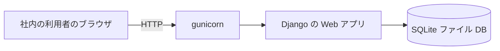
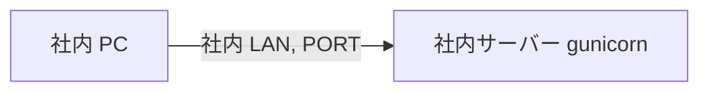
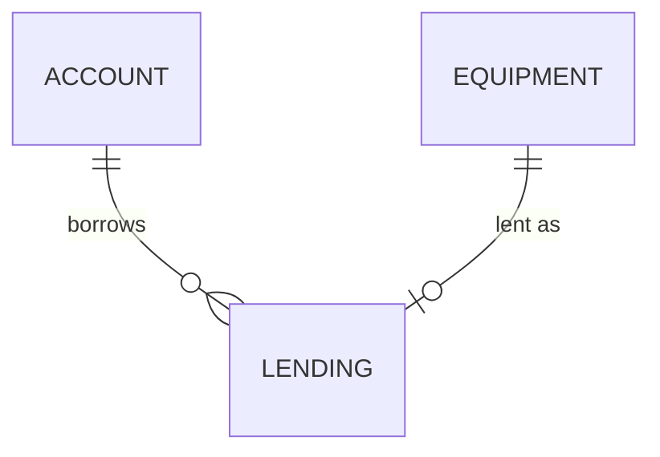
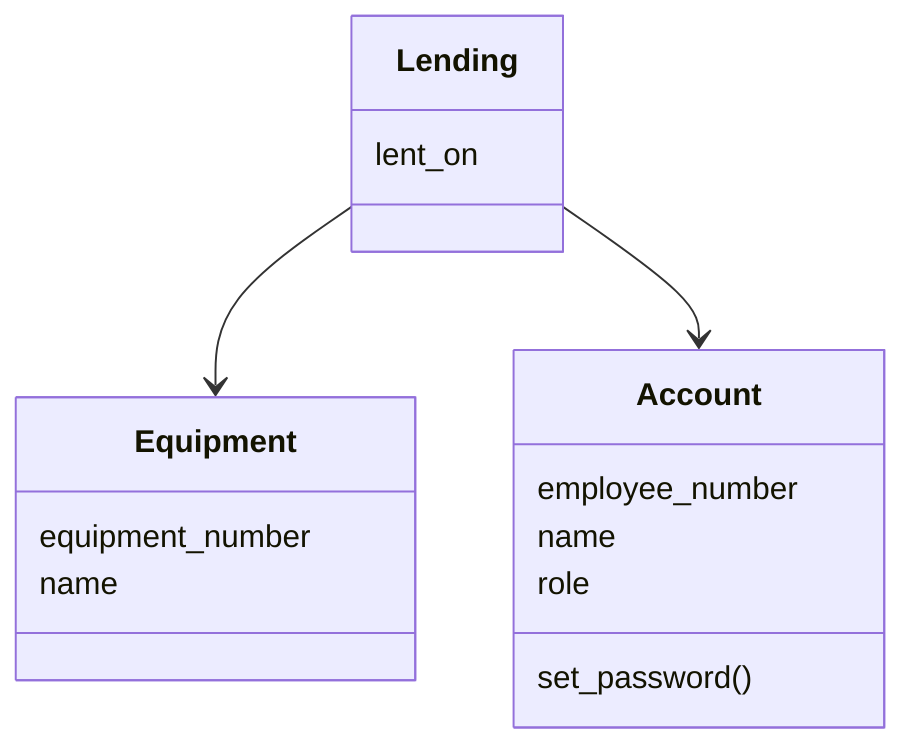

# 詳細設計書: 備品の貸出管理

要件定義書（`docs/requirements.md`）の要件をすべて満たす最小の設計。要件に無い設計要素は足さない。

## 1. 言語・フレームワーク・アーキテクチャの選定

### 1-1. 判定の概要

- 判定日時: 2026-11-22
- 技術制約の要約（要件定義書 1-1）: 社内サーバーで動かす。無償のものだけを使う。Python 3.12 と無償のライブラリ、ファイル型 DB で足りること（contract.md）。画面はブラウザで開く GUI だけ。利用人数 50 人まで、備品数百件まで。既存コードは無い。
- 出典の確認方法: 公式の配布ページ（https://www.djangoproject.com/download/）を 2026-11-22 に取得して LTS の表を確認した。候補のバージョンは PyPI の一覧（`pip index versions`、2026-11-22 時点）で確認した。

### 1-2. 判断軸と候補の比較

| 判断軸 | この案件で効く条件 | Django 5.2 LTS（選定） | Flask 3 系 | FastAPI 系 |
|---|---|---|---|---|
| 既存資産との整合 | 既存コードは無い | 影響なし | 影響なし | 影響なし |
| チームの技術 | 指定無し | 影響なし | 影響なし | 影響なし |
| 配備先 | 社内サーバー、Python 3.12 で動く | 動く（公式の対応 Python 3.10 以降） | 動く | 動く |
| 認証と認可の境界 | ログイン、担当者と社員の 2 段階、画面単位の制御 | 認証・セッション・権限の仕組みが標準で揃う | 認証は自前で組む | 認証は自前で組む |
| 画面の規模 | 画面 6 種、フォームは 4 種。画面は HTML の描画で足りる | フォームの入力欄の id が `id_<項目名>` の規則で出る（contract.md の id と一致） | テンプレートとフォームを別途組む | 画面の描画は別途組む |
| データの規模と構造 | 件数は小さい。1 つのファイル型 DB で足りる | ORM とマイグレーションが標準 | ORM を別途選ぶ | ORM を別途選ぶ |
| 外部連携 | 無し | 影響なし | 影響なし | 影響なし |
| ライセンスとコスト | 無償 | BSD 系（無償） | BSD 系（無償） | MIT（無償） |
| 保守性 | 長期サポートの版がある | 5.2 LTS は 2028 年 4 月ごろまでサポート（公式配布ページに表示。取得 2026-11-22） | 保守は継続 | 保守は継続 |

- 候補の数: 比較は Django 5.2 LTS、Flask、FastAPI の 3 件。6.1 系は非 LTS のため除外。
- 選定結果: 言語 Python 3.12、フレームワーク Django 5.2 LTS（最新の 5.2.x。PyPI で 5.2.19 を確認）、DB SQLite（Python 標準の sqlite3 を通す）、実行形態はサーバー（コンテナは使わない）。WSGI サーバーは gunicorn（MIT）。
- 選定理由: 要件の認証・権限・フォームの入力欄の id の規則（contract.md の `id_*`）が Django の標準機能と一致し、自前で組む部分が最も少ない。LTS の版を使うため保守の見通しが立つ。
- ユーザー承認の記録: 未確認（依頼者の回答が無いため最小案で決めた。要件定義書 1-2 の表と合わせて承認を求める）。

### 1-3. 検証用の技術

- 単体・結合テスト: pytest と pytest-django（いずれも MIT / BSD 系で無償）。
- E2E テスト: Playwright for Python（Apache-2.0。PyPI で 1.65.2 を確認）。ブラウザは Playwright が取得する Chromium を使う。
- 承認の記録: 未確認（1-2 と同様）。

### 1-4. 採用ライブラリ

| パッケージ | 版 | 用途 | ライセンス |
|---|---|---|---|
| Django | 5.2.19 | Web フレームワーク | BSD-3-Clause |
| gunicorn | 27.0.1 | WSGI サーバー | MIT |
| pytest | 9.2.0 | テスト実行 | MIT |
| pytest-django | 最新の安定版（setup.sh で導入） | Django との連携 | MIT |
| playwright | 1.65.2 | E2E のブラウザ操作 | Apache-2.0 |

## 2. システム構成

### 2-1. コンポーネント一覧

| コンポーネント | 役割 | 配置 |
|---|---|---|
| Web アプリ（Django） | 画面の描画、認証、権限、業務処理 | `src/` |
| WSGI サーバー（gunicorn） | Web アプリを待ち受けて実行する | `run.sh` が起動する |
| DB（SQLite ファイル） | 社員、備品、貸出の記録を保存する | `$DATA_DIR/lending.sqlite3` |
| E2E テスト（pytest + Playwright） | 画面を実際に操作して要件を確かめる | `e2e/` |
| 単体・結合テスト（pytest） | Web アプリの部品と画面の処理を確かめる | `tests/` |

### 2-2. システム全体構成図



### 2-3. 各コンポーネントの役割と機能

- Web アプリ: 6 つの画面の描画、フォームの検証、ログインとログアウト、担当者の権限の確認、備品と貸出の業務処理を行う。
- gunicorn: 単一のマスタープロセスと、2 つのワーカープロセスで待ち受ける（設定は `run.sh` に固定）。
- SQLite: 同時書き込みは SQLite の排他で直列化される。利用人数 50 人の範囲で足りる。

### 2-4. コンポーネント間インターフェースとデータフロー

- ブラウザと Web アプリは HTTP（フォーム送信と GET）で通信する。API は作らない。
- Web アプリと DB は Django ORM 経由で通信する。
- 貸出の登録と返却は、1 つのデータベーストランザクションの中で、備品の行をロックしてから状態を確かめて書き込む。

### 2-5. ネットワーク構成図

ネットワーク越しの通信は、ブラウザから gunicorn への HTTP だけ。社内ネットワークの制限はネットワーク機器側で行う（要件定義書 1-2）。



## 3. データ設計

### 3-1. データモデル

DB は必要（要件定義書 4-1）。DB 製品は SQLite（1 章の選定）。

| 設計要素 | テーブル | カラム | 型 | 制約 |
|---|---|---|---|---|
| `DS-SC-ACCOUNT-TABLE` | accounts_account | id, password（ハッシュ）, last_login, employee_number, name, role | 整数（主キー）、文字列（ハッシュ用に 128）、日時、文字列 6 桁、文字列 30、文字列 1 桁（M または E） | employee_number は一意。name は必須。role は M（担当者）か E（社員） |
| `DS-SC-EQUIPMENT-TABLE` | equipment_equipment | id, equipment_number, name | 整数（主キー）、文字列 20、文字列 50 | equipment_number は一意で大文字と小文字を区別。name は必須 |
| `DS-SC-LENDING-TABLE` | equipment_lending | id, equipment_id, borrower_id, lent_on | 整数（主キー）、整数（外部キー）、整数（外部キー）、日付 | equipment_id は一意（1 つの備品に貸出は最大 1 件）。equipment の削除は制限（PROTECT）。borrower の削除は制限（PROTECT） |

- 「一意」の制約は DB 側でも張る（アプリの検査と二重に守る）。
- `DS-SC-ACCOUNT-TABLE` の `password` と `last_login` は Django の認証の標準項目。
- 管理番号の大文字と小文字は区別する。DB の既定の照合順で比較する（SQLite の既定は大文字と小文字を区別する）。

リレーション図:



DB の初期化: 起動時のマイグレーションで空のテーブルを作る（件数 0 件で始まる）。

### 3-2. トランザクションと排他制御

- アカウント登録（`DS-FN-REGISTER-ACCOUNT`）: 同じトランザクションの中で、アカウント件数を数えてから作成する。SQLite の書き込みトランザクションは同時に 1 つだけ進むため、同時に登録されても担当者は 1 人だけになる。トランザクションは即時開始（IMMEDIATE）にする。
- 貸出の登録（`DS-FN-LEND-EQUIPMENT`）: トランザクションの中で、備品の行を選択的にロック（`select_for_update`。SQLite では書き込みの直列化で代替）して貸出の有無を確かめ、無ければ貸出の記録を作る。失敗時は全体をロールバックする。
- 返却（`DS-FN-RETURN-EQUIPMENT`）: 同じ方式で貸出の記録を確かめてから消す。
- 削除（`DS-FN-DELETE-EQUIPMENT`）: 同じ方式で貸出の記録が無いことを確かめてから備品を消す。
- 排他制御の方式: 悲観的（書き込みのトランザクションを直列化）。理由: 同時の操作は少なく、貸出の二重登録を確実に防ぐため。

### 3-3. 状態遷移

備品の状態は貸出の記録の有無で決まる（状態の列は持たない）。

| 遷移 | 状態の持ち方 | 遷移を行う処理 | 許されない遷移のときの扱い |
|---|---|---|---|
| 空き → 貸出中 | 貸出の記録が 1 件作られる | `DS-FN-LEND-EQUIPMENT` | 既に貸出中なら「この備品は貸出中です」（業務エラー） |
| 貸出中 → 空き | 貸出の記録が消される | `DS-FN-RETURN-EQUIPMENT` | 空きなら「この備品は貸出中ではありません」（業務エラー） |

状態を持つエンティティは備品だけ（状態の列は持たず、貸出の記録から導く）。

## 4. アーキテクチャ設計

### 4-1. 外部設計

画面（`DS-IF-*`）。すべてサーバーが HTML を返す。ブラウザ側の JavaScript は使わない（確認ダイアログは `window.confirm` を HTML のフォームで呼ぶ）。

| DS-IF | 画面 | URL | メソッド | 入力 | 出力 | 利用者 |
|---|---|---|---|---|---|---|
| `DS-IF-STATUS-SCREEN` | 貸出状況（トップ） | `/` | GET | なし | 備品一覧の表。担当者には行ごとのボタン | 全員 |
| `DS-IF-REGISTER-SCREEN` | アカウント登録 | `/accounts/register/` | GET / POST | 社員番号、名前、パスワード | 成功時はログイン画面へ転送。失敗時は同じ画面にエラー | 訪問者 |
| `DS-IF-LOGIN-SCREEN` | ログイン | `/login/` | GET / POST | 社員番号、パスワード | 成功時はトップへ転送。失敗時は同じ画面に `.error` | 訪問者 |
| `DS-IF-LOGOUT-ACTION` | ログアウト | `/logout/` | POST | なし | トップへ転送 | ログイン中 |
| `DS-IF-EQUIPMENT-NEW-SCREEN` | 備品の登録 | `/equipment/new/` | GET / POST | 管理番号、備品名 | 成功時はトップへ転送 | 担当者 |
| `DS-IF-EQUIPMENT-EDIT-SCREEN` | 備品の修正 | `/equipment/<管理番号>/edit/` | GET / POST | 管理番号、備品名 | 成功時はトップへ転送 | 担当者 |
| `DS-IF-EQUIPMENT-DELETE-ACTION` | 備品の削除 | `/equipment/<管理番号>/delete/` | POST | なし | 成功時はトップへ転送。貸出中は同じ動作で `.error` | 担当者 |
| `DS-IF-LENDING-NEW-SCREEN` | 貸出の登録 | `/lendings/new/?equipment=<管理番号>` | GET / POST | 借りる社員、貸出日（既定は今日） | 成功時はトップへ転送 | 担当者 |
| `DS-IF-LENDING-RETURN-ACTION` | 返却 | `/lendings/<管理番号>/return/` | POST | なし | トップへ転送 | 担当者 |

- 入力の検証（4-1 の共通）: 社員番号は数字 6 桁、名前は必須で 30 文字以内（前後の空白は除く）、パスワードは 8 文字以上 128 文字以内、管理番号は半角英数字とハイフン 1〜20 文字で大文字と小文字を区別、備品名は必須で 50 文字以内、貸出日は今日以前の日付、借りる社員は登録済みのアカウントだけ。
- エラー仕様: 入力欄ごとのエラーは入力欄を含む `.field` の中の `.field-error` に出す。画面全体のエラーは `.error`、操作の結果の知らせは `.message`。入力値は消さない。業務ルール違反（貸出中の貸出、貸出中の削除、空きの返却）は `.error` を出し、データを変えない。権限が無い操作は HTTP 403 の画面で `.error` に「この操作は担当者だけができます」を出す。
- 帳票・出力ファイル: 無い。
- 外部システム連携: 無い。
- 画面の共通要素: ヘッダーに、ログイン中は `.current-user`（名前）と「ログアウト」ボタン（POST のフォーム）、未ログインは「ログイン」と「アカウント登録」のリンク。担当者には「備品を登録」のリンク（`/equipment/new/`）。
- 一覧の文言: 備品が 0 件のとき「備品は登録されていません」。
- 画面の描画に使うファイル（テンプレート、CSS）は `DS-IF-*` の説明に含め、対応表には載せない。

### 4-2. 内部設計

処理フロー（貸出の登録）:
1. 担当者か確かめる。違えば 403。
2. 借りる社員、貸出日を検証する。貸出日が今日より後なら入力欄エラーで止める。
3. トランザクションを開始し、備品の行をロックする。
4. 既に貸出の記録があれば業務エラー「この備品は貸出中です」を出して戻す。
5. 貸出の記録を作って確定する。
6. 貸出状況の画面へ転送し、`.message` に「貸出を登録しました」を出す。

処理フロー（返却）: 担当者か確かめ、トランザクションで備品をロックし、貸出の記録が無ければ業務エラー、あれば記録を消して確定する。

処理フロー（最初の登録者）: 入力を検証し、トランザクションを開始する。アカウント件数が 0 件なら役割を担当者、1 件以上なら社員にする。作成して確定し、ログイン画面へ転送する。

- バッチ: 無い。

## 5. クラス設計

| クラス | 責務（1 文） | 所在 |
|---|---|---|
| `Account`（`DS-CL-ACCOUNT-USER`） | 社員 1 人を表し、社員番号でログインさせる | `src/accounts/models.py` |
| `RegisterForm`（`DS-CL-REGISTER-FORM`） | 登録画面の入力を検証する | `src/accounts/forms.py` |
| `LoginForm`（`DS-CL-LOGIN-FORM`） | ログイン画面の入力を検証する | `src/accounts/forms.py` |
| `Equipment`（`DS-CL-EQUIPMENT`） | 備品 1 件を表す | `src/equipment/models.py` |
| `Lending`（`DS-CL-LENDING`） | 貸出の記録 1 件を表す | `src/equipment/models.py` |
| `EquipmentForm`（`DS-CL-EQUIPMENT-FORM`） | 備品の登録と修正の入力を検証する | `src/equipment/forms.py` |
| `LendingForm`（`DS-CL-LENDING-FORM`） | 貸出の登録の入力を検証する（借りる社員、今日以前の貸出日） | `src/equipment/forms.py` |
| `BusinessRuleError`（`DS-CL-BUSINESS-RULE-ERROR`） | 業務ルール違反を表す例外 | `src/equipment/services.py` |

- クラス間の依存は、views → services → models、views → forms → models の一方向。
- システム内メッセージは無い（同期の関数呼び出しだけ）。



## 6. エラーハンドリングとセキュリティ設計

### 6-1. エラーハンドリング

| 想定エラー | 利用者への見え方 | ログ | 処理 |
|---|---|---|---|
| 入力の形式違い | 入力欄の `.field-error` | 出さない | 値を残して再表示 |
| ログイン失敗 | `.error`「社員番号またはパスワードが違います」 | 出さない | 再表示。社員番号の有無を区別しない |
| 業務ルール違反 | `.error` と文言 | 出さない | 中止し、データを変えない |
| 権限が無い操作 | 403 画面の `.error` | 出す（Django の標準） | 中止 |
| 存在しない備品の管理番号 | 404 の標準画面 | 出す（Django の標準） | 中止 |
| 同時操作による競合 | 業務ルール違反と同じ（再読み込みで状態が見える） | 出さない | 後から来た操作は拒否 |

### 6-2. 認証

- 方式: 社員番号とパスワードによるログイン（セッション Cookie）。SSO は無い。
- パスワードは Django の既定のハッシュ方式で保存する（`DS-CL-ACCOUNT-USER` の `set_password`）。強度検査は行わない（要件定義書 1-2）。
- セッションは Django の既定（2 週間）。ログアウトでセッションを破棄する。

### 6-3. 認可

| 操作 | 担当者 | 社員 | 訪問者 |
|---|---|---|---|
| 貸出状況の閲覧 | 可 | 可 | 可 |
| アカウント登録・ログイン・ログアウト | 可 | 可 | 可 |
| 備品の登録・修正・削除 | 可 | 不可 | 不可 |
| 貸出の登録・返却 | 可 | 不可 | 不可 |

- 制御の単位: ページ単位（`DS-FN-MANAGER-REQUIRED` の装飾子で、担当者以外は 403）。ボタンは担当者にだけ描画する。
- 監査ログ: 無い（要件定義書 6）。

### 6-4. その他のセキュリティ対策

- CSRF: Django の既定（すべての POST にトークン）。
- 社内限定: アプリでは判定しない（ネットワーク側）。`ALLOWED_HOSTS` は環境変数で指定し、既定は `localhost,127.0.0.1`。
- 秘密鍵: 環境変数 `DJANGO_SECRET_KEY` があればそれを使う。無ければ初回起動時に `$DATA_DIR/secret_key` を作って保存し、以後はそれを使う（`DS-OP-SETTINGS-ENV`）。

## 7. コード設計

### 7-1. ディレクトリ構成

```
（プロジェクトルート）
├── run.sh            起動（対応表の対象外）
├── setup.sh          初回の準備（対応表の対象外）
├── requirements.txt  依存の一覧（対応表の対象外）
├── pytest.ini        テスト設定（対応表の対象外）
├── src/              Web アプリ（--src の対象）
│   ├── manage.py
│   ├── config/       設定と URL の割り当て
│   ├── accounts/     アカウントと認証
│   ├── equipment/    備品と貸出
│   ├── templates/    HTML テンプレート（対応表の対象外。DS-IF の説明に含む。CSS は各テンプレートの style に含める）
├── tests/            単体・結合テスト（pytest。対応表の対象外）
└── e2e/              E2E テスト（対応表の DS-TS の行でだけ載せる）
```

### 7-2. ファイル一覧

| ファイル | 役割 | 実現する設計 ID | 対応表の粒度 |
|---|---|---|---|
| `src/manage.py` | Django の管理コマンドの入口 | `DS-MD-MANAGE-ENTRY` | 対象 |
| `src/config/settings.py` | 設定（DB、環境変数、認証、言語・時刻） | `DS-MD-CONFIG-SETTINGS` | 対象 |
| `src/config/urls.py` | URL と画面の対応、403 の画面 | `DS-MD-CONFIG-URLS` | 対象 |
| `src/config/wsgi.py` | gunicorn の入口 | `DS-MD-CONFIG-WSGI` | 対象 |
| `src/accounts/models.py` | アカウントのモデルと作成 | `DS-MD-ACCOUNTS-MODELS`、`DS-CL-ACCOUNT-USER`、`DS-SC-ACCOUNT-TABLE`、`DS-SC-ROLE-VALUES` | 対象 |
| `src/accounts/forms.py` | 登録とログインの入力検証 | `DS-MD-ACCOUNTS-FORMS`、`DS-CL-REGISTER-FORM`、`DS-CL-LOGIN-FORM` | 対象 |
| `src/accounts/services.py` | 最初の登録者の判定と登録 | `DS-MD-ACCOUNTS-SERVICES`、`DS-FN-REGISTER-ACCOUNT` | 対象 |
| `src/accounts/views.py` | 登録・ログイン・ログアウトの画面処理 | `DS-MD-ACCOUNTS-VIEWS`、`DS-FN-REGISTER-VIEW`、`DS-FN-LOGIN-VIEW`、`DS-FN-LOGOUT-VIEW`、`DS-IF-REGISTER-SCREEN`、`DS-IF-LOGIN-SCREEN`、`DS-IF-LOGOUT-ACTION` | 対象 |
| `src/accounts/permissions.py` | 担当者だけに許す装飾子 | `DS-MD-ACCOUNTS-PERMISSIONS`、`DS-FN-MANAGER-REQUIRED` | 対象 |
| `src/accounts/migrations/0001_initial.py` | アカウント表の作成（自動生成） | `DS-MD-ACCOUNTS-MIGRATION-0001` | 対象 |
| `src/equipment/models.py` | 備品と貸出のモデル | `DS-MD-EQUIPMENT-MODELS`、`DS-CL-EQUIPMENT`、`DS-CL-LENDING`、`DS-SC-EQUIPMENT-TABLE`、`DS-SC-LENDING-TABLE` | 対象 |
| `src/equipment/forms.py` | 備品と貸出の入力検証 | `DS-MD-EQUIPMENT-FORMS`、`DS-CL-EQUIPMENT-FORM`、`DS-CL-LENDING-FORM` | 対象 |
| `src/equipment/services.py` | 備品の削除、貸出、返却の業務処理 | `DS-MD-EQUIPMENT-SERVICES`、`DS-FN-DELETE-EQUIPMENT`、`DS-FN-LEND-EQUIPMENT`、`DS-FN-RETURN-EQUIPMENT`、`DS-CL-BUSINESS-RULE-ERROR` | 対象 |
| `src/equipment/views.py` | 貸出状況・備品・貸出の画面処理 | `DS-MD-EQUIPMENT-VIEWS`、`DS-FN-STATUS-VIEW`、`DS-FN-EQUIPMENT-NEW-VIEW`、`DS-FN-EQUIPMENT-EDIT-VIEW`、`DS-FN-EQUIPMENT-DELETE-VIEW`、`DS-FN-LENDING-NEW-VIEW`、`DS-FN-LENDING-RETURN-VIEW`、`DS-IF-STATUS-SCREEN`、`DS-IF-EQUIPMENT-NEW-SCREEN`、`DS-IF-EQUIPMENT-EDIT-SCREEN`、`DS-IF-EQUIPMENT-DELETE-ACTION`、`DS-IF-LENDING-NEW-SCREEN`、`DS-IF-LENDING-RETURN-ACTION` | 対象 |
| `src/equipment/migrations/0001_initial.py` | 備品と貸出の表の作成（自動生成） | `DS-MD-EQUIPMENT-MIGRATION-0001` | 対象 |

- 粒度: `function`（公開関数まで対応表に載せる）。
- 依存の規則: 下の表（`scripts/isdd/dependencies.json` に書き写す）。

| 依存元（ディレクトリ） | 依存してよい先（プロジェクト内） | 依存してはいけない先（プロジェクト内のパスか外部モジュール名） | 理由 |
|---|---|---|---|
| `src/equipment` | `src/accounts` | `src/config` | 業務層は設定に依存しない（設定はフレームワークの入口だけ） |
| `src/accounts` | なし | `src/equipment` | 認証は備品の業務を知らない |

- 依存の規則は上の表だけ。外部連携は無いため、外部 API のライブラリを縛る規則は無い。
- コーディング規約: PEP 8 に従う。関数とクラスには処理の説明の docstring を付ける（要件 ID と設計 ID は書かない）。

## 8. テスト設計

### 8-1. テストの種類と方針

- 単体テスト: 各モジュールの関数（フォームの検証、業務処理の判定、装飾子）を `tests/` で pytest により確かめる。
- 結合テスト: Django のテストクライアントで各画面（GET と POST）を実行し、DB の状態まで確かめる。全機能要件（`RQ-FT-*`）を対象にする。
- 単体・結合テストの実行コマンド: `python3 -m pytest tests -q`
- 非機能要件の検証: `RQ-NF-PASSWORD-HASH` は `DS-CL-ACCOUNT-USER` が実現する（単体テストで、保存された値が平文と一致しないことを確かめる）。`RQ-NF-INTERNAL-ACCESS` は `DS-OP-SETTINGS-ENV` が実現する（単体テストで、`ALLOWED_HOSTS` の既定値を確かめる）。これらは受け入れ判定の対象外のため、対応表には載せない。

### 8-2. E2E テストのシナリオ

要件定義書 第 7 章の 10 本を 100% 網羅する。すべて Playwright で実際のブラウザを動かし、`run.sh` で起動した Web アプリに対して行う。

| DS-ID | 目的 | 前提条件 | 手順 | 期待結果 |
|---|---|---|---|---|
| `DS-TS-REGISTER-FIRST-ACCOUNT-E2E` | 最初の登録者が担当者になる | DB が空 | 登録画面で 000001 などを入力して登録し、ログインする | 登録成功、ログイン後に名前が出る |
| `DS-TS-REGISTER-SECOND-ACCOUNT-E2E` | 2 件目は社員、誤った入力は拒否 | 担当者 1 件 | 5 桁、31 文字、7 文字パスワード、重複の社員番号で登録を試す。正しい値で登録する | 誤りは入力欄のエラーで値が残る。正しい登録は社員として成功 |
| `DS-TS-LOGIN-LOGOUT-E2E` | ログインの成否、ログアウト | アカウント 1 件 | 誤ったパスワードでログイン、正しい値でログイン、ログアウト | 失敗は `.error`、成功は `.current-user`、ログアウトで消える |
| `DS-TS-REGISTER-EQUIPMENT-E2E` | 担当者の備品登録と誤りの拒否 | 担当者でログイン | 正しい値で登録、全角や 21 文字、重複を試す | 登録は一覧に出る。誤りは拒否され値が残る |
| `DS-TS-UPDATE-EQUIPMENT-E2E` | 備品の修正と重複の拒否 | 担当者、備品 1 件 | 管理番号と備品名を変える。別の既存番号に変える | 変更が反映。重複は拒否 |
| `DS-TS-DELETE-EQUIPMENT-E2E` | 空きは削除、貸出中は拒否 | 担当者、空き 1 件と貸出中 1 件 | 貸出中の削除を確認で「はい」。空きの削除を確認で「はい」 | 貸出中は `.error`で残る。空きは一覧から消える |
| `DS-TS-LEND-EQUIPMENT-E2E` | 貸出の登録と拒否 | 担当者、空き 1 件、アカウント 2 件 | 貸出を登録。明日の日付で登録を試す。貸出中の備品に貸出を試す | 成功は一覧に反映。明日と貸出中は拒否 |
| `DS-TS-RETURN-EQUIPMENT-E2E` | 返却で空きに戻る | 担当者、貸出中 1 件 | 返却を確認で「はい」。空きの行に返却ボタンが無いことを確かめる | 貸出が消え「空き」に戻る |
| `DS-TS-VIEW-STATUS-PUBLIC-E2E` | 誰でも見られる、0 件の案内 | 0 件、その後 2 件（1 件貸出中） | 0 件でトップ。備品を登録し貸出してから未ログインでトップ | 0 件の文言。未ログインは操作ボタン無し。昇順の表示 |
| `DS-TS-EMPLOYEE-CANNOT-OPERATE-E2E` | 社員は操作できない | 社員でログイン、備品 1 件 | トップの行ボタンを確かめ、備品登録の URL に直接入る | ボタン無し。403 と `.error`。データは変わらない |

- モード: 外部連携は無いためモードは設けない。
- 実行手段: Playwright（Chromium、ヘッドレス）。

### 8-3. E2E の実行手段

- Web の GUI: Playwright for Python（1.65.2）。選定理由は 1-3 の通り（ブラウザ自動化として無償で、Python の pytest から使える）。承認は未確認。

### 8-4. E2E の実行コマンドと運用

- 実行コマンド: `python3 -m pytest e2e --junitxml=e2e/results/e2e.xml`（事前に `bash setup.sh` で Playwright の Chromium を取得しておく）。
- E2E は各テストの前に一時の `DATA_DIR` を作り、`run.sh` を `PORT`（空きポート）で起動して、テストの終了時に起動したプロセスだけを停止する。
- 結果は JUnit XML を `e2e/results/e2e.xml` に出す。`e2e/results/` は git 管理外（isdd-setup が `.gitignore` に足す）。
- テストが失敗したら修正と再実行を繰り返し、全件成功まで続ける。

## 9. 運用設計

### DS-OP-SETTINGS-ENV: 設定値・環境変数

| 名前 | 用途 | 既定値 | 必須か |
|---|---|---|---|
| `PORT` | 待ち受けポート | 8000 | 任意 |
| `DATA_DIR` | DB と秘密鍵の置き場所 | `./data`（プロジェクトルート直下） | 任意 |
| `DJANGO_SECRET_KEY` | Django の秘密鍵 | 無ければ `$DATA_DIR/secret_key` を生成して使う | 任意 |
| `ALLOWED_HOSTS` | 受け付けるホスト名（カンマ区切り） | `localhost,127.0.0.1` | 任意 |

- 秘密情報の値は設計書に書かない。外部連携は無いため接続情報は無い。

### DS-OP-START-SCRIPT: 起動（`run.sh`）

- 手順: `DATA_DIR` を作る（無ければ）→ 秘密鍵を用意する → `python3 src/manage.py migrate` でテーブルを作る（既に作られていれば何もしない）→ `.venv` の gunicorn を `src/` を作業場所にして `config.wsgi:application` を `0.0.0.0:$PORT` で起動する（ワーカー 2）。
- 起動に失敗したら、終了コードを 0 以外で終わる。

### DS-OP-SETUP-SCRIPT: 初回の準備（`setup.sh`）

- `.venv` を作り、`requirements.txt` の依存を導入し、Playwright の Chromium を取得する。何度実行しても同じ状態になる。

### 9-1. 起動方法と操作説明

- 起動と操作は README.md に書く（初回は `bash setup.sh`、起動は `bash run.sh`、既定のポートは 8000）。認証の初期ユーザーは無い（最初に登録した人が担当者になる）。

### 9-2. データ移行、可用性、バックアップ

- データ移行: 無い（要件定義書 5）。
- 可用性: 要求が無いため、特別な構成は作らない。
- バックアップ: 無い（要件定義書 6）。

## 10. ログ・監視・アラート・障害対応設計

- ログ: 標準の出力（gunicorn と Django の標準のエラーログ）だけ。ログの設計は必須ではないため、ログの種類と内容の記述は行わない。
- 監視・アラート: 設計は必須ではないため、監視・アラートの内容と対応方法の記述は行わない。
- 障害対応: 想定する障害は、DB ファイルの書き込みができない、ポートが使用中で起動しない、の 2 つ。検知は `run.sh` の終了コードと標準エラー出力。対応は、権限または使用中のポートを直して `bash run.sh` を再実行する。復旧の確認は画面 `/` が開くこと。

## 11. 要件と設計の対応表

| DS-ID | 対応要件ID |
|---|---|
| `DS-MD-MANAGE-ENTRY` | `RQ-OP-START-ON-SERVER` |
| `DS-MD-CONFIG-SETTINGS` | `RQ-DT-LOCAL-DB`, `RQ-NF-INTERNAL-ACCESS` |
| `DS-MD-CONFIG-URLS` | `RQ-UI-STATUS-SCREEN`, `RQ-UI-REGISTER-ACCOUNT-SCREEN`, `RQ-UI-LOGIN-SCREEN`, `RQ-UI-EQUIPMENT-NEW-SCREEN`, `RQ-UI-EQUIPMENT-EDIT-SCREEN`, `RQ-UI-LENDING-NEW-SCREEN`, `RQ-FT-MANAGER-ONLY-OPERATIONS` |
| `DS-MD-CONFIG-WSGI` | `RQ-OP-START-ON-SERVER` |
| `DS-MD-ACCOUNTS-MODELS` | `RQ-DT-ACCOUNT`, `RQ-NF-PASSWORD-HASH`, `RQ-FT-FIRST-ACCOUNT-IS-MANAGER` |
| `DS-MD-ACCOUNTS-FORMS` | `RQ-FT-REGISTER-ACCOUNT`, `RQ-FT-LOGIN` |
| `DS-MD-ACCOUNTS-SERVICES` | `RQ-FT-REGISTER-ACCOUNT`, `RQ-FT-FIRST-ACCOUNT-IS-MANAGER` |
| `DS-MD-ACCOUNTS-VIEWS` | `RQ-FT-REGISTER-ACCOUNT`, `RQ-FT-LOGIN`, `RQ-FT-LOGOUT`, `RQ-UI-REGISTER-ACCOUNT-SCREEN`, `RQ-UI-LOGIN-SCREEN` |
| `DS-MD-ACCOUNTS-PERMISSIONS` | `RQ-FT-MANAGER-ONLY-OPERATIONS` |
| `DS-MD-ACCOUNTS-MIGRATION-0001` | `RQ-DT-ACCOUNT` |
| `DS-MD-EQUIPMENT-MODELS` | `RQ-DT-EQUIPMENT`, `RQ-DT-LENDING`, `RQ-FT-LEND-ONLY-AVAILABLE` |
| `DS-MD-EQUIPMENT-FORMS` | `RQ-FT-REGISTER-EQUIPMENT`, `RQ-FT-UPDATE-EQUIPMENT`, `RQ-FT-LEND-EQUIPMENT`, `RQ-FT-LENT-ON-NOT-FUTURE` |
| `DS-MD-EQUIPMENT-SERVICES` | `RQ-FT-DELETE-EQUIPMENT`, `RQ-FT-DELETE-ONLY-AVAILABLE`, `RQ-FT-LEND-EQUIPMENT`, `RQ-FT-LEND-ONLY-AVAILABLE`, `RQ-FT-RETURN-EQUIPMENT`, `RQ-FT-RETURN-ONLY-LENT`, `RQ-DT-LEND-TRANSITION`, `RQ-DT-RETURN-TRANSITION` |
| `DS-MD-EQUIPMENT-VIEWS` | `RQ-FT-VIEW-LENDING-STATUS`, `RQ-FT-REGISTER-EQUIPMENT`, `RQ-FT-UPDATE-EQUIPMENT`, `RQ-FT-DELETE-EQUIPMENT`, `RQ-FT-LEND-EQUIPMENT`, `RQ-FT-RETURN-EQUIPMENT`, `RQ-UI-STATUS-SCREEN`, `RQ-UI-EQUIPMENT-NEW-SCREEN`, `RQ-UI-EQUIPMENT-EDIT-SCREEN`, `RQ-UI-LENDING-NEW-SCREEN` |
| `DS-MD-EQUIPMENT-MIGRATION-0001` | `RQ-DT-EQUIPMENT`, `RQ-DT-LENDING` |
| `DS-SC-DATABASE` | `RQ-DT-LOCAL-DB` |
| `DS-OP-SETTINGS-ENV` | `RQ-NF-INTERNAL-ACCESS`, `RQ-OP-START-ON-SERVER` |
| `DS-OP-START-SCRIPT` | `RQ-OP-START-ON-SERVER` |
| `DS-OP-SETUP-SCRIPT` | `RQ-OP-START-ON-SERVER` |
| `DS-CL-ACCOUNT-USER` | `RQ-NF-PASSWORD-HASH`, `RQ-DT-ACCOUNT` |
| `DS-SC-ACCOUNT-TABLE` | `RQ-DT-ACCOUNT` |
| `DS-SC-ROLE-VALUES` | `RQ-DT-ACCOUNT`, `RQ-FT-MANAGER-ONLY-OPERATIONS` |
| `DS-CL-REGISTER-FORM` | `RQ-FT-REGISTER-ACCOUNT` |
| `DS-CL-LOGIN-FORM` | `RQ-FT-LOGIN` |
| `DS-FN-REGISTER-ACCOUNT` | `RQ-FT-REGISTER-ACCOUNT`, `RQ-FT-FIRST-ACCOUNT-IS-MANAGER` |
| `DS-FN-REGISTER-VIEW` | `RQ-FT-REGISTER-ACCOUNT`, `RQ-UI-REGISTER-ACCOUNT-SCREEN` |
| `DS-FN-LOGIN-VIEW` | `RQ-FT-LOGIN`, `RQ-UI-LOGIN-SCREEN` |
| `DS-FN-LOGOUT-VIEW` | `RQ-FT-LOGOUT` |
| `DS-FN-MANAGER-REQUIRED` | `RQ-FT-MANAGER-ONLY-OPERATIONS` |
| `DS-IF-REGISTER-SCREEN` | `RQ-UI-REGISTER-ACCOUNT-SCREEN` |
| `DS-IF-LOGIN-SCREEN` | `RQ-UI-LOGIN-SCREEN` |
| `DS-IF-LOGOUT-ACTION` | `RQ-FT-LOGOUT` |
| `DS-CL-EQUIPMENT` | `RQ-DT-EQUIPMENT` |
| `DS-CL-LENDING` | `RQ-DT-LENDING` |
| `DS-CL-EQUIPMENT-FORM` | `RQ-FT-REGISTER-EQUIPMENT`, `RQ-FT-UPDATE-EQUIPMENT` |
| `DS-CL-LENDING-FORM` | `RQ-FT-LEND-EQUIPMENT`, `RQ-FT-LENT-ON-NOT-FUTURE` |
| `DS-CL-BUSINESS-RULE-ERROR` | `RQ-FT-LEND-ONLY-AVAILABLE`, `RQ-FT-DELETE-ONLY-AVAILABLE`, `RQ-FT-RETURN-ONLY-LENT` |
| `DS-SC-EQUIPMENT-TABLE` | `RQ-DT-EQUIPMENT` |
| `DS-SC-LENDING-TABLE` | `RQ-DT-LENDING`, `RQ-DT-LEND-TRANSITION` |
| `DS-FN-DELETE-EQUIPMENT` | `RQ-FT-DELETE-EQUIPMENT`, `RQ-FT-DELETE-ONLY-AVAILABLE` |
| `DS-FN-LEND-EQUIPMENT` | `RQ-FT-LEND-EQUIPMENT`, `RQ-FT-LEND-ONLY-AVAILABLE`, `RQ-DT-LEND-TRANSITION` |
| `DS-FN-RETURN-EQUIPMENT` | `RQ-FT-RETURN-EQUIPMENT`, `RQ-FT-RETURN-ONLY-LENT`, `RQ-DT-RETURN-TRANSITION` |
| `DS-FN-STATUS-VIEW` | `RQ-FT-VIEW-LENDING-STATUS`, `RQ-UI-STATUS-SCREEN` |
| `DS-FN-EQUIPMENT-NEW-VIEW` | `RQ-FT-REGISTER-EQUIPMENT`, `RQ-UI-EQUIPMENT-NEW-SCREEN` |
| `DS-FN-EQUIPMENT-EDIT-VIEW` | `RQ-FT-UPDATE-EQUIPMENT`, `RQ-UI-EQUIPMENT-EDIT-SCREEN` |
| `DS-FN-EQUIPMENT-DELETE-VIEW` | `RQ-FT-DELETE-EQUIPMENT` |
| `DS-FN-LENDING-NEW-VIEW` | `RQ-FT-LEND-EQUIPMENT`, `RQ-UI-LENDING-NEW-SCREEN` |
| `DS-FN-LENDING-RETURN-VIEW` | `RQ-FT-RETURN-EQUIPMENT` |
| `DS-IF-STATUS-SCREEN` | `RQ-UI-STATUS-SCREEN` |
| `DS-IF-EQUIPMENT-NEW-SCREEN` | `RQ-UI-EQUIPMENT-NEW-SCREEN` |
| `DS-IF-EQUIPMENT-EDIT-SCREEN` | `RQ-UI-EQUIPMENT-EDIT-SCREEN` |
| `DS-IF-EQUIPMENT-DELETE-ACTION` | `RQ-FT-DELETE-EQUIPMENT` |
| `DS-IF-LENDING-NEW-SCREEN` | `RQ-UI-LENDING-NEW-SCREEN` |
| `DS-IF-LENDING-RETURN-ACTION` | `RQ-FT-RETURN-EQUIPMENT` |
| `DS-TS-REGISTER-FIRST-ACCOUNT-E2E` | `RQ-TS-REGISTER-FIRST-ACCOUNT` |
| `DS-TS-REGISTER-SECOND-ACCOUNT-E2E` | `RQ-TS-REGISTER-SECOND-ACCOUNT` |
| `DS-TS-LOGIN-LOGOUT-E2E` | `RQ-TS-LOGIN-LOGOUT` |
| `DS-TS-REGISTER-EQUIPMENT-E2E` | `RQ-TS-REGISTER-EQUIPMENT` |
| `DS-TS-UPDATE-EQUIPMENT-E2E` | `RQ-TS-UPDATE-EQUIPMENT` |
| `DS-TS-DELETE-EQUIPMENT-E2E` | `RQ-TS-DELETE-EQUIPMENT` |
| `DS-TS-LEND-EQUIPMENT-E2E` | `RQ-TS-LEND-EQUIPMENT` |
| `DS-TS-RETURN-EQUIPMENT-E2E` | `RQ-TS-RETURN-EQUIPMENT` |
| `DS-TS-VIEW-STATUS-PUBLIC-E2E` | `RQ-TS-VIEW-STATUS-PUBLIC` |
| `DS-TS-EMPLOYEE-CANNOT-OPERATE-E2E` | `RQ-TS-EMPLOYEE-CANNOT-OPERATE` |

### 11-1. 除外要件

除外要件は無い。

## 12. 変更履歴

- 新規作成（2026-11-22）。
