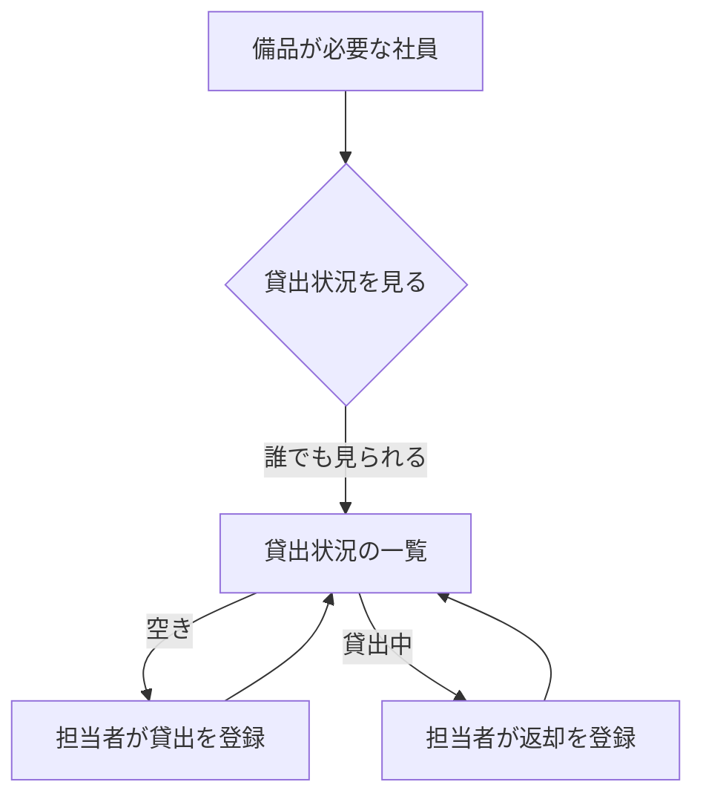
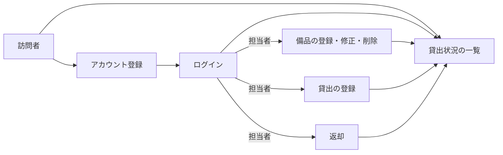
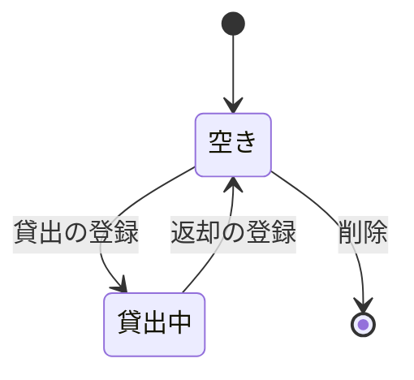
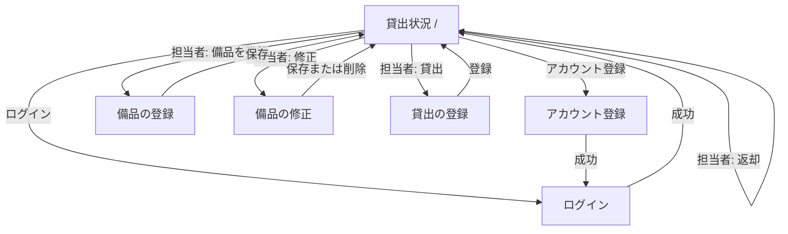

# 要件定義書: 備品の貸出管理

## 1. 目的・前提

### 目的

会社の備品の貸出を 1 つのアプリで管理する。現状は総務が Excel の台帳と紙の貸出票で管理しており、最新の状態が分からず、記録が食い違ったり消えたりしている。社員が「どの備品を誰が借りているか」を総務の担当者に問い合わせないと分からず、担当者は 1 回 15 分かけて調べている。このアプリで、貸出状況を 1 か所で最新に保ち、社員が自分で確認できるようにする。

### 用語集

| 用語 | 業務上の意味 | 本案件での使用範囲 | 同義語/類義語 |
|---|---|---|---|
| 社員 | 会社の従業員。社員番号でアカウントを持つ | アカウントを持つ全員（担当者を含む） | 利用者 |
| 担当者 | 備品の登録・修正・削除と、貸出・返却の記録を行う総務の担当者。役割の一つ | 役割として、社員アカウントのうち担当者の役割を持つもの | 管理者 |
| 備品 | 会社が貸し出す物品 | 管理番号で一意に識別する物品 | 物品 |
| 管理番号 | 備品を識別する番号。半角の英数字とハイフン | 備品の識別子 | 備品番号 |
| 貸出 | 空いている備品を、ある社員に貸し出して記録すること | 貸出の記録を 1 件作る操作 | 貸し出し |
| 返却 | 貸出中の備品が戻ったことを記録すること | 貸出の記録を消して備品を空きに戻す操作 | 返し |
| 空き | 貸出の記録が無い備品の状態 | 状態の表示 | 利用可能 |
| 貸出中 | 貸出の記録がある備品の状態 | 状態の表示 | 貸し出し中 |

### システムの形態

GUI（ブラウザで開く画面）。Web API とバッチは作らない。

### 1-1. 技術制約（前提として記録する。要件ではないため ID は付与しない）

| 制約項目 | 内容 | 出どころ（誰がいつ答えたか） |
|---|---|---|
| 既存コードベース | 無し（新規開発） | 依頼文（既存のコードに関する記述は無い。Excel 台帳と紙の貸出票のみ） |
| 配備先 | 社内のサーバー。社内ネットワークからだけ開く | 依頼文 |
| チームの技術 | 指定無し。採用を禁じられた技術の記述も無い | 依頼文に記述無し。Python 3.12 と無償のライブラリ、ファイル DB で足りること（contract.md の起動の条件） |
| ライセンスとコスト | 無償のものだけを使う。有償ソフトは使わない | 依頼文 |
| 性能と規模の目安 | 利用人数は社員と担当者の合計で 50 人まで。備品は数百件まで。応答時間の目標は依頼に無い | 依頼文 |

### 1-2. 依頼に無く自分で決めた項目（必須）

依頼は「依頼者が任せると答えた」わけではないため、依頼に無い決め事はすべて最小案で決め、承認列を「未確認」にする。依頼者が答えたら承認済にする。

| 項目 | 決めた内容 | 根拠（最小案か、依頼のどこから推測したか） | 承認（承認済 / 未確認） |
|---|---|---|---|
| 外部連携の有無 | 外部連携は無い（RQ-EX は作らない） | 依頼に外部のシステムとの連携の記述が無く、無償のものだけを使う、社内のサーバーで完結する、とあるため | 未確認 |
| 既存ソースコード | 既存コードは無い（新規開発） | 依頼に既存のコードの記述が無く、現状は Excel と紙のみと書かれているため | 未確認 |
| 最初の登録者の扱い | 登録の時点でアカウントが 0 件なら担当者、1 件以上なら社員。判定と作成は 1 つの排他されたトランザクションで行い、同時の登録でも担当者は 1 人だけにする | 依頼の「アカウントが 1 件も無いとき…担当者」の文言。同時登録で 2 人が担当者になるのを防ぐ最小の手当て | 未確認 |
| 担当者の権限 | 担当者だけが備品の登録・修正・削除と、貸出・返却を行える。社員と未ログインの利用者は貸出状況の閲覧だけ | 依頼の「担当者が〜する」と「誰でも見られる」の文言から | 未確認 |
| 社員の操作 | 社員は、自分のアカウントのパスワードや情報を変える操作を持たない（アカウントの修正・削除は作らない） | 依頼に無い操作。最小案として作らない | 未確認 |
| 社員番号の形式 | 6 桁の数字のみ（先頭の 0 を許す）。空欄・5 桁以下・7 桁以上・数字以外は入力エラー | 依頼の「6 桁の数字」の文言 | 未確認 |
| 名前の形式 | 必須。前後の空白は除く。30 文字以内（文字数で数える） | 依頼の「30 文字以内」。空欄の扱いは依頼に無いため必須にした | 未確認 |
| パスワードの形式 | 8 文字以上。上限は 128 文字。文字種の制限は無い。Django の既定の強度検査（よく使われるパスワードの拒否など）は行わない | 依頼の「8 文字以上」のみ。強度検査を入れると依頼に無い制限になるため外した | 未確認 |
| パスワードの保存 | 一方向ハッシュで保存する（Django の既定のハッシュ方式） | 依頼に記述無し。平文で保存しないのは最小の安全策 | 未確認 |
| 社員番号の重複 | 完全一致の重複は不可 | 依頼の「重複不可」 | 未確認 |
| 備品の管理番号の形式 | 半角の英字（大文字・小文字）、数字、ハイフンのみ。1 文字以上 20 文字以内。大文字と小文字は区別する（`ab-1` と `AB-1` は別の番号） | 依頼の「半角の英数字とハイフン 20 文字以内」。大小の扱いは依頼に無いため区別する方を最小とした | 未確認 |
| 管理番号の修正 | 修正画面で管理番号も変えられる。変えても他の番号との重複は不可。貸出記録は備品の内部の識別子で結ぶため、変えても貸出は外れない | 依頼の「修正」の範囲。管理番号を修正できないと誤登録を直せないため | 未確認 |
| 備品名の形式 | 必須。前後の空白は除く。50 文字以内 | 依頼の「50 文字以内」。空欄は必須にした | 未確認 |
| 貸出中の備品の削除 | 貸出中の備品は削除できない（エラーを出し、データを変えない） | 依頼に無い。貸出記録が孤立するのを防ぐ最小の制限 | 未確認 |
| 貸出の対象 | 空きの備品だけ貸し出せる。貸出中の備品に貸出を登録しようとした場合はエラーにし、データを変えない | 依頼の「空いている備品について」 | 未確認 |
| 借りる社員の候補 | 登録済みの全アカウント（担当者を含む）から選ぶ | 依頼の「借りる社員はアカウントから選ぶ」。担当者も社員の一人として扱う | 未確認 |
| 貸出日の既定と範囲 | 既定は今日（日本時間）。今日より後の日付は入力エラー。過去の日付は許す（後から記録する場合のため） | 依頼の「既定は今日」の文言。未来日を許すと記録の意味が崩れるため禁止した | 未確認 |
| 返却の記録 | 返却すると貸出の記録を消す（返却の履歴は残さない） | 依頼の「貸出の記録を消し、空きに戻す」 | 未確認 |
| 返却の対象 | 貸出中の備品だけ返却できる。空きの備品に返却を要求した場合はエラーにし、データを変えない | 依頼の「返却したら」と同じ操作の前提 | 未確認 |
| 同時操作 | 同じ備品への貸出や返却が競合した場合、後から来た操作は、その時点の状態を見てエラーにする（データは変えない） | 依頼に無い。二重貸出を防ぐ最小の手当て | 未確認 |
| 一覧の並び順と件数 | 管理番号の文字コード順（昇順）で全件を 1 画面に表示する。ページ分けは行わない | 依頼の「管理番号の昇順」の文言と、備品が数百件までという規模 | 未確認 |
| 備品が 0 件のとき | 「備品は登録されていません」と表示する | contract.md の文言 | 未確認 |
| セッション | ログイン後の状態は、ログアウトするか Django の既定の期間（2 週間）が過ぎるまで保つ | 依頼に無し。既定値を使う最小案 | 未確認 |
| アカウント数の上限 | アプリでは上限を設けない（利用人数 50 人は運用の前提） | 依頼の「50 人まで」は規模の前提であり、機能の制限とは書かれていないため | 未確認 |
| 社内限定の制御 | アプリは社内ネットワークの判定をしない。社内からだけ届くようにする作業はネットワーク側で行う。アプリの許可するホスト名は環境変数で指定し、既定は localhost と 127.0.0.1 | 依頼の「社内のネットワークからだけ開く」。アプリで IP を判定する機能は依頼に無いため作らない | 未確認 |
| バックアップ | 作らない（バックアップは必要ない）。データは 1 つの DB ファイルに置く | 依頼に無し。最小案 | 未確認 |
| ログ・監査・監視 | 作らない（アプリの標準の動作ログとエラーログのみ） | 依頼に無し。最小案 | 未確認 |
| 既存台帳の取り込み | 作らない（移行は無い）。既存の Excel 台帳の内容は手で登録する | 依頼に移行の記述が無いため。取り込み機能を作ると依頼に無い機能になるため | 未確認 |
| 入力値の再表示 | 入力欄の入力値は、入力の誤りで再表示するときも消さない。ただしパスワード欄は再表示しない（画面に残さない） | 依頼の「入力した値は消さない」（contract.md）を守りつつ、パスワードを画面に戻さないための例外 | 未確認 |
| 応答時間の目標 | 数値の目標は定めない | 依頼に応答時間の記述が無い。推測で数値を作らない | 未確認 |
| 起動と停止の手順 | 起動は `bash run.sh`、初回の準備は `bash setup.sh`。停止は起動したプロセスを止めることで行う | contract.md の起動の条件 | 未確認 |

## 2. 業務

### 対象業務一覧

| RQ-BZ-ID | 業務名 | 業務の範囲 | 担当者 |
|---|---|---|---|
| `RQ-BZ-EQUIPMENT-LENDING` | 備品の貸出管理 | 備品の登録、貸出、返却、貸出状況の確認 | 担当者（総務）、社員（閲覧） |

### 業務フロー

### 2-1. 業務の問題（あるべき姿と現状のギャップ）

| 問題 | 対象業務（RQ-BZ） | あるべき姿 | 現状 | ギャップ（KPI） | 業務影響 |
|---|---|---|---|---|---|
| 貸出の記録が食い違い、消えている | `RQ-BZ-EQUIPMENT-LENDING` | 貸出の記録が 1 か所にあり、常に最新である | Excel の台帳と紙の貸出票の 2 種類があり、どれが最新か分からない | 食い違いや消失の件数は依頼に無いため不明（数値は作らない） | 備品の所在が分からない |
| 社員が貸出状況を担当者に問い合わせている | `RQ-BZ-EQUIPMENT-LENDING` | 社員が自分で貸出状況を確認でき、担当者への問い合わせが要らない | 担当者が 1 回 15 分かけて調べている | 1 回あたり 15 分（問い合わせの件数は依頼に無いため不明） | 担当者の作業時間が取られる |

### 2-2. 業務課題一覧（必須）

| RQ-BK-ID | 業務課題（取り組むこと） | 解決する問題（2-1） | 解決後の状態（KPI の目標値） | 対象業務（RQ-BZ） |
|---|---|---|---|---|
| `RQ-BK-SINGLE-LENDING-LEDGER` | 貸出の記録を 1 つのアプリに一元化する | 貸出の記録が食い違い、消えている | 貸出の記録が 1 か所だけになる | `RQ-BZ-EQUIPMENT-LENDING` |
| `RQ-BK-SELF-SERVICE-LENDING-STATUS` | 社員が貸出状況を自分で確認できるようにする | 社員が貸出状況を担当者に問い合わせている | 問い合わせが要らず、担当者の調査時間（1 回 15 分）が無くなる | `RQ-BZ-EQUIPMENT-LENDING` |

### 2-3. 見込み経営効果

| RQ-EF-ID | 効果の種類 | 内容 | 見込み（金額・時間などと算定根拠） | 対応業務課題ID（RQ-BK-*） |
|---|---|---|---|---|
| `RQ-EF-SOFT-SAVING-INQUIRY-TIME` | Soft Saving | 担当者が貸出状況を調べる時間の削減 | 1 回あたり 15 分の削減。問い合わせの月間件数が依頼に無いため、総額は算定しない（算定できない理由: 件数が不明） | `RQ-BK-SELF-SERVICE-LENDING-STATUS` |

## 3. 機能要件

- 入力データ: 人手による入力のみ（社員番号、名前、パスワード、管理番号、備品名、借りる社員、貸出日）。外部からの入力は無い。
- 出力データ: 貸出状況の一覧（画面）のみ。帳票や出力ファイルは作らない。
- 全機能の利用フロー: 3 章の機能一覧と 3-1〜3-3 の表に書いた操作の流れ。

- 利用者の種別: 訪問者（ログインしていない人）、社員（ログイン済み、担当者以外）、担当者（ログイン済みで担当者の役割を持つ人）。

### 機能一覧

| RQ-ID | カテゴリ | 機能名 | 対応業務課題ID（RQ-BK-*） | この機能が無いと何が困るか |
|---|---|---|---|---|
| `RQ-FT-REGISTER-ACCOUNT` | 共通 | 社員アカウントの登録 | `RQ-BK-SINGLE-LENDING-LEDGER` | 社員が自分でログインできず、貸出を誰が借りているかを記録できない |
| `RQ-FT-LOGIN` | 共通 | 社員番号とパスワードでのログイン | `RQ-BK-SINGLE-LENDING-LEDGER` | 担当者が操作を行えず、権限を分けられない |
| `RQ-FT-LOGOUT` | 共通 | ログアウト | `RQ-BK-SINGLE-LENDING-LEDGER` | 共用の端末で、前の利用者のまま操作される |
| `RQ-FT-REGISTER-EQUIPMENT` | 業務機能 | 備品の登録 | `RQ-BK-SINGLE-LENDING-LEDGER` | 備品の一覧がないため、貸出の記録ができない |
| `RQ-FT-UPDATE-EQUIPMENT` | 業務機能 | 備品の修正 | `RQ-BK-SINGLE-LENDING-LEDGER` | 誤った管理番号や備品名を直せない |
| `RQ-FT-DELETE-EQUIPMENT` | 業務機能 | 備品の削除 | `RQ-BK-SINGLE-LENDING-LEDGER` | 廃棄した備品が一覧に残り続ける |
| `RQ-FT-LEND-EQUIPMENT` | 業務機能 | 空きの備品の貸出の登録 | `RQ-BK-SINGLE-LENDING-LEDGER` | 誰が借りているかを記録できない |
| `RQ-FT-RETURN-EQUIPMENT` | 業務機能 | 貸出中の備品の返却の登録 | `RQ-BK-SINGLE-LENDING-LEDGER` | 返却されても貸出中のままになる |
| `RQ-FT-VIEW-LENDING-STATUS` | 業務機能 | 貸出状況の一覧の閲覧（誰でも可） | `RQ-BK-SELF-SERVICE-LENDING-STATUS` | 社員が担当者に問い合わせるしかなく、1 回 15 分の調査が続く |
| `RQ-FT-MANAGER-ONLY-OPERATIONS` | 共通 | 備品の登録・修正・削除と、貸出・返却を担当者だけに許す | `RQ-BK-SINGLE-LENDING-LEDGER` | 社員が勝手に貸出や返却を記録し、記録が再び食い違う |

### 3-1. 帳票・出力ファイル

帳票・出力ファイルは無い。

### 3-2. 業務ルール

| RQ-ID | ルール名 | 内容（条件と結果） | 違反時・エラー時の業務上の扱い | 対応業務課題ID（RQ-BK-*） |
|---|---|---|---|---|
| `RQ-FT-FIRST-ACCOUNT-IS-MANAGER` | 最初の登録者は担当者 | アカウントが 0 件のときに登録した人は担当者、1 件以上のときに登録した人は社員になる | 同時に登録されても担当者は 1 人だけになるように、判定と作成を 1 つの排他された処理で行う | `RQ-BK-SINGLE-LENDING-LEDGER` |
| `RQ-FT-LEND-ONLY-AVAILABLE` | 貸出は空きの備品だけ | 貸出中の備品には貸出を登録できない | 「この備品は貸出中です」とエラーを出し、貸出の記録を変えない | `RQ-BK-SINGLE-LENDING-LEDGER` |
| `RQ-FT-DELETE-ONLY-AVAILABLE` | 貸出中の備品は削除しない | 貸出中の備品は削除できない | 「貸出中の備品は削除できません。先に返却してください」とエラーを出し、備品を変えない | `RQ-BK-SINGLE-LENDING-LEDGER` |
| `RQ-FT-LENT-ON-NOT-FUTURE` | 貸出日は今日以前 | 貸出日は今日（日本時間）以前の日付だけ受け付ける | 今日より後の日付は入力欄にエラーを出し、値は消さない | `RQ-BK-SINGLE-LENDING-LEDGER` |
| `RQ-FT-RETURN-ONLY-LENT` | 返却は貸出中の備品だけ | 空きの備品には返却を登録できない | 「この備品は貸出中ではありません」とエラーを出し、データを変えない | `RQ-BK-SINGLE-LENDING-LEDGER` |

### 3-3. 外部連携

外部連携は無い。

## 4. データ

### 4-1. データ要件一覧

| RQ-ID | 種別 | 内容 | 対応業務課題ID（RQ-BK-*） | この要件が無いと何が困るか |
|---|---|---|---|---|
| `RQ-DT-LOCAL-DB` | 内部データ | すべてのデータは社内サーバー上の 1 つのファイル型 DB に保存する。外部データは無い。保持期間は無期限（削除は利用者の操作による） | `RQ-BK-SINGLE-LENDING-LEDGER` | 記録の保存先が無く、一元化できない |

DB の必要性: 必要（同時に複数の利用者が貸出状況を見て、担当者が登録・返却する。初期件数は 0 件、想定は備品数百件と社員・担当者 50 人まで。年間増加率は依頼に無いが件数は小さい。参照関係は貸出記録から備品と社員への 2 つだけ。検索は管理番号順の一覧だけ）。

### 4-2. 業務エンティティとデータ項目

| RQ-ID | カテゴリ | 業務エンティティ名 | 対応業務課題ID（RQ-BK-*） | この業務エンティティが無いと何が困るか |
|---|---|---|---|---|
| `RQ-DT-ACCOUNT` | 業務 | アカウント（社員） | `RQ-BK-SINGLE-LENDING-LEDGER` | 借りる社員を選べず、ログインもできない |
| `RQ-DT-EQUIPMENT` | 業務 | 備品 | `RQ-BK-SINGLE-LENDING-LEDGER` | 貸出の対象が無い |
| `RQ-DT-LENDING` | 業務 | 貸出の記録 | `RQ-BK-SINGLE-LENDING-LEDGER` | 誰が何をいつ借りているかが残らない |

| エンティティ名 | 項目名 | 業務上の意味 | 必須 | 形式・桁 | 値の範囲・制約 | 例 |
|---|---|---|---|---|---|---|
| アカウント（社員） | 社員番号 | 社員を一意に表す番号 | 必須 | 数字 6 桁（先頭の 0 を許す） | 重複不可 | 000123 |
| アカウント（社員） | 名前 | 社員の名前 | 必須 | 文字列 | 30 文字以内（前後の空白は除く） | 総務 太郎 |
| アカウント（社員） | パスワード | ログイン用の合言葉 | 必須 | 文字列 | 8 文字以上 128 文字以内。一方向ハッシュで保存 | （利用者が設定） |
| アカウント（社員） | 役割 | 担当者か社員か | 必須 | 担当者 / 社員 のどちらか | 最初の登録者だけ担当者 | 担当者 |
| 備品 | 管理番号 | 備品を一意に表す番号 | 必須 | 半角英数字とハイフン、1〜20 文字 | 重複不可。大文字と小文字は区別する | PC-0001 |
| 備品 | 備品名 | 備品の名前 | 必須 | 文字列 | 50 文字以内（前後の空白は除く） | ノートパソコン A |
| 貸出の記録 | 備品 | 貸し出した備品 | 必須 | 備品への参照 | 1 つの備品につき貸出の記録は最大 1 件 | PC-0001 |
| 貸出の記録 | 借りる社員 | 借りている社員 | 必須 | アカウントへの参照 | 登録済みのアカウントだけ | 総務 太郎 |
| 貸出の記録 | 貸出日 | 貸し出した日 | 必須 | 日付（YYYY-MM-DD、日本時間） | 今日以前 | 2026-11-20 |

### 4-3. CRUD テーブル（必須）

| エンティティ名 | Create | Read（一覧） | Read（詳細） | 検索 | Update | Delete | 備考 |
|---|---|---|---|---|---|---|---|
| アカウント（社員） | ○ | △ | × | × | × | × | 一覧は貸出の登録画面の選択肢としてのみ使う。検索は無い。修正と削除は依頼に無いため作らない。登録は同時実行されても担当者を 1 人にする排他が必要 |
| 備品 | ○ | ○ | ○ | × | ○ | ○ | 一覧は貸出状況の一覧。詳細は修正画面。削除は貸出中の備品を拒否する（トランザクション）。修正・削除は担当者だけ |
| 貸出の記録 | ○ | ○ | × | × | × | ○ | 作成は空きの備品への貸出の登録。削除は返却。貸出状況の一覧で備品と結んで表示する。同じ備品への同時の貸出と返却は排他が必要 |

### 4-4. 状態遷移

備品の状態（空き / 貸出中）は貸出の記録の有無で決まる。

| RQ-ID | エンティティ名 | 遷移前の状態 | きっかけ（操作・条件） | 遷移後の状態 | 対応業務課題ID（RQ-BK-*） |
|---|---|---|---|---|---|
| `RQ-DT-LEND-TRANSITION` | 備品 | 空き | 担当者が貸出を登録する（貸出の記録を作る） | 貸出中 | `RQ-BK-SINGLE-LENDING-LEDGER` |
| `RQ-DT-RETURN-TRANSITION` | 備品 | 貸出中 | 担当者が返却を登録する（貸出の記録を消す） | 空き | `RQ-BK-SINGLE-LENDING-LEDGER` |

### 4-5. 画面一覧（GUI の場合のみ）

| RQ-ID | 画面名 | 対応する CRUD 操作（エンティティ名:操作種別） | 主な機能・目的 | 対応業務課題ID（RQ-BK-*） |
|---|---|---|---|---|
| `RQ-UI-STATUS-SCREEN` | 貸出状況（トップ） | 備品:Read（一覧）、貸出の記録:Read（一覧） | 全備品の状態と借りている社員、貸出日の一覧。担当者には行ごとに操作ボタンを出す | `RQ-BK-SELF-SERVICE-LENDING-STATUS` |
| `RQ-UI-REGISTER-ACCOUNT-SCREEN` | アカウント登録 | アカウント:Create | 社員番号、名前、パスワードを入力して登録する | `RQ-BK-SINGLE-LENDING-LEDGER` |
| `RQ-UI-LOGIN-SCREEN` | ログイン | アカウント:Read（認証） | 社員番号とパスワードでログインする | `RQ-BK-SINGLE-LENDING-LEDGER` |
| `RQ-UI-EQUIPMENT-NEW-SCREEN` | 備品の登録 | 備品:Create | 管理番号と備品名を入力して登録する（担当者だけ） | `RQ-BK-SINGLE-LENDING-LEDGER` |
| `RQ-UI-EQUIPMENT-EDIT-SCREEN` | 備品の修正 | 備品:Update、備品:Delete | 管理番号と備品名を修正する。削除を確認して行う（担当者だけ） | `RQ-BK-SINGLE-LENDING-LEDGER` |
| `RQ-UI-LENDING-NEW-SCREEN` | 貸出の登録 | 貸出の記録:Create | 借りる社員と貸出日を選んで貸出を登録する（担当者だけ） | `RQ-BK-SINGLE-LENDING-LEDGER` |

画面の詳細（5 項目）:

- 貸出状況（トップ）: 目的は全備品の状態の把握。主要要素は備品の表と、担当者には行ごとのボタン（修正、削除、貸出、返却）と「備品を登録」の入口。表示項目は管理番号、備品名、状態（空き / 貸出中）、借りている社員の名前、貸出日。入力項目は無い。エラー時は画面上部の `.error` に出す。
- アカウント登録: 入力項目は社員番号、名前、パスワード。送信ボタン「登録」。成功するとログイン画面へ移り、「登録しました。ログインしてください」を出す。
- ログイン: 入力項目は社員番号、パスワード。送信ボタン「ログイン」。失敗時は「社員番号またはパスワードが違います」を出す。
- 備品の登録と修正: 入力項目は管理番号、備品名。送信ボタン「保存」。修正画面には削除ボタン「削除」を置く（確認ダイアログを出す）。
- 貸出の登録: 入力項目は借りる社員（選択肢は「名前（社員番号）」）、貸出日（既定は今日）。送信ボタン「登録」。成功すると貸出状況の画面へ移る。
- エラーの見え方: 入力欄ごとのエラーは入力欄を含む `.field` の中の `.field-error` に出す。画面全体のエラーは `.error`、操作の結果の知らせは `.message`。入力した値は消さない。

画面遷移図:

## 5. 非機能要件

| RQ-ID | カテゴリ | 非機能要件名 | 対応業務課題ID（RQ-BK-*） | この非機能要件が無いと何が困るか |
|---|---|---|---|---|
| `RQ-NF-INTERNAL-ACCESS` | 利用者とアクセス経路 | 利用者は社員と担当者と訪問者（社内の人）。アクセスは社内ネットワークからだけ。アプリは社内の判定をせず、ネットワーク側で制限する | `RQ-BK-SINGLE-LENDING-LEDGER` | 社外から貸出状況と社員の名前が見られてしまう |
| `RQ-NF-PASSWORD-HASH` | セキュリティ | パスワードは一方向ハッシュで保存し、平文では保存しない。ログインに失敗した理由（社員番号が無いか、パスワードが違うか）は画面に出さない | `RQ-BK-SINGLE-LENDING-LEDGER` | パスワードが漏れると社員になりすまされる。社員番号の存在が分かってしまう |

- 性能: 応答時間の目標は依頼に無いため定めない（1-2 の表）。
- 利用人数: 社員と担当者の合計で 50 人まで（1-1 の前提）。
- 可用性: 要求は無い。止めてよい時間の記述も無い。
- 移行性: 移行は無い（1-2 の表）。
- セキュリティ: 認証方式はパスワード認証のみ（SSO は無い）。権限は担当者と社員の 2 段階を、操作単位で制御する。監査証跡の改ざん防止は要らない。

## 6. 運用要件

| RQ-ID | 種別 | 内容 | 対応業務課題ID（RQ-BK-*） | この要件が無いと何が困るか |
|---|---|---|---|---|
| `RQ-OP-START-ON-SERVER` | 起動 | 社内サーバーで `bash setup.sh`（初回に 1 回）と `bash run.sh` で起動する。環境変数 `PORT`（既定 8000）で待ち受け、環境変数 `DATA_DIR` にデータを置く。DATA_DIR が無ければ作り、空の状態（備品もアカウントも 0 件）で始まる | `RQ-BK-SINGLE-LENDING-LEDGER` | 社内サーバーで動かせない |

- ログ: ログは必要ないため、ログの内容と保存期間の記述は行わない（アプリの標準の動作ログとエラーログだけ）。
- 監査ログ: 本番の要件として要らない（1-2 の表）。
- 監視・アラート: 監視・アラートは必要ないため、監視・アラートの内容と対応方法の記述は行わない。
- バックアップと復旧: バックアップは必要ない（1-2 の表）。DB ファイルは DATA_DIR に置く。

## 7. テスト用利用シナリオ

| RQ-ID | テスト目的 | 前提条件 | テスト手順 | 期待される結果 | 検証する要件ID | 対応業務課題ID（RQ-BK-*） |
|---|---|---|---|---|---|---|
| `RQ-TS-REGISTER-FIRST-ACCOUNT` | 最初の登録者が担当者になる | DB が空 | 登録画面で社員番号 000001、名前、8 文字以上のパスワードを入力して登録する。ログインする | 登録が成功し、ログイン後の画面に担当者として名前が出る | `RQ-FT-REGISTER-ACCOUNT`, `RQ-FT-FIRST-ACCOUNT-IS-MANAGER`, `RQ-UI-REGISTER-ACCOUNT-SCREEN` | `RQ-BK-SINGLE-LENDING-LEDGER` |
| `RQ-TS-REGISTER-SECOND-ACCOUNT` | 2 件目以降は社員になり、入力の誤りが拒否される | 担当者 1 件が登録済み | 別の社員番号で登録する。社員番号を 5 桁、名前を 31 文字、パスワードを 7 文字、既存と同じ社員番号で入力し、それぞれ登録を試す。最後に正しい値で登録しログインする | 誤った入力はそれぞれ入力欄のエラーを出し、値は消えない。正しい登録は社員として成功する | `RQ-FT-REGISTER-ACCOUNT`, `RQ-UI-REGISTER-ACCOUNT-SCREEN` | `RQ-BK-SINGLE-LENDING-LEDGER` |
| `RQ-TS-LOGIN-LOGOUT` | ログインの成功・失敗とログアウト | アカウント 1 件が登録済み | 間違ったパスワードでログインを試す。正しい値でログインし、ログアウトする | 失敗時は「社員番号またはパスワードが違います」が `.error` に出る。成功時は `.current-user` に名前が出て、ログアウト後は出ない | `RQ-FT-LOGIN`, `RQ-FT-LOGOUT`, `RQ-UI-LOGIN-SCREEN` | `RQ-BK-SINGLE-LENDING-LEDGER` |
| `RQ-TS-REGISTER-EQUIPMENT` | 担当者が備品を登録し、入力の誤りが拒否される | 担当者でログイン済み | 備品の登録画面で正しい値を登録する。管理番号に全角文字や 21 文字を入れて試す。既存の管理番号で登録を試す | 正しい登録は一覧に出る。誤りは入力欄のエラーになり、値は消えず、重複は登録されない | `RQ-FT-REGISTER-EQUIPMENT`, `RQ-UI-EQUIPMENT-NEW-SCREEN` | `RQ-BK-SINGLE-LENDING-LEDGER` |
| `RQ-TS-UPDATE-EQUIPMENT` | 担当者が備品の管理番号と備品名を修正する | 担当者でログイン済み、備品 1 件が登録済み | 行の「修正」から、管理番号と備品名を変えて「保存」する。既存の別の管理番号に変えようとする | 変更は一覧に反映される。重複する管理番号は入力欄のエラーになり、データは変わらない | `RQ-FT-UPDATE-EQUIPMENT`, `RQ-UI-EQUIPMENT-EDIT-SCREEN` | `RQ-BK-SINGLE-LENDING-LEDGER` |
| `RQ-TS-DELETE-EQUIPMENT` | 空きの備品は削除でき、貸出中の備品は削除できない | 担当者でログイン済み、空きの備品 1 件と貸出中の備品 1 件 | 貸出中の備品の「削除」を確認ダイアログで「はい」にする。空きの備品の「削除」を確認ダイアログで「はい」にする | 貸出中は `.error` で拒否され一覧に残る。空きは削除され一覧から消える | `RQ-FT-DELETE-EQUIPMENT`, `RQ-FT-DELETE-ONLY-AVAILABLE`, `RQ-UI-EQUIPMENT-EDIT-SCREEN` | `RQ-BK-SINGLE-LENDING-LEDGER` |
| `RQ-TS-LEND-EQUIPMENT` | 空きの備品に貸出を登録し、貸出中の備品には登録できない | 担当者でログイン済み、空きの備品 1 件、アカウント 2 件 | 空きの備品の「貸出」で借りる社員と貸出日（既定は今日）を選んで「登録」する。貸出日を明日にして登録する。貸出中の備品に貸出を試す | 成功時は貸出状況に戻り、借りる社員の名前と貸出日が出る。明日の日付と貸出中の備品への貸出は入力欄のエラーや `.error` になり、記録は変わらない | `RQ-FT-LEND-EQUIPMENT`, `RQ-FT-LEND-ONLY-AVAILABLE`, `RQ-FT-LENT-ON-NOT-FUTURE`, `RQ-UI-LENDING-NEW-SCREEN` | `RQ-BK-SINGLE-LENDING-LEDGER` |
| `RQ-TS-RETURN-EQUIPMENT` | 貸出中の備品の返却で貸出の記録が消え、空きに戻る | 担当者でログイン済み、貸出中の備品 1 件 | 行の「返却」を確認ダイアログで「はい」にする。空きの備品に返却を試す（ボタンが無いことを確かめる） | 貸出の記録が消え、状態が「空き」に戻り、借りる社員と貸出日の表示が消える | `RQ-FT-RETURN-EQUIPMENT`, `RQ-FT-RETURN-ONLY-LENT` | `RQ-BK-SINGLE-LENDING-LEDGER` |
| `RQ-TS-VIEW-STATUS-PUBLIC` | 誰でも貸出状況を見られ、備品が 0 件のときは案内が出る | 備品 0 件の状態、その後に備品 2 件（1 件は貸出中） | 備品 0 件でトップを開く。備品を登録し貸出中にしてから、ログインせずにトップを開く | 0 件のときは「備品は登録されていません」が出る。ログインしていない画面には操作ボタンが無く、管理番号の昇順に行が並び、状態・借りている社員の名前・貸出日が表示される | `RQ-FT-VIEW-LENDING-STATUS`, `RQ-UI-STATUS-SCREEN` | `RQ-BK-SELF-SERVICE-LENDING-STATUS` |
| `RQ-TS-EMPLOYEE-CANNOT-OPERATE` | 社員は備品の操作ができない | 社員でログイン済み、備品 1 件が登録済み | 社員でログインしてトップを開き、備品の登録画面へ直接 URL で入る | トップに操作ボタンは出ない。備品の登録画面は操作を拒否し、`.error` に権限が無い旨が出る。データは変わらない | `RQ-FT-MANAGER-ONLY-OPERATIONS`, `RQ-UI-STATUS-SCREEN`, `RQ-UI-EQUIPMENT-NEW-SCREEN` | `RQ-BK-SINGLE-LENDING-LEDGER` |

## 8. 変更履歴

- 新規作成（2026-11-22）。依頼文と contract.md を起点に、依頼者の回答が無いため 1-2 の項目を最小案で決めた。承認は未確認。
