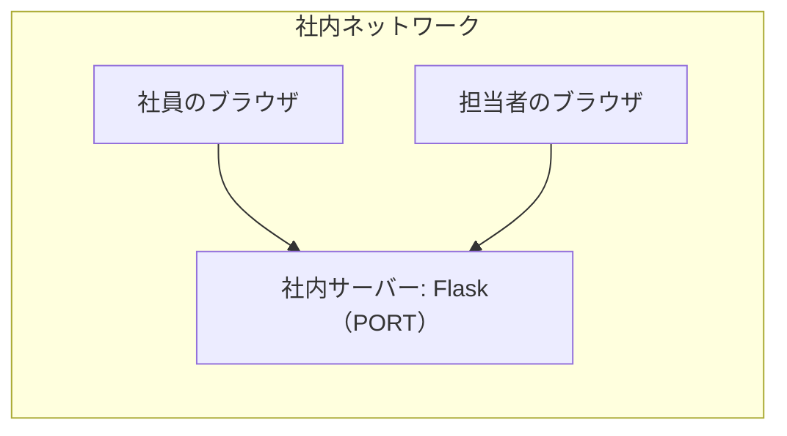
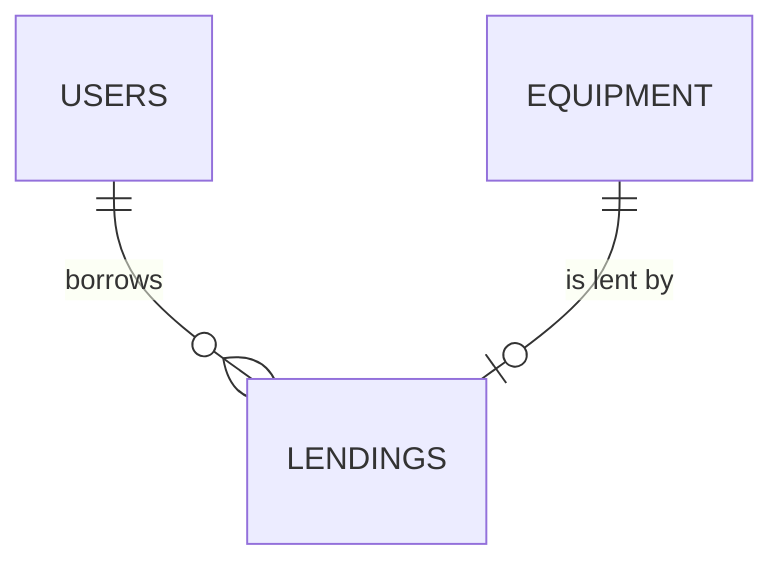
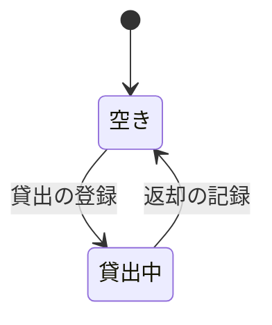
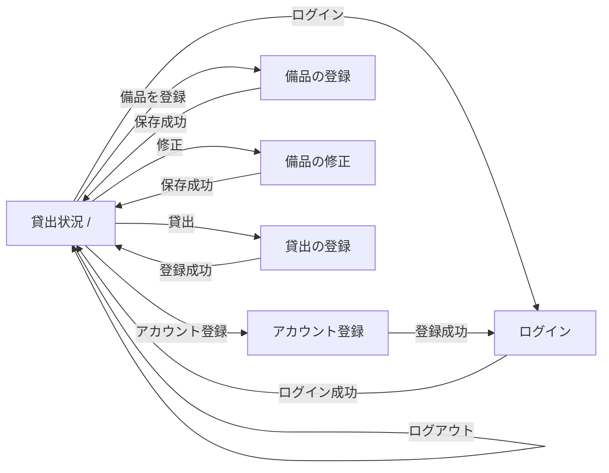
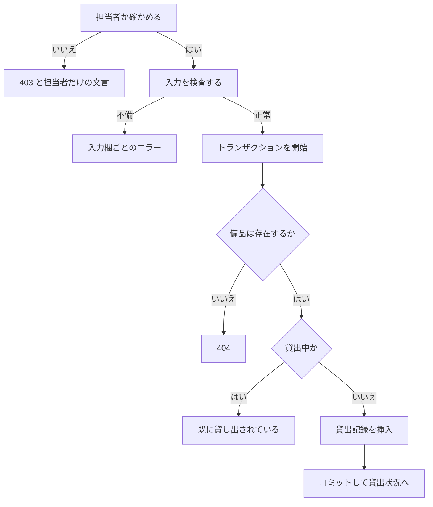
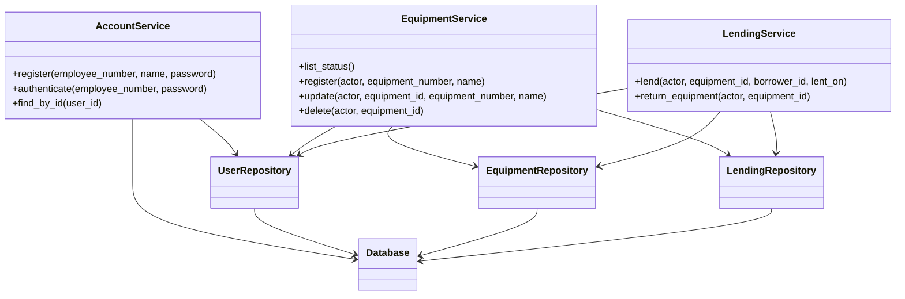
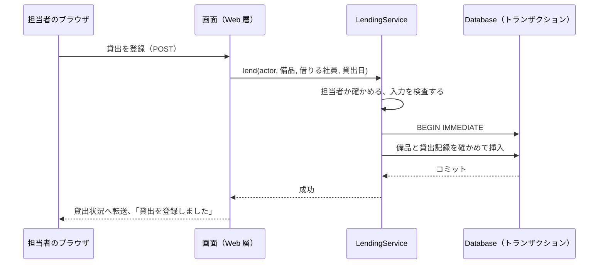

# 詳細設計書: 備品の貸出管理

## 1. 言語・フレームワーク・アーキテクチャの選定

### 判定

- 判定日: 2026-11-22（PyPI の公開情報を確認。確認日はこの日）
- 技術制約の要約（要件定義書 1-1）: 既存コードは無い。社内サーバーで動かし、社内ネットワークからだけ開く。無償のものだけを使う。Python 3.12 で動き、`bash setup.sh` と `bash run.sh` で準備と起動をする（採点の契約）。利用者 50 人、備品数百件。

### 判断軸

| 判断軸 | この案件で効く条件 | 該当 | 理由 |
|---|---|---|---|
| 既存資産との整合 | 既存コードは無い | 無し | 新規のため制約なし |
| チームの技術 | 特に無い。Python 3.12 は契約で固定 | 有り | Python 3.12 の候補に絞る |
| 配備先 | 社内サーバー、コンテナは使わない前提、ブラウザで開く | 有り | 標準的な Python 実行環境で動く候補 |
| 認証と認可の境界 | パスワード認証と、社員と担当者の 2 ロール。SSO は無い | 有り | 認証を 1 箇所に集める構成で足りる |
| 画面の規模 | 画面は 6 種類（一覧、登録、修正、貸出、ログイン、アカウント登録）。複雑な状態管理は無い | 有り | テンプレートで素直に作れる軽い枠組みで足りる |
| データの規模と構造 | 備品数百件、利用者 50 人、参照関係は 3 エンティティ、同時の貸出を 1 件に限る、検索と集計は無い | 有り | ファイル型の RDB で足りる。トランザクションが要る |
| 外部連携 | 無し | 無し | 連携ライブラリは不要 |
| ライセンスとコスト | 無償のみ | 有り | 無償の OSS だけ候補にする |
| 保守性 | 長期の保守が要る | 有り | 保守が活発で情報の多い候補 |

### 候補の比較

| 候補 | 判断軸ごとの評価 | 出典 URL | 確認日 |
|---|---|---|---|
| Python 3.12 + Flask 3.1.3 + SQLite（標準の sqlite3） | 画面 6 種の小規模 Web に合う。認証は自前で数十行。SQLite は標準ライブラリで無償。配備は pip と venv で足りる | https://pypi.org/project/Flask/ | 2026-11-22 |
| Python 3.12 + Django 6.1.3 + SQLite | 認証・管理画面・ORM を含み、標準機能は多い。今回の画面と認証は少なく、機能が余る。配備と保守の手順が増える | https://pypi.org/project/Django/ | 2026-11-22 |
| Python 3.12 + FastAPI 0.165.0 + SQLite | 画面は別途テンプレートと認証を組む必要があり、今回の GUI 中心の要件では作業が増える | https://pypi.org/project/fastapi/ | 2026-11-22 |

ライセンスの確認: PyPI の公開情報のライセンス欄は空だったため、各プロジェクトのライセンスは未確認。Flask・Django は BSD 系、FastAPI と pytest は MIT、Playwright は Apache-2.0 として扱う。承認の時点で、各プロジェクトのリポジトリの LICENSE を確かめる。

### 最終選定結果

| 項目 | 選定 | 理由（業務要件との対応） |
|---|---|---|
| 言語 | Python 3.12 | 採点の契約で指定。標準ライブラリだけで DB と暗号化（scrypt）が足りる |
| フレームワーク | Flask 3.1.3（テンプレートは Jinja2） | 画面 6 種の GUI を最小の構成で作れる（RQ-UI の 6 画面）。認証は自前の数十行で、依存を増やさない |
| DB | SQLite（標準ライブラリ sqlite3。ORM は使わない） | 備品数百件、利用者 50 人。ファイル 1 つで `DATA_DIR` に置ける。同時の貸出を 1 件に限るため、排他はトランザクションで行う |
| 実行形態 | サーバー（コンテナを使わない）。`bash run.sh` で起動 | 社内サーバーで動かす（RQ-NF-INTERNAL-ACCESS） |
| テスト | 単体は pytest、E2E は pytest と Playwright for Python（Chromium） | 画面の要素の id とクラスを実際のブラウザで確かめる。結果は JUnit XML で出せる |
| 待ち受けサーバー | Waitress 3.0.2（WSGI サーバー） | Flask の開発用サーバーではなく本番向けの WSGI サーバーで、社内の数十人の利用に足りる。ライセンスは承認時に確認する |
| 時刻帯のデータ | tzdata 2026.6（Asia/Tokyo） | 日本時間で日付を扱うため。OS の時刻帯データが無い環境でも動かす |

ユーザー承認の記録: 未確認（依頼者が「任せる」と答えた項目の扱い。要件定義書 1-2 の決め事と同じ扱い）。

### 構成の方式

フロントエンドとバックエンドを分けない。Flask がテンプレートで HTML を返す 1 プロセスの構成。API の経路は無い。認証境界は `src/web/auth.py` の 1 箇所に集める。

## 2. システム構成

### コンポーネント一覧

| コンポーネント | 役割 | 配置 |
|---|---|---|
| 画面（Web 層） | ルーティング、フォームの読み取り、テンプレートの描画、ログイン状態の判定 | `src/web/` |
| 業務層（サービス） | アカウント登録と認証、備品の管理、貸出と返却、入力の検査、権限の検査 | `src/service/` |
| データ層 | SQLite の接続とスキーマ、テーブルへの読み書き | `src/data/` |
| 起動の入口 | 設定の読み取り、サービスの組み立て、サーバーの起動 | `src/main.py` |
| 起動・準備スクリプト | `setup.sh`（仮想環境と依存、ブラウザの導入）、`run.sh`（起動） | プロジェクト直下 |
| E2E テスト | ブラウザでの操作と画面の確認 | `e2e/` |
| 単体テスト | 入力の検査、業務ルール、データ層 | `tests/` |

### システム全体構成図


### 各コンポーネントの役割と機能

- 画面: 貸出状況、アカウント登録、ログイン、備品の登録・修正、貸出の登録の画面を描画する。操作の結果は `.message`、画面全体のエラーは `.error`、入力欄ごとのエラーは `.field-error` に出す（画面の id と文言は契約による）。
- 業務層: 入力を検査し、業務ルールを守り、データ層を呼ぶ。失敗は `ServiceError`（入力欄ごとの場合は欄の名前つき）か `PermissionDenied` で返す。
- データ層: テーブル `users`、`equipment`、`lendings` を扱う。貸出と返却と初回登録は `BEGIN IMMEDIATE` のトランザクションで行う。

### コンポーネント間インターフェースとデータフロー

- 画面 → 業務層: 画面は業務層のクラスのメソッドを呼ぶ。業務層は画面の型に依存しない（戻り値は値とエラーだけ）。
- 業務層 → データ層: 業務層はリポジトリクラスのメソッドを呼ぶ。SQL は データ層だけに書く。
- 認証: 画面はログイン時に利用者の番号を署名付きのセッション Cookie に入れる。以降は Cookie の番号で利用者を取り出し、業務層の `AccountService.find_by_id` で役割を確かめる。

### ネットワーク構成図

ネットワーク越しの通信は、社内の利用者のブラウザから社内サーバーの Flask への HTTP だけ。外部への通信は無い。



## 3. データ設計

### 3-1. データモデル

DB が必要かの判定: 必要（SQLite）。理由は要件定義書 4-1 のとおり（参照関係、同時の貸出を 1 件に限る、保持期間は無期限）。製品は第 1 章の SQLite を使う。

テーブル:

- `DS-SC-USERS-TABLE`（テーブル `users`）: `id`（整数、主キー）、`employee_number`（文字列 6 桁、一意）、`name`（文字列、1〜30 文字）、`password_hash`（文字列、保存形式は 3-1 の下の注）、`role`（文字列、`manager` か `member`）、`created_at`（日時文字列）
- `DS-SC-EQUIPMENT-TABLE`（テーブル `equipment`）: `id`（整数、主キー）、`equipment_number`（文字列、1〜20 文字、一意。大文字と小文字を区別する）、`name`（文字列、1〜50 文字）
- `DS-SC-LENDINGS-TABLE`（テーブル `lendings`）: `equipment_id`（整数、主キー、`equipment.id` を参照。削除時は行を消さず、業務層で拒否する）、`user_id`（整数、`users.id` を参照）、`lent_on`（文字列 `YYYY-MM-DD`）

備品 1 件に貸出記録は最大 1 件（`lendings.equipment_id` が主キーのため、データベースが保証する）。

注: パスワードの保存形式は `scrypt`（Python 標準の `hashlib.scrypt`）の結果を `scrypt$<N>$<r>$<p>$<salt の16進>$<ハッシュの16進>` の 1 文字列にする。元の文字列は保存しない。

リレーション図:



### 3-2. トランザクションと排他制御

- 初回のアカウント登録: 同じトランザクションで利用者数を数え、0 件なら `manager`、1 件以上なら `member` を登録する。接続は `BEGIN IMMEDIATE` で書き込みの排他を取るため、同時の初回登録でも担当者は 1 人だけになる。トランザクションの範囲は、数えてから挿入するまで。ロールバックの条件は、一意制約の違反と想定外の例外。
- 貸出の登録: 同じトランザクションで、備品の存在と貸出記録の有無を確かめ、貸出記録を挿入する。貸出中ならロールバックせずに業務エラーを返す（記録は変えない）。
- 返却: 同じトランザクションで、貸出記録の有無を確かめ、貸出記録を削除する。無ければ業務エラーを返す。
- 備品の修正: 管理番号の重複は一意制約で検出し、業務エラーに変換する。排他制御は行わない（後勝ちで足りる規模のため）。ただし、一意制約の違反は必ずエラーにする。
- 同時更新の方式: 貸出と返却と初回登録は悲観的排他（`BEGIN IMMEDIATE`）。備品の修正と削除は一意制約と業務ルールの検査で足りる。選んだ理由: 規模が小さく、排他の範囲を書き込み時に 1 か所に絞れるため。

### 3-3. 状態遷移

備品の状態は貸出記録の有無で決まる（状態の列は持たない）。

| 遷移 | 状態の持ち方 | 遷移を行う処理 |
|---|---|---|
| 空き → 貸出中 | `lendings` に `equipment_id` の行が入る | 貸出の登録（`DS-CL-LENDING-SERVICE` の貸出処理） |
| 貸出中 → 空き | `lendings` の `equipment_id` の行が消える | 返却の記録（`DS-CL-LENDING-SERVICE` の返却処理） |

- 許されない遷移（貸出中への貸出、空きの備品の返却）を求められたら、業務エラーを返し、データは変えない。貸出中の備品への貸出は「この備品は既に貸し出されています」、空きの備品の返却は「この備品は貸し出されていません」。
- 貸出中の備品の削除は状態遷移ではなく、業務ルールで拒否する（`DS-CL-EQUIPMENT-SERVICE`）。

状態遷移図:



## 4. アーキテクチャ設計

### 4-1. 外部設計

#### 利用者向けインターフェース（画面）

画面の一覧（URL、メソッド、対応する DS-IF）:

| DS-IF | URL | メソッド | 画面 | 主な要素 |
|---|---|---|---|---|
| `DS-IF-STATUS-PAGE` | `/` | GET | 貸出状況 | 表（`tbody tr`、各行に `data-equipment-number`）、各行の操作ボタン（担当者だけ）、「備品を登録」リンク（担当者だけ）、ヘッダー（`.current-user`、「ログイン」「アカウント登録」リンク、「ログアウト」ボタン） |
| `DS-IF-REGISTER-ACCOUNT-PAGE` | `/accounts/register/` | GET, POST | アカウント登録 | `id_employee_number`、`id_name`、`id_password`、「登録」ボタン |
| `DS-IF-LOGIN-PAGE` | `/login/` | GET, POST | ログイン | `id_employee_number`、`id_password`、「ログイン」ボタン |
| `DS-IF-LOGOUT` | `/logout/` | POST | ログアウト | 「ログアウト」ボタン（ヘッダー） |
| `DS-IF-EQUIPMENT-NEW-PAGE` | `/equipment/new/` | GET, POST | 備品の登録 | `id_equipment_number`、`id_name`、「保存」ボタン |
| `DS-IF-EQUIPMENT-EDIT-PAGE` | `/equipment/<id>/edit/` | GET, POST | 備品の修正 | `id_equipment_number`、`id_name`、「保存」ボタン |
| `DS-IF-EQUIPMENT-DELETE` | `/equipment/<id>/delete/` | POST | 備品の削除（行の操作） | 「削除」ボタン（確認ダイアログ付き） |
| `DS-IF-LENDING-NEW-PAGE` | `/lendings/new/` | GET, POST | 貸出の登録 | `id_borrower`（select）、`id_lent_on`（既定は今日）、「登録」ボタン。備品の指定は隠し欄 `equipment` |
| `DS-IF-LENDING-RETURN` | `/lendings/<equipment_id>/return/` | POST | 返却（行の操作） | 「返却」ボタン（確認ダイアログ付き） |

画面の描画の規則:

- 入力欄は `<div class="field">` で囲み、入力欄の横に `<span class="field-error">` を置く（エラーがある欄だけ）。
- 画面全体のエラーとフラッシュ（操作の結果）は共通の部品（`base.html`）で `.error`・`.message` に出す。
- 入力エラーで画面を描き直すとき、送られた値を入力欄に入れ直す（パスワード欄を含む）。
- 操作ボタンは、ログインしている利用者がその操作を行えるときだけ出す。行の操作は `<form>` と `<button>`（修正は GET で編集画面へ、貸出は GET で貸出画面へ、削除と返却は POST）。削除と返却の `<form>` は `onsubmit` で `window.confirm` を呼び、「はい」のときだけ送る。
- 表示する文言は要件定義書の文言と契約の文言を使う。

画面遷移図:



インターフェース仕様（画面の入力、検査、エラーの見え方）:

| DS-IF | 入力と検査 | 出力 | エラー仕様 |
|---|---|---|---|
| `DS-IF-STATUS-PAGE` | 入力なし | 全備品を管理番号の昇順で表示する。貸出中は借りている社員の名前と貸出日 | 備品が 0 件なら「備品は登録されていません」を表示し表は出さない |
| `DS-IF-REGISTER-ACCOUNT-PAGE` | 社員番号（6 桁の半角数字）、名前（前後の空白を除いて 1〜30 文字）、パスワード（8 文字以上）。社員番号の重複は不可 | 成功時はログイン画面へ転送し「登録しました。ログインしてください」を出す | 入力欄ごとに `.field-error`。重複は社員番号の欄に「この社員番号は登録されています」 |
| `DS-IF-LOGIN-PAGE` | 社員番号、パスワード（入力の形式は検査しない。違えば同じ文言） | 成功時は貸出状況へ転送 | 失敗は `.error` に「社員番号またはパスワードが違います」 |
| `DS-IF-LOGOUT` | ログイン中であること | 貸出状況へ転送し「ログアウトしました」を出す | 未ログインでも貸出状況へ転送する（データは変えない） |
| `DS-IF-EQUIPMENT-NEW-PAGE` | 管理番号（半角英数字とハイフン、1〜20 文字、重複不可）、備品名（前後の空白を除いて 1〜50 文字）。担当者だけ | 成功時は貸出状況へ転送し「備品を登録しました」 | 入力欄ごとに `.field-error`。社員は `.error` に「この操作は担当者だけができます」（403） |
| `DS-IF-EQUIPMENT-EDIT-PAGE` | 同上。修正前の値を初期表示する。担当者だけ | 成功時は貸出状況へ転送し「備品を修正しました」 | 同上。存在しない備品は 404 |
| `DS-IF-EQUIPMENT-DELETE` | 備品の存在。担当者だけ。貸出中なら削除しない | 成功時は貸出状況へ転送し「備品を削除しました」 | 貸出中は `.error` に「貸出中の備品は削除できません」（データは変えない）。社員は 403 |
| `DS-IF-LENDING-NEW-PAGE` | 借りる社員（必須、登録済みのアカウント）、貸出日（必須、YYYY-MM-DD、今日以前。既定は今日の日本時間）。備品は空きであること。担当者だけ | 成功時は貸出状況へ転送し「貸出を登録しました」 | 借りる社員と貸出日は入力欄ごとに `.field-error`。貸出中の備品は `.error` に「この備品は既に貸し出されています」。存在しない備品は 404 |
| `DS-IF-LENDING-RETURN` | 備品の存在、貸出記録があること。担当者だけ | 成功時は貸出状況へ転送し「返却を記録しました」 | 貸出記録が無ければ `.error` に「この備品は貸し出されていません」（データは変えない） |

#### 外部システム連携

外部システムとの連携は無い。連携ライブラリ（`external/`）は作らない。

#### 外部 DB 連携

外部 DB の連携は無い。

#### 帳票・出力ファイル

帳票・出力ファイルは無い（要件定義書 3-1）。

### 4-2. 内部設計

#### 処理フロー（主な処理）

- 初回登録の処理: 入力を検査する（`DS-FN-VALIDATE-ACCOUNT-FIELDS`）→ 同じトランザクションで利用者数を数え、役割を決めて挿入する → 社員番号の重複は一意制約の違反を業務エラーに変換する → 成功を返す。
- ログインの処理: 社員番号で利用者を探す → 見つからなければ業務エラー → パスワードを scrypt で検証する（比較は一定時間の比較）→ 違えば業務エラー（見つからない場合と同じ文言）→ 成功なら利用者の番号をセッションに入れる。
- 備品の登録と修正: 入力を検査する（`DS-FN-VALIDATE-EQUIPMENT-FIELDS`）→ 管理番号の重複は一意制約の違反を業務エラーに変換する → 保存する。
- 備品の削除: 担当者か確かめる（`DS-FN-REQUIRE-MANAGER`）→ 同じトランザクションで貸出記録を確かめる → 貸出中なら業務エラー → 備品を削除する。
- 貸出の登録: 担当者か確かめる → 入力を検査する（`DS-FN-VALIDATE-LENDING-FIELDS`。既定の貸出日は `DS-FN-TODAY-JST`）→ 同じトランザクションで備品の存在と貸出記録を確かめる → 貸出中なら業務エラー → 貸出記録を挿入する。
- 返却の処理: 担当者か確かめる → 同じトランザクションで貸出記録を確かめる → 無ければ業務エラー → 貸出記録を削除する。
- 貸出状況の一覧: 備品を管理番号の文字列の昇順で取り、貸出記録と結んで、行ごとに状態を決める。借りている社員の名前は利用者の表と結ぶ（1 回の問い合わせで取る）。

処理フロー図（貸出の登録）:



#### 各処理の役割と機能

- 入力の検査（`DS-FN-VALIDATE-ACCOUNT-FIELDS`、`DS-FN-VALIDATE-EQUIPMENT-FIELDS`、`DS-FN-VALIDATE-LENDING-FIELDS`）: 形式、桁数、必須、日付を検査し、欄ごとのエラーを返す。
- 権限の確認（`DS-FN-REQUIRE-MANAGER`）: 利用者の役割が担当者でなければ `PermissionDenied` を投げる。業務層のすべての書き込みで呼ぶ。
- 利用者の判定（`DS-FN-CURRENT-USER`）: セッションの番号から利用者を取り出す。無ければ None。
- セッションの開始と終了（`DS-FN-START-SESSION`、`DS-FN-END-SESSION`）。
- 今日の日付（`DS-FN-TODAY-JST`）: 日本時間の今日の日付を返す。

バッチ設計: バッチは無い。

## 5. クラス設計

### 全クラス一覧と役割

| クラス（修飾名） | 責務（1 文） | 設計 ID |
|---|---|---|
| `AccountService`（`src/service/accounts.py`） | 利用者アカウントの登録と認証を行う | `DS-CL-ACCOUNT-SERVICE` |
| `EquipmentService`（`src/service/equipment.py`） | 備品の登録、修正、削除と、貸出状況の一覧を行う | `DS-CL-EQUIPMENT-SERVICE` |
| `LendingService`（`src/service/lending.py`） | 貸出の登録と返却を行う | `DS-CL-LENDING-SERVICE` |
| `ServiceError`（`src/service/errors.py`） | 業務エラーを欄の名前と文言つきで運ぶ | `DS-CL-SERVICE-ERROR` |
| `PermissionDenied`（`src/service/permissions.py`） | 担当者でない利用者の書き込みを拒否する例外を運ぶ | `DS-CL-PERMISSION-DENIED` |
| `DuplicateError`（`src/data/repositories.py`） | 一意制約の違反を、業務層へ種類だけ伝える例外 | `DS-CL-DUPLICATE-ERROR` |
| `NotFoundError`（`src/service/errors.py`） | 対象の備品や利用者が無いことを伝える例外（画面では 404） | `DS-CL-NOT-FOUND-ERROR` |
| `User`（`src/service/accounts.py`） | ログイン中の利用者の値（id、社員番号、名前、役割） | `DS-CL-USER-VALUE` |
| `EquipmentStatus`（`src/service/equipment.py`） | 貸出状況の一覧の 1 行の値（状態、借りている社員の名前、貸出日） | `DS-CL-EQUIPMENT-STATUS` |
| `EquipmentItem`（`src/service/equipment.py`） | 備品 1 件の値（修正画面の初期値に使う） | `DS-CL-EQUIPMENT-ITEM` |
| `Services`（`src/main.py`） | 画面に渡す業務層の 3 つのサービスの入れ物 | `DS-CL-SERVICES-BUNDLE` |
| `UserRepository`（`src/data/repositories.py`） | 利用者の表を読み書きする | `DS-CL-USER-REPOSITORY` |
| `EquipmentRepository`（`src/data/repositories.py`） | 備品の表を読み書きする | `DS-CL-EQUIPMENT-REPOSITORY` |
| `LendingRepository`（`src/data/repositories.py`） | 貸出記録の表を読み書きする | `DS-CL-LENDING-REPOSITORY` |
| `Database`（`src/data/database.py`） | SQLite の接続、スキーマの作成、トランザクションを扱う | `DS-CL-DATABASE` |

### クラス図



### システム内メッセージ一覧と役割

業務層の呼び出し（同期）:

| メッセージ | 呼び出し元 → 呼び出し先 | 役割 |
|---|---|---|
| `register(...)` | 登録画面 → `AccountService` | 入力を検査し、利用者を登録する |
| `authenticate(...)` | ログイン画面 → `AccountService` | 利用者を認証する |
| `find_by_id(...)` | 画面の判定 → `AccountService` | ログイン中の利用者を取り出す |
| `list_status()` | 貸出状況 → `EquipmentService` | 一覧の行を作る |
| `register/update/delete(actor, ...)` | 備品の画面 → `EquipmentService` | 担当者の権限を確かめて備品を操作する |
| `lend/return_equipment(actor, ...)` | 貸出の画面 → `LendingService` | 担当者の権限を確かめて貸出を記録する |

### メッセージフロー図



## 6. エラーハンドリングとセキュリティ設計

### エラーハンドリング

| 想定エラー | 利用者への見え方 | ログ | 処理 |
|---|---|---|---|
| 入力の不備 | 入力欄ごとの `.field-error`。送った値は残す | 出さない | 中止（データは変えない） |
| 業務ルール違反（貸出中、貸出中の削除、貸出記録が無い返却、登録済みの社員番号や管理番号） | `.error`（重複は欄ごとの `.field-error`） | 出さない | 中止（トランザクションを戻す） |
| 権限が無い（社員が担当者の操作をする） | 403 の画面に `.error`「この操作は担当者だけができます」 | 出さない | 中止 |
| 未ログインで担当者の画面を開く | ログイン画面へ転送 | 出さない | 中止 |
| 存在しない備品・利用者 | 404 | 出さない | 中止 |
| 想定外の例外（データベースの接続失敗など） | 500 の画面（簡素な文言） | 標準のエラーログに出す | 中止。トランザクションは戻す |

### 認証

- 方式: 社員番号とパスワード。パスワードは `hashlib.scrypt` で保存し、照合は `hmac.compare_digest` で行う。
- ログイン状態: Flask の署名付きセッション Cookie。Cookie の署名に使う秘密の値は、初回起動時に `DATA_DIR/secret_key` へ乱数で作って保存し、以降は同じ値を使う。Cookie の有効期限は指定しない（ブラウザを閉じると切れる）。
- SSO は無い。パスワードの変更とアカウントの削除の機能は無い。

### 認可

ロールと操作の権限:

| 操作 | 担当者 | 社員 | 未ログイン |
|---|---|---|---|
| 貸出状況の閲覧 | ○ | ○ | ○ |
| アカウント登録、ログイン、ログアウト | ○ | ○ | ○ |
| 備品の登録・修正・削除 | ○ | × | ×（ログイン画面へ） |
| 貸出の登録・返却 | ○ | × | ×（ログイン画面へ） |

- 制御の単位: 画面（担当者の画面を社員に開かない）、ボタン（操作できない行にボタンを出さない）、業務（業務層の `DS-FN-REQUIRE-MANAGER` で書き込みの前に確かめる）の 3 段。
- 認可の判定の入口は 1 箇所（画面の判定は `DS-FN-CURRENT-USER` と `require_manager`、業務の判定は `require_manager`）。

### 監査ログ

監査ログは無い（要件定義書 6）。

### その他のセキュリティ対策

- 社内ネットワーク限定（RQ-NF-INTERNAL-ACCESS）: アプリは全インターフェース（0.0.0.0）で待ち受ける。社内以外からの接続は、サーバーの通信制御（ファイアウォール）で止める。アプリ内では IP の判定をしない（運用手順は第 9 章）。
- フォームの送信は POST。削除、返却、ログアウトは GET では行わない。
- 出力のエスケープは Jinja2 の自動エスケープに任せる。
- パスワードは画面の再表示でも元の文字列を保存しない。入力欄への再表示は画面の値の保持のためだけに行う（要件定義書 1-2）。

## 7. コード設計

### ディレクトリ構成

```
src/
  main.py
  web/
    app.py
    auth.py
    views.py
    templates/
    static/
  service/
    accounts.py
    equipment.py
    lending.py
    errors.py
    validation.py
    permissions.py
    clock.py
  data/
    database.py
    repositories.py
tests/          単体テスト（pytest）
e2e/            E2E テスト（pytest + Playwright）
run.sh
setup.sh
requirements.txt
```

ファイルの一覧（テストファイルを除く。`DS-MD-*` は対応表の対象のファイル。`templates/` と `static/` は対応表の対象外）:

| ファイル | 役割 | 含まれるクラス・関数 | 実現する設計 ID |
|---|---|---|---|
| `src/main.py` | 起動の入口。設定を読み、サービスを組み立て、サーバーを起動する | `Services`、`main`、`build_services`、`load_secret_key` | `DS-MD-MAIN`、`DS-CL-SERVICES-BUNDLE`、`DS-FN-MAIN`、`DS-FN-BUILD-SERVICES`、`DS-FN-LOAD-SECRET-KEY` |
| `src/web/app.py` | Flask アプリを作る | `create_app`、`handle_permission_denied` | `DS-MD-WEB-APP`、`DS-FN-CREATE-APP`、`DS-FN-HANDLE-PERMISSION-DENIED` |
| `src/web/auth.py` | ログイン状態の取り出しと開始・終了 | `current_user`、`start_session`、`end_session` | `DS-MD-WEB-AUTH`、`DS-FN-CURRENT-USER`、`DS-FN-START-SESSION`、`DS-FN-END-SESSION` |
| `src/web/views.py` | 画面のルーティングと描画 | `status_page`、`register_account_page`、`login_page`、`logout`、`equipment_new_page`、`equipment_edit_page`、`equipment_delete`、`lending_new_page`、`lending_return` | `DS-MD-WEB-VIEWS`、`DS-IF-STATUS-PAGE`、`DS-IF-REGISTER-ACCOUNT-PAGE`、`DS-IF-LOGIN-PAGE`、`DS-IF-LOGOUT`、`DS-IF-EQUIPMENT-NEW-PAGE`、`DS-IF-EQUIPMENT-EDIT-PAGE`、`DS-IF-EQUIPMENT-DELETE`、`DS-IF-LENDING-NEW-PAGE`、`DS-IF-LENDING-RETURN` |
| `src/service/accounts.py` | 利用者の登録と認証 | `User`、`AccountService`、`hash_password`、`verify_password` | `DS-MD-SERVICE-ACCOUNTS`、`DS-CL-ACCOUNT-SERVICE`、`DS-CL-USER-VALUE` |
| `src/service/equipment.py` | 備品の管理と一覧 | `EquipmentStatus`、`EquipmentItem`、`EquipmentService` | `DS-MD-SERVICE-EQUIPMENT`、`DS-CL-EQUIPMENT-SERVICE`、`DS-CL-EQUIPMENT-STATUS`、`DS-CL-EQUIPMENT-ITEM` |
| `src/service/lending.py` | 貸出と返却 | `LendingService` | `DS-MD-SERVICE-LENDING`、`DS-CL-LENDING-SERVICE` |
| `src/service/errors.py` | 業務エラー | `ServiceError`、`NotFoundError` | `DS-MD-SERVICE-ERRORS`、`DS-CL-SERVICE-ERROR`、`DS-CL-NOT-FOUND-ERROR` |
| `src/service/validation.py` | 入力の検査 | `validate_account_fields`、`validate_equipment_fields`、`validate_lending_fields` | `DS-MD-SERVICE-VALIDATION`、`DS-FN-VALIDATE-ACCOUNT-FIELDS`、`DS-FN-VALIDATE-EQUIPMENT-FIELDS`、`DS-FN-VALIDATE-LENDING-FIELDS` |
| `src/service/permissions.py` | 担当者の権限の確認 | `PermissionDenied`、`require_manager` | `DS-MD-SERVICE-PERMISSIONS`、`DS-CL-PERMISSION-DENIED`、`DS-FN-REQUIRE-MANAGER` |
| `src/service/clock.py` | 日本時間の今日 | `today_jst` | `DS-MD-SERVICE-CLOCK`、`DS-FN-TODAY-JST` |
| `src/data/database.py` | SQLite の接続、スキーマ、トランザクション | `Database` | `DS-MD-DATA-DATABASE`、`DS-CL-DATABASE` |
| `src/data/repositories.py` | 3 つの表の読み書き | `UserRepository`、`EquipmentRepository`、`LendingRepository`、`DuplicateError` | `DS-MD-DATA-REPOSITORIES`、`DS-CL-USER-REPOSITORY`、`DS-CL-EQUIPMENT-REPOSITORY`、`DS-CL-LENDING-REPOSITORY`、`DS-CL-DUPLICATE-ERROR` |

- `src/web/app.py` の `create_app` は業務層の組み立て済みのサービスを受け取り、画面と例外処理を登録する。

対応表の粒度: `class`。理由: 画面の部品と薄い CRUD が多く、関数単位で追う価値が小さいため。第 5 章の各クラスと、設計で名前を付けた関数だけを対応表に載せる。

依存の規則（`scripts/isdd/dependencies.json` に書き写す）:

| 依存元（ディレクトリ） | 依存してよい先（プロジェクト内） | 依存してはいけない先（プロジェクト内のパスか外部モジュール名） | 理由 |
|---|---|---|---|
| `src/web` | `src/service` | `src/data`、`sqlite3` | 画面は業務層を通して保存する |
| `src/service` | `src/data` | `src/web`、`flask`、`werkzeug`、`sqlite3` | 業務層は画面と Web の部品に依存せず、SQL を書かない |
| `src/data` | （なし） | `src/web`、`src/service`、`flask` | データ層は他の層に依存しない |

コーディング規約: PEP 8 に従う。関数とクラスの docstring に処理の説明、引数、戻り値を書く。型注釈は公開関数に付ける。コードには要件 ID・設計 ID を書かない。設計 ID とコードの対応は `docs/trace_map.md` で管理する。

## 8. テスト設計

### 8-1. テストの種類と方針

- 単体テスト（`tests/`）: 入力の検査、業務ルール（貸出中の削除、貸出中への貸出、担当者の権限、初回登録の役割）、パスワードのハッシュ、データ層の一意制約。データベースは一時ファイルを使う。
- 結合テスト: 単体テストの範囲で、業務層とデータ層を一時ファイルの SQLite で結んで確かめる（同じ `tests/` に置く）。
- 総合テスト: 実際のブラウザで行う E2E（8-2）。
- 実装するテストケース: 全モジュール（`src/service/`・`src/data/`）の単体テスト、全機能要件（`RQ-FT-*`）の結合テスト（業務層）、画面の総合テスト（E2E）。
- 単体・結合テストの実行コマンド: `python3 -m pytest tests -q`（仮想環境を有効にした状態。`run.sh` と同じ `.venv/bin/python` を使う）
- 非機能要件の検証: `RQ-NF-RESPONSE-TIME` は E2E の `DS-TS-STATUS-RESPONSE-TIME` で確かめる。`RQ-NF-PASSWORD-HASHING` は E2E の `DS-TS-PASSWORD-NOT-STORED-PLAIN` で確かめる。`RQ-NF-INTERNAL-ACCESS` は E2E の `DS-TS-INTERNAL-ACCESS-REACHABLE` で確かめる。

### 8-2. E2E テストのシナリオ

要件定義書 第 7 章の `RQ-TS-*` の全 18 本に 1 対 1 で `DS-TS-*` を付ける。テストは `e2e/` 配下で、関数名は `DS-TS` の内容に合わせる。

| DS-ID | 目的 | 前提条件 | 手順 | 期待結果 |
|---|---|---|---|---|
| `DS-TS-FIRST-ACCOUNT-IS-MANAGER` | 最初の登録者が担当者になる | アカウント 0 件 | 登録画面で社員番号 100001、名前「山田 太郎」、パスワード 8 文字以上を登録し、ログインする | 登録後にログイン画面に「登録しました。ログインしてください」。ログイン後に「備品を登録」が見える |
| `DS-TS-SECOND-ACCOUNT-IS-MEMBER` | 2 人目以降が社員になる | 担当者が 1 件 | 社員番号 100002 で登録し、ログインする | 「備品を登録」と行の操作ボタンが見えない |
| `DS-TS-REJECT-INVALID-ACCOUNT` | 不正な登録入力を拒否する | 登録画面 | 社員番号 12345、名前空、パスワード 7 文字で登録。次に登録済みの社員番号で登録 | 欄ごとの `.field-error`。入力値が残り、登録されない |
| `DS-TS-LOGIN-LOGOUT` | ログインとログアウト | アカウント登録済み | 正しい番号とパスワードでログインし、`.current-user` を確かめ、ログアウトする | ログイン後に名前が出る。ログアウト後に「ログイン」「アカウント登録」リンクが出る |
| `DS-TS-LOGIN-FAILURE` | 違うパスワードを拒否する | アカウント登録済み | 正しい番号と違うパスワードでログイン | `.error` に「社員番号またはパスワードが違います」。ログインしていない |
| `DS-TS-REGISTER-EQUIPMENT` | 担当者が備品を登録する | 担当者でログイン | 「備品を登録」から EQ-0001、「ノート PC 14 インチ」を保存 | 一覧に EQ-0001 の「空き」の行。`.message` に「備品を登録しました」 |
| `DS-TS-REJECT-INVALID-EQUIPMENT` | 不正な備品の入力と重複を拒否する | 担当者でログイン、EQ-0001 が登録済み | 管理番号「EQ 0002」（空白）、備品名空で保存。次に「EQ-0001」で保存 | 欄ごとの `.field-error`。入力値が残り、備品は増えない |
| `DS-TS-EDIT-EQUIPMENT` | 備品の修正 | EQ-0001 が登録済み | 修正画面で EQ-0002、「ノート PC 16 インチ」に変えて保存 | 一覧の EQ-0002 の行に新しい備品名。`.message` に「備品を修正しました」 |
| `DS-TS-DELETE-EQUIPMENT` | 空きの備品の削除 | EQ-0002 が空き | 行の「削除」→ 確認ダイアログで「はい」 | 行が消え、`.message` に「備品を削除しました」 |
| `DS-TS-REFUSE-DELETE-LENT` | 貸出中の備品は削除しない | EQ-0001 が貸出中 | 行の「削除」→「はい」 | `.error` に「貸出中の備品は削除できません」。行と貸出記録が残る |
| `DS-TS-LEND-EQUIPMENT` | 空きの備品を社員に貸す | EQ-0001 が空き、社員 100001 が登録済み | 行の「貸出」→ 借りる社員に「山田 太郎（100001）」、貸出日は既定のまま「登録」 | 貸出状況に戻り、EQ-0001 が「貸出中」、借りている社員の名前、今日の貸出日。`.message` に「貸出を登録しました」 |
| `DS-TS-REJECT-INVALID-LENDING` | 貸出の不備と貸出中の備品への貸出を拒否する | EQ-0001 が貸出中、EQ-0003 が空き | 借りる社員を選ばずに登録。貸出日を明日にして登録。EQ-0001 の貸出画面を直接開いて登録 | 社員と貸出日に `.field-error`。EQ-0001 は `.error` で拒否され、貸出記録は変わらない |
| `DS-TS-RETURN-EQUIPMENT` | 返却で空きに戻す | EQ-0001 が貸出中 | 行の「返却」→「はい」 | EQ-0001 が「空き」。借りている社員と貸出日が消える。`.message` に「返却を記録しました」 |
| `DS-TS-VIEW-STATUS-ANONYMOUS` | 未ログインでも一覧が見られ、操作ボタンは出ない | 備品 2 件（1 件貸出中） | ログアウトした状態で貸出状況を開く | 管理番号の昇順で全行。状態、名前、貸出日。操作ボタン無し |
| `DS-TS-VIEW-EMPTY-STATUS` | 備品 0 件の表示 | 備品 0 件 | 貸出状況を開く | 「備品は登録されていません」。表は出ない |
| `DS-TS-MEMBER-CANNOT-OPEN-MANAGER-SCREEN` | 社員は担当者の画面を開けない | 社員でログイン | 備品登録画面の URL を直接開く | `.error` に「この操作は担当者だけができます」。入力欄は出ない |
| `DS-TS-STATUS-RESPONSE-TIME` | 一覧の表示が 2 秒以内 | 備品 500 件、利用者 50 人を DB に投入（テストの前処理） | 貸出状況を開き、全行が出るまでの時間を測る | 2 秒以内 |
| `DS-TS-PASSWORD-NOT-STORED-PLAIN` | パスワードを元の文字列で保存しない | アカウントを 1 件登録 | 登録したパスワードの文字列が DB ファイルのバイト列に含まれないことを確かめる | 含まれない |
| `DS-TS-INTERNAL-ACCESS-REACHABLE` | サーバーは全インターフェースで待ち受ける | サーバーを起動 | 127.0.0.1 と、この機の非ループバックの IP（取れる場合）で貸出状況を開く | どちらでも `/` が 200 で返る。社内以外の遮断は運用の確認（第 9 章） |

- 実行手段: E2E は Playwright for Python の Chromium（ヘッドレス）。テストごとに一時フォルダの DATA_DIR を使い、サーバーを別プロセスで起動する（テストごとにデータを初期化するため）。
- モックは無い（外部連携が無い）。

### 8-3. E2E の実行手段

Web の GUI: Playwright（`playwright` の Python パッケージ）と Chromium。選定理由: 画面の要素と確認ダイアログを実際のブラウザで扱え、JUnit XML を pytest から出せる。承認は未確認（依頼者の「任せる」の扱い）。

### 8-4. E2E の実行コマンドと運用

- 実行コマンド: `python3 -m pytest e2e -q --junitxml=e2e/results/e2e.xml`（仮想環境の `python3`）
- 結果の出力先: `e2e/results/e2e.xml`（JUnit XML。`e2e/results/` は git 管理外）
- テスト資産は `e2e/` 配下（test_accounts.py、test_equipment.py、test_lending.py、test_status.py、test_nonfunctional.py の 5 ファイル）。`DS-TS` の対応表の修飾名は `e2e/<ファイル>::<関数名>` の形。
- テストが失敗したら、修正と再実行を全件通過まで繰り返す。
- 外部連携は無いので mock と real のモードは設けない。

## 9. 運用設計

### DS-OP-START-AND-INIT（起動・初期化）

- 準備: `bash setup.sh` を 1 回実行する。`.venv` を作り、`requirements.txt` の依存を入れ、`python3 -m playwright install chromium` で E2E 用のブラウザを入れる。
- 起動: `bash run.sh` で起動する。`run.sh` は `.venv/bin/python src/main.py` を実行し、`src/main.py` が Waitress で待ち受ける。
- 初期化: 起動時に `DATA_DIR` を作る（無ければ）。`DATA_DIR/app.db` が無ければ、テーブルを作る。利用者も備品も 0 件で始める。`DATA_DIR/secret_key` が無ければ乱数で作る。
- 初期ユーザー: 無い（最初の登録者が担当者になる）。

設定値（環境変数）:

| 名前 | 用途 | 既定値 | 必須か |
|---|---|---|---|
| `PORT` | 待ち受けポート | 8000 | 任意 |
| `DATA_DIR` | DB とセッションの秘密の値の保存先 | `./data` | 任意 |

- パスワードなどの秘密情報の値は書かない（無い）。
- バックアップは要件に無い（要件定義書 6）。`DATA_DIR` を止めて複製すれば戻せる形式だが、運用の要求ではない。
- データ移行は無い（要件定義書 5）。

### DS-OP-NETWORK-ACCESS（社内ネットワーク限定の運用）

- アプリは `0.0.0.0` で待ち受ける（`src/main.py` の起動設定）。
- 社内以外からの接続は、社内サーバーの通信制御（OS のファイアウォールまたはネットワーク機器）で、待ち受けのポート（既定 8000）を社内のネットワークに限って許可する。この設定は運用者が行い、アプリは IP の判定を持たない。

### 起動方法と操作説明

README.md に、準備（`setup.sh`）、起動（`run.sh`）、ブラウザで `http://<サーバー>:8000/` を開くこと、初回の登録は担当者になることを書く。

## 10. ログ・監視・アラート・障害対応設計

- ログ: 要件定義書 6 のとおり、アプリの標準の動作ログとエラーログだけ。ログの種類と内容の設計は必須ではないため、ログの種類と内容の記述は行わない。
- 監視・アラート: 監視・アラートは必要ないため、監視・アラートの内容と対応方法の記述は行わない。
- 障害対応: 想定する障害と対応は次のとおり。

| 障害 | 検知 | 対応手順 | 復旧の確認 |
|---|---|---|---|
| サーバーが起動しない | `bash run.sh` のエラー表示 | `setup.sh` の再実行（依存の不足）、ポートの競合は `PORT` を変える | `/` が表示される |
| `DATA_DIR` に書けない | 起動時のエラー | 権限を直す | 起動し、`/` が表示される |
| DB ファイルの破損 | 画面の 500 とエラーログ | 最新の複製を `DATA_DIR/app.db` に戻す（複製が無ければ手作業で再登録） | 貸出状況が表示される |
| 社内以外から接続できてしまう | 運用者による確認 | 通信制御の設定を見直す | 社外のネットワークから接続できない |

## 11. 要件と設計の対応表

| DS-ID | 対応要件ID |
|---|---|
| `DS-MD-MAIN` | `RQ-OP-START-AND-INIT`, `RQ-NF-INTERNAL-ACCESS` |
| `DS-MD-WEB-APP` | `RQ-UI-STATUS-SCREEN`, `RQ-FT-ROLE-PERMISSION` |
| `DS-MD-WEB-AUTH` | `RQ-FT-LOGIN`, `RQ-FT-LOGOUT` |
| `DS-MD-WEB-VIEWS` | `RQ-FT-VIEW-STATUS`, `RQ-FT-REGISTER-ACCOUNT`, `RQ-FT-REGISTER-EQUIPMENT`, `RQ-FT-EDIT-EQUIPMENT`, `RQ-FT-DELETE-EQUIPMENT`, `RQ-FT-LEND-EQUIPMENT`, `RQ-FT-RETURN-EQUIPMENT` |
| `DS-MD-SERVICE-ACCOUNTS` | `RQ-FT-REGISTER-ACCOUNT`, `RQ-FT-LOGIN`, `RQ-NF-PASSWORD-HASHING` |
| `DS-MD-SERVICE-EQUIPMENT` | `RQ-FT-REGISTER-EQUIPMENT`, `RQ-FT-EDIT-EQUIPMENT`, `RQ-FT-DELETE-EQUIPMENT`, `RQ-FT-NO-DELETE-LENT`, `RQ-FT-VIEW-STATUS` |
| `DS-MD-SERVICE-LENDING` | `RQ-FT-LEND-EQUIPMENT`, `RQ-FT-RETURN-EQUIPMENT`, `RQ-FT-ONE-LENDING-PER-EQUIPMENT` |
| `DS-MD-SERVICE-ERRORS` | `RQ-FT-REGISTER-ACCOUNT`, `RQ-FT-REGISTER-EQUIPMENT`, `RQ-FT-LEND-EQUIPMENT` |
| `DS-MD-SERVICE-VALIDATION` | `RQ-FT-REGISTER-ACCOUNT`, `RQ-FT-REGISTER-EQUIPMENT`, `RQ-FT-EDIT-EQUIPMENT`, `RQ-FT-LEND-EQUIPMENT` |
| `DS-MD-SERVICE-PERMISSIONS` | `RQ-FT-ROLE-PERMISSION` |
| `DS-MD-SERVICE-CLOCK` | `RQ-FT-LEND-EQUIPMENT` |
| `DS-MD-DATA-DATABASE` | `RQ-DT-DATA-STORAGE`, `RQ-OP-START-AND-INIT` |
| `DS-MD-DATA-REPOSITORIES` | `RQ-DT-ACCOUNT-ENTITY`, `RQ-DT-EQUIPMENT-ENTITY`, `RQ-DT-LENDING-ENTITY` |
| `DS-CL-ACCOUNT-SERVICE` | `RQ-FT-REGISTER-ACCOUNT`, `RQ-FT-LOGIN`, `RQ-NF-PASSWORD-HASHING` |
| `DS-CL-EQUIPMENT-SERVICE` | `RQ-FT-REGISTER-EQUIPMENT`, `RQ-FT-EDIT-EQUIPMENT`, `RQ-FT-DELETE-EQUIPMENT`, `RQ-FT-NO-DELETE-LENT`, `RQ-FT-VIEW-STATUS`, `RQ-NF-RESPONSE-TIME` |
| `DS-CL-LENDING-SERVICE` | `RQ-FT-LEND-EQUIPMENT`, `RQ-FT-RETURN-EQUIPMENT`, `RQ-FT-ONE-LENDING-PER-EQUIPMENT` |
| `DS-CL-SERVICE-ERROR` | `RQ-FT-REGISTER-ACCOUNT`, `RQ-FT-REGISTER-EQUIPMENT`, `RQ-FT-LEND-EQUIPMENT` |
| `DS-CL-USER-REPOSITORY` | `RQ-DT-ACCOUNT-ENTITY`, `RQ-FT-LOGIN` |
| `DS-CL-EQUIPMENT-REPOSITORY` | `RQ-DT-EQUIPMENT-ENTITY`, `RQ-FT-VIEW-STATUS` |
| `DS-CL-LENDING-REPOSITORY` | `RQ-DT-LENDING-ENTITY`, `RQ-DT-LENDING-START`, `RQ-DT-LENDING-END`, `RQ-FT-RETURN-EQUIPMENT` |
| `DS-CL-DATABASE` | `RQ-DT-DATA-STORAGE`, `RQ-OP-START-AND-INIT` |
| `DS-CL-PERMISSION-DENIED` | `RQ-FT-ROLE-PERMISSION` |
| `DS-CL-NOT-FOUND-ERROR` | `RQ-FT-EDIT-EQUIPMENT`, `RQ-FT-LEND-EQUIPMENT`, `RQ-FT-RETURN-EQUIPMENT`, `RQ-FT-DELETE-EQUIPMENT` |
| `DS-CL-USER-VALUE` | `RQ-FT-LOGIN`, `RQ-FT-ROLE-PERMISSION`, `RQ-DT-ACCOUNT-ENTITY` |
| `DS-CL-EQUIPMENT-STATUS` | `RQ-FT-VIEW-STATUS` |
| `DS-CL-EQUIPMENT-ITEM` | `RQ-FT-EDIT-EQUIPMENT`, `RQ-DT-EQUIPMENT-ENTITY` |
| `DS-CL-SERVICES-BUNDLE` | `RQ-OP-START-AND-INIT`, `RQ-FT-VIEW-STATUS` |
| `DS-CL-DUPLICATE-ERROR` | `RQ-FT-REGISTER-ACCOUNT`, `RQ-FT-REGISTER-EQUIPMENT`, `RQ-FT-EDIT-EQUIPMENT` |
| `DS-FN-MAIN` | `RQ-OP-START-AND-INIT`, `RQ-NF-INTERNAL-ACCESS` |
| `DS-FN-BUILD-SERVICES` | `RQ-DT-DATA-STORAGE`, `RQ-OP-START-AND-INIT` |
| `DS-FN-LOAD-SECRET-KEY` | `RQ-FT-LOGIN`, `RQ-OP-START-AND-INIT` |
| `DS-FN-CREATE-APP` | `RQ-FT-VIEW-STATUS` |
| `DS-FN-HANDLE-PERMISSION-DENIED` | `RQ-FT-ROLE-PERMISSION` |
| `DS-FN-CURRENT-USER` | `RQ-FT-LOGIN`, `RQ-FT-ROLE-PERMISSION` |
| `DS-FN-START-SESSION` | `RQ-FT-LOGIN` |
| `DS-FN-END-SESSION` | `RQ-FT-LOGOUT` |
| `DS-FN-VALIDATE-ACCOUNT-FIELDS` | `RQ-FT-REGISTER-ACCOUNT` |
| `DS-FN-VALIDATE-EQUIPMENT-FIELDS` | `RQ-FT-REGISTER-EQUIPMENT`, `RQ-FT-EDIT-EQUIPMENT` |
| `DS-FN-VALIDATE-LENDING-FIELDS` | `RQ-FT-LEND-EQUIPMENT` |
| `DS-FN-REQUIRE-MANAGER` | `RQ-FT-ROLE-PERMISSION` |
| `DS-FN-TODAY-JST` | `RQ-FT-LEND-EQUIPMENT` |
| `DS-IF-STATUS-PAGE` | `RQ-UI-STATUS-SCREEN`, `RQ-FT-VIEW-STATUS` |
| `DS-IF-REGISTER-ACCOUNT-PAGE` | `RQ-UI-REGISTER-ACCOUNT-SCREEN`, `RQ-FT-REGISTER-ACCOUNT` |
| `DS-IF-LOGIN-PAGE` | `RQ-UI-LOGIN-SCREEN`, `RQ-FT-LOGIN` |
| `DS-IF-LOGOUT` | `RQ-FT-LOGOUT` |
| `DS-IF-EQUIPMENT-NEW-PAGE` | `RQ-UI-EQUIPMENT-NEW-SCREEN`, `RQ-FT-REGISTER-EQUIPMENT` |
| `DS-IF-EQUIPMENT-EDIT-PAGE` | `RQ-UI-EQUIPMENT-EDIT-SCREEN`, `RQ-FT-EDIT-EQUIPMENT` |
| `DS-IF-EQUIPMENT-DELETE` | `RQ-FT-DELETE-EQUIPMENT`, `RQ-FT-NO-DELETE-LENT` |
| `DS-IF-LENDING-NEW-PAGE` | `RQ-UI-LENDING-NEW-SCREEN`, `RQ-FT-LEND-EQUIPMENT`, `RQ-FT-ONE-LENDING-PER-EQUIPMENT` |
| `DS-IF-LENDING-RETURN` | `RQ-FT-RETURN-EQUIPMENT` |
| `DS-SC-USERS-TABLE` | `RQ-DT-ACCOUNT-ENTITY`, `RQ-NF-PASSWORD-HASHING` |
| `DS-SC-EQUIPMENT-TABLE` | `RQ-DT-EQUIPMENT-ENTITY` |
| `DS-SC-LENDINGS-TABLE` | `RQ-DT-LENDING-ENTITY`, `RQ-DT-LENDING-START`, `RQ-DT-LENDING-END` |
| `DS-OP-START-AND-INIT` | `RQ-OP-START-AND-INIT` |
| `DS-OP-NETWORK-ACCESS` | `RQ-NF-INTERNAL-ACCESS` |
| `DS-TS-FIRST-ACCOUNT-IS-MANAGER` | `RQ-TS-FIRST-ACCOUNT-IS-MANAGER` |
| `DS-TS-SECOND-ACCOUNT-IS-MEMBER` | `RQ-TS-SECOND-ACCOUNT-IS-MEMBER` |
| `DS-TS-REJECT-INVALID-ACCOUNT` | `RQ-TS-REJECT-INVALID-ACCOUNT` |
| `DS-TS-LOGIN-LOGOUT` | `RQ-TS-LOGIN-LOGOUT` |
| `DS-TS-LOGIN-FAILURE` | `RQ-TS-LOGIN-FAILURE` |
| `DS-TS-REGISTER-EQUIPMENT` | `RQ-TS-REGISTER-EQUIPMENT` |
| `DS-TS-REJECT-INVALID-EQUIPMENT` | `RQ-TS-REJECT-INVALID-EQUIPMENT` |
| `DS-TS-EDIT-EQUIPMENT` | `RQ-TS-EDIT-EQUIPMENT` |
| `DS-TS-DELETE-EQUIPMENT` | `RQ-TS-DELETE-EQUIPMENT` |
| `DS-TS-REFUSE-DELETE-LENT` | `RQ-TS-REFUSE-DELETE-LENT` |
| `DS-TS-LEND-EQUIPMENT` | `RQ-TS-LEND-EQUIPMENT` |
| `DS-TS-REJECT-INVALID-LENDING` | `RQ-TS-REJECT-INVALID-LENDING` |
| `DS-TS-RETURN-EQUIPMENT` | `RQ-TS-RETURN-EQUIPMENT` |
| `DS-TS-VIEW-STATUS-ANONYMOUS` | `RQ-TS-VIEW-STATUS-ANONYMOUS` |
| `DS-TS-VIEW-EMPTY-STATUS` | `RQ-TS-VIEW-EMPTY-STATUS` |
| `DS-TS-MEMBER-CANNOT-OPEN-MANAGER-SCREEN` | `RQ-TS-MEMBER-CANNOT-OPEN-MANAGER-SCREEN` |
| `DS-TS-STATUS-RESPONSE-TIME` | `RQ-TS-STATUS-RESPONSE-TIME`, `RQ-NF-RESPONSE-TIME` |
| `DS-TS-PASSWORD-NOT-STORED-PLAIN` | `RQ-TS-PASSWORD-NOT-STORED-PLAIN`, `RQ-NF-PASSWORD-HASHING` |
| `DS-TS-INTERNAL-ACCESS-REACHABLE` | `RQ-NF-INTERNAL-ACCESS` |

### 11-1. 除外要件

除外要件は無い。
