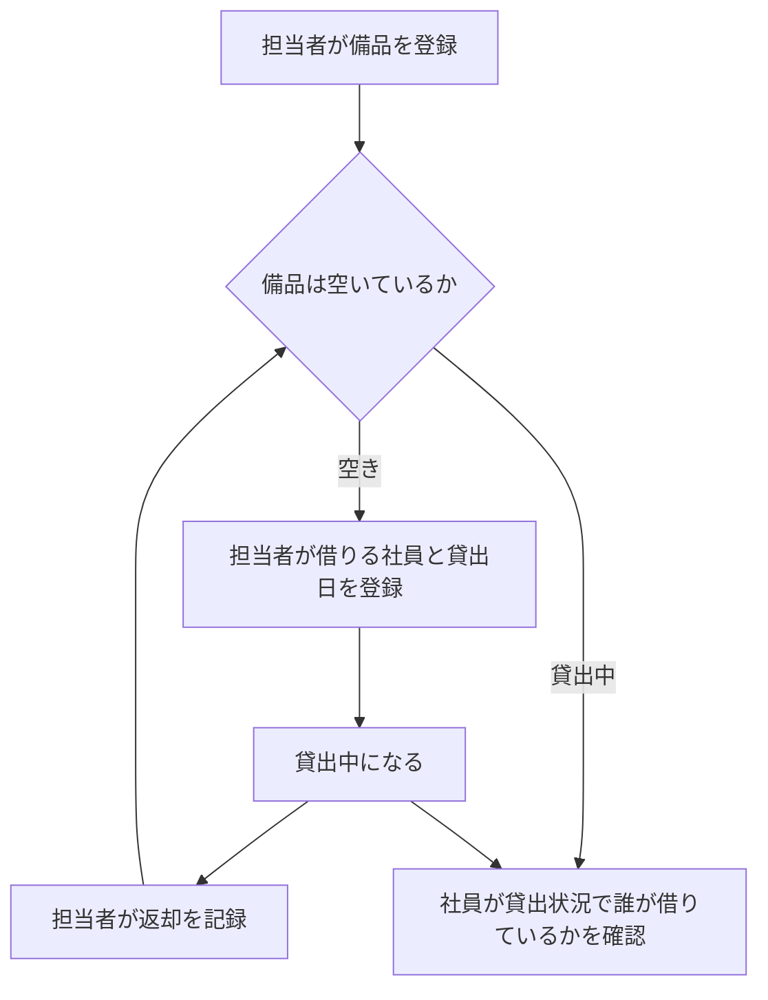
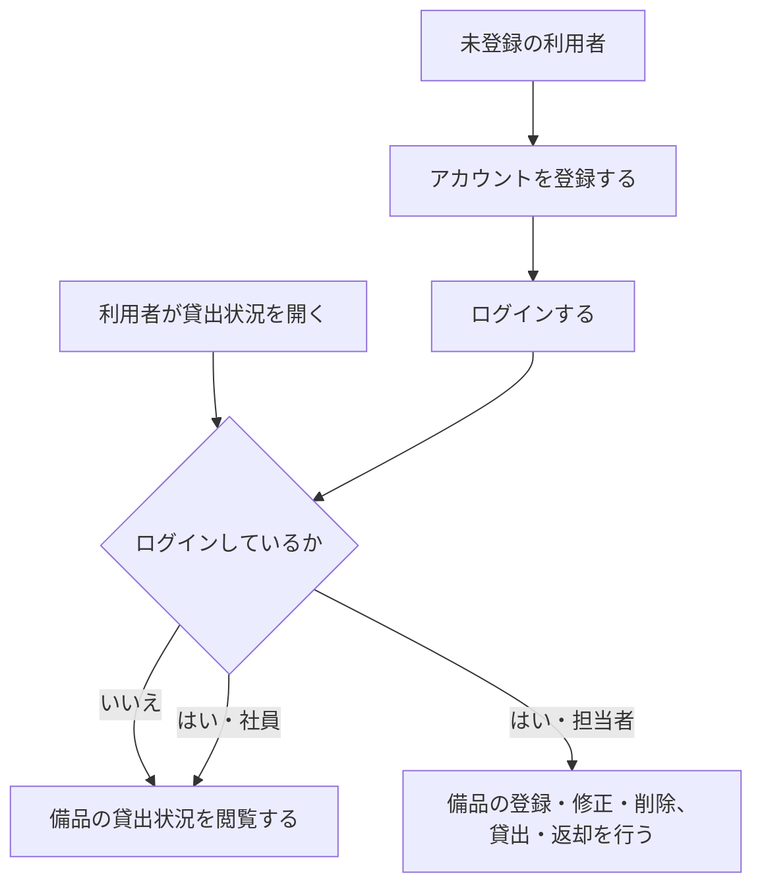
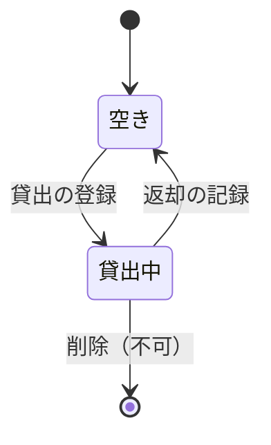
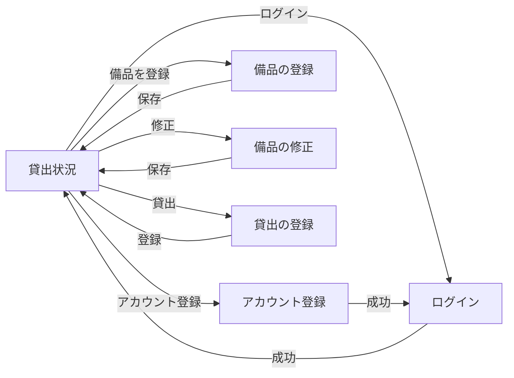

# 要件定義書: 備品の貸出管理

## 1. 目的・前提

### 目的

会社の備品の貸出を 1 つのアプリで管理し、どの備品を誰が借りているかを社員が自分で確かめられ、総務の台帳（記録）が食い違ったり消えたりしない状態にする。

### 用語集

| 用語 | 業務上の意味 | 本案件での使用範囲 | 同義語/類義語 |
|---|---|---|---|
| 備品 | 会社が貸し出す物品 | 管理番号と備品名で登録する単位 | 機材 |
| 管理番号 | 備品を一意に区別する番号（半角英数字とハイフン） | 備品の一意キー | 資産番号 |
| 社員 | 会社の従業員。アカウントを持つ利用者 | 貸出を借りる側として選ぶ | 利用者 |
| 担当者 | 総務など、備品の登録と貸出の記録を行う利用者 | 備品の登録・修正・削除、貸出・返却の記録 | 管理者 |
| 貸出 | ある備品を、ある社員に、ある日付で貸すこと | 貸出記録 1 件として登録する | 貸し出し |
| 返却 | 貸出中の備品が戻ること | 貸出記録を消して空きに戻す | 返納 |
| 空き | 貸出記録が無い備品の状態 | 状態の表示 | 在庫 |
| 貸出中 | 貸出記録がある備品の状態 | 状態の表示 | 貸出済 |

### システムの形態

- GUI（ブラウザで開く画面）。CUI・Web API・バッチは無い。

### 1-1. 技術制約（前提として記録する。要件ではないため ID は付与しない）

| 制約項目 | 内容 | 出どころ（誰がいつ答えたか） |
|---|---|---|
| 既存コードベース | 無し（新規開発） | 依頼文（既存は Excel の台帳と紙の貸出票のみ） |
| 配備先 | 社内のサーバーで動かし、社内のネットワークからだけ開く。コンテナは使わない前提 | 依頼文 |
| チームの技術 | 特に無い。ただし採点の契約（contract.md）により Python 3.12 で動くこと、起動は `bash run.sh`、準備は `bash setup.sh` | 依頼文と contract.md |
| ライセンスとコスト | 無償のものだけを使う。有償ソフトと有償サービスは使わない | 依頼文 |
| 性能と規模の目安 | 利用者は社員と担当者の合計で 50 人まで。備品は数百件まで | 依頼文 |

### 1-2. 依頼に無く自分で決めた項目（必須）

依頼の回答が無いため、最小案で決めた。承認列が「未確認」の項目は、依頼者の確認を待つ。

| 項目 | 決めた内容 | 根拠（最小案か、依頼のどこから推測したか） | 承認（承認済 / 未確認） |
|---|---|---|---|
| 開始ゲート: 外部連携 | 外部連携は無い | 依頼文に外部システムの記述が無い | 未確認 |
| 開始ゲート: 既存ソース | 既存ソースコードは無い（新規フロー） | 依頼文は Excel と紙の台帳のみ | 未確認 |
| 担当者の初回登録 | 同時に 2 人が初回登録しても担当者は 1 人だけ（登録処理を直列化する） | 依頼の「1 件も無いときに登録した人」を一意に満たすため | 未確認 |
| 名前の入力 | 前後の空白を除いて 1 文字以上 30 文字以下。空白だけは不可。同じ名前は登録できる（社員番号で区別） | 依頼の「30 文字以内」に空の入力の扱いを足した最小案 | 未確認 |
| パスワードの上限 | 8 文字以上、上限は設けない。文字種の制限は無い | 依頼は下限のみ。上限を設けると依頼に無い制限になるため | 未確認 |
| パスワードの保存 | 元の文字列を保存せず、一方向のハッシュで保存する | 社内でも平文保存は避けるのが最小の安全策 | 未確認 |
| 登録後の動き | 登録後は自動でログインせず、ログイン画面に移って案内を出す | 契約の文言「登録しました。ログインしてください」から | 未確認 |
| 入力エラー時の再表示 | エラーで画面を出し直すとき、入力した値は消さない（パスワード欄も含む） | contract.md の「入力した値は消さない」を全入力欄に当てた。社内限定の画面でパスワードを再表示する点は要確認 | 未確認 |
| 管理番号の形式 | 半角英数字とハイフンだけ、1 文字以上 20 文字以下。前後の空白は不可。大文字と小文字は区別する | 依頼の形式と桁数に、区別の扱いを最小案で足した | 未確認 |
| 管理番号の重複 | 完全一致（大文字と小文字を区別）で重複を拒否する | 同上 | 未確認 |
| 備品名の入力 | 前後の空白を除いて 1 文字以上 50 文字以下。空白だけは不可。同じ備品名は登録できる | 依頼の「50 文字以内」に空の入力の扱いを足した | 未確認 |
| 備品の修正 | 管理番号と備品名の両方を修正できる。貸出中の備品も修正できる（貸出記録は内部の番号で結ぶ） | 依頼の「修正」は両項目を対象とする最小案 | 未確認 |
| 貸出中の備品の削除 | 削除を拒否し、理由を `.error` に出す。貸出記録は消さない | 貸出記録の食い違いを防ぐ依頼の趣旨に合わせた最小案 | 未確認 |
| 貸出の対象 | 空きの備品だけ貸し出せる。貸出中の備品への貸出は拒否する | 依頼の「空いている備品について」 | 未確認 |
| 貸出日 | 既定は今日（日本時間）。YYYY-MM-DD の日付で、今日より後の日付は拒否する。過去の日付は許可する | 依頼の「既定は今日」と、未来の貸出を記録しないための最小案 | 未確認 |
| 借りる社員の選択肢 | 登録済みの全アカウント（担当者を含む）を「名前（社員番号）」で並べる。未選択は拒否する | 依頼の「借りる社員はアカウントから選ぶ」 | 未確認 |
| 返却の権限 | 返却は担当者だけが記録できる | 依頼に返却の行為者が書かれていない。貸出と同じ担当者の作業とみなす | 未確認 |
| 返却の確認 | 返却ボタンは確認ダイアログで「はい」のときだけ返却する。ダイアログの文言は「返却を記録しますか？」 | 依頼の確認ダイアログの要件に文言を足した | 未確認 |
| 削除の確認 | 削除ボタンは確認ダイアログで「はい」のときだけ削除する。文言は「この備品を削除しますか？」 | 同上 | 未確認 |
| 権限の範囲 | 社員は貸出状況の閲覧と自分のログイン・ログアウトだけ。担当者は備品の登録・修正・削除、貸出・返却の記録ができる。アカウントの変更・削除は誰もできない | 依頼の役割の記述から最小案 | 未確認 |
| 権限違反の直接アクセス | 社員が担当者の画面を URL で開いたら、`.error` に「この操作は担当者だけができます」と出す。未ログインで担当者の画面を開いたらログイン画面に移る | 依頼に無い操作。画面を出さないだけでは直接の URL を防げないため | 未確認 |
| ログインの保持 | ログイン状態はブラウザを閉じるまで保つ。パスワードの変更・アカウントの削除の機能は無い | 依頼に無い機能は足さない。保持期間は最小案 | 未確認 |
| 一覧の並び順 | 管理番号の文字列としての昇順（ASCII の順。大文字と小文字は区別する） | 依頼の「管理番号の昇順」の文字の順序を最小案で決めた | 未確認 |
| 一覧の表示 | 空きの行は借りている社員と貸出日を空欄にする。備品が 0 件のときは表を出さず「備品は登録されていません」を出す | 依頼の 0 件の文言と、空き行の表示 | 未確認 |
| 操作の結果の文言 | 備品の登録「備品を登録しました」、修正「備品を修正しました」、削除「備品を削除しました」、貸出「貸出を登録しました」、返却「返却を記録しました」、ログアウト「ログアウトしました」を `.message` に出す | 依頼の成功の知らせに文言を足した | 未確認 |
| 同時の貸出 | 同じ備品に同時に貸出が来たら 1 件だけ成功し、もう 1 件は「この備品は既に貸し出されています」を `.error` に出す | 貸出中の二重記録を防ぐ依頼の趣旨から | 未確認 |
| 利用人数と備品数の扱い | 利用人数 50 人と備品数百件は想定規模。登録数の上限は機能として設けない | 依頼の規模は上限の記述ではない | 未確認 |
| 応答時間の目標 | 備品 500 件・利用 50 人で、貸出状況の一覧の表示を 2 秒以内に終える | 依頼に応答時間の記述が無い。最小の目安として決めた | 未確認 |
| 可用性 | 可用性の要求は無い（止めてよい時間の指定も無い） | 依頼に記述が無い | 未確認 |
| 移行 | 移行は無い。既存の Excel 台帳と紙の貸出票の内容は、このアプリへ取り込まない。最初は備品もアカウントも 0 件で始める | 依頼に移行の記述が無い。契約の「空なら 0 件で始まる」 | 未確認 |
| データの保持 | 登録したデータは期限を設けず保持する。バックアップは要件に含めない | 依頼に記述が無い。最小案 | 未確認 |
| ログと監視 | 監査ログ、監視・アラートは要件に含めない（アプリの標準の動作ログのみ） | 依頼に記述が無い | 未確認 |
| アクセス経路 | アプリは社内ネットワークの判定を持たない。社内ネットワーク以外からの接続は、サーバー側の通信制御で止める（運用手順として書く） | 依頼の「社内のネットワークからだけ開く」を最小の方法で満たす | 未確認 |
| 見込み経営効果 | 算定しない（理由は 2-3 に書く） | 依頼に件数や単価が無い | 未確認 |

## 2. 業務

### 対象業務一覧

| RQ-BZ-ID | 業務名 | 業務の範囲 | 担当者 |
|---|---|---|---|
| `RQ-BZ-EQUIPMENT-LENDING` | 備品の貸出管理 | 備品の登録、貸出、返却、貸出状況の確認 | 担当者（総務）、社員（閲覧） |

### 業務フロー

### 2-1. 業務の問題（あるべき姿と現状のギャップ）

| 問題 | 対象業務（RQ-BZ） | あるべき姿 | 現状 | ギャップ（KPI） | 業務影響 |
|---|---|---|---|---|---|
| 備品の記録が 2 種類（Excel と紙）あり、どれが最新か分からない | `RQ-BZ-EQUIPMENT-LENDING` | 記録は 1 つで、常に最新の貸出状況が分かる | Excel の台帳と紙の貸出票が並存し、記録が食い違ったり消えたりしている | 食い違い・消失の件数は不明（依頼に数値が無い） | 誰が借りているか分からず、備品の所在を確かめられない |
| 誰が何を借りているかを、社員が総務へ問い合わせないと分からない | `RQ-BZ-EQUIPMENT-LENDING` | 社員が自分で貸出状況を確かめられる | 担当者が 1 回 15 分かけて調べている | 問い合わせの件数は不明。1 回あたり 15 分 | 担当者の作業が増え、社員の待ち時間も生じる |

### 2-2. 業務課題一覧（必須）

| RQ-BK-ID | 業務課題（取り組むこと） | 解決する問題（2-1） | 解決後の状態（KPI の目標値） | 対象業務（RQ-BZ） |
|---|---|---|---|---|
| `RQ-BK-LEDGER-CONSOLIDATION` | Excel の台帳と紙の貸出票を、1 つのアプリの記録に統一する | 記録が 2 種類ある | 備品の記録が 1 つになり、食い違いと消失の件数が 0 件 | `RQ-BZ-EQUIPMENT-LENDING` |
| `RQ-BK-LENDING-RECORD-ACCURACY` | 貸出と返却をアプリで記録し、誰が借りているかを正しく残す | 記録が 2 種類ある。誰が借りているか分からない | 貸出中の備品ごとに借りている社員と貸出日が必ず記録される | `RQ-BZ-EQUIPMENT-LENDING` |
| `RQ-BK-SELF-SERVICE-STATUS` | 社員が貸出状況を自分で確かめられるようにする | 担当者が 1 回 15 分かけて調べている | 社員が問い合わせずに貸出状況を確認でき、担当者の調べ作業が 0 件 | `RQ-BZ-EQUIPMENT-LENDING` |
| `RQ-BK-ACCOUNT-IDENTITY` | 社員が自分のアカウントで利用し、借りる人を社員番号で特定できるようにする | 誰が借りているか分からない。社員が問い合わせないと分からない | 貸出の記録がすべてアカウントの社員に結びつく | `RQ-BZ-EQUIPMENT-LENDING` |

業務課題と要件の対応表（同じ行の要件 ID は、その業務課題を解決するための要件）:

| RQ-BK-ID | 対応する要件 ID |
|---|---|
| `RQ-BK-LEDGER-CONSOLIDATION` | `RQ-FT-REGISTER-EQUIPMENT`, `RQ-FT-EDIT-EQUIPMENT`, `RQ-FT-DELETE-EQUIPMENT`, `RQ-UI-EQUIPMENT-NEW-SCREEN`, `RQ-UI-EQUIPMENT-EDIT-SCREEN`, `RQ-DT-EQUIPMENT-ENTITY`, `RQ-DT-DATA-STORAGE`, `RQ-NF-INTERNAL-ACCESS`, `RQ-OP-START-AND-INIT` |
| `RQ-BK-LENDING-RECORD-ACCURACY` | `RQ-FT-LEND-EQUIPMENT`, `RQ-FT-RETURN-EQUIPMENT`, `RQ-FT-ONE-LENDING-PER-EQUIPMENT`, `RQ-FT-NO-DELETE-LENT`, `RQ-FT-ROLE-PERMISSION`, `RQ-UI-LENDING-NEW-SCREEN`, `RQ-DT-LENDING-ENTITY`, `RQ-DT-LENDING-START`, `RQ-DT-LENDING-END` |
| `RQ-BK-SELF-SERVICE-STATUS` | `RQ-FT-VIEW-STATUS`, `RQ-UI-STATUS-SCREEN`, `RQ-NF-RESPONSE-TIME` |
| `RQ-BK-ACCOUNT-IDENTITY` | `RQ-FT-REGISTER-ACCOUNT`, `RQ-FT-LOGIN`, `RQ-FT-LOGOUT`, `RQ-UI-REGISTER-ACCOUNT-SCREEN`, `RQ-UI-LOGIN-SCREEN`, `RQ-DT-ACCOUNT-ENTITY`, `RQ-NF-PASSWORD-HASHING` |

### 2-3. 見込み経営効果

見込み経営効果は算定しない（理由: 依頼に問い合わせの件数、備品の貸出件数、人件費の単価が無く、金額も時間も算定できないため。問い合わせ 1 回あたり 15 分という数値のみが分かっている）。

## 3. 機能要件

- 入力データ: 人手入力のみ（ブラウザのフォーム）。外部からのデータ取り込みは無い。
- 出力データ: 画面の表示のみ。帳票・出力ファイルは無い。

### 利用フロー

業務フローとの対応: 業務フローの「備品を登録」は利用フローの担当者の備品の登録に、「貸出の登録」と「返却の記録」は貸出・返却に、「貸出状況の確認」は閲覧に対応する。

### 機能一覧

| RQ-ID | カテゴリ | 機能名 | 対応業務課題ID（RQ-BK-*） | この機能が無いと何が困るか |
|---|---|---|---|---|
| `RQ-FT-REGISTER-ACCOUNT` | 共通 | アカウントを登録する（社員番号・名前・パスワードを検証し、先着 1 名を担当者、2 人目以降を社員にする） | `RQ-BK-ACCOUNT-IDENTITY` | 社員が貸出の相手として選ばれず、借りた人を特定できない |
| `RQ-FT-LOGIN` | 共通 | 社員番号とパスワードでログインする | `RQ-BK-ACCOUNT-IDENTITY` | 利用者を識別できず、担当者の操作を限定できない |
| `RQ-FT-LOGOUT` | 共通 | ログアウトする | `RQ-BK-ACCOUNT-IDENTITY` | 共用の端末で他人の操作が続いてしまう |
| `RQ-FT-ROLE-PERMISSION` | 共通 | 担当者だけが備品の登録・修正・削除、貸出・返却を行い、社員は閲覧だけにする | `RQ-BK-LENDING-RECORD-ACCURACY` | 社員が勝手に記録を書き換え、記録が食い違う |
| `RQ-FT-REGISTER-EQUIPMENT` | マスタ管理 | 備品を登録する（管理番号・備品名を検証する） | `RQ-BK-LEDGER-CONSOLIDATION` | 備品が記録に載らず、台帳を 1 つにできない |
| `RQ-FT-EDIT-EQUIPMENT` | マスタ管理 | 備品の管理番号と備品名を修正する | `RQ-BK-LEDGER-CONSOLIDATION` | 登録の誤りを直せず、記録が古いまま残る |
| `RQ-FT-DELETE-EQUIPMENT` | マスタ管理 | 備品を削除する（貸出中は削除できない） | `RQ-BK-LEDGER-CONSOLIDATION` | 廃棄した備品が残り、一覧が実態と合わない |
| `RQ-FT-NO-DELETE-LENT` | 業務機能 | 貸出中の備品の削除を拒否する業務ルール | `RQ-BK-LENDING-RECORD-ACCURACY` | 貸出中の備品が消え、誰が借りているかの記録も消える |
| `RQ-FT-LEND-EQUIPMENT` | 業務機能 | 空きの備品に、借りる社員と貸出日を記録する | `RQ-BK-LENDING-RECORD-ACCURACY` | 誰が借りているかが記録されない |
| `RQ-FT-ONE-LENDING-PER-EQUIPMENT` | 業務機能 | 1 つの備品に同時に 1 件の貸出だけを認める業務ルール | `RQ-BK-LENDING-RECORD-ACCURACY` | 同じ備品が二重に貸し出され、記録が食い違う |
| `RQ-FT-RETURN-EQUIPMENT` | 業務機能 | 返却を記録し、貸出記録を消して空きに戻す | `RQ-BK-LENDING-RECORD-ACCURACY` | 返却された備品が貸出中のまま残る |
| `RQ-FT-VIEW-STATUS` | 業務機能 | 全備品の管理番号・備品名・状態・借りている社員の名前・貸出日を一覧で表示する（ログイン不要） | `RQ-BK-SELF-SERVICE-STATUS` | 社員が総務に問い合わせるしかなく、担当者の 15 分の作業が続く |

### 3-1. 帳票・出力ファイル

帳票・出力ファイルは無い。

### 3-2. 業務ルール

| RQ-ID | ルール名 | 内容（条件と結果） | 違反時・エラー時の業務上の扱い | 対応業務課題ID（RQ-BK-*） |
|---|---|---|---|---|
| `RQ-FT-ONE-LENDING-PER-EQUIPMENT` | 同時に 1 件の貸出 | 貸出中の備品に貸出を登録しようとしたら、登録しない | 「この備品は既に貸し出されています」を `.error` に出し、記録を変えない | `RQ-BK-LENDING-RECORD-ACCURACY` |
| `RQ-FT-NO-DELETE-LENT` | 貸出中は削除しない | 貸出記録がある備品の削除を求められたら、削除しない | 「貸出中の備品は削除できません」を `.error` に出し、備品も貸出記録も変えない | `RQ-BK-LENDING-RECORD-ACCURACY` |

### 3-3. 外部連携

外部連携は無い。

## 4. データ

### 4-1. データ要件一覧

| RQ-ID | 種別 | 内容 | 対応業務課題ID（RQ-BK-*） | この要件が無いと何が困るか |
|---|---|---|---|---|
| `RQ-DT-DATA-STORAGE` | 内部データ | 全データは社内サーバー上のファイル型のデータベース（SQLite）に保存する。外部データは扱わない。保持期間は期限を設けない。外部データベースの接続は無い。件数の想定は、利用者 50 人、備品数百件、貸出記録は備品と同数まで（増加の想定は無い） | `RQ-BK-LEDGER-CONSOLIDATION` | 記録の保存先が決まらず、台帳を 1 つにできない |

DB が必要か: 必要。貸出記録と備品と利用者の参照関係があり、同時の貸出を 1 件に限るため、トランザクションで扱う必要がある。検索・集計は無い（一覧の表示だけ）。

### 4-2. 業務エンティティとデータ項目

| RQ-ID | カテゴリ | 業務エンティティ名 | 対応業務課題ID（RQ-BK-*） | この業務エンティティが無いと何が困るか |
|---|---|---|---|---|
| `RQ-DT-ACCOUNT-ENTITY` | 利用者 | 利用者アカウント | `RQ-BK-ACCOUNT-IDENTITY` | 貸出の相手を特定できない |
| `RQ-DT-EQUIPMENT-ENTITY` | 備品 | 備品 | `RQ-BK-LEDGER-CONSOLIDATION` | 管理する対象が無い |
| `RQ-DT-LENDING-ENTITY` | 記録 | 貸出記録 | `RQ-BK-LENDING-RECORD-ACCURACY` | 誰が借りているかを残せない |

| エンティティ名 | 項目名 | 業務上の意味 | 必須 | 形式・桁 | 値の範囲・制約 | 例 |
|---|---|---|---|---|---|---|
| 利用者アカウント | 社員番号 | 利用者を区別する番号 | 必須 | 半角数字 6 桁 | 重複不可 | 100001 |
| 利用者アカウント | 名前 | 利用者の名前 | 必須 | 文字列 | 前後の空白を除いて 1〜30 文字、空白だけは不可 | 山田 太郎 |
| 利用者アカウント | パスワード | ログインに使う秘密の文字列 | 必須 | 文字列（保存はハッシュ） | 8 文字以上、上限なし | （保存しない） |
| 利用者アカウント | 役割 | 担当者か社員か | 必須 | 「担当者」または「社員」 | 先着 1 名が担当者、2 人目以降は社員 | 担当者 |
| 備品 | 管理番号 | 備品を区別する番号 | 必須 | 半角英数字とハイフン、1〜20 文字 | 重複不可（大文字と小文字は区別） | EQ-0001 |
| 備品 | 備品名 | 備品の名前 | 必須 | 文字列 | 前後の空白を除いて 1〜50 文字、空白だけは不可 | ノート PC 14 インチ |
| 貸出記録 | 備品 | 貸し出した備品 | 必須 | 備品への参照 | 備品 1 件に貸出記録は最大 1 件 | EQ-0001 |
| 貸出記録 | 借りる社員 | 借りている利用者 | 必須 | 利用者アカウントへの参照 | 登録済みのアカウント | 山田 太郎 |
| 貸出記録 | 貸出日 | 貸し出した日 | 必須 | YYYY-MM-DD（日本時間） | 今日以前の日付 | 2026-11-20 |

### 4-3. CRUD テーブル（必須）

| エンティティ名 | Create | Read（一覧） | Read（詳細） | 検索 | Update | Delete | 備考 |
|---|---|---|---|---|---|---|---|
| 利用者アカウント | ○ | × | × | × | × | × | 登録は誰でも可（先着 1 名が担当者）。一覧・変更・削除は無い |
| 備品 | ○ | ○ | △ | × | ○ | ○ | 詳細は修正画面で表示する。Delete は貸出中なら不可（業務ルール）。Update は管理番号の重複を検査 |
| 貸出記録 | ○ | △ | × | × | × | ○ | Create は空きの備品だけ（同時の貸出は 1 件に限る。トランザクション）。Read は貸出状況の一覧の中で表示する。Delete は返却のときに行う（トランザクション） |

### 4-4. 状態遷移

備品の状態（空き / 貸出中）は貸出記録の有無で決まる。

| RQ-ID | エンティティ名 | 遷移前の状態 | きっかけ（操作・条件） | 遷移後の状態 | 対応業務課題ID（RQ-BK-*） |
|---|---|---|---|---|---|
| `RQ-DT-LENDING-START` | 備品 | 空き | 担当者が借りる社員と貸出日を登録する | 貸出中 | `RQ-BK-LENDING-RECORD-ACCURACY` |
| `RQ-DT-LENDING-END` | 備品 | 貸出中 | 担当者が返却を記録する | 空き | `RQ-BK-LENDING-RECORD-ACCURACY` |

### 4-5. 画面一覧

| RQ-ID | 画面名 | 対応する CRUD 操作（エンティティ名:操作種別） | 主な機能・目的 | 対応業務課題ID（RQ-BK-*） |
|---|---|---|---|---|
| `RQ-UI-STATUS-SCREEN` | 貸出状況（トップ） | 備品:Read（一覧）、貸出記録:Read（一覧）、備品:Delete・貸出記録:Create・貸出記録:Delete（行の操作ボタンの呼び出し） | 全備品の状態と借りている社員を一覧で見る。担当者には行の操作ボタンを出す | `RQ-BK-SELF-SERVICE-STATUS` |
| `RQ-UI-REGISTER-ACCOUNT-SCREEN` | アカウント登録 | 利用者アカウント:Create | 社員番号・名前・パスワードで登録する | `RQ-BK-ACCOUNT-IDENTITY` |
| `RQ-UI-LOGIN-SCREEN` | ログイン | 利用者アカウント:Read（認証） | 社員番号とパスワードでログインする | `RQ-BK-ACCOUNT-IDENTITY` |
| `RQ-UI-EQUIPMENT-NEW-SCREEN` | 備品の登録 | 備品:Create | 管理番号と備品名を入力して登録する（担当者だけ） | `RQ-BK-LEDGER-CONSOLIDATION` |
| `RQ-UI-EQUIPMENT-EDIT-SCREEN` | 備品の修正 | 備品:Read（詳細）、備品:Update | 管理番号と備品名を修正する（担当者だけ） | `RQ-BK-LEDGER-CONSOLIDATION` |
| `RQ-UI-LENDING-NEW-SCREEN` | 貸出の登録 | 貸出記録:Create | 借りる社員と貸出日を選んで登録する（担当者だけ） | `RQ-BK-LENDING-RECORD-ACCURACY` |

#### 画面ごとの仕様（5 項目）

- 貸出状況（トップ）: 目的は全備品の状況を見ること。主要要素は貸出状況の表、「ログイン」「アカウント登録」（未ログイン時のリンク）、「ログアウト」ボタン（ログイン時）、「備品を登録」リンク（担当者だけ）、行の操作ボタン（担当者だけ）。入力項目は無い。表示項目は管理番号、備品名、状態、借りている社員の名前、貸出日。エラー時は `.error` か `.message` に出す。
- アカウント登録: 入力項目は社員番号、名前、パスワード（いずれも必須）。表示は入力欄と「登録」ボタン。エラーは入力欄ごとに `.field-error`。成功時はログイン画面に移り「登録しました。ログインしてください」を出す。
- ログイン: 入力項目は社員番号、パスワード。「ログイン」ボタン。失敗時は `.error` に「社員番号またはパスワードが違います」。
- 備品の登録: 入力項目は管理番号、備品名。「保存」ボタン。エラーは入力欄ごとに `.field-error`。成功時は貸出状況に移り `.message`。
- 備品の修正: 入力項目は管理番号、備品名。「保存」ボタン。修正前の値を初期表示する。エラーと成功の出し方は備品の登録と同じ。
- 貸出の登録: 入力項目は借りる社員（選択）、貸出日（既定は今日）。「登録」ボタン。成功時は貸出状況に移る。エラーは入力欄ごとに `.field-error`、対象の備品の状態による拒否は `.error`。

画面遷移図:

## 5. 非機能要件

- 利用者の種別とアクセス経路: 利用者は社員と担当者（社内の利用者だけ）。アクセスは社内ネットワークからに限る。貸出状況の閲覧だけは、ログインしていない社内の利用者にも開く。
- 性能: 備品 500 件、利用者 50 人の規模で、貸出状況の一覧の表示を 2 秒以内に終える。
- 利用人数: 社員と担当者の合計 50 人まで。同時に操作する人数の要求は無い。
- 可用性: 可用性の要求は無い。
- 移行性: 移行は無い。
- セキュリティ: 認証はパスワード認証（社員番号とパスワード）。SSO は無い。権限制御の粒度はページ単位（担当者の画面は社員に開かない）とボタン単位（担当者だけに行の操作ボタンを出す）。ロールは 2 種類（担当者、社員）。権限の例外運用は無い。監査証跡の改ざん防止は要求しない。

| RQ-ID | カテゴリ | 非機能要件名 | 対応業務課題ID（RQ-BK-*） | この非機能要件が無いと何が困るか |
|---|---|---|---|---|
| `RQ-NF-INTERNAL-ACCESS` | アクセス経路 | 社内の利用者だけが社内ネットワークから利用する | `RQ-BK-LEDGER-CONSOLIDATION` | 社外から記録が見られ、外部に備品の情報が漏れる |
| `RQ-NF-RESPONSE-TIME` | 性能 | 備品 500 件、利用者 50 人で、貸出状況の一覧の表示を 2 秒以内に終える | `RQ-BK-SELF-SERVICE-STATUS` | 一覧が遅く、社員が結局担当者に問い合わせる |
| `RQ-NF-PASSWORD-HASHING` | セキュリティ | パスワードは元の文字列で保存せず、一方向のハッシュで保存する | `RQ-BK-ACCOUNT-IDENTITY` | データベースが漏れたとき、パスワードがそのまま漏れる |

## 6. 運用要件

- ログ: アプリの標準の動作ログとエラーログのみ。ログの内容の要件は無い。
- 監査ログ: 要求しない。
- 監視・アラート: 監視・アラートは必要ないため、監視・アラートの内容と対応方法の記述は行わない。
- バックアップと復旧: バックアップは要件に含めない。データは期限を設けず保持する。

| RQ-ID | 種別 | 内容 | 対応業務課題ID（RQ-BK-*） | この要件が無いと何が困るか |
|---|---|---|---|---|
| `RQ-OP-START-AND-INIT` | 起動・初期化 | `bash setup.sh` で準備し、`bash run.sh` で起動する。データの保存先（`DATA_DIR`）が無ければ作る。データベースは起動時に無ければ作り、備品もアカウントも 0 件で始める。待ち受けは `PORT`（既定 8000） | `RQ-BK-LEDGER-CONSOLIDATION` | 起動の手順が決まらず、運用者が動かせない |

## 7. テスト用利用シナリオ

| RQ-ID | テスト目的 | 前提条件 | テスト手順 | 期待される結果 | 検証する要件ID | 対応業務課題ID（RQ-BK-*） |
|---|---|---|---|---|---|---|
| `RQ-TS-FIRST-ACCOUNT-IS-MANAGER` | 最初の登録者が担当者になること | アカウントが 0 件 | アカウント登録画面で社員番号 100001、名前「山田 太郎」、パスワード 8 文字以上を入力して登録する。ログインする | 登録後にログイン画面に「登録しました。ログインしてください」が出る。ログインすると担当者の操作（備品を登録）が見える | `RQ-FT-REGISTER-ACCOUNT`, `RQ-FT-LOGIN`, `RQ-UI-REGISTER-ACCOUNT-SCREEN`, `RQ-UI-LOGIN-SCREEN` | `RQ-BK-ACCOUNT-IDENTITY` |
| `RQ-TS-SECOND-ACCOUNT-IS-MEMBER` | 2 人目以降が社員になること | 担当者が 1 件登録済み | 別の社員番号 100002 で登録し、ログインする | 役割が社員になり、「備品を登録」と行の操作ボタンが見えない | `RQ-FT-REGISTER-ACCOUNT`, `RQ-FT-ROLE-PERMISSION`, `RQ-UI-REGISTER-ACCOUNT-SCREEN` | `RQ-BK-ACCOUNT-IDENTITY` |
| `RQ-TS-REJECT-INVALID-ACCOUNT` | 不正な登録入力が拒否されること | 登録画面を開いている | 社員番号 12345（5 桁）、名前が空、パスワード 7 文字で登録する。さらに既に登録済みの社員番号で登録する | 入力欄ごとに `.field-error` が出て、入力した値が残る。登録されない | `RQ-FT-REGISTER-ACCOUNT`, `RQ-UI-REGISTER-ACCOUNT-SCREEN` | `RQ-BK-ACCOUNT-IDENTITY` |
| `RQ-TS-LOGIN-LOGOUT` | ログインとログアウトができること | アカウントが登録済み | 正しい社員番号とパスワードでログインし、`.current-user` に名前が出ることを確かめ、ログアウトする | ログイン後に名前が出る。ログアウト後は「ログイン」「アカウント登録」のリンクが出る | `RQ-FT-LOGIN`, `RQ-FT-LOGOUT`, `RQ-UI-LOGIN-SCREEN` | `RQ-BK-ACCOUNT-IDENTITY` |
| `RQ-TS-LOGIN-FAILURE` | 違うパスワードでログインできないこと | アカウントが登録済み | 正しい社員番号と違うパスワードでログインする | `.error` に「社員番号またはパスワードが違います」が出て、ログインしていない | `RQ-FT-LOGIN`, `RQ-UI-LOGIN-SCREEN` | `RQ-BK-ACCOUNT-IDENTITY` |
| `RQ-TS-REGISTER-EQUIPMENT` | 担当者が備品を登録できること | 担当者でログイン済み | 「備品を登録」から管理番号 EQ-0001、備品名「ノート PC 14 インチ」で保存する | 貸出状況に EQ-0001 の行が「空き」で出て、`.message` に「備品を登録しました」が出る | `RQ-FT-REGISTER-EQUIPMENT`, `RQ-UI-EQUIPMENT-NEW-SCREEN` | `RQ-BK-LEDGER-CONSOLIDATION` |
| `RQ-TS-REJECT-INVALID-EQUIPMENT` | 不正な備品の入力と重複が拒否されること | 担当者でログイン済みで、EQ-0001 が登録済み | 管理番号に「EQ 0002」（空白を含む）、備品名を空で保存する。次に管理番号「EQ-0001」で保存する | 入力欄ごとに `.field-error` が出る。重複は拒否され、入力した値が残る。備品は増えない | `RQ-FT-REGISTER-EQUIPMENT`, `RQ-UI-EQUIPMENT-NEW-SCREEN` | `RQ-BK-LEDGER-CONSOLIDATION` |
| `RQ-TS-EDIT-EQUIPMENT` | 備品の修正ができること | EQ-0001 が登録済み | 修正画面で管理番号を EQ-0002、備品名を「ノート PC 16 インチ」に変えて保存する | 一覧で EQ-0002 の行に新しい備品名が出て、`.message` に「備品を修正しました」が出る | `RQ-FT-EDIT-EQUIPMENT`, `RQ-UI-EQUIPMENT-EDIT-SCREEN` | `RQ-BK-LEDGER-CONSOLIDATION` |
| `RQ-TS-DELETE-EQUIPMENT` | 空きの備品を削除できること | EQ-0002 が登録済みで空き | 行の「削除」を押し、確認ダイアログで「はい」を選ぶ | 一覧から EQ-0002 の行が消え、`.message` に「備品を削除しました」が出る | `RQ-FT-DELETE-EQUIPMENT` | `RQ-BK-LEDGER-CONSOLIDATION` |
| `RQ-TS-REFUSE-DELETE-LENT` | 貸出中の備品は削除されないこと | EQ-0001 が貸出中 | 行の「削除」を押し、確認ダイアログで「はい」を選ぶ | `.error` に「貸出中の備品は削除できません」が出て、一覧の行と貸出記録が残る | `RQ-FT-DELETE-EQUIPMENT`, `RQ-FT-NO-DELETE-LENT`, `RQ-UI-STATUS-SCREEN` | `RQ-BK-LENDING-RECORD-ACCURACY` |
| `RQ-TS-LEND-EQUIPMENT` | 空きの備品を社員に貸し出せること | EQ-0001 が空き、社員 100002 が登録済み | 行の「貸出」を押し、借りる社員に「山田 太郎（100001）」、貸出日を今日のままで「登録」する | 貸出状況に戻り、EQ-0001 が「貸出中」、借りている社員の名前、今日の貸出日で出る。`.message` に「貸出を登録しました」が出る | `RQ-FT-LEND-EQUIPMENT`, `RQ-UI-LENDING-NEW-SCREEN`, `RQ-UI-STATUS-SCREEN` | `RQ-BK-LENDING-RECORD-ACCURACY` |
| `RQ-TS-REJECT-INVALID-LENDING` | 貸出の入力の不備と貸出中の備品への貸出が拒否されること | EQ-0001 が貸出中、EQ-0003 が空き | 貸出画面で借りる社員を選ばずに「登録」する。貸出日を明日の日付にして「登録」する。貸出中の EQ-0001 の貸出画面を直接開いて登録する | 借りる社員と貸出日は `.field-error` が出る。EQ-0001 の貸出は `.error` で拒否され、貸出記録は変わらない | `RQ-FT-LEND-EQUIPMENT`, `RQ-FT-ONE-LENDING-PER-EQUIPMENT`, `RQ-UI-LENDING-NEW-SCREEN` | `RQ-BK-LENDING-RECORD-ACCURACY` |
| `RQ-TS-RETURN-EQUIPMENT` | 返却で空きに戻ること | EQ-0001 が貸出中 | 行の「返却」を押し、確認ダイアログで「はい」を選ぶ | EQ-0001 が「空き」になり、借りている社員の名前と貸出日が消える。`.message` に「返却を記録しました」が出る | `RQ-FT-RETURN-EQUIPMENT`, `RQ-FT-ROLE-PERMISSION`, `RQ-UI-STATUS-SCREEN` | `RQ-BK-LENDING-RECORD-ACCURACY` |
| `RQ-TS-VIEW-STATUS-ANONYMOUS` | ログインしていなくても貸出状況が見られ、操作ボタンが出ないこと | 備品が 2 件（1 件は貸出中） | ログアウトした状態で貸出状況を開く | 全備品が管理番号の昇順で並び、状態・借りている社員の名前・貸出日が出る。行の操作ボタンが無い | `RQ-FT-VIEW-STATUS`, `RQ-UI-STATUS-SCREEN`, `RQ-FT-ROLE-PERMISSION` | `RQ-BK-SELF-SERVICE-STATUS` |
| `RQ-TS-VIEW-EMPTY-STATUS` | 備品が 0 件のときの表示 | 備品が 0 件 | 貸出状況を開く | 「備品は登録されていません」が出て、表は出ない | `RQ-FT-VIEW-STATUS`, `RQ-UI-STATUS-SCREEN` | `RQ-BK-SELF-SERVICE-STATUS` |
| `RQ-TS-MEMBER-CANNOT-OPEN-MANAGER-SCREEN` | 社員が担当者の画面を開けないこと | 社員でログイン済み | 備品の登録画面の URL を直接開く | `.error` に「この操作は担当者だけができます」が出て、登録画面の入力欄は出ない | `RQ-FT-ROLE-PERMISSION`, `RQ-UI-EQUIPMENT-NEW-SCREEN` | `RQ-BK-LENDING-RECORD-ACCURACY` |
| `RQ-TS-STATUS-RESPONSE-TIME` | 一覧の表示が 2 秒以内であること | 備品 500 件と利用者 50 人が登録済み | 貸出状況を開き、表示が終わるまでの時間を測る | 2 秒以内に全行が表示される | `RQ-NF-RESPONSE-TIME`, `RQ-FT-VIEW-STATUS` | `RQ-BK-SELF-SERVICE-STATUS` |
| `RQ-TS-PASSWORD-NOT-STORED-PLAIN` | パスワードが元の文字列で保存されないこと | アカウントを 1 件登録した | 登録したパスワードの文字列が、データベースのファイルに含まれないことを調べる | 元のパスワードの文字列はデータベースに無い | `RQ-NF-PASSWORD-HASHING`, `RQ-FT-REGISTER-ACCOUNT` | `RQ-BK-ACCOUNT-IDENTITY` |
