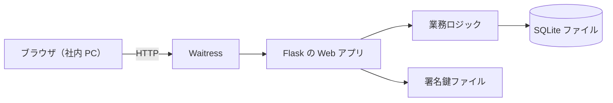
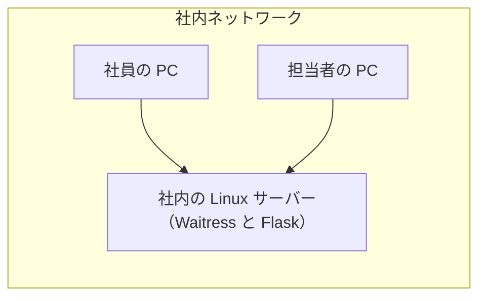
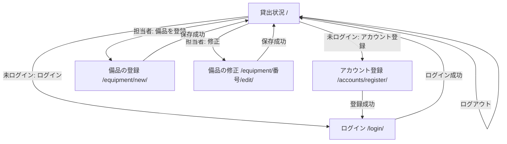
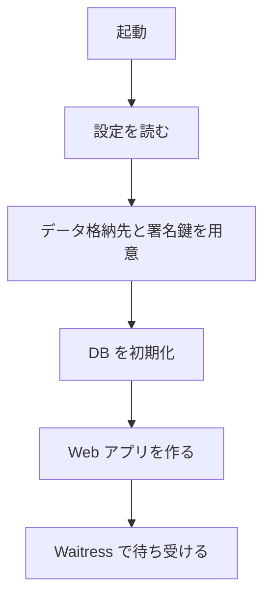

# 備品台帳・貸出状況 詳細設計書

## 1. 言語・フレームワーク・アーキテクチャの選定

### 1-1. 技術制約の要約

要件定義書 1-1 のとおり。既存コードは無い。社内の Linux サーバーで `bash run.sh` により直接起動する（コンテナは使わない）。無償のものだけを使う。利用者は 50 人まで、備品は数百件、アカウントは 50 件まで。

### 1-2. 判断軸と候補

| 判断軸 | この案件で効く条件 | 評価 |
|---|---|---|
| 既存資産との整合 | 既存コード無し | 制約無し |
| チームの技術 | Python 3.12 と SQLite で足りる | Python の無償フレームワークを候補にする |
| 配備先 | Linux。コンテナは使わず `bash run.sh` で起動 | 純粋な Python と pip で導入できること |
| 認証と認可の境界 | 社員番号とパスワード、3 ロール（担当者・社員・未ログイン）、無操作 30 分で自動ログアウト | サーバー側でセッションとロールを判定できること |
| 画面の規模 | 画面 5 種、サーバーで描画する単純な一覧と入力フォーム | サーバー描画の軽量フレームワークで足りる |
| データの規模と構造 | 備品数百件、アカウント 50 件、参照関係無し、同時更新あり | SQLite（ファイル DB）で一意制約と トランザクションを使う |
| 外部連携 | 無し | 制約無し |
| ライセンスとコスト | 無償のみ | OSS で無償のライブラリのみ |
| 保守性 | 保守中であること | 各候補の最新版が保守されていること |

候補の比較（出典は PyPI の公式メタデータ。確認日 2026-11-05）:

| 区分 | 候補 | 判断 | 出典 URL | 確認日 |
|---|---|---|---|---|
| Web フレームワーク | Flask 3.1.3 | 採用。ルーティング・Jinja2 テンプレート・署名付き Cookie のセッションが標準。画面 5 種に十分 | https://pypi.org/pypi/Flask/json | 2026-11-05 |
| Web フレームワーク | Django | 不採用。管理画面や ORM など、この規模に不要な機能が多い | 未調査（ユーザー承認: 2026-11-05、ANSWERS.md「推奨の案でよい」） | 2026-11-05 |
| Web フレームワーク | FastAPI | 不採用。Web API を作らないため、型による API 定義の利点が無い | 未調査（ユーザー承認: 2026-11-05、ANSWERS.md「推奨の案でよい」） | 2026-11-05 |
| WSGI サーバー | Waitress 3.0.2 | 採用。純粋な Python で導入でき、Linux で動く。ライセンスは ZPL 2.1 | https://pypi.org/pypi/waitress/json | 2026-11-05 |
| WSGI サーバー | Flask 内蔵の開発サーバー | 不採用。開発用であり、本番の常時起動に向かない | 公式ドキュメントの注意書き（未確認。既知の情報） | 2026-11-05 |
| DB | SQLite（Python 標準の sqlite3） | 採用。導入が不要、一意制約とトランザクションで重複と同時更新を防げる | Python 標準ライブラリ（追加の導入なし） | 2026-11-05 |
| テスト（単体） | pytest 9.2.0 | 採用 | https://pypi.org/pypi/pytest/json | 2026-11-05 |
| テスト（E2E・ブラウザ） | Playwright for Python 1.64.1 | 採用。ブラウザを自動操作し、確認ダイアログも扱える。無償（Apache-2.0） | https://pypi.org/pypi/playwright/json | 2026-11-05 |

ライセンス欄の Flask（BSD-3-Clause）と Playwright（Apache-2.0）は、この環境では Web 検索が許可されず確認できなかった。PyPI の公式メタデータの license 欄は空だった（既知の情報による）。導入前に、社内の利用条件で確認すること。

最終選定:

- 言語: Python 3.12
- フレームワーク: Flask 3.1.3
- WSGI サーバー: Waitress 3.0.2
- DB: SQLite（ファイル 1 つ）
- 実行形態: サーバー（コンテナを使わない）。`bash setup.sh` で導入し、`bash run.sh` で起動する
- テスト: 単体は pytest 9.2.0、E2E は Playwright 1.64.1 と pytest

選定理由: 要件の画面数は少なく、サーバーで描画するため、軽量な Flask で足りる。DB は同時更新で記録を失わないために必要で、SQLite の一意制約とトランザクションで重複と同時登録を防げる。コンテナを使わない条件に合うのは、純粋な Python で導入できる構成。

承認の記録: 技術選定はユーザーの包括承認（ANSWERS.md「技術選定: 推奨の案でよい」）により 2026-11-05 に承認。

### 1-3. 実行形態

サーバー（コンテナを使わない）。起動は `bash run.sh`。導入は `bash setup.sh`（採点の前に 1 回実行）。

## 2. システム構成

### 2-1. コンポーネント一覧

| コンポーネント | 役割 | 実装 |
|---|---|---|
| Web アプリ | 画面の描画、入力の受け付け、セッション、権限の判定 | Flask（`src/equipment_ledger/web.py` ほか） |
| 業務ロジック | 入力の検証、アカウントの登録と認証、備品の登録・修正・削除・一覧 | `src/equipment_ledger/` の各モジュール |
| データ格納 | 備品とアカウントの保存 | SQLite ファイル（`DATA_DIR/equipment.db`） |
| 署名鍵 | セッション Cookie の署名に使う鍵 | `DATA_DIR/secret_key`（初回起動時に生成） |
| 画面テンプレート | HTML の描画 | `src/equipment_ledger/templates/`、`src/equipment_ledger/static/style.css` |

### 2-2. システム全体構成図



### 2-3. 各コンポーネントの役割

- Web アプリ: 利用者の要求を受け、画面を描画する。ログイン状態を Cookie の署名付きセッションで持ち、無操作 30 分でセッションを無効にする。権限（担当者か）は要求ごとにサーバーで判定する。
- 業務ロジック: 入力の形式を検証し、重複を DB の一意制約で防ぐ。備品とアカウントの読み書きを行う。
- データ格納: 2 つのテーブルだけを持つ。

### 2-4. コンポーネント間インターフェースとデータフロー

- ブラウザ → Web アプリ: HTTP（GET と POST）。フォームの入力値を送る。
- Web アプリ → 業務ロジック: 関数呼び出し。成功と失敗（文言の種類）を返す。
- 業務ロジック → SQLite: SQL（トランザクションは関数の中で閉じる）。

ネットワーク越しの通信は、ブラウザと Web アプリの間の HTTP だけ。

### 2-5. ネットワーク構成図



社内ネットワーク以外からの接続は、サーバーの待ち受けと経路（ファイアウォール）で止める。アプリ側では外部への通信を行わない。

## 3. データ設計

### 3-1. データモデル

DB を使う（理由: 複数の担当者が同時に更新しても記録を失わないため。要件 `RQ-DT-SQLITE-DATABASE`）。DB 製品は SQLite（第 1 章の選定どおり）。

テーブルは 2 つ。どちらも一意制約で重複を防ぐ。

**備品テーブル（`DS-SC-EQUIPMENT-TABLE`）**

| カラム | 型 | 制約 | 対応する要件のデータ項目 |
|---|---|---|---|
| id | 整数 | 主キー、自動採番 | （内部キー） |
| equipment_number | テキスト | 必須、一意制約。20 文字以内、半角英数字とハイフン | 管理番号 |
| name | テキスト | 必須、50 文字以内 | 備品名 |

**アカウントテーブル（`DS-SC-ACCOUNT-TABLE`）**

| カラム | 型 | 制約 | 対応する要件のデータ項目 |
|---|---|---|---|
| id | 整数 | 主キー、自動採番 | （内部キー） |
| employee_number | テキスト | 必須、一意制約。6 桁の数字 | 社員番号 |
| name | テキスト | 必須、30 文字以内 | 名前 |
| password_hash | テキスト | 必須。パスワードのハッシュ値（平文は保存しない） | パスワード |
| role | テキスト | 必須。`manager`（担当者）か `employee`（社員） | 役割 |

行の削除は備品だけ（削除の記録は残さない）。アカウントは登録のみで削除しない。

### 3-2. トランザクションと排他制御

| 操作 | トランザクション | 排他制御 |
|---|---|---|
| アカウント登録 | 件数の確認（最初の登録か）と挿入を 1 つのトランザクションで行う。書き込みロックを先に取る（`BEGIN IMMEDIATE`）。失敗時はロールバック | 社員番号の重複は一意制約で防ぐ（同時でも 1 件だけ入る）。最初の登録者の判定は書き込みロックで直列化する |
| 備品の登録 | 1 件の挿入。一意制約違反なら挿入されず、ロールバック | 管理番号の一意制約で同時の重複を防ぐ（後の要求が失敗する） |
| 備品の修正 | 1 件の更新。一意制約違反なら更新されず、ロールバック | 同上。対象の存在を同じトランザクションで確かめる |
| 備品の削除 | 1 件の削除。対象が無ければ何もしない | 同時の削除は、後の要求が「対象の備品が見つかりません」になる |

トランザクションが要る操作は、アカウント登録（最初の登録者の判定）だけ。他は 1 文で完結する。

### 3-3. 状態遷移

状態を持つエンティティは無い（貸出は次の段で追加する）。

## 4. アーキテクチャ設計

### 4-1. 外部設計

利用者向けインターフェース（GUI）。画面一覧:

| 画面 | URL | 対象 | 説明 |
|---|---|---|---|
| 貸出状況（トップ） | `/` | 誰でも | 備品の一覧（管理番号、備品名、状況、借りている社員、貸出日）。ログイン中は名前と「ログアウト」ボタン。未ログインは「ログイン」「アカウント登録」のリンク。担当者は「備品を登録」リンク、行の「修正」「削除」ボタン |
| アカウント登録 | `/accounts/register/` | 誰でも | 社員番号、名前、パスワードの入力欄と「登録」ボタン |
| ログイン | `/login/` | 誰でも | 社員番号、パスワードの入力欄と「ログイン」ボタン |
| 備品の登録 | `/equipment/new/` | 担当者 | 管理番号、備品名の入力欄と「保存」ボタン |
| 備品の修正 | `/equipment/<管理番号>/edit/` | 担当者 | 管理番号、備品名の入力欄（現在の値を入れておく）と「保存」ボタン |
| 備品の削除 | `/equipment/<管理番号>/delete/`（POST） | 担当者 | 貸出状況の行の「削除」ボタンから送る。ブラウザの確認ダイアログ（`window.confirm`）で「はい」のときだけ送信する |
| ログアウト | `/logout/`（POST） | ログイン中 | 貸出状況の「ログアウト」ボタンから送る |

画面の共通部分:

- 画面全体のエラー（ログインの失敗）は `.error` に出す。
- 操作の結果の知らせ（成功や「この操作は担当者だけが行えます」など）は `.message` に出す。
- 入力欄の検証エラーは、入力欄を含む `.field` の中の `.field-error` に出す。エラー時は入力値を入力欄に戻す（パスワードも含む）。
- ログイン中は `.current-user` に名前を出す。

画面遷移:



外部からの要求の扱い（担当者以外の操作の要求）:

- 未ログインで登録・修正・削除の URL を開く（GET）か POST すると、ログイン画面へ戻し、`.message` に「この操作は担当者だけが行えます」を出す。
- 社員でログイン中に同じ要求をすると、貸出状況の画面へ戻し、`.message` に同じ文言を出す。
- 操作の内容は行わない。

#### インターフェース仕様

| DS-ID | 入力 | バリデーション | 出力 | エラー仕様 |
|---|---|---|---|---|
| `DS-IF-EQUIPMENT-STATUS-SCREEN` | なし | なし | 備品の一覧（管理番号の昇順、全行「空き」、借りている社員・貸出日は空欄）。0 件なら「備品は登録されていません」 | なし |
| `DS-IF-ACCOUNT-REGISTER-SCREEN` | 社員番号、名前、パスワード | 社員番号は 6 桁の数字。名前は空でなく 30 文字以内。パスワードは 8 文字以上（`RQ-FT-ACCOUNT-INPUT-RULES`）。社員番号の重複（`RQ-FT-UNIQUE-EMPLOYEE-NUMBER`） | 成功時はログイン画面へ転送し `.message`（「登録しました。ログインしてください」） | 項目ごとに `.field-error`。重複は社員番号の欄 |
| `DS-IF-LOGIN-SCREEN` | 社員番号、パスワード | 形式の検証はしない（違いを示さない） | 成功時は貸出状況の画面へ転送 | 失敗時は `.error`「社員番号またはパスワードが違います」。入力した社員番号は残す |
| `DS-IF-LOGOUT-ACTION` | なし（ログイン中の POST） | なし | 貸出状況の画面へ転送 | なし |
| `DS-IF-EQUIPMENT-NEW-SCREEN` | 管理番号、備品名 | 管理番号は半角英数字とハイフン・20 文字以内（空不可）。備品名は空でなく 50 文字以内（`RQ-FT-EQUIPMENT-INPUT-RULES`）。管理番号の重複（`RQ-FT-UNIQUE-EQUIPMENT-NUMBER`） | 成功時は貸出状況の画面へ転送し `.message`「備品を登録しました」 | 項目ごとに `.field-error`。担当者以外は貸出状況へ転送（`RQ-FT-RESTRICT-EQUIPMENT-OPERATION`） |
| `DS-IF-EQUIPMENT-EDIT-SCREEN` | 管理番号、備品名 | 登録と同じ | 成功時は貸出状況の画面へ転送し `.message`「備品を修正しました」。対象が無ければ `.message`「対象の備品が見つかりません」で貸出状況へ | 登録と同じ。担当者以外は同上 |
| `DS-IF-EQUIPMENT-DELETE-ACTION` | 管理番号（URL） | なし | 貸出状況の画面へ転送し `.message`「備品を削除しました」。対象が無ければ「対象の備品が見つかりません」 | 担当者以外は同上 |

無操作の期限切れ: 無操作 30 分（`SESSION_IDLE_TIMEOUT_SECONDS`）を過ぎた要求は、セッションを捨て、要求された画面に `.message`「セッションの有効期限が切れました。ログインしてください」を出す。その後はログイン中でない扱いになる。

#### 外部システム連携

無し。

#### 帳票・出力ファイル

無し。

### 4-2. 内部設計

#### 処理フロー（要求ごとの共通処理）

1. セッションにログインのアカウントがあり、最後の操作から期限を過ぎていればセッションを捨て、期限切れの文言を出す（`DS-FN-EXPIRE-IDLE-SESSION`）。
2. ログイン中なら、最後の操作の時刻を今に更新する。
3. 画面や操作に応じた処理を行う。担当者の操作は `DS-FN-REQUIRE-MANAGER` で先に判定する。

#### 処理フロー（アカウント登録）

1. 入力を検証する（`DS-FN-VALIDATE-ACCOUNT-INPUT`）。違反があれば項目ごとの文言を返す。
2. 書き込みロックを取ってトランザクションを開始する。
3. アカウントが 0 件なら担当者、そうでなければ社員として挿入する。
4. 一意制約違反（社員番号の重複）なら、ロールバックして重複の文言を返す。
5. 成功ならコミットする。

#### 処理フロー（ログイン）

1. 社員番号でアカウントを探す（`DS-FN-FIND-ACCOUNT`）。
2. 見つからない、またはパスワードが合わなければ、どちらが違うかを示さず同じ文言を返す。
3. 合えばセッションにアカウントの識別子と最後の操作の時刻を入れる（`DS-FN-LOG-IN`）。

#### 処理フロー（備品の一覧）

管理番号の昇順で全件を取り、状況を「空き」として返す（`DS-FN-LIST-EQUIPMENT`）。

#### 処理フロー（備品の登録・修正・削除）

- 登録: 入力を検証し、挿入する。一意制約違反なら重複の文言（`DS-FN-CREATE-EQUIPMENT`）。
- 修正: 対象の存在を確かめ、検証し、更新する。一意制約違反なら重複の文言。対象が無ければ「対象の備品が見つかりません」（`DS-FN-UPDATE-EQUIPMENT`、`DS-FN-FIND-EQUIPMENT`）。
- 削除: 対象を削除する。対象が無ければ「対象の備品が見つかりません」。削除の記録は残さない（`DS-FN-DELETE-EQUIPMENT`）。

#### 処理フロー（起動）

1. 環境変数から設定を読む（`DS-FN-LOAD-CONFIG`）。
2. データ格納先（`DATA_DIR`）が無ければ作る。署名鍵が無ければ生成して保存する。
3. DB に接続し、テーブルが無ければ作る（`DS-FN-INITIALIZE-DATABASE`）。
4. Web アプリを作り（`DS-FN-CREATE-APP`）、Waitress で待ち受ける（`DS-FN-START-SERVER`）。



#### 各処理の役割と機能

| 処理 | 役割 |
|---|---|
| 設定の読み込み | `PORT`（既定 8000）、`HOST`（既定 0.0.0.0）、`DATA_DIR`（既定 `./data`）、`SESSION_IDLE_TIMEOUT_SECONDS`（既定 1800）を読む |
| 入力の検証 | 項目ごとの形式・長さ・空欄を判定する。文言を返す |
| アカウントの登録と認証 | 登録（最初の人は担当者）、社員番号とパスワードの照合 |
| 備品の操作 | 一覧、登録、修正、削除 |
| セッションと権限 | ログイン、ログアウト、無操作の期限切れ、担当者の判定 |

#### バッチ設計

バッチは無い。

### 4-3. 外部 DB 連携

無し（DB は内部の SQLite ファイルだけ）。

## 5. クラス設計

クラスは作らない。モジュールごとの関数で構成する（Flask と標準ライブラリの流儀に合わせる）。状態は DB とセッションに持つ。

- クラスの責務: 該当なし（クラス無し）
- クラス図: 該当なし
- システム内メッセージ一覧: 該当なし（関数呼び出しのみ）

## 6. エラーハンドリングとセキュリティ設計

### 6-1. エラーハンドリング

| 想定エラー | 利用者への見え方 | ログ | 扱い |
|---|---|---|---|
| 入力の形式違い・空欄・長すぎ | 項目ごとの `.field-error`、入力値は残す | なし | 処理を中止（保存しない） |
| 社員番号・管理番号の重複 | 該当項目の `.field-error` | なし | 保存しない |
| ログインの失敗 | `.error`「社員番号またはパスワードが違います」 | なし | 処理を中止 |
| 担当者以外の操作 | 転送先の `.message`「この操作は担当者だけが行えます」 | なし | 操作を行わない |
| 対象の備品が無い | `.message`「対象の備品が見つかりません」 | なし | 何もしない |
| セッション期限切れ | 要求された画面の `.message` | なし | セッションを捨てる |
| DB の書き込み失敗（想定外） | Flask の標準エラーページ（500） | 標準のエラー出力 | 処理を中止（トランザクションはロールバック） |

### 6-2. 認証

方式: 社員番号とパスワード。SSO は無い。パスワードは `werkzeug.security` のハッシュ（ソルト付き）で保存し、照合はハッシュの比較で行う。Web アプリは Flask の署名付き Cookie のセッションを使う。Cookie は HttpOnly、SameSite=Lax。署名鍵は `DATA_DIR/secret_key` に保存する（初回起動時に生成し、ファイルの権限は所有者だけ読めるようにする）。

ログイン失敗の文言は、社員番号の不一致とパスワードの不一致で同じにする。

無操作の期限: 最後の操作の時刻をセッションに持ち、要求ごとに更新する。期限（既定 1800 秒）を過ぎた要求は、セッションを捨てる。

### 6-3. 認可

ロールは 3 つ: 担当者（`manager`）、社員（`employee`）、未ログイン。

| 操作 | 担当者 | 社員 | 未ログイン |
|---|---|---|---|
| 貸出状況の閲覧 | 可 | 可 | 可 |
| 行の「修正」「削除」ボタンの表示 | 表示 | 非表示 | 非表示 |
| 「備品を登録」リンクの表示 | 表示 | 非表示 | 非表示 |
| 登録・修正・削除の要求（GET と POST） | 可 | 拒否（貸出状況へ転送） | 拒否（ログイン画面へ転送） |
| アカウント登録・ログイン | 可 | 可 | 可 |

権限の判定は要求ごとにサーバーで行う（画面のボタンの有無だけに頼らない）。

### 6-4. 監査ログ

無し（要件定義書 第 6 章のとおり、監査ログは不要）。

### 6-5. その他のセキュリティ対策

- パスワードは平文で保存・出力しない。ログにも出さない。
- CSRF 対策は SameSite=Lax の Cookie による（トークンは使わない。社内限定で、ブラウザの SameSite の既定で別サイトからの POST は送られないため）。
- 入力値は Jinja2 の自動エスケープで描画する。
- 外部への通信は行わない。

## 7. コード設計

### 7-1. ディレクトリ構成

```
run.sh
setup.sh
requirements.txt
requirements-dev.txt
README.md
src/equipment_ledger/   （ソースコード。isdd の対象 --src src）
src/equipment_ledger/templates/   （HTML。対応表の対象外）
src/equipment_ledger/static/      （CSS。対応表の対象外）
tests/                  （単体テスト。対応表の対象外）
e2e/                    （E2E テスト。対応表の DS-TS で結ぶ）
```

### 7-2. ファイル一覧

テストファイルを除くソースファイルは 1 つずつ `DS-MD-*` を持つ。実現する設計 ID の列にはそのファイルで実現する要素を書く。

| ファイルパス | 役割 | 含まれる関数 | DS-ID（モジュール） | 実現する設計 ID |
|---|---|---|---|---|
| `src/equipment_ledger/__main__.py` | 起動の入口 | `main` | `DS-MD-ENTRYPOINT` | `DS-FN-START-SERVER` |
| `src/equipment_ledger/config.py` | 設定の読み込み | `load_config` | `DS-MD-CONFIG` | `DS-FN-LOAD-CONFIG` |
| `src/equipment_ledger/db.py` | DB の接続と初期化 | `connect_database`、`initialize_database` | `DS-MD-DB` | `DS-FN-CONNECT-DATABASE`、`DS-FN-INITIALIZE-DATABASE`、`DS-SC-EQUIPMENT-TABLE`、`DS-SC-ACCOUNT-TABLE` |
| `src/equipment_ledger/validation.py` | 入力の検証 | `validate_account_input`、`validate_equipment_input` | `DS-MD-VALIDATION` | `DS-FN-VALIDATE-ACCOUNT-INPUT`、`DS-FN-VALIDATE-EQUIPMENT-INPUT` |
| `src/equipment_ledger/accounts.py` | アカウントの登録と認証 | `register_account`、`find_account`、`authenticate_account` | `DS-MD-ACCOUNTS` | `DS-FN-REGISTER-ACCOUNT`、`DS-FN-FIND-ACCOUNT`、`DS-FN-AUTHENTICATE-ACCOUNT` |
| `src/equipment_ledger/equipment.py` | 備品の一覧・登録・修正・削除 | `list_equipment`、`find_equipment`、`create_equipment`、`update_equipment`、`delete_equipment` | `DS-MD-EQUIPMENT` | `DS-FN-LIST-EQUIPMENT`、`DS-FN-FIND-EQUIPMENT`、`DS-FN-CREATE-EQUIPMENT`、`DS-FN-UPDATE-EQUIPMENT`、`DS-FN-DELETE-EQUIPMENT` |
| `src/equipment_ledger/auth.py` | セッション、ログイン・ログアウト、権限、期限切れ | `log_in`、`log_out`、`current_account`、`expire_idle_session`、`require_manager` | `DS-MD-AUTH` | `DS-FN-LOG-IN`、`DS-FN-LOG-OUT`、`DS-FN-CURRENT-ACCOUNT`、`DS-FN-EXPIRE-IDLE-SESSION`、`DS-FN-REQUIRE-MANAGER` |
| `src/equipment_ledger/web.py` | Web アプリの作成と画面（ルート） | `create_app`、`equipment_status`、`register_account`、`login`、`logout`、`new_equipment`、`edit_equipment`、`delete_equipment` | `DS-MD-WEB` | `DS-FN-CREATE-APP`、`DS-IF-EQUIPMENT-STATUS-SCREEN`、`DS-IF-ACCOUNT-REGISTER-SCREEN`、`DS-IF-LOGIN-SCREEN`、`DS-IF-LOGOUT-ACTION`、`DS-IF-EQUIPMENT-NEW-SCREEN`、`DS-IF-EQUIPMENT-EDIT-SCREEN`、`DS-IF-EQUIPMENT-DELETE-ACTION` |

テンプレートと CSS は対応表の対象外（画面の説明は上の 4-1 に書く）。

### 7-3. 対応表の粒度

`function`（公開関数まで対応表に載せる）。理由: 設計要素が関数単位で明確で、要件から関数まで追う価値がある。

### 7-4. 依存の規則

依存の規則は無い。

### 7-5. コーディング規約

- Python 3.12。PEP 8 に従う（行の長さは 100 字まで）。
- 公開関数には処理の説明、引数、戻り値を書く。内部関数は名前の先頭に `_` を付ける。
- 要件 ID・設計 ID はコードに書かない。対応は `docs/trace_map.md` で持つ。

## 8. テスト設計

### 8-1. テストの種類と方針

- 単体テスト（pytest）: 入力の検証、ハッシュの照合、備品の一覧・登録・修正・削除、期限の判定を、DB の一時ファイルを使って確かめる。`tests/` に置く。
- 結合テスト: 単体テストと同じ実行コマンドで、Flask のテストクライアントを使い、画面の要求と応答を確かめる（`tests/test_web.py`）。
- 総合テスト: E2E で代える（8-2）。
- 非機能要件 `RQ-NF-RESPONSE-3S` は `DS-TS-RESPONSE-TIME` で確かめる（8-2）。

単体・結合テストの実行コマンド: `.venv/bin/python -m pytest tests -q`

### 8-2. E2E テストのシナリオ

要件定義書 第 7 章の 9 本のシナリオを、実際のブラウザ（Playwright の Chromium）で実行する。

| DS-ID | 目的 | 前提条件 | 手順 | 期待結果 |
|---|---|---|---|---|
| `DS-TS-REGISTER-ACCOUNT` | アカウント登録と最初の登録者の担当者化、入力規則 | DB が空 | 登録画面で 1 人目を登録、2 人目を登録、形式違いと重複を入力 | 1 人目は担当者、2 人目は社員。登録後はログイン画面に「登録しました。ログインしてください」。違反は文言どおり |
| `DS-TS-LOGIN-LOGOUT` | ログインの成功と失敗、ログアウト | 社員が 1 人以上 | 誤ったパスワードでログイン、正しく登録済みの人でログイン、ログアウト | 失敗は「社員番号またはパスワードが違います」のみ。成功で `.current-user` に名前。ログアウトで未ログインに戻る |
| `DS-TS-IDLE-LOGOUT` | 無操作の期限切れ | `SESSION_IDLE_TIMEOUT_SECONDS=2` で起動 | ログイン後、3 秒待って操作する | ログイン画面に戻り、「セッションの有効期限が切れました。ログインしてください」 |
| `DS-TS-VIEW-STATUS` | 誰でも見られる一覧 | 初期状態（0 件）、その後 3 件登録 | 未ログインで 0 件の表示を確かめる。担当者で 3 件を登録し、未ログインで一覧を見る | 0 件は「備品は登録されていません」。3 件は管理番号の昇順、全行「空き」、ボタン無し |
| `DS-TS-CREATE-EQUIPMENT` | 担当者による登録と入力規則、重複 | 担当者でログイン | 正常な備品を登録、形式違い、重複、長すぎる名前 | 正常は一覧に増える。違反は文言どおり、入力値は残る |
| `DS-TS-UPDATE-EQUIPMENT` | 担当者による修正 | 備品 2 件 | 1 件の管理番号と名前を直して保存。もう 1 件の番号を既存と同じにする | 直した内容が一覧に出る。重複は文言どおり |
| `DS-TS-DELETE-EQUIPMENT` | 確認ダイアログでのキャンセルと削除 | 備品 1 件 | 「削除」で確認をキャンセル、次に「削除」で「はい」 | キャンセルは残る。「はい」で行が消え、「備品を削除しました」 |
| `DS-TS-RESTRICT-NON-MANAGER` | 社員と未ログインの操作制限 | 担当者・社員が登録済み、備品 1 件 | 社員でログインし、一覧のボタンを確かめる。社員と未ログインで登録・修正・削除の URL を開き、POST を送る | 社員の一覧に「修正」「削除」「備品を登録」は無い。要求は拒否され、備品は変わらない |
| `DS-TS-RESPONSE-TIME` | 備品 500 件での表示時間 | 備品 500 件を DB に直接入れる | 貸出状況を開き、表示完了までの時間を測る | 3 秒以内 |

モード: 外部連携が無いので、mock・real のモードは設けない。

### 8-3. E2E の実行手段

Web の GUI: Playwright for Python 1.64.1（Chromium）と pytest で、ローカルで直接実行する（ユーザーの回答どおり）。E2E は、テストの中で `run.sh` と同じ起動を行い（一時の `DATA_DIR` と空きポートを使う）、終わったら停止する。

承認の記録: E2E の実行手段はユーザーの包括承認（ANSWERS.md「E2E の実行手段: ローカルで直接実行」）により 2026-11-05 に承認。

### 8-4. E2E の実行コマンドと運用

- 実行コマンド: `.venv/bin/python -m pytest e2e -q --junitxml=e2e/results/e2e.xml`
- 結果は JUnit XML で `e2e/results/e2e.xml` に出す。`e2e/results/` は git 管理外。
- テスト資産は `e2e/` に置く。`DS-TS-*` は次の関数に結ぶ:
  - `DS-TS-REGISTER-ACCOUNT` → `e2e/test_accounts.py::test_register_account`
  - `DS-TS-LOGIN-LOGOUT` → `e2e/test_accounts.py::test_login_logout`
  - `DS-TS-IDLE-LOGOUT` → `e2e/test_accounts.py::test_idle_logout`
  - `DS-TS-VIEW-STATUS` → `e2e/test_equipment.py::test_view_status`
  - `DS-TS-CREATE-EQUIPMENT` → `e2e/test_equipment.py::test_create_equipment`
  - `DS-TS-UPDATE-EQUIPMENT` → `e2e/test_equipment.py::test_update_equipment`
  - `DS-TS-DELETE-EQUIPMENT` → `e2e/test_equipment.py::test_delete_equipment`
  - `DS-TS-RESTRICT-NON-MANAGER` → `e2e/test_equipment.py::test_restrict_non_manager`
  - `DS-TS-RESPONSE-TIME` → `e2e/test_performance.py::test_response_time`
- 外部連携が無いので、モック（`external/`）は無い。
- テストが失敗したら、修正と再実行を全件通過まで繰り返す。

## 9. 運用設計

### 9-1. 起動方式

サーバー形式。`setup.sh` で導入し、`run.sh` で起動する。

- `setup.sh`: `.venv` を作り、`requirements.txt`（本番）と `requirements-dev.txt`（テスト）を入れ、Playwright の Chromium を入れる。採点・導入の前に 1 回実行する。（`DS-OP-SETUP-AND-RUN`）
- `run.sh`: `.venv` を使って `src` を読み込み、`python -m equipment_ledger` を起動する。`.venv` が無ければ「先に bash setup.sh を実行してください」と出して終了する。

初期化: 起動時に DB のテーブルと署名鍵を自動で作る。初期ユーザーは無い（最初に登録した人が担当者になる。導入手順は要件 `RQ-OP-INITIAL-MANAGER-FIRST` に従い、README に書く）。

### 9-2. 設定値・環境変数

| 名前 | 用途 | 既定値 | 必須 |
|---|---|---|---|
| `PORT` | 待ち受けポート | 8000 | 無し（既定あり） |
| `HOST` | 待ち受けアドレス。社内ネットワークからだけ開くには、サーバーの経路や ファイアウォールで制限する | 0.0.0.0 | 無し |
| `DATA_DIR` | DB と署名鍵の置き場所 | `./data` | 無し |
| `SESSION_IDLE_TIMEOUT_SECONDS` | 無操作で自動ログアウトするまでの秒数 | 1800 | 無し |

秘密情報（パスワード、署名鍵）の値はこの表に書かない。署名鍵は `DATA_DIR/secret_key` に生成される。

### 9-3. バックアップと復旧

要件定義書 6 章のとおり、バックアップは不要。

### 9-4. データ移行

移行は無い（既存の Excel は取り込まず、担当者が画面から手で入力する）。

### 9-5. 可用性

要求は無い（平日の日中に使い、夜間・休日は止まってよい）。止める作業の手順は無い。

### 9-6. 社内ネットワーク限定

`RQ-NF-INTERNAL-NETWORK-ONLY` の確認: アプリは外部へ通信せず、既定で全ネットワークインターフェースで待ち受ける。社内ネットワークからだけ開くには、サーバーの前段のファイアウォールで制限する（導入時の手順として README に書く）。

## 10. ログ・監視・アラート・障害対応設計

- ログ: 一般的な動作ログ・エラーログ以外は無い。Waitress と Flask の標準出力に出る分だけとし、内容・保存期間の設計は行わない。
- 監視・アラート: 不要。内容と対応方法の設計は行わない。
- 障害対応: 想定する障害は、サーバーの停止と DB ファイルの破損。対応は、サーバーを `bash run.sh` で再起動する。DB ファイルが壊れた場合は、担当者が画面から手で入力し直す（バックアップは不要と回答済み）。

## 11. 要件と設計の対応表

| DS-ID | 対応要件ID |
|---|---|
| `DS-MD-ENTRYPOINT` | `RQ-NF-INTERNAL-NETWORK-ONLY` |
| `DS-MD-CONFIG` | `RQ-FT-IDLE-LOGOUT` |
| `DS-MD-DB` | `RQ-DT-SQLITE-DATABASE`, `RQ-DT-INTERNAL-DATA-ONLY` |
| `DS-MD-VALIDATION` | `RQ-FT-ACCOUNT-INPUT-RULES`, `RQ-FT-EQUIPMENT-INPUT-RULES` |
| `DS-MD-ACCOUNTS` | `RQ-FT-REGISTER-ACCOUNT`, `RQ-FT-FIRST-ACCOUNT-MANAGER`, `RQ-FT-UNIQUE-EMPLOYEE-NUMBER`, `RQ-FT-LOGIN`, `RQ-FT-GENERIC-LOGIN-ERROR`, `RQ-NF-EMPLOYEE-NUMBER-PASSWORD-AUTH`, `RQ-DT-ACCOUNT` |
| `DS-MD-EQUIPMENT` | `RQ-FT-VIEW-EQUIPMENT-STATUS`, `RQ-FT-CREATE-EQUIPMENT`, `RQ-FT-UPDATE-EQUIPMENT`, `RQ-FT-DELETE-EQUIPMENT`, `RQ-FT-UNIQUE-EQUIPMENT-NUMBER`, `RQ-DT-EQUIPMENT`, `RQ-DT-NO-DELETION-HISTORY` |
| `DS-MD-AUTH` | `RQ-FT-LOGOUT`, `RQ-FT-IDLE-LOGOUT`, `RQ-FT-RESTRICT-EQUIPMENT-OPERATION` |
| `DS-MD-WEB` | `RQ-UI-EQUIPMENT-STATUS-SCREEN`, `RQ-UI-ACCOUNT-REGISTER-SCREEN`, `RQ-UI-LOGIN-SCREEN`, `RQ-UI-EQUIPMENT-FORM-SCREEN`, `RQ-FT-LOGOUT` |
| `DS-FN-START-SERVER` | `RQ-NF-INTERNAL-NETWORK-ONLY` |
| `DS-FN-LOAD-CONFIG` | `RQ-FT-IDLE-LOGOUT`, `RQ-DT-SQLITE-DATABASE` |
| `DS-FN-CONNECT-DATABASE` | `RQ-DT-SQLITE-DATABASE` |
| `DS-FN-INITIALIZE-DATABASE` | `RQ-DT-SQLITE-DATABASE` |
| `DS-FN-VALIDATE-ACCOUNT-INPUT` | `RQ-FT-ACCOUNT-INPUT-RULES` |
| `DS-FN-VALIDATE-EQUIPMENT-INPUT` | `RQ-FT-EQUIPMENT-INPUT-RULES` |
| `DS-FN-REGISTER-ACCOUNT` | `RQ-FT-REGISTER-ACCOUNT`, `RQ-FT-FIRST-ACCOUNT-MANAGER`, `RQ-FT-UNIQUE-EMPLOYEE-NUMBER` |
| `DS-FN-FIND-ACCOUNT` | `RQ-FT-LOGIN`, `RQ-FT-GENERIC-LOGIN-ERROR` |
| `DS-FN-AUTHENTICATE-ACCOUNT` | `RQ-FT-LOGIN`, `RQ-FT-GENERIC-LOGIN-ERROR`, `RQ-NF-EMPLOYEE-NUMBER-PASSWORD-AUTH` |
| `DS-FN-LIST-EQUIPMENT` | `RQ-FT-VIEW-EQUIPMENT-STATUS` |
| `DS-FN-FIND-EQUIPMENT` | `RQ-FT-UPDATE-EQUIPMENT`, `RQ-FT-DELETE-EQUIPMENT` |
| `DS-FN-CREATE-EQUIPMENT` | `RQ-FT-CREATE-EQUIPMENT`, `RQ-FT-UNIQUE-EQUIPMENT-NUMBER` |
| `DS-FN-UPDATE-EQUIPMENT` | `RQ-FT-UPDATE-EQUIPMENT`, `RQ-FT-UNIQUE-EQUIPMENT-NUMBER` |
| `DS-FN-DELETE-EQUIPMENT` | `RQ-FT-DELETE-EQUIPMENT`, `RQ-DT-NO-DELETION-HISTORY` |
| `DS-FN-LOG-IN` | `RQ-FT-LOGIN`, `RQ-NF-EMPLOYEE-NUMBER-PASSWORD-AUTH` |
| `DS-FN-LOG-OUT` | `RQ-FT-LOGOUT` |
| `DS-FN-CURRENT-ACCOUNT` | `RQ-FT-RESTRICT-EQUIPMENT-OPERATION`, `RQ-FT-IDLE-LOGOUT` |
| `DS-FN-EXPIRE-IDLE-SESSION` | `RQ-FT-IDLE-LOGOUT` |
| `DS-FN-REQUIRE-MANAGER` | `RQ-FT-RESTRICT-EQUIPMENT-OPERATION` |
| `DS-FN-CREATE-APP` | `RQ-NF-EMPLOYEE-NUMBER-PASSWORD-AUTH`, `RQ-FT-IDLE-LOGOUT` |
| `DS-IF-EQUIPMENT-STATUS-SCREEN` | `RQ-UI-EQUIPMENT-STATUS-SCREEN` |
| `DS-IF-ACCOUNT-REGISTER-SCREEN` | `RQ-UI-ACCOUNT-REGISTER-SCREEN`, `RQ-FT-REGISTER-ACCOUNT` |
| `DS-IF-LOGIN-SCREEN` | `RQ-UI-LOGIN-SCREEN` |
| `DS-IF-LOGOUT-ACTION` | `RQ-FT-LOGOUT` |
| `DS-IF-EQUIPMENT-NEW-SCREEN` | `RQ-UI-EQUIPMENT-FORM-SCREEN`, `RQ-FT-CREATE-EQUIPMENT` |
| `DS-IF-EQUIPMENT-EDIT-SCREEN` | `RQ-UI-EQUIPMENT-FORM-SCREEN`, `RQ-FT-UPDATE-EQUIPMENT` |
| `DS-IF-EQUIPMENT-DELETE-ACTION` | `RQ-FT-DELETE-EQUIPMENT` |
| `DS-SC-EQUIPMENT-TABLE` | `RQ-DT-EQUIPMENT`, `RQ-DT-SQLITE-DATABASE`, `RQ-DT-INTERNAL-DATA-ONLY` |
| `DS-SC-ACCOUNT-TABLE` | `RQ-DT-ACCOUNT`, `RQ-NF-EMPLOYEE-NUMBER-PASSWORD-AUTH` |
| `DS-OP-SETUP-AND-RUN` | `RQ-OP-INITIAL-MANAGER-FIRST` |
| `DS-OP-SETTINGS` | `RQ-NF-INTERNAL-NETWORK-ONLY`, `RQ-FT-IDLE-LOGOUT` |
| `DS-TS-REGISTER-ACCOUNT` | `RQ-TS-REGISTER-ACCOUNT` |
| `DS-TS-LOGIN-LOGOUT` | `RQ-TS-LOGIN-LOGOUT` |
| `DS-TS-IDLE-LOGOUT` | `RQ-TS-IDLE-LOGOUT` |
| `DS-TS-VIEW-STATUS` | `RQ-TS-VIEW-STATUS` |
| `DS-TS-CREATE-EQUIPMENT` | `RQ-TS-CREATE-EQUIPMENT` |
| `DS-TS-UPDATE-EQUIPMENT` | `RQ-TS-UPDATE-EQUIPMENT` |
| `DS-TS-DELETE-EQUIPMENT` | `RQ-TS-DELETE-EQUIPMENT` |
| `DS-TS-RESTRICT-NON-MANAGER` | `RQ-TS-RESTRICT-NON-MANAGER` |
| `DS-TS-RESPONSE-TIME` | `RQ-TS-RESPONSE-TIME`, `RQ-NF-RESPONSE-3S` |

### 11-1. 除外要件

除外要件は無い。

## 12. 設計の補足（変更・移行の方針）

本段は新規開発。既存システムの変更や移行は無い。
