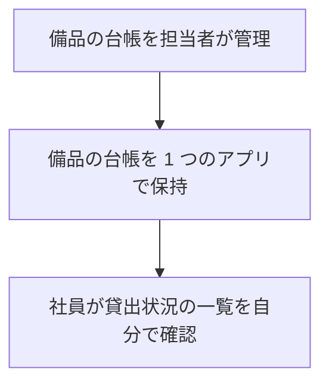

# 備品台帳・貸出状況 要件定義書

## 1. 目的・前提

### 目的

会社の備品の台帳を 1 つのアプリにまとめ、記録の食い違いと消失をなくす。社員が「どの備品があり、空いているか」を担当者に問い合わせずに自分で確かめられるようにする。

### 用語集

| 用語 | 業務上の意味 | 本案件での使用範囲 | 同義語/類義語 |
|---|---|---|---|
| 社員 | 会社に所属し、備品を借りる人 | 社員番号でアカウントを登録した人（担当者を含む） | 利用者 |
| 担当者 | 備品の台帳を管理し、備品の登録・修正・削除を行う社員 | 最初に登録したアカウントと、担当者として登録された社員 | 管理者 |
| 備品 | 会社が所有し、社員が借りる物品 | 管理番号と備品名を持つ台帳の 1 件 | 物品 |
| 管理番号 | 備品を識別する番号 | 半角の英数字とハイフンで 20 文字以内。重複不可 | 備品番号 |
| 貸出状況 | 備品が空きか貸出中かの表示 | 今回の段では全備品「空き」（貸出の登録は次の段） | 在庫状況 |

### システムの形態

- GUI（画面）: ブラウザで開く画面だけを提供する。Web API とバッチは作らない。

### 1-1. 技術制約

| 制約項目 | 内容 | 出どころ（誰がいつ答えたか） |
|---|---|---|
| 既存コードベース | 無し（新規開発） | ヒアリング固定回答（ANSWERS.md） |
| 配備先 | 社内の Linux サーバー。コンテナは使わず、`bash run.sh` で直接起動できること。社内ネットワークからだけ開く | ANSWERS.md・contract.md |
| チームの技術 | 決まり無し。Python 3.12 と SQLite で足りる | ANSWERS.md |
| ライセンスとコスト | 無償のものだけを使う（有償ソフト・有償サービス不可） | 依頼文 |
| 性能と規模の目安 | 利用者 50 人（社員と担当者の合計）、備品は数百件、アカウントは 50 件まで | 依頼文・ANSWERS.md |

### 1-2. 依頼に無く自分で決めた項目（必須）

| 項目 | 決めた内容 | 根拠（最小案か、依頼のどこから推測したか） | 承認（承認済 / 未確認） |
|---|---|---|---|
| セッションの有効期限の起点 | 最後の操作（ページの読み込みを含む）から 30 分。期限切れ後の最初の要求は、セッションを捨て、要求された画面に「セッションの有効期限が切れました。ログインしてください」を出す（転送はしない） | 依頼「操作しないまま 30 分」。最後の操作からの経過で数える最小案 | 承認済（ANSWERS.md の包括承認） |
| 社員番号の形式違い・空欄 | 空欄も形式違いと同じ文言「社員番号は 6 桁の数字で入力してください」 | 依頼の形式規則。空欄を別文言にしない最小案 | 承認済（包括承認） |
| 名前・備品名の前後の空白 | 前後の空白を取り除いてから判定・保存する。空白だけの入力は空欄扱い | 空白だけの名前が通ると一覧が読めないため | 承認済（包括承認） |
| 名前の空欄 | 「名前を入力してください」（契約の文言） | contract.md | 承認済 |
| 備品名の空欄 | 「備品名を入力してください」 | 依頼に空欄の扱いが無いため、名前と同じ形の文言を付けた | 承認済（包括承認） |
| 管理番号の空欄 | 形式違いと同じ文言「管理番号は半角の英数字とハイフンで 20 文字以内で入力してください」 | 空欄も形式違いとして扱う最小案 | 承認済（包括承認） |
| パスワードの空欄・短い | 空欄も「パスワードは 8 文字以上で入力してください」。上限は設けない | 依頼の下限のみ。上限は依頼に無い | 承認済（包括承認） |
| パスワードの保存 | ハッシュ化して保存する（平文で保存しない） | 依頼に無いが、保存の安全を最低限確保する最小案 | 承認済（包括承認） |
| 管理番号の大文字・小文字 | 区別する（入力どおりに保存し、完全一致で重複を判定する） | 依頼に無い。最小案として入力どおり扱う | 承認済（包括承認） |
| 管理番号の修正 | 修正画面で管理番号と備品名の両方を直せる。直した管理番号が他の備品と重なれば「この管理番号は既に使われています」 | 依頼の「修正」を、台帳の全項目の修正と読んだ最小案 | 承認済（包括承認） |
| 備品の削除 | 確認ダイアログで「はい」の後に即削除。削除の記録は残さない | 依頼「削除した記録は残さない」（ヒアリング固定回答） | 承認済（包括承認） |
| 存在しない備品の操作 | 修正・削除の対象が無いとき「対象の備品が見つかりません」を貸出状況の画面の `.message` に出す | 依頼に無い。他の担当者が先に削除した場合の最小案 | 承認済（包括承認） |
| 最初のアカウントの同時登録 | 登録の判定と保存を 1 つのトランザクションで行い、同時に来ても担当者は 1 人だけ | 依頼「アカウントが 1 件も無いとき」を複数人が同時に登録しても守るため | 承認済（包括承認） |
| 同時の重複登録 | 社員番号の重複は DB の一意制約で止め、同時でも重複を作らない。重複のときは「この社員番号は既に登録されています」 | 依頼「重複不可」を同時登録でも守るため | 承認済（包括承認） |
| 登録後の遷移 | 登録成功時はログイン画面へ移り「登録しました。ログインしてください」を `.message` に出す（契約どおり） | contract.md | 承認済 |
| ログイン後の遷移 | 貸出状況の画面へ移る | 最小案 | 承認済（包括承認） |
| 操作の結果の知らせ | 登録・修正・削除の成功時は貸出状況の画面に「備品を登録しました」「備品を修正しました」「備品を削除しました」を `.message` に出す | 依頼に無い知らせだが、操作の結果が見えないと利用者が困るため | 承認済（包括承認） |
| 担当者以外の操作の要求 | 未ログインはログイン画面へ、社員は貸出状況の画面へ戻し、どちらも「この操作は担当者だけが行えます」を `.message` に出す。対象の URL（登録・修正・削除）は担当者以外に画面を返さない | contract.md と依頼「要求を受け付けない」 | 承認済（契約） |
| 入力値の保持 | エラー時に社員番号・名前・管理番号・備品名に加え、パスワードも入力欄に戻す（契約「入力した値は消さない」を字義どおりに適用） | contract.md。パスワードの再表示は社内限定の画面に限る最小案 | 承認済（包括承認） |
| ログアウト後の遷移 | 貸出状況の画面へ移る（メッセージは出さない） | 最小案 | 承認済（包括承認） |
| 連続ログイン失敗の制限 | 無し（失敗回数で止めない） | 依頼に無い。制限を足すと依頼に無い機能になるため | 承認済（包括承認） |
| 監査ログ | 無し（運用要件で不要と回答済み） | ヒアリング固定回答 | 承認済 |

## 2. 業務

### 2-0. 対象業務一覧

| RQ-BZ-ID | 業務名 | 業務の範囲 | 担当者 |
|---|---|---|---|
| `RQ-BZ-EQUIPMENT-LEDGER` | 備品台帳の管理と貸出状況の閲覧 | 備品の台帳の登録・修正・削除と、全社員による貸出状況の確認。貸出・返却の記録は含まない | 担当者（台帳の管理）、社員・誰でも（閲覧） |

### 2-0a. 業務フロー

### 2-1. 業務の問題（あるべき姿と現状のギャップ）

| 問題 | 対象業務（RQ-BZ） | あるべき姿 | 現状 | ギャップ（KPI） | 業務影響 |
|---|---|---|---|---|---|
| 備品の記録が複数の Excel にあり、記録が食い違い、消えている | `RQ-BZ-EQUIPMENT-LEDGER` | 記録が 1 つだけあり、誰が更新しても食い違わず失われない | 管理用 Excel が複数あり、どれが最新か分からない | 食い違い・消失の件数: 不明（数値は確認できていない） | 記録の信頼性が低い |
| 社員が備品の状況を担当者に問い合わせるしかない | `RQ-BZ-EQUIPMENT-LEDGER` | 社員が自分で備品の空き状況を確かめられる | 担当者に問い合わせ、担当者が 1 回 15 分かけて調べている | 担当者の問い合わせ対応: 1 回 15 分（頻度: 不明） | 担当者の時間が取られる |

### 2-2. 業務課題一覧（必須）

| RQ-BK-ID | 業務課題（取り組むこと） | 解決する問題（2-1） | 解決後の状態（KPI の目標値） | 対象業務（RQ-BZ） |
|---|---|---|---|---|
| `RQ-BK-SINGLE-EQUIPMENT-LEDGER` | 備品の台帳を 1 つのアプリにまとめ、複数の担当者が更新しても記録が失われないようにする | 記録が複数の Excel にあり食い違い・消失が起きている | 記録が 1 つだけになり、食い違い・消失が起きない | `RQ-BZ-EQUIPMENT-LEDGER` |
| `RQ-BK-SELF-SERVICE-STATUS-VIEW` | 社員と誰でもが備品の一覧（空きか貸出中か）を自分で確認できるようにする | 社員が担当者に問い合わせるしかない | 担当者への問い合わせが無くなる（問い合わせ対応 1 回 15 分が無くなる） | `RQ-BZ-EQUIPMENT-LEDGER` |
| `RQ-BK-MANAGER-ONLY-CHANGE` | 社員が自分で登録し、備品の登録・修正・削除を担当者だけに限る | 複数の人が無制限に記録を書き換え、記録が食い違う | 備品の変更は担当者だけが行い、社員からの変更の要求は受け付けない | `RQ-BZ-EQUIPMENT-LEDGER` |

### 2-3. 見込み経営効果

| RQ-EF-ID | 効果の種類 | 内容 | 見込み（金額・時間などと算定根拠） | 対応業務課題ID（RQ-BK-*） |
|---|---|---|---|---|
| `RQ-EF-SOFT-SAVING-INQUIRY-TIME` | Soft Saving | 担当者が備品の状況を問い合わせに答える時間が無くなる | 問い合わせ対応 1 回あたり 15 分の削減。問い合わせの頻度が不明のため、月の合計は算定しない | `RQ-BK-SELF-SERVICE-STATUS-VIEW` |

## 3. 機能要件

### 3-0. 機能一覧

| RQ-ID | カテゴリ | 機能名 | 対応業務課題ID（RQ-BK-*） | この機能が無いと何が困るか |
|---|---|---|---|---|
| `RQ-FT-REGISTER-ACCOUNT` | 共通（認証・認可） | アカウント登録 | `RQ-BK-MANAGER-ONLY-CHANGE` | 社員が自分で利用者として登録できず、担当者の手で登録することになる |
| `RQ-FT-LOGIN` | 共通（認証・認可） | ログイン | `RQ-BK-MANAGER-ONLY-CHANGE` | 担当者と社員を区別して操作を制限できない |
| `RQ-FT-LOGOUT` | 共通（認証・認可） | ログアウト | `RQ-BK-MANAGER-ONLY-CHANGE` | 共用の端末で、前の人のログインが残る |
| `RQ-FT-IDLE-LOGOUT` | 共通（認証・認可） | 無操作の自動ログアウト | `RQ-BK-MANAGER-ONLY-CHANGE` | 離席中に他人が担当者の操作をできてしまう |
| `RQ-FT-VIEW-EQUIPMENT-STATUS` | 業務機能 | 貸出状況の一覧表示 | `RQ-BK-SELF-SERVICE-STATUS-VIEW` | 社員が担当者に問い合わせずに備品の状況を確かめられない |
| `RQ-FT-CREATE-EQUIPMENT` | マスタ管理 | 備品の登録 | `RQ-BK-SINGLE-EQUIPMENT-LEDGER` | 台帳に備品が 1 件も入らない |
| `RQ-FT-UPDATE-EQUIPMENT` | マスタ管理 | 備品の修正 | `RQ-BK-SINGLE-EQUIPMENT-LEDGER` | 誤りを直せず、Excel に戻ってしまう |
| `RQ-FT-DELETE-EQUIPMENT` | マスタ管理 | 備品の削除 | `RQ-BK-SINGLE-EQUIPMENT-LEDGER` | 廃止した備品が一覧に残り続ける |
| `RQ-FT-RESTRICT-EQUIPMENT-OPERATION` | 共通（認可） | 担当者以外の備品操作の拒否 | `RQ-BK-MANAGER-ONLY-CHANGE` | 社員が備品の記録を書き換えられ、記録が食い違う |

### 3-1. 帳票・出力ファイル

帳票・出力ファイルは無い。画面の一覧だけを提供する。

### 3-2. 業務ルール

| RQ-ID | ルール名 | 内容（条件と結果） | 違反時・エラー時の業務上の扱い | 対応業務課題ID（RQ-BK-*） |
|---|---|---|---|---|
| `RQ-FT-FIRST-ACCOUNT-MANAGER` | 最初の登録者は担当者 | アカウントが 1 件も無いときの登録は担当者、2 件目以降の登録は社員とする。判定と保存は同じトランザクションで行う | 該当なし | `RQ-BK-MANAGER-ONLY-CHANGE` |
| `RQ-FT-UNIQUE-EMPLOYEE-NUMBER` | 社員番号の重複禁止 | 同じ社員番号のアカウントは 1 件まで | 「この社員番号は既に登録されています」を出し、登録しない | `RQ-BK-MANAGER-ONLY-CHANGE` |
| `RQ-FT-UNIQUE-EQUIPMENT-NUMBER` | 管理番号の重複禁止 | 同じ管理番号の備品は 1 件まで（完全一致で判定） | 「この管理番号は既に使われています」を出し、保存しない | `RQ-BK-SINGLE-EQUIPMENT-LEDGER` |
| `RQ-FT-GENERIC-LOGIN-ERROR` | ログイン失敗の文言 | 社員番号かパスワードが違うときは、どちらが違うかを示さず「社員番号またはパスワードが違います」を出す | ログイン画面に留まり、入力した社員番号を残す | `RQ-BK-MANAGER-ONLY-CHANGE` |
| `RQ-FT-ACCOUNT-INPUT-RULES` | アカウント入力の形式 | 社員番号は 6 桁の数字。名前は空でなく 30 文字以内。パスワードは 8 文字以上 | 項目ごとに該当の文言を出し、入力値を残す | `RQ-BK-MANAGER-ONLY-CHANGE` |
| `RQ-FT-EQUIPMENT-INPUT-RULES` | 備品入力の形式 | 管理番号は半角の英数字とハイフンで 20 文字以内（空不可）。備品名は空でなく 50 文字以内 | 項目ごとに該当の文言を出し、入力値を残す | `RQ-BK-SINGLE-EQUIPMENT-LEDGER` |

業務ルールに無ければ依頼に無い。

### 3-3. 外部連携

外部連携は無い。

## 4. データ

### 4-1. データ要件一覧

| RQ-ID | 種別 | 内容 | 対応業務課題ID（RQ-BK-*） | この要件が無いと何が困るか |
|---|---|---|---|---|
| `RQ-DT-INTERNAL-DATA-ONLY` | 内部データ | 扱うデータは備品とアカウントの 2 種類で、すべて社内の内部データ。外部 DB は無い | `RQ-BK-SINGLE-EQUIPMENT-LEDGER` | 外部の情報源との二重管理が生まれる |
| `RQ-DT-SQLITE-DATABASE` | 保持 | 備品とアカウントを SQLite の 1 つのファイルに保存する。DB を使う理由は、複数の人が同時に更新しても記録を失わないため。初期件数は 0 件、想定は備品 数百件・アカウント 50 件まで、年間増加は小さい。参照関係は無く、検索は備品の一覧のみ | `RQ-BK-SINGLE-EQUIPMENT-LEDGER` | 同時更新で記録が失われる |
| `RQ-DT-NO-DELETION-HISTORY` | 保持期間 | 削除した備品とアカウントの記録は残さない（保持期間の定義は無し） | `RQ-BK-SINGLE-EQUIPMENT-LEDGER` | 削除の証跡が要るなら、後から依頼として扱う |

### 4-2. 業務エンティティとデータ項目

| RQ-ID | カテゴリ | 業務エンティティ名 | 対応業務課題ID（RQ-BK-*） | この業務エンティティが無いと何が困るか |
|---|---|---|---|---|
| `RQ-DT-EQUIPMENT` | 業務 | 備品 | `RQ-BK-SINGLE-EQUIPMENT-LEDGER` | 台帳の対象が無い |
| `RQ-DT-ACCOUNT` | 業務 | アカウント | `RQ-BK-MANAGER-ONLY-CHANGE` | 利用者を識別できない |

| エンティティ名 | 項目名 | 業務上の意味 | 必須 | 形式・桁 | 値の範囲・制約 | 例 |
|---|---|---|---|---|---|---|
| 備品 | 管理番号 | 備品を識別する番号 | 必須 | 半角英数字とハイフン、20 文字以内 | 重複不可（完全一致） | `PC-0001` |
| 備品 | 備品名 | 備品の名前 | 必須 | 50 文字以内 | 空白だけは不可 | ノートパソコン |
| アカウント | 社員番号 | 社員を識別する番号 | 必須 | 6 桁の数字 | 重複不可 | `123456` |
| アカウント | 名前 | 社員の名前 | 必須 | 30 文字以内 | 空白だけは不可 | 山田太郎 |
| アカウント | パスワード | ログインの合言葉 | 必須 | 8 文字以上（上限無し） | 保存はハッシュ化する | （利用者が決める） |
| アカウント | 役割 | 担当者か社員か | 必須 | 担当者 / 社員 | 最初の登録者だけ担当者 | 担当者 |

### 4-3. CRUD テーブル（必須）

| エンティティ名 | Create | Read（一覧） | Read（詳細） | 検索 | Update | Delete | 備考 |
|---|---|---|---|---|---|---|---|
| 備品 | ○ | ○ | △ | × | ○ | ○ | 一覧は管理番号の昇順。詳細は修正画面で項目を読む（△）。作成と修正の管理番号の重複判定は同じトランザクション内で行う（排他は DB の一意制約） |
| アカウント | ○ | × | × | × | × | × | 登録のみ（一覧・修正・削除の画面は無い）。最初の登録の判定は同じトランザクション内で行う |

### 4-4. 状態遷移

状態を持つエンティティは無い（貸出の記録は次の段で追加する）。

### 4-5. 画面一覧（GUI の場合のみ）

| RQ-ID | 画面名 | 対応する CRUD 操作（エンティティ名:操作種別） | 主な機能・目的 | 対応業務課題ID（RQ-BK-*） |
|---|---|---|---|---|
| `RQ-UI-EQUIPMENT-STATUS-SCREEN` | 貸出状況（トップ） | 備品:Read（一覧）、備品:Delete（行の削除ボタン） | 全備品の管理番号・備品名・貸出状況を一覧で見る。担当者は行から修正・削除、「備品を登録」へ移る | `RQ-BK-SELF-SERVICE-STATUS-VIEW` |
| `RQ-UI-ACCOUNT-REGISTER-SCREEN` | アカウント登録 | アカウント:Create | 社員番号・名前・パスワードで登録する | `RQ-BK-MANAGER-ONLY-CHANGE` |
| `RQ-UI-LOGIN-SCREEN` | ログイン | （CRUD の対象外。認証） | 社員番号とパスワードでログインする | `RQ-BK-MANAGER-ONLY-CHANGE` |
| `RQ-UI-EQUIPMENT-FORM-SCREEN` | 備品の登録・修正 | 備品:Create、備品:Update | 管理番号と備品名を入力して保存する（登録と修正で共通の画面） | `RQ-BK-SINGLE-EQUIPMENT-LEDGER` |

画面遷移: 貸出状況 → ログイン → 貸出状況。貸出状況 → アカウント登録 → ログイン。担当者は貸出状況から備品の登録・修正へ移り、保存後は貸出状況へ戻る。

## 5. 非機能要件

- 利用者の種別: 社員と担当者（合計 50 人まで）。アクセス経路は社内ネットワーク限定（インターネットには公開しない）。
- 性能: 操作から表示まで 3 秒以内（備品 数百件の状態で）。
- 利用人数: 同時に 50 人まで。
- 可用性: 平日の日中に使い、夜間・休日は止まってよい。障害からの復旧目標時間は要求が無い。
- 移行性: 移行は無い。既存の Excel は取り込まず、担当者が画面から手で入力する。
- セキュリティ:
  - 認証方式はパスワード認証（社員番号とパスワード）。SSO は無い。パスワードはハッシュ化して保存する。
  - 権限制御の粒度は画面・操作単位。ロールは 3 つ（担当者・社員・未ログイン）。ボタンの出し分けと、要求の拒否の両方で制御する。権限の例外運用は無い。
  - 無操作 30 分で自動ログアウト。
  - 監査証跡の改ざん防止は不要。

| RQ-ID | カテゴリ | 非機能要件名 | 対応業務課題ID（RQ-BK-*） | この非機能要件が無いと何が困るか |
|---|---|---|---|---|
| `RQ-NF-RESPONSE-3S` | 性能 | 操作から表示まで 3 秒以内 | `RQ-BK-SELF-SERVICE-STATUS-VIEW` | 一覧の表示が遅く、社員が使わなくなる |
| `RQ-NF-INTERNAL-NETWORK-ONLY` | アクセス経路 | 社内ネットワークからだけ開く | `RQ-BK-SINGLE-EQUIPMENT-LEDGER` | 社外から記録にアクセスされる |
| `RQ-NF-EMPLOYEE-NUMBER-PASSWORD-AUTH` | セキュリティ | 社員番号とパスワードで認証し、パスワードは平文で保存しない | `RQ-BK-MANAGER-ONLY-CHANGE` | 利用者の区別と担当者の権限が成り立たない |

## 6. 運用要件

- ログ: 一般的な動作ログ・エラーログ以外は要らない。ログの内容と保存期間の記述は行わない。
- 監査ログ: 不要。記録する操作の種類・保存期間・改ざん防止は定義しない。
- 監視・アラート: 不要。監視・アラートの内容と対応方法の記述は行わない。
- バックアップと復旧: 不要（ヒアリングで不要と回答）。

| RQ-ID | 種別 | 内容 | 対応業務課題ID（RQ-BK-*） | この要件が無いと何が困るか |
|---|---|---|---|---|
| `RQ-OP-INITIAL-MANAGER-FIRST` | 導入手順 | 社員に URL を知らせる前に、担当者が最初のアカウントを登録する | `RQ-BK-MANAGER-ONLY-CHANGE` | 最初の登録者が担当者にならず、誰も備品を管理できない |

## 7. テスト用利用シナリオ

| RQ-ID | テスト目的 | 前提条件 | テスト手順 | 期待される結果 | 検証する要件ID | 対応業務課題ID（RQ-BK-*） |
|---|---|---|---|---|---|---|
| `RQ-TS-REGISTER-ACCOUNT` | アカウント登録と最初の登録者の担当者化を確かめる | アカウントが 0 件 | 最初の人が登録画面で登録し、次の人も登録する | 最初は担当者、次は社員になり、登録後はログイン画面に「登録しました。ログインしてください」が出る。形式違い・重複は文言どおりに出る | `RQ-FT-REGISTER-ACCOUNT`, `RQ-FT-FIRST-ACCOUNT-MANAGER`, `RQ-FT-UNIQUE-EMPLOYEE-NUMBER`, `RQ-FT-ACCOUNT-INPUT-RULES`, `RQ-UI-ACCOUNT-REGISTER-SCREEN` | `RQ-BK-MANAGER-ONLY-CHANGE` |
| `RQ-TS-LOGIN-LOGOUT` | ログイン・失敗時の文言・ログアウトを確かめる | 社員が 1 件以上登録済み | 誤ったパスワードでログイン、正しいログイン、ログアウト | 失敗時は「社員番号またはパスワードが違います」だけが出る。成功時は `.current-user` に名前。ログアウトで未ログインに戻る | `RQ-FT-LOGIN`, `RQ-FT-LOGOUT`, `RQ-FT-GENERIC-LOGIN-ERROR`, `RQ-UI-LOGIN-SCREEN` | `RQ-BK-MANAGER-ONLY-CHANGE` |
| `RQ-TS-IDLE-LOGOUT` | 無操作 30 分の自動ログアウトを確かめる | 既定値は 1800 秒。テストでは `SESSION_IDLE_TIMEOUT_SECONDS` を短くして起動 | ログイン後、無操作で期限を過ぎてから操作する | 期限切れ後はログイン画面に戻り、担当者の操作は拒否される | `RQ-FT-IDLE-LOGOUT` | `RQ-BK-MANAGER-ONLY-CHANGE` |
| `RQ-TS-VIEW-STATUS` | 誰でも見られる貸出状況一覧を確かめる | 備品が 0 件、その後数件登録 | 未ログインで貸出状況を開き、件数を増やして見る | 0 件のとき「備品は登録されていません」。件数があれば管理番号の昇順で、全行「空き」、借りている社員・貸出日は空欄。未ログインにボタンは出ない | `RQ-FT-VIEW-EQUIPMENT-STATUS`, `RQ-UI-EQUIPMENT-STATUS-SCREEN` | `RQ-BK-SELF-SERVICE-STATUS-VIEW` |
| `RQ-TS-CREATE-EQUIPMENT` | 担当者による備品の登録と入力規則を確かめる | 担当者でログイン済み | 登録画面で正常な備品を登録し、形式違い・重複・長すぎる名前を入力する | 正常なら一覧に行が増える。違反は文言どおりに出て入力値が残る | `RQ-FT-CREATE-EQUIPMENT`, `RQ-FT-EQUIPMENT-INPUT-RULES`, `RQ-FT-UNIQUE-EQUIPMENT-NUMBER`, `RQ-UI-EQUIPMENT-FORM-SCREEN` | `RQ-BK-SINGLE-EQUIPMENT-LEDGER` |
| `RQ-TS-UPDATE-EQUIPMENT` | 担当者による備品の修正を確かめる | 備品が 1 件以上ある | 行の「修正」から管理番号と備品名を直して保存する | 一覧の行が直った内容になる。既存の別の管理番号と重なると文言が出る | `RQ-FT-UPDATE-EQUIPMENT`, `RQ-UI-EQUIPMENT-FORM-SCREEN` | `RQ-BK-SINGLE-EQUIPMENT-LEDGER` |
| `RQ-TS-DELETE-EQUIPMENT` | 担当者による備品の削除（確認ダイアログ）を確かめる | 備品が 1 件以上ある | 行の「削除」で確認ダイアログを「キャンセル」、次に「はい」 | キャンセルでは残り、「はい」で行が消える。削除の記録は残らない | `RQ-FT-DELETE-EQUIPMENT` | `RQ-BK-SINGLE-EQUIPMENT-LEDGER` |
| `RQ-TS-RESTRICT-NON-MANAGER` | 社員・未ログインの操作制限（ボタンの出し分けと要求の拒否）を確かめる | 社員と担当者が登録済み、備品が 1 件以上 | 社員でログインして一覧を見る。社員・未ログインで登録・修正・削除の URL に直接アクセスし、POST も送る | 社員の一覧に「修正」「削除」「備品を登録」は無い。直接の要求は「この操作は担当者だけが行えます」で拒否され、備品は変わらない | `RQ-FT-RESTRICT-EQUIPMENT-OPERATION` | `RQ-BK-MANAGER-ONLY-CHANGE` |
| `RQ-TS-RESPONSE-TIME` | 備品数百件での 3 秒以内の表示を確かめる | 備品 500 件を登録 | 貸出状況を開いて表示完了までの時間を測る | 3 秒以内に表示される | `RQ-NF-RESPONSE-3S` | `RQ-BK-SELF-SERVICE-STATUS-VIEW` |
