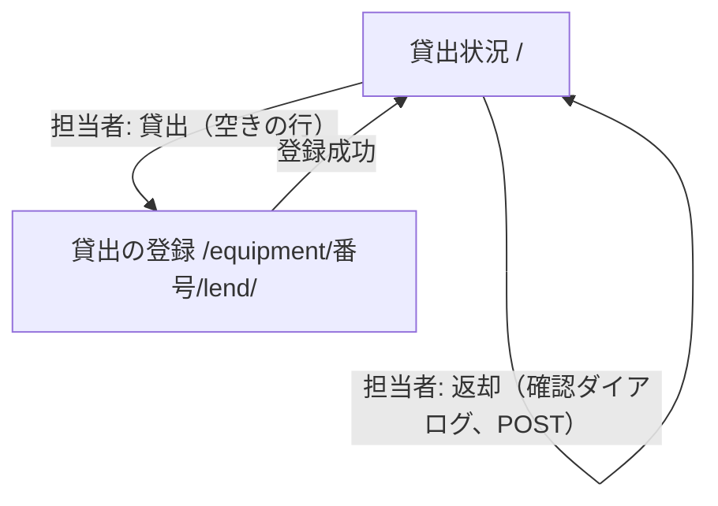

# 備品台帳・貸出状況 変更設計書（段 2: 貸出と返却、社員番号の 7 桁化）

正本の `docs/detail_design.md` に重ねて読む。[追加] と [削除] は、実装後レビュー（isdd-build）で正本へ反映する。正本は書き換えない。

表記の約束: 設計の中身が変わる要素は、旧 ID を [削除]、新しい ID を [追加] にする。中身が変わらず対応する要件だけが変わる要素は、同じ ID を [削除] と [追加] の 2 行に書く。

## 1. 言語・フレームワーク・アーキテクチャの選定

変更なし。既存設計 `docs/detail_design.md` 第 1 章の技術（Python 3.12、Flask 3.1.3、Waitress 3.0.2、SQLite、pytest、Playwright）を引き継ぐ。貸出の判定に標準ライブラリの `datetime` を使う（追加の導入なし）。

### 1-2. 判断軸と候補

変更なし。

### 1-3. 実行形態

変更なし。

## 2. システム構成

### 2-1. コンポーネント一覧

| コンポーネント | 役割 | 実装 |
|---|---|---|
| [追加] 貸出・返却の処理 | 貸出の登録と返却の処理。貸出の記録の読み書き | `src/equipment_ledger/lending.py` |

他のコンポーネントは変更なし。

### 2-2 〜 2-5

変更なし。

### 2-3. 各コンポーネントの役割

[追加] 業務ロジック: 貸出・返却の処理は、貸出の表と備品の表を 1 つのトランザクションで読み書きする（`lending.py`）。

## 3. データ設計

### 3-1. データモデル

[削除] テーブルは 2 つ。どちらも一意制約で重複を防ぐ。
[追加] テーブルは 3 つ。どちらも一意制約で重複を防ぐ。貸出の表は備品 1 件につき 0 か 1 件の行を持つ。

**備品テーブル（[削除] `DS-SC-EQUIPMENT-TABLE`）**

**備品テーブル（[追加] `DS-SC-EQUIPMENT-TABLE-REVISIONED`）**

| カラム | 型 | 制約 | 対応する要件のデータ項目 |
|---|---|---|---|
| [追加] id | 整数 | 主キー、自動採番 | （内部キー。貸出の表の参照先） |
| [追加] equipment_number | テキスト | 必須、一意制約。20 文字以内、半角英数字とハイフン | 管理番号 |
| [追加] name | テキスト | 必須、50 文字以内 | 備品名 |
| [追加] revision | 整数 | 必須、既定 1。修正のたびに 1 増える | 修正の競合の検出（画面に出さない） |

**貸出テーブル（[追加] `DS-SC-LOAN-TABLE`）**

| カラム | 型 | 制約 | 対応する要件のデータ項目 |
|---|---|---|---|
| [追加] equipment_id | 整数 | 主キー（備品 1 件に 0 か 1 件）。備品テーブルの id を参照する | 備品（貸出中の備品） |
| [追加] borrower_id | 整数 | 必須。アカウントテーブルの id を参照する | 借りる社員 |
| [追加] lent_on | テキスト | 必須。`YYYY-MM-DD` | 貸出日 |

返却の処理では貸出の行を削除する（記録は残さない）。貸出の行は備品の内部 ID に結びつくので、備品の管理番号や名前を直しても切れない。

**アカウントテーブル（`DS-SC-ACCOUNT-TABLE`）**

| カラム | 型 | 制約 | 対応する要件のデータ項目 |
|---|---|---|---|
| [削除] employee_number | テキスト | 必須、一意制約。6 桁の数字 | 社員番号 |
| [追加] employee_number | テキスト | 必須、一意制約。7 桁の数字 | 社員番号 |

以下は変更なし: id、name、password_hash、role。

### 3-2. トランザクションと排他制御

[追加] 次の行を表に足す。

| 操作 | トランザクション | 排他制御 |
|---|---|---|
| [追加] 貸出の登録 | 書き込みロック（`BEGIN IMMEDIATE`）を取り、備品の存在、借りる社員の存在、貸出中かを確かめて、貸出の行を挿入する。失敗時はロールバック | 貸出の表の主キー（備品の id）の一意制約で、同時の貸出の二重登録を防ぐ。後の要求は「既に貸出中」になる |
| [追加] 返却の処理 | 書き込みロックを取り、備品の存在と貸出の行を確かめて、貸出の行を削除する。貸出の行が無ければ「既に返却されています」でロールバック | 書き込みロックで直列化する。後の要求は「既に返却されています」になる |
| [追加] 備品の修正（`DS-FN-UPDATE-EQUIPMENT-CHECKED`） | 1 文の `UPDATE`。条件は管理番号と版番号の一致。版番号を 1 増やす | 条件に一致しなければ（他の担当者が修正・削除した）何も更新せず「他の担当者が先に…」を返す。一意制約違反は重複の文言 |
| [追加] 備品の削除（`DS-FN-DELETE-UNLENT-EQUIPMENT`） | 書き込みロックを取り、貸出の行が無ければ削除する | 貸出中なら削除せず、「貸出中のため削除できません」を返す |

変更前の「備品の修正」「備品の削除」の行は、上の [追加] の行で置き換える（[削除] 行は、旧い説明のまま残す）。

| 操作 | トランザクション | 排他制御 |
|---|---|---|
| [削除] 備品の修正 | 1 件の更新。一意制約違反なら更新されず、ロールバック | 同上。対象の存在を同じトランザクションで確かめる |
| [削除] 備品の削除 | 1 件の削除。対象が無ければ何もしない | 同時の削除は、後の要求が「対象の備品が見つかりません」になる |

### 3-3. 状態遷移

[追加] 備品の貸出の状態を持つ（空き、貸出中）。遷移は正本の変更要件定義書 4-4 のとおり。貸出の状態は貸出の行の有無で表す（行があれば貸出中）。

## 4. アーキテクチャ設計

### 4-1. 外部設計

#### 画面一覧

| 画面 | URL | 対象 | 説明 |
|---|---|---|---|
| [削除] 貸出状況（トップ） | `/` | 誰でも | 備品の一覧（管理番号、備品名、状況、借りている社員、貸出日）。担当者は「備品を登録」、行の「修正」「削除」 |
| [追加] 貸出状況（トップ） | `/` | 誰でも | 備品の一覧（管理番号、備品名、状況「空き」か「貸出中」、借りている社員、貸出日）。担当者は「備品を登録」、行の「貸出」（空きのとき）または「返却」（貸出中のとき）、「修正」「削除」 |
| [追加] 貸出の登録 | `/equipment/<管理番号>/lend/` | 担当者 | `.lending-equipment` に「備品: 管理番号 備品名」。借りる社員（`id_borrower`、選択肢は「名前（社員番号）」、先頭は空の選択肢）と貸出日（`id_lent_on`、`type=date`、既定は日本時間の今日）と「登録」ボタン |

他の画面は変更なし（アカウント登録、ログイン、備品の登録、備品の修正（下の変更を除く））。

画面の共通部分（追加）:

- [追加] 貸出の入力の検証エラーは、`.field` の中の `.field-error` に出す（借りる社員、貸出日）。
- [追加] 修正画面の保存で、他の担当者が先に更新・削除していた場合は `.error` に出す。

画面遷移（追加）:

外部からの要求の扱い（追加）: 未ログインまたは社員が貸出の登録の URL を開く（GET）か登録（POST）を送る、または返却の URL に POST を送ると、変更前の登録・修正・削除と同じく拒否する（未ログインはログイン画面、社員は貸出状況へ戻し、`.message`「この操作は担当者だけが行えます」）。

#### インターフェース仕様

| DS-ID | 入力 | バリデーション | 出力 | エラー仕様 |
|---|---|---|---|---|
| [削除] `DS-IF-EQUIPMENT-STATUS-SCREEN` | なし | なし | 備品の一覧（管理番号の昇順、全行「空き」、借りている社員・貸出日は空欄）。0 件なら「備品は登録されていません」 | なし |
| [追加] `DS-IF-LENDING-STATUS-SCREEN` | なし | なし | 備品の一覧（管理番号の昇順、状況は「空き」か「貸出中」、貸出中は借りている社員の名前と貸出日）。0 件なら「備品は登録されていません」 | なし |
| [追加] `DS-IF-LENDING-SCREEN` | 管理番号（URL）。GET は表示、POST は借りる社員（`borrower_id`）と貸出日（`lent_on`） | `DS-FN-VALIDATE-LENDING-INPUT` | 成功時は貸出状況へ転送し `.message`「貸出を登録しました」。GET で貸出中なら貸出状況へ転送し `.message`「この備品は既に貸出中です」。対象が無ければ `.message`「対象の備品が見つかりません」 | 借りる社員、貸出日は `.field-error`（入力値は残す）。貸出中・競合は `.message`（貸出状況へ転送） |
| [追加] `DS-IF-RETURN-ACTION` | 管理番号（URL、POST のみ） | なし | 成功時は貸出状況へ転送し `.message`「返却を処理しました」。貸出の行が無ければ `.message`「この備品は既に返却されています」。対象が無ければ `.message`「対象の備品が見つかりません」 | 担当者以外は `DS-FN-REQUIRE-MANAGER` で拒否 |
| [削除] `DS-IF-EQUIPMENT-EDIT-SCREEN` | 管理番号、備品名、版番号（隠し欄 `revision`） | 登録と同じ | 成功時は貸出状況へ転送し `.message`「備品を修正しました」。対象が無ければ `.message`「対象の備品が見つかりません」で貸出状況へ | 登録と同じ。担当者以外は同上 |
| [追加] `DS-IF-EQUIPMENT-EDIT-CHECKED-SCREEN` | 管理番号、備品名、版番号（隠し欄 `revision`） | 登録と同じ | 成功時は貸出状況へ転送し `.message`「備品を修正しました」。対象が無ければ `.message`「対象の備品が見つかりません」で貸出状況へ（GET）。貸出の記録は引き継ぐ | 保存時の版番号の不一致、または削除済みは `.error`「他の担当者が先にこの備品を更新しました。貸出状況の画面から開き直してください」（保存しない、入力値は残す）。入力の検証エラーと重複は登録と同じ |
| [削除] `DS-IF-EQUIPMENT-DELETE-ACTION` | 管理番号（URL） | なし | 貸出状況へ転送し `.message`「備品を削除しました」。対象が無ければ「対象の備品が見つかりません」 | 担当者以外は同上 |
| [追加] `DS-IF-EQUIPMENT-DELETE-UNLENT-ACTION` | 管理番号（URL） | なし | 貸出状況へ転送し `.message`「備品を削除しました」。対象が無ければ「対象の備品が見つかりません」。貸出中なら削除せず `.message`「この備品は貸出中のため削除できません。先に返却を処理してください」 | 担当者以外は同上 |

変更なし: `DS-IF-ACCOUNT-REGISTER-SCREEN`（社員番号の規則は `DS-FN-VALIDATE-ACCOUNT-INPUT-SEVEN-DIGIT` に従う）、`DS-IF-LOGIN-SCREEN`、`DS-IF-LOGOUT-ACTION`、`DS-IF-EQUIPMENT-NEW-SCREEN`。

#### 外部システム連携

変更なし。

#### 帳票・出力ファイル

変更なし。

### 4-2. 内部設計

#### 処理フロー（追加）

**貸出の登録（`DS-FN-LEND-EQUIPMENT`）**

1. 書き込みロックを取ってトランザクションを開始する。
2. 管理番号の備品が無ければ「対象の備品が見つかりません」で戻す。
3. 借りる社員の ID のアカウントが無ければ、借りる社員の欄の文言で戻す（`.field-error`）。
4. 貸出の行が既にあれば「この備品は既に貸出中です」で戻す。
5. 貸出の行を挿入する。主キーの一意制約違反なら「既に貸出中です」で戻す。
6. コミットする。

**返却の処理（`DS-FN-RETURN-EQUIPMENT`）**

1. 書き込みロックを取ってトランザクションを開始する。
2. 管理番号の備品が無ければ「対象の備品が見つかりません」で戻す。
3. 貸出の行を削除する。行が無ければ（既に返却済み）「この備品は既に返却されています」で戻す。
4. コミットする。

**修正の保存（`DS-FN-UPDATE-EQUIPMENT-CHECKED`）**

1. 入力を検証する（`DS-FN-VALIDATE-ACCOUNT-INPUT-SEVEN-DIGIT` と同じ考え方で、備品の検証は `DS-FN-VALIDATE-EQUIPMENT-INPUT`）。
2. 管理番号と版番号が一致する行を、管理番号・備品名を新しい値にし版番号を 1 増やして更新する。一致しなければ「他の担当者が先に…」を返す。
3. 一意制約違反なら「この管理番号は既に使われています」を返す。
4. 貸出の行は備品の内部 ID に結びついているので、そのまま残る。

**貸出状況の一覧（`DS-FN-LIST-EQUIPMENT-WITH-LENDING`）**

管理番号の昇順で、備品と貸出の行、借りる社員の名前を結合して返す。貸出の行が無い備品は「空き」、借りている社員と貸出日は空。

**備品の削除（`DS-FN-DELETE-UNLENT-EQUIPMENT`）**

1. 書き込みロックを取ってトランザクションを開始する。
2. 対象が無ければ「対象の備品が見つかりません」で戻す。
3. 貸出の行があれば「貸出中のため削除できません」で戻す。
4. 備品の行を削除する。記録は残さない。コミットする。

**貸出の登録の入力（`DS-FN-VALIDATE-LENDING-INPUT`）**

借りる社員が空なら「借りる社員を選んでください」。貸出日が空なら「貸出日を入力してください」。`YYYY-MM-DD` で無ければ「貸出日は YYYY-MM-DD の形式で入力してください」。今日（日本時間）より後なら「貸出日に未来の日付は入力できません」。今日の日付は `today_in_japan` が返す（UTC+9）。

#### 処理フロー（変更）

**[削除] 処理フロー（備品の登録・修正・削除）**

- [削除] 修正: 対象の存在を確かめ、検証し、更新する（`DS-FN-UPDATE-EQUIPMENT`）。
- [削除] 削除: 対象を削除する。対象が無ければ「対象の備品が見つかりません」。削除の記録は残さない（`DS-FN-DELETE-EQUIPMENT`）。

**[追加] 処理フロー（備品の登録・修正・削除）**

- 登録: 変更なし（`DS-FN-CREATE-EQUIPMENT`）。
- 修正: `DS-FN-UPDATE-EQUIPMENT-CHECKED` で、版番号の一致を条件に更新する。画面の GET で対象が無ければ「対象の備品が見つかりません」。
- 削除: `DS-FN-DELETE-UNLENT-EQUIPMENT` で、貸出中なら拒否する。

**[削除] 処理フロー（起動）の 3 番目**

3. [削除] DB に接続し、テーブルが無ければ作る（`DS-FN-INITIALIZE-DATABASE`）。

**[追加] 処理フロー（起動）の 3 番目**

3. DB に接続し、テーブルが無ければ作る。既存の備品テーブルに版番号の列が無ければ列を足す（`DS-FN-PREPARE-DATABASE`）。

#### 各処理の役割と機能

[追加] 貸出・返却: 貸出の登録と返却の処理（`lending.py`）。貸出の行の読み書きをトランザクションで行う。

#### バッチ設計

変更なし。

### 4-3. 外部 DB 連携

変更なし。

## 5. クラス設計

変更なし。クラスは作らない。

## 6. エラーハンドリングとセキュリティ設計

### 6-1. エラーハンドリング

[追加] 次の行を表に足す。

| 想定エラー | 利用者への見え方 | ログ | 扱い |
|---|---|---|---|
| [追加] 借りる社員の未選択・存在しない | 借りる社員の `.field-error`「借りる社員を選んでください」 | なし | 貸出を登録しない |
| [追加] 貸出日の空欄・形式違い・未来の日付 | 貸出日の `.field-error` | なし | 貸出を登録しない |
| [追加] 貸出中の備品の貸出・貸出の画面を開く | 貸出状況の `.message`「この備品は既に貸出中です」 | なし | 記録しない |
| [追加] 返却済みの備品の返却 | 貸出状況の `.message`「この備品は既に返却されています」 | なし | 何もしない |
| [追加] 貸出中の備品の削除 | 貸出状況の `.message`「この備品は貸出中のため削除できません。先に返却を処理してください」 | なし | 削除しない |
| [追加] 修正の保存で、他の担当者が先に更新・削除していた | 修正画面の `.error`「他の担当者が先にこの備品を更新しました。貸出状況の画面から開き直してください」 | なし | 保存しない |

### 6-2. 認証

変更なし。社員番号は 7 桁の数字として扱う（検査は `DS-FN-VALIDATE-ACCOUNT-INPUT-SEVEN-DIGIT`）。ログインの形式検査は変更なし（形式の違いを示さない）。

### 6-3. 認可

[追加] 次の行を表に足す。

| 操作 | 担当者 | 社員 | 未ログイン |
|---|---|---|---|
| [追加] 貸出の登録・返却の要求（GET と POST） | 可 | 拒否（貸出状況へ転送） | 拒否（ログイン画面へ転送） |
| [追加] 行の「貸出」「返却」ボタンの表示 | 表示 | 非表示 | 非表示 |

権限の判定は要求ごとにサーバーで行う（`DS-FN-REQUIRE-MANAGER`。変更なし）。

### 6-4 〜 6-5

変更なし。

## 7. コード設計

### 7-1. ディレクトリ構成

変更なし。`e2e/` に貸出のテストファイルを足す。

### 7-2. ファイル一覧

| ファイルパス | 役割 | 含まれる関数 | DS-ID（モジュール） | 実現する設計 ID |
|---|---|---|---|---|
| [削除] `src/equipment_ledger/db.py` | DB の接続と初期化 | `connect_database`、`initialize_database` | `DS-MD-DB` | `DS-FN-CONNECT-DATABASE`、`DS-FN-INITIALIZE-DATABASE`、`DS-SC-EQUIPMENT-TABLE`、`DS-SC-ACCOUNT-TABLE` |
| [追加] `src/equipment_ledger/db.py` | DB の接続と初期化 | `connect_database`、`initialize_database` | `DS-MD-DB` | `DS-FN-CONNECT-DATABASE`、`DS-FN-PREPARE-DATABASE`、`DS-SC-EQUIPMENT-TABLE-REVISIONED`、`DS-SC-ACCOUNT-TABLE`、`DS-SC-LOAN-TABLE` |
| [削除] `src/equipment_ledger/validation.py` | 入力の検証 | `validate_account_input`、`validate_equipment_input` | `DS-MD-VALIDATION` | `DS-FN-VALIDATE-ACCOUNT-INPUT`、`DS-FN-VALIDATE-EQUIPMENT-INPUT` |
| [追加] `src/equipment_ledger/validation.py` | 入力の検証 | `validate_account_input`、`validate_equipment_input`、`validate_lending_input`、`today_in_japan` | `DS-MD-VALIDATION` | `DS-FN-VALIDATE-ACCOUNT-INPUT-SEVEN-DIGIT`、`DS-FN-VALIDATE-EQUIPMENT-INPUT`、`DS-FN-VALIDATE-LENDING-INPUT` |
| [削除] `src/equipment_ledger/accounts.py` | アカウントの登録と認証 | `register_account`、`find_account`、`authenticate_account` | `DS-MD-ACCOUNTS` | `DS-FN-REGISTER-ACCOUNT`、`DS-FN-FIND-ACCOUNT`、`DS-FN-AUTHENTICATE-ACCOUNT` |
| [追加] `src/equipment_ledger/accounts.py` | アカウントの登録と認証 | `register_account`、`find_account`、`authenticate_account`、`list_borrowers` | `DS-MD-ACCOUNTS` | `DS-FN-REGISTER-ACCOUNT`、`DS-FN-FIND-ACCOUNT`、`DS-FN-AUTHENTICATE-ACCOUNT`、`DS-FN-LIST-BORROWERS` |
| [削除] `src/equipment_ledger/equipment.py` | 備品の一覧・登録・修正・削除 | `list_equipment`、`find_equipment`、`create_equipment`、`update_equipment`、`delete_equipment` | `DS-MD-EQUIPMENT` | `DS-FN-LIST-EQUIPMENT`、`DS-FN-FIND-EQUIPMENT`、`DS-FN-CREATE-EQUIPMENT`、`DS-FN-UPDATE-EQUIPMENT`、`DS-FN-DELETE-EQUIPMENT` |
| [追加] `src/equipment_ledger/equipment.py` | 備品の一覧・登録・修正・削除 | `list_equipment`、`find_equipment`、`create_equipment`、`update_equipment`、`delete_equipment` | `DS-MD-EQUIPMENT` | `DS-FN-LIST-EQUIPMENT-WITH-LENDING`、`DS-FN-FIND-EQUIPMENT`、`DS-FN-CREATE-EQUIPMENT`、`DS-FN-UPDATE-EQUIPMENT-CHECKED`、`DS-FN-DELETE-UNLENT-EQUIPMENT` |
| [追加] `src/equipment_ledger/lending.py` | 貸出の登録と返却の処理 | `lend_equipment`、`return_equipment` | `DS-MD-LENDING` | `DS-FN-LEND-EQUIPMENT`、`DS-FN-RETURN-EQUIPMENT` |
| [削除] `src/equipment_ledger/web.py` | Web アプリの作成と画面（ルート） | `create_app`、`equipment_status`、`register_account`、`login`、`logout`、`new_equipment`、`edit_equipment`、`delete_equipment` | `DS-MD-WEB` | `DS-FN-CREATE-APP`、`DS-IF-EQUIPMENT-STATUS-SCREEN`、`DS-IF-ACCOUNT-REGISTER-SCREEN`、`DS-IF-LOGIN-SCREEN`、`DS-IF-LOGOUT-ACTION`、`DS-IF-EQUIPMENT-NEW-SCREEN`、`DS-IF-EQUIPMENT-EDIT-SCREEN`、`DS-IF-EQUIPMENT-DELETE-ACTION` |
| [追加] `src/equipment_ledger/web.py` | Web アプリの作成と画面（ルート） | `create_app`、`equipment_status`、`register_account`、`login`、`logout`、`new_equipment`、`edit_equipment`、`delete_equipment`、`lend_equipment`、`return_equipment` | `DS-MD-WEB` | `DS-FN-CREATE-APP`、`DS-IF-LENDING-STATUS-SCREEN`、`DS-IF-ACCOUNT-REGISTER-SCREEN`、`DS-IF-LOGIN-SCREEN`、`DS-IF-LOGOUT-ACTION`、`DS-IF-EQUIPMENT-NEW-SCREEN`、`DS-IF-EQUIPMENT-EDIT-CHECKED-SCREEN`、`DS-IF-EQUIPMENT-DELETE-UNLENT-ACTION`、`DS-IF-LENDING-SCREEN`、`DS-IF-RETURN-ACTION` |

変更なし: `__main__.py`、`config.py`、`auth.py`（`DS-MD-AUTH`）。

テンプレート（`status.html`、`lending_form.html`、`equipment_form.html` など）と CSS は対応表の対象外（画面の説明は上の 4-1 に書く）。

### 7-3. 対応表の粒度

変更なし（`function`）。

### 7-4. 依存の規則

変更なし。依存の規則は無い。

### 7-5. コーディング規約

変更なし。

## 8. テスト設計

### 8-1. テストの種類と方針

[追加] 単体テストに、貸出の登録と返却（同時の二重を含む）、入力の検証（貸出日）、修正の版番号の一致、貸出中の削除の拒否を足す（`tests/`）。

### 8-2. E2E テストのシナリオ

[削除] 要件定義書 第 7 章の 9 本のシナリオを、実際のブラウザ（Playwright の Chromium）で実行する。
[追加] 要件定義書 第 7 章の 9 本と、変更で足した 7 本のシナリオを、実際のブラウザで実行する。

| DS-ID | 目的 | 前提条件 | 手順 | 期待結果 |
|---|---|---|---|---|
| [削除] `DS-TS-REGISTER-ACCOUNT` | アカウント登録と最初の登録者の担当者化、入力規則 | DB が空 | 登録画面で 1 人目を登録、2 人目を登録、形式違いと重複を入力 | 1 人目は担当者、2 人目は社員。登録後はログイン画面に「登録しました。ログインしてください」。違反は文言どおり |
| [追加] `DS-TS-REGISTER-ACCOUNT` | アカウント登録と最初の登録者の担当者化、7 桁の入力規則 | DB が空 | 登録画面で 1 人目を 7 桁で登録、2 人目を登録、6 桁・重複を入力 | 1 人目は担当者、2 人目は社員。登録後はログイン画面に「登録しました。ログインしてください」。6 桁は「社員番号は 7 桁の数字で入力してください」、重複は文言どおり |
| [追加] `DS-TS-LEND-EQUIPMENT` | 担当者による貸出の登録と入力規則 | 担当者でログイン、社員 1 人、空きの備品 1 件 | 行の「貸出」を開き、借りる社員と貸出日（既定）で登録。借りる社員を未選択で登録。貸出日を明日にして登録 | 登録後、一覧に「貸出中」、借りている社員、貸出日。未選択と未来の日付は `.field-error` の文言どおり出て入力値は残る |
| [追加] `DS-TS-PREVENT-DOUBLE-LENDING` | 貸出中の備品の二重の貸出の防止 | 担当者の 2 つのブラウザ、空きの備品 1 件 | 1 つ目で貸出の画面を開き登録。2 つ目で、登録前に開いた貸出の画面から登録。貸出中の備品の貸出の画面を開く | 1 つ目は記録される。2 つ目は記録されず「この備品は既に貸出中です」。貸出中の画面を開くと同じ文言で貸出状況へ戻る |
| [追加] `DS-TS-RETURN-EQUIPMENT` | 返却の確認と二重の返却の防止 | 担当者でログイン、貸出中の備品 1 件 | 行の「返却」で確認をキャンセル、次に「返却」で「はい」。2 つ目のブラウザで、同じ行の返却を「はい」で送る | キャンセルでは貸出中のまま。「はい」で空きに戻り「返却を処理しました」。2 つ目は「この備品は既に返却されています」 |
| [追加] `DS-TS-REFUSE-DELETE-LENT-EQUIPMENT` | 貸出中の備品の削除の拒否 | 担当者でログイン、貸出中の備品 1 件 | 行の「削除」で確認の「はい」 | 削除されず、「この備品は貸出中のため削除できません。先に返却を処理してください」。一覧に残る |
| [追加] `DS-TS-UPDATE-EQUIPMENT-CONFLICT` | 修正の競合の拒否と、修正後の貸出の引き継ぎ | 担当者の 2 つのブラウザ、貸出中の備品 1 件 | 1 つ目で修正画面を開く。2 つ目で同じ備品の名前を直して保存。1 つ目で保存。次に 1 つ目で修正画面を開き、2 つ目で削除してから保存。貸出中の備品の修正を成功させる | 1 つ目は `.error` で拒否（2 つ目の更新の後・削除の後の両方）。修正が成功したときは、貸出中・借りている社員・貸出日が残る |
| [追加] `DS-TS-RESTRICT-LENDING-NON-MANAGER` | 社員と未ログインの貸出・返却の制限 | 社員と担当者が登録済み、空きの備品と貸出中の備品が各 1 件 | 社員でログインして一覧を見る。社員と未ログインで貸出の URL を開き、返却の URL に POST | 社員の一覧に「貸出」「返却」は無い。要求は拒否され、貸出の状況は変わらない |
| [追加] `DS-TS-VIEW-LENDING-STATUS` | 貸出状況の一覧の貸出の表示 | 担当者で備品 2 件、そのうち 1 件を社員に貸し出す | 未ログインで貸出状況を開く。担当者で開く | 貸出中の行に「貸出中」、借りている社員の名前、貸出日。空きの行は「空き」で、借りている社員と貸出日は空。未ログインにボタンは無い |

変更なし: `DS-TS-LOGIN-LOGOUT`、`DS-TS-IDLE-LOGOUT`、`DS-TS-VIEW-STATUS`、`DS-TS-CREATE-EQUIPMENT`、`DS-TS-UPDATE-EQUIPMENT`、`DS-TS-DELETE-EQUIPMENT`、`DS-TS-RESTRICT-NON-MANAGER`、`DS-TS-RESPONSE-TIME`。

モード: 変更なし（外部連携が無いので、モックと 2 モードは無い）。

### 8-3. E2E の実行手段

変更なし。

### 8-4. E2E の実行コマンドと運用

[追加] `DS-TS` の対応（テスト関数）:

- `DS-TS-LEND-EQUIPMENT` → `e2e/test_lending.py::test_lend_equipment`
- `DS-TS-PREVENT-DOUBLE-LENDING` → `e2e/test_lending.py::test_prevent_double_lending`
- `DS-TS-RETURN-EQUIPMENT` → `e2e/test_lending.py::test_return_equipment`
- `DS-TS-REFUSE-DELETE-LENT-EQUIPMENT` → `e2e/test_lending.py::test_refuse_delete_lent_equipment`
- `DS-TS-UPDATE-EQUIPMENT-CONFLICT` → `e2e/test_lending.py::test_update_equipment_conflict`
- `DS-TS-RESTRICT-LENDING-NON-MANAGER` → `e2e/test_lending.py::test_restrict_lending_non_manager`
- `DS-TS-VIEW-LENDING-STATUS` → `e2e/test_lending.py::test_view_lending_status`

[削除] `DS-TS-REGISTER-ACCOUNT` → `e2e/test_accounts.py::test_register_account`（同じ関数。手順と期待結果を 7 桁に直す）

実行コマンドは変更なし。

## 9. 運用設計

### 9-1. 起動方式

変更なし。

### 9-2. 設定値・環境変数

変更なし。

### 9-3. バックアップと復旧

変更なし。

### 9-4. データ移行

[削除] 移行は無い（既存の Excel は取り込まず、担当者が画面から手で入力する）。
[追加] 起動時に、既存の DB の備品テーブルへ版番号の列を足し、貸出の表を作る（`DS-FN-PREPARE-DATABASE`）。既存のデータは消さない。社員番号 6 桁のデータは移行しない（ANSWERS.md）。

### 9-5、9-6

変更なし。

## 10. ログ・監視・アラート・障害対応設計

変更なし。

## 11. 要件と設計の対応表

| DS-ID | 対応要件ID |
|---|---|
| `DS-MD-ENTRYPOINT` | `RQ-NF-INTERNAL-NETWORK-ONLY` |
| `DS-MD-CONFIG` | `RQ-FT-IDLE-LOGOUT` |
| `DS-MD-DB` | `RQ-DT-SQLITE-DATABASE`, `RQ-DT-INTERNAL-DATA-ONLY` |
| [削除] `DS-MD-VALIDATION` | `RQ-FT-ACCOUNT-INPUT-RULES`, `RQ-FT-EQUIPMENT-INPUT-RULES` |
| [追加] `DS-MD-VALIDATION` | `RQ-FT-ACCOUNT-INPUT-RULES-SEVEN-DIGIT`, `RQ-FT-EQUIPMENT-INPUT-RULES`, `RQ-FT-LENDING-INPUT-RULES` |
| [削除] `DS-MD-ACCOUNTS` | `RQ-FT-REGISTER-ACCOUNT`, `RQ-FT-FIRST-ACCOUNT-MANAGER`, `RQ-FT-UNIQUE-EMPLOYEE-NUMBER`, `RQ-FT-LOGIN`, `RQ-FT-GENERIC-LOGIN-ERROR`, `RQ-NF-EMPLOYEE-NUMBER-PASSWORD-AUTH`, `RQ-DT-ACCOUNT` |
| [追加] `DS-MD-ACCOUNTS` | `RQ-FT-REGISTER-ACCOUNT`, `RQ-FT-FIRST-ACCOUNT-MANAGER`, `RQ-FT-UNIQUE-EMPLOYEE-NUMBER`, `RQ-FT-LOGIN`, `RQ-FT-GENERIC-LOGIN-ERROR`, `RQ-NF-EMPLOYEE-NUMBER-PASSWORD-AUTH`, `RQ-DT-ACCOUNT`, `RQ-FT-LEND-EQUIPMENT` |
| [削除] `DS-MD-EQUIPMENT` | `RQ-FT-VIEW-EQUIPMENT-STATUS`, `RQ-FT-CREATE-EQUIPMENT`, `RQ-FT-UPDATE-EQUIPMENT`, `RQ-FT-DELETE-EQUIPMENT`, `RQ-FT-UNIQUE-EQUIPMENT-NUMBER`, `RQ-DT-EQUIPMENT`, `RQ-DT-NO-DELETION-HISTORY` |
| [追加] `DS-MD-EQUIPMENT` | `RQ-FT-VIEW-EQUIPMENT-STATUS`, `RQ-FT-VIEW-LENDING-STATUS`, `RQ-FT-CREATE-EQUIPMENT`, `RQ-FT-UPDATE-EQUIPMENT`, `RQ-FT-DELETE-EQUIPMENT`, `RQ-FT-UNIQUE-EQUIPMENT-NUMBER`, `RQ-FT-REJECT-STALE-EQUIPMENT-UPDATE`, `RQ-FT-KEEP-LENDING-ON-UPDATE`, `RQ-FT-REFUSE-DELETE-LENT-EQUIPMENT`, `RQ-DT-EQUIPMENT`, `RQ-DT-NO-DELETION-HISTORY` |
| [追加] `DS-MD-LENDING` | `RQ-FT-LEND-EQUIPMENT`, `RQ-FT-RETURN-EQUIPMENT`, `RQ-FT-PREVENT-DOUBLE-LENDING`, `RQ-FT-PREVENT-DOUBLE-RETURN`, `RQ-DT-LOAN` |
| [削除] `DS-MD-AUTH` | `RQ-FT-LOGOUT`, `RQ-FT-IDLE-LOGOUT`, `RQ-FT-RESTRICT-EQUIPMENT-OPERATION` |
| [追加] `DS-MD-AUTH` | `RQ-FT-LOGOUT`, `RQ-FT-IDLE-LOGOUT`, `RQ-FT-RESTRICT-EQUIPMENT-OPERATION`, `RQ-FT-RESTRICT-LENDING-OPERATION` |
| [削除] `DS-MD-WEB` | `RQ-UI-EQUIPMENT-STATUS-SCREEN`, `RQ-UI-ACCOUNT-REGISTER-SCREEN`, `RQ-UI-LOGIN-SCREEN`, `RQ-UI-EQUIPMENT-FORM-SCREEN`, `RQ-FT-LOGOUT` |
| [追加] `DS-MD-WEB` | `RQ-UI-EQUIPMENT-STATUS-SCREEN`, `RQ-UI-ACCOUNT-REGISTER-SCREEN`, `RQ-UI-LOGIN-SCREEN`, `RQ-UI-EQUIPMENT-FORM-SCREEN`, `RQ-UI-LENDING-FORM-SCREEN`, `RQ-FT-LOGOUT` |
| `DS-FN-START-SERVER` | `RQ-NF-INTERNAL-NETWORK-ONLY` |
| `DS-FN-LOAD-CONFIG` | `RQ-FT-IDLE-LOGOUT`, `RQ-DT-SQLITE-DATABASE` |
| `DS-FN-CONNECT-DATABASE` | `RQ-DT-SQLITE-DATABASE` |
| [削除] `DS-FN-INITIALIZE-DATABASE` | `RQ-DT-SQLITE-DATABASE` |
| [追加] `DS-FN-PREPARE-DATABASE` | `RQ-DT-SQLITE-DATABASE`, `RQ-OP-SCHEMA-UPGRADE-ON-START`, `RQ-DT-LOAN` |
| [削除] `DS-FN-VALIDATE-ACCOUNT-INPUT` | `RQ-FT-ACCOUNT-INPUT-RULES` |
| [追加] `DS-FN-VALIDATE-ACCOUNT-INPUT-SEVEN-DIGIT` | `RQ-FT-ACCOUNT-INPUT-RULES-SEVEN-DIGIT` |
| [追加] `DS-FN-VALIDATE-LENDING-INPUT` | `RQ-FT-LENDING-INPUT-RULES` |
| `DS-FN-VALIDATE-EQUIPMENT-INPUT` | `RQ-FT-EQUIPMENT-INPUT-RULES` |
| `DS-FN-REGISTER-ACCOUNT` | `RQ-FT-REGISTER-ACCOUNT`, `RQ-FT-FIRST-ACCOUNT-MANAGER`, `RQ-FT-UNIQUE-EMPLOYEE-NUMBER` |
| `DS-FN-FIND-ACCOUNT` | `RQ-FT-LOGIN`, `RQ-FT-GENERIC-LOGIN-ERROR` |
| `DS-FN-AUTHENTICATE-ACCOUNT` | `RQ-FT-LOGIN`, `RQ-FT-GENERIC-LOGIN-ERROR`, `RQ-NF-EMPLOYEE-NUMBER-PASSWORD-AUTH` |
| [追加] `DS-FN-LIST-BORROWERS` | `RQ-FT-LEND-EQUIPMENT` |
| [削除] `DS-FN-LIST-EQUIPMENT` | `RQ-FT-VIEW-EQUIPMENT-STATUS` |
| [追加] `DS-FN-LIST-EQUIPMENT-WITH-LENDING` | `RQ-FT-VIEW-EQUIPMENT-STATUS`, `RQ-FT-VIEW-LENDING-STATUS` |
| `DS-FN-FIND-EQUIPMENT` | `RQ-FT-UPDATE-EQUIPMENT`, `RQ-FT-DELETE-EQUIPMENT` |
| `DS-FN-CREATE-EQUIPMENT` | `RQ-FT-CREATE-EQUIPMENT`, `RQ-FT-UNIQUE-EQUIPMENT-NUMBER` |
| [削除] `DS-FN-UPDATE-EQUIPMENT` | `RQ-FT-UPDATE-EQUIPMENT`, `RQ-FT-UNIQUE-EQUIPMENT-NUMBER` |
| [追加] `DS-FN-UPDATE-EQUIPMENT-CHECKED` | `RQ-FT-UPDATE-EQUIPMENT`, `RQ-FT-UNIQUE-EQUIPMENT-NUMBER`, `RQ-FT-REJECT-STALE-EQUIPMENT-UPDATE`, `RQ-FT-KEEP-LENDING-ON-UPDATE` |
| [削除] `DS-FN-DELETE-EQUIPMENT` | `RQ-FT-DELETE-EQUIPMENT`, `RQ-DT-NO-DELETION-HISTORY` |
| [追加] `DS-FN-DELETE-UNLENT-EQUIPMENT` | `RQ-FT-DELETE-EQUIPMENT`, `RQ-FT-REFUSE-DELETE-LENT-EQUIPMENT`, `RQ-DT-NO-DELETION-HISTORY` |
| `DS-FN-LOG-IN` | `RQ-FT-LOGIN`, `RQ-NF-EMPLOYEE-NUMBER-PASSWORD-AUTH` |
| `DS-FN-LOG-OUT` | `RQ-FT-LOGOUT` |
| `DS-FN-CURRENT-ACCOUNT` | `RQ-FT-RESTRICT-EQUIPMENT-OPERATION`, `RQ-FT-IDLE-LOGOUT` |
| `DS-FN-EXPIRE-IDLE-SESSION` | `RQ-FT-IDLE-LOGOUT` |
| `DS-FN-REQUIRE-MANAGER` | `RQ-FT-RESTRICT-EQUIPMENT-OPERATION`, `RQ-FT-RESTRICT-LENDING-OPERATION` |
| [追加] `DS-FN-LEND-EQUIPMENT` | `RQ-FT-LEND-EQUIPMENT`, `RQ-FT-PREVENT-DOUBLE-LENDING`, `RQ-DT-LOAN` |
| [追加] `DS-FN-RETURN-EQUIPMENT` | `RQ-FT-RETURN-EQUIPMENT`, `RQ-FT-PREVENT-DOUBLE-RETURN`, `RQ-DT-LOAN` |
| `DS-FN-CREATE-APP` | `RQ-NF-EMPLOYEE-NUMBER-PASSWORD-AUTH`, `RQ-FT-IDLE-LOGOUT` |
| [削除] `DS-IF-EQUIPMENT-STATUS-SCREEN` | `RQ-UI-EQUIPMENT-STATUS-SCREEN` |
| [追加] `DS-IF-LENDING-STATUS-SCREEN` | `RQ-UI-EQUIPMENT-STATUS-SCREEN`, `RQ-FT-VIEW-LENDING-STATUS` |
| `DS-IF-ACCOUNT-REGISTER-SCREEN` | `RQ-UI-ACCOUNT-REGISTER-SCREEN`, `RQ-FT-REGISTER-ACCOUNT` |
| `DS-IF-LOGIN-SCREEN` | `RQ-UI-LOGIN-SCREEN` |
| `DS-IF-LOGOUT-ACTION` | `RQ-FT-LOGOUT` |
| `DS-IF-EQUIPMENT-NEW-SCREEN` | `RQ-UI-EQUIPMENT-FORM-SCREEN`, `RQ-FT-CREATE-EQUIPMENT` |
| [削除] `DS-IF-EQUIPMENT-EDIT-SCREEN` | `RQ-UI-EQUIPMENT-FORM-SCREEN`, `RQ-FT-UPDATE-EQUIPMENT` |
| [追加] `DS-IF-EQUIPMENT-EDIT-CHECKED-SCREEN` | `RQ-UI-EQUIPMENT-FORM-SCREEN`, `RQ-FT-UPDATE-EQUIPMENT`, `RQ-FT-REJECT-STALE-EQUIPMENT-UPDATE`, `RQ-FT-KEEP-LENDING-ON-UPDATE` |
| [削除] `DS-IF-EQUIPMENT-DELETE-ACTION` | `RQ-FT-DELETE-EQUIPMENT` |
| [追加] `DS-IF-EQUIPMENT-DELETE-UNLENT-ACTION` | `RQ-FT-DELETE-EQUIPMENT`, `RQ-FT-REFUSE-DELETE-LENT-EQUIPMENT` |
| [追加] `DS-IF-LENDING-SCREEN` | `RQ-UI-LENDING-FORM-SCREEN`, `RQ-FT-LEND-EQUIPMENT`, `RQ-FT-RESTRICT-LENDING-OPERATION` |
| [追加] `DS-IF-RETURN-ACTION` | `RQ-FT-RETURN-EQUIPMENT`, `RQ-FT-RESTRICT-LENDING-OPERATION` |
| [削除] `DS-SC-EQUIPMENT-TABLE` | `RQ-DT-EQUIPMENT`, `RQ-DT-SQLITE-DATABASE`, `RQ-DT-INTERNAL-DATA-ONLY` |
| [追加] `DS-SC-EQUIPMENT-TABLE-REVISIONED` | `RQ-DT-EQUIPMENT`, `RQ-DT-SQLITE-DATABASE`, `RQ-DT-INTERNAL-DATA-ONLY`, `RQ-FT-REJECT-STALE-EQUIPMENT-UPDATE` |
| `DS-SC-ACCOUNT-TABLE` | `RQ-DT-ACCOUNT`, `RQ-NF-EMPLOYEE-NUMBER-PASSWORD-AUTH` |
| [追加] `DS-SC-LOAN-TABLE` | `RQ-DT-LOAN`, `RQ-DT-SQLITE-DATABASE` |
| `DS-OP-SETUP-AND-RUN` | `RQ-OP-INITIAL-MANAGER-FIRST` |
| `DS-OP-SETTINGS` | `RQ-NF-INTERNAL-NETWORK-ONLY`, `RQ-FT-IDLE-LOGOUT` |
| [削除] `DS-TS-REGISTER-ACCOUNT` | `RQ-TS-REGISTER-ACCOUNT` |
| [追加] `DS-TS-REGISTER-ACCOUNT` | `RQ-TS-REGISTER-ACCOUNT` |
| `DS-TS-LOGIN-LOGOUT` | `RQ-TS-LOGIN-LOGOUT` |
| `DS-TS-IDLE-LOGOUT` | `RQ-TS-IDLE-LOGOUT` |
| `DS-TS-VIEW-STATUS` | `RQ-TS-VIEW-STATUS` |
| `DS-TS-CREATE-EQUIPMENT` | `RQ-TS-CREATE-EQUIPMENT` |
| `DS-TS-UPDATE-EQUIPMENT` | `RQ-TS-UPDATE-EQUIPMENT` |
| `DS-TS-DELETE-EQUIPMENT` | `RQ-TS-DELETE-EQUIPMENT` |
| `DS-TS-RESTRICT-NON-MANAGER` | `RQ-TS-RESTRICT-NON-MANAGER` |
| `DS-TS-RESPONSE-TIME` | `RQ-TS-RESPONSE-TIME`, `RQ-NF-RESPONSE-3S` |
| [追加] `DS-TS-LEND-EQUIPMENT` | `RQ-TS-LEND-EQUIPMENT` |
| [追加] `DS-TS-PREVENT-DOUBLE-LENDING` | `RQ-TS-PREVENT-DOUBLE-LENDING` |
| [追加] `DS-TS-RETURN-EQUIPMENT` | `RQ-TS-RETURN-EQUIPMENT` |
| [追加] `DS-TS-REFUSE-DELETE-LENT-EQUIPMENT` | `RQ-TS-REFUSE-DELETE-LENT-EQUIPMENT` |
| [追加] `DS-TS-UPDATE-EQUIPMENT-CONFLICT` | `RQ-TS-UPDATE-EQUIPMENT-CONFLICT` |
| [追加] `DS-TS-RESTRICT-LENDING-NON-MANAGER` | `RQ-TS-RESTRICT-LENDING-NON-MANAGER` |
| [追加] `DS-TS-VIEW-LENDING-STATUS` | `RQ-TS-VIEW-LENDING-STATUS` |

変更なし（既存）: `DS-FN-FIND-ACCOUNT` などの既存の行は上の表のまま。

### 11-1. 除外要件

除外要件は無い。

## 12. 設計の補足（変更・移行の方針）

- 変更の要点: 貸出・返却を追加し、社員番号を 7 桁に変える。修正の競合は備品の版番号で判定し、貸出の記録は備品の内部 ID に結びつける。
- 移行: 起動時に既存の DB へ版番号の列と貸出の表を足す（`DS-FN-PREPARE-DATABASE`）。社員番号 6 桁のデータは移行しない。
- 同時の貸出・返却は、書き込みロックと主キーの一意制約で先の処理だけを行う。
