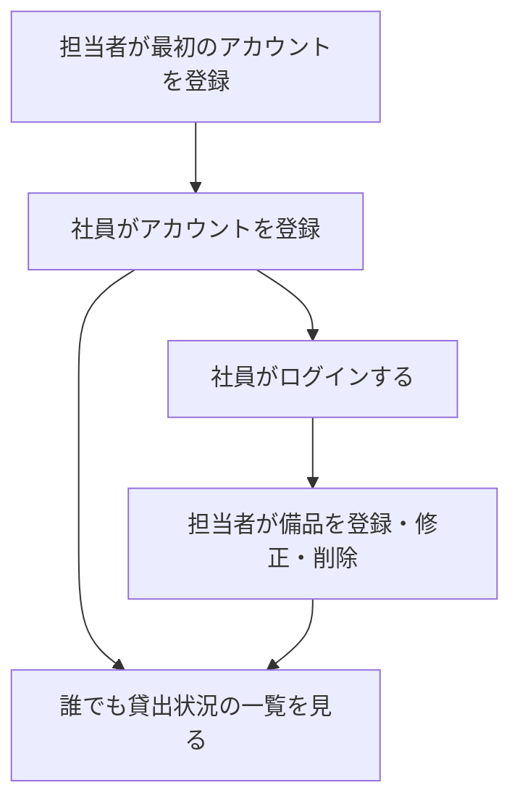
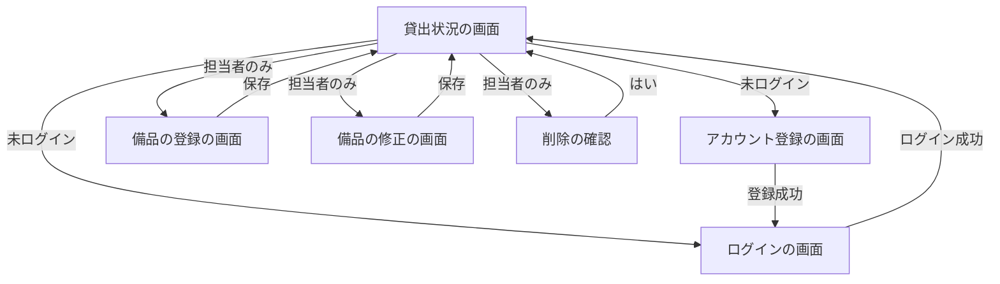

# 要件定義書: 備品の台帳と貸出状況の閲覧（段 1）

- 作成日: 2026-11-05
- フロー: 新規
- 根拠: REQUEST.md（依頼）、ANSWERS.md（ヒアリングへの固定回答）、contract.md（採点の契約。画面の URL・要素 id・文言は契約に従う）

## 1. 目的・前提

### 1-0. システムの目的

会社の備品の台帳と貸出の記録を 1 つのアプリにまとめ、記録の食い違いと消失をなくす。社員が「どの備品があり、空いているか」を担当者に問い合わせずに自分で確かめられるようにする。

用語集:

| 用語 | 業務上の意味 | 本案件での使用範囲 | 同義語/類義語 |
|---|---|---|---|
| 備品 | 会社が保有し、社員が借りることのある物品 | 台帳に登録する対象 | 物品 |
| 管理番号 | 備品を一意に識別する記号（半角の英数字とハイフン） | 備品の識別子 | 備品番号 |
| 社員 | 会社の従業員。アカウントを持つ利用者 | ログインして一覧を見る利用者 | 利用者 |
| 担当者 | 備品の登録・修正・削除を行う社員 | 最初に登録したアカウントと、担当者が与える権限 | 管理者 |
| 貸出中・空き | 備品が貸し出されているかどうかの状態 | 今段では全備品が「空き」 | 利用可能 |
| 社員番号 | 社員を識別する 6 桁の数字 | アカウントの識別子 | 社員コード |

システムの形態: GUI（ブラウザで開く画面）。Web API・バッチは作らない。

### 1-1. 技術制約（前提として記録する。要件ではないため ID は付与しない）

| 制約項目 | 内容 | 出どころ（誰がいつ答えたか） |
|---|---|---|
| 既存コードベース | 無し（新規開発） | ANSWERS.md（2026-11-05） |
| 配備先 | 社内の Linux サーバー。採点では `bash run.sh` で直接起動するため、コンテナ無しで動くこと。社内ネットワークからだけ開く | ANSWERS.md・contract.md |
| チームの技術 | 決まり無し。Python 3.12 と SQLite で足りる | ANSWERS.md |
| ライセンスとコスト | 無償のものだけを使う。有償ソフトとランニングコストは無し | REQUEST.md |
| 性能と規模の目安 | 利用者 50 人まで（社員と担当者の合計）、備品は数百件まで、アカウントは 50 件まで | REQUEST.md・ANSWERS.md |

### 1-2. 依頼に無く自分で決めた項目（必須）

| 項目 | 決めた内容 | 根拠（最小案か、依頼のどこから推測したか） | 承認（承認済 / 未確認） |
|---|---|---|---|
| 社員番号の前の 0 | 6 桁の数字として受け付け、文字列として保存する（000123 も可） | 依頼「社員番号 6 桁の数字」。数値化すると 0 が落ちるため | 未確認 |
| 入力の前後の空白 | 社員番号・名前・管理番号・備品名は前後の空白を取り除いてから判定する | 最小案。空白だけの名前を「空」と同じに扱うため | 未確認 |
| 名前の空欄 | 空（空白のみを含む）は「名前を入力してください」 | 依頼に空欄の扱いが無い。契約の文言「名前が空」を使う | 未確認 |
| パスワードの上限 | 上限は設けない。保存はハッシュ化する | 依頼は下限（8 文字以上）のみ。最小案 | 未確認 |
| パスワードの文字種 | 制限しない（何文字でも可、下限 8 文字） | 依頼に文字種の記載無し | 未確認 |
| 名前の重複 | 同じ名前の社員の登録を許可する（社員番号で一意に区別） | 依頼は社員番号のみ重複不可 | 未確認 |
| 管理番号の大文字小文字 | 区別する（A-001 と a-001 は別の備品）。前後の空白は除く | 最小案。依頼に記載無し | 未確認 |
| 管理番号の空欄 | 「管理番号は半角の英数字とハイフンで 20 文字以内で入力してください」を出す（空も形式違いとして扱う） | 契約の文言の範囲で処理する | 未確認 |
| 備品名の空欄 | 「備品名を入力してください」を出す | 依頼に空欄の扱いが無い | 未確認 |
| 修正での管理番号 | 修正画面で管理番号も変更できる。変更後の番号は重複チェックする | 依頼の「修正」の範囲を広く取る。最小案として「変更可」を選ぶ（変更不可も候補。承認で変える） | 未確認 |
| 削除の方式 | 確認ダイアログで「はい」の時だけ即時に削除する。削除の履歴は残さない | ANSWERS.md（削除した記録は残さない）・契約（window.confirm） | 承認済（ANSWERS.md） |
| 同時登録（最初のアカウント） | 登録の判定と保存を 1 つの処理で行い、同時に来ても担当者は 1 人だけにする | 依頼「1 件も無いときに登録した人は担当者」を複数人が同時に登録しても守るため | 未確認 |
| ログイン失敗の回数制限 | 設けない（アカウントのロックは無し） | 依頼に無い機能。最小案 | 未確認 |
| 失敗時の入力値 | 失敗時も入力欄の値を残す（契約「入力した値は消さない」）。パスワード欄も値を残すため、画面の HTML にパスワードが含まれる（社内限定の運用前提） | 契約の文言。リスクを明示して承認を求める | 未確認 |
| 担当者専用の操作の拒否 | 未ログインの人は登録画面・修正・削除の要求をログイン画面へ転送する。社員の要求は貸出状況の画面へ戻し「この操作は担当者だけが行えます」を出す | 契約の文言の指定 | 未確認 |
| 存在しない備品への修正・削除 | 貸出状況の画面へ戻し「備品が見つかりません」を出す | 依頼に無い。他の担当者が先に削除した場合に必要な最小の扱い | 未確認 |
| 社内限定の範囲 | アプリは全ての IP で待ち受ける。社内ネットワーク以外からの到達は配備先のネットワーク設定で止める（アプリ内では判定しない） | 依頼「社内ネットワークからだけ開く」。アプリ内の IP 判定は依頼に無い | 未確認 |
| セッションの保存 | サーバー側の DB に保存し、ブラウザには無作為のトークンを Cookie で持たせる。ログアウトで削除する | 依頼「30 分で自動ログアウト」を実現する最小の方式 | 未確認 |
| 復旧目標 | 障害時の復旧は翌営業日の日中までを目標とする | 依頼の「夜間・休日は止まってよい」から推測。数値は依頼に無い | 未確認 |
| 導入の順序 | 社員への URL の案内の前に、担当者が最初のアカウントを登録する | ANSWERS.md（導入手順） | 承認済（ANSWERS.md） |

## 2. 業務

### 2-0. 対象業務一覧

| RQ-BZ-ID | 業務名 | 業務の範囲 | 担当者 |
|---|---|---|---|
| `RQ-BZ-EQUIPMENT-LEDGER` | 備品台帳の管理と閲覧 | 備品の登録・修正・削除、社員による備品の一覧の閲覧。貸出・返却は今段では扱わない | 担当者（登録・修正・削除）、社員と未ログインの人（閲覧） |

業務フロー（今段）:

### 2-1. 業務の問題（あるべき姿と現状のギャップ）

| 問題 | 対象業務（RQ-BZ） | あるべき姿 | 現状 | ギャップ（KPI） | 業務影響 |
|---|---|---|---|---|---|
| 備品の記録が複数の Excel に分かれ、どれが最新か分からない | `RQ-BZ-EQUIPMENT-LEDGER` | 備品の記録が 1 つだけあり、誰が更新しても食い違わず失われない | 管理用 Excel が複数あり、記録が食い違ったり消えたりしている | 食い違い・消失の件数は依頼に記載無し。不明（数値は作らない） | 記録の信用が落ち、確認の手間が増える |
| 借りたい社員が、誰が何を借りているかを担当者に問い合わせないと分からない | `RQ-BZ-EQUIPMENT-LEDGER` | 社員が自分で備品の一覧を見て、空いているかを確かめられる | 担当者に問い合わせ、担当者が 1 回 15 分かけて調べている | 1 回 15 分の調べ物（問い合わせの件数は不明） | 担当者の時間を奪う |

### 2-2. 業務課題一覧（必須）

| RQ-BK-ID | 業務課題（取り組むこと） | 解決する問題（2-1） | 解決後の状態（KPI の目標値） | 対象業務（RQ-BZ） |
|---|---|---|---|---|
| `RQ-BK-SINGLE-RECORD-LEDGER` | 備品の記録を 1 つのアプリにまとめ、複数の担当者が更新しても失われない仕組みにする | 1 つ目の問題（記録の分散と食い違い） | 記録が 1 つだけあり、食い違いと消失が無い | `RQ-BZ-EQUIPMENT-LEDGER` |
| `RQ-BK-SELF-SERVICE-STATUS` | 社員が備品の一覧（空きか貸出中か）を自分で確かめられるようにする | 2 つ目の問題（問い合わせと 1 回 15 分の調べ物） | 社員が担当者に問い合わせずに備品の状況を確かめられ、担当者の 1 回 15 分の対応が無くなる | `RQ-BZ-EQUIPMENT-LEDGER` |
| `RQ-BK-ROLE-BASED-EDIT` | 備品の更新を担当者だけに限り、社員はログインして閲覧だけにする | 1 つ目の問題（記録の食い違い。誰でも更新できると食い違う） | 更新できるのは担当者だけになる | `RQ-BZ-EQUIPMENT-LEDGER` |

対応表（業務課題と要件）:

| 要件 | 対応業務課題（RQ-BK） |
|---|---|
| `RQ-FT-REGISTER-EQUIPMENT`、`RQ-FT-UPDATE-EQUIPMENT`、`RQ-FT-DELETE-EQUIPMENT`、`RQ-FT-EQUIPMENT-NUMBER-UNIQUE`、`RQ-UI-EQUIPMENT-FORM-SCREEN`、`RQ-DT-EQUIPMENT-ENTITY`、`RQ-DT-DATA-STORAGE`、`RQ-NF-MIGRATION-MANUAL-ENTRY` | `RQ-BK-SINGLE-RECORD-LEDGER` |
| `RQ-FT-VIEW-EQUIPMENT-STATUS`、`RQ-UI-EQUIPMENT-STATUS-SCREEN`、`RQ-NF-USER-SCALE`、`RQ-NF-RESPONSE-TIME`、`RQ-NF-AVAILABILITY` | `RQ-BK-SELF-SERVICE-STATUS` |
| `RQ-FT-REGISTER-ACCOUNT`、`RQ-FT-FIRST-ACCOUNT-IS-MANAGER`、`RQ-FT-EMPLOYEE-NUMBER-UNIQUE`、`RQ-FT-LOGIN`、`RQ-FT-LOGOUT`、`RQ-FT-AUTO-LOGOUT-IDLE`、`RQ-FT-MANAGER-ONLY-EQUIPMENT-OPERATION`、`RQ-UI-ACCOUNT-REGISTER-SCREEN`、`RQ-UI-LOGIN-SCREEN`、`RQ-DT-ACCOUNT-ENTITY`、`RQ-NF-AUTHENTICATION`、`RQ-NF-INTRANET-ACCESS`、`RQ-OP-FIRST-ACCOUNT-SETUP` | `RQ-BK-ROLE-BASED-EDIT` |

### 2-3. 見込み経営効果

| RQ-EF-ID | 効果の種類 | 内容 | 見込み（金額・時間などと算定根拠） | 対応業務課題ID（RQ-BK-*） |
|---|---|---|---|---|
| `RQ-EF-INQUIRY-TIME-SAVING` | Soft Saving（浮いた作業時間） | 担当者が備品の状況を問い合わせに答えるための調べ物が無くなる | 1 回あたり 15 分の削減。問い合わせの月間件数は依頼に無いため、月の合計は算定しない | `RQ-BK-SELF-SERVICE-STATUS` |

## 3. 機能要件

- 入力データ: 人手入力（アカウント登録、ログイン、備品の登録・修正）。外部連携は無い。
- 出力データ: 画面の一覧（貸出状況）と、画面の知らせ。帳票・出力ファイルは無い。
- 利用フロー:

- システムの形態: GUI。画面ごとの 5 項目は 4-5 と 3-0 の表に書く。

機能一覧（業務課題から導き出した機能）:

| RQ-ID | カテゴリ | 機能名 | 対応業務課題ID（RQ-BK-*） | この機能が無いと何が困るか |
|---|---|---|---|---|
| `RQ-FT-REGISTER-ACCOUNT` | 共通（認証・認可・ログ） | アカウント登録 | `RQ-BK-ROLE-BASED-EDIT` | 社員が自分で利用を始められず、担当者が全員のアカウントを作る手間が生じる |
| `RQ-FT-LOGIN` | 共通（認証・認可・ログ） | 社員番号とパスワードでログイン | `RQ-BK-ROLE-BASED-EDIT` | 担当者と社員を区別できず、更新の制限ができない |
| `RQ-FT-LOGOUT` | 共通（認証・認可・ログ） | ログアウト | `RQ-BK-ROLE-BASED-EDIT` | 共用の端末に利用者の操作が残る |
| `RQ-FT-AUTO-LOGOUT-IDLE` | 共通（認証・認可・ログ） | 操作しないまま 30 分で自動ログアウト | `RQ-BK-ROLE-BASED-EDIT` | 離席中に他の人が担当者の操作をできてしまう |
| `RQ-FT-REGISTER-EQUIPMENT` | 業務機能 | 備品の登録 | `RQ-BK-SINGLE-RECORD-LEDGER` | 備品の記録が作れず、台帳として使えない |
| `RQ-FT-UPDATE-EQUIPMENT` | 業務機能 | 備品の修正 | `RQ-BK-SINGLE-RECORD-LEDGER` | 誤った記録を直せず、記録が食い違ったままになる |
| `RQ-FT-DELETE-EQUIPMENT` | 業務機能 | 備品の削除 | `RQ-BK-SINGLE-RECORD-LEDGER` | 不要になった備品が一覧に残り続ける |
| `RQ-FT-VIEW-EQUIPMENT-STATUS` | 業務機能 | 貸出状況の一覧（誰でも閲覧） | `RQ-BK-SELF-SERVICE-STATUS` | 社員が担当者に問い合わせるしかなく、15 分の調べ物が続く |

### 3-0. 画面の仕様（GUI）

各画面の 5 項目（目的、主要要素、入力項目、表示項目、エラー時の見え方）。

| 画面 | 目的 | 主要要素 | 入力項目 | 表示項目 | エラー時の見え方 |
|---|---|---|---|---|---|
| 貸出状況（`/`） | 備品の空き状況を誰でも確かめる | 一覧の表、ログイン中の名前、ログイン・アカウント登録のリンク（未ログイン時）、ログアウトのボタン（ログイン時）、備品を登録のボタン（担当者のみ）、各行の修正・削除のボタン（担当者のみ） | なし | 管理番号、備品名、状態（空き / 貸出中）、借りている社員の名前、貸出日（`YYYY-MM-DD`） | 操作の拒否は `.message` に出す。備品が 0 件なら「備品は登録されていません」 |
| アカウント登録（`/accounts/register/`） | 社員が自分のアカウントを作る | 社員番号、名前、パスワードの入力欄、登録ボタン | 社員番号、名前、パスワード | なし | 入力欄ごとのエラーを `.field-error` に出す。入力値は残す |
| ログイン（`/login/`） | 社員番号とパスワードで利用を始める | 社員番号、パスワードの入力欄、ログインボタン | 社員番号、パスワード | なし | 画面全体のエラーを `.error` に出す。入力値は残す |
| 備品の登録（`/equipment/new/`） | 担当者が備品を新しく登録する | 管理番号、備品名の入力欄、保存ボタン | 管理番号、備品名 | なし | 入力欄ごとのエラーを `.field-error` に出す。入力値は残す |
| 備品の修正（URL は自由。`/equipment/<管理番号>/edit/`） | 担当者が備品の記録を直す | 管理番号、備品名の入力欄、保存ボタン | 管理番号、備品名 | 現在の値 | 入力欄ごとのエラーを `.field-error` に出す。存在しない備品は貸出状況へ戻し「備品が見つかりません」を `.message` に出す |

### 3-1. 帳票・出力ファイル

帳票・出力ファイルは無い。

| RQ-ID | 帳票・出力名 | 形式（PDF / CSV / 標準出力など） | 出力項目 | 出力のきっかけ | 対応業務課題ID（RQ-BK-*） |
|---|---|---|---|---|---|
| なし | 帳票・出力ファイルは無い | ― | ― | ― | ― |

### 3-2. 業務ルール

| RQ-ID | ルール名 | 内容（条件と結果） | 違反時・エラー時の業務上の扱い | 対応業務課題ID（RQ-BK-*） |
|---|---|---|---|---|
| `RQ-FT-FIRST-ACCOUNT-IS-MANAGER` | 最初のアカウントは担当者 | アカウントが 1 件も無いときに登録した人は担当者、2 件目以降に登録した人は社員。判定と保存は 1 つの処理で行う | ― | `RQ-BK-ROLE-BASED-EDIT` |
| `RQ-FT-EMPLOYEE-NUMBER-UNIQUE` | 社員番号は重複不可 | 登録済みの社員番号と同じ番号は登録できない | 「この社員番号は既に登録されています」を入力欄のエラーに出す | `RQ-BK-ROLE-BASED-EDIT` |
| `RQ-FT-EQUIPMENT-NUMBER-UNIQUE` | 管理番号は重複不可 | 登録済みの管理番号（自分自身を除く）と同じ番号は登録・修正できない。大文字小文字は区別する | 「この管理番号は既に使われています」を入力欄のエラーに出す | `RQ-BK-SINGLE-RECORD-LEDGER` |
| `RQ-FT-MANAGER-ONLY-EQUIPMENT-OPERATION` | 備品の登録・修正・削除は担当者だけ | 担当者以外（社員、未ログインの人）の登録・修正・削除の要求は受け付けず、データを変えない。画面のボタンも出さない | 社員は貸出状況へ戻し「この操作は担当者だけが行えます」を `.message` に出す。未ログインの人はログインの画面へ移す | `RQ-BK-ROLE-BASED-EDIT` |

### 3-3. 外部連携

外部連携は無い。

| RQ-ID | 連携先 | 方向（取得 / 送信 / 受信） | やり取りするデータ | タイミング | 対応業務課題ID（RQ-BK-*） |
|---|---|---|---|---|---|
| なし | 外部連携は無い | ― | ― | ― | ― |

## 4. データ

### 4-1. データ要件一覧

| RQ-ID | 種別 | 内容 | 対応業務課題ID（RQ-BK-*） | この要件が無いと何が困るか |
|---|---|---|---|---|
| `RQ-DT-DATA-STORAGE` | 内部データ・DB の必要性 | 全データは内部データ。外部 DB は無い。ファイル型の DB（SQLite）に保存する。初期の件数は 0 件（備品 0 件、アカウント 0 件）。備品は数百件、アカウントは 50 件まで。データの保持期間は無期限（削除したものの記録は残さない）。DB が必要な理由: 複数の人が同時に更新しても記録が失われないよう、トランザクションで一貫性を保つため。参照関係は単純（今段では 2 つのエンティティに参照が無い）。検索・集計は無い（一覧の全件表示のみ） | `RQ-BK-SINGLE-RECORD-LEDGER` | 同時更新で記録が失われ、食い違いが再発する |

### 4-2. 業務エンティティとデータ項目

| RQ-ID | カテゴリ | 業務エンティティ名 | 対応業務課題ID（RQ-BK-*） | この業務エンティティが無いと何が困るか |
|---|---|---|---|---|
| `RQ-DT-EQUIPMENT-ENTITY` | 業務データ | 備品 | `RQ-BK-SINGLE-RECORD-LEDGER` | 備品の台帳そのものが作れない |
| `RQ-DT-ACCOUNT-ENTITY` | 業務データ | アカウント（社員） | `RQ-BK-ROLE-BASED-EDIT` | 利用者と担当者の区別ができない |

| エンティティ名 | 項目名 | 業務上の意味 | 必須 | 形式・桁 | 値の範囲・制約 | 例 |
|---|---|---|---|---|---|---|
| 備品 | 管理番号 | 備品の識別子 | 必須 | 半角の英数字とハイフン、20 文字以内 | 重複不可（大文字小文字を区別） | `PC-0001` |
| 備品 | 備品名 | 備品の名前 | 必須 | 50 文字以内 | 制約は長さのみ | ノートパソコン |
| アカウント | 社員番号 | 社員の識別子 | 必須 | 6 桁の数字 | 重複不可。前の 0 を保持する | `000123` |
| アカウント | 名前 | 社員の名前 | 必須 | 30 文字以内 | 空は不可。重複は可 | 山田 太郎 |
| アカウント | パスワード | ログイン用の秘密の文字列 | 必須 | 8 文字以上 | 上限無し。保存はハッシュ化（平文で保存しない） | ― |
| アカウント | 役割 | 担当者か社員か | 必須 | 「担当者」または「社員」 | 最初のアカウントは担当者、以降は社員 | 担当者 |

### 4-3. CRUD テーブル（必須）

| エンティティ名 | Create | Read（一覧） | Read（詳細） | 検索 | Update | Delete | 備考 |
|---|---|---|---|---|---|---|---|
| 備品 | △ | ○ | △ | × | △ | △ | 作成・修正・削除は担当者だけ（`RQ-FT-MANAGER-ONLY-EQUIPMENT-OPERATION`）。修正画面の表示に詳細を使う。一覧は誰でも閲覧可。同時更新は保存時に上書きが無いよう、更新は 1 件ずつ 1 つの処理で行う（トランザクション）。検索は無い |
| アカウント | ○ | × | △ | × | × | × | 登録は誰でも可（未ログインでも）。詳細の読み取りはログイン時の照合だけに使い、画面は無い。一覧・修正・削除は無い |

### 4-4. 状態遷移

状態を持つエンティティは無い（今段では備品の貸出状態を持たず、全件「空き」として表示する）。

### 4-5. 画面一覧（GUI の場合のみ）

| RQ-ID | 画面名 | 対応する CRUD 操作（エンティティ名:操作種別） | 主な機能・目的 | 対応業務課題ID（RQ-BK-*） |
|---|---|---|---|---|
| `RQ-UI-EQUIPMENT-STATUS-SCREEN` | 貸出状況（トップ） | 備品:Read（一覧）、備品:Delete（行の削除ボタン） | 備品の一覧、担当者の削除 | `RQ-BK-SELF-SERVICE-STATUS`、`RQ-BK-SINGLE-RECORD-LEDGER` |
| `RQ-UI-ACCOUNT-REGISTER-SCREEN` | アカウント登録 | アカウント:Create | 社員が自分のアカウントを作る | `RQ-BK-ROLE-BASED-EDIT` |
| `RQ-UI-LOGIN-SCREEN` | ログイン | アカウント:Read（詳細）（ログイン照合） | 社員番号とパスワードでログイン | `RQ-BK-ROLE-BASED-EDIT` |
| `RQ-UI-EQUIPMENT-FORM-SCREEN` | 備品の登録・修正 | 備品:Create、備品:Read（詳細）、備品:Update | 担当者が備品を登録・修正する | `RQ-BK-SINGLE-RECORD-LEDGER` |

## 5. 非機能要件

- 利用者の種別: 社員と担当者（合計 50 人まで）。アクセス経路: 社内ネットワーク限定（配備先で止める）。

| RQ-ID | カテゴリ | 非機能要件名 | 対応業務課題ID（RQ-BK-*） | この非機能要件が無いと何が困るか |
|---|---|---|---|---|
| `RQ-NF-USER-SCALE` | 利用人数 | 同時に利用する人数は 50 人まで | `RQ-BK-SELF-SERVICE-STATUS` | 想定を超える人数で動かなくなる |
| `RQ-NF-RESPONSE-TIME` | 性能 | 操作から画面の表示までを 3 秒以内にする（社内ネットワーク内で、利用人数 50 人の時） | `RQ-BK-SELF-SERVICE-STATUS` | 一覧が遅く、問い合わせの代わりにならない |
| `RQ-NF-AVAILABILITY` | 可用性 | 平日の日中に利用する。夜間・休日は停止してよい。障害からの復旧は翌営業日の日中までとする | `RQ-BK-SELF-SERVICE-STATUS` | 平日に使えない時間が出ると業務が止まる |
| `RQ-NF-AUTHENTICATION` | セキュリティ（認証） | 社員番号とパスワードで認証する。SSO は使わない。パスワードはハッシュ化して保存する | `RQ-BK-ROLE-BASED-EDIT` | 誰でも担当者の操作ができてしまう |
| `RQ-NF-INTRANET-ACCESS` | セキュリティ（アクセス経路） | 社内ネットワークからだけ開く（配備先のネットワーク設定で制限する） | `RQ-BK-ROLE-BASED-EDIT` | 社外から記録を見られ、更新される |
| `RQ-NF-MIGRATION-MANUAL-ENTRY` | 移行性 | 既存の Excel の記録は担当者が画面から手で入力する。取り込み機能は作らない | `RQ-BK-SINGLE-RECORD-LEDGER` | 移行の手段が無く、既存の備品が台帳に入らない |

移行: 既存の Excel からは担当者が画面で手入力する。取り込みは無い（ANSWERS.md）。

## 6. 運用要件

| RQ-ID | 種別 | 内容 | 対応業務課題ID（RQ-BK-*） | この要件が無いと何が困るか |
|---|---|---|---|---|
| `RQ-OP-FIRST-ACCOUNT-SETUP` | 導入手順 | 社員に URL を知らせる前に、担当者が最初のアカウントを登録する。以後、社員はアカウント登録画面から自分で登録する | `RQ-BK-ROLE-BASED-EDIT` | 最初の登録者が社員になり、担当者がいない状態になる |

- ログ: ログは必要ない（動作ログ・監査ログの要件は無い）。
- 監査ログ: 不要。
- 監視・アラート: 不要。
- バックアップ: 不要（ANSWERS.md）。

## 7. テスト用利用シナリオ

| RQ-ID | テスト目的 | 前提条件 | テスト手順 | 期待される結果 | 検証する要件ID | 対応業務課題ID（RQ-BK-*） |
|---|---|---|---|---|---|---|
| `RQ-TS-REGISTER-FIRST-ACCOUNT` | 最初のアカウントが担当者になることを確かめる | アカウントが 0 件 | アカウント登録画面で社員番号・名前・パスワードを入力して登録 | ログイン画面に「登録しました。ログインしてください」が出て、ログインすると担当者として振る舞う | `RQ-FT-REGISTER-ACCOUNT`、`RQ-FT-FIRST-ACCOUNT-IS-MANAGER`、`RQ-UI-ACCOUNT-REGISTER-SCREEN` | `RQ-BK-ROLE-BASED-EDIT` |
| `RQ-TS-REGISTER-SECOND-ACCOUNT` | 2 件目以降は社員になることを確かめる | 担当者のアカウントが 1 件ある | 別の社員番号で登録してログインする | 「社員」として振る舞い、備品の操作ボタンが出ない | `RQ-FT-REGISTER-ACCOUNT`、`RQ-FT-FIRST-ACCOUNT-IS-MANAGER`、`RQ-UI-ACCOUNT-REGISTER-SCREEN` | `RQ-BK-ROLE-BASED-EDIT` |
| `RQ-TS-ACCOUNT-INPUT-VALIDATION` | アカウント登録の入力チェックを確かめる | アカウント登録画面を開いている | 社員番号の形式違い、社員番号の重複、名前の空・30 文字超、パスワードの 8 文字未満を入力して登録 | 各文言が入力欄の `.field-error` に出て、入力値が残る | `RQ-FT-REGISTER-ACCOUNT`、`RQ-FT-EMPLOYEE-NUMBER-UNIQUE`、`RQ-UI-ACCOUNT-REGISTER-SCREEN` | `RQ-BK-ROLE-BASED-EDIT` |
| `RQ-TS-LOGIN` | ログインの成功と失敗を確かめる | アカウントがある | 正しい社員番号とパスワードでログイン。次に誤った組み合わせでログイン | 成功でトップに戻り `.current-user` に名前が出る。失敗では「社員番号またはパスワードが違います」が `.error` に出る（どちらが違うかは示さない） | `RQ-FT-LOGIN`、`RQ-UI-LOGIN-SCREEN`、`RQ-NF-AUTHENTICATION` | `RQ-BK-ROLE-BASED-EDIT` |
| `RQ-TS-LOGOUT` | ログアウトを確かめる | ログイン中 | 「ログアウト」ボタンを押す | ログアウトされ、ログイン・アカウント登録のリンクが出る | `RQ-FT-LOGOUT` | `RQ-BK-ROLE-BASED-EDIT` |
| `RQ-TS-AUTO-LOGOUT` | 30 分の無操作で自動ログアウトすることを確かめる | ログイン中。`SESSION_IDLE_TIMEOUT_SECONDS` を短く設定して起動 | 操作せずに設定時間を超えてから画面を更新 | ログアウト状態になる | `RQ-FT-AUTO-LOGOUT-IDLE` | `RQ-BK-ROLE-BASED-EDIT` |
| `RQ-TS-REGISTER-EQUIPMENT` | 担当者が備品を登録できることを確かめる | 担当者でログイン | 「備品を登録」から管理番号と備品名を入力して保存 | 一覧に「空き」で追加される（管理番号の昇順） | `RQ-FT-REGISTER-EQUIPMENT`、`RQ-UI-EQUIPMENT-FORM-SCREEN` | `RQ-BK-SINGLE-RECORD-LEDGER` |
| `RQ-TS-EQUIPMENT-INPUT-VALIDATION` | 備品の入力チェックと重複を確かめる | 担当者でログイン、備品が 1 件ある | 管理番号の形式違い、管理番号の重複、備品名の 51 文字を入力して保存 | 各文言が `.field-error` に出て、入力値が残り、登録されない | `RQ-FT-EQUIPMENT-NUMBER-UNIQUE`、`RQ-FT-REGISTER-EQUIPMENT`、`RQ-UI-EQUIPMENT-FORM-SCREEN` | `RQ-BK-SINGLE-RECORD-LEDGER` |
| `RQ-TS-UPDATE-EQUIPMENT` | 担当者が備品を修正できることを確かめる | 担当者でログイン、備品が 1 件ある | 行の「修正」から備品名を変えて「保存」 | 一覧の行が新しい備品名になる | `RQ-FT-UPDATE-EQUIPMENT`、`RQ-UI-EQUIPMENT-FORM-SCREEN` | `RQ-BK-SINGLE-RECORD-LEDGER` |
| `RQ-TS-DELETE-EQUIPMENT` | 削除の確認で「はい」の時だけ削除されることを確かめる | 担当者でログイン、備品が 1 件ある | 「削除」を押して確認で「キャンセル」、次に「はい」 | キャンセルでは残り、「はい」で一覧から消える | `RQ-FT-DELETE-EQUIPMENT`、`RQ-UI-EQUIPMENT-STATUS-SCREEN` | `RQ-BK-SINGLE-RECORD-LEDGER` |
| `RQ-TS-VIEW-STATUS-ANONYMOUS` | 未ログインでも一覧が見られ、ボタンが出ないことを確かめる | 備品が 2 件ある（管理番号 `B-2`、`A-10`） | 未ログインでトップを開く | 管理番号の昇順（`A-10`、`B-2`）で `tbody tr` に出て、「空き」、借りている社員・貸出日は空欄。ボタンは出ない | `RQ-FT-VIEW-EQUIPMENT-STATUS`、`RQ-UI-EQUIPMENT-STATUS-SCREEN`、`RQ-NF-RESPONSE-TIME`、`RQ-NF-USER-SCALE` | `RQ-BK-SELF-SERVICE-STATUS` |
| `RQ-TS-VIEW-STATUS-EMPTY` | 備品が 0 件の表示を確かめる | 備品が 0 件 | トップを開く | 「備品は登録されていません」が出て、表は出ない | `RQ-FT-VIEW-EQUIPMENT-STATUS`、`RQ-UI-EQUIPMENT-STATUS-SCREEN` | `RQ-BK-SELF-SERVICE-STATUS` |
| `RQ-TS-EMPLOYEE-CANNOT-OPERATE` | 社員の備品操作を拒否することを確かめる | 社員でログイン | トップを開き、備品の登録画面 `/equipment/new/` へ直接アクセス。さらに修正・削除の要求を直接送る | ボタンは出ず、直接の要求は貸出状況へ戻り「この操作は担当者だけが行えます」が `.message` に出る。データは変わらない | `RQ-FT-MANAGER-ONLY-EQUIPMENT-OPERATION`、`RQ-UI-EQUIPMENT-STATUS-SCREEN`、`RQ-UI-EQUIPMENT-FORM-SCREEN` | `RQ-BK-ROLE-BASED-EDIT` |
| `RQ-TS-ANONYMOUS-CANNOT-OPERATE` | 未ログインの人の備品操作を拒否することを確かめる | 未ログイン | 備品の登録画面 `/equipment/new/` へアクセス。修正・削除の要求を直接送る | ログイン画面へ移り、データは変わらない | `RQ-FT-MANAGER-ONLY-EQUIPMENT-OPERATION` | `RQ-BK-ROLE-BASED-EDIT` |

## 8. 整合のための注記

- 今段で作らないもの: 貸出・返却の記録、アカウントの管理（削除・権限変更）、ログ・監査ログ、監視、バックアップ、取り込み機能、Web API、バッチ。
