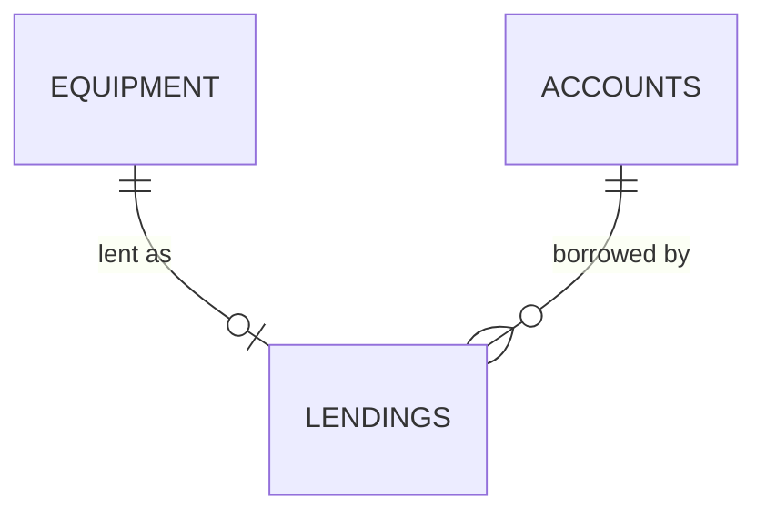
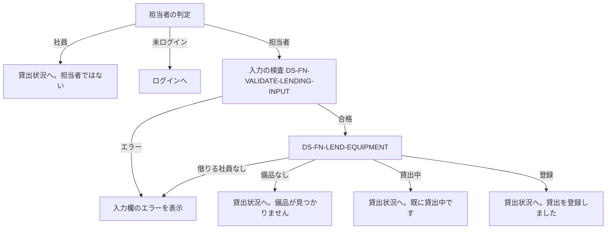

# 変更設計書: 社員番号の 7 桁化と、備品の貸出・返却（段 2）

- 作成日: 2026-11-05
- フロー: 変更
- 入力要件書: `.history/20261105-lending-and-employee-number/change_requirements.md`（正本 `docs/requirements.md` に重ねる）
- 正本: `docs/detail_design.md`（段 1。実装済みの設計）。この文書は正本を書き換えない

この文書の区分は行ごとに「[追加]」か「[削除]」を書く。区分の無い章は「変更なし。既存設計 `docs/detail_design.md` セクション[N] を参照」と書く。

設計 ID の扱い（この変更での判断）: 設計 ID は「設計要素の責務」で決める。責務が同じで、振る舞いだけが変わる既存の要素（一覧、取得、修正、削除、画面、検査）は ID を変えず、対応の行を [追加] で足す。責務が新しく生まれる要素は [追加] する。この変更では責務が無くなる要素は無いので、[削除] の要素は無い。

## 1. 言語・フレームワーク・アーキテクチャの選定

変更なし。既存設計 `docs/detail_design.md` 第 1 章を引き継ぐ（Python 3.12、Flask、waitress、SQLite、Playwright の E2E）。変更要件の技術制約と矛盾しない。

## 2. システム構成

変更なし。既存設計 `docs/detail_design.md` 第 2 章を参照。

## 3. データ設計

### 3-1. データモデル

テーブルを 1 つ足す（[追加]）。

| テーブル | DS-ID | カラム | 型 | 制約 | 区分 |
|---|---|---|---|---|---|
| `lendings` | `DS-SC-LENDING-TABLE` | `equipment_number` | TEXT | 主キー。`equipment` の値を指す外部キー。`ON UPDATE CASCADE`（管理番号の修正で貸出の行も付いてくる） | [追加] |
| | | `employee_number` | TEXT | 必須。`accounts` の値を指す外部キー | [追加] |
| | | `lent_on` | TEXT | 必須。`YYYY-MM-DD`（日本時間の日付） | [追加] |

主キーを管理番号にするので、備品 1 件に貸出は 0 か 1 件になる（`RQ-DT-LENDING-ENTITY`）。返却は行の削除で表す（履歴は残さない）。

スキーマ文（`src/db.py` の `SCHEMA_SQL` に足す。`equipment` の後、`sessions` の前）:

```sql
CREATE TABLE IF NOT EXISTS lendings (
    equipment_number TEXT PRIMARY KEY REFERENCES equipment(equipment_number) ON UPDATE CASCADE,
    employee_number TEXT NOT NULL REFERENCES accounts(employee_number),
    lent_on TEXT NOT NULL
);
```

既存の `accounts` の社員番号の検査（7 桁）は、テーブルの形を変えない（TEXT のまま）。6 桁のデータの移行は無い（要件 1-2）。

リレーション図の追加:



### 3-2. トランザクションと排他制御

既存の表に行を足す・変える（[追加]）。

| 操作 | トランザクションの範囲 | ロールバックの条件 | 排他制御 | 区分 |
|---|---|---|---|---|
| 貸出の登録（`DS-FN-LEND-EQUIPMENT`） | 備品の存在、貸出の有無、借りる社員の存在を確かめ、貸出の行を挿入する。`BEGIN IMMEDIATE` | 備品が無い → 取り消し（not_found）。貸出の行がある → 取り消し（already_lent）。挿入で主キー違反（同時の別の登録。念のための保険）→ 取り消し（already_lent）。借りる社員が無い → 取り消し | 書き込みロックで直列化する。先に確定した登録だけが残り、後の登録は貸出中を見て拒否する | [追加] |
| 返却（`DS-FN-RETURN-EQUIPMENT`） | 備品の存在を確かめ、貸出の行を削除する。`BEGIN IMMEDIATE` | 備品が無い → not_found。削除件数 0 → 取り消し（not_lent） | 同上 | [追加] |
| 備品の削除（`DS-FN-DELETE-EQUIPMENT`） | 備品の存在、貸出の有無を確かめ、削除する。`BEGIN IMMEDIATE`（既存の削除の 1 つの処理を、確認を足して行う） | 備品が無い → not_found。貸出の行がある → 取り消し（lent） | 同上 | [追加]（既存の行の備考の変更） |
| 備品の修正（`DS-FN-UPDATE-EQUIPMENT`） | 読み込みと書き込みを同じトランザクションで行う（既存）。更新時刻を比べ、違えば取り消し | 更新時刻が違う、または備品が無い → 取り消し（conflict）。新しい番号が既にある → 取り消し（重複） | 同上。貸出の行は外部キーの連動更新で付いてくる | [追加]（既存の行の備考の変更） |

状態遷移は、貸出の行の有無で表す（`docs/requirements.md` 4-4 の変更分）。

## 4. アーキテクチャ設計

### 4-1. 外部設計

利用者向けインターフェース（画面と操作の入口は Flask のルート）。

| DS-ID | 画面・操作 | URL・メソッド | 入力 | 出力 | 入力のバリデーション（要件の項目・業務ルール） | エラー仕様 | 区分 |
|---|---|---|---|---|---|---|---|
| `DS-IF-EQUIPMENT-STATUS-SCREEN` | 貸出状況（トップ） | `/` GET（既存） | なし | 一覧に貸出の列（状態、借りている社員の名前、貸出日）。担当者には空きの行に「貸出」、貸出中の行に「返却」、全行に「修正」「削除」。貸出・返却の知らせは `.message` | なし | 「既に貸出中です」「既に返却されています」「貸出中のため削除できません」「貸出を登録しました」「返却を処理しました」は `.message` に出す（`notice` の値で選ぶ） | [追加]（責務は既存の一覧。振る舞いの追加） |
| `DS-IF-LENDING-FORM-SCREEN` | 貸出の登録 | `/equipment/<管理番号>/lend/` GET（画面）、POST（登録） | 借りる社員（`id_borrower`）、貸出日（`id_lent_on`） | GET は画面（`.lending-equipment` に備品。既定の貸出日は今日）。POST 成功は貸出状況へ転送（`notice=lent`） | 借りる社員は選択必須（アカウントに存在すること）。貸出日は `YYYY-MM-DD`、未来は不可（`DS-FN-VALIDATE-LENDING-INPUT`） | 入力欄ごとの文言は `.field-error`。入力値は残す。備品が無い → 貸出状況へ（`notice=not_found`）。貸出中 → 貸出状況へ（`notice=already_lent`）。担当者以外 → 担当者の判定（`DS-FN-REQUIRE-MANAGER`）に従う | [追加] |
| `DS-IF-RETURN-ACTION` | 返却 | `/equipment/<管理番号>/return/` POST | なし（確認は画面のボタンの `window.confirm`） | 貸出状況へ転送（`notice=returned`） | 担当者のみ | 空き → `notice=already_returned`。備品が無い → `notice=not_found`。担当者以外は担当者の判定に従う | [追加] |
| `DS-IF-EQUIPMENT-FORM-SCREEN` | 備品の登録・修正 | `/equipment/new/`、`/equipment/<管理番号>/edit/`（既存） | 管理番号、備品名。修正では読み込み時の更新時刻（隠し項目 `loaded_updated_at`） | 既存 | 既存の検査に加え、修正の保存は更新時刻を比べる（`DS-FN-UPDATE-EQUIPMENT`） | 競合（他の担当者が先に更新・削除）は `.error` に「他の担当者が先にこの備品を更新しました。貸出状況の画面から開き直してください」。入力値は残す | [追加]（責務は既存。振る舞いの追加） |
| `DS-IF-EQUIPMENT-DELETE-ACTION` | 備品の削除 | `/equipment/<管理番号>/delete/` POST（既存） | なし | 貸出状況へ（`notice=deleted`、または `notice=delete_lent`） | 担当者のみ（既存） | 貸出中は削除せず、`.message` に「この備品は貸出中のため削除できません。先に返却を処理してください」 | [追加]（責務は既存） |
| `DS-IF-ACCOUNT-REGISTER-SCREEN` | アカウント登録 | `/accounts/register/`（既存） | 社員番号（7 桁）、名前、パスワード | 既存 | 社員番号は 7 桁の数字（`DS-FN-VALIDATE-ACCOUNT-INPUT`） | 社員番号の文言は「社員番号は 7 桁の数字で入力してください」 | [追加]（責務は既存） |

既存のログインとログアウトの画面は変更なし。

外部システム連携: 変更なし（無し）。
外部 DB 連携: 変更なし（無し）。

### 4-2. 内部設計

処理フロー（貸出の登録）:



各処理の役割:
- 貸出の登録（`DS-FN-LEND-EQUIPMENT`）: 上の 1 つのトランザクションで行う（3-2）。
- 返却（`DS-FN-RETURN-EQUIPMENT`）: 同じく 1 つのトランザクションで行う。
- 今日の日付（`DS-FN-TODAY-JST`）: 日本時間（UTC+9 の固定オフセット。日本は夏時間が無いため、時刻帯データに依存しない）の今日の日付。
- 借りる社員の選択肢（`DS-FN-LIST-BORROWERS`）: 全アカウントを社員番号の昇順で返す（名前と社員番号）。
- 貸出状況の一覧（`DS-FN-LIST-EQUIPMENT`、既存の ID）: 備品に貸出の行を左外部結合し、借りている社員の名前（`accounts` を結合）と貸出日を返す。管理番号の昇順。
- 修正（`DS-FN-UPDATE-EQUIPMENT`）: 処理は既存と同じ。競合の判定を足す。外部キーの連動更新で貸出の行は付いてくる。
- 削除（`DS-FN-DELETE-EQUIPMENT`）: 貸出の行の有無を確かめてから削除する。

バッチ: 無し。

## 5. クラス設計

変更なし（クラスは作らない。モジュールごとの関数で構成する）。

## 6. エラーハンドリングとセキュリティ設計

### 6-1. エラーハンドリング（変更分）

| 想定エラー | 利用者への見え方 | 処理の扱い | 区分 |
|---|---|---|---|
| 借りる社員の未選択・存在しない社員 | `.field-error`「借りる社員を選んでください」 | 貸出の行を作らない。入力値は残す | [追加] |
| 貸出日の形式違い | `.field-error`「貸出日は YYYY-MM-DD の形で入力してください」 | 貸出の行を作らない | [追加] |
| 貸出日が未来 | `.field-error`「貸出日に未来の日付は入力できません」 | 貸出の行を作らない | [追加] |
| 貸出中の備品への貸出（同時の 2 件を含む） | `.message`「この備品は既に貸出中です」 | 後の貸出は取り消す | [追加] |
| 返却済みの備品の返却（同時の 2 件を含む） | `.message`「この備品は既に返却されています」 | 取り消す | [追加] |
| 貸出中の備品の削除 | `.message`「この備品は貸出中のため削除できません。先に返却を処理してください」 | 削除しない | [追加] |
| 修正の競合（他の担当者が先に更新・削除） | `.error`「他の担当者が先にこの備品を更新しました。貸出状況の画面から開き直してください」 | 保存しない。入力値は残す | [追加] |
| 社員・未ログインの貸出・返却の要求 | 既存の担当者の判定に従う（社員は `.message`、未ログインはログイン画面） | データを変えない | [追加] |

### 6-2. 認証

変更なし。ログインは社員番号の形式を検査せず、一致しなければ既存の文言。

### 6-3. 認可

| 操作 | 未ログイン | 社員 | 担当者 | 区分 |
|---|---|---|---|---|
| 貸出の登録・返却 | 不可（ログイン画面へ） | 不可（貸出状況へ戻し知らせ） | 可 | [追加] |
| 貸出状況の閲覧 | 可 | 可 | 可（既存） | 変更なし |

認可の判定は既存の `DS-FN-REQUIRE-MANAGER` を使う（ボタンの表示と、要求の受け付けの両方）。

### 6-4. 監査ログ

変更なし（無い）。

### 6-5. その他のセキュリティ対策

変更なし。ただし、貸出の登録画面の選択肢の値は、サーバー側で `accounts` に存在するかを確かめる（画面の値を信用しない）。

## 7. コード設計

### 7-1. ディレクトリ構成（変更分）

```
src/
  lending.py      [追加] 貸出・返却・今日の日付
  templates/
    lending_form.html  [追加] 貸出の登録画面
```

### 7-2. ファイル一覧（変更分）

| ファイル | 役割 | 含まれる関数 | 実現する設計 ID | 区分 |
|---|---|---|---|---|
| `src/lending.py` | 貸出の登録・返却、今日の日付（日本時間） | `lend_equipment`、`return_equipment`、`today_jst` | `DS-MD-LENDING`、`DS-FN-LEND-EQUIPMENT`、`DS-FN-RETURN-EQUIPMENT`、`DS-FN-TODAY-JST` | [追加] |
| `src/db.py` | スキーマに貸出の表を足す | `init_schema` | `DS-SC-LENDING-TABLE` | [追加] |
| `src/validation.py` | 貸出の入力検査を足す | `validate_lending_input` | `DS-FN-VALIDATE-LENDING-INPUT`、`DS-MD-VALIDATION`（既存。社員番号 7 桁の検査） | [追加] |
| `src/accounts.py` | 借りる社員の選択肢を足す | `list_borrowers` | `DS-FN-LIST-BORROWERS` | [追加] |
| `src/equipment.py` | 一覧の貸出の結合、取得の更新時刻、修正の競合検知、削除の貸出の確認 | 既存の関数（`list_equipment`、`get_equipment`、`update_equipment`、`delete_equipment`）の振る舞いを変える | 既存の ID（`DS-FN-LIST-EQUIPMENT`、`DS-FN-GET-EQUIPMENT`、`DS-FN-UPDATE-EQUIPMENT`、`DS-FN-DELETE-EQUIPMENT`） | [追加] |
| `src/web.py` | 貸出の登録・返却の画面と操作を足す | `equipment_lend`、`equipment_return` | `DS-IF-LENDING-FORM-SCREEN`、`DS-IF-RETURN-ACTION` | [追加] |
| `src/templates/status.html` | 貸出の列と操作のボタン | ― | 既存の `DS-IF-EQUIPMENT-STATUS-SCREEN` | [追加] |
| `src/templates/equipment_form.html` | 競合の `.error` と隠し項目 | ― | 既存の `DS-IF-EQUIPMENT-FORM-SCREEN` | [追加] |
| `src/templates/lending_form.html` | 貸出の登録画面 | ― | `DS-IF-LENDING-FORM-SCREEN` | [追加] |

テンプレート（`src/templates/`）と CSS（`src/static/`）は対応表の対象外（既存の規則）。

### 7-3. 対応表の粒度

変更なし（`function`）。

### 7-4. 依存の規則

変更なし（依存の規則は無い）。

### 7-5. コーディング規約

変更なし。コードに要件 ID・設計 ID を書かない。

## 8. テスト設計

### 8-1. テストの種類と方針

変更なし（単体・結合は `tests/`、E2E は `e2e/`）。

### 8-2. E2E テストのシナリオ（変更分）

変更要件の 10 本の `RQ-TS`（新規）を、1 対 1 で `DS-TS` にする。既存の `DS-TS` の手順は本文だけを変える（貸出のない備品は既存の期待結果のまま）。

| DS-ID | 目的 | 前提条件 | 手順 | 期待結果 | 区分 |
|---|---|---|---|---|---|
| `DS-TS-EMPLOYEE-NUMBER-7-DIGITS-E2E` | 社員番号は 7 桁 | アカウント登録画面 | 6 桁で登録、次に 7 桁で登録してログイン | 6 桁は `.field-error`、7 桁は登録されログインできる | [追加] |
| `DS-TS-LEND-EQUIPMENT-E2E` | 担当者の貸出の登録 | 担当者、社員、空きの備品 | 「貸出」→借りる社員を選んで「登録」 | 行が「貸出中」、借りている社員の名前、今日の貸出日 | [追加] |
| `DS-TS-LEND-VALIDATION-E2E` | 貸出の入力検査 | 担当者、空きの備品 | 社員未選択で登録、明日の日付で登録、今日で登録 | 未選択と未来は `.field-error`、入力値は残る。今日は登録される | [追加] |
| `DS-TS-LEND-ALREADY-LENT-E2E` | 同時の貸出（古い画面からの貸出） | 担当者、空きの備品、貸出の登録画面を 2 つ開いている | 1 つ目で貸す。2 つ目で別の社員を選んで登録 | 2 つ目は「この備品は既に貸出中です」、記録は 1 つ目の社員 | [追加] |
| `DS-TS-RETURN-EQUIPMENT-E2E` | 返却の確認 | 担当者、貸出中の備品 | 「返却」→キャンセル→「返却」→はい | キャンセルは残る。はいで「空き」、借りている社員と貸出日が空欄 | [追加] |
| `DS-TS-RETURN-ALREADY-RETURNED-E2E` | 同時の返却（古い画面からの返却） | 担当者、貸出中の備品、貸出状況を 2 つ開いている | 1 つ目で返却（はい）。2 つ目で返却（はい） | 2 つ目は「この備品は既に返却されています」 | [追加] |
| `DS-TS-LENDING-OPERATION-DENIED-E2E` | 社員と未ログインの貸出・返却の拒否 | 社員でログイン。未ログイン | 貸出の登録画面へ直接アクセス、返却の要求を直接送る | 社員は「この操作は担当者だけが行えます」。未ログインはログイン画面。データは変わらない | [追加] |
| `DS-TS-DELETE-LENT-BLOCKED-E2E` | 貸出中の削除の拒否 | 担当者、貸出中の備品 | 「削除」→「はい」 | 削除されず、「この備品は貸出中のため削除できません。先に返却を処理してください」。行は残る | [追加] |
| `DS-TS-UPDATE-CONFLICT-E2E` | 修正の競合 | 担当者、備品 1 件、修正画面を 2 つ開いている | 1 つ目で保存。2 つ目で別の名前にして保存 | 2 つ目は保存されず `.error`。入力値は残る | [追加] |
| `DS-TS-UPDATE-KEEPS-LENDING-E2E` | 修正と貸出の引き継ぎ | 担当者、貸出中の備品 1 件 | 「修正」で管理番号と備品名を変えて保存 | 新しい管理番号の行が「貸出中」、借りている社員と貸出日が残る | [追加] |

既存の非機能のシナリオ（一覧の表示の 3 秒以内）は、備品 300 件のうち 100 件を貸出中にしたうえで、表示が 3 秒以内であることを確かめる（手順の変更のみ）。

### 8-3. E2E の実行手段

変更なし。

### 8-4. E2E の実行コマンドと運用

変更なし（`.venv/bin/python scripts/isdd/unittest_junit.py -s e2e -t . -o e2e/results/e2e.xml`）。

## 9. 運用設計

### 9-1. 起動

変更なし。

### 9-2. 初期化と初期ユーザー

変更なし。起動時の `init_schema` が `lendings` の表を作る（既存の DB にも、起動時に表が足される）。

### 9-3. 設定値・環境変数

変更なし。

### 9-4. バックアップと復旧

変更なし。

### 9-5. 移行

変更なし。6 桁の社員番号の既存データは移行しない（依頼どおり）。

### 9-6. 可用性

変更なし。

## 10. ログ・監視・アラート・障害対応設計

変更なし。

## 11. 要件と設計の対応表

書式: 「DS-ID」「対応要件ID」「区分」。区分が [追加] の行は、この変更で新しく対応させる行（既存の DS-ID の行を含む）。

| DS-ID | 対応要件ID | 区分 |
|---|---|---|
| `DS-SC-LENDING-TABLE` | `RQ-DT-LENDING-ENTITY` | [追加] |
| `DS-MD-LENDING` | `RQ-FT-LEND-EQUIPMENT`、`RQ-FT-RETURN-EQUIPMENT` | [追加] |
| `DS-FN-LEND-EQUIPMENT` | `RQ-FT-LEND-EQUIPMENT`、`RQ-FT-LEND-ONLY-AVAILABLE` | [追加] |
| `DS-FN-RETURN-EQUIPMENT` | `RQ-FT-RETURN-EQUIPMENT`、`RQ-FT-RETURN-ONLY-LENT` | [追加] |
| `DS-FN-TODAY-JST` | `RQ-FT-LEND-EQUIPMENT` | [追加] |
| `DS-FN-VALIDATE-LENDING-INPUT` | `RQ-FT-LEND-EQUIPMENT` | [追加] |
| `DS-FN-LIST-BORROWERS` | `RQ-FT-LEND-EQUIPMENT`、`RQ-UI-LENDING-FORM-SCREEN` | [追加] |
| `DS-IF-LENDING-FORM-SCREEN` | `RQ-UI-LENDING-FORM-SCREEN`、`RQ-FT-LEND-EQUIPMENT`、`RQ-FT-LEND-ONLY-AVAILABLE`、`RQ-FT-MANAGER-ONLY-LENDING-OPERATION` | [追加] |
| `DS-IF-RETURN-ACTION` | `RQ-FT-RETURN-EQUIPMENT`、`RQ-FT-RETURN-ONLY-LENT`、`RQ-FT-MANAGER-ONLY-LENDING-OPERATION` | [追加] |
| `DS-IF-EQUIPMENT-STATUS-SCREEN` | `RQ-FT-LEND-EQUIPMENT`、`RQ-FT-RETURN-EQUIPMENT`、`RQ-FT-DELETE-BLOCKED-WHEN-LENT` | [追加] |
| `DS-IF-EQUIPMENT-FORM-SCREEN` | `RQ-FT-UPDATE-CONFLICT-CHECK` | [追加] |
| `DS-IF-EQUIPMENT-DELETE-ACTION` | `RQ-FT-DELETE-BLOCKED-WHEN-LENT` | [追加] |
| `DS-IF-ACCOUNT-REGISTER-SCREEN` | `RQ-FT-EMPLOYEE-NUMBER-7-DIGITS` | [追加] |
| `DS-MD-VALIDATION` | `RQ-FT-EMPLOYEE-NUMBER-7-DIGITS`、`RQ-FT-LEND-EQUIPMENT` | [追加] |
| `DS-FN-VALIDATE-ACCOUNT-INPUT` | `RQ-FT-EMPLOYEE-NUMBER-7-DIGITS` | [追加] |
| `DS-FN-LIST-EQUIPMENT` | `RQ-DT-LENDING-ENTITY` | [追加] |
| `DS-FN-GET-EQUIPMENT` | `RQ-FT-UPDATE-CONFLICT-CHECK` | [追加] |
| `DS-FN-UPDATE-EQUIPMENT` | `RQ-FT-UPDATE-CONFLICT-CHECK`、`RQ-FT-UPDATE-KEEPS-LENDING` | [追加] |
| `DS-FN-DELETE-EQUIPMENT` | `RQ-FT-DELETE-BLOCKED-WHEN-LENT` | [追加] |
| `DS-MD-AUTH` | `RQ-FT-MANAGER-ONLY-LENDING-OPERATION` | [追加] |
| `DS-FN-REQUIRE-MANAGER` | `RQ-FT-MANAGER-ONLY-LENDING-OPERATION` | [追加] |
| `DS-FN-CURRENT-USER` | `RQ-FT-MANAGER-ONLY-LENDING-OPERATION` | [追加] |
| `DS-TS-EMPLOYEE-NUMBER-7-DIGITS-E2E` | `RQ-TS-EMPLOYEE-NUMBER-7-DIGITS` | [追加] |
| `DS-TS-LEND-EQUIPMENT-E2E` | `RQ-TS-LEND-EQUIPMENT` | [追加] |
| `DS-TS-LEND-VALIDATION-E2E` | `RQ-TS-LEND-VALIDATION` | [追加] |
| `DS-TS-LEND-ALREADY-LENT-E2E` | `RQ-TS-LEND-ALREADY-LENT` | [追加] |
| `DS-TS-RETURN-EQUIPMENT-E2E` | `RQ-TS-RETURN-EQUIPMENT` | [追加] |
| `DS-TS-RETURN-ALREADY-RETURNED-E2E` | `RQ-TS-RETURN-ALREADY-RETURNED` | [追加] |
| `DS-TS-LENDING-OPERATION-DENIED-E2E` | `RQ-TS-LENDING-OPERATION-DENIED` | [追加] |
| `DS-TS-DELETE-LENT-BLOCKED-E2E` | `RQ-TS-DELETE-LENT-BLOCKED` | [追加] |
| `DS-TS-UPDATE-CONFLICT-E2E` | `RQ-TS-UPDATE-CONFLICT` | [追加] |
| `DS-TS-UPDATE-KEEPS-LENDING-E2E` | `RQ-TS-UPDATE-KEEPS-LENDING` | [追加] |

### 11-1. 除外要件

除外要件は無い。
