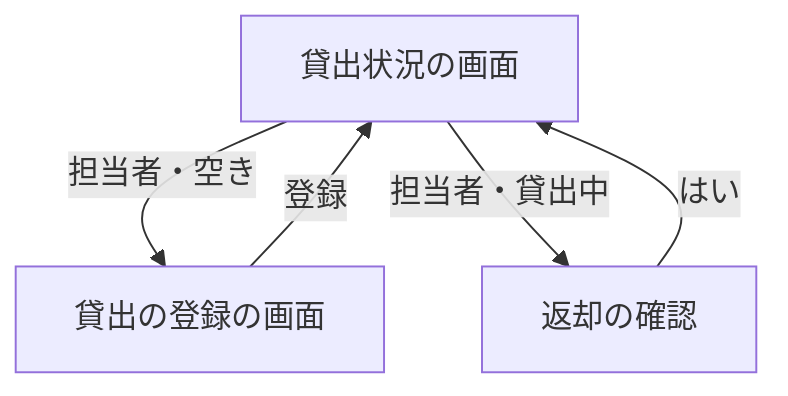

# 変更要件定義書: 社員番号の 7 桁化と、備品の貸出・返却（段 2）

- 作成日: 2026-11-05
- フロー: 変更
- 正本: `docs/requirements.md`（段 1。実装済みの仕様）
- 根拠: REQUEST.md（依頼）、ANSWERS.md（ヒアリングへの固定回答）、contract.md（採点の契約。段 2 の版）

この文書は正本を書き換えない。区分は行ごとに「[追加]」か「[削除]」を書く。区分の無い章は「変更なし」と書く。
ID の表に載らない本文の変更（用語・数字・説明文）は「1-3. 本文の変更」に書く。

## 1. 目的・前提

### 1-0. 変更の目的

社員番号を 6 桁から 7 桁に変える。備品の貸出と返却を同じアプリに加え、社員が「どの備品を誰が借りているか」を担当者に問い合わせずに自分で確かめられるようにする（担当者の問い合わせ対応 1 回 15 分を無くす）。

### 1-1. 技術制約

変更なし。既存要件定義書 `docs/requirements.md` 1-1 を参照。

### 1-2. 依頼に無く自分で決めた項目（必須）

| 項目 | 決めた内容 | 根拠（最小案か、依頼のどこから推測したか） | 承認（承認済 / 未確認） |
|---|---|---|---|
| 貸出の対象の社員 | アカウントの全員（担当者を含む）を選べる。表示は「名前（社員番号）」、並びは社員番号の昇順 | 依頼「借りる社員はアカウントから選ぶ」。役割で絞る指定は無い | 承認済（ANSWERS.md: 承認はすべて与えられたものとして進める） |
| 貸出日の形式 | `YYYY-MM-DD`。既定は日本時間（UTC+9）の今日。今日と過去は可、未来は不可 | 依頼「既定は今日、未来は受け付けない」。契約の `id_lent_on` の形式 | 承認済（ANSWERS.md: 依頼の文章のとおり） |
| 貸出日の形式違い | 「貸出日は YYYY-MM-DD の形で入力してください」を `.field-error` に出す | 契約に無い文言。形式違いの扱いを決める必要があるため | 承認済（ANSWERS.md: 承認はすべて与えられたものとして進める） |
| 貸出の成功・返却の成功の知らせ | 「貸出を登録しました」「返却を処理しました」を貸出状況の `.message` に出す | 契約に無い文言。操作の結果を画面に示すため（契約の `.message` の用途に合わせる） | 承認済（ANSWERS.md: 承認はすべて与えられたものとして進める） |
| 貸出記録の持ち方 | 貸出は備品ごとに 0 件か 1 件。管理番号を主キーにして DB の制約で 1 件に限る | 依頼「貸出中の備品は貸し出せない」「備品 1 件に貸出は 0 か 1 件」（ANSWERS.md） | 承認済（ANSWERS.md） |
| 返却の記録 | 返却で貸出の行を消す。履歴は残さない | 依頼「返却した貸出の記録は残さない」 | 承認済（ANSWERS.md） |
| 修正の競合の検知 | 修正画面の読み込み時の更新時刻を隠し項目で持たせ、保存時に比べる。不一致、または備品が無ければ保存を拒否し `.error` に出す | 依頼「開いてから保存するまでに他の担当者が更新・削除していたら保存を受け付けない」。契約の文言 | 承認済（ANSWERS.md） |
| 修正と貸出の引き継ぎ | 管理番号を変えても貸出の行は同じ備品に付いたままにする（外部キーの連動更新） | 依頼「修正しても貸出の記録はそのまま引き継ぐ」 | 承認済（ANSWERS.md） |
| 貸出中の削除の知らせ | 「この備品は貸出中のため削除できません。先に返却を処理してください」を貸出状況の `.message` に出す。削除ボタンは貸出中の行にも出す | 依頼「貸出中の備品は削除できない」。契約の文言。ボタンは既存の行の操作を変えないため | 承認済（ANSWERS.md） |
| 貸出・返却の URL | 貸出の登録画面は `/equipment/<管理番号>/lend/`（GET 画面、POST 登録）。返却は `/equipment/<管理番号>/return/`（POST）。確認は `window.confirm` | 契約で URL は自由。行のボタンから遷移する最小の形 | 承認済（ANSWERS.md: 承認はすべて与えられたものとして進める） |
| 社員番号 7 桁の検査 | `[0-9]{7}`（先頭の 0 を含む。例 `0000001`）。アカウント登録の検査に使う。ログインでは形式を検査せず、一致しなければ「社員番号またはパスワードが違います」 | 依頼「6 桁は登録できないようにする」。ログインは既存の振る舞いを変えない（一致しない番号は失敗になる） | 承認済（ANSWERS.md: 承認はすべて与えられたものとして進める） |
| 既存の 6 桁のデータ | 移行しない。6 桁で登録済みのアカウントは残るが、7 桁の番号で登録し直す必要がある | 依頼「既存の 6 桁のデータの移行は不要（採点は空のデータから始める）」（ANSWERS.md） | 承認済（ANSWERS.md） |

### 1-3. 本文の変更（ID は変えない）

次の本文は、正本の該当箇所を実装後レビューで書き換える。ID の意味（業務・要件の対象）は変わらないため、ID は変えない。

| 正本の箇所 | 変える内容 |
|---|---|
| 1-0 用語集（社員番号、貸出中・空き） | 社員番号は 7 桁の数字。貸出中・空きは貸出の記録で決まる（今段では全件空き、の注記を消す） |
| 2-0 対象業務（`RQ-BZ-EQUIPMENT-LEDGER` の範囲） | 「貸出・返却は今段では扱わない」を消し、貸出・返却は `RQ-BZ-EQUIPMENT-LENDING` で扱う |
| 2-1 業務の問題 | 変更の行（[追加] の問題）を足す |
| 3 機能要件の利用フロー図 | 貸出の登録・返却の経路を足す |
| 3-0 画面の仕様（貸出状況の表示項目と操作、アカウント登録の社員番号） | 貸出中・借りている社員・貸出日の表示、行の操作（貸出・返却・修正・削除）、社員番号 7 桁 |
| 4-2 業務エンティティ（アカウントの社員番号の形式・例。備品の項目は変えない） | 社員番号は 7 桁の数字、例 `0000123` |
| 4-3 CRUD テーブル（備品、アカウント、貸出を追加） | 貸出の行を足す。備品の Update・Delete に貸出中の制約を書く |
| 4-4 状態遷移 | 備品の状態（空き ⇄ 貸出中）を書く。返却で空きに戻る |
| 6 運用（ログ・監査ログ等） | 変更なし |
| 8 整合のための注記（今段で作らないもの） | 「貸出・返却の記録」を消す |

## 2. 業務

### 2-0. 対象業務一覧

| RQ-BZ-ID | 業務名 | 業務の範囲 | 担当者 | 区分 |
|---|---|---|---|---|
| `RQ-BZ-EQUIPMENT-LENDING` | 備品の貸出・返却 | 担当者が空いている備品を貸し出し、返却を処理する。社員と未ログインの人は貸出状況を見る | 担当者（貸出・返却）、社員と未ログインの人（閲覧） | [追加] |

### 2-1. 業務の問題（あるべき姿と現状のギャップ）

| 問題 | 対象業務（RQ-BZ） | あるべき姿 | 現状 | ギャップ（KPI） | 業務影響 | 区分 |
|---|---|---|---|---|---|---|
| 備品を誰が借りているか、貸出中かどうかが記録されていない（貸出の記録は担当者の手元にある） | `RQ-BZ-EQUIPMENT-LENDING` | 貸出の記録が 1 つのアプリにあり、社員が貸出中か、誰が借りているかを自分で確かめられる | 貸出の記録が無く、一覧は全件「空き」 | 貸出の件数は依頼に無い。不明（数値は作らない） | 担当者への問い合わせと調べ物が続く | [追加] |

### 2-2. 業務課題一覧（必須）

| RQ-BK-ID | 業務課題（取り組むこと） | 解決する問題（2-1） | 解決後の状態（KPI の目標値） | 対象業務（RQ-BZ） | 区分 |
|---|---|---|---|---|---|
| `RQ-BK-LENDING-RECORD` | 貸出の記録を備品台帳と同じアプリに持ち、貸出中かどうかと借りている社員を社員が自分で確かめられるようにする | 2-1 の貸出の記録の問題 | 貸出中か、誰が借りているかを担当者に問い合わせずに確かめられる | `RQ-BZ-EQUIPMENT-LENDING` | [追加] |

対応表（業務課題と要件）:

| 要件 | 対応業務課題（RQ-BK） | 区分 |
|---|---|---|
| `RQ-FT-LEND-EQUIPMENT`、`RQ-FT-LEND-ONLY-AVAILABLE`、`RQ-FT-RETURN-EQUIPMENT`、`RQ-FT-RETURN-ONLY-LENT`、`RQ-FT-UPDATE-KEEPS-LENDING`、`RQ-UI-LENDING-FORM-SCREEN`、`RQ-DT-LENDING-ENTITY` | `RQ-BK-LENDING-RECORD` | [追加] |
| `RQ-FT-MANAGER-ONLY-LENDING-OPERATION`、`RQ-FT-EMPLOYEE-NUMBER-7-DIGITS` | `RQ-BK-ROLE-BASED-EDIT` | [追加] |
| `RQ-FT-DELETE-BLOCKED-WHEN-LENT`、`RQ-FT-UPDATE-CONFLICT-CHECK` | `RQ-BK-SINGLE-RECORD-LEDGER` | [追加] |

既存の業務課題との対応（自己サービスの閲覧、ロールに基づく編集）の行は変わらない。既存の貸出状況の一覧の機能は既存の対応のまま、表示が貸出の記録に基づくように変わる（本文の変更 1-3）。

### 2-3. 見込み経営効果

変更なし。既存要件定義書 `docs/requirements.md` 2-3 を参照（既存の経営効果（問い合わせの調べ物の削減）は、貸出中・借りている社員の問い合わせも含めて担当者の 1 回 15 分の調べ物が無くなる効果として、既存のまま）。

## 3. 機能要件

- 入力データ: 人手入力（アカウント登録、ログイン、備品の登録・修正、貸出の登録）。外部連携は無い。
- 出力データ: 画面の一覧（貸出状況）と、画面の知らせ。帳票・出力ファイルは無い。
- 利用フロー（変更分を足す）:

機能一覧（変更分）:

| RQ-ID | カテゴリ | 機能名 | 対応業務課題ID（RQ-BK-*） | この機能が無いと何が困るか | 区分 |
|---|---|---|---|---|---|
| `RQ-FT-LEND-EQUIPMENT` | 業務機能 | 備品の貸出の登録（借りる社員と貸出日を記録） | `RQ-BK-LENDING-RECORD` | 貸出の記録が作れず、誰が借りているか分からない | [追加] |
| `RQ-FT-RETURN-EQUIPMENT` | 業務機能 | 備品の返却（確認の「はい」で貸出の記録を消し、空きに戻す） | `RQ-BK-LENDING-RECORD` | 返却されても空きに戻らず、貸出中のまま残る | [追加] |
| `RQ-FT-EMPLOYEE-NUMBER-7-DIGITS` | 共通（認証・認可・ログ） | 社員番号は 7 桁の数字（6 桁は登録できない） | `RQ-BK-ROLE-BASED-EDIT` | 6 桁と 7 桁の番号が混在し、依頼の桁数の変更が守られない | [追加] |
| `RQ-FT-MANAGER-ONLY-LENDING-OPERATION` | 共通（認証・認可・ログ） | 貸出・返却は担当者だけ | `RQ-BK-ROLE-BASED-EDIT` | 社員や未ログインの人が貸出・返却の記録を変えられる | [追加] |

### 3-0. 画面の仕様（GUI）（変更分）

| 画面 | 目的 | 主要要素 | 入力項目 | 表示項目 | エラー時の見え方 | 区分 |
|---|---|---|---|---|---|---|
| 貸出状況（`/`） | 備品の空き状況と、貸出中の人を誰でも確かめる | 一覧の表。担当者は行ごとに「修正」「削除」と、空きの備品に「貸出」、貸出中の備品に「返却」 | なし | 管理番号、備品名、状態（空き / 貸出中）、借りている社員の名前、貸出日（`YYYY-MM-DD`） | 操作の拒否・競合は `.message` に出す（貸出中の削除、既に貸出中、既に返却） | [追加]（貸出状況の画面の表示項目と操作の変更。既存の画面の ID は変えない） |
| 貸出の登録（`/equipment/<管理番号>/lend/`） | 担当者が空きの備品を誰に貸すかを記録する | `.lending-equipment`（「備品: <管理番号> <備品名>」）、借りる社員の選択、貸出日の入力欄、登録ボタン | 借りる社員（`id_borrower`）、貸出日（`id_lent_on`、既定は今日） | なし | 借りる社員の未選択・未来の貸出日は入力欄の `.field-error`。入力値は残す。既に貸出中などは貸出状況へ戻し `.message` | [追加]（`RQ-UI-LENDING-FORM-SCREEN`） |

### 3-1. 帳票・出力ファイル

変更なし（帳票・出力ファイルは無い）。

### 3-2. 業務ルール（変更分）

| RQ-ID | ルール名 | 内容（条件と結果） | 違反時・エラー時の業務上の扱い | 対応業務課題ID（RQ-BK-*） | 区分 |
|---|---|---|---|---|---|
| `RQ-FT-LEND-ONLY-AVAILABLE` | 貸出中の備品は貸し出せない | 貸出中の備品への貸出は受け付けない。同時に来た 2 件の貸出は、先に記録された 1 件だけを記録する（DB の制約と、貸出の処理を 1 つの書き込みトランザクションで行うことで保証する） | 後の方に「この備品は既に貸出中です」を貸出状況の `.message` に出す | `RQ-BK-LENDING-RECORD` | [追加] |
| `RQ-FT-RETURN-ONLY-LENT` | 空きの備品は返却できない | 貸出中でない備品への返却は受け付けない。同時に来た 2 件の返却は、先の 1 件だけを行う | 後の方に「この備品は既に返却されています」を貸出状況の `.message` に出す | `RQ-BK-LENDING-RECORD` | [追加] |
| `RQ-FT-DELETE-BLOCKED-WHEN-LENT` | 貸出中の備品は削除できない | 貸出中の備品の削除は受け付けず、備品のデータを変えない | 「この備品は貸出中のため削除できません。先に返却を処理してください」を貸出状況の `.message` に出す | `RQ-BK-SINGLE-RECORD-LEDGER` | [追加] |
| `RQ-FT-UPDATE-CONFLICT-CHECK` | 修正の保存は、読み込み後に他の担当者が変えていなければ受け付ける | 修正画面を開いた時点の更新時刻と、保存時点の更新時刻が違う、または備品が無くなっていれば、保存を受け付けず、データを変えない | 「他の担当者が先にこの備品を更新しました。貸出状況の画面から開き直してください」を修正画面の `.error` に出す。入力値は残す | `RQ-BK-SINGLE-RECORD-LEDGER` | [追加] |
| `RQ-FT-UPDATE-KEEPS-LENDING` | 修正しても貸出を引き継ぐ | 備品の修正（管理番号・備品名の変更）の後も、貸出の記録（借りる社員と貸出日）は同じ備品に残る | ― | `RQ-BK-LENDING-RECORD` | [追加] |
| `RQ-FT-MANAGER-ONLY-LENDING-OPERATION` | 貸出・返却は担当者だけ | 担当者以外（社員、未ログインの人）の貸出・返却の要求は受け付けず、データを変えない。画面のボタンも出さない | 社員は貸出状況へ戻し「この操作は担当者だけが行えます」を `.message` に出す。未ログインの人はログインの画面へ移す | `RQ-BK-ROLE-BASED-EDIT` | [追加] |
| `RQ-FT-EMPLOYEE-NUMBER-7-DIGITS` | 社員番号は 7 桁 | 社員番号は 7 桁の数字だけを受け付ける。6 桁など 7 桁以外は登録できない。先頭の 0 は保持する | 「社員番号は 7 桁の数字で入力してください」を入力欄の `.field-error` に出す | `RQ-BK-ROLE-BASED-EDIT` | [追加] |

### 3-3. 外部連携

変更なし（外部連携は無い）。

## 4. データ

### 4-1. データ要件一覧（変更分）

| RQ-ID | 種別 | 内容 | 対応業務課題ID（RQ-BK-*） | この要件が無いと何が困るか | 区分 |
|---|---|---|---|---|---|
| `RQ-DT-LENDING-ENTITY` | 業務データ（貸出） | 貸出は備品 1 件につき 0 か 1 件。項目は管理番号、借りる社員の社員番号、貸出日（`YYYY-MM-DD`）。返却で行を消し、履歴は残さない。管理番号は備品を指し、備品の管理番号を変えても貸出は同じ備品に付く | `RQ-BK-LENDING-RECORD` | 貸出中かどうかと借りている人を保存できず、貸出の記録が作れない | [追加] |

既存のデータ保存の要件は変更なし。貸出の同時更新も同じ SQLite のトランザクションで守る。

### 4-2. 業務エンティティとデータ項目（変更分）

| RQ-ID | カテゴリ | 業務エンティティ名 | 対応業務課題ID（RQ-BK-*） | この業務エンティティが無いと何が困るか | 区分 |
|---|---|---|---|---|---|
| `RQ-DT-LENDING-ENTITY` | 業務データ | 貸出 | `RQ-BK-LENDING-RECORD` | 貸出中の備品と借りている社員を表せない | [追加] |

| エンティティ名 | 項目名 | 業務上の意味 | 必須 | 形式・桁 | 値の範囲・制約 | 例 | 区分 |
|---|---|---|---|---|---|---|---|
| 貸出 | 管理番号 | 貸し出している備品 | 必須 | 備品の管理番号と同じ | 1 件の備品に 1 件まで（重複不可）。備品が無くなると行も無くなる（備品の削除は貸出中だと拒否するため、実際には起きない） | `PC-0001` | [追加] |
| 貸出 | 社員番号 | 借りている社員 | 必須 | 7 桁の数字 | アカウントに存在すること | `0000123` | [追加] |
| 貸出 | 貸出日 | 貸し出した日 | 必須 | `YYYY-MM-DD` | 未来の日付は不可（今日と過去は可。日本時間の日付） | `2026-11-05` | [追加] |

社員番号の項目（既存のアカウントのエンティティ）の変更は、ID を変えずに本文を直す（1-3 の本文の変更）。意味（社員を識別する番号）は変わらず、形式（6 桁→7 桁）だけが変わるため。

### 4-3. CRUD テーブル（必須）

| エンティティ名 | Create | Read（一覧） | Read（詳細） | 検索 | Update | Delete | 備考 | 区分 |
|---|---|---|---|---|---|---|---|---|
| 備品 | △ | ○ | △ | × | △ | △ | 作成・修正・削除は担当者だけ。修正は読み込み時点の更新時刻と比べ、違えば保存しない。貸出中の備品は削除できない。管理番号を変えても貸出の行は付いてくる | [追加]（既存の行の備考の変更） |
| アカウント | ○ | × | △ | × | × | × | 登録は誰でも可。貸出の登録画面で借りる社員の選択肢（名前と社員番号）を読む（一覧の表示は貸出の登録画面の選択肢だけ） | [追加]（既存の行の備考の変更） |
| 貸出 | ○ | ○（貸出状況の一覧に結合して表示） | △ | × | × | ○（返却で行を消す） | 作成は担当者が貸出の登録で行い、備品 1 件に 1 件まで。返却は備品の行の貸出の行を消す。更新（別の人への貸し直し）は無い | [追加] |

### 4-4. 状態遷移（変更分）

備品の状態（貸出の有無で決まる。備品の行に状態の列は持たない）:

| 現在の状態 | 操作 | 次の状態 | 条件 |
|---|---|---|---|
| 空き | 貸出の登録 | 貸出中 | 担当者。借りる社員と貸出日を記録 |
| 貸出中 | 返却（確認の「はい」） | 空き | 担当者。貸出の行を消す |
| 貸出中 | 貸出の登録 | 貸出中（変わらない） | 拒否し「この備品は既に貸出中です」 |
| 空き | 返却 | 空き（変わらない） | 拒否し「この備品は既に返却されています」 |

### 4-5. 画面一覧（変更分）

| RQ-ID | 画面名 | 対応する CRUD 操作（エンティティ名:操作種別） | 主な機能・目的 | 対応業務課題ID（RQ-BK-*） | 区分 |
|---|---|---|---|---|---|
| `RQ-UI-LENDING-FORM-SCREEN` | 貸出の登録 | 貸出:Create、備品:Read（詳細）、アカウント:Read（一覧の選択肢） | 担当者が空きの備品を誰に貸すかを記録する | `RQ-BK-LENDING-RECORD` | [追加] |

既存の貸出状況の画面の操作は、貸出（空き）と返却（貸出中）の行のボタンを足す（本文の変更 3-0）。貸出状況の画面の ID は変えない（目的は同じ）。

## 5. 非機能要件

変更なし。既存の利用人数・応答時間の非機能要件（50 人、操作から表示まで 3 秒以内）は貸出の状況表示にも適用する。

## 6. 運用要件

変更なし。ただし、貸出の行を消す返却と、貸出の行を作る登録は、データベースの初期化時に作られる（既存の DB にも起動時に表を足す）。

## 7. テスト用利用シナリオ（変更分）

| RQ-ID | テスト目的 | 前提条件 | テスト手順 | 期待される結果 | 検証する要件ID | 対応業務課題ID（RQ-BK-*） | 区分 |
|---|---|---|---|---|---|---|---|
| `RQ-TS-EMPLOYEE-NUMBER-7-DIGITS` | 社員番号が 7 桁であることを確かめる | アカウント登録画面 | 6 桁の番号で登録。次に 7 桁の番号で登録してログイン | 6 桁は「社員番号は 7 桁の数字で入力してください」が `.field-error` に出て登録されない。7 桁は登録でき、ログインできる | `RQ-FT-EMPLOYEE-NUMBER-7-DIGITS` | `RQ-BK-ROLE-BASED-EDIT` | [追加] |
| `RQ-TS-LEND-EQUIPMENT` | 担当者が空きの備品を貸し出せることを確かめる | 担当者でログイン、社員が 1 人、備品が 1 件（空き） | 行の「貸出」から借りる社員を選び、貸出日を今日のまま「登録」 | 一覧の行が「貸出中」、借りている社員の名前、貸出日（今日）になる | `RQ-FT-LEND-EQUIPMENT`、`RQ-UI-LENDING-FORM-SCREEN`、`RQ-DT-LENDING-ENTITY` | `RQ-BK-LENDING-RECORD` | [追加] |
| `RQ-TS-LEND-VALIDATION` | 貸出の入力検査を確かめる | 担当者でログイン、備品が 1 件（空き） | 借りる社員を選ばずに登録。次に明日の日付を入力して登録。今日の日付で登録 | 社員の未選択は「借りる社員を選んでください」、明日は「貸出日に未来の日付は入力できません」が `.field-error` に出て入力値が残る。今日は登録できる | `RQ-FT-LEND-EQUIPMENT`、`RQ-UI-LENDING-FORM-SCREEN` | `RQ-BK-LENDING-RECORD` | [追加] |
| `RQ-TS-LEND-ALREADY-LENT` | 貸出中の備品を貸し出せないことを確かめる | 担当者でログイン、備品が 1 件（空き）。貸出の登録画面を 2 つの画面で開いている | 1 つ目の画面で貸し出す。次に 2 つ目の画面で別の社員を選んで登録 | 2 つ目は貸出状況へ戻り「この備品は既に貸出中です」が `.message` に出る。記録は 1 つ目の社員だけ | `RQ-FT-LEND-ONLY-AVAILABLE` | `RQ-BK-LENDING-RECORD` | [追加] |
| `RQ-TS-RETURN-EQUIPMENT` | 返却の確認で「はい」の時だけ空きに戻ることを確かめる | 担当者でログイン、貸出中の備品が 1 件 | 「返却」を押して確認で「キャンセル」。次に「返却」を押して「はい」 | キャンセルでは貸出中のまま。「はい」で「空き」に戻り、借りている社員と貸出日が空欄になる | `RQ-FT-RETURN-EQUIPMENT` | `RQ-BK-LENDING-RECORD` | [追加] |
| `RQ-TS-RETURN-ALREADY-RETURNED` | 返却済みの備品を返却できないことを確かめる | 担当者でログイン、貸出中の備品が 1 件。貸出状況の画面を 2 つ開いている | 1 つ目の画面で返却（はい）。次に 2 つ目の画面で返却（はい） | 2 つ目は「この備品は既に返却されています」が `.message` に出る | `RQ-FT-RETURN-ONLY-LENT` | `RQ-BK-LENDING-RECORD` | [追加] |
| `RQ-TS-LENDING-OPERATION-DENIED` | 社員と未ログインの人の貸出・返却の要求を拒否することを確かめる | 社員でログイン（別に未ログインの人） | 社員が貸出の登録画面 `/equipment/<管理番号>/lend/` へ直接アクセス、返却の要求を直接送る。未ログインの人も同じ要求を送る | 社員は貸出状況へ戻り「この操作は担当者だけが行えます」が `.message` に出る。未ログインの人はログイン画面へ移る。データは変わらない | `RQ-FT-MANAGER-ONLY-LENDING-OPERATION` | `RQ-BK-ROLE-BASED-EDIT` | [追加] |
| `RQ-TS-DELETE-LENT-BLOCKED` | 貸出中の備品を削除できないことを確かめる | 担当者でログイン、貸出中の備品が 1 件 | 「削除」を押して確認で「はい」 | 削除されず、貸出状況の `.message` に「この備品は貸出中のため削除できません。先に返却を処理してください」が出る。行は残る | `RQ-FT-DELETE-BLOCKED-WHEN-LENT` | `RQ-BK-SINGLE-RECORD-LEDGER` | [追加] |
| `RQ-TS-UPDATE-CONFLICT` | 修正の保存で、他の担当者の更新・削除を検知することを確かめる | 担当者でログイン、備品が 1 件。修正画面を 2 つ開いている | 1 つ目の画面で備品名を変えて保存。次に 2 つ目の画面で別の名前に変えて保存（削除の場合は別の画面で削除してから保存） | 2 つ目は保存されず、`.error` に「他の担当者が先にこの備品を更新しました。貸出状況の画面から開き直してください」が出る。入力値は残る | `RQ-FT-UPDATE-CONFLICT-CHECK` | `RQ-BK-SINGLE-RECORD-LEDGER` | [追加] |
| `RQ-TS-UPDATE-KEEPS-LENDING` | 修正しても貸出の記録が引き継がれることを確かめる | 担当者でログイン、貸出中の備品が 1 件 | 行の「修正」で管理番号と備品名を変えて保存 | 一覧で新しい管理番号の行が「貸出中」のまま、借りている社員の名前と貸出日が残る | `RQ-FT-UPDATE-KEEPS-LENDING` | `RQ-BK-LENDING-RECORD` | [追加] |

既存のシナリオのうち、本文（手順や期待結果）の数字や表示が変わるものは、ID の表を変えずに本文を直す（例: 既存の未ログイン閲覧のシナリオは貸出の無い備品のままなので、期待結果は変わらない）。

## 8. 整合のための注記

- 今段で作らないもの（変更分）: 貸出の履歴、貸し出し中の備品の貸し直し（別の人への変更）、返却の期限と延滞の扱い、貸出の取り消し、社員番号の移行（既存の 6 桁の番号の変換）、アカウントの管理（削除・権限変更）、取り込み機能。
- 「アカウントの管理」は今段の依頼に無いため作らない。
