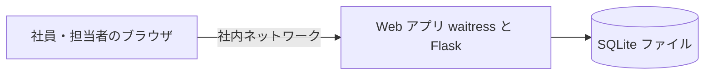
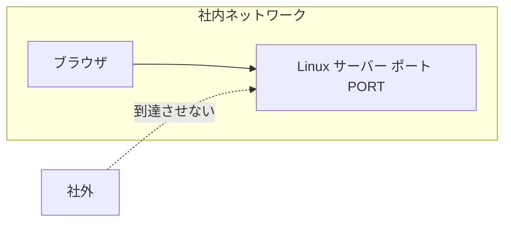
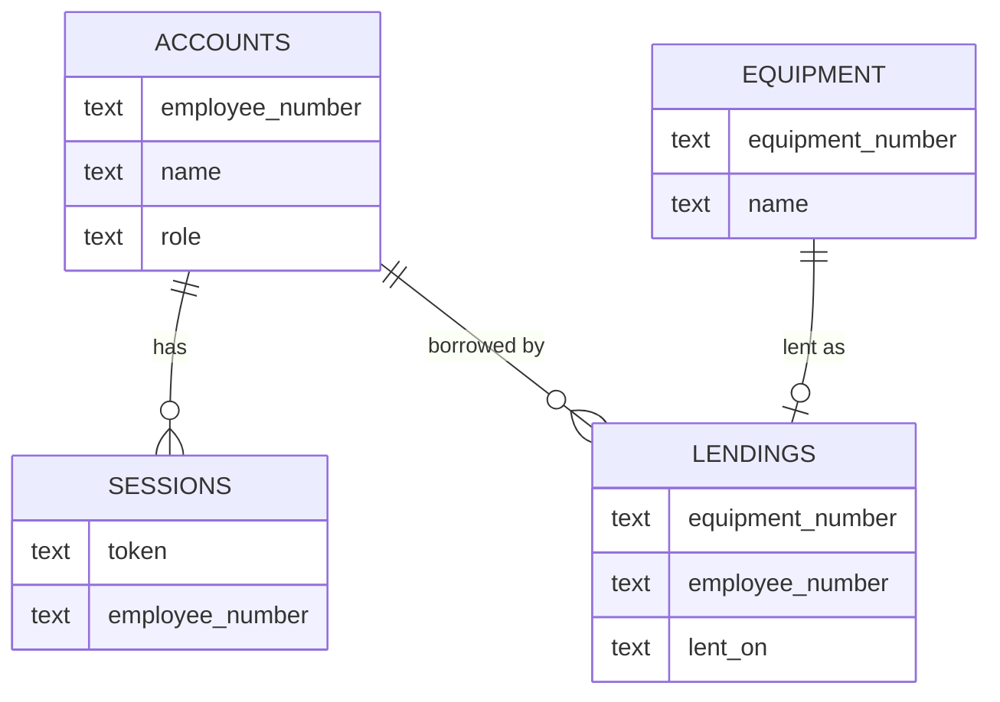
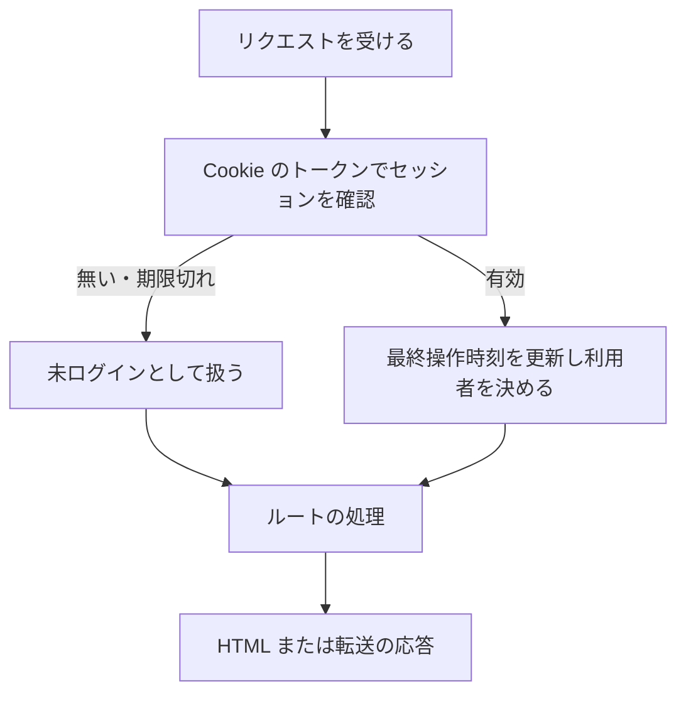

# 詳細設計書: 備品の台帳と貸出状況の閲覧（段 2: 貸出・返却を追加）

- 作成日: 2026-11-05
- フロー: 新規
- 入力要件書: `docs/requirements.md`
- 段 2 の変更: `.history/20261105-lending-and-employee-number/`（変更設計書を実装後レビューで反映した）

## 1. 言語・フレームワーク・アーキテクチャの選定

### 1-1. 技術制約と判断軸

要件定義書 1-1 の制約（既存コード無し、社内 Linux サーバーで `bash run.sh` により直接起動、コンテナ無し、無償のみ、利用者 50 人、備品数百件）と、要件（GUI、認証あり、同時更新で記録を失わない、3 秒以内の表示）から判断軸を次のとおり定める。

| 判断軸 | この案件で効く条件 | 判定 |
|---|---|---|
| 既存資産との整合 | 無し | 該当なし |
| チームの技術 | 決まり無し。Python 3.12 と SQLite で足りる（ANSWERS） | Python を採用 |
| 配備先 | Linux、コンテナ無しで起動 | 通常のプロセスとして起動できる構成のみ |
| 認証と認可の境界 | 社員番号とパスワード、ロール 3 種、30 分の自動ログアウト | 1 つのアプリ内でサーバー側に判定を集める |
| 画面の規模 | 画面 4 種、状態遷移なし | サーバーで HTML を描画する構成 |
| データの規模と構造 | 備品数百件、アカウント 50 件、参照関係は単純、同時更新あり | ファイル型の RDB（SQLite）で足りる |
| 外部連携 | 無し | 該当なし |
| ライセンスとコスト | 無償のみ | OSS のみ |
| 保守性 | 長く保守する想定は要件に無い。公式配布が確認できること | PyPI で版と LICENSE を確認 |

### 1-2. 候補の比較と確認

候補の公式情報は、検索ツールが利用できなかったため、公式の配布情報（PyPI の JSON API `https://pypi.org/pypi/<名前>/json`）と各リポジトリの LICENSE ファイルを直接取得して確認した。確認日は 2026-11-05。

| 区分 | 候補 | 判断軸ごとの評価 | 出典 URL | 確認日 |
|---|---|---|---|---|
| Web フレームワーク | Flask 3.1.3 | 保守中（PyPI の最新版）。Python 3.9 以上。BSD 系ライセンス（Pallets）。テンプレートの自動エスケープあり | https://pypi.org/pypi/flask/json、https://github.com/pallets/flask/blob/main/LICENSE.txt | 2026-11-05 |
| Web フレームワーク | 標準ライブラリの http.server だけで作る | 依存は無いが、ルーティング・Cookie・テンプレートの自前実装が増え、誤りの余地が大きい | 標準ライブラリ（Python 3.12） | 2026-11-05 |
| 本番用 WSGI サーバー | waitress 3.0.2 | 保守中。Python 3.9 以上。ZPL 2.1（自由なライセンス） | https://pypi.org/pypi/waitress/json、https://raw.githubusercontent.com/Pylons/waitress/main/LICENSE.txt | 2026-11-05 |
| 本番用 WSGI サーバー | Flask の開発用サーバー | 開発用のため本番では使わない案内がある | 公式ドキュメント | 2026-11-05 |
| データベース | SQLite（Python 標準の sqlite3） | 追加の導入が不要。ファイル 1 つで同時更新をトランザクションで守れる。備品数百件・利用者 50 人の規模で十分 | Python 3.12 標準ライブラリ | 2026-11-05 |
| データベース | PostgreSQL などの別プロセスの DB | 規模に対して過剰。導入と運用の手間が増える | ― | 2026-11-05 |
| E2E のブラウザ自動化 | Playwright（Python）1.64.1 | 保守中。Python 3.10 以上。Apache-2.0。Chromium を自動で取得できる。ローカルに Chromium のキャッシュがあることを確認 | https://pypi.org/pypi/playwright/json、https://raw.githubusercontent.com/microsoft/playwright-python/main/LICENSE | 2026-11-05 |
| E2E のブラウザ自動化 | Selenium | 利用可能。ただしブラウザのドライバの導入を別に管理する必要がある | ― | 2026-11-05（未取得の情報のため比較のみ） |

### 1-3. 最終選定

| 項目 | 選定 |
|---|---|
| 言語 | Python 3.12 |
| Web フレームワーク | Flask 3.1.3 |
| 本番用サーバー | waitress 3.0.2 |
| データベース | SQLite（標準ライブラリ sqlite3） |
| 実行形態 | サーバー（コンテナを使わない。`bash run.sh` で起動） |
| E2E | Playwright 1.64.1 の Chromium、テストの実行は unittest（標準ライブラリ）。JUnit XML は `scripts/isdd/unittest_junit.py` で出す |
| 選定理由 | ANSWERS.md が「Python の無償のフレームワーク」と SQLite を指定。Flask はテンプレートの自動エスケープと入力の取り扱いが素直で、画面 4 種の規模に合う。waitress でコンテナ無しの本番運用ができる |

承認: ANSWERS.md により承認済み（2026-11-05）。

## 2. システム構成

### 2-1. コンポーネント一覧

| コンポーネント | 役割 | 実装 |
|---|---|---|
| 起動スクリプト | 依存の確認と Web サーバーの起動 | `run.sh`、`setup.sh` |
| Web アプリ | 画面の描画、入力の受け付け、業務判定 | `src/` 配下（Flask） |
| 本番用サーバー | HTTP の受け付け（待ち受けはすべての IP、ポートは環境変数 `PORT`） | waitress |
| データベース | 備品、アカウント、セッションの保存 | SQLite ファイル（`DATA_DIR` 配下） |
| E2E テスト | ブラウザで画面を操作して仕様を確かめる | `e2e/` 配下（Playwright） |

### 2-2. システム全体構成図



### 2-3. 各コンポーネントの役割

- Web アプリ: 画面の描画、入力の検査、セッションの確認、担当者の判定、備品とアカウントの保存を行う。
- SQLite ファイル: 全データを持つ。同時の更新は SQLite のトランザクションで直列化する。

### 2-4. コンポーネント間インターフェースとデータフロー

ブラウザと Web アプリは HTTP（フォームの送信と HTML の応答）でやり取りする。Web アプリは SQLite ファイルを `DATA_DIR` のパスで開く。

### 2-5. ネットワーク構成図

ネットワーク越しの通信は、ブラウザから Web アプリへの HTTP のみ。構成は次のとおり。



社内ネットワークからの到達の制限は配備先のネットワーク設定で行う（アプリ内では判定しない）。

## 3. データ設計

### 3-1. データモデル

DB を使う。理由: 複数の人が同時に更新しても記録が失われないよう、トランザクションを使うため（要件 4-1）。

テーブル（すべて SQLite の 1 つのファイルに置く）:

| テーブル | DS-ID | カラム | 型 | 制約 |
|---|---|---|---|---|
| `accounts` | `DS-SC-ACCOUNT-TABLE` | `employee_number` | TEXT | 主キー。7 桁の数字の文字列 |
| | | `name` | TEXT | 必須。30 文字以内 |
| | | `password_hash` | TEXT | 必須。ハッシュの文字列 |
| | | `role` | TEXT | 必須。`manager` または `employee` |
| | | `created_at` | TEXT | 必須。ISO 8601 の日時（UTC） |
| `equipment` | `DS-SC-EQUIPMENT-TABLE` | `equipment_number` | TEXT | 主キー。英数字とハイフン、20 文字以内。大文字小文字を区別 |
| | | `name` | TEXT | 必須。50 文字以内 |
| | | `created_at` | TEXT | 必須 |
| | | `updated_at` | TEXT | 必須 |
| `lendings` | `DS-SC-LENDING-TABLE` | `equipment_number` | TEXT | 主キー。`equipment` の値を指す外部キー（`ON UPDATE CASCADE`。管理番号の修正で貸出も付いてくる） |
| | | `employee_number` | TEXT | 必須。`accounts` の値を指す外部キー |
| | | `lent_on` | TEXT | 必須。`YYYY-MM-DD`（日本時間の日付） |
| `sessions` | `DS-SC-SESSION-TABLE` | `token` | TEXT | 主キー。無作為の 32 バイト以上を URL 安全な文字列にしたもの |
| | | `employee_number` | TEXT | 必須。`accounts` の値 |
| | | `last_seen` | REAL | 必須。最後の操作の時刻（UNIX 秒） |

リレーション: `sessions.employee_number` は `accounts.employee_number` を指す外部キー（削除の操作は無いため、連鎖削除は設けない）。`lendings` は `equipment`（1 対 0〜1）と `accounts`（1 対多）を指す外部キー。

リレーション図:



### 3-2. トランザクションと排他制御

| 操作 | トランザクションの範囲 | ロールバックの条件 | 排他制御 |
|---|---|---|---|
| アカウント登録 | 「アカウント件数の確認」「役割の決定」「挿入」を 1 つのトランザクションで行う。書き込み開始時に排他ロックを取る（`BEGIN IMMEDIATE`） | 挿入で社員番号の重複（主キー違反）が起きたら取り消し、「この社員番号は既に登録されています」を返す | SQLite の書き込みロック。同時登録でも件数の確認と挿入が直列化されるため、担当者は 1 人だけになる |
| 備品の登録・修正 | 1 つのトランザクション（`BEGIN IMMEDIATE`） | 管理番号の重複（主キー違反、修正では別の番号への変更時）で取り消し、「この管理番号は既に使われています」 | SQLite の書き込みロック（後から来た更新は先の更新が終わってから行われる。上書きを防ぐため、修正は読み込みと書き込みを同じトランザクションで行う） |
| 備品の削除 | 1 つのトランザクション。備品の存在と貸出の有無を確かめてから削除する | 対象が存在しなければ取り消し、「備品が見つかりません」。貸出中（貸出の行がある）なら取り消し、「この備品は貸出中のため削除できません」 | 同上 |
| 備品の修正（競合の検知を含む） | 読み込みと書き込みを同じトランザクションで行う。読み込み時の更新時刻と比べ、違う、または備品が無ければ取り消し（「他の担当者が先に更新しました」） | 上の修正の欄のとおり | 同上。貸出の行は外部キーの連動更新で付いてくる |
| 貸出の登録 | 備品の存在、貸出の有無、借りる社員の存在を確かめてから貸出の行を挿入する（`BEGIN IMMEDIATE`） | 備品が無い、貸出中、借りる社員が無い（取り消し） | 書き込みロックで直列化する。先に記録された貸出だけが残り、後の貸出は「この備品は既に貸出中です」 |
| 返却 | 備品の存在を確かめ、貸出の行を削除する（`BEGIN IMMEDIATE`） | 備品が無い、貸出の行が無い（取り消し、「この備品は既に返却されています」） | 同上。先の返却だけが行われる |
| セッションの更新・削除 | 1 つのトランザクション | ― | 同上 |

状態遷移は 3-3 を参照。

### 3-3. 状態遷移

備品の状態は貸出の記録の有無で決まる（備品の行に状態の列は持たない）。

| 現在の状態 | 操作 | 次の状態 | 条件 |
|---|---|---|---|
| 空き | 貸出の登録 | 貸出中 | 担当者。借りる社員と貸出日を記録 |
| 貸出中 | 返却（確認の「はい」） | 空き | 担当者。貸出の行を消す |
| 貸出中 | 貸出の登録 | 貸出中（変わらない） | 拒否し「この備品は既に貸出中です」 |
| 空き | 返却 | 空き（変わらない） | 拒否し「この備品は既に返却されています」 |

## 4. アーキテクチャ設計

### 4-1. 外部設計

利用者向けインターフェース（GUI。画面と操作の入口は Flask のルート）。

| DS-ID | 画面・操作 | URL・メソッド | 入力 | 出力 | 入力のバリデーション（要件の項目・業務ルール） | エラー仕様 |
|---|---|---|---|---|---|---|
| `DS-IF-EQUIPMENT-STATUS-SCREEN` | 貸出状況（トップ） | `/` GET | なし | HTML（一覧。状態（空き / 貸出中）、借りている社員の名前、貸出日。ログインの状態に応じたリンクとボタン。担当者には空きの行に「貸出」、貸出中の行に「返却」、全行に「修正」「削除」） | なし | 備品 0 件は「備品は登録されていません」。操作の拒否・知らせは `.message`（貸出中の削除、既に貸出中、既に返却、貸出・返却の成功） |
| `DS-IF-ACCOUNT-REGISTER-SCREEN` | アカウント登録 | `/accounts/register/` GET（画面）、POST（登録） | 社員番号、名前、パスワード | GET は画面、POST 成功はログイン画面へ転送し「登録しました。ログインしてください」を表示 | 社員番号は 7 桁の数字。名前は空でなく 30 文字以内。パスワードは 8 文字以上。社員番号は重複不可（要件 4-2、3-2） | 入力欄ごとの文言は `.field-error`。入力値は残す |
| `DS-IF-LOGIN-SCREEN` | ログイン | `/login/` GET（画面）、POST（ログイン） | 社員番号、パスワード | GET は画面、POST 成功はトップへ転送 | 社員番号とパスワードの空は失敗として扱う | 失敗は「社員番号またはパスワードが違います」を `.error` に出す。どちらが違うかは示さない。入力値は残す |
| `DS-IF-LOGOUT-ACTION` | ログアウト | `/logout/` POST | なし | トップへ転送 | なし | セッションが無ければトップへ転送 |
| `DS-IF-EQUIPMENT-FORM-SCREEN` | 備品の登録・修正 | `/equipment/new/`（登録）、`/equipment/<管理番号>/edit/`（修正）GET と POST | 管理番号、備品名。修正では読み込み時の更新時刻（隠し項目 `loaded_updated_at`） | 成功は貸出状況へ転送 | 管理番号は半角の英数字とハイフン、20 文字以内、重複不可。備品名は 50 文字以内（要件 4-2、3-2）。修正の保存は更新時刻を比べる | 入力欄ごとの文言は `.field-error`。入力値は残す。担当者以外は要件 3-2 の扱い。存在しない備品は「備品が見つかりません」。開いてから他の担当者が更新・削除していたら、保存せず `.error` に「他の担当者が先にこの備品を更新しました。貸出状況の画面から開き直してください」 |
| `DS-IF-EQUIPMENT-DELETE-ACTION` | 備品の削除 | `/equipment/<管理番号>/delete/` POST | なし | 貸出状況へ転送し「備品を削除しました」を `.message` | 担当者のみ | 担当者以外は「この操作は担当者だけが行えます」。未ログインはログイン画面へ。存在しなければ「備品が見つかりません」。貸出中なら削除せず「この備品は貸出中のため削除できません。先に返却を処理してください」 |
| `DS-IF-LENDING-FORM-SCREEN` | 貸出の登録 | `/equipment/<管理番号>/lend/` GET（画面）、POST（登録） | 借りる社員（`id_borrower`。選択肢は「名前（社員番号）」）、貸出日（`id_lent_on`、既定は日本時間の今日） | GET は画面（`.lending-equipment` に「備品: <管理番号> <備品名>」）。POST 成功は貸出状況へ転送（「貸出を登録しました」） | 借りる社員は必須（アカウントに存在すること）。貸出日は `YYYY-MM-DD`、未来は不可（`DS-FN-VALIDATE-LENDING-INPUT`） | 入力欄ごとの文言は `.field-error`。入力値は残す。備品が無い → 貸出状況へ（「備品が見つかりません」）。貸出中 → 貸出状況へ（「この備品は既に貸出中です」）。担当者以外は担当者の判定に従う |
| `DS-IF-RETURN-ACTION` | 返却 | `/equipment/<管理番号>/return/` POST | なし（確認は行の「返却」ボタンの `window.confirm`） | 貸出状況へ転送（「返却を処理しました」） | 担当者のみ | 空き → 「この備品は既に返却されています」。備品が無い → 「備品が見つかりません」。担当者以外は担当者の判定に従う |

画面の仕様（要素・文言・id）は契約（contract.md）に従う。入力欄の id は `id_employee_number`、`id_name`、`id_password`、`id_equipment_number`。

外部システム連携: 無し。
外部 DB 連携: 無し。

### 4-2. 内部設計

処理フロー（全リクエスト共通）:



各処理の役割:
- セッションの確認: トークンで `sessions` を引き、最終操作から設定秒数（既定 1800 秒）を超えていれば削除して未ログインとして扱う。有効なら最終操作時刻を現在時刻に更新する。
- 担当者の確認: 利用者の役割が `manager` かを判定する。未ログインは登録・修正・削除の画面をログイン画面へ転送する。社員は貸出状況へ転送し、知らせを出す。
- 入力の検査: 項目ごとに検査し、すべてのエラーを集めて返す（最初の 1 件で止めない）。
- 貸出の登録（`DS-FN-LEND-EQUIPMENT`）: 入力の検査（`DS-FN-VALIDATE-LENDING-INPUT`）のあと、1 つのトランザクションで備品の存在、貸出の有無、借りる社員の存在を確かめて挿入する。
- 返却（`DS-FN-RETURN-EQUIPMENT`）: 1 つのトランザクションで貸出の行を削除する（履歴は残さない）。
- 今日の日付（`DS-FN-TODAY-JST`）: 日本時間（UTC+9 の固定オフセット）の今日。借りる社員の選択肢（`DS-FN-LIST-BORROWERS`）: 全アカウントを社員番号の昇順で返す。
- 貸出状況の一覧（`DS-FN-LIST-EQUIPMENT`）: 備品に貸出の行を左結合し、借りている社員の名前（`accounts` を結合）と貸出日を、管理番号の昇順で返す。

バッチ: 無し。

## 5. クラス設計

クラスは作らない。モジュールごとの関数で構成する（規模が小さく、状態を持つ対象が無いため）。

## 6. エラーハンドリングとセキュリティ設計

### 6-1. エラーハンドリング

| 想定エラー | 利用者への見え方 | 処理の扱い |
|---|---|---|
| 入力の形式違い・重複・長さ超過 | 入力欄の `.field-error` | 保存しない。入力値は残す |
| 社員番号かパスワードの誤り | `.error`「社員番号またはパスワードが違います」 | ログインしない。どちらが違うかは示さない |
| 担当者以外の操作 | `.message`「この操作は担当者だけが行えます」 | データを変えない |
| 未ログインの操作 | ログイン画面へ転送 | データを変えない |
| 存在しない備品 | `.message`「備品が見つかりません」 | データを変えない |
| 想定外の例外 | 「エラーが発生しました。時間をおいて再度お試しください」（汎用の画面） | 処理を中止し、例外をサーバーの標準エラー出力に出す（ログの保存は無い） |
| DB の書き込みの競合（SQLite のロック待ち） | 通常の応答（5 秒まで待つ） | 5 秒を超えたら想定外の例外として扱う |
| 借りる社員の未選択・存在しない社員 | 入力欄の `.field-error`「借りる社員を選んでください」 | 貸出の行を作らない。入力値は残す |
| 貸出日の形式違い・未来の日付 | 入力欄の `.field-error`（「貸出日は YYYY-MM-DD の形で入力してください」「貸出日に未来の日付は入力できません」） | 貸出の行を作らない |
| 貸出中の備品への貸出（同時の 2 件を含む） | 貸出状況の `.message`「この備品は既に貸出中です」 | 後の貸出は取り消す |
| 返却済みの備品の返却（同時の 2 件を含む） | 貸出状況の `.message`「この備品は既に返却されています」 | 取り消す |
| 貸出中の備品の削除 | 貸出状況の `.message`「この備品は貸出中のため削除できません。先に返却を処理してください」 | 削除しない |
| 修正の競合（他の担当者が先に更新・削除） | 修正画面の `.error`「他の担当者が先にこの備品を更新しました。貸出状況の画面から開き直してください」 | 保存しない。入力値は残す |

### 6-2. 認証

方式: 社員番号とパスワード（SSO は無し）。パスワードは PBKDF2-HMAC-SHA256、反復 260000 回、16 バイトの無作為の塩でハッシュ化して保存する。照合は定数時間比較（`hmac.compare_digest`）。

セッション: ログイン成功時に無作為のトークンを作り `sessions` に保存する。ブラウザには Cookie `sid` として渡す（HttpOnly、SameSite=Lax、Path=/）。ログアウトで `sessions` の行を削除し Cookie を消す。

### 6-3. 認可

| 操作 | 未ログイン | 社員 | 担当者 |
|---|---|---|---|
| 貸出状況の閲覧 | 可 | 可 | 可 |
| アカウント登録 | 可 | 可 | 可 |
| ログイン・ログアウト | 可（ログイン）/ 不要（ログアウト） | 可 | 可 |
| 備品の登録・修正・削除 | 不可（ログイン画面へ） | 不可（貸出状況へ戻し知らせ） | 可 |
| 貸出の登録・返却 | 不可（ログイン画面へ） | 不可（貸出状況へ戻し知らせ） | 可 |

認可の判定は、ボタンの表示と、要求の受け付けの両方で行う。要求の受け付けはサーバー側で判定する。

### 6-4. 監査ログ

無い（要件 6）。

### 6-5. その他のセキュリティ対策

- HTML のエスケープは Flask のテンプレート自動エスケープに任せる。
- POST の要求は、セッション Cookie の SameSite=Lax により他サイトからの送信を抑える（CSRF の専用トークンは設けない。社内限定のため。承認が必要な判断として要件 1-2 に記録）。
- パスワードの値はログに出さない（ログ自体は無い）。

## 7. コード設計

### 7-1. ディレクトリ構成

```
run.sh
setup.sh
requirements.txt
requirements-dev.txt
src/
  __init__.py
  main.py
  config.py
  db.py
  validation.py
  accounts.py
  sessions.py
  auth.py
  equipment.py
  lending.py
  web.py
  templates/
  static/
tests/
e2e/
docs/
README.md
```

テンプレート（`src/templates/`）と CSS（`src/static/`）、起動スクリプト、依存の一覧は対応表の対象外（設計書 7-2 の規則）。

### 7-2. ファイル一覧

| ファイル | 役割 | 含まれる関数 | 実現する設計 ID |
|---|---|---|---|
| `src/__init__.py` | パッケージの宣言 | なし | `DS-MD-PACKAGE-INIT` |
| `src/main.py` | 起動の入口。設定を読み、サーバーを起動する | `main` | `DS-MD-MAIN`、`DS-FN-MAIN` |
| `src/config.py` | 環境変数の読み取り | `load_settings` | `DS-MD-CONFIG`、`DS-FN-LOAD-SETTINGS` |
| `src/db.py` | DB の接続、スキーマの作成 | `connect`、`init_schema` | `DS-MD-DB`、`DS-FN-CONNECT`、`DS-FN-INIT-SCHEMA`、`DS-SC-ACCOUNT-TABLE`、`DS-SC-EQUIPMENT-TABLE`、`DS-SC-LENDING-TABLE`、`DS-SC-SESSION-TABLE` |
| `src/validation.py` | 入力の検査 | `validate_account_input`、`validate_equipment_input`、`validate_lending_input` | `DS-MD-VALIDATION`、`DS-FN-VALIDATE-ACCOUNT-INPUT`、`DS-FN-VALIDATE-EQUIPMENT-INPUT`、`DS-FN-VALIDATE-LENDING-INPUT` |
| `src/accounts.py` | アカウント登録、パスワードの処理、ログインの照合、借りる社員の選択肢 | `hash_password`、`verify_password`、`register_account`、`verify_login`、`list_borrowers` | `DS-MD-ACCOUNTS`、`DS-FN-HASH-PASSWORD`、`DS-FN-REGISTER-ACCOUNT`、`DS-FN-VERIFY-LOGIN`、`DS-FN-LIST-BORROWERS` |
| `src/sessions.py` | セッションの作成・確認・削除 | `create_session`、`resolve_session`、`delete_session` | `DS-MD-SESSIONS`、`DS-FN-CREATE-SESSION`、`DS-FN-RESOLVE-SESSION`、`DS-FN-DELETE-SESSION` |
| `src/auth.py` | 現在の利用者の取得と担当者の判定 | `current_user`、`require_manager` | `DS-MD-AUTH`、`DS-FN-CURRENT-USER`、`DS-FN-REQUIRE-MANAGER` |
| `src/equipment.py` | 備品の一覧・登録・修正・削除（貸出の結合、修正の競合の検知、貸出中の削除の拒否を含む） | `list_equipment`、`get_equipment`、`create_equipment`、`update_equipment`、`delete_equipment` | `DS-MD-EQUIPMENT`、`DS-FN-LIST-EQUIPMENT`、`DS-FN-GET-EQUIPMENT`、`DS-FN-CREATE-EQUIPMENT`、`DS-FN-UPDATE-EQUIPMENT`、`DS-FN-DELETE-EQUIPMENT` |
| `src/lending.py` | 貸出の登録と返却、日本時間の今日の日付 | `lend_equipment`、`return_equipment`、`today_jst` | `DS-MD-LENDING`、`DS-FN-LEND-EQUIPMENT`、`DS-FN-RETURN-EQUIPMENT`、`DS-FN-TODAY-JST` |
| `src/web.py` | 画面とルートの定義、Flask アプリの作成 | `create_app`、`equipment_status`、`account_register`、`login`、`logout`、`equipment_new`、`equipment_edit`、`equipment_delete`、`equipment_lend`、`equipment_return` | `DS-MD-WEB`、`DS-FN-CREATE-APP`、`DS-IF-EQUIPMENT-STATUS-SCREEN`、`DS-IF-ACCOUNT-REGISTER-SCREEN`、`DS-IF-LOGIN-SCREEN`、`DS-IF-LOGOUT-ACTION`、`DS-IF-EQUIPMENT-FORM-SCREEN`、`DS-IF-EQUIPMENT-DELETE-ACTION`、`DS-IF-LENDING-FORM-SCREEN`、`DS-IF-RETURN-ACTION` |

### 7-3. 対応表の粒度

`function`。理由: 公開関数の単位で要件との対応をたどれるようにするため（設計 ID はモジュールごとの関数に付くため）。

### 7-4. 依存の規則

依存の規則は無い。

### 7-5. コーディング規約

- Python: PEP 8 に従う。型ヒントを関数の引数と戻り値に付ける。
- 関数の説明はドキュメントコメント（処理の内容、引数、戻り値）。
- コードに要件 ID・設計 ID を書かない。設計 ID と関数の対応は `docs/trace_map.md` に記録する。

## 8. テスト設計

### 8-1. テストの種類と方針

| 種類 | 目的 | 方法 | 実行コマンド |
|---|---|---|---|
| 単体テスト | 入力の検査、パスワードのハッシュ、セッションの期限、備品の一覧の並び順 | 標準ライブラリ unittest。`tests/` 配下 | `.venv/bin/python -m unittest discover -s tests -t .` |
| 結合テスト | ルートと DB の結び付き | Flask のテストクライアントと一時 DB を使う。`tests/` 配下 | 上と同じ |
| E2E | 利用者の操作を画面で確かめる | Playwright（Chromium）。`e2e/` 配下 | 8-4 のコマンド |

非機能要件の検証（`DS-TS-NONFUNCTIONAL-LOAD-E2E`）は E2E の中で行う。

### 8-2. E2E テストのシナリオ

要件定義書のテスト用利用シナリオ（`RQ-TS-*`）の 14 本（段 1）と、段 2 で足した 11 本を 1 対 1 で `DS-TS-*` にする。

| DS-ID | 目的 | 前提条件 | 手順 | 期待結果 |
|---|---|---|---|---|
| `DS-TS-REGISTER-FIRST-ACCOUNT-E2E` | 最初のアカウントが担当者になる | アカウント 0 件 | 登録画面で登録し、ログイン | ログイン画面に「登録しました。ログインしてください」。ログイン後に担当者の操作が出る |
| `DS-TS-REGISTER-SECOND-ACCOUNT-E2E` | 2 件目は社員になる | 担当者が 1 件 | 別の社員番号で登録し、ログイン | 社員として振る舞い、備品の操作ボタンが出ない |
| `DS-TS-ACCOUNT-INPUT-VALIDATION-E2E` | 登録の入力検査 | 登録画面 | 形式違い、重複、名前の空と 31 文字、パスワードの 7 文字を入力 | 各文言が `.field-error` に出て、入力値が残る |
| `DS-TS-LOGIN-E2E` | ログインの成功と失敗 | アカウント 1 件 | 正しい組み合わせ、誤った組み合わせ | 成功で `.current-user`。失敗で「社員番号またはパスワードが違います」（`.error`） |
| `DS-TS-LOGOUT-E2E` | ログアウト | ログイン中 | 「ログアウト」を押す | ログイン・アカウント登録のリンクが出る |
| `DS-TS-AUTO-LOGOUT-E2E` | 無操作の自動ログアウト | `SESSION_IDLE_TIMEOUT_SECONDS=2` で起動 | ログイン後に 3 秒待って再読み込み | 未ログイン表示になる |
| `DS-TS-REGISTER-EQUIPMENT-E2E` | 担当者の備品登録 | 担当者でログイン | 「備品を登録」から登録 | 一覧に「空き」で追加される |
| `DS-TS-EQUIPMENT-INPUT-VALIDATION-E2E` | 備品の入力検査と重複 | 担当者、備品 1 件 | 形式違い、重複、備品名 51 文字 | 各文言が `.field-error`。入力値が残り、登録されない |
| `DS-TS-UPDATE-EQUIPMENT-E2E` | 備品の修正 | 担当者、備品 1 件 | 「修正」から備品名を変えて保存 | 一覧の行が新しい名前になる |
| `DS-TS-DELETE-EQUIPMENT-E2E` | 削除の確認 | 担当者、備品 1 件 | 「削除」→キャンセル→「削除」→はい | キャンセルでは残り、はいで消える |
| `DS-TS-VIEW-STATUS-ANONYMOUS-E2E` | 未ログインの閲覧 | 備品 `B-2`、`A-10` | 未ログインでトップ | 昇順（`A-10`、`B-2`）の行。「空き」。ボタンは無い |
| `DS-TS-VIEW-STATUS-EMPTY-E2E` | 0 件の表示 | 備品 0 件 | トップ | 「備品は登録されていません」。表は無い |
| `DS-TS-EMPLOYEE-CANNOT-OPERATE-E2E` | 社員の操作拒否 | 社員でログイン | 登録画面へ直接アクセス。修正・削除の要求を直接送る | 貸出状況へ戻り「この操作は担当者だけが行えます」。データは変わらない |
| `DS-TS-ANONYMOUS-CANNOT-OPERATE-E2E` | 未ログインの操作拒否 | 未ログイン | 登録画面へアクセス。修正・削除の要求を直接送る | ログイン画面へ移り、データは変わらない |
| `DS-TS-NONFUNCTIONAL-LOAD-E2E` | 非機能要件（50 人、3 秒、可用性） | 備品 300 件（うち 100 件は貸出中）、アカウント 50 件 | トップの表示時間を測る | 表示が 3 秒以内 |
| `DS-TS-EMPLOYEE-NUMBER-7-DIGITS-E2E` | 社員番号は 7 桁 | アカウント登録画面 | 6 桁で登録、次に 7 桁（先頭 0 を含む）で登録してログイン | 6 桁は `.field-error`、7 桁は登録されログインできる |
| `DS-TS-LEND-EQUIPMENT-E2E` | 担当者の貸出の登録 | 担当者、社員、空きの備品 | 「貸出」→借りる社員を選んで「登録」 | 行が「貸出中」、借りている社員の名前、今日の貸出日 |
| `DS-TS-LEND-VALIDATION-E2E` | 貸出の入力検査 | 担当者、空きの備品 | 社員未選択で登録、明日の日付で登録 | 未選択と未来は `.field-error`、入力値は残る。今日は登録される |
| `DS-TS-LEND-ALREADY-LENT-E2E` | 同時の貸出（古い画面からの貸出） | 担当者、空きの備品、貸出の登録画面を 2 つ開いている | 1 つ目で貸す。2 つ目で別の社員を選んで登録 | 2 つ目は「この備品は既に貸出中です」、記録は 1 つ目の社員 |
| `DS-TS-RETURN-EQUIPMENT-E2E` | 返却の確認 | 担当者、貸出中の備品 | 「返却」→キャンセル→「返却」→はい | キャンセルは残る。はいで「空き」、借りている社員と貸出日が空欄 |
| `DS-TS-RETURN-ALREADY-RETURNED-E2E` | 同時の返却（古い画面からの返却） | 担当者、貸出中の備品、貸出状況を 2 つ開いている | 1 つ目で返却（はい）。2 つ目で返却（はい） | 2 つ目は「この備品は既に返却されています」 |
| `DS-TS-LENDING-OPERATION-DENIED-E2E` | 社員と未ログインの貸出・返却の拒否 | 社員でログイン。未ログイン | 貸出の登録画面へ直接アクセス、返却の要求を直接送る | 社員は「この操作は担当者だけが行えます」。未ログインはログイン画面。データは変わらない |
| `DS-TS-DELETE-LENT-BLOCKED-E2E` | 貸出中の削除の拒否 | 担当者、貸出中の備品 | 「削除」→「はい」 | 削除されず、「この備品は貸出中のため削除できません。先に返却を処理してください」。行は残る |
| `DS-TS-UPDATE-CONFLICT-E2E` | 修正の競合 | 担当者、備品 1 件、修正画面を 2 つ開いている | 1 つ目で保存。2 つ目で別の名前にして保存 | 2 つ目は保存されず `.error`。入力値は残る |
| `DS-TS-UPDATE-KEEPS-LENDING-E2E` | 修正と貸出の引き継ぎ | 担当者、貸出中の備品 1 件 | 「修正」で管理番号と備品名を変えて保存 | 新しい管理番号の行が「貸出中」、借りている社員と貸出日が残る |

### 8-3. E2E の実行手段

ローカルで直接実行する（ANSWERS.md）。Playwright の Chromium で、テストごとに別の一時 DB を使う。テストの中でアプリを別プロセスとして起動し、空いているポートを使う。

### 8-4. E2E の実行コマンドと運用

```bash
.venv/bin/python scripts/isdd/unittest_junit.py -s e2e -t . -o e2e/results/e2e.xml
```

- 結果は `e2e/results/e2e.xml`（JUnit XML）に出る。`e2e/results/` は git 管理外。
- テスト関数の名前は、対応表の `DS-TS` 行の `e2e/test_*.py::クラス名.関数名` と一致させる。
- 失敗したら修正と再実行を繰り返し、全件通過まで続ける。
- 外部連携は無いので mock モードは無い。

## 9. 運用設計

### 9-1. 起動

- 起動は `bash run.sh`。`run.sh` は `.venv` が無ければ「先に bash setup.sh を実行してください」と表示して止まる。あれば `.venv/bin/python -m src.main` を実行する。
- 導入は `bash setup.sh`（1 回だけ）。`.venv` を作り、`requirements.txt` を導入する。E2E 用の `requirements-dev.txt` も導入し、Playwright の Chromium を取得する（`playwright install chromium`）。
- 待ち受けは全ての IP（`0.0.0.0`）、ポートは `PORT`。社内限定は配備先で行う。

`DS-OP-STARTUP` は `run.sh`、`setup.sh`、`src/main.py` の起動。

### 9-2. 初期化と初期ユーザー

- 初期化: 起動時に `DATA_DIR` を作り、`DATA_DIR/equipment_ledger.sqlite3` が無ければスキーマを作る（`DS-OP-DATA-DIR`）。既存の DB にも、起動時に貸出の表（`lendings`）が足される。
- 初期ユーザーは無い。最初のアカウントは利用者が登録する。導入手順は README と `DS-OP-FIRST-ACCOUNT-SETUP` に書く。

### 9-3. 設定値・環境変数

| 名前 | 用途 | 既定値 | 必須か |
|---|---|---|---|
| `PORT` | 待ち受けのポート | 8000 | 任意 |
| `DATA_DIR` | DB ファイルの置き場所 | `./data` | 任意 |
| `SESSION_IDLE_TIMEOUT_SECONDS` | 無操作で自動ログアウトするまでの秒数 | 1800 | 任意 |

秘密情報の値は持たない（パスワードは DB にハッシュで入る）。`DS-OP-ENV-SETTINGS` に記載。

### 9-4. バックアップと復旧

バックアップは不要（ANSWERS.md）。復旧の目標は翌営業日の日中まで（要件 1-2、非機能要件）。DB ファイルを残す運用は配備先の判断に委ねる。

### 9-5. 移行

既存の Excel は担当者が画面から手入力する（取り込みは無い）。

### 9-6. 可用性

平日の日中に利用する。夜間・休日の停止は許容。止める作業は `run.sh` の停止（Ctrl+C）と再起動のみ。

## 10. ログ・監視・アラート・障害対応設計

- ログ: 設計しない（要件 6 で不要）。エラーの詳細は標準エラー出力に出すのみ。
- 監視・アラート: 設計しない（要件 6 で不要）。
- 障害対応（`DS-OP-STARTUP`）: 起動に失敗したら標準エラー出力の内容で原因を確かめる（DB ファイルの権限、`PORT` の使用中など）。DB ファイルが壊れた場合は、担当者が手入力で復元する（バックアップは無いため）。

## 11. 要件と設計の対応表

| DS-ID | 対応要件ID |
|---|---|
| `DS-MD-PACKAGE-INIT` | `RQ-NF-INTRANET-ACCESS` |
| `DS-MD-MAIN` | `RQ-NF-INTRANET-ACCESS` |
| `DS-FN-MAIN` | `RQ-NF-INTRANET-ACCESS` |
| `DS-MD-CONFIG` | `RQ-FT-AUTO-LOGOUT-IDLE` |
| `DS-FN-LOAD-SETTINGS` | `RQ-FT-AUTO-LOGOUT-IDLE` |
| `DS-OP-ENV-SETTINGS` | `RQ-FT-AUTO-LOGOUT-IDLE` |
| `DS-MD-DB` | `RQ-DT-DATA-STORAGE` |
| `DS-FN-CONNECT` | `RQ-DT-DATA-STORAGE` |
| `DS-FN-INIT-SCHEMA` | `RQ-DT-DATA-STORAGE` |
| `DS-OP-DATA-DIR` | `RQ-DT-DATA-STORAGE` |
| `DS-SC-ACCOUNT-TABLE` | `RQ-DT-ACCOUNT-ENTITY` |
| `DS-SC-EQUIPMENT-TABLE` | `RQ-DT-EQUIPMENT-ENTITY` |
| `DS-SC-LENDING-TABLE` | `RQ-DT-LENDING-ENTITY` |
| `DS-SC-SESSION-TABLE` | `RQ-FT-AUTO-LOGOUT-IDLE` |
| `DS-MD-VALIDATION` | `RQ-FT-REGISTER-ACCOUNT`、`RQ-FT-REGISTER-EQUIPMENT`、`RQ-FT-EMPLOYEE-NUMBER-7-DIGITS`、`RQ-FT-LEND-EQUIPMENT` |
| `DS-FN-VALIDATE-ACCOUNT-INPUT` | `RQ-FT-REGISTER-ACCOUNT`、`RQ-FT-EMPLOYEE-NUMBER-UNIQUE`、`RQ-FT-EMPLOYEE-NUMBER-7-DIGITS` |
| `DS-FN-VALIDATE-EQUIPMENT-INPUT` | `RQ-FT-REGISTER-EQUIPMENT`、`RQ-FT-EQUIPMENT-NUMBER-UNIQUE` |
| `DS-FN-VALIDATE-LENDING-INPUT` | `RQ-FT-LEND-EQUIPMENT` |
| `DS-MD-ACCOUNTS` | `RQ-FT-REGISTER-ACCOUNT` |
| `DS-FN-HASH-PASSWORD` | `RQ-NF-AUTHENTICATION` |
| `DS-FN-REGISTER-ACCOUNT` | `RQ-FT-REGISTER-ACCOUNT`、`RQ-FT-FIRST-ACCOUNT-IS-MANAGER`、`RQ-FT-EMPLOYEE-NUMBER-UNIQUE` |
| `DS-FN-VERIFY-LOGIN` | `RQ-FT-LOGIN`、`RQ-NF-AUTHENTICATION` |
| `DS-FN-LIST-BORROWERS` | `RQ-FT-LEND-EQUIPMENT`、`RQ-UI-LENDING-FORM-SCREEN` |
| `DS-MD-SESSIONS` | `RQ-FT-LOGIN`、`RQ-FT-LOGOUT`、`RQ-FT-AUTO-LOGOUT-IDLE` |
| `DS-FN-CREATE-SESSION` | `RQ-FT-LOGIN` |
| `DS-FN-RESOLVE-SESSION` | `RQ-FT-AUTO-LOGOUT-IDLE` |
| `DS-FN-DELETE-SESSION` | `RQ-FT-LOGOUT` |
| `DS-MD-AUTH` | `RQ-FT-MANAGER-ONLY-EQUIPMENT-OPERATION`、`RQ-FT-MANAGER-ONLY-LENDING-OPERATION` |
| `DS-FN-CURRENT-USER` | `RQ-FT-MANAGER-ONLY-EQUIPMENT-OPERATION`、`RQ-FT-VIEW-EQUIPMENT-STATUS`、`RQ-FT-MANAGER-ONLY-LENDING-OPERATION` |
| `DS-FN-REQUIRE-MANAGER` | `RQ-FT-MANAGER-ONLY-EQUIPMENT-OPERATION`、`RQ-FT-MANAGER-ONLY-LENDING-OPERATION` |
| `DS-MD-EQUIPMENT` | `RQ-FT-VIEW-EQUIPMENT-STATUS` |
| `DS-FN-LIST-EQUIPMENT` | `RQ-FT-VIEW-EQUIPMENT-STATUS`、`RQ-DT-LENDING-ENTITY` |
| `DS-FN-GET-EQUIPMENT` | `RQ-FT-UPDATE-EQUIPMENT`、`RQ-FT-UPDATE-CONFLICT-CHECK` |
| `DS-FN-CREATE-EQUIPMENT` | `RQ-FT-REGISTER-EQUIPMENT`、`RQ-FT-EQUIPMENT-NUMBER-UNIQUE`、`RQ-NF-MIGRATION-MANUAL-ENTRY` |
| `DS-FN-UPDATE-EQUIPMENT` | `RQ-FT-UPDATE-EQUIPMENT`、`RQ-FT-EQUIPMENT-NUMBER-UNIQUE`、`RQ-FT-UPDATE-CONFLICT-CHECK`、`RQ-FT-UPDATE-KEEPS-LENDING` |
| `DS-FN-DELETE-EQUIPMENT` | `RQ-FT-DELETE-EQUIPMENT`、`RQ-FT-DELETE-BLOCKED-WHEN-LENT` |
| `DS-MD-LENDING` | `RQ-FT-LEND-EQUIPMENT`、`RQ-FT-RETURN-EQUIPMENT` |
| `DS-FN-LEND-EQUIPMENT` | `RQ-FT-LEND-EQUIPMENT`、`RQ-FT-LEND-ONLY-AVAILABLE` |
| `DS-FN-RETURN-EQUIPMENT` | `RQ-FT-RETURN-EQUIPMENT`、`RQ-FT-RETURN-ONLY-LENT` |
| `DS-FN-TODAY-JST` | `RQ-FT-LEND-EQUIPMENT` |
| `DS-MD-WEB` | `RQ-UI-EQUIPMENT-STATUS-SCREEN`、`RQ-UI-ACCOUNT-REGISTER-SCREEN`、`RQ-UI-LOGIN-SCREEN`、`RQ-UI-EQUIPMENT-FORM-SCREEN` |
| `DS-FN-CREATE-APP` | `RQ-NF-INTRANET-ACCESS` |
| `DS-IF-EQUIPMENT-STATUS-SCREEN` | `RQ-UI-EQUIPMENT-STATUS-SCREEN`、`RQ-FT-VIEW-EQUIPMENT-STATUS`、`RQ-FT-LEND-EQUIPMENT`、`RQ-FT-RETURN-EQUIPMENT`、`RQ-FT-DELETE-BLOCKED-WHEN-LENT` |
| `DS-IF-ACCOUNT-REGISTER-SCREEN` | `RQ-UI-ACCOUNT-REGISTER-SCREEN`、`RQ-FT-EMPLOYEE-NUMBER-7-DIGITS` |
| `DS-IF-LOGIN-SCREEN` | `RQ-UI-LOGIN-SCREEN` |
| `DS-IF-LOGOUT-ACTION` | `RQ-FT-LOGOUT`、`RQ-UI-EQUIPMENT-STATUS-SCREEN` |
| `DS-IF-EQUIPMENT-FORM-SCREEN` | `RQ-UI-EQUIPMENT-FORM-SCREEN`、`RQ-NF-MIGRATION-MANUAL-ENTRY`、`RQ-FT-UPDATE-CONFLICT-CHECK` |
| `DS-IF-EQUIPMENT-DELETE-ACTION` | `RQ-UI-EQUIPMENT-STATUS-SCREEN`、`RQ-FT-DELETE-EQUIPMENT`、`RQ-FT-DELETE-BLOCKED-WHEN-LENT` |
| `DS-IF-LENDING-FORM-SCREEN` | `RQ-UI-LENDING-FORM-SCREEN`、`RQ-FT-LEND-EQUIPMENT`、`RQ-FT-LEND-ONLY-AVAILABLE`、`RQ-FT-MANAGER-ONLY-LENDING-OPERATION` |
| `DS-IF-RETURN-ACTION` | `RQ-FT-RETURN-EQUIPMENT`、`RQ-FT-RETURN-ONLY-LENT`、`RQ-FT-MANAGER-ONLY-LENDING-OPERATION` |
| `DS-OP-STARTUP` | `RQ-NF-INTRANET-ACCESS`、`RQ-NF-AVAILABILITY` |
| `DS-OP-FIRST-ACCOUNT-SETUP` | `RQ-OP-FIRST-ACCOUNT-SETUP` |
| `DS-TS-REGISTER-FIRST-ACCOUNT-E2E` | `RQ-TS-REGISTER-FIRST-ACCOUNT` |
| `DS-TS-REGISTER-SECOND-ACCOUNT-E2E` | `RQ-TS-REGISTER-SECOND-ACCOUNT` |
| `DS-TS-ACCOUNT-INPUT-VALIDATION-E2E` | `RQ-TS-ACCOUNT-INPUT-VALIDATION` |
| `DS-TS-LOGIN-E2E` | `RQ-TS-LOGIN` |
| `DS-TS-LOGOUT-E2E` | `RQ-TS-LOGOUT` |
| `DS-TS-AUTO-LOGOUT-E2E` | `RQ-TS-AUTO-LOGOUT` |
| `DS-TS-REGISTER-EQUIPMENT-E2E` | `RQ-TS-REGISTER-EQUIPMENT` |
| `DS-TS-EQUIPMENT-INPUT-VALIDATION-E2E` | `RQ-TS-EQUIPMENT-INPUT-VALIDATION` |
| `DS-TS-UPDATE-EQUIPMENT-E2E` | `RQ-TS-UPDATE-EQUIPMENT` |
| `DS-TS-DELETE-EQUIPMENT-E2E` | `RQ-TS-DELETE-EQUIPMENT` |
| `DS-TS-VIEW-STATUS-ANONYMOUS-E2E` | `RQ-TS-VIEW-STATUS-ANONYMOUS` |
| `DS-TS-VIEW-STATUS-EMPTY-E2E` | `RQ-TS-VIEW-STATUS-EMPTY` |
| `DS-TS-EMPLOYEE-CANNOT-OPERATE-E2E` | `RQ-TS-EMPLOYEE-CANNOT-OPERATE` |
| `DS-TS-ANONYMOUS-CANNOT-OPERATE-E2E` | `RQ-TS-ANONYMOUS-CANNOT-OPERATE` |
| `DS-TS-NONFUNCTIONAL-LOAD-E2E` | `RQ-NF-USER-SCALE`、`RQ-NF-RESPONSE-TIME` |
| `DS-TS-EMPLOYEE-NUMBER-7-DIGITS-E2E` | `RQ-TS-EMPLOYEE-NUMBER-7-DIGITS` |
| `DS-TS-LEND-EQUIPMENT-E2E` | `RQ-TS-LEND-EQUIPMENT` |
| `DS-TS-LEND-VALIDATION-E2E` | `RQ-TS-LEND-VALIDATION` |
| `DS-TS-LEND-ALREADY-LENT-E2E` | `RQ-TS-LEND-ALREADY-LENT` |
| `DS-TS-RETURN-EQUIPMENT-E2E` | `RQ-TS-RETURN-EQUIPMENT` |
| `DS-TS-RETURN-ALREADY-RETURNED-E2E` | `RQ-TS-RETURN-ALREADY-RETURNED` |
| `DS-TS-LENDING-OPERATION-DENIED-E2E` | `RQ-TS-LENDING-OPERATION-DENIED` |
| `DS-TS-DELETE-LENT-BLOCKED-E2E` | `RQ-TS-DELETE-LENT-BLOCKED` |
| `DS-TS-UPDATE-CONFLICT-E2E` | `RQ-TS-UPDATE-CONFLICT` |
| `DS-TS-UPDATE-KEEPS-LENDING-E2E` | `RQ-TS-UPDATE-KEEPS-LENDING` |

### 11-1. 除外要件

除外要件は無い。

注: 上の表の `RQ-TS-*` 行は、第 8 章 8-2 の `DS-TS-*` と第 7 章の `RQ-TS-*` を結ぶ。`RQ-NF-AUTHENTICATION`・`RQ-NF-AVAILABILITY` などの受け先は本表の他の行で示す。
