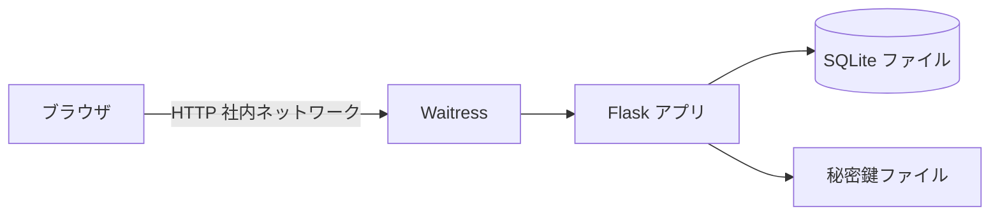
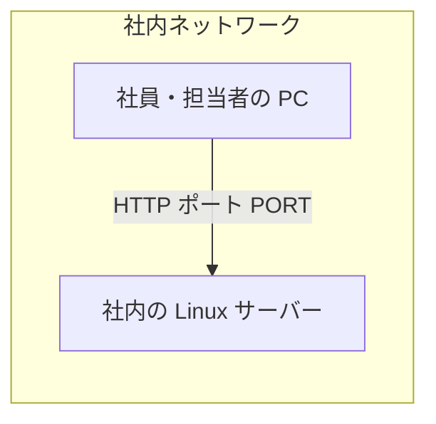
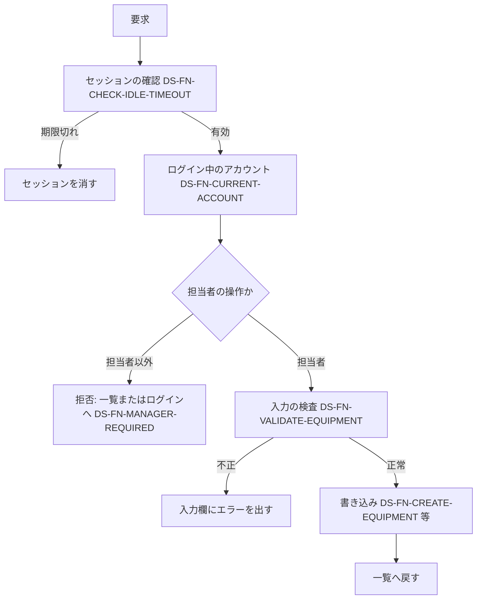

# 詳細設計書: 備品台帳と貸出状況の閲覧

（新規フロー。要件定義書 `docs/requirements.md` を根拠にする）

## 1. 言語・フレームワーク・アーキテクチャの選定

### 1-1. 選定結果

- 判定日時: 2026-11-05
- 技術制約の要約: 要件定義書 1-1 のとおり。無償のみ、Python 3.12 と SQLite で足りること、社内の Linux サーバーで `bash run.sh` により直接起動すること（コンテナ無し）、利用者 50 人、備品数百件。
- 判断軸ごとの該当有無と理由

  | 判断軸 | 該当 | 理由 |
  |---|---|---|
  | 既存資産との整合 | 無し | 新規開発 |
  | チームの技術 | 有り | Python 3.12 と SQLite で足りるという固定回答 |
  | 配備先 | 有り | Linux、コンテナ無しで動くこと。社内ネットワークからだけ開く |
  | 認証と認可の境界 | 有り | パスワード認証、3 ロール（担当者・社員・未ログイン）。ボタンと要求の両方で制御 |
  | 画面の規模 | 有り（小） | 画面は 4 種（一覧、登録、ログイン、備品の入力）と 3 つの操作。サーバー側で描画するテンプレートで足りる |
  | データの規模と構造 | 有り | 備品数百件、アカウント 50 件。同時の更新で記録を失わないため DB（SQLite）を使う |
  | 外部連携 | 無し | 外部連携は無い |
  | ライセンスとコスト | 有り | 無償のみ |
  | 保守性 | 有り | 保守が継続しているライブラリを選ぶ |

- 候補の比較表（出典: PyPI の公式メタデータ（`https://pypi.org/pypi/<名前>/json`）。確認日 2026-11-05）

  | 種別 | 候補 | 判断軸ごとの評価 | 出典 URL | 確認日 |
  |---|---|---|---|---|
  | Web フレームワーク | Flask 3.1.3 | 軽量。サーバー描画のテンプレートと、フォーム・セッション・リダイレクトを標準で扱える。Python 3.9 以上 | `https://pypi.org/pypi/flask/json`、公式ドキュメント `https://flask.palletsprojects.com/` | 2026-11-05 |
  | Web フレームワーク | Django | 機能は十分だが、画面 4 種と小規模な CRUD には枠組みが重い。管理画面・ORM・移行の仕組みは使わない | 公式 `https://www.djangoproject.com/`（PyPI の確認は未実施） | 未確認（比較の判断のみ） |
  | Web フレームワーク | FastAPI | API 向けの設計で、サーバー描画の画面は主目的ではない。Web API は要件に無い | 未確認（比較の判断のみ） | 未確認 |
  | WSGI サーバー | Waitress 3.0.2 | 純 Python で、コンテナ無しの Linux で動く。ライセンスは ZPL 2.1（PyPI の分類表記） | `https://pypi.org/pypi/waitress/json`、`https://github.com/Pylons/waitress` | 2026-11-05 |
  | データベース | SQLite（Python 標準の sqlite3、SQLite 3.53.1） | 追加の導入が要らず、ファイル 1 つで動く。一意制約で重複を防げ、トランザクションで同時の更新を直列化できる。備品数百件・利用者 50 人の規模に足りる | Python 標準ライブラリ（追加の出典なし） | 2026-11-05（ローカル環境の確認） |
  | データベース | PostgreSQL | 高機能だが、別のサーバーの導入と保守が要る。要件の規模に対して過剰 | 未確認（比較の判断のみ） | 未確認 |
  | E2E（ブラウザ自動化） | Playwright for Python 1.64.1 | 実際のブラウザで画面を操作できる。Python 3.10 以上 | `https://pypi.org/pypi/playwright/json`、`https://github.com/microsoft/playwright-python` | 2026-11-05 |
  | E2E（ブラウザ自動化） | Selenium | 実績は多いが、ブラウザドライバの管理が要る。Playwright で足りる | 未確認（比較の判断のみ） | 未確認 |
  | テスト実行器 | pytest 9.2.0 | `--junitxml` で JUnit XML を出せる。Python 3.10 以上 | `https://pypi.org/pypi/pytest/json` | 2026-11-05 |

  注記: 候補のライセンスは、Waitress（ZPL 2.1）以外は PyPI のメタデータに記載が無く、この段階では公式リポジトリの表記を未確認。無償であることは各プロジェクトの公開リポジトリの表記で確認する（承認時の前提）。
- 最終選定結果: 言語 Python 3.12、Web フレームワーク Flask 3.1.3、WSGI サーバー Waitress 3.0.2、データベース SQLite（標準）、実行形態 サーバー（コンテナ無し、`bash run.sh`）、E2E は Playwright 1.64.1 と pytest 9.2.0
- 選定理由: 要件の画面 4 種と小規模な CRUD に対し、最小の枠組みで足りる。DB は同時更新の記録保護のため必要で、追加の導入が要らない SQLite を選ぶ。
- ユーザー承認の記録: 固定回答（ANSWERS.md）で「推奨の案でよい。Python の無償のフレームワークと SQLite」と承認済み（2026-11-05）。

### 1-2. 承認の記録（まとめ）

- 技術選定: 承認済（固定回答）
- E2E の実行手段: ローカルで直接実行（固定回答）
- 連携ライブラリ・モック方式: 対象外（外部連携は無い）
- 要件の除外: 無し（11-1 に記載なし）

## 2. システム構成

- コンポーネント一覧

  | コンポーネント | 役割 | 配置 |
  |---|---|---|
  | Web アプリ（Flask） | 画面の表示と、登録・ログイン・備品の操作の受け付け | `app/` |
  | Waitress | HTTP を受けて Web アプリを動かす | `app/__main__.py` から起動 |
  | SQLite ファイル | 備品とアカウントの記録 | `DATA_DIR/app.db` |
  | セッションの秘密鍵ファイル | セッション Cookie の署名に使う鍵 | `DATA_DIR/secret_key` |
  | ブラウザ（利用者の PC） | 画面を開く | 社内ネットワーク |

- システム全体構成図



- 各コンポーネントの役割と機能: 2 章の表のとおり。
- コンポーネント間インターフェースとデータフロー: ブラウザは HTTP で画面と操作を要求する。Flask は要求を処理し、SQLite に読み書きする。画面は HTML で返す。外部へは出ない。
- ネットワーク構成図: ブラウザから社内サーバーへの HTTP だけ。ネットワーク構成図（mermaid）:



## 3. データ設計

### 3-1. データモデル

DB は必要（要件定義書 4-1 `RQ-DT-DATA-STORE`）。SQLite を使う。

- テーブル設計

  テーブル `accounts`（`DS-SC-ACCOUNT-TABLE`）

  | カラム | 型 | 制約 | 対応する要件（4-2） |
  |---|---|---|---|
  | id | 整数 | 主キー、自動採番 | - |
  | employee_number | 文字列 | 必須、一意、6 桁の数字 | 社員番号 |
  | name | 文字列 | 必須、30 文字以内、空不可 | 名前 |
  | password_hash | 文字列 | 必須（ハッシュ値） | パスワード（平文は保存しない） |
  | role | 文字列 | 必須、`manager` または `employee` | 役割 |

  テーブル `equipment`（`DS-SC-EQUIPMENT-TABLE`）

  | カラム | 型 | 制約 | 対応する要件（4-2） |
  |---|---|---|---|
  | id | 整数 | 主キー、自動採番 | - |
  | equipment_number | 文字列 | 必須、一意、半角の英数字とハイフンの 20 文字以内 | 管理番号 |
  | name | 文字列 | 必須、50 文字以内、空不可 | 備品名 |

- リレーション図: 参照関係は無い（2 テーブルは独立）。
- 貸出の表は作らない（この段では貸出は無い。次の段で追加する）。
- 初期化: 起動時に、テーブルが無ければ作る（DS-FN-INIT-DB）。

### 3-2. トランザクションと排他制御

- アカウント登録（DS-FN-REGISTER-ACCOUNT）: 1 回の書き込みトランザクションで「件数を数える → 0 件なら担当者、それ以外は社員 → 挿入」を行う。SQLite の即時書き込みトランザクション（BEGIN IMMEDIATE）で直列化し、同時でも担当者は 1 件だけになる。社員番号の重複は一意制約の違反を捕まえて「この社員番号は既に登録されています」を返す。
- 備品の登録・修正（DS-FN-CREATE-EQUIPMENT・DS-FN-UPDATE-EQUIPMENT）: 1 回の書き込みトランザクション。管理番号の重複は一意制約の違反で判定し、「この管理番号は既に使われています」を返す。修正の対象が無ければ「この管理番号の備品は見つかりません」を返す。
- 備品の削除（DS-FN-DELETE-EQUIPMENT）: 1 回の書き込みトランザクションで、対象の行を削除する。
- 排他の方式: 楽観的な排他は使わない。最後の保存が勝つ（要件定義書 1-2 の決め）。一意制約と即時トランザクションで重複を防ぐ。
- 同時の接続: 接続ごとに SQLite を開き、書き込みの待ち時間（busy timeout）を 5 秒にする。WAL モードにする（読み取りを書き込みと並行させる）。

### 3-3. 状態遷移

状態を持つエンティティは無い（要件定義書 4-4）。

## 4. アーキテクチャ設計

### 4-1. 外部設計

利用者向けインターフェース（`DS-IF-*`）。画面は Flask のテンプレートで HTML を返す。テンプレートと CSS は `app/templates/` と `app/static/` に置き、isdd の対応表には載せない（HTML・CSS は DS-MD を付けない）。

| DS-IF | 画面・操作 | 方式 | 入口の関数（対応表） | 入力 | 出力 | エラー仕様 |
|---|---|---|---|---|---|---|
| `DS-IF-LOAN-STATUS-PAGE` | 貸出状況（トップ） | GET `/` | `index_page` | なし | 一覧の表（`tbody tr`、各行に `data-equipment-number`、管理番号の昇順）。ログイン状態に応じたボタンとリンク。備品 0 件なら「備品は登録されていません」 | 担当者以外の操作の要求は、ここへ戻して `.message` に「この操作は担当者だけが行えます」。セッション切れは未ログインとして表示 |
| `DS-IF-REGISTER-PAGE` | アカウント登録 | GET・POST `/accounts/register/` | `register_page` | 社員番号、名前、パスワード | GET は入力欄、POST 成功はログイン画面へ移り `.message` に「登録しました。ログインしてください」 | 入力欄ごとのエラーを `.field` の中の `.field-error` に出す。入力値は残す。入力のチェックは DS-FN-VALIDATE-REGISTRATION の規則 |
| `DS-IF-LOGIN-PAGE` | ログイン | GET・POST `/login/` | `login_page` | 社員番号、パスワード | 成功はトップへ移る | 失敗は `.error` に「社員番号またはパスワードが違います」。どちらが違うかは示さない。担当者以外の操作要求から来た未ログインの人には `.message` に「この操作は担当者だけが行えます」 |
| `DS-IF-LOGOUT-ACTION` | ログアウト | POST `/logout/` | `logout_action` | なし | トップへ移る | 未ログインでも同じ応答 |
| `DS-IF-EQUIPMENT-FORM-PAGE` | 備品の登録 | GET・POST `/equipment/new/` | `equipment_new_page` | 管理番号、備品名 | GET は空の入力欄と「保存」。POST 成功は一覧へ移り `.message` に「備品を登録しました」 | 入力欄ごとのエラーを `.field-error` に出し、入力値は残す。未ログインはログイン画面へ、社員は一覧へ戻して `.message` |
| `DS-IF-EQUIPMENT-EDIT-PAGE` | 備品の修正 | GET・POST `/equipment/<管理番号>/edit/` | `equipment_edit_page` | 管理番号、備品名 | GET は既存の値を入れた入力欄と「保存」。POST 成功は一覧へ移り `.message` に「備品を修正しました」 | 同上。対象が無ければ一覧へ戻して `.message` に「この管理番号の備品は見つかりません」 |
| `DS-IF-EQUIPMENT-DELETE-ACTION` | 備品の削除 | POST `/equipment/<管理番号>/delete/` | `equipment_delete_action` | なし（画面の「削除」ボタン。確認は `window.confirm` で行い、「はい」のときだけ送信） | 一覧へ移り `.message` に「備品を削除しました」 | 未ログイン・社員は拒否（DS-FN-MANAGER-REQUIRED） |

- 入力欄の id: 社員番号 `id_employee_number`、名前 `id_name`、パスワード `id_password`、管理番号 `id_equipment_number`、備品名 `id_name`。
- ボタンの文言: 「登録」「ログイン」「ログアウト」「保存」「修正」「削除」。リンク: 未ログインの一覧に「ログイン」「アカウント登録」、担当者の一覧に「備品を登録」。
- ログイン中は `.current-user` に名前を出す。
- 削除の確認ダイアログ: `window.confirm` を削除ボタンの送信に付ける。
- 「修正」は既存の値を入れた修正画面を開くボタン（GET の form の送信）。

#### 外部システム連携

無し（要件定義書 3-3）。

#### 外部 DB 連携

無し。

### 4-2. 内部設計

処理フロー（登録・ログイン・備品操作の共通）:



- 役割:
  - セッションの期限: 操作ごとに最後の操作時刻を更新する。`SESSION_IDLE_TIMEOUT_SECONDS` を超えていたらセッションを消す（DS-FN-CHECK-IDLE-TIMEOUT）。
  - 担当者の判定: セッションの社員のアカウントの役割が `manager` か（DS-FN-MANAGER-REQUIRED）。
  - 一覧: 備品を管理番号の昇順で取り出し、状態を「空き」、借りている社員の名前と貸出日を空欄で付ける（DS-FN-LIST-LOAN-STATUS）。
- 入力の検査は、登録・修正の両方で同じ規則を使う（DS-FN-VALIDATE-EQUIPMENT）。
- 処理の一覧（役割）は 5 章の関数の表を参照。
- バッチ: 無し。

## 5. クラス設計

クラスは作らない（すべて関数。対応表の粒度は function）。役割は関数ごとに 1 文で書く。

| 関数（対応表の名前） | 役割（1 文） |
|---|---|
| `create_app`（DS-FN-CREATE-APP） | 設定を読み、DB を初期化し、ルートを登録した Flask アプリを作る |
| `load_settings`（DS-FN-LOAD-SETTINGS） | 環境変数（`PORT`・`DATA_DIR`・`SESSION_IDLE_TIMEOUT_SECONDS`）を読み、既定値を入れる |
| `get_db`（DS-FN-GET-DB） | 要求ごとの SQLite 接続を返す（WAL、待ち時間 5 秒） |
| `init_db`（DS-FN-INIT-DB） | テーブルが無ければ作り、秘密鍵ファイルが無ければ作る |
| `close_db`（DS-FN-CLOSE-DB） | 要求の終わりに接続を閉じる |
| `hash_password`（DS-FN-HASH-PASSWORD） | パスワードをハッシュ値にする（Werkzeug の `generate_password_hash`） |
| `validate_registration`（DS-FN-VALIDATE-REGISTRATION） | 社員番号・名前・パスワードの入力を検査し、欄ごとのエラーを返す |
| `register_account`（DS-FN-REGISTER-ACCOUNT） | 0 件なら担当者、それ以外は社員としてアカウントを 1 件保存する |
| `get_account`（DS-FN-GET-ACCOUNT） | 番号（id）でアカウントを 1 件取り出す |
| `authenticate_account`（DS-FN-AUTHENTICATE-ACCOUNT） | 社員番号とパスワードが合うアカウントを返す。合わなければ何も返さない |
| `validate_equipment`（DS-FN-VALIDATE-EQUIPMENT） | 管理番号・備品名の形式と長さを検査し、欄ごとのエラーを返す |
| `create_equipment`（DS-FN-CREATE-EQUIPMENT） | 備品を 1 件保存する。重複は重複エラーを返す |
| `update_equipment`（DS-FN-UPDATE-EQUIPMENT） | 管理番号で備品を探して管理番号と備品名を変える。対象が無い・重複のときはエラーを返す |
| `delete_equipment`（DS-FN-DELETE-EQUIPMENT） | 管理番号の備品を 1 件削除する |
| `get_equipment`（DS-FN-GET-EQUIPMENT） | 管理番号で備品を 1 件取り出す |
| `list_loan_status`（DS-FN-LIST-LOAN-STATUS） | 全備品を管理番号の昇順で、貸出状態つきで返す（この段では全件「空き」） |
| `login_account`（DS-FN-LOGIN-ACCOUNT） | 認証されたアカウントの番号と最後の操作時刻をセッションに入れる |
| `logout_account`（DS-FN-LOGOUT-ACCOUNT） | セッションを消す |
| `current_account`（DS-FN-CURRENT-ACCOUNT） | セッションのアカウントを返す。無ければ何も返さない |
| `check_idle_timeout`（DS-FN-CHECK-IDLE-TIMEOUT） | 最後の操作から設定秒数を超えていればセッションを消し、そうでなければ最後の操作時刻を更新する |
| `manager_required`（DS-FN-MANAGER-REQUIRED） | 担当者以外の要求を拒否する（未ログインはログイン画面へ、社員は一覧へ戻して `.message`） |
| `start_server`（DS-FN-START-SERVER） | 設定を読み、Waitress で Web アプリを待ち受ける |
| 画面・操作の関数（7 個） | `DS-IF-*` の表のとおり。要求を受け、上の関数を呼んで応答を返す |

- クラス図・メッセージ一覧は無い（クラスを使わない）。処理の流れは 4-2 のとおり。

## 6. エラーハンドリングとセキュリティ設計

### 6-1. エラーハンドリング

| 想定エラー | 利用者への見え方 | ログ | 処理 |
|---|---|---|---|
| 入力の形式違い・空・長すぎ | 入力欄の下に `.field-error` | 無し | 保存しない（入力値は残す） |
| 社員番号・管理番号の重複 | 入力欄の下に `.field-error` | 無し | 保存しない |
| ログインの失敗 | `.error`「社員番号またはパスワードが違います」 | 無し | 何もしない |
| 担当者以外の操作の要求 | 一覧（またはログイン画面）に `.message` | 無し | 操作しない |
| セッションの期限切れ | 未ログインとして表示 | 無し | セッションを消す |
| DB の書き込みの競合（待ちが 5 秒を超える） | 500 エラーの画面（Flask の標準） | 標準のエラーログ | 処理を中止する |

### 6-2. 認証

- 方式: 社員番号とパスワード。SSO は無い。パスワードはハッシュ値で保存する（`werkzeug.security`）。
- セッション: Flask の署名付き Cookie。鍵は `DATA_DIR/secret_key`（無ければ作る）。Cookie は `HttpOnly` と `SameSite=Lax`。
- 期限: 最後の操作から `SESSION_IDLE_TIMEOUT_SECONDS`（既定 1800 秒）を超えたらログアウト扱い。

### 6-3. 認可

| ロール | 貸出状況（閲覧） | 登録（アカウント） | 備品の登録・修正・削除 |
|---|---|---|---|
| 未ログイン | 可 | 可 | 不可（ログイン画面へ） |
| 社員 | 可 | 可（登録は誰でも可） | 不可（ボタンは出さず、要求は一覧へ戻して拒否） |
| 担当者 | 可 | 可 | 可 |

- 制御の単位: ボタン（画面の出し分け）と要求（サーバー側の `manager_required`）の両方。
- ロールは `accounts.role` で決まる。最初の 1 件が担当者、2 件目以降は社員。

### 6-4. 監査ログ

無い（要件定義書 6 章）。

### 6-5. その他のセキュリティ対策

- 社内ネットワーク限定（RQ-NF-INTERNAL-NETWORK）: 待ち受けは全インターフェース（`0.0.0.0`）にするが、アプリは社内からの接続だけを想定し、インターネットには公開しない（運用の決め。ファイアウォールで制御する前提）。
- CSRF: 専用のトークンは作らず、Cookie の `SameSite=Lax` で代替する（要件定義書 1-2）。

## 7. コード設計

### 7-1. ディレクトリ構成

```
run.sh
setup.sh
requirements.txt
app/
  __init__.py      アプリの作成と設定
  __main__.py      起動（python -m app）
  db.py            SQLite の接続と初期化
  accounts.py      アカウントの登録・認証・取り出し
  equipment.py     備品の検査・登録・修正・削除・一覧
  auth.py          セッション・ロールの判定
  views.py         画面と操作の入口
  templates/       HTML（対応表の対象外）
  static/          CSS（対応表の対象外）
tests/             単体テスト（pytest。対応表の対象外）
e2e/               E2E テスト（Playwright + pytest）
e2e/results/       JUnit XML（git 管理外）
scripts/isdd/      isdd の対応表チェック
docs/              要件・設計・対応表
```

### 7-2. ファイル一覧

| ファイル | 役割 | DS-MD | 実現する設計 ID |
|---|---|---|---|
| `app/__init__.py` | アプリの作成と設定 | `DS-MD-APP-INIT` | `DS-FN-CREATE-APP`, `DS-FN-LOAD-SETTINGS` |
| `app/__main__.py` | 起動 | `DS-MD-APP-MAIN` | `DS-FN-START-SERVER` |
| `app/db.py` | SQLite の接続と初期化（テーブルの定義は SCHEMA の文字列として持つ。テーブルは `DS-SC-*` で 3 章に書き、対応表の対象にはしない） | `DS-MD-DB` | `DS-FN-GET-DB`, `DS-FN-INIT-DB`, `DS-FN-CLOSE-DB` |
| `app/accounts.py` | アカウント | `DS-MD-ACCOUNTS` | `DS-FN-HASH-PASSWORD`, `DS-FN-VALIDATE-REGISTRATION`, `DS-FN-REGISTER-ACCOUNT`, `DS-FN-GET-ACCOUNT`, `DS-FN-AUTHENTICATE-ACCOUNT` |
| `app/equipment.py` | 備品 | `DS-MD-EQUIPMENT` | `DS-FN-VALIDATE-EQUIPMENT`, `DS-FN-CREATE-EQUIPMENT`, `DS-FN-UPDATE-EQUIPMENT`, `DS-FN-DELETE-EQUIPMENT`, `DS-FN-GET-EQUIPMENT`, `DS-FN-LIST-LOAN-STATUS` |
| `app/auth.py` | セッションとロール | `DS-MD-AUTH` | `DS-FN-LOGIN-ACCOUNT`, `DS-FN-LOGOUT-ACCOUNT`, `DS-FN-CURRENT-ACCOUNT`, `DS-FN-CHECK-IDLE-TIMEOUT`, `DS-FN-MANAGER-REQUIRED` |
| `app/views.py` | 画面と操作 | `DS-MD-VIEWS` | `DS-IF-LOAN-STATUS-PAGE`, `DS-IF-REGISTER-PAGE`, `DS-IF-LOGIN-PAGE`, `DS-IF-LOGOUT-ACTION`, `DS-IF-EQUIPMENT-FORM-PAGE`, `DS-IF-EQUIPMENT-EDIT-PAGE`, `DS-IF-EQUIPMENT-DELETE-ACTION` |

- 対応表の対象外（DS-MD を付けない）: `run.sh`（`DS-OP-RUN-SCRIPT`）、`setup.sh`（`DS-OP-SETUP-SCRIPT`）、`requirements.txt`、テンプレート、CSS。
- 対応表の粒度: `function`（既定。関数ごとに対応表に載せる。関数の数が多く、各関数に設計 ID を持たせるため）。
- 依存の規則: 無い（依存の規則は無い）。`scripts/isdd/dependencies.json` は `"rules": []`。

### 7-3. コーディング規約

- Python 3.12。PEP 8 に従う。関数には日本語の説明（何をするか、引数、戻り値）を付ける。
- コードに要件 ID・設計 ID を書かない。
- SQL はパラメータ付きで書く（文字列連結をしない）。

## 8. テスト設計

### 8-1. テストの種類と方針

- 単体テスト（`tests/`）: 入力検査（`validate_registration`・`validate_equipment`）、パスワードのハッシュ、期限判定（`check_idle_timeout` の境界）。実行: `.venv/bin/python -m pytest tests -q`
- 結合テスト: 単体テストと同じ `tests/` で、Flask のテストクライアントを使い、DB を一時ディレクトリに作る（登録から一覧表示まで）。
- 総合テスト・E2E（`e2e/`）: 実際のブラウザで 8-2 のシナリオを実行する。
- 非機能の検証: 応答時間（3 秒以内）は E2E の `DS-TS-LOAN-STATUS-PERFORMANCE` で確かめる。

### 8-2. E2E テストのシナリオ

要件定義書 第 7 章の `RQ-TS-*` を 100% 網羅する（13 件）。

| DS-ID | 目的 | 前提条件 | 手順 | 期待結果 |
|---|---|---|---|---|
| `DS-TS-REGISTER-FIRST-ACCOUNT` | 最初の登録は担当者 | アカウント 0 件 | 登録画面で正しい値を入れて「登録」。ログインする | 「登録しました。ログインしてください」。ログイン後に名前と「備品を登録」が見える |
| `DS-TS-REGISTER-VALIDATION` | 登録の入力チェック | アカウント 1 件以上 | 社員番号の形式違い、重複、名前が空、名前 31 文字、パスワード 7 文字で登録 | 各欄に指定の文言。入力値は残る。登録されない |
| `DS-TS-REGISTER-SECOND-ACCOUNT` | 2 件目は社員 | 担当者 1 件 | 別の社員番号で登録し、ログインして備品の登録画面を開く | 「備品を登録」は出ない。登録画面を開くと `.message`「この操作は担当者だけが行えます」 |
| `DS-TS-LOGIN-AND-FAILURE` | ログインの成否 | アカウント 1 件以上 | 誤った社員番号、誤ったパスワード、正しい組み合わせでログイン | 失敗は `.error`「社員番号またはパスワードが違います」。成功で名前が出る |
| `DS-TS-LOGOUT` | ログアウト | ログイン中 | 「ログアウト」を押す | 名前が消え「ログイン」のリンクが出る |
| `DS-TS-IDLE-TIMEOUT` | 30 分（テストでは短く）で自動ログアウト | `SESSION_IDLE_TIMEOUT_SECONDS=2` で起動し、ログイン中 | 操作せずに 3 秒待ち、画面を開く | 名前が消えている。備品の登録画面はログイン画面へ移る |
| `DS-TS-CREATE-EQUIPMENT` | 担当者が備品を登録し一覧に出る | 担当者でログイン中 | 「備品を登録」で管理番号と備品名を入れて「保存」 | 一覧の行に管理番号・備品名・「空き」（昇順） |
| `DS-TS-CREATE-EQUIPMENT-VALIDATION` | 備品の入力チェック | 担当者でログイン中 | 管理番号 21 文字、記号入り、重複、備品名 51 文字で保存 | 指定の文言。入力値は残り、登録されない |
| `DS-TS-UPDATE-EQUIPMENT` | 担当者が備品を修正 | 備品 1 件以上 | 「修正」を押し、備品名を変えて「保存」 | 一覧に新しい備品名 |
| `DS-TS-DELETE-EQUIPMENT` | 担当者が備品を削除（確認あり） | 備品 1 件以上 | 「削除」→ 確認を「キャンセル」→ 再度「削除」→「はい」 | キャンセルでは残る。「はい」で一覧から消える |
| `DS-TS-LOAN-STATUS-ANONYMOUS` | 未ログインで一覧が見える。0 件の表示 | 未ログイン | 0 件なら一覧を開く。備品があれば行を見る | 0 件は「備品は登録されていません」。行に「空き」。ボタンは無く、リンクだけ |
| `DS-TS-ROLE-CONTROL` | 社員にボタンが無く、要求は拒否 | 社員でログイン中 | 行の「修正」「削除」が無いことを見る。未ログインで登録画面の URL を開く。社員で同じ URL を開く | 社員にボタンは無い。未ログインはログイン画面へ。社員は一覧へ戻り `.message` |
| `DS-TS-LOAN-STATUS-PERFORMANCE` | 3 秒以内に一覧が表示 | 備品 500 件を登録済み | 一覧を開き表示までの時間を計る | 3 秒以内 |

### 8-3. E2E の実行手段

- 方式: Playwright（Chromium）で実ブラウザを操作する。テストは `e2e/` に置く。
- テストの起動: `e2e/conftest.py` が一時の `DATA_DIR` と空きポートで Waitress を別スレッドに起動し、各テストに URL を渡す。
- 承認: 固定回答（ローカルで直接実行）。

### 8-4. E2E の実行コマンドと運用

- 単体・結合: `.venv/bin/python -m pytest tests -q`
- E2E: `.venv/bin/python -m pytest e2e --junitxml=e2e/results/e2e.xml`（結果は `e2e/results/` に JUnit XML で出る）
- テスト資産: `e2e/` 配下。`DS-TS-*` の各シナリオは `e2e/test_scenarios.py` のテスト関数に 1 対 1 で結ぶ（対応表の `DS-TS` 行）。
- テストが失敗したら修正と再実行を繰り返し、全件通過まで続ける。
- 外部連携は無いので、モードは設けない。

## 9. 運用設計

### DS-OP-SETUP-SCRIPT（`setup.sh`）

- 役割: `.venv` を作り、`requirements.txt` を導入し、Playwright の Chromium を導入する。採点の前に 1 回だけ実行する。
- 入口: `bash setup.sh`。

### DS-OP-RUN-SCRIPT（`run.sh`）

- 役割: `.venv` で `python -m app` を起動する。待ち受けは `0.0.0.0:PORT`。
- 起動方法: `bash run.sh`。
- 初期化: 起動時に `DATA_DIR` を作り、DB と秘密鍵を作る（DS-FN-INIT-DB）。空の `DATA_DIR` なら、備品もアカウントも 0 件で始まる。
- 初期ユーザー: 無い（最初に登録したアカウントが担当者になる。DS-OP-FIRST-MANAGER-PROCEDURE）。
- 可用性: 平日の日中に使う。夜間・休日の停止は運用で行う（要件定義書 5 章）。

### DS-OP-ENV-SETTINGS（環境変数）

| 名前 | 用途 | 既定値 | 必須か |
|---|---|---|---|
| `PORT` | 待ち受けポート | 8000 | 任意 |
| `DATA_DIR` | DB と秘密鍵の置き場所 | `./data` | 任意 |
| `SESSION_IDLE_TIMEOUT_SECONDS` | 操作しないまま自動ログアウトするまでの秒数 | 1800 | 任意 |

秘密の値は書かない（秘密鍵は `DATA_DIR/secret_key` に自動生成する）。

### DS-OP-FIRST-MANAGER-PROCEDURE（導入手順）

社員に URL を知らせる前に、担当者が最初のアカウントを登録する。最初の 1 件が担当者になる（README.md に書く）。

### 9-1. バックアップ・データ移行

- バックアップ: 必要ない（要件定義書 6 章）。
- データ移行: 移行は無い（要件定義書 5 章）。担当者が画面から手で入力する。

## 10. ログ・監視・アラート・障害対応設計

- ログ: 必要ない。標準のエラー出力だけ（ログの種類と内容の記述は行わない）。
- 監視・アラート: 必要ない（監視・アラートの設計は必須ではないため、内容と対応方法の記述は行わない）。
- 障害対応:
  - DB ファイルが開けない: 起動に失敗する。`DATA_DIR` の権限を確かめて再起動する。
  - 書き込みの競合が長引く: 5 秒の待ちの後に失敗する。画面を開き直して再度操作する。

## 11. 要件と設計の対応表

| DS-ID | 対応要件ID |
|---|---|
| `DS-MD-APP-INIT` | `RQ-OP-STARTUP-SCRIPT` |
| `DS-MD-APP-MAIN` | `RQ-OP-STARTUP-SCRIPT`, `RQ-NF-INTERNAL-NETWORK` |
| `DS-MD-DB` | `RQ-DT-DATA-STORE` |
| `DS-MD-ACCOUNTS` | `RQ-FT-REGISTER-ACCOUNT`, `RQ-NF-PASSWORD-AUTH` |
| `DS-MD-EQUIPMENT` | `RQ-FT-CREATE-EQUIPMENT`, `RQ-FT-UPDATE-EQUIPMENT`, `RQ-FT-DELETE-EQUIPMENT`, `RQ-FT-VIEW-LOAN-STATUS` |
| `DS-MD-AUTH` | `RQ-FT-LOGIN`, `RQ-FT-LOGOUT`, `RQ-FT-IDLE-AUTO-LOGOUT`, `RQ-FT-ROLE-CONTROL` |
| `DS-MD-VIEWS` | `RQ-UI-LOAN-STATUS-SCREEN`, `RQ-UI-REGISTER-SCREEN`, `RQ-UI-LOGIN-SCREEN`, `RQ-UI-EQUIPMENT-FORM-SCREEN` |
| `DS-FN-CREATE-APP` | `RQ-OP-STARTUP-SCRIPT` |
| `DS-FN-LOAD-SETTINGS` | `RQ-OP-STARTUP-SCRIPT`, `RQ-FT-IDLE-AUTO-LOGOUT` |
| `DS-FN-GET-DB` | `RQ-DT-DATA-STORE`, `RQ-NF-USER-SCALE` |
| `DS-FN-INIT-DB` | `RQ-DT-DATA-STORE`, `RQ-OP-STARTUP-SCRIPT` |
| `DS-FN-CLOSE-DB` | `RQ-DT-DATA-STORE` |
| `DS-FN-HASH-PASSWORD` | `RQ-NF-PASSWORD-AUTH`, `RQ-FT-REGISTER-ACCOUNT` |
| `DS-FN-VALIDATE-REGISTRATION` | `RQ-FT-REGISTER-ACCOUNT` |
| `DS-FN-REGISTER-ACCOUNT` | `RQ-FT-REGISTER-ACCOUNT`, `RQ-OP-FIRST-MANAGER-SETUP` |
| `DS-FN-GET-ACCOUNT` | `RQ-FT-ROLE-CONTROL` |
| `DS-FN-AUTHENTICATE-ACCOUNT` | `RQ-FT-LOGIN`, `RQ-NF-PASSWORD-AUTH` |
| `DS-FN-VALIDATE-EQUIPMENT` | `RQ-FT-CREATE-EQUIPMENT`, `RQ-FT-UPDATE-EQUIPMENT` |
| `DS-FN-CREATE-EQUIPMENT` | `RQ-FT-CREATE-EQUIPMENT` |
| `DS-FN-UPDATE-EQUIPMENT` | `RQ-FT-UPDATE-EQUIPMENT` |
| `DS-FN-DELETE-EQUIPMENT` | `RQ-FT-DELETE-EQUIPMENT` |
| `DS-FN-GET-EQUIPMENT` | `RQ-FT-UPDATE-EQUIPMENT` |
| `DS-FN-LIST-LOAN-STATUS` | `RQ-FT-VIEW-LOAN-STATUS`, `RQ-NF-RESPONSE-3S` |
| `DS-FN-LOGIN-ACCOUNT` | `RQ-FT-LOGIN` |
| `DS-FN-LOGOUT-ACCOUNT` | `RQ-FT-LOGOUT` |
| `DS-FN-CURRENT-ACCOUNT` | `RQ-FT-ROLE-CONTROL` |
| `DS-FN-CHECK-IDLE-TIMEOUT` | `RQ-FT-IDLE-AUTO-LOGOUT` |
| `DS-FN-MANAGER-REQUIRED` | `RQ-FT-ROLE-CONTROL`, `RQ-FT-DELETE-EQUIPMENT` |
| `DS-FN-START-SERVER` | `RQ-OP-STARTUP-SCRIPT`, `RQ-NF-INTERNAL-NETWORK`, `RQ-NF-AVAILABILITY-DAYTIME` |
| `DS-IF-LOAN-STATUS-PAGE` | `RQ-UI-LOAN-STATUS-SCREEN`, `RQ-FT-VIEW-LOAN-STATUS` |
| `DS-IF-REGISTER-PAGE` | `RQ-UI-REGISTER-SCREEN`, `RQ-FT-REGISTER-ACCOUNT` |
| `DS-IF-LOGIN-PAGE` | `RQ-UI-LOGIN-SCREEN`, `RQ-FT-LOGIN` |
| `DS-IF-LOGOUT-ACTION` | `RQ-FT-LOGOUT` |
| `DS-IF-EQUIPMENT-FORM-PAGE` | `RQ-UI-EQUIPMENT-FORM-SCREEN`, `RQ-FT-CREATE-EQUIPMENT` |
| `DS-IF-EQUIPMENT-EDIT-PAGE` | `RQ-UI-EQUIPMENT-FORM-SCREEN`, `RQ-FT-UPDATE-EQUIPMENT` |
| `DS-IF-EQUIPMENT-DELETE-ACTION` | `RQ-FT-DELETE-EQUIPMENT` |
| `DS-SC-ACCOUNT-TABLE` | `RQ-DT-ACCOUNT-RECORD`, `RQ-DT-DATA-STORE`, `RQ-NF-USER-SCALE` |
| `DS-SC-EQUIPMENT-TABLE` | `RQ-DT-EQUIPMENT-RECORD`, `RQ-DT-DATA-STORE` |
| `DS-OP-SETUP-SCRIPT` | `RQ-OP-STARTUP-SCRIPT` |
| `DS-OP-RUN-SCRIPT` | `RQ-OP-STARTUP-SCRIPT`, `RQ-NF-INTERNAL-NETWORK`, `RQ-NF-AVAILABILITY-DAYTIME` |
| `DS-OP-ENV-SETTINGS` | `RQ-OP-STARTUP-SCRIPT`, `RQ-FT-IDLE-AUTO-LOGOUT` |
| `DS-OP-FIRST-MANAGER-PROCEDURE` | `RQ-OP-FIRST-MANAGER-SETUP` |
| `DS-TS-REGISTER-FIRST-ACCOUNT` | `RQ-TS-REGISTER-FIRST-ACCOUNT` |
| `DS-TS-REGISTER-VALIDATION` | `RQ-TS-REGISTER-VALIDATION` |
| `DS-TS-REGISTER-SECOND-ACCOUNT` | `RQ-TS-REGISTER-SECOND-ACCOUNT` |
| `DS-TS-LOGIN-AND-FAILURE` | `RQ-TS-LOGIN-AND-FAILURE` |
| `DS-TS-LOGOUT` | `RQ-TS-LOGOUT` |
| `DS-TS-IDLE-TIMEOUT` | `RQ-TS-IDLE-TIMEOUT` |
| `DS-TS-CREATE-EQUIPMENT` | `RQ-TS-CREATE-EQUIPMENT` |
| `DS-TS-CREATE-EQUIPMENT-VALIDATION` | `RQ-TS-CREATE-EQUIPMENT-VALIDATION` |
| `DS-TS-UPDATE-EQUIPMENT` | `RQ-TS-UPDATE-EQUIPMENT` |
| `DS-TS-DELETE-EQUIPMENT` | `RQ-TS-DELETE-EQUIPMENT` |
| `DS-TS-LOAN-STATUS-ANONYMOUS` | `RQ-TS-LOAN-STATUS-ANONYMOUS` |
| `DS-TS-ROLE-CONTROL` | `RQ-TS-ROLE-CONTROL` |
| `DS-TS-LOAN-STATUS-PERFORMANCE` | `RQ-TS-LOAN-STATUS-PERFORMANCE` |

### 11-1. 除外要件

除外要件は無い。

### 補足: 設計 ID と要件 ID の対応の確認

- `RQ-NF-USER-SCALE` は `DS-FN-GET-DB`（接続ごとの待ち時間）と `DS-SC-ACCOUNT-TABLE` で受ける（50 人の同時利用を DB の直列化で扱う）。
- `RQ-NF-AVAILABILITY-DAYTIME` は運用（停止は運用で行う）として `DS-OP-RUN-SCRIPT` と `DS-FN-START-SERVER` で受ける。
