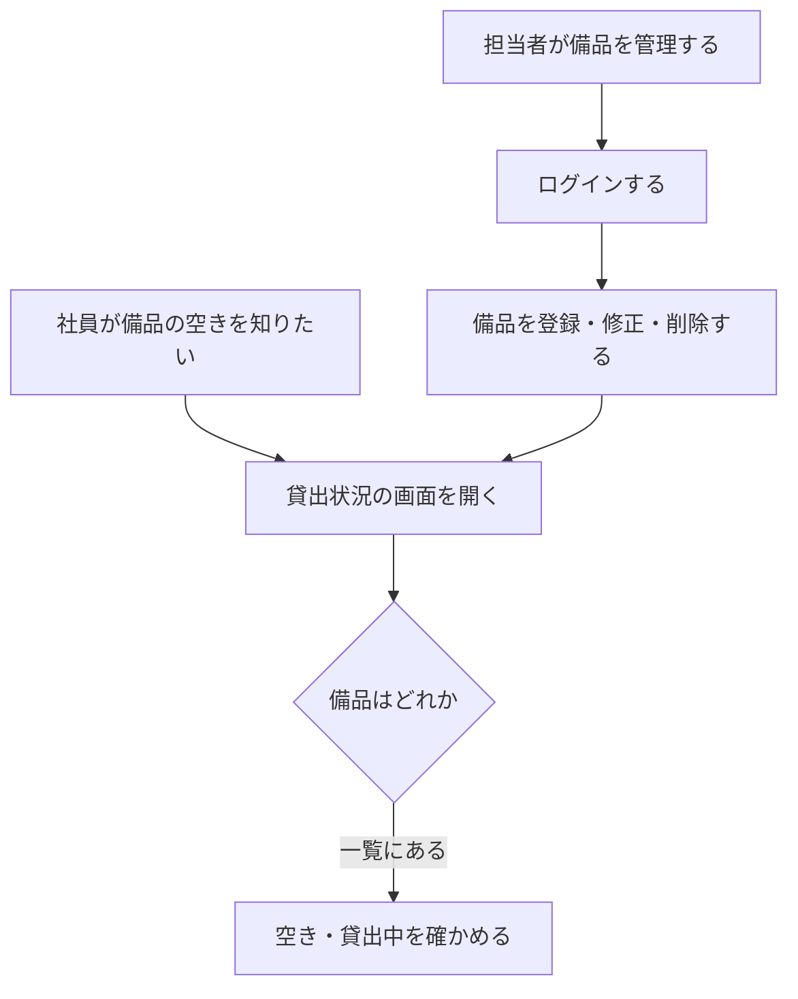
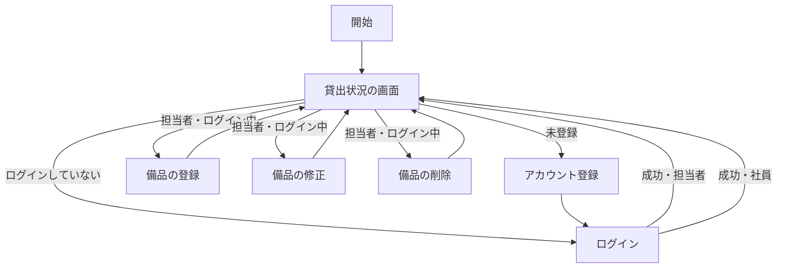

# 要件定義書: 備品台帳と貸出状況の閲覧

（新規フロー。段 1。依頼は REQUEST.md、固定回答は ANSWERS.md）

## 1. 目的・前提

- システムの目的: 会社の備品の台帳と貸出の記録を 1 つのアプリにまとめ、記録の食い違いと消失をなくす。社員が「どの備品があり、空いているか」を担当者に問い合わせずに自分で確かめられるようにする。
- 用語集

  | 用語 | 業務上の意味 | 本案件での使用範囲 | 同義語/類義語 |
  |---|---|---|---|
  | 備品 | 会社が貸し出す物品 | 台帳に登録する対象 | 物品 |
  | 管理番号 | 備品 1 件を識別する番号（半角の英数字とハイフン、20 文字以内） | 備品の識別子 | 備品番号 |
  | 担当者 | 備品の登録・修正・削除を行う社員 | 最初に登録したアカウント（1 件だけ）。担当者を増やす機能は無い | 管理者 |
  | 社員 | 備品の貸出状況を見る利用者（借りる人） | 担当者以外のアカウント | 利用者 |
  | 社員番号 | 社員を識別する 6 桁の数字 | ログインの ID | 職員番号 |
  | 貸出状況 | 備品ごとの空き・貸出中の別、借りている社員の名前、貸出日 | 一覧画面で閲覧する内容 | 在庫状況 |

- システムの形態: GUI（ブラウザで開く画面）。Web API やバッチは無い。

### 1-1. 技術制約（前提。要件ではないため ID は付けない）

| 制約項目 | 内容 | 出どころ（誰がいつ答えたか） |
|---|---|---|
| 既存コードベース | 無し（新規開発） | ANSWERS.md（固定回答） |
| 配備先 | 社内の Linux サーバー。コンテナは可だが、採点では `bash run.sh` で直接起動するため、コンテナ無しで動くこと。社内ネットワークからだけ開く | REQUEST.md・contract.md |
| チームの技術 | 決まり無し。Python 3.12 と SQLite で足りる | ANSWERS.md（固定回答） |
| ライセンスとコスト | 無償のものだけを使う。有償ソフト・有償サービスは使わない | REQUEST.md |
| 性能と規模の目安 | 利用者は社員と担当者の合計 50 人まで。備品は数百件まで。操作から表示まで 3 秒以内 | REQUEST.md・ANSWERS.md（固定回答） |

### 1-2. 依頼に無く自分で決めた項目（必須）

| 項目 | 決めた内容 | 根拠（最小案か、依頼のどこから推測したか） | 承認（承認済 / 未確認） |
|---|---|---|---|
| 備品の修正で管理番号も変えられるか | 変えられる。変更後の管理番号も重複不可・形式は登録と同じ | 依頼の「修正」に管理番号を含むと読んだ。変えられないと誤登録を直せないため | 承認済（固定回答により） |
| 備品名・管理番号の空欄 | 空欄は不可。管理番号は形式違反、備品名は「備品名を入力してください」 | 空欄の既定値は無いため、必須項目として最小案 | 承認済（固定回答により） |
| 名前・備品名の前後の空白 | 前後の空白は取り除いてから判定・保存する | 空白だけの名前を防ぐ最小案 | 承認済（固定回答により） |
| 管理番号の大文字と小文字 | 区別する（入力のとおり保存し、完全一致で重複を判定） | 最小案 | 承認済（固定回答により） |
| 備品一覧の並び | 管理番号の昇順（contract.md の指定） | 契約の指定 | 承認済（固定回答により） |
| 同時に同じ社員番号・管理番号を登録したとき | 後から来た側は重複エラーにする（DB の一意制約で防ぐ） | 「重複不可」の依頼を DB で確実に守る最小案 | 承認済（固定回答により） |
| 最初の担当者の決め方 | アカウントが 0 件のときの登録を、同時の登録でも 1 件だけ担当者にする | 「1 件も無いとき」の条件を競合で崩さないため | 承認済（固定回答により） |
| 備品の登録・修正・削除の同時操作 | 後から保存した内容が有効（最後の保存が勝つ）。削除済みの備品の修正は「この管理番号の備品は見つかりません」を一覧に戻して示す | 最小案。排他制御は依頼に無い | 承認済（固定回答により） |
| ログイン失敗の回数制限 | 作らない | 依頼に無い。ANSWERS の「依頼に無いことは作らない」 | 承認済（固定回答により） |
| パスワードの保存方法 | ハッシュ化して保存し、平文は残さない | 依頼のパスワード認証を安全に満たす最小案 | 承認済（固定回答により） |
| CSRF 対策 | 専用のトークンは作らず、セッション Cookie の SameSite=Lax で代替する | 社内限定・依頼に無い。外部トークンを増やさない最小案 | 承認済（固定回答により） |
| 社員番号の先頭の 0 | 6 桁の数字であれば先頭の 0 も受け付ける（`000001` は可） | 形式「6 桁の数字」の文字どおり | 承認済（固定回答により） |
| 操作しないまま 30 分の判定 | 最後の操作（画面の表示・保存を含むリクエスト）から計る。既定 1800 秒、環境変数で変えられる | contract.md の指定 | 承認済（固定回答により） |

## 2. 業務

- 対象業務一覧

  | RQ-BZ-ID | 業務名 | 業務の範囲 | 担当者 |
  |---|---|---|---|
  | `RQ-BZ-EQUIPMENT-LEDGER` | 備品台帳の管理 | 備品の登録・修正・削除と、記録の一元化 | 担当者 |
  | `RQ-BZ-LOAN-STATUS-LOOKUP` | 貸出状況の閲覧 | 備品の空き・貸出中の確認（貸出の記録はこの段では扱わない） | 社員・担当者（ログインしていなくても閲覧できる） |

- 業務フロー

### 2-1. 業務の問題（あるべき姿と現状のギャップ）

| 問題 | 対象業務（RQ-BZ） | あるべき姿 | 現状 | ギャップ（KPI） | 業務影響 |
|---|---|---|---|---|---|
| 備品の記録が複数の Excel に分かれ、どれが最新か分からない | `RQ-BZ-EQUIPMENT-LEDGER` | 記録は 1 つだけあり、誰が更新しても食い違わず失われない | 複数の管理用 Excel が並存し、記録が食い違ったり消えたりしている | 件数は不明（記録の食い違いの件数は測っていない）。`不明（理由: 計測されていない）` | 誤った備品の情報で借りられない、または空いている備品が見つからない |
| 社員の「どの備品を誰が借りているか」の問い合わせが担当者に集中する | `RQ-BZ-LOAN-STATUS-LOOKUP` | 社員が自分で備品の貸出状況を確かめられる | 担当者に問い合わせ、担当者が 1 回 15 分かけて調べている | 1 回あたり 15 分の担当者の作業。問い合わせの頻度は不明 | 担当者の作業時間が取られる |

### 2-2. 業務課題一覧（必須）

| RQ-BK-ID | 業務課題（取り組むこと） | 解決する問題（2-1） | 解決後の状態（KPI の目標値） | 対象業務（RQ-BZ） |
|---|---|---|---|---|
| `RQ-BK-CENTRAL-EQUIPMENT-RECORD` | 備品の記録を 1 つのアプリにまとめ、複数の担当者が更新しても失われないようにする | 備品の記録が複数の Excel に分かれている | 記録は 1 つだけになる（Excel の並存は 0 件） | `RQ-BZ-EQUIPMENT-LEDGER` |
| `RQ-BK-SELF-SERVICE-STATUS-VIEW` | 社員が自分で備品の貸出状況を見られるようにする | 担当者への問い合わせに 1 回 15 分かかる | 担当者への問い合わせで調べる必要が無くなる（問い合わせ対応 0 件） | `RQ-BZ-LOAN-STATUS-LOOKUP` |
| `RQ-BK-MANAGER-ONLY-UPDATE` | 備品の更新を担当者だけに限り、社員とログインしていない人が記録を変えられないようにする | 記録が食い違い・消える（誰でも更新できる状態を防ぐ） | 担当者以外の更新は 0 件（画面と要求の両方で拒否） | `RQ-BZ-EQUIPMENT-LEDGER` |

### 2-3. 見込み経営効果

| RQ-EF-ID | 効果の種類 | 内容 | 見込み（金額・時間などと算定根拠） | 対応業務課題ID（RQ-BK-*） |
|---|---|---|---|---|
| `RQ-EF-SOFT-SAVING-INQUIRY` | Soft Saving | 担当者が問い合わせに対応する 1 回 15 分の作業が無くなる | 1 回あたり 15 分。問い合わせの頻度が不明のため、月の合計は算定しない（理由: 頻度の計測が無い） | `RQ-BK-SELF-SERVICE-STATUS-VIEW` |

## 3. 機能要件

- 入力データ: 人手入力のみ（アカウント登録、ログイン、備品の登録・修正）。外部からの入力は無い。
- 出力データ: 画面の表示のみ（貸出状況の一覧、各画面の知らせ）。
- 全機能の利用フロー

- 業務フローとの対応: 業務フローの「貸出状況を見る」は `RQ-FT-VIEW-LOAN-STATUS`、「担当者が備品を管理する」は `RQ-FT-CREATE-EQUIPMENT`・`RQ-FT-UPDATE-EQUIPMENT`・`RQ-FT-DELETE-EQUIPMENT`、「ログインする」は `RQ-FT-LOGIN` に対応する。
- 機能一覧

  | RQ-ID | カテゴリ | 機能名 | 対応業務課題ID（RQ-BK-*） | この機能が無いと何が困るか |
  |---|---|---|---|---|
  | `RQ-FT-REGISTER-ACCOUNT` | 共通（認証・認可・ログ） | アカウント登録（社員番号 6 桁、名前 30 文字以内、パスワード 8 文字以上。社員番号は重複不可。0 件のときの登録は担当者、2 件目以降は社員） | `RQ-BK-MANAGER-ONLY-UPDATE` | 担当者とログインの相手が作れず、誰も備品を登録できない |
  | `RQ-FT-LOGIN` | 共通（認証・認可・ログ） | 社員番号とパスワードでログインする。失敗時は、どちらが違うかを示さない | `RQ-BK-MANAGER-ONLY-UPDATE` | 担当者だけの更新を守れない |
  | `RQ-FT-LOGOUT` | 共通（認証・認可・ログ） | ログアウトする | `RQ-BK-MANAGER-ONLY-UPDATE` | 共用の端末で担当者の操作が続いてしまう |
  | `RQ-FT-IDLE-AUTO-LOGOUT` | 共通（認証・認可・ログ） | 操作しないまま 30 分たったら自動でログアウトする | `RQ-BK-MANAGER-ONLY-UPDATE` | 離席中に他人が担当者として更新できてしまう |
  | `RQ-FT-CREATE-EQUIPMENT` | マスタ管理 | 担当者が備品を登録する（管理番号は半角の英数字とハイフンで 20 文字以内、重複不可。備品名は 50 文字以内） | `RQ-BK-CENTRAL-EQUIPMENT-RECORD` | 備品の台帳に登録できない |
  | `RQ-FT-UPDATE-EQUIPMENT` | マスタ管理 | 担当者が備品を修正する（同じ入力規則） | `RQ-BK-CENTRAL-EQUIPMENT-RECORD` | 誤った記録を直せず、食い違いが残る |
  | `RQ-FT-DELETE-EQUIPMENT` | マスタ管理 | 担当者が備品を削除する（確認ダイアログで「はい」のときだけ） | `RQ-BK-CENTRAL-EQUIPMENT-RECORD` | 登録済みの不要な備品を消せない |
  | `RQ-FT-VIEW-LOAN-STATUS` | 業務機能 | 誰でも（ログインしていなくても）備品の一覧を見る。管理番号、備品名、空きか貸出中か、借りている社員の名前、貸出日を管理番号の昇順で出す。この段では全件「空き」 | `RQ-BK-SELF-SERVICE-STATUS-VIEW` | 社員が担当者に問い合わせるしかなく、課題が解決しない |
  | `RQ-FT-ROLE-CONTROL` | 共通（認証・認可・ログ） | 担当者・社員・未ログインの 3 つのロールで、ボタンの出し分けと操作要求の拒否を行う（3-2） | `RQ-BK-MANAGER-ONLY-UPDATE` | 社員が備品を書き換えられてしまう |
- システムの形態ごとの仕様（GUI）: 画面ごとの 5 項目は 4-5 の画面一覧と、次の 3-1 以降で書く。画面の目的・主要要素・入力項目・表示項目・エラー時の見え方を画面ごとに下に書く。

  | 画面 | 画面の目的 | 主要要素 | 入力項目 | 表示項目 | エラー時の見え方 |
  |---|---|---|---|---|---|
  | 貸出状況（トップ） | 備品の空き・貸出中を一覧で確かめる | 表（行ごとに管理番号・備品名・状態・借りている社員の名前・貸出日）。ログイン中は名前とログアウト。未ログインは「ログイン」「アカウント登録」のリンク。担当者は「備品を登録」の入口と、行ごとの「修正」「削除」 | 無し | 上記の表。備品が 0 件なら「備品は登録されていません」 | 担当者以外の操作の要求は、この画面に「この操作は担当者だけが行えます」を `.message` で出す |
  | アカウント登録 | 社員が自分のアカウントを作る | 社員番号、名前、パスワードの入力欄と「登録」ボタン | 社員番号、名前、パスワード | 入力欄ごとのエラー | 入力欄の下に `.field-error` で出す。入力値は消さない |
  | ログイン | 社員番号とパスワードでログインする | 社員番号、パスワードの入力欄と「ログイン」ボタン | 社員番号、パスワード | ログインした名前は貸出状況の画面で出す | 失敗時は画面全体に `.error` で「社員番号またはパスワードが違います」（どちらが違うかは示さない） |
  | 備品の登録・修正 | 担当者が備品を登録・修正する | 管理番号、備品名の入力欄と「保存」ボタン（修正は既存の値を入れて開く） | 管理番号、備品名 | 入力欄ごとのエラー | 入力欄の下に `.field-error` で出す。入力値は消さない |

### 3-1. 帳票・出力ファイル

帳票・出力ファイルは無い（画面の一覧だけ）。

| RQ-ID | 帳票・出力名 | 形式（PDF / CSV / 標準出力など） | 出力項目 | 出力のきっかけ | 対応業務課題ID（RQ-BK-*） |
|---|---|---|---|---|---|

（帳票・出力ファイルは無い）

### 3-2. 業務ルール

| RQ-ID | ルール名 | 内容（条件と結果） | 違反時・エラー時の業務上の扱い | 対応業務課題ID（RQ-BK-*） |
|---|---|---|---|---|
| `RQ-FT-ROLE-CONTROL` | 担当者だけが備品を変えられる | 備品の登録・修正・削除は担当者だけができる。社員と未ログインの人には、その操作のボタンを出さず、操作の要求（直接のアドレス指定や送信）も受け付けない | 社員が操作を要求したら、貸出状況の画面に戻し「この操作は担当者だけが行えます」を出す。未ログインなら、ログイン画面へ移す | `RQ-BK-MANAGER-ONLY-UPDATE` |

業務ルールは上の 1 件だけ（ほかの規則は、各機能要件と 4-2 のデータ項目に書く）。

### 3-3. 外部連携

外部連携は無い。

## 4. データ

### 4-1. データ要件一覧

| RQ-ID | 種別 | 内容 | 対応業務課題ID（RQ-BK-*） | この要件が無いと何が困るか |
|---|---|---|---|---|
| `RQ-DT-DATA-STORE` | 内部データ・DB の必要性 | 内部データのみ。外部 DB は無い。備品とアカウントを DB（SQLite）に保存する。DB が必要な理由: 複数の担当者が同時に更新しても記録が失われないようにするため（ファイルへの同時書き込みでは失われうる）。初期件数: 備品 0 件・アカウント 0 件。想定件数: 備品は数百件、アカウントは 50 件まで。参照関係は単純（参照は無い）、検索と集計は無い。保持期間: 削除したものは残さない（物理削除） | `RQ-BK-CENTRAL-EQUIPMENT-RECORD` | 同時更新で記録が失われ、依頼の「記録が失われない」が満たせない |

### 4-2. 業務エンティティとデータ項目

| RQ-ID | カテゴリ | 業務エンティティ名 | 対応業務課題ID（RQ-BK-*） | この業務エンティティが無いと何が困るか |
|---|---|---|---|---|
| `RQ-DT-EQUIPMENT-RECORD` | 備品 | 備品 | `RQ-BK-CENTRAL-EQUIPMENT-RECORD` | 備品の台帳そのものが無くなる |
| `RQ-DT-ACCOUNT-RECORD` | アカウント | アカウント | `RQ-BK-MANAGER-ONLY-UPDATE` | 誰が担当者か、誰がログインできるかが分からない |

| エンティティ名 | 項目名 | 業務上の意味 | 必須 | 形式・桁 | 値の範囲・制約 | 例 |
|---|---|---|---|---|---|---|
| 備品 | 管理番号 | 備品を識別する番号 | 必須 | 半角の英数字とハイフン、20 文字以内 | 重複不可（完全一致で判定） | `EQ-0001` |
| 備品 | 備品名 | 備品の名前 | 必須 | 50 文字以内 | 前後の空白は取り除く | ノートパソコン |
| アカウント | 社員番号 | ログインの ID | 必須 | 6 桁の数字 | 重複不可 | `000123` |
| アカウント | 名前 | 社員の名前 | 必須 | 30 文字以内 | 前後の空白は取り除く。空不可 | 山田太郎 |
| アカウント | パスワード | ログイン用の秘密の文字列 | 必須 | 8 文字以上（入力時）。保存はハッシュ化 | 平文では保存しない | （入力値は保存しない） |
| アカウント | 役割 | 担当者か社員か | 必須 | 担当者 / 社員 | 最初に登録したアカウントが担当者、2 件目以降は社員 | 担当者 |

### 4-3. CRUD テーブル（必須）

| エンティティ名 | Create | Read（一覧） | Read（詳細） | 検索 | Update | Delete | 備考 |
|---|---|---|---|---|---|---|---|
| 備品 | ○（担当者） | ○（貸出状況の一覧。ログイン不要） | △（修正画面を開くときだけ） | × | ○（担当者） | ○（担当者。確認ダイアログ後） | Create・Update・Delete は同時更新の影響を受けるため、重複チェックは一意制約で行う（トランザクションで 1 件ずつ確定） |
| アカウント | ○（誰でも。登録画面から） | × | × | × | × | × | 最初の 1 件の登録だけ担当者にする（同時でも 1 件だけになるよう、登録は 1 回の排他トランザクションで行う） |

| 値 | 意味 |
|---|---|
| ○ | 必須の操作 |
| △ | 条件付きで必要な操作 |
| × | 対象外の操作 |

### 4-4. 状態遷移

状態を持つエンティティは無い（備品の貸出状態は次の段で扱う。この段では常に「空き」）。

### 4-5. 画面一覧（GUI の場合のみ）

| RQ-ID | 画面名 | 対応する CRUD 操作（エンティティ名:操作種別） | 主な機能・目的 | 対応業務課題ID（RQ-BK-*） |
|---|---|---|---|---|
| `RQ-UI-LOAN-STATUS-SCREEN` | 貸出状況（トップ） | 備品:Read（一覧）、備品:Delete（行の削除ボタン） | 備品の一覧と状態の閲覧。担当者は行ごとに修正・削除の入口を持つ | `RQ-BK-SELF-SERVICE-STATUS-VIEW` |
| `RQ-UI-REGISTER-SCREEN` | アカウント登録 | アカウント:Create | 社員が自分のアカウントを作る | `RQ-BK-MANAGER-ONLY-UPDATE` |
| `RQ-UI-LOGIN-SCREEN` | ログイン | （アカウントの認証。CRUD には無い） | 社員番号とパスワードでログイン・ログアウトする | `RQ-BK-MANAGER-ONLY-UPDATE` |
| `RQ-UI-EQUIPMENT-FORM-SCREEN` | 備品の登録・修正 | 備品:Create、備品:Update | 担当者が備品を登録・修正する | `RQ-BK-CENTRAL-EQUIPMENT-RECORD` |

- 画面は業務操作（備品の Create・Update・Delete、アカウントの Create、一覧）から導いた。

## 5. 非機能要件

- 利用者の種別とアクセス経路: 社員と担当者（社内の利用者のみ）。社内ネットワークからだけ開く（インターネットには公開しない）。
- 性能: 操作から表示まで 3 秒以内（備品 500 件のとき）。
- 利用人数: 社員と担当者の合計 50 人まで。
- 可用性: 平日の日中に使う。夜間・休日は止まってよい。障害からの復旧目標は無い。
- 移行性: 移行は無い。既存の Excel の内容は、担当者が画面から手で入力する（取り込み機能は作らない）。
- セキュリティ
  - 認証方式: 社員番号とパスワードによるパスワード認証。SSO は無し。
  - 権限制御の粒度: 画面の操作ボタンと、操作の要求の両方で制御（ボタン単位・要求単位）。ロールは 3 つ（担当者・社員・未ログイン）。権限の例外運用は無い。
  - 監査証跡の改ざん防止: 不要（監査ログは無い。6 章）。

| RQ-ID | カテゴリ | 非機能要件名 | 対応業務課題ID（RQ-BK-*） | この非機能要件が無いと何が困るか |
|---|---|---|---|---|
| `RQ-NF-RESPONSE-3S` | 性能 | 操作から表示まで 3 秒以内（備品 500 件） | `RQ-BK-SELF-SERVICE-STATUS-VIEW` | 社員が一覧を待ちきれず、担当者に問い合わせに戻る |
| `RQ-NF-USER-SCALE` | 利用人数 | 社員と担当者の合計 50 人まで同時に使える | `RQ-BK-CENTRAL-EQUIPMENT-RECORD` | 想定より多い人数で記録が詰まる（前提の確認に使う） |
| `RQ-NF-INTERNAL-NETWORK` | アクセス経路 | 社内ネットワークからだけ開ける | `RQ-BK-MANAGER-ONLY-UPDATE` | 社外から備品の記録に触れられてしまう |
| `RQ-NF-PASSWORD-AUTH` | 認証 | 社員番号とパスワードで認証する（SSO は無し） | `RQ-BK-MANAGER-ONLY-UPDATE` | 誰が操作したかが分からず、担当者だけの更新が守れない |
| `RQ-NF-AVAILABILITY-DAYTIME` | 可用性 | 平日の日中に使え、夜間・休日は止まってよい | `RQ-BK-CENTRAL-EQUIPMENT-RECORD` | 夜間の保守の範囲が決まらず、運用が決められない |

## 6. 運用要件

- ログ: 一般的な動作ログ・エラーログ以外のログは要らない。ログの内容と保存期間の記述は行わない（ログは必要ないため）。
- 監査ログ: 無い（監査証跡は要らない）。
- 監視・アラート: 監視・アラートは必要ないため、監視・アラートの内容と対応方法の記述は行わない。
- バックアップと復旧: バックアップは必要ない。

| RQ-ID | 種別 | 内容 | 対応業務課題ID（RQ-BK-*） | この要件が無いと何が困るか |
|---|---|---|---|---|
| `RQ-OP-STARTUP-SCRIPT` | 起動 | `bash setup.sh` で依存を導入し、`bash run.sh` で起動する。環境変数 `PORT`（既定 8000）、`DATA_DIR`（データの置き場所。無ければ作る）、`SESSION_IDLE_TIMEOUT_SECONDS`（既定 1800）で設定する | `RQ-BK-CENTRAL-EQUIPMENT-RECORD` | 起動方法が決まらず、導入できない |
| `RQ-OP-FIRST-MANAGER-SETUP` | 導入手順 | 社員に URL を知らせる前に、担当者が最初のアカウントを登録する。最初の 1 件が担当者になるため、順序を守らないと担当者が決まらない | `RQ-BK-MANAGER-ONLY-UPDATE` | 最初に登録した社員が担当者になり、意図しない人が担当者になる |

## 7. テスト用利用シナリオ

| RQ-ID | テスト目的 | 前提条件 | テスト手順 | 期待される結果 | 検証する要件ID | 対応業務課題ID（RQ-BK-*） |
|---|---|---|---|---|---|---|
| `RQ-TS-REGISTER-FIRST-ACCOUNT` | 最初の登録は担当者になる | アカウントが 0 件 | アカウント登録画面で正しい値を入力して登録し、ログインする | 「登録しました。ログインしてください」が出る。ログイン後、名前が表示される。担当者の操作（「備品を登録」）が見える | `RQ-FT-REGISTER-ACCOUNT`, `RQ-UI-REGISTER-SCREEN`, `RQ-UI-LOGIN-SCREEN`, `RQ-FT-LOGIN` | `RQ-BK-MANAGER-ONLY-UPDATE` |
| `RQ-TS-REGISTER-VALIDATION` | 登録の入力チェック | アカウントが 1 件以上 | 社員番号の形式違い、社員番号の重複、名前が空、名前が 31 文字、パスワードが 7 文字で登録する | 各入力欄の下に指定の文言が出て、入力値は残っている。登録されない | `RQ-FT-REGISTER-ACCOUNT`, `RQ-UI-REGISTER-SCREEN` | `RQ-BK-MANAGER-ONLY-UPDATE` |
| `RQ-TS-REGISTER-SECOND-ACCOUNT` | 2 件目以降は社員になる | 担当者が 1 件登録済み | 別の社員番号で登録し、そのアカウントでログインして備品の登録画面を開く | ログイン後に「備品を登録」が出ず、備品の登録画面を開くと「この操作は担当者だけが行えます」が出る | `RQ-FT-REGISTER-ACCOUNT`, `RQ-FT-ROLE-CONTROL` | `RQ-BK-MANAGER-ONLY-UPDATE` |
| `RQ-TS-LOGIN-AND-FAILURE` | ログインの成功と失敗 | 1 件以上のアカウント | 誤った社員番号、誤ったパスワード、正しい組み合わせでログインする | 失敗時は「社員番号またはパスワードが違います」が `.error` に出て、どちらが違うかは出ない。成功時は名前が出る | `RQ-FT-LOGIN`, `RQ-UI-LOGIN-SCREEN` | `RQ-BK-MANAGER-ONLY-UPDATE` |
| `RQ-TS-LOGOUT` | ログアウト | ログイン中 | 「ログアウト」を押す | 名前が消え、「ログイン」のリンクが出る | `RQ-FT-LOGOUT` | `RQ-BK-MANAGER-ONLY-UPDATE` |
| `RQ-TS-IDLE-TIMEOUT` | 操作しないと自動でログアウトする | ログイン中。`SESSION_IDLE_TIMEOUT_SECONDS` を短く設定して起動 | 操作せずに待ち、その後に画面を開く | ログアウトされ、名前が消えている（備品の登録画面はログイン画面へ移る） | `RQ-FT-IDLE-AUTO-LOGOUT` | `RQ-BK-MANAGER-ONLY-UPDATE` |
| `RQ-TS-CREATE-EQUIPMENT` | 担当者が備品を登録し、一覧に出る | 担当者でログイン中 | 「備品を登録」から管理番号と備品名を入れて「保存」する | 一覧の行に管理番号・備品名・「空き」が出る（管理番号の昇順） | `RQ-FT-CREATE-EQUIPMENT`, `RQ-UI-EQUIPMENT-FORM-SCREEN`, `RQ-FT-VIEW-LOAN-STATUS` | `RQ-BK-CENTRAL-EQUIPMENT-RECORD` |
| `RQ-TS-CREATE-EQUIPMENT-VALIDATION` | 備品の入力チェック | 担当者でログイン中 | 管理番号の形式違い（21 文字、記号入り）、管理番号の重複、備品名が 51 文字で保存する | 指定の文言が入力欄の下に出て、入力値は残り、登録されない | `RQ-FT-CREATE-EQUIPMENT`, `RQ-UI-EQUIPMENT-FORM-SCREEN` | `RQ-BK-CENTRAL-EQUIPMENT-RECORD` |
| `RQ-TS-UPDATE-EQUIPMENT` | 担当者が備品を修正する | 備品が 1 件以上ある | 一覧の「修正」を押し、備品名を変えて「保存」する | 一覧に新しい備品名が出る | `RQ-FT-UPDATE-EQUIPMENT`, `RQ-UI-EQUIPMENT-FORM-SCREEN` | `RQ-BK-CENTRAL-EQUIPMENT-RECORD` |
| `RQ-TS-DELETE-EQUIPMENT` | 担当者が備品を削除する（確認あり） | 備品が 1 件以上ある | 「削除」を押して確認ダイアログを「キャンセル」にする。次に「削除」して「はい」にする | キャンセルでは残る。「はい」で一覧から消える | `RQ-FT-DELETE-EQUIPMENT` | `RQ-BK-CENTRAL-EQUIPMENT-RECORD` |
| `RQ-TS-LOAN-STATUS-ANONYMOUS` | ログインしていなくても一覧が見られる。0 件の表示 | 備品 0 件、または備品が 1 件以上 | 未ログインで貸出状況の画面を開く。0 件なら「備品は登録されていません」が出る。備品がある場合は行に「空き」と管理番号が出て、ボタンは無い | 一覧が見え、ボタンは「ログイン」「アカウント登録」のリンクだけ | `RQ-FT-VIEW-LOAN-STATUS`, `RQ-UI-LOAN-STATUS-SCREEN` | `RQ-BK-SELF-SERVICE-STATUS-VIEW` |
| `RQ-TS-ROLE-CONTROL` | 社員に操作ボタンが出ず、操作の要求も拒否される | 社員でログイン中 | 一覧に行の「修正」「削除」が無いことを見る。未ログインで備品の登録画面の URL を直接開く。社員で同じ URL を開く | 社員にはボタンが無い。未ログインはログイン画面へ。社員は一覧に戻り「この操作は担当者だけが行えます」が `.message` に出る | `RQ-FT-ROLE-CONTROL`, `RQ-UI-LOAN-STATUS-SCREEN` | `RQ-BK-MANAGER-ONLY-UPDATE` |
| `RQ-TS-LOAN-STATUS-PERFORMANCE` | 3 秒以内に表示される | 備品 500 件を登録済み | 貸出状況の画面を開き、表示までの時間を計る | 3 秒以内に一覧が表示される | `RQ-NF-RESPONSE-3S` | `RQ-BK-SELF-SERVICE-STATUS-VIEW` |

- 網羅性: すべての `RQ-FT`・`RQ-UI` が上のいずれかの「検証する要件ID」に現れる。`RQ-NF-RESPONSE-3S` も確かめる。

## 8. 網羅性チェックの結果（要件段階）

- 業務の問題、業務課題、経営効果の対応は 2 章のとおり。
- エンティティ（備品、アカウント）ごとにデータ項目と CRUD を書いた（4-2、4-3）。
- 状態遷移は無い（4-4）。業務ルールは 3-2 の 1 件。帳票・外部連携は無い（3-1、3-3）。
- 運用（6 章）と非機能（5 章）を書いた。
- 削除できる要件: 無し（すべての `RQ-FT`・`RQ-UI` が第 7 章で確かめられる）。
