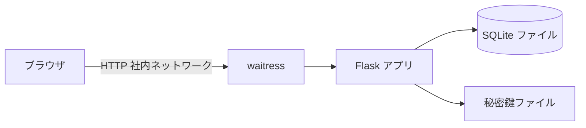
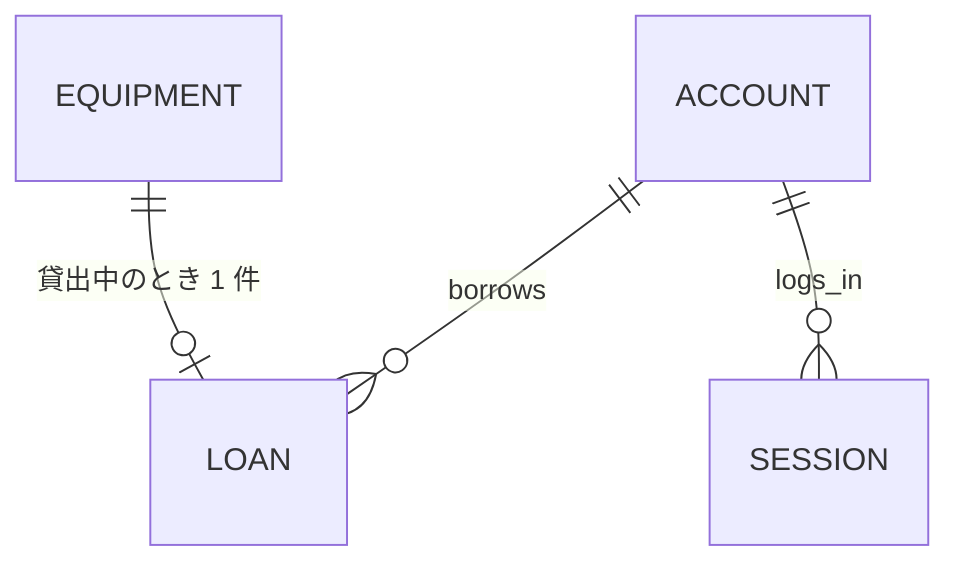
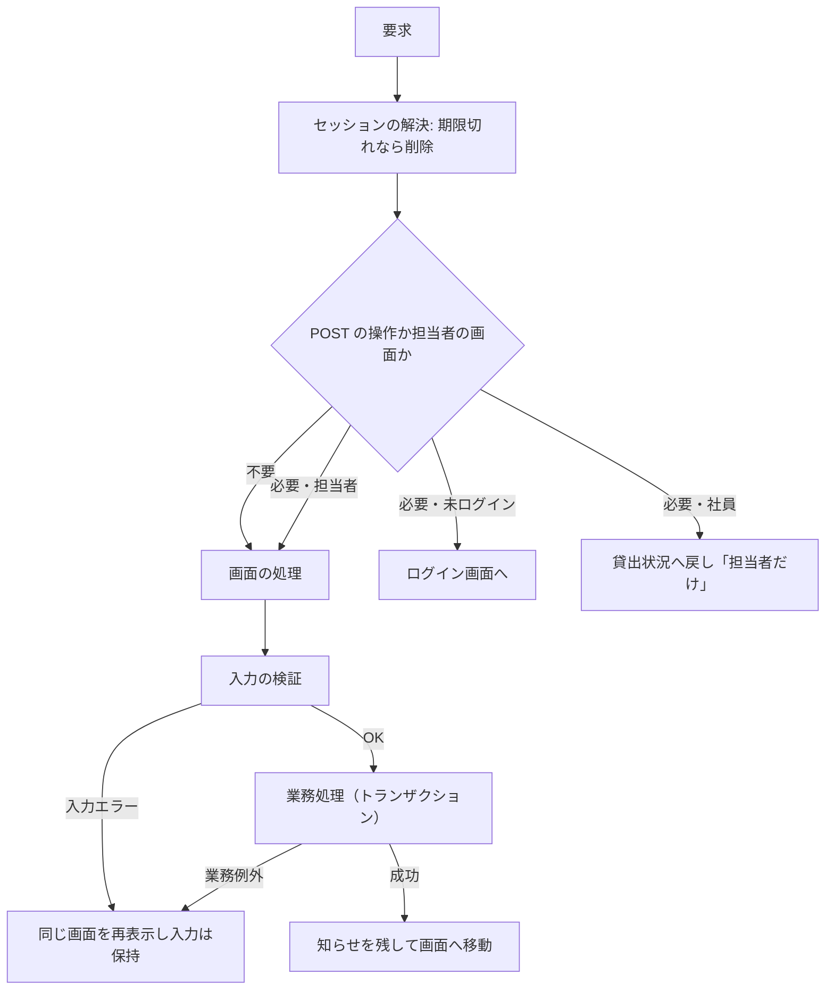
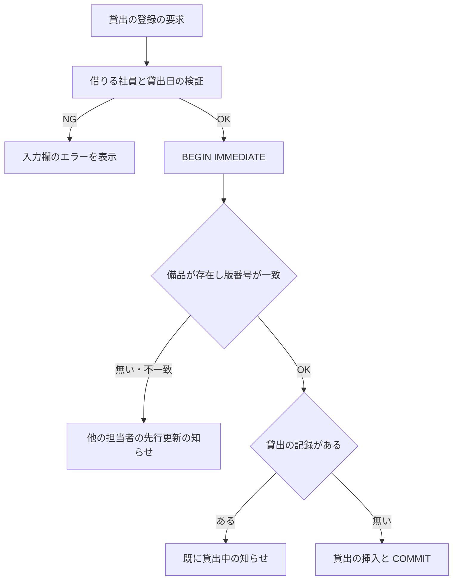
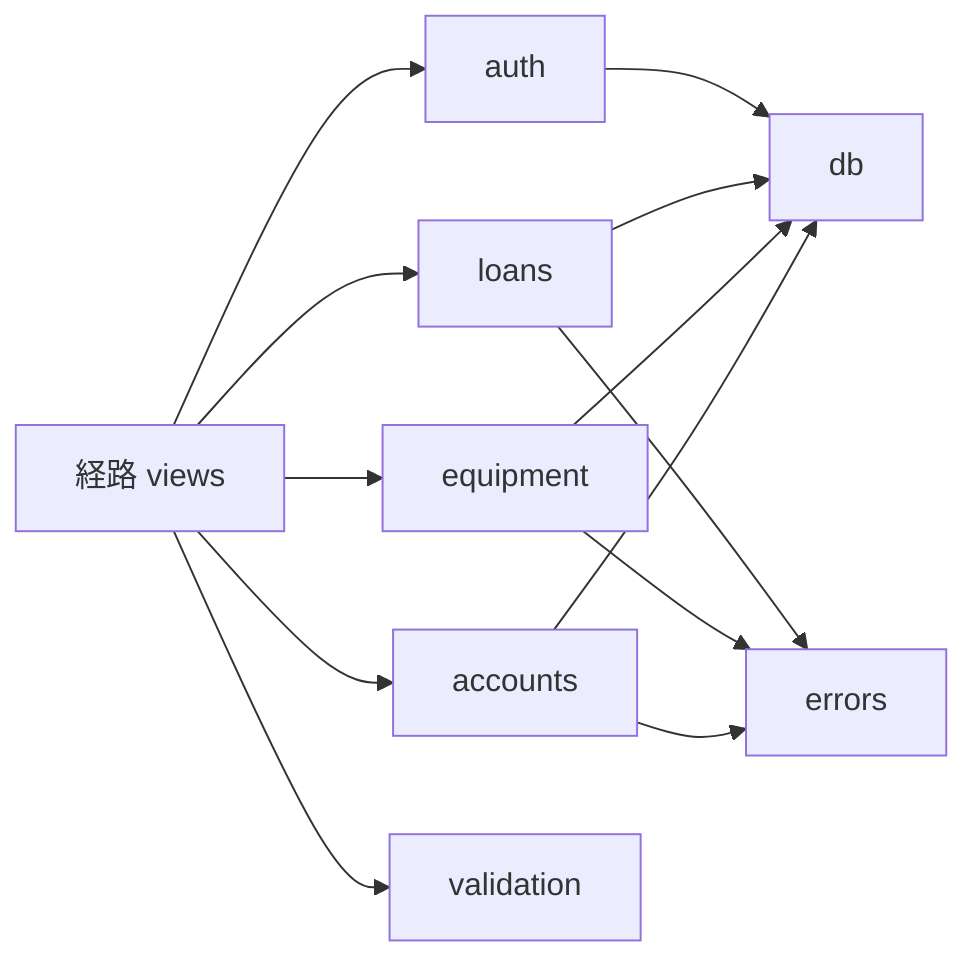

# 詳細設計書: 備品台帳と貸出状況の閲覧

作成日: 2026-11-04。要件定義書 `docs/requirements.md` に対応する。承認は ANSWERS.md の固定回答により 2026-11-04 に得たものとする。

## 1. 言語・フレームワーク・アーキテクチャの選定

### 1-1. 判定の記録

- 判定日時: 2026-11-04 01:10（JST）
- 技術制約の要約: 既存コード無し。社内の Linux サーバーで `bash run.sh` により直接起動する。コンテナは使わない。無償のものだけ。Python 3.12 と SQLite で足りる。利用者 50 人、備品数百件、アカウント 50 件まで。認証は社員番号とパスワード、ロールは担当者と社員の 2 つ（未ログインを加えて 3 つ）、無操作 30 分で自動ログアウト。

### 1-2. 判断軸

| 判断軸 | 見るもの | この案件での該当 | 効き方 |
|---|---|---|---|
| 既存資産との整合 | 既存コード | 無し | 該当しない |
| チームの技術 | 扱える言語 | 決まり無し。Python 3.12 を使う | Python 系の候補に絞る |
| 配備先 | OS、コンテナ、直接起動 | Linux で直接起動。コンテナ不要 | 直接起動できる候補 |
| 認証と認可の境界 | 認証方式、認可の単位 | 社員番号とパスワード。ボタン単位と操作単位の拒否 | 認可を 1 箇所（要求の入口）に集められる構成 |
| 画面の規模 | 画面数、遷移 | 7 画面。サーバーで描画する単純な遷移 | サーバー描画のテンプレート |
| データの規模と構造 | 件数、同時更新 | 数百件、50 人、同時更新あり（記録を失わない） | 本格的な RDB は不要。同時更新を直列化できる SQLite |
| 外部連携 | 外部 API | 無し | 該当しない |
| ライセンスとコスト | 有償、ライセンス | 無償のみ | OSS の候補 |
| 保守性 | 保守状況 | 2026 年時点で保守中の候補のみ | 最新版の確認 |

### 1-3. 候補の比較

| 区分 | 候補 | 判断軸ごとの評価 | 出典 URL | 確認日 |
|---|---|---|---|---|
| Web フレームワーク | Flask 3.1.3（BSD-3-Clause） | テンプレートの自動エスケープ、フォームとリダイレクトの標準的な書き方、チームの扱いやすさ。PyPI で 2026-02-19 公開の安定版 | https://pypi.org/project/Flask/ 、https://flask.palletsprojects.com/ | 2026-11-04 |
| Web フレームワーク | Django 5.x（BSD-3-Clause） | 管理画面と ORM が揃うが、この規模には機能が多すぎる。マイグレーションの仕組みが必要 | https://www.djangoproject.com/ | 2026-11-04（比較のため候補として挙げるのみ。不採用） |
| Web フレームワーク | Python 標準ライブラリ（http.server） | 依存は無いが、フォーム解析、認証、エスケープを自前で作る必要があり、不具合の余地が大きい | https://docs.python.org/3.12/library/http.server.html | 2026-11-04（不採用） |
| WSGI サーバー | waitress 3.0.2（ZPL-2.1） | 純 Python で Linux と macOS で動く。複数スレッドで 50 人程度に足りる。PyPI で 2024-11-16 公開の安定版 | https://pypi.org/project/waitress/ 、https://github.com/Pylons/waitress | 2026-11-04 |
| データベース | SQLite（Python 標準の sqlite3） | 同時更新を `BEGIN IMMEDIATE` で直列化できる。ファイル 1 つで足り、運用が要らない。Python 3.12 に同梱 | https://docs.python.org/3.12/library/sqlite3.html | 2026-11-04 |
| パスワードのハッシュ | Werkzeug の `generate_password_hash`（Flask の依存。scrypt）| 標準の方式で、追加の依存が要らない | https://pypi.org/project/Werkzeug/ | 2026-11-04 |
| E2E 実行（テスト） | pytest 9.2.0（MIT）+ Playwright for Python 1.64.1（Apache-2.0） | 実際のブラウザで画面を操作し、JUnit XML を出せる。PyPI で pytest は 2026-10-27、Playwright は 2026-10-22 公開 | https://pypi.org/project/pytest/ 、https://pypi.org/project/playwright/ | 2026-11-04 |

### 1-4. 選定結果

| 項目 | 選定 |
|---|---|
| 言語 | Python 3.12 |
| フレームワーク | Flask 3.1.3 |
| WSGI サーバー | waitress 3.0.2 |
| データベース | SQLite（標準 sqlite3） |
| 実行形態 | サーバー（Linux）で直接起動。コンテナは使わない |
| テスト | 単体テストは pytest（標準の `unittest` の形で書いてもよいが、本設計では pytest）。E2E は pytest と Playwright |

選定理由: 要件定義書 1-1 の技術制約（無償、直接起動、Python 3.12 と SQLite）と、画面 7 つ・同時更新の直列化・認可の入口の集約（要求の入口で役割を判定する）に合うため。

### 1-5. 承認

ANSWERS.md の「技術選定: 推奨の案でよい。Python の無償のフレームワークと SQLite」により、2026-11-04 に承認。

## 2. システム構成

### 2-1. コンポーネント一覧

| コンポーネント | 役割 | 配置 |
|---|---|---|
| ブラウザ | 画面の表示と操作（社内ネットワークから） | 利用者の PC |
| waitress（WSGI サーバー） | HTTP を受け、Flask アプリに渡す。スレッド数 16 | 社内サーバー |
| Flask アプリ（`app` パッケージ） | 画面の処理、認証、業務ルールの判定、データの読み書き | 社内サーバー |
| SQLite ファイル | 備品、貸出、アカウント、セッションの保存 | `DATA_DIR` の下の `isdd.sqlite3` |
| 秘密鍵ファイル | Flask の署名付き cookie（フラッシュメッセージ用）の鍵 | `DATA_DIR` の下の `secret_key` |

### 2-2. システム全体構成図



### 2-3. 各コンポーネントの役割とインターフェース

- 画面の要求は Flask の経路（画面ごとの関数）で受ける。経路の関数は、役割の判定（認可）と入力の検証を行ったあと、業務処理の関数を呼ぶ。
- 業務処理の関数は、データベースの読み書きを 1 つのトランザクションで行い、業務ルール違反は業務例外（`RuleViolation`）で返す。
- 画面は業務例外を入力欄のエラー、画面全体のエラー、操作の知らせのどれかに振り分けて表示する。

### 2-4. ネットワーク構成図

ネットワーク越しの通信はブラウザと社内サーバーの間の HTTP だけ。外部連携は無い。構成図は 2-2 の全体構成図と同じ。

## 3. データ設計

### 3-1. データモデル

DB が必要な理由: 複数の担当者が同時に更新しても記録を失わないため（要件 `RQ-DT-DATABASE-REQUIRED`）。SQLite を使う。第 1 章の選定結果による。



#### テーブル: アカウント（`accounts`）

| カラム | 型 | 制約 | 対応する項目 |
|---|---|---|---|
| employee_number | TEXT | 主キー。半角数字 6 桁（CHECK） | 社員番号 |
| name | TEXT | NOT NULL。1 文字以上 30 文字以内（アプリで検証） | 名前 |
| password_hash | TEXT | NOT NULL | パスワードのハッシュ（平文は保存しない） |
| is_manager | INTEGER | NOT NULL。0 か 1 | 役割（1 が担当者） |

#### テーブル: 備品（`equipment`）

| カラム | 型 | 制約 | 対応する項目 |
|---|---|---|---|
| equipment_number | TEXT | 主キー。半角英数字とハイフン 20 文字以内（アプリで検証） | 管理番号 |
| name | TEXT | NOT NULL。50 文字以内 | 備品名 |
| version | INTEGER | NOT NULL。1 から始まり、修正のたびに 1 増やす | 同時更新の検出に使う |

#### テーブル: 貸出（`loans`）

| カラム | 型 | 制約 | 対応する項目 |
|---|---|---|---|
| equipment_number | TEXT | 主キー（備品ごとに貸出中の記録は 1 件）。備品への外部キー | 管理番号 |
| borrower_employee_number | TEXT | NOT NULL。アカウントへの外部キー | 借りる社員の社員番号 |
| lent_on | TEXT | NOT NULL。YYYY-MM-DD | 貸出日 |

返却と備品の削除で行を消す。履歴の表は作らない（`RQ-DT-NO-HISTORY`）。

#### テーブル: セッション（`sessions`）

| カラム | 型 | 制約 | 対応する項目 |
|---|---|---|---|
| token | TEXT | 主キー。推測されないランダムな文字列（32 バイトを URL 安全な文字で表す） | ログイン中の識別子（cookie と一致） |
| employee_number | TEXT | NOT NULL。アカウントへの外部キー | ログインしている社員 |
| last_seen | REAL | NOT NULL。最後に操作した時刻（UNIX 時刻、秒） | 無操作の判定 |

セッションは行を消すことでログアウトになる。ログインしている社員のアカウントは、削除前に、その社員のセッションを消す。

### 3-2. トランザクションと排他制御

接続ごとに `PRAGMA foreign_keys = ON`、`PRAGMA busy_timeout = 5000`、`PRAGMA journal_mode = WAL` を設定する。書き込みを伴う操作は、すべて `BEGIN IMMEDIATE` で始まる 1 つのトランザクションで行い、確定（COMMIT）か取り消し（ROLLBACK）で終わる。

| 操作 | トランザクションの範囲 | ロールバックの条件 | 排他制御 |
|---|---|---|---|
| アカウント登録 | 件数の確認、役割の決定、挿入 | 社員番号の重複（一意制約違反）、業務ルール違反 | 書き込みロックで直列化する。最初の登録者の判定もこの中で行う |
| 担当者の付け外し | 担当者数の確認、役割の更新 | 担当者が 0 人になる | 書き込みロックで直列化する |
| パスワードの再設定 | ハッシュの更新 | 入力の不正 | 書き込みロックで直列化する |
| アカウントの削除 | 貸出の確認、セッションの削除、担当者数の確認、アカウントの削除 | 借りている社員、担当者が 0 人になる | 書き込みロックで直列化する |
| 備品の登録 | 管理番号の重複確認、挿入 | 一意制約違反 | 書き込みロックで直列化する |
| 備品の修正・削除 | 版番号の確認、更新または削除、貸出の確認（削除時）、貸出の付け替え（修正で管理番号を変えたとき。同じトランザクションで `loans` の管理番号も書き換える） | 版番号の不一致（他の担当者が先に更新または削除）、貸出中（削除時）、管理番号の重複 | 版番号による楽観的排他制御。書き込みロックで確認と更新を 1 つにする |
| 貸出の登録 | 備品の存在と版番号の確認、貸出の挿入 | 版番号の不一致、貸出中（一意制約違反） | 書き込みロック、主キーの一意制約 |
| 返却の登録 | 備品の版番号の確認、貸出の削除 | 版番号の不一致、貸出の記録が無い（返却済み） | 書き込みロック |

### 3-3. 状態遷移

備品の貸出状態は `loans` の行の有無で持つ（行が無い = 空き、行がある = 貸出中）。

| 遷移 | 状態の持ち方 | 遷移を行う処理 | 許されない遷移の扱い |
|---|---|---|---|
| 空き → 貸出中 | `loans` に行を挿入する | 貸出の登録（`lend_equipment`） | 既に行がある場合は「この備品は既に貸出中です」（画面の知らせ） |
| 貸出中 → 空き | `loans` の行を削除する | 返却の登録（`return_equipment`） | 行が無い場合は「この備品は既に返却されています」（画面の知らせ） |

状態を持つエンティティは備品の貸出状態だけ。

## 4. アーキテクチャ設計

### 4-1. 外部設計

#### 利用者向けインターフェース（画面）

| 経路 | 画面 | 利用者 |
|---|---|---|
| GET `/` | 貸出状況（トップ） | 誰でも |
| GET・POST `/accounts/register/` | アカウント登録 | 誰でも |
| GET・POST `/login/` | ログイン | 誰でも |
| POST `/logout/` | ログアウト（ボタン） | ログイン中の人 |
| GET・POST `/equipment/new/` | 備品の登録 | 担当者 |
| GET・POST `/equipment/<管理番号>/edit/` | 備品の修正 | 担当者 |
| POST `/equipment/<管理番号>/delete/` | 備品の削除（確認ダイアログで「はい」） | 担当者 |
| GET・POST `/equipment/<管理番号>/lend/` | 貸出の登録 | 担当者 |
| POST `/equipment/<管理番号>/return/` | 返却の登録（確認ダイアログで「はい」） | 担当者 |
| GET `/accounts/` | アカウントの一覧（`?reset=<社員番号>` で再設定の入力欄を出す） | 担当者 |
| POST `/accounts/<社員番号>/manager/` | 担当者の付け外し（フォームの値 `grant` か `revoke`。確認ダイアログで「はい」） | 担当者 |
| POST `/accounts/<社員番号>/password/` | パスワード再設定の確定 | 担当者 |
| POST `/accounts/<社員番号>/delete/` | アカウントの削除（確認ダイアログで「はい」） | 担当者 |

すべての POST は、要求の入口で役割を判定する（担当者以外は拒否）。未ログインは `/login/` へ移す。

#### 画面の 5 項目

| 画面 | 目的 | 主要要素 | 入力項目 | 表示項目 | エラー時の見え方 |
|---|---|---|---|---|---|
| 貸出状況 | 備品の貸出状況を見る | `tbody` の行。ログイン中なら `.current-user` と「ログアウト」。未ログインなら「ログイン」「アカウント登録」のリンク。担当者なら「備品を登録」「アカウントの一覧」のリンクと行の「修正」「削除」「貸出」「返却」 | なし | 管理番号、備品名、「空き」か「貸出中」、借りている社員の名前、貸出日（管理番号の昇順） | 担当者以外の操作の要求は、この画面に「この操作は担当者だけが行えます」を `.message` に出す |
| アカウント登録 | 社員が自分のアカウントを登録する | 「登録」ボタン | 社員番号、名前、パスワード | なし | 入力欄ごとのエラーを `.field-error` に出す。入力した値は消さない |
| ログイン | 社員番号とパスワードでログインする | 「ログイン」ボタン | 社員番号、パスワード | なし | 「社員番号またはパスワードが違います」を `.error` に出す。どちらが違うかは示さない |
| 備品の登録 | 担当者が備品を登録する | 「保存」ボタン | 管理番号、備品名 | なし | 入力欄ごとのエラー。管理番号の重複も入力欄 |
| 備品の修正 | 担当者が備品を修正する（備品の登録と同じ部品） | 「保存」ボタン | 管理番号、備品名（現在の値）、版番号（隠し欄） | なし | 入力欄のエラー。他の担当者の先行更新は `.error` |
| 貸出の登録 | 担当者が備品を社員に貸し出す | `.lending-equipment`、「登録」ボタン | 借りる社員（`select`）、貸出日（`date`、既定は今日）、版番号（隠し欄） | 「備品: 管理番号 備品名」 | 入力欄のエラーは `.field-error`。状態の知らせは `.message`。先行更新は `.error` |
| アカウントの一覧 | 担当者がアカウントを管理する | 行の「担当者にする」「担当者から外す」「パスワード再設定」「削除」。再設定時は入力欄と「確定」 | 再設定の新しいパスワード | 社員番号、名前、役割（担当者か社員） | 知らせは `.message`。再設定の入力エラーは `.field-error` |

#### 入力の検証（入力欄ごとのエラー）

| 入力 | 規則 | 文言 |
|---|---|---|
| 社員番号 | 前後の空白を除いて、半角数字 6 桁 | 社員番号は 6 桁の数字で入力してください |
| 名前（アカウント） | 前後の空白を除いて 1 文字以上 30 文字以内 | 空: 名前を入力してください。長い: 名前は 30 文字以内で入力してください |
| パスワード | 8 文字以上（空白は除かない） | パスワードは 8 文字以上で入力してください |
| 管理番号 | 半角英数字とハイフンだけで 1 文字以上 20 文字以内 | 管理番号は半角の英数字とハイフンで 20 文字以内で入力してください |
| 備品名 | 前後の空白を除いて 1 文字以上 50 文字以内 | 空: 備品名を入力してください。長い: 備品名は 50 文字以内で入力してください |
| 借りる社員 | 選択されている | 借りる社員を選んでください |
| 貸出日 | YYYY-MM-DD の日付で、今日（日本時間）以前 | 形式違い: 貸出日は日付で入力してください。未来: 貸出日に未来の日付は入力できません |

業務ルールのエラーは 3-2 の業務規則（要件定義書 3-2）と文言を一致させ、次の表で振り分ける。

| 業務ルール | 表示先 | 文言 |
|---|---|---|
| 社員番号の重複 | 入力欄（社員番号） | この社員番号は既に登録されています |
| 管理番号の重複 | 入力欄（管理番号） | この管理番号は既に使われています |
| 担当者 0 人になる | `.message` | 担当者が 1 人もいなくなるため、この操作はできません |
| 借りている社員の削除 | `.message` | この社員は備品を借りているため削除できません。先に返却を処理してください |
| 貸出中の削除 | `.message` | この備品は貸出中のため削除できません。先に返却を処理してください |
| 貸出中の貸出 | `.message` | この備品は既に貸出中です |
| 返却済みの返却 | `.message` | この備品は既に返却されています |
| 他の担当者の先行更新・削除 | `.error` | 他の担当者が先にこの備品を更新しました。貸出状況の画面から開き直してください |
| 担当者以外の操作 | 貸出状況の画面の `.message`（未ログインはログイン画面へ） | この操作は担当者だけが行えます |

成功時の知らせ（`.message`）: 登録後の貸出状況の画面で備品登録・修正・削除・貸出・返却の完了を示す文（「備品を登録しました」など）。アカウント登録の成功は、ログイン画面の `.message` に「登録しました。ログインしてください」を出す。

#### 外部連携

外部連携は無い。

#### 帳票・出力

帳票・出力ファイルは無い。

### 4-2. 内部設計

#### 処理フロー（経路の共通処理）



#### 貸出の登録の処理フロー



返却も同じ構成で、貸出の記録の削除と「既に返却済み」の判定を行う。

#### 各処理の役割

| 処理 | 役割 |
|---|---|
| セッションの解決 | cookie の識別子でセッションを探す。最後の操作から設定秒数（既定 1800 秒）を過ぎていたら削除して未ログインにする。過ぎていなければ最後の操作の時刻を更新する |
| 役割の判定 | 担当者でなければ拒否する（`RuleViolation` ではなく、担当者以外の知らせを返す） |
| 入力の検証 | 3 章の規則に従い、入力欄ごとのエラーを返す |
| アカウント登録 | 社員番号の重複を確かめ、件数が 0 件なら担当者、それ以外は社員として挿入する。パスワードはハッシュにする |
| 認証 | 社員番号でアカウントを探し、パスワードのハッシュを照合する。社員番号が無い場合も同じ時間で照合を行い、どちらが違うかを区別しない |
| 備品の登録・修正・削除 | 版番号による排他制御と業務ルールを行う |
| 貸出状況の一覧 | 備品と貸出の記録を結合し、管理番号の昇順で返す |

### 4-3. 外部 DB 連携

無し。

## 5. クラス設計

本システムは関数で構成し、業務例外を 1 つのクラスで表す（クラス図は不要）。

| クラス | 責務（1 文） |
|---|---|
| `RuleViolation` | 業務ルール違反を、入力欄（任意）と文言とともに業務処理から呼び出し側へ伝える |

- クラス間の依存の向きは、経路（views）→ 業務処理（accounts、equipment、loans）→ 共通（db、errors、timeutil、validation、auth）の一方向。
- メッセージ（システム内）: 経路の関数から業務処理の関数への呼び出しだけ。非同期のメッセージは無い。



## 6. エラーハンドリングとセキュリティ設計

### 6-1. エラーハンドリング

| 想定エラー | 利用者への見え方 | ログ | 扱い |
|---|---|---|---|
| 入力の不正 | 入力欄の `.field-error`。入力値は保持 | 無し | 再表示 |
| 業務ルール違反 | 3 章の表のとおり | 無し | 変更せず再表示 |
| 版番号の不一致 | `.error` | 無し | 変更しない |
| 予期しない例外 | 500 のエラーページ（Flask の標準） | 標準のエラーログ（waitress の出力） | 処理を中止し、取り消す |
| データベースのロック待ち超過 | 500 のエラーページ | 標準のエラーログ | 取り消す（busy_timeout 5 秒を超えた場合） |

ログは要件 `RQ-OP` のとおり必要ないため、業務ログは書かない（標準のエラーログだけ）。

### 6-2. 認証

方式: 社員番号とパスワード（SSO は無い）。パスワードは Werkzeug の scrypt 形式のハッシュで保存する。ログイン成功時にランダムなトークンをセッションに保存し、cookie（名前 `isdd_session`、HttpOnly、SameSite=Lax）で渡す。ログアウトはセッションの削除。無操作は設定秒数で切れる。

### 6-3. 認可

| 操作 | 未ログイン | 社員 | 担当者 |
|---|---|---|---|
| 貸出状況の閲覧 | 可 | 可 | 可 |
| アカウント登録・ログイン | 可 | 可（ログイン後は登録画面へ直接の操作は不要） | 可 |
| ログアウト | 不可（ログイン画面へ） | 可 | 可 |
| 備品の登録・修正・削除、貸出・返却 | 不可（ログイン画面へ） | 不可（貸出状況へ戻し「担当者だけ」） | 可 |
| アカウントの一覧・担当者の付け外し・パスワード再設定・アカウントの削除 | 不可（ログイン画面へ） | 不可（貸出状況へ戻し「担当者だけ」） | 可 |

認可の単位はボタン（表示の出し分け）と経路（要求の拒否）の両方。表示の出し分けは、担当者の判定と同じ値を使う。

### 6-4. 監査ログ

無し（要件の運用で不要とされている）。

### 6-5. その他のセキュリティ対策

- 社内ネットワークからだけ開く（運用で守る。`DS-OP-RUN-SCRIPT`）。
- SQL は必ずパラメータで渡す（文字列連結をしない）。
- 画面の値は Jinja2 の自動エスケープで出す。
- 秘密鍵（フラッシュメッセージ用）は初回起動時に生成し、`DATA_DIR` の `secret_key` に保存する。
- 状態を変える操作はすべて POST にする。

## 7. コード設計

### 7-1. ディレクトリ構成

```
app/          アプリ本体（Python パッケージ）
app/templates/  画面のテンプレート
e2e/          E2E テスト（pytest + Playwright）
tests/        単体テスト（pytest）
docs/         設計書、要件定義書、対応表
run.sh        起動スクリプト
setup.sh      準備スクリプト（仮想環境と依存の導入）
requirements.txt  実行時の依存（固定版）
```

### 7-2. ファイル一覧

| ファイル | 役割 | 含まれる関数・クラス | 実現する設計 ID |
|---|---|---|---|
| `app/__init__.py` | アプリの組み立て（起動時の初期化） | `create_app` | `DS-MD-APP-INIT`、`DS-FN-CREATE-APP` |
| `app/config.py` | 環境変数の読み取りと秘密鍵の準備 | `load_config`、`load_or_create_secret_key` | `DS-MD-CONFIG`、`DS-FN-LOAD-CONFIG`、`DS-FN-LOAD-SECRET-KEY` |
| `app/db.py` | SQLite の接続と表の作成（表の定義は SCHEMA の文字列。DS-SC-* は表の定義として本文に書き、対応表には載せない） | `connect`、`init_schema` | `DS-MD-DB`、`DS-FN-CONNECT-DATABASE`、`DS-FN-INIT-SCHEMA` |
| `app/timeutil.py` | 日本時間の今日 | `today_jst` | `DS-MD-TIMEUTIL`、`DS-FN-TODAY-JST` |
| `app/errors.py` | 業務ルール違反の例外 | `RuleViolation` | `DS-MD-ERRORS`、`DS-CL-RULE-VIOLATION` |
| `app/validation.py` | 入力の検証 | `validate_account_input`、`validate_password`、`validate_equipment_input`、`validate_lent_on` | `DS-MD-VALIDATION`、`DS-FN-VALIDATE-ACCOUNT-INPUT`、`DS-FN-VALIDATE-PASSWORD`、`DS-FN-VALIDATE-EQUIPMENT-INPUT`、`DS-FN-VALIDATE-LENT-ON` |
| `app/auth.py` | セッション、ログイン状態、役割の判定 | `create_session`、`resolve_session_user`、`delete_session`、`require_manager` | `DS-MD-AUTH`、`DS-FN-CREATE-SESSION`、`DS-FN-RESOLVE-SESSION-USER`、`DS-FN-DELETE-SESSION`、`DS-FN-REQUIRE-MANAGER` |
| `app/accounts.py` | アカウントの業務処理 | `register_account`、`authenticate`、`list_accounts`、`set_manager_role`、`reset_password`、`delete_account` | `DS-MD-ACCOUNTS`、`DS-FN-REGISTER-ACCOUNT`、`DS-FN-AUTHENTICATE`、`DS-FN-LIST-ACCOUNTS`、`DS-FN-SET-MANAGER-ROLE`、`DS-FN-RESET-PASSWORD`、`DS-FN-DELETE-ACCOUNT` |
| `app/equipment.py` | 備品の業務処理と貸出状況の一覧 | `create_equipment`、`get_equipment`、`update_equipment`、`delete_equipment`、`list_lending_status` | `DS-MD-EQUIPMENT`、`DS-FN-CREATE-EQUIPMENT`、`DS-FN-GET-EQUIPMENT`、`DS-FN-UPDATE-EQUIPMENT`、`DS-FN-DELETE-EQUIPMENT`、`DS-FN-LIST-LENDING-STATUS` |
| `app/loans.py` | 貸出と返却の業務処理 | `lend_equipment`、`return_equipment` | `DS-MD-LOANS`、`DS-FN-LEND-EQUIPMENT`、`DS-FN-RETURN-EQUIPMENT` |
| `app/views.py` | 画面の経路と画面の処理 | `lending_status`、`account_register`、`login`、`logout`、`equipment_new`、`equipment_edit`、`equipment_delete`、`lend`、`return_equipment_view`、`account_list`、`account_manager`、`account_password`、`account_delete` | `DS-MD-VIEWS`、`DS-IF-LENDING-STATUS-SCREEN`、`DS-IF-ACCOUNT-REGISTER-SCREEN`、`DS-IF-LOGIN-SCREEN`、`DS-IF-LOGOUT-ACTION`、`DS-IF-EQUIPMENT-NEW-SCREEN`、`DS-IF-EQUIPMENT-EDIT-SCREEN`、`DS-IF-EQUIPMENT-DELETE-ACTION`、`DS-IF-LEND-SCREEN`、`DS-IF-RETURN-ACTION`、`DS-IF-ACCOUNT-LIST-SCREEN`、`DS-IF-ACCOUNT-MANAGER-ACTION`、`DS-IF-ACCOUNT-PASSWORD-ACTION`、`DS-IF-ACCOUNT-DELETE-ACTION` |
| `app/templates/base.html` | 共通の枠、知らせ欄、ログイン状態の表示 | なし | `DS-MD-TPL-BASE` |
| `app/templates/status.html` | 貸出状況の画面 | なし | `DS-MD-TPL-STATUS` |
| `app/templates/login.html` | ログインの画面 | なし | `DS-MD-TPL-LOGIN` |
| `app/templates/account_register.html` | アカウント登録の画面 | なし | `DS-MD-TPL-ACCOUNT-REGISTER` |
| `app/templates/account_list.html` | アカウントの一覧 | なし | `DS-MD-TPL-ACCOUNT-LIST` |
| `app/templates/equipment_form.html` | 備品の登録・修正の画面 | なし | `DS-MD-TPL-EQUIPMENT-FORM` |
| `app/templates/lend_form.html` | 貸出の登録の画面 | なし | `DS-MD-TPL-LEND-FORM` |

- 関数の名前は対応表（`docs/trace_map.md`）と一致させる。
- 業務処理の関数は、引数に接続（`sqlite3.Connection`）と値を受け取り、結果か `RuleViolation` を返す。
- 対応表の粒度: `function`（既定）。関数ごとに DS-ID を付ける。
- 依存の規則: 無い（層の依存は 5 章の一方向の規則に従うが、機械で確かめる規則は書かない）。

### 7-3. コーディング規約

- 標準的な Python の書き方（PEP 8 の範囲）。型注釈を付ける。
- 関数の説明は通常のドキュメントコメント（処理の説明、引数、戻り値）。ID は書かない。
- 文字列の定数（業務の文言）は `app/validation.py` と各業務処理の関数に、設計書の文言のとおりに書く。

## 8. テスト設計

### 8-1. テストの種類と方針

- 単体テスト（`tests/`）: 検証関数（`app/validation.py`）、認証と業務処理（`app/accounts.py`、`app/equipment.py`、`app/loans.py`）を、テスト用の一時的な SQLite で確かめる。実行: `.venv/bin/python -m pytest tests`
- 結合テスト: 単体テストの業務処理を、画面の経路を通した呼び出しで確かめる（Flask のテストクライアント）。E2E と重複するため、E2E の結果で代用する。
- 総合テスト（E2E）: 8-2 の利用シナリオを、実際のブラウザで確かめる。
- 非機能要件の検証: 同時 50 人の表示時間は `DS-TS-PERFORMANCE-50-USERS` で確かめる。
- テストの失敗は修正と再実行を繰り返し、全件通過まで続ける。

### 8-2. E2E テストのシナリオ

要件定義書第 7 章のシナリオと 1 対 1 に対応する。E2E は `e2e/` の pytest テストで、テスト開始時に `run.sh` と同じ起動（`waitress` と `create_app`）をテスト用の `PORT` と一時の `DATA_DIR` で行う。

| DS-ID | 目的 | 前提条件 | 手順 | 期待結果 |
|---|---|---|---|---|
| `DS-TS-REGISTER-FIRST-MANAGER` | 最初の登録者が担当者になり、2 件目が社員になる | 空の `DATA_DIR` | 100001 を登録し、100002 を登録し、担当者として一覧を開く | 100001 は担当者、100002 は社員。登録後のログイン画面に「登録しました。ログインしてください」 |
| `DS-TS-REGISTER-ACCOUNT-VALIDATION` | アカウント登録の入力チェック | 空の `DATA_DIR` | 12345、名前が空、名前 31 文字、パスワード 7 文字、社員番号の重複を入力する | 入力欄ごとに `.field-error` の完全一致の文言。入力値は消えない |
| `DS-TS-LOGIN-LOGOUT` | ログインとログアウト、失敗時の表示 | 担当者が登録済み | 誤った社員番号、誤ったパスワードでログインし、正しく入ってからログアウトする | 失敗は `.error` に同じ文言。成功時は `.current-user` に名前。ログアウト後は未ログインの表示 |
| `DS-TS-IDLE-LOGOUT` | 無操作での自動ログアウト | `SESSION_IDLE_TIMEOUT_SECONDS=3` で起動 | ログインし、4 秒以上操作しない。その後に担当者の操作を要求する | 自動でログアウトされ、要求はログイン画面へ移る |
| `DS-TS-ROLE-CHECK` | 出し分けと要求の拒否 | 担当者と社員が登録済み | 未ログインと社員で、ボタンとリンクの有無を見る。担当者の画面に直接アクセスし、POST で備品の登録を要求する。最後に担当者でログインし、貸出状況にリンク「備品を登録」が 1 件出ることを確かめる | 出し分けが正しい。拒否は `.message` の「この操作は担当者だけが行えます」（未ログインはログイン画面） |
| `DS-TS-REGISTER-EQUIPMENT` | 備品の登録と入力チェック | 担当者でログイン済み | EQ-0001 と「ノートPC」を登録し、形式違い、備品名 51 文字、管理番号の重複を入力する | 登録後は「空き」で表示。入力エラーは `.field-error` の完全一致の文言 |
| `DS-TS-EDIT-EQUIPMENT` | 修正と同時更新の検出 | 備品 1 件。担当者 2 人 | 担当者 A が修正の画面を開く。担当者 B が先に保存する。担当者 A が保存する | A の保存は行われず、`.error` に完全一致の文言 |
| `DS-TS-EDIT-KEEPS-LOAN` | 貸出中の備品の修正で、貸出が引き継がれる | 備品 1 件を社員に貸出中。担当者 1 人 | 担当者が修正の画面で管理番号を変えて保存する。貸出状況の画面を見る | 保存は成功。新しい管理番号の行が貸出中で、借りている社員の名前と貸出日が残る |
| `DS-TS-DELETE-EQUIPMENT` | 削除と貸出中の削除の禁止 | 備品 2 件、うち 1 件を貸出中 | 貸出中の備品を削除する（確認で「はい」）。空きの備品を削除する | 貸出中は拒否の `.message`。空きは一覧から消える |
| `DS-TS-LEND-RETURN` | 貸出と返却、禁止事項 | 空きの備品 1 件、社員 1 人 | 借りる社員を未選択で登録。未来の貸出日で登録。正しく登録。同じ備品にもう一度登録。返却。返却済みの備品に返却 | 各文言の完全一致。貸出後は「貸出中」と名前と貸出日。返却後は「空き」 |
| `DS-TS-VIEW-LENDING-STATUS` | 未ログインでの閲覧と並び順 | 備品 3 件（登録順と管理番号の順は異なる）、1 件を貸出中 | 未ログインで開く。備品 0 件の表示も確かめる | 管理番号の昇順。0 件は「備品は登録されていません」 |
| `DS-TS-ACCOUNT-LIST-MANAGE` | 担当者の付け外し、パスワード再設定、アカウント削除 | 担当者 100001、社員 100002 | 100002 を担当者にする。100001 を外す（担当者が 1 人になる時点で、残りの担当者を外す操作を試す）。パスワードを 7 文字と 8 文字で再設定する。貸出中の社員を削除する | 担当者 0 人の操作は拒否。再設定の 7 文字は `.field-error`、8 文字で成功。貸出中の社員の削除は拒否 |
| `DS-TS-PERFORMANCE-50-USERS` | 同時 50 人での表示時間 | 備品 500 件、アカウント 50 件 | 50 並列で貸出状況を開き、各表示時間を計る | 全件 3 秒以内 |

### 8-3. E2E の実行手段

- 実行手段: Playwright for Python（同期 API）で Chromium を操作し、pytest で実行する（ローカルで直接実行）。
- 使用するバージョン: pytest 9.2.0、Playwright 1.64.1。ブラウザは `playwright install chromium` で 1 回だけ取得する（`e2e/requirements-e2e.txt` に版を書く）。
- 承認: ANSWERS.md の「E2E の実行手段: ローカルで直接実行」により 2026-11-04 に承認。

### 8-4. E2E の実行コマンドと運用

- 実行コマンド（プロジェクトルートで）: `.venv/bin/python -m pytest e2e --junitxml=e2e/results/e2e.xml`
- 結果の出力先: `e2e/results/`（git 管理外）。
- テスト資産は `e2e/` の下。`DS-TS-*` は対応表の `DS-TS` の行でテスト関数（`e2e/test_scenarios.py::test_...`）に結ぶ。
- 外部連携が無いため、モックのモードは無い。
- 実装時・ CI の必須ゴールは E2E の全件通過。
- テストが失敗したら修正と再実行を繰り返し、全件通過まで続ける。

## 9. 運用設計

### 9-1. 起動

- 準備（1 回だけ）: `bash setup.sh`。Python 3.12 で仮想環境 `.venv` を作り、`requirements.txt` の版を入れる。
- 起動: `bash run.sh`。`.venv/bin/waitress-serve --host 0.0.0.0 --port "$PORT" --threads 16 --call app:create_app` を実行する。
- 初期化: 起動時に `DATA_DIR` の SQLite ファイルと表を作る（無ければ）。初期ユーザーは無い（最初の登録者が担当者になる）。

| DS-ID | 内容 |
|---|---|
| `DS-OP-SETUP-SCRIPT` | `setup.sh`。仮想環境の作成と依存の導入。`requirements.txt` は固定版だけを書く（無償のライブラリだけ） |
| `DS-OP-RUN-SCRIPT` | `run.sh`。環境変数の既定値を入れ、waitress をスレッド数 16 で起動する。待ち受けは `0.0.0.0`。社内ネットワーク限定はサーバーのファイアウォールで行う（運用） |
| `DS-OP-SETTINGS` | 設定値: `PORT`（既定 8000）、`DATA_DIR`（既定は `data`）、`SESSION_IDLE_TIMEOUT_SECONDS`（既定 1800）。秘密情報は無く、秘密鍵は `DATA_DIR` に自動生成する |
| `DS-OP-INITIAL-MANAGER-PROCEDURE` | 導入手順。社員に URL を知らせる前に、担当者が最初のアカウントを登録する。README.md の「起動方法」に書く |

### 9-2. バックアップと復旧

バックアップは必要ない（要件）。

### 9-3. データ移行

既存の Excel は担当者が画面から手で入力する（取り込み機能は無い）。

### 9-4. 可用性

平日の日中に使う。夜間・休日は止まってよい。

## 10. ログ・監視・アラート・障害対応設計

- ログ: 業務ログは必要ないため、ログの種類と内容の記述は行わない。標準のエラーログ（waitress と Flask の出力）だけを使う。
- 監視・アラート: 監視・アラートは必要ないため、監視・アラートの内容と対応方法の記述は行わない。
- 障害対応: 利用者が画面を開けないときは、サーバーで `bash run.sh` が動いているかを確かめ、止まっていれば起動し直す。データファイルは `DATA_DIR` にある（消さない）。

## 11. 要件と設計の対応表

| DS-ID | 対応要件ID |
|---|---|
| `DS-MD-APP-INIT` | `RQ-OP-STARTUP` |
| `DS-FN-CREATE-APP` | `RQ-OP-STARTUP`、`RQ-DT-DATABASE-REQUIRED` |
| `DS-MD-CONFIG` | `RQ-OP-STARTUP` |
| `DS-FN-LOAD-CONFIG` | `RQ-OP-STARTUP`、`RQ-FT-IDLE-LOGOUT` |
| `DS-FN-LOAD-SECRET-KEY` | `RQ-NF-AUTH-EMPLOYEE-NUMBER-PASSWORD` |
| `DS-MD-DB` | `RQ-DT-DATABASE-REQUIRED` |
| `DS-FN-CONNECT-DATABASE` | `RQ-DT-DATABASE-REQUIRED`、`RQ-BK-SINGLE-RECORD` |
| `DS-FN-INIT-SCHEMA` | `RQ-DT-DATABASE-REQUIRED` |
| `DS-SC-DATABASE-FILE` | `RQ-DT-INTERNAL-ONLY`、`RQ-DT-DATABASE-REQUIRED` |
| `DS-MD-TIMEUTIL` | `RQ-FT-RULE-NO-FUTURE-LENT-ON` |
| `DS-FN-TODAY-JST` | `RQ-FT-RULE-NO-FUTURE-LENT-ON`、`RQ-FT-LEND-EQUIPMENT` |
| `DS-MD-ERRORS` | `RQ-FT-RULE-KEEP-ONE-MANAGER`、`RQ-FT-RULE-NO-DELETE-BORROWING-ACCOUNT`、`RQ-FT-RULE-NO-DELETE-LENT-EQUIPMENT`、`RQ-FT-RULE-NO-LEND-LENT-EQUIPMENT`、`RQ-FT-RULE-NO-RETURN-RETURNED`、`RQ-FT-RULE-CONCURRENT-UPDATE` |
| `DS-CL-RULE-VIOLATION` | `RQ-FT-RULE-KEEP-ONE-MANAGER`、`RQ-FT-RULE-NO-DELETE-BORROWING-ACCOUNT`、`RQ-FT-RULE-NO-DELETE-LENT-EQUIPMENT`、`RQ-FT-RULE-NO-LEND-LENT-EQUIPMENT`、`RQ-FT-RULE-NO-RETURN-RETURNED`、`RQ-FT-RULE-CONCURRENT-UPDATE`、`RQ-FT-RULE-UNIQUE-EMPLOYEE-NUMBER`、`RQ-FT-RULE-UNIQUE-EQUIPMENT-NUMBER` |
| `DS-MD-VALIDATION` | `RQ-FT-REGISTER-ACCOUNT`、`RQ-FT-REGISTER-EQUIPMENT`、`RQ-FT-EDIT-EQUIPMENT` |
| `DS-FN-VALIDATE-ACCOUNT-INPUT` | `RQ-FT-REGISTER-ACCOUNT`、`RQ-NF-PASSWORD-HASHED` |
| `DS-FN-VALIDATE-PASSWORD` | `RQ-FT-RESET-PASSWORD`、`RQ-FT-REGISTER-ACCOUNT` |
| `DS-FN-VALIDATE-EQUIPMENT-INPUT` | `RQ-FT-REGISTER-EQUIPMENT`、`RQ-FT-EDIT-EQUIPMENT` |
| `DS-FN-VALIDATE-LENT-ON` | `RQ-FT-RULE-NO-FUTURE-LENT-ON`、`RQ-FT-LEND-EQUIPMENT` |
| `DS-MD-AUTH` | `RQ-FT-LOGIN`、`RQ-FT-ROLE-CHECK`、`RQ-NF-AUTH-EMPLOYEE-NUMBER-PASSWORD` |
| `DS-FN-CREATE-SESSION` | `RQ-FT-LOGIN`、`RQ-NF-AUTH-EMPLOYEE-NUMBER-PASSWORD` |
| `DS-FN-RESOLVE-SESSION-USER` | `RQ-FT-IDLE-LOGOUT`、`RQ-FT-ROLE-CHECK` |
| `DS-FN-DELETE-SESSION` | `RQ-FT-LOGOUT` |
| `DS-FN-REQUIRE-MANAGER` | `RQ-FT-ROLE-CHECK` |
| `DS-SC-SESSION-TABLE` | `RQ-FT-IDLE-LOGOUT`、`RQ-FT-LOGOUT` |
| `DS-MD-ACCOUNTS` | `RQ-FT-REGISTER-ACCOUNT`、`RQ-FT-LIST-ACCOUNTS` |
| `DS-FN-REGISTER-ACCOUNT` | `RQ-FT-REGISTER-ACCOUNT`、`RQ-FT-RULE-FIRST-ACCOUNT-MANAGER`、`RQ-FT-RULE-UNIQUE-EMPLOYEE-NUMBER`、`RQ-NF-PASSWORD-HASHED` |
| `DS-FN-AUTHENTICATE` | `RQ-FT-LOGIN`、`RQ-NF-AUTH-EMPLOYEE-NUMBER-PASSWORD` |
| `DS-FN-LIST-ACCOUNTS` | `RQ-FT-LIST-ACCOUNTS` |
| `DS-FN-SET-MANAGER-ROLE` | `RQ-FT-GRANT-MANAGER`、`RQ-FT-RULE-KEEP-ONE-MANAGER` |
| `DS-FN-RESET-PASSWORD` | `RQ-FT-RESET-PASSWORD`、`RQ-NF-PASSWORD-HASHED` |
| `DS-FN-DELETE-ACCOUNT` | `RQ-FT-DELETE-ACCOUNT`、`RQ-FT-RULE-NO-DELETE-BORROWING-ACCOUNT`、`RQ-FT-RULE-KEEP-ONE-MANAGER` |
| `DS-SC-ACCOUNT-TABLE` | `RQ-DT-ACCOUNT`、`RQ-DT-INTERNAL-ONLY`、`RQ-FT-RULE-UNIQUE-EMPLOYEE-NUMBER` |
| `DS-MD-EQUIPMENT` | `RQ-FT-REGISTER-EQUIPMENT`、`RQ-FT-EDIT-EQUIPMENT`、`RQ-FT-DELETE-EQUIPMENT`、`RQ-FT-VIEW-LENDING-STATUS` |
| `DS-FN-CREATE-EQUIPMENT` | `RQ-FT-REGISTER-EQUIPMENT`、`RQ-FT-RULE-UNIQUE-EQUIPMENT-NUMBER` |
| `DS-FN-GET-EQUIPMENT` | `RQ-FT-EDIT-EQUIPMENT` |
| `DS-FN-UPDATE-EQUIPMENT` | `RQ-FT-EDIT-EQUIPMENT`、`RQ-FT-RULE-CONCURRENT-UPDATE`、`RQ-FT-RULE-UNIQUE-EQUIPMENT-NUMBER`、`RQ-FT-RULE-KEEP-LOAN-ON-EDIT` |
| `DS-FN-DELETE-EQUIPMENT` | `RQ-FT-DELETE-EQUIPMENT`、`RQ-FT-RULE-NO-DELETE-LENT-EQUIPMENT`、`RQ-FT-RULE-CONCURRENT-UPDATE` |
| `DS-FN-LIST-LENDING-STATUS` | `RQ-FT-VIEW-LENDING-STATUS`、`RQ-NF-RESPONSE-3S` |
| `DS-SC-EQUIPMENT-TABLE` | `RQ-DT-EQUIPMENT`、`RQ-DT-INTERNAL-ONLY`、`RQ-FT-RULE-UNIQUE-EQUIPMENT-NUMBER` |
| `DS-MD-LOANS` | `RQ-FT-LEND-EQUIPMENT`、`RQ-FT-RETURN-EQUIPMENT` |
| `DS-FN-LEND-EQUIPMENT` | `RQ-FT-LEND-EQUIPMENT`、`RQ-FT-RULE-NO-LEND-LENT-EQUIPMENT`、`RQ-FT-RULE-REQUIRE-BORROWER`、`RQ-FT-RULE-NO-FUTURE-LENT-ON`、`RQ-FT-RULE-CONCURRENT-UPDATE`、`RQ-DT-LEND-TRANSITION` |
| `DS-FN-RETURN-EQUIPMENT` | `RQ-FT-RETURN-EQUIPMENT`、`RQ-FT-RULE-NO-RETURN-RETURNED`、`RQ-FT-RULE-CONCURRENT-UPDATE`、`RQ-DT-RETURN-TRANSITION` |
| `DS-SC-LOAN-TABLE` | `RQ-DT-LENDING`、`RQ-DT-NO-HISTORY`、`RQ-DT-LEND-TRANSITION`、`RQ-DT-RETURN-TRANSITION`、`RQ-FT-RULE-NO-DELETE-LENT-EQUIPMENT` |
| `DS-IF-LENDING-STATUS-SCREEN` | `RQ-UI-LENDING-STATUS-SCREEN`、`RQ-FT-VIEW-LENDING-STATUS`、`RQ-FT-ROLE-CHECK` |
| `DS-IF-ACCOUNT-REGISTER-SCREEN` | `RQ-UI-ACCOUNT-REGISTER-SCREEN`、`RQ-FT-REGISTER-ACCOUNT` |
| `DS-IF-LOGIN-SCREEN` | `RQ-UI-LOGIN-SCREEN`、`RQ-FT-LOGIN` |
| `DS-IF-LOGOUT-ACTION` | `RQ-FT-LOGOUT` |
| `DS-IF-EQUIPMENT-NEW-SCREEN` | `RQ-UI-EQUIPMENT-NEW-SCREEN`、`RQ-FT-REGISTER-EQUIPMENT`、`RQ-NF-MIGRATION-MANUAL` |
| `DS-IF-EQUIPMENT-EDIT-SCREEN` | `RQ-UI-EQUIPMENT-EDIT-SCREEN`、`RQ-FT-EDIT-EQUIPMENT` |
| `DS-IF-EQUIPMENT-DELETE-ACTION` | `RQ-FT-DELETE-EQUIPMENT`、`RQ-FT-RULE-NO-DELETE-LENT-EQUIPMENT` |
| `DS-IF-LEND-SCREEN` | `RQ-UI-LEND-SCREEN`、`RQ-FT-LEND-EQUIPMENT`、`RQ-FT-RULE-REQUIRE-BORROWER`、`RQ-FT-RULE-NO-FUTURE-LENT-ON` |
| `DS-IF-RETURN-ACTION` | `RQ-FT-RETURN-EQUIPMENT` |
| `DS-IF-ACCOUNT-LIST-SCREEN` | `RQ-UI-ACCOUNT-LIST-SCREEN`、`RQ-FT-LIST-ACCOUNTS` |
| `DS-IF-ACCOUNT-MANAGER-ACTION` | `RQ-FT-GRANT-MANAGER` |
| `DS-IF-ACCOUNT-PASSWORD-ACTION` | `RQ-FT-RESET-PASSWORD` |
| `DS-IF-ACCOUNT-DELETE-ACTION` | `RQ-FT-DELETE-ACCOUNT` |
| `DS-MD-TPL-BASE` | `RQ-UI-LENDING-STATUS-SCREEN`、`RQ-FT-ROLE-CHECK` |
| `DS-MD-TPL-STATUS` | `RQ-UI-LENDING-STATUS-SCREEN`、`RQ-FT-VIEW-LENDING-STATUS` |
| `DS-MD-TPL-LOGIN` | `RQ-UI-LOGIN-SCREEN` |
| `DS-MD-TPL-ACCOUNT-REGISTER` | `RQ-UI-ACCOUNT-REGISTER-SCREEN` |
| `DS-MD-TPL-ACCOUNT-LIST` | `RQ-UI-ACCOUNT-LIST-SCREEN` |
| `DS-MD-TPL-EQUIPMENT-FORM` | `RQ-UI-EQUIPMENT-NEW-SCREEN`、`RQ-UI-EQUIPMENT-EDIT-SCREEN` |
| `DS-MD-TPL-LEND-FORM` | `RQ-UI-LEND-SCREEN` |
| `DS-MD-VIEWS` | `RQ-UI-LENDING-STATUS-SCREEN`、`RQ-UI-ACCOUNT-REGISTER-SCREEN`、`RQ-UI-LOGIN-SCREEN`、`RQ-UI-EQUIPMENT-NEW-SCREEN`、`RQ-UI-EQUIPMENT-EDIT-SCREEN`、`RQ-UI-LEND-SCREEN`、`RQ-UI-ACCOUNT-LIST-SCREEN` |
| `DS-OP-SETUP-SCRIPT` | `RQ-OP-STARTUP`、`RQ-NF-LICENSE-FREE` |
| `DS-OP-RUN-SCRIPT` | `RQ-OP-STARTUP`、`RQ-NF-ACCESS-INTERNAL-ONLY`、`RQ-NF-CONCURRENT-USERS-50`、`RQ-NF-AVAILABILITY-WEEKDAY-DAYTIME` |
| `DS-OP-SETTINGS` | `RQ-OP-STARTUP`、`RQ-FT-IDLE-LOGOUT` |
| `DS-OP-INITIAL-MANAGER-PROCEDURE` | `RQ-OP-INITIAL-MANAGER` |
| `DS-TS-REGISTER-FIRST-MANAGER` | `RQ-TS-REGISTER-FIRST-MANAGER` |
| `DS-TS-REGISTER-ACCOUNT-VALIDATION` | `RQ-TS-REGISTER-ACCOUNT-VALIDATION` |
| `DS-TS-LOGIN-LOGOUT` | `RQ-TS-LOGIN-LOGOUT` |
| `DS-TS-IDLE-LOGOUT` | `RQ-TS-IDLE-LOGOUT` |
| `DS-TS-ROLE-CHECK` | `RQ-TS-ROLE-CHECK` |
| `DS-TS-REGISTER-EQUIPMENT` | `RQ-TS-REGISTER-EQUIPMENT` |
| `DS-TS-EDIT-EQUIPMENT` | `RQ-TS-EDIT-EQUIPMENT` |
| `DS-TS-EDIT-KEEPS-LOAN` | `RQ-TS-EDIT-KEEPS-LOAN` |
| `DS-TS-DELETE-EQUIPMENT` | `RQ-TS-DELETE-EQUIPMENT` |
| `DS-TS-LEND-RETURN` | `RQ-TS-LEND-RETURN` |
| `DS-TS-VIEW-LENDING-STATUS` | `RQ-TS-VIEW-LENDING-STATUS` |
| `DS-TS-ACCOUNT-LIST-MANAGE` | `RQ-TS-ACCOUNT-LIST-MANAGE` |
| `DS-TS-PERFORMANCE-50-USERS` | `RQ-TS-PERFORMANCE-50-USERS`、`RQ-NF-RESPONSE-3S`、`RQ-NF-CONCURRENT-USERS-50` |

### 11-1. 除外要件

除外要件は無い。

### 11-2. 補足

- `DS-SC-SESSION-TABLE` と `DS-SC-ACCOUNT-TABLE` の一部の要件は、既に上の行にある。
- `RQ-BK-*`、`RQ-BZ-*`、`RQ-EF-*` は設計 ID を持たない（要件定義書の定義どおり）。
