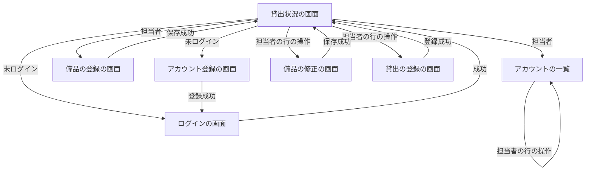
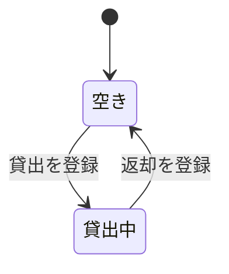

# 要件定義書: 備品台帳と貸出状況の閲覧

作成日: 2026-11-04（新規フロー）。確定は isdd-spec の承認段階で行う（ANSWERS.md の固定回答に従う）。

## 1. 目的・前提

### 目的

会社の備品の台帳と貸出の記録を 1 つのアプリにまとめ、記録の食い違いと消失をなくす。社員が「どの備品を誰が借りているか」を担当者に問い合わせずに自分で確かめられるようにする。

### システムの形態

GUI（ブラウザで開く画面のみ）。Web API とバッチは持たない。

### 用語集

| 用語 | 業務上の意味 | 本案件での使用範囲 | 同義語/類義語 |
|---|---|---|---|
| 社員 | 社内でアカウントを登録した人。借りる人になる | アカウントを持つ全員 | 利用者 |
| 担当者 | 備品の登録・修正・削除、貸出・返却、アカウントの管理を行う社員 | ロールの 1 つ | 管理者（使わない） |
| 未ログインの人 | アカウントでログインしていない人。貸出状況だけを見られる | 貸出状況の画面 | ゲスト |
| 備品 | 会社が貸し出す物品。管理番号で一意に識別する | 台帳の 1 件 | 物品 |
| 管理番号 | 備品を一意に識別する番号。半角の英数字とハイフンで 20 文字以内 | 備品の主キー | 備品番号 |
| 貸出 | 担当者が備品を社員に貸し出した記録。返却で記録を消す | 貸出中の備品 1 件につき 1 件 | 貸し出し |
| 空き | 貸出中の記録が無い備品の状態 | 貸出状況の表示 | 返却済み |
| 貸出中 | 貸出中の記録がある備品の状態 | 貸出状況の表示 | 貸出 |
| 社員番号 | 社員を一意に識別する 6 桁の数字 | アカウントの主キー | 社員 ID |

### 対象外（この段で作らないもの）

なし。依頼の文章の範囲をすべて対象にする（ANSWERS.md の「要件の除外: 無し」）。

## 1-1. 技術制約（前提として記録する。要件ではないため ID は付与しない）

| 制約項目 | 内容 | 出どころ（誰がいつ答えたか） |
|---|---|---|
| 既存コードベース | 無し（段 1 は新規。段 2・3 は段 1 のコードを引き継ぐ） | ANSWERS.md（isdd 群の固定回答） |
| 配備先 | 社内の Linux サーバー。社内ネットワークからだけ開く。コンテナは使わず、`bash run.sh` で直接起動できること（採点も直接起動） | REQUEST.md、contract.md |
| チームの技術 | 決まり無し。Python 3.12 と SQLite で足りること | ANSWERS.md、REQUEST.md |
| ライセンスとコスト | 無償のものだけ。外部のサービスは使わない | REQUEST.md、contract.md |
| 性能と規模の目安 | 利用者 50 人（社員と担当者の合計）、備品は数百件、アカウントは 50 件まで | REQUEST.md、ANSWERS.md |

## 2. 業務

### 対象業務一覧

| RQ-BZ-ID | 業務名 | 業務の範囲 | 担当者 |
|---|---|---|---|
| `RQ-BZ-EQUIPMENT-LEDGER` | 備品台帳の管理 | 備品の登録・修正・削除 | 担当者 |
| `RQ-BZ-EQUIPMENT-LENDING` | 備品の貸出・返却と貸出状況の確認 | 貸出・返却の登録、貸出状況の一覧 | 担当者（登録・返却）、社員と未ログインの人（確認） |
| `RQ-BZ-ACCOUNT-MANAGEMENT` | アカウントと担当者の管理 | アカウント登録、ログイン、社員の一覧、担当者の付け外し、パスワード再設定、アカウント削除 | 社員（登録・ログイン）、担当者（管理） |

### 業務フロー

### 2-1. 業務の問題（あるべき姿と現状のギャップ）

| 問題 | 対象業務（RQ-BZ） | あるべき姿 | 現状 | ギャップ（KPI） | 業務影響 |
|---|---|---|---|---|---|
| 備品と貸出の記録が複数の管理用 Excel に分かれている | `RQ-BZ-EQUIPMENT-LEDGER`、`RQ-BZ-EQUIPMENT-LENDING` | 記録が 1 つだけあり、誰が更新しても食い違わず失われない | 複数の人が別々の Excel を更新し、どれが最新か分からない。記録が食い違ったり消えたりしている | 不明（記録の食い違いと消失の件数は聞き取れていない。件数を作らない） | 記録の信頼性が低く、担当者が確認に時間を取られる |
| 社員が「どの備品を誰が借りているか」を担当者に問い合わせないと分からない | `RQ-BZ-EQUIPMENT-LENDING` | 社員が自分で貸出状況をすぐ確かめられる | 担当者が問い合わせに答えるため、1 回 15 分かけて調べている | 問い合わせへの対応 1 回 15 分（件数は不明） | 担当者の作業時間が取られ、借りたい人も待たされる |

### 2-2. 業務課題一覧（必須）

| RQ-BK-ID | 業務課題（取り組むこと） | 解決する問題（2-1） | 解決後の状態（KPI の目標値） | 対象業務（RQ-BZ） |
|---|---|---|---|---|
| `RQ-BK-SINGLE-RECORD` | 備品の台帳と貸出の記録を 1 つのアプリにまとめ、同時に更新されても記録が失われず食い違わないようにする | 備品と貸出の記録が複数の Excel に分かれている | 記録が 1 つだけになる（目標値は不明。聞き取れていない） | `RQ-BZ-EQUIPMENT-LEDGER`、`RQ-BZ-EQUIPMENT-LENDING` |
| `RQ-BK-ROLE-LIMITED-UPDATE` | 台帳の更新を担当者だけに限り、社員とログインしていない人は見るだけにする。社員はアカウントを自分で登録して使えるようにする | 複数の人が別々に記録を更新している | 更新できる人が担当者に限られる（目標値は不明） | `RQ-BZ-ACCOUNT-MANAGEMENT`、`RQ-BZ-EQUIPMENT-LEDGER` |
| `RQ-BK-SELF-SERVICE-STATUS` | 社員が「どの備品を誰が借りているか」を担当者に聞かずに、貸出状況の画面で自分で確かめられるようにする | 社員が担当者に問い合わせないと分からない | 問い合わせが無くなる（担当者 1 回 15 分の対応が無くなる） | `RQ-BZ-EQUIPMENT-LENDING`、`RQ-BZ-ACCOUNT-MANAGEMENT` |

### 2-3. 見込み経営効果

| RQ-EF-ID | 効果の種類 | 内容 | 見込み（金額・時間などと算定根拠） | 対応業務課題ID（RQ-BK-*） |
|---|---|---|---|---|
| `RQ-EF-SOFT-SAVING-INQUIRY` | Soft Saving | 担当者が「誰が借りているか」の問い合わせに答える作業が無くなる | 問い合わせ対応 1 回あたり 15 分の作業時間が無くなる。問い合わせの頻度が不明のため、月の合計は算定しない | `RQ-BK-SELF-SERVICE-STATUS` |

## 3. 機能要件

### 3-0. 入力データと出力データ

- 人手入力のみ（社員、担当者が画面のフォームから入力する）。外部連携は無い
- 出力データは画面の一覧と詳細の表示だけ

### 3-0-1. 利用者の流れ

### 3-0-2. 業務フローとの対応

| 業務フローの工程 | 対応する機能 |
|---|---|
| 社員がアカウントを登録 | `RQ-FT-REGISTER-ACCOUNT` |
| 担当者が備品を登録 | `RQ-FT-REGISTER-EQUIPMENT` |
| 担当者が貸出を登録 | `RQ-FT-LEND-EQUIPMENT` |
| 社員が貸出状況で確かめる | `RQ-FT-VIEW-LENDING-STATUS` |
| 担当者が返却を登録 | `RQ-FT-RETURN-EQUIPMENT` |

### 3-1. 機能一覧

| RQ-ID | カテゴリ | 機能名 | 対応業務課題ID（RQ-BK-*） | この機能が無いと何が困るか |
|---|---|---|---|---|
| `RQ-FT-REGISTER-ACCOUNT` | 共通（認証・認可・ログ） | アカウント登録 | `RQ-BK-ROLE-LIMITED-UPDATE`、`RQ-BK-SELF-SERVICE-STATUS` | 社員が自分のアカウントを持てず、借りる人を特定できない |
| `RQ-FT-LOGIN` | 共通（認証・認可・ログ） | ログイン | `RQ-BK-ROLE-LIMITED-UPDATE` | 担当者と社員を区別できず、担当者だけの操作を守れない |
| `RQ-FT-LOGOUT` | 共通（認証・認可・ログ） | ログアウト | `RQ-BK-ROLE-LIMITED-UPDATE` | 共用の端末に残ったログインで、他の人が操作できてしまう |
| `RQ-FT-IDLE-LOGOUT` | 共通（認証・認可・ログ） | 無操作での自動ログアウト（30 分） | `RQ-BK-ROLE-LIMITED-UPDATE` | 離席中の端末から担当者の操作が行われる |
| `RQ-FT-ROLE-CHECK` | 共通（認証・認可・ログ） | ロールごとの操作の出し分けと要求の拒否 | `RQ-BK-ROLE-LIMITED-UPDATE` | ボタンを隠しても、直接の要求で更新されてしまう |
| `RQ-FT-REGISTER-EQUIPMENT` | マスタ管理 | 備品の登録 | `RQ-BK-SINGLE-RECORD` | 台帳に備品を載せられず、貸出を記録できない |
| `RQ-FT-EDIT-EQUIPMENT` | マスタ管理 | 備品の修正 | `RQ-BK-SINGLE-RECORD` | 誤った管理番号や備品名を直せず、記録が食い違う |
| `RQ-FT-DELETE-EQUIPMENT` | マスタ管理 | 備品の削除 | `RQ-BK-SINGLE-RECORD` | 廃止した備品が台帳に残り続ける |
| `RQ-FT-LIST-ACCOUNTS` | マスタ管理 | アカウントの一覧 | `RQ-BK-ROLE-LIMITED-UPDATE` | 担当者が社員と担当者の一覧を確認できず、付け外しや再設定ができない |
| `RQ-FT-GRANT-MANAGER` | マスタ管理 | 担当者の付け外し | `RQ-BK-ROLE-LIMITED-UPDATE` | 担当者が増やせず、担当者の交代ができない |
| `RQ-FT-RESET-PASSWORD` | マスタ管理 | パスワードの再設定（担当者による） | `RQ-BK-ROLE-LIMITED-UPDATE` | パスワードを忘れた社員が、アカウントを使えなくなる |
| `RQ-FT-DELETE-ACCOUNT` | マスタ管理 | アカウントの削除 | `RQ-BK-ROLE-LIMITED-UPDATE` | 退職者のアカウントが残り続ける |
| `RQ-FT-LEND-EQUIPMENT` | 業務機能 | 貸出の登録 | `RQ-BK-SINGLE-RECORD` | 誰が借りているかが記録されず、貸出状況に答えられない |
| `RQ-FT-RETURN-EQUIPMENT` | 業務機能 | 返却の登録 | `RQ-BK-SINGLE-RECORD` | 返却された備品が貸出中のまま残り、空きが分からない |
| `RQ-FT-VIEW-LENDING-STATUS` | 業務機能 | 貸出状況の一覧 | `RQ-BK-SELF-SERVICE-STATUS` | 社員が担当者に聞かずに、誰が借りているか確かめられない |

### 3-2. 業務ルール

| RQ-ID | ルール名 | 内容（条件と結果） | 違反時・エラー時の業務上の扱い | 対応業務課題ID（RQ-BK-*） |
|---|---|---|---|---|
| `RQ-FT-RULE-FIRST-ACCOUNT-MANAGER` | 最初の担当者 | アカウントが 1 件も無いときに登録した人は担当者になる。2 件目以降に登録した人は社員になる | 登録の判定は同時に登録されても 1 件目だけを担当者にする | `RQ-BK-ROLE-LIMITED-UPDATE` |
| `RQ-FT-RULE-KEEP-ONE-MANAGER` | 担当者 1 人以上 | 担当者が 1 人もいなくなる操作（担当者から外す、担当者のアカウントを削除する）はできない | 「担当者が 1 人もいなくなるため、この操作はできません」を表示し、変えない | `RQ-BK-ROLE-LIMITED-UPDATE` |
| `RQ-FT-RULE-UNIQUE-EMPLOYEE-NUMBER` | 社員番号の重複禁止 | 社員番号は同じものを 2 件登録できない | 「この社員番号は既に登録されています」を入力欄に表示する | `RQ-BK-ROLE-LIMITED-UPDATE` |
| `RQ-FT-RULE-UNIQUE-EQUIPMENT-NUMBER` | 管理番号の重複禁止 | 管理番号は同じものを 2 件登録できない | 「この管理番号は既に使われています」を入力欄に表示する | `RQ-BK-SINGLE-RECORD` |
| `RQ-FT-RULE-NO-DELETE-LENT-EQUIPMENT` | 貸出中の備品は削除できない | 貸出中の記録がある備品は削除できない | 「この備品は貸出中のため削除できません。先に返却を処理してください」を表示し、削除しない | `RQ-BK-SINGLE-RECORD` |
| `RQ-FT-RULE-NO-LEND-LENT-EQUIPMENT` | 貸出中の備品は貸し出せない | 貸出中の備品に、もう一度貸出を登録できない | 「この備品は既に貸出中です」を表示し、記録を変えない | `RQ-BK-SINGLE-RECORD` |
| `RQ-FT-RULE-NO-RETURN-RETURNED` | 返却済みの備品は返却できない | 貸出中の記録が無い備品に返却を登録できない | 「この備品は既に返却されています」を表示し、記録を変えない | `RQ-BK-SINGLE-RECORD` |
| `RQ-FT-RULE-NO-FUTURE-LENT-ON` | 未来の貸出日は禁止 | 貸出日は今日（日本時間）以前の日付だけ入力できる | 「貸出日に未来の日付は入力できません」を入力欄に表示する | `RQ-BK-SINGLE-RECORD` |
| `RQ-FT-RULE-REQUIRE-BORROWER` | 借りる社員は必須 | 貸出の登録では借りる社員を選ぶ | 「借りる社員を選んでください」を入力欄に表示する | `RQ-BK-SINGLE-RECORD` |
| `RQ-FT-RULE-NO-DELETE-BORROWING-ACCOUNT` | 借りている社員は削除できない | 貸出中の備品を借りている社員のアカウントは削除できない | 「この社員は備品を借りているため削除できません。先に返却を処理してください」を表示し、削除しない | `RQ-BK-ROLE-LIMITED-UPDATE` |
| `RQ-FT-RULE-CONCURRENT-UPDATE` | 他の担当者が先に更新・削除した備品 | 修正・削除・貸出・返却の画面を開いた後に、他の担当者が同じ備品を更新または削除していたら、その操作は行わない | 「他の担当者が先にこの備品を更新しました。貸出状況の画面から開き直してください」を画面全体のエラーに表示する | `RQ-BK-SINGLE-RECORD` |
| `RQ-FT-RULE-KEEP-LOAN-ON-EDIT` | 修正しても貸出を引き継ぐ | 貸出中の備品の管理番号を修正したとき、貸出の記録は新しい管理番号の備品へそのまま引き継ぐ。貸出日と借りている社員は変わらない | 拒否する場面は無い（修正は通常どおり保存する）。貸出の記録が消えたり食い違ったりしないことを確かめる | `RQ-BK-SINGLE-RECORD` |

### 3-3. 外部連携

外部連携は無い。

### 3-4. 画面の仕様（システムの形態が GUI のため、画面ごと）

画面の一覧は 4-5 に書く。画面ごとの 5 項目は次のとおり。

| 画面（RQ-UI-ID） | 画面の目的 | 主要要素 | 入力項目 | 表示項目 | エラー時の見え方 |
|---|---|---|---|---|---|
| `RQ-UI-LENDING-STATUS-SCREEN` | 誰でも備品の貸出状況を見られる | 貸出状況の表、未ログインなら「ログイン」「アカウント登録」のリンク、ログイン中なら名前と「ログアウト」ボタン、担当者なら「アカウントの一覧」リンクと行ごとの「修正」「削除」「貸出」「返却」ボタン、担当者には「備品を登録」リンク | なし | 管理番号、備品名、空きか貸出中か、借りている社員の名前、貸出日（管理番号の昇順） | 担当者以外の操作の要求は、この画面に「この操作は担当者だけが行えます」を `.message` に表示する |
| `RQ-UI-ACCOUNT-REGISTER-SCREEN` | 社員が自分のアカウントを登録する | 「登録」ボタン | 社員番号、名前、パスワード | なし | 入力欄ごとのエラーを入力欄の下の `.field-error` に表示し、入力した値は消さない |
| `RQ-UI-LOGIN-SCREEN` | 社員番号とパスワードでログインする | 「ログイン」ボタン | 社員番号、パスワード | なし | 社員番号かパスワードの違いを示さず、「社員番号またはパスワードが違います」を `.error` に表示する |
| `RQ-UI-EQUIPMENT-NEW-SCREEN` | 担当者が備品を登録する | 「保存」ボタン | 管理番号、備品名 | なし | 入力欄ごとのエラーを `.field-error` に表示し、入力した値は消さない。管理番号の重複は入力欄のエラー |
| `RQ-UI-EQUIPMENT-EDIT-SCREEN` | 担当者が備品を修正する（修正の画面は備品の登録の画面と同じ部品を使う） | 「保存」ボタン | 管理番号、備品名（現在の値が入る） | なし | 同上。他の担当者が先に更新していた場合は `.error` に表示する |
| `RQ-UI-LEND-SCREEN` | 担当者が備品の貸出を登録する | `.lending-equipment` に「備品: 管理番号 備品名」、「登録」ボタン | 借りる社員（選択）、貸出日（既定は今日の日付） | 備品の情報 | 入力欄ごとのエラーを `.field-error` に表示し、状況のエラーは `.message` か `.error` に表示する |
| `RQ-UI-ACCOUNT-LIST-SCREEN` | 担当者がアカウントの一覧を見て、担当者の付け外し、パスワードの再設定、削除をする | 行ごとの「担当者にする」「担当者から外す」「パスワード再設定」「削除」ボタン、再設定の「確定」ボタン | 再設定の新しいパスワード | 社員番号、名前、役割（担当者か社員） | 操作の失敗は `.message` か `.error` に表示する |

### 3-5. 操作の確認（削除・返却・担当者の付け外し・アカウントの削除）

削除、返却、担当者の付け外し、アカウントの削除は、ブラウザの確認ダイアログで「はい」を押したときだけ行う。

## 4. データ

### 4-1. データ要件一覧

| RQ-ID | 種別 | 内容 | 対応業務課題ID（RQ-BK-*） | この要件が無いと何が困るか |
|---|---|---|---|---|
| `RQ-DT-INTERNAL-ONLY` | 内部データ | 扱うデータは備品、貸出、アカウントの 3 つだけで、すべて内部データ。外部の DB は無い | `RQ-BK-SINGLE-RECORD` | 記録の出所が分からなくなる |
| `RQ-DT-NO-HISTORY` | データ保持期間 | 返却した貸出の記録、削除した備品とアカウントの記録は残さない（貸出中の記録だけを持つ） | `RQ-BK-SINGLE-RECORD` | 残す前提にすると、削除の記録まで保持する仕組みが要り、依頼にない機能になる |
| `RQ-DT-DATABASE-REQUIRED` | DB の必要性 | DB を使う（SQLite）。理由は、複数の担当者が同時に更新しても記録を失わないため。初期件数は 0 件、備品は数百件まで、アカウントは 50 件まで。1 年後の想定件数は、備品の増加率が不明のため「数百件を超えない」とする。参照は貸出から備品とアカウントへの参照だけ。検索と集計は貸出状況の一覧だけ | `RQ-BK-SINGLE-RECORD` | ファイルに書くと同時更新で記録が失われる |

### 4-2. 業務エンティティとデータ項目

| RQ-ID | カテゴリ | 業務エンティティ名 | 対応業務課題ID（RQ-BK-*） | この業務エンティティが無いと何が困るか |
|---|---|---|---|---|
| `RQ-DT-ACCOUNT` | 業務 | アカウント | `RQ-BK-ROLE-LIMITED-UPDATE`、`RQ-BK-SELF-SERVICE-STATUS` | 誰が担当者で誰が社員かが分からず、ログインもできない |
| `RQ-DT-EQUIPMENT` | 業務 | 備品 | `RQ-BK-SINGLE-RECORD` | 台帳が無く、備品を管理できない |
| `RQ-DT-LENDING` | 業務 | 貸出 | `RQ-BK-SINGLE-RECORD`、`RQ-BK-SELF-SERVICE-STATUS` | 誰がいつ借りたかが残らず、貸出状況に答えられない |

#### エンティティごとのデータ項目

| エンティティ名 | 項目名 | 業務上の意味 | 必須 | 形式・桁 | 値の範囲・制約 | 例 |
|---|---|---|---|---|---|---|
| アカウント | 社員番号 | 社員を識別する番号 | 必須 | 半角数字 6 桁 | 重複不可 | 100001 |
| アカウント | 名前 | 社員の名前 | 必須 | 文字列 | 1 文字以上 30 文字以内（前後の空白は除く） | 山田 太郎 |
| アカウント | パスワード | ログインに使う合言葉 | 必須 | 文字列 | 8 文字以上。保存は一方向のハッシュにする | ********（画面に出さない） |
| アカウント | 役割 | 担当者か社員か | 必須 | 「担当者」か「社員」 | 初期は最初の登録者が担当者、以降は社員 | 担当者 |
| 備品 | 管理番号 | 備品を識別する番号 | 必須 | 半角の英数字とハイフン 20 文字以内 | 重複不可 | EQ-0001 |
| 備品 | 備品名 | 備品の名前 | 必須 | 文字列 | 50 文字以内 | ノートPC |
| 貸出 | 管理番号 | 貸し出した備品 | 必須 | 備品の管理番号 | 1 つの備品に貸出中の記録は 1 件だけ | EQ-0001 |
| 貸出 | 借りる社員の社員番号 | 借りている社員 | 必須 | アカウントの社員番号 | 登録されたアカウントの社員番号だけ | 100001 |
| 貸出 | 貸出日 | 貸し出した日 | 必須 | 日付 YYYY-MM-DD | 今日（日本時間）以前 | 2026-11-04 |

### 4-3. CRUD テーブル（必須）

| エンティティ名 | Create | Read（一覧） | Read（詳細） | 検索 | Update | Delete | 備考 |
|---|---|---|---|---|---|---|---|
| アカウント | ○ | ○ | △ | × | △ | ○ | 一覧は担当者だけ。Create は社員が自分で行う。Update は担当者の付け外し（役割）とパスワードの再設定。Delete は担当者が行い、貸出中の社員は削除できない（トランザクションと排他制御が要る）。Read（詳細）は行の情報に含まれるため、別の画面は作らない |
| 備品 | ○ | ○（貸出状況の画面） | △ | × | ○ | ○ | 一覧は誰でも見られる。Update と Delete は同時更新の確認が要る（他の担当者の更新を検出）。Delete は貸出中なら拒否する（トランザクションが要る）。Read（詳細）は修正の画面で行う。検索は無い |
| 貸出 | ○ | ○（貸出状況の画面） | × | × | × | ○ | 貸出の登録は備品の状態を変えるため、トランザクションと排他制御が要る（同じ備品に 2 件の貸出を作らない）。返却は貸出の記録を消す（Delete）。貸出の修正は無い |

| 値 | 意味 |
|---|---|
| ○ | 必須の操作 |
| △ | 条件付きで必要な操作 |
| × | 対象外の操作 |

### 4-4. 状態遷移

状態を持つエンティティは、備品の貸出状態（空き・貸出中）。

| RQ-ID | エンティティ名 | 遷移前の状態 | きっかけ（操作・条件） | 遷移後の状態 | 対応業務課題ID（RQ-BK-*） |
|---|---|---|---|---|---|
| `RQ-DT-LEND-TRANSITION` | 備品（貸出状態） | 空き | 担当者が貸出を登録する（借りる社員と貸出日を入力） | 貸出中 | `RQ-BK-SINGLE-RECORD` |
| `RQ-DT-RETURN-TRANSITION` | 備品（貸出状態） | 貸出中 | 担当者が返却を登録する（確認ダイアログで「はい」） | 空き | `RQ-BK-SINGLE-RECORD` |

許されない遷移（貸出中の備品の貸出、空きの備品の返却）は、業務ルール（3-2）のエラーで扱う。

### 4-5. 画面一覧（GUI の場合のみ）

| RQ-ID | 画面名 | 対応する CRUD 操作（エンティティ名:操作種別） | 主な機能・目的 | 対応業務課題ID（RQ-BK-*） |
|---|---|---|---|---|
| `RQ-UI-LENDING-STATUS-SCREEN` | 貸出状況（トップ） | 備品:Read（一覧）、貸出:Read（一覧）、貸出:Delete（返却）、貸出:Create（貸出）、備品:Delete（削除）、備品:Update（修正） | 誰でも貸出状況を見る。担当者は行の操作ボタンで備品の操作を行う | `RQ-BK-SELF-SERVICE-STATUS`、`RQ-BK-SINGLE-RECORD` |
| `RQ-UI-ACCOUNT-REGISTER-SCREEN` | アカウント登録 | アカウント:Create | 社員が自分のアカウントを登録する | `RQ-BK-ROLE-LIMITED-UPDATE`、`RQ-BK-SELF-SERVICE-STATUS` |
| `RQ-UI-LOGIN-SCREEN` | ログイン | アカウント:Read（詳細）（ログインの確認） | 社員番号とパスワードでログイン・ログアウトする | `RQ-BK-ROLE-LIMITED-UPDATE` |
| `RQ-UI-EQUIPMENT-NEW-SCREEN` | 備品の登録 | 備品:Create | 担当者が備品を登録する | `RQ-BK-SINGLE-RECORD` |
| `RQ-UI-EQUIPMENT-EDIT-SCREEN` | 備品の修正 | 備品:Read（詳細）、備品:Update | 担当者が備品を修正する | `RQ-BK-SINGLE-RECORD` |
| `RQ-UI-LEND-SCREEN` | 貸出の登録 | 貸出:Create | 担当者が備品を社員に貸し出す | `RQ-BK-SINGLE-RECORD` |
| `RQ-UI-ACCOUNT-LIST-SCREEN` | アカウントの一覧 | アカウント:Read（一覧）、アカウント:Update（役割・パスワード）、アカウント:Delete | 担当者がアカウントを管理する | `RQ-BK-ROLE-LIMITED-UPDATE` |

## 5. 非機能要件

| RQ-ID | カテゴリ | 非機能要件名 | 対応業務課題ID（RQ-BK-*） | この非機能要件が無いと何が困るか |
|---|---|---|---|---|
| `RQ-NF-ACCESS-INTERNAL-ONLY` | 利用者とアクセス経路 | 利用者は社員と担当者（合計 50 人まで）。社内のネットワークからだけ開く。インターネットには公開しない | `RQ-BK-SELF-SERVICE-STATUS` | 社外から台帳の内容が見えてしまう |
| `RQ-NF-RESPONSE-3S` | 性能 | 同時に 50 人が開いても、操作から表示まで 3 秒以内に応答する | `RQ-BK-SELF-SERVICE-STATUS` | 一覧の表示に時間がかかり、問い合わせの代わりにならない |
| `RQ-NF-CONCURRENT-USERS-50` | 利用人数 | 同時接続は 50 人まで。備品は数百件まで、アカウントは 50 件まで | `RQ-BK-SINGLE-RECORD` | 想定外の規模で動かなくなる |
| `RQ-NF-AVAILABILITY-WEEKDAY-DAYTIME` | 可用性 | 平日の日中に使う。夜間・休日は止まってよい。障害からの復旧目標は特に定めない（夜間・休日は次の稼働時に復旧すればよい） | `RQ-BK-SINGLE-RECORD` | 夜間の再起動まで止まることが問題になる（業務上は問題にならない） |
| `RQ-NF-AUTH-EMPLOYEE-NUMBER-PASSWORD` | セキュリティ | 認証は社員番号とパスワード（SSO は使わない）。30 分の無操作で自動ログアウトする | `RQ-BK-ROLE-LIMITED-UPDATE` | 誰でも担当者の操作ができてしまう |
| `RQ-NF-PASSWORD-HASHED` | セキュリティ | パスワードは一方向のハッシュで保存し、平文を保存しない・画面に出さない | `RQ-BK-ROLE-LIMITED-UPDATE` | データファイルが漏れたときにパスワードが読まれる |
| `RQ-NF-MIGRATION-MANUAL` | 移行性 | 既存の Excel の内容は、担当者が画面から手で入力する。取り込み機能は作らない | `RQ-BK-SINGLE-RECORD` | 移行の手段が無く、台帳を最初から作れない（件数は数百件程度） |
| `RQ-NF-LICENSE-FREE` | ライセンスとコスト | 無償のソフトウェアだけを使う | `RQ-BK-SINGLE-RECORD` | 有償の契約が必要になり、導入できない |

## 6. 運用要件

| RQ-ID | 種別 | 内容 | 対応業務課題ID（RQ-BK-*） | この要件が無いと何が困るか |
|---|---|---|---|---|
| `RQ-OP-STARTUP` | 起動 | `bash setup.sh` で準備し、`bash run.sh` で起動する。待ち受けポートは環境変数 `PORT`（既定 8000）、データの置き場所は `DATA_DIR`、自動ログアウトまでの秒数は `SESSION_IDLE_TIMEOUT_SECONDS`（既定 1800） | `RQ-BK-SINGLE-RECORD` | 起動の方法が分からず、採点も運用もできない |
| `RQ-OP-INITIAL-MANAGER` | 導入手順 | 社員に URL を知らせる前に、担当者が最初のアカウントを登録する | `RQ-BK-ROLE-LIMITED-UPDATE` | 最初の担当者がいないと、備品の登録ができない |

- ログ: ログは必要ないため、ログの内容と保存期間の記述は行わない。
- 監査ログ: 監査ログは無い（本番の要件として要らない）。
- 監視・アラート: 監視・アラートは必要ないため、監視・アラートの内容と対応方法の記述は行わない。
- バックアップと復旧: バックアップは必要ない。

## 7. テスト用利用シナリオ

| RQ-ID | テスト目的 | 前提条件 | テスト手順 | 期待される結果 | 検証する要件ID | 対応業務課題ID（RQ-BK-*） |
|---|---|---|---|---|---|---|
| `RQ-TS-REGISTER-FIRST-MANAGER` | 最初の登録者が担当者になり、2 件目が社員になる | DATA_DIR が空 | 1. 貸出状況の画面を開く。2. アカウント登録で 100001 を登録する。3. アカウント登録で 100002 を登録する。4. アカウントの一覧は担当者だけが見られることを確かめる | 100001 は「担当者」、100002 は「社員」。登録後はログイン画面に「登録しました。ログインしてください」が出る | `RQ-FT-REGISTER-ACCOUNT`、`RQ-FT-RULE-FIRST-ACCOUNT-MANAGER`、`RQ-UI-ACCOUNT-REGISTER-SCREEN`、`RQ-UI-LOGIN-SCREEN` | `RQ-BK-ROLE-LIMITED-UPDATE` |
| `RQ-TS-REGISTER-ACCOUNT-VALIDATION` | アカウント登録の入力チェック | 空の DATA_DIR | 社員番号 12345、名前が空、名前 31 文字、パスワード 7 文字、社員番号の重複をそれぞれ入力して登録する | 入力欄ごとに `.field-error` の完全一致の文言が出て、入力した値は消えない。重複は「この社員番号は既に登録されています」 | `RQ-FT-REGISTER-ACCOUNT`、`RQ-FT-RULE-UNIQUE-EMPLOYEE-NUMBER`、`RQ-UI-ACCOUNT-REGISTER-SCREEN` | `RQ-BK-ROLE-LIMITED-UPDATE` |
| `RQ-TS-LOGIN-LOGOUT` | ログインとログアウト、失敗時の表示 | 担当者が登録済み | 誤った社員番号、誤ったパスワードでログインし、それぞれ同じ文言を確かめる。正しく入ってログインの名前を確かめ、ログアウトする | 失敗時は「社員番号またはパスワードが違います」を `.error` に出す。成功時は `.current-user` に名前が出る。ログアウト後は表示が未ログインに戻る | `RQ-FT-LOGIN`、`RQ-FT-LOGOUT`、`RQ-UI-LOGIN-SCREEN`、`RQ-FT-ROLE-CHECK` | `RQ-BK-ROLE-LIMITED-UPDATE` |
| `RQ-TS-IDLE-LOGOUT` | 無操作での自動ログアウト | SESSION_IDLE_TIMEOUT_SECONDS を短い秒数にして起動する | ログインし、その秒数より長く操作しない。その後、担当者の操作を要求する | 自動でログアウトしており、要求は拒否されてログインの画面に移る | `RQ-FT-IDLE-LOGOUT`、`RQ-NF-AUTH-EMPLOYEE-NUMBER-PASSWORD` | `RQ-BK-ROLE-LIMITED-UPDATE` |
| `RQ-TS-ROLE-CHECK` | 社員と未ログインの人に操作の出し分けと要求の拒否を確かめる | 担当者と社員が登録済み | 未ログインと社員で、貸出状況の画面に修正・削除・貸出・返却のボタンと「備品を登録」「アカウントの一覧」のリンクが無いことを確かめる。備品の登録の画面、アカウントの一覧に直接アクセスし、POST で備品の登録を要求する。最後に担当者でログインし、貸出状況にリンク「備品を登録」が 1 件出ることを確かめる | 出し分けが正しい。直接の要求は拒否され、「この操作は担当者だけが行えます」が `.message` に出る（未ログインはログイン画面に移る） | `RQ-FT-ROLE-CHECK`、`RQ-UI-LENDING-STATUS-SCREEN`、`RQ-UI-EQUIPMENT-NEW-SCREEN`、`RQ-UI-ACCOUNT-LIST-SCREEN` | `RQ-BK-ROLE-LIMITED-UPDATE` |
| `RQ-TS-REGISTER-EQUIPMENT` | 備品の登録と入力チェック | 担当者でログイン済み | 管理番号 EQ-0001 と備品名 ノートPC を登録する。形式違い（日本語・21 文字）、備品名 51 文字、管理番号の重複をそれぞれ入力する | 登録後は貸出状況に「空き」で出る。入力エラーは `.field-error` に完全一致の文言で出る | `RQ-FT-REGISTER-EQUIPMENT`、`RQ-FT-RULE-UNIQUE-EQUIPMENT-NUMBER`、`RQ-UI-EQUIPMENT-NEW-SCREEN` | `RQ-BK-SINGLE-RECORD` |
| `RQ-TS-EDIT-EQUIPMENT` | 備品の修正と同時更新の検出 | 備品が 1 件登録済み。担当者が 2 人いる | 担当者 A が修正の画面を開く。担当者 B が同じ備品を先に修正して保存する。担当者 A が保存する | 担当者 A の保存は行われず、`.error` に「他の担当者が先にこの備品を更新しました。貸出状況の画面から開き直してください」が出る | `RQ-FT-EDIT-EQUIPMENT`、`RQ-FT-RULE-CONCURRENT-UPDATE`、`RQ-UI-EQUIPMENT-EDIT-SCREEN` | `RQ-BK-SINGLE-RECORD` |
| `RQ-TS-EDIT-KEEPS-LOAN` | 貸出中の備品を修正して管理番号を変えても、貸出が引き継がれる | 担当者でログイン済み。備品 EQ-1 を社員 100002 に貸出中 | 1. 備品 EQ-1 の修正の画面で管理番号を EQ-2 に変えて保存する。2. 貸出状況の画面を見る | 保存は成功し「備品を更新しました」が出る。EQ-2 の行が「貸出中」で、借りている社員の名前と貸出日が残る。EQ-1 の行は無い | `RQ-FT-RULE-KEEP-LOAN-ON-EDIT`、`RQ-FT-EDIT-EQUIPMENT` | `RQ-BK-SINGLE-RECORD` |
| `RQ-TS-DELETE-EQUIPMENT` | 備品の削除と、貸出中の備品の削除禁止 | 備品が 2 件、うち 1 件を貸出中 | 貸出中の備品の削除を確認ダイアログで「はい」にする。空きの備品を削除する（確認ダイアログで「はい」） | 貸出中の削除は「この備品は貸出中のため削除できません。先に返却を処理してください」が出て削除されない。空きの備品は一覧から消える | `RQ-FT-DELETE-EQUIPMENT`、`RQ-FT-RULE-NO-DELETE-LENT-EQUIPMENT` | `RQ-BK-SINGLE-RECORD` |
| `RQ-TS-LEND-RETURN` | 貸出と返却、貸出中・返却済みの禁止、未来の貸出日の禁止 | 備品 1 件（空き）、社員 1 人 | 貸出の画面で借りる社員を選ばずに登録する。未来の貸出日で登録する。正しく登録する。同じ備品にもう一度貸出を登録する。返却を登録する。返却済みの備品に返却を登録する | 未選択は「借りる社員を選んでください」、未来日は「貸出日に未来の日付は入力できません」。貸出後は貸出中、借りている社員の名前と貸出日が出る。貸出中の再登録は「この備品は既に貸出中です」。返却後は空き。返却済みの再返却は「この備品は既に返却されています」 | `RQ-FT-LEND-EQUIPMENT`、`RQ-FT-RETURN-EQUIPMENT`、`RQ-FT-RULE-REQUIRE-BORROWER`、`RQ-FT-RULE-NO-FUTURE-LENT-ON`、`RQ-FT-RULE-NO-LEND-LENT-EQUIPMENT`、`RQ-FT-RULE-NO-RETURN-RETURNED`、`RQ-UI-LEND-SCREEN`、`RQ-DT-LEND-TRANSITION`、`RQ-DT-RETURN-TRANSITION` | `RQ-BK-SINGLE-RECORD` |
| `RQ-TS-VIEW-LENDING-STATUS` | 未ログインの人も貸出状況を見られ、管理番号の昇順で並ぶ | 備品が 3 件（管理番号の順に登録しない）、1 件を貸出中 | 未ログインで貸出状況の画面を開く。備品が 0 件のときの表示も確かめる | 管理番号の昇順、各行に管理番号、備品名、空きか貸出中か、借りている社員の名前、貸出日が出る。0 件は「備品は登録されていません」 | `RQ-FT-VIEW-LENDING-STATUS`、`RQ-UI-LENDING-STATUS-SCREEN` | `RQ-BK-SELF-SERVICE-STATUS` |
| `RQ-TS-ACCOUNT-LIST-MANAGE` | 担当者の付け外し、パスワードの再設定、アカウントの削除 | 担当者 1 人（100001）、社員 1 人（100002） | 社員 100002 を「担当者にする」（確認で「はい」）。100001 を「担当者から外す」。担当者が 1 人のとき、担当者を外す。パスワード再設定で 7 文字を入力し確定、8 文字以上で確定。社員 100002 のアカウントを削除する（貸出中ならその前に貸出を登録しておく） | 担当者 1 人を外す操作は「担当者が 1 人もいなくなるため、この操作はできません」。再設定は 7 文字で「パスワードは 8 文字以上で入力してください」、8 文字で成功。貸出中の社員の削除は「この社員は備品を借りているため削除できません。先に返却を処理してください」 | `RQ-FT-LIST-ACCOUNTS`、`RQ-FT-GRANT-MANAGER`、`RQ-FT-RESET-PASSWORD`、`RQ-FT-DELETE-ACCOUNT`、`RQ-FT-RULE-KEEP-ONE-MANAGER`、`RQ-FT-RULE-NO-DELETE-BORROWING-ACCOUNT`、`RQ-UI-ACCOUNT-LIST-SCREEN`、`RQ-NF-PASSWORD-HASHED` | `RQ-BK-ROLE-LIMITED-UPDATE` |
| `RQ-TS-PERFORMANCE-50-USERS` | 同時に 50 人が開いても 3 秒以内に表示される | 備品 500 件、アカウント 50 件 | 50 件の同時接続で貸出状況の画面を開き、表示までの時間を測る | 各表示が 3 秒以内 | `RQ-NF-RESPONSE-3S`、`RQ-NF-CONCURRENT-USERS-50` | `RQ-BK-SELF-SERVICE-STATUS` |

## 8. 要件の整理

### 業務課題と要件の対応

| 業務課題（RQ-BK） | 対応する要件（主なもの） |
|---|---|
| `RQ-BK-SINGLE-RECORD` | 備品の登録・修正・削除、貸出・返却、業務ルール、データ（`RQ-DT-*`）、非機能の規模 |
| `RQ-BK-ROLE-LIMITED-UPDATE` | アカウント登録、ログイン・ログアウト、無操作の自動ログアウト、出し分けと拒否、アカウントの管理 |
| `RQ-BK-SELF-SERVICE-STATUS` | 貸出状況の一覧、アカウント登録（社員が自分で） |
